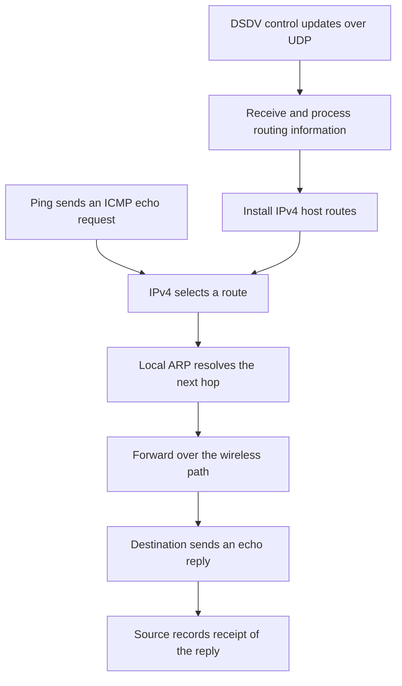
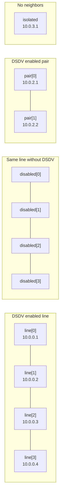
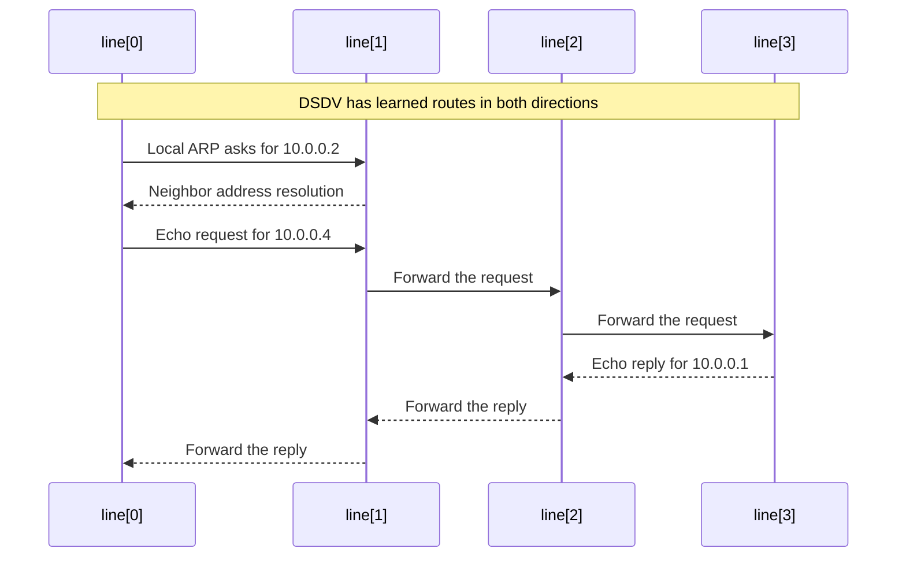
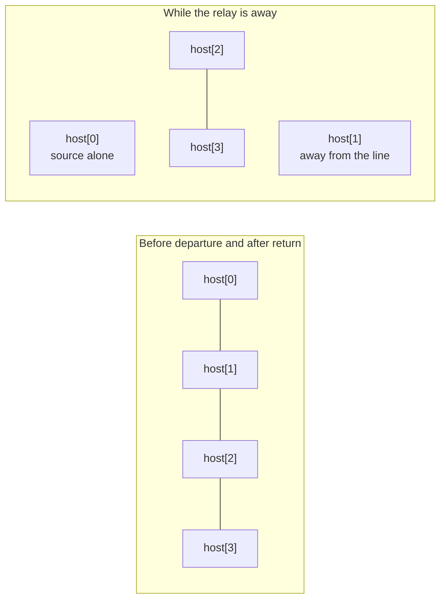

# DSDV protocol tests

> **Kind:** reference · **Status:** current · **Seal:** none · **Owns:** — · **Stands on:** [forwarding test](../../../../../tests/protocol/dsdv/DsdvForwarding.test), [mobile test](../../../../../tests/protocol/dsdv/DsdvMobile.test), [mobile example configuration](../../../../../examples/dsdv/omnetpp.ini)

The two DSDV protocol tests check whether routes learned through real control traffic can carry application packets. One checks a fixed topology in detail. The other moves a relay away and back, then checks that delivery stops and recovers. Together they connect DSDV's routing decisions to observable IPv4 forwarding.

| Test | Main question | Required result |
| --- | --- | --- |
| [DsdvForwarding.test](../../../../../tests/protocol/dsdv/DsdvForwarding.test) | Does DSDV install and use the correct routes? | Echo replies arrive over a four-node line and a direct pair, both intermediate nodes see the line's requests, and the routing-disabled control receives no replies. |
| [DsdvMobile.test](../../../../../tests/protocol/dsdv/DsdvMobile.test) | Can delivery recover after a relay leaves and returns? | Replies arrive before departure and after return, with none in the checked partition window. |

These are deterministic correctness scenarios with seed 0. They do not measure throughput, packet-delivery ratio or average convergence time. The [results record](results.md) owns executed results; this guide explains the fixtures and assertions.

## What the packets exercise

DSDV periodically sends routing information over UDP. Each node uses accepted information to install IPv4 host routes: a destination address, a next hop and a hop count. Ping sends ICMP echo requests using those routes; a successful echo reply requires a working return path as well.



The fixtures assign static addresses but disable configurator-generated static, default and subnet routes. They also clear `netmaskRoutes`, so sharing a `/24` address prefix does not supply a connected route that bypasses DSDV. Ordinary local ARP resolves the selected neighbor; global ARP does not supply address resolution across the whole topology.

Both fixtures use `AckingWirelessInterface`, `GenericUnitDiskRadio` and a 110 m communication range. Neighboring nodes start 100 m apart. Nodes two positions apart are 200 m apart and cannot communicate directly. These simplified wireless links keep the focus on routing; the tests do not exercise IEEE 802.11 channel access or PHY behavior.

## The fixed forwarding test

### Four independent groups

`DsdvForwarding.test` creates four groups in one network. Their separation keeps the groups out of each other's communication range.



The lines represent radio reachability, not configured IPv4 routes. The disabled line has the same spacing and wireless settings as the enabled line, but a `UdpSink` replaces its DSDV application. This supplies a control: physical connectivity alone must not make multihop delivery succeed.

The simulation lasts 10 s. Ping starts at 6 s and sends every 500 ms, leaving time for routing information to propagate first. The enabled line pings from `line[0]` to `line[3]`; the pair pings from `pair[0]` to `pair[1]`; the disabled line tries the corresponding three-hop destination.

### Follow one request

For destination `10.0.0.4`, the source must select `10.0.0.2` as its next hop. Its ARP request must therefore ask for the neighbor's address, even though the IPv4 packet is addressed to the far end of the line.



This figure shows the intended exchange. The observer checks the source's ARP target, receipt of destination-bound ICMP packets at both intermediate IPv4 modules, and echo replies at the source. It does not capture and compare every packet in this sequence.

### What must be true at the end

The C++ observer subscribes to control-update, ping-receipt, lower-layer packet-receipt and ARP-request signals. Its assertions combine evidence from traffic and routing tables:

| Observation | Assertion | Why it matters |
| --- | --- | --- |
| Accepted control updates | At least one `updateAccepted` signal across the network | The routing-control path was active. This is an aggregate count, not a per-node assertion. |
| Enabled line | At least one reply at `line[0]` | The three-hop path can carry requests and replies. |
| Enabled pair | At least one reply at `pair[0]` | Direct-neighbor delivery works too. |
| Disabled line | Zero replies at `disabled[0]`, and no route there to `10.0.1.4` | The control cannot obtain a working path from the surrounding configuration. |
| Intermediate forwarding | Both `line[1]` and `line[2]` receive IPv4 ICMP traffic addressed to `10.0.0.4` | The observed traffic actually traverses both intermediate nodes. |
| Source ARP | At least one request from `line[0]`, with every observed request targeting `10.0.0.2` | Address resolution follows the next hop rather than the remote destination. |
| Routes in the enabled line | Every ordered source/destination pair has the expected DSDV-owned `/32` MANET route, metric and next hop | All 12 non-self routes have the correct final forwarding state. |
| Isolated node | No route in its table is owned by its DSDV application | A node without neighbors does not install a learned DSDV route. |

For the route-table assertions, the expected metric is the number of positions between source and destination. The next hop is the adjacent node in the destination's direction. For example, at `line[0]`:

| Destination | Next hop | Metric |
| --- | --- | ---: |
| `10.0.0.2` | `10.0.0.2` | 1 |
| `10.0.0.3` | `10.0.0.2` | 2 |
| `10.0.0.4` | `10.0.0.2` | 3 |

Every checked route must identify that node's DSDV application as its owner. A coincidentally correct route from another component cannot satisfy the assertion.

A successful run prints:

```text
DSDV forwarding PASS: owned routes, local ARP, two intermediate traversals, disabled control
```

The preceding counter line helps diagnose a failure. No accepted controls points toward update exchange or processing. Controls without replies calls for checking route installation and forwarding. Missing intermediate observations or an incorrect ARP target identifies a more specific path mismatch. These are investigation starting points; the counters alone do not establish a root cause.

### Limits of this test

The reply assertions require some delivery, not delivery of every ping. Route tables are inspected at the end, so the test does not establish that every route was correct throughout startup. The intermediate observations identify the two modules that saw suitable traffic; they do not match each observed request to a particular reply. There is no forced control-packet loss or explicit assertion of a full-dump/incremental-update sequence.

## The mobile recovery test

### Move the relay that holds the line together

`DsdvMobile.test` runs the production [Mobile example](../../../../../examples/dsdv/omnetpp.ini). Its network contains four [DsdvRouter](../../../../../src/inet/node/dsdv/DsdvRouter.ned) nodes. Each router connects its separate `dsdv` module through the transport dispatcher. This complements the fixed test, which puts DSDV in `app[0]` on an `AdhocHost`.

`host[0]` pings `host[3]` every 500 ms from 4 s. The second node, `host[1]`, moves vertically away from the line and then returns. Losing that relay separates the source from the destination because neither remaining gap can be crossed directly.



| Simulation time | Relay movement | Delivery assertion |
| --- | --- | --- |
| 0–4 s | Stationary at `(200 m, 100 m)` | Ping has not started. |
| 4–8 s | Still in the line | At least one reply with receipt time `4 <= t < 8`. |
| 8–12 s | Moves to `(200 m, 500 m)` | No assertion for this transition interval. |
| 12–20 s | Waits away from the line | No replies permitted. |
| 20–24 s | Moves back to `(200 m, 100 m)` | No replies permitted through 22 s; the rest is a recovery allowance. |
| 24–26 s | Back in the line | Additional recovery allowance. |
| 26–32 s | Stationary in the restored line | At least one reply with receipt time `26 <= t < 32`. |

The full no-reply assertion covers the inclusive interval `12 <= t <= 22`. The movement schedule changes physical reachability as the relay crosses the 110 m range boundary; departure at 8 s and return at 24 s are movement milestones, not asserted route-change timestamps. The gaps between assertion windows avoid requiring one exact breakage or convergence instant.

### Check application delivery from recorded times

The Python test starts `inet --debug` with configuration `Mobile`, run 0, and writes `simulation.log`, `mobile.vec` and `mobile.sca`. It then uses `opp_scavetool` to export the source application's `pingRxSeq:vector` to `replies.csv`.

The script requires exactly one matching vector and reads its receipt timestamps. Its three assertions are deliberately simple:

```text
At least one reply before departure:  4 <= t < 8
No replies during the checked gap:   12 <= t <= 22
At least one reply after return:     26 <= t < 32
```

The observation is taken from the source Ping application, separately from DSDV's own route-update signals. It establishes end-to-end delivery behavior without reading or injecting routes in the test script. An absent or ambiguous vector fails the check rather than being treated as a successful no-reply interval.

A successful run prints:

```text
DSDV mobile PASS: initial forwarding, partition loss, rejoin recovery
```

When this test fails, first distinguish a subprocess failure from a timestamp assertion. `simulation.log` records initialization and runtime errors. `replies.csv` shows whether initial delivery, silence during the partition, or recovery missed its required window.

### Limits of this test

The observed silence during the partition does not, by itself, prove that stale routes were removed: a physically broken link can prevent replies even while a stale route remains installed. Recovery proves that this scenario regains a usable path, but the script does not inspect withdrawal sequence numbers, route-expiry deadlines or the exact mechanism that repaired each route. It also requires only one reply in each success window, not continuous delivery throughout the window.

The [coverage ledger](coverage.md) maps the separate unit and module tests to selection, expiry, lifecycle, settling and dissemination checks. Those checks complement these protocol scenarios rather than being implied by their PASS lines.

## Run and interpret the tests

From the repository root, with the OMNeT++/INET environment loaded:

```sh
make MODE=debug -j$(nproc)
opp_run_protocol_tests -m debug -w '^tests/protocol/dsdv$' \
  -f '/Dsdv(Forwarding|Mobile)\.test$'
```

To select only one scenario, replace the final filter with `/DsdvForwarding\.test$` or `/DsdvMobile\.test$`. The integrated runner prepares the generated fixtures and their build environment. See the [protocol-test authoring guide](../../../../../tests/protocol/lib/AUTHORING.md#10-running-tests) for runner details, and avoid overlapping runs that share generated test directories.

Both tests require their stated PASS text and a successful test execution. Neither declares an expected failure. A build error or an inability to launch the simulation is a setup failure, not evidence about DSDV behavior. A fingerprint comparison is a separate check: these protocol assertions do not compare or update fingerprint baselines.
