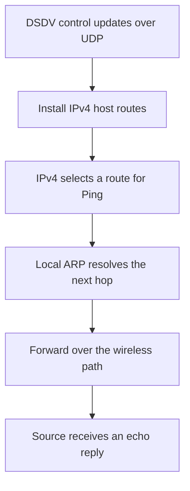

# DSDV protocol tests

> **Kind:** reference · **Status:** current · **Seal:** none · **Owns:** — · **Stands on:** [forwarding guide](../../../../../tests/protocol/dsdv/DsdvForwarding.md), [mobile guide](../../../../../tests/protocol/dsdv/DsdvMobile.md)

The original DSDV protocol fixtures connect routing decisions to observable IPv4 application delivery. Their companion reviewer documents own each topology, setup, assertion, run command, parent-comparison limit and diagnostic explanation.

| Test and reviewer guide | Main question | Required result |
| --- | --- | --- |
| [DsdvForwarding.test](../../../../../tests/protocol/dsdv/DsdvForwarding.test), [guide](../../../../../tests/protocol/dsdv/DsdvForwarding.md) | Does DSDV install and use correct routes? | Replies over a four-node line and pair, both relays observed, correct next-hop ARP and no delivery in the routing-disabled control. |
| [DsdvMobile.test](../../../../../tests/protocol/dsdv/DsdvMobile.test), [guide](../../../../../tests/protocol/dsdv/DsdvMobile.md) | Does delivery recover after a relay leaves and returns? | Replies before departure and after return, with none in the checked partition window. |

## What the packets exercise

DSDV sends routing information over UDP. Accepted entries become IPv4 host routes containing a next hop and hop count. Ping uses those routes, while ordinary local ARP resolves the chosen neighbor. A successful echo reply also needs a return path.

These fixed-seed correctness scenarios do not measure throughput, packet-delivery ratio or average convergence time. They complement the unit/module evidence mapped in the [coverage ledger](coverage.md); a protocol PASS does not imply every route-selection, expiry or lifecycle invariant. The [results record](results.md) owns execution evidence, while this index and the per-test guides explain the fixtures.

## Execution interpretation

Both tests require successful execution and their stated PASS text; neither declares an expected failure. Compilation, launch or export errors are setup failures, not routing results. Missing reply data is a failure, not successful partition silence. Fingerprint comparison remains separate, and these fixtures never update its baselines. Use the per-test guides for selectors and avoid overlapping runs sharing generated directories.
