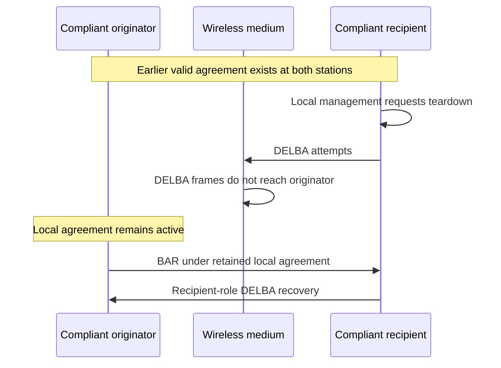
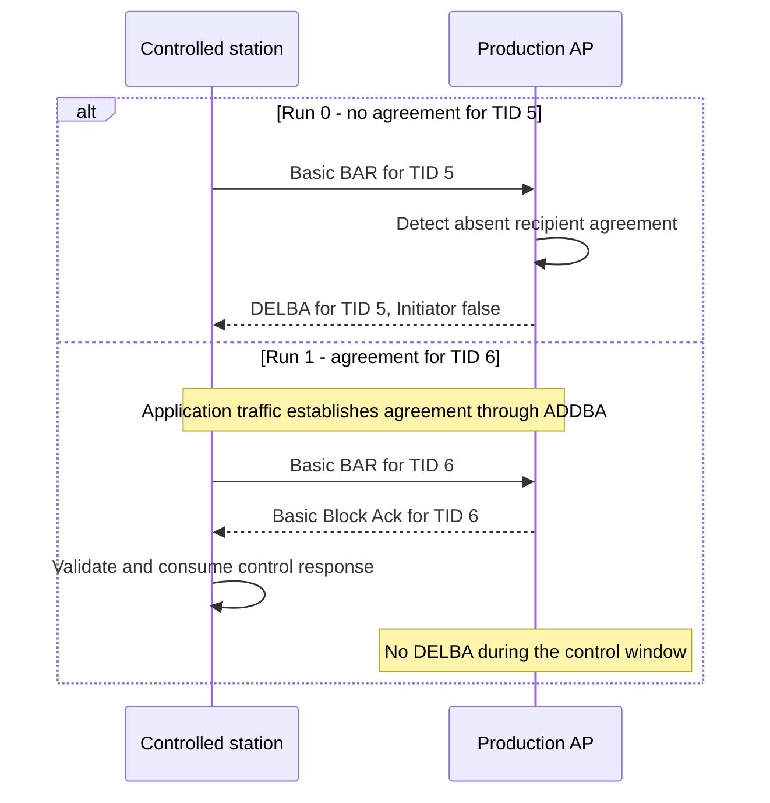
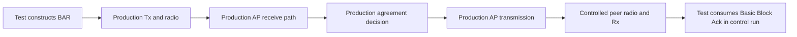

# BAR without a Block Ack agreement

> **Kind:** reference · **Status:** current · **Seal:** none · **Owns:** — · **Stands on:** [test source](../../../../../../tests/protocol/wifi/common/WifiBlockAckBarWithoutAgreement.test), [comparison record](blockack-bar-without-agreement-comparison.md)

A recipient without the selected Block Ack agreement must send recipient-role DELBA after it receives the test BAR. A separate control establishes an agreement and requires a Basic Block Ack response. Together, the runs distinguish recovery from normal response behavior.

The test checks INET's Basic compatibility profile. It does not establish support for every Block Ack format or current-standard conformance for the Basic format.

## Can compliant stations reach this situation?

Yes, after a real agreement becomes inconsistent across the two stations because a teardown frame is lost. The stations need not disagree about the rules. They can temporarily have different information about the agreement.

Hypothetical compliant scenario: the recipient's management entity requests teardown of an active agreement. The recipient removes its local agreement and transmits DELBA. Every DELBA attempt fails to reach the originator because of medium loss. The originator retains its local agreement and later transmits a BAR. The recipient must then recover from the absent-agreement condition.



[IEEE Std 802.11-2024, 11.5.3.2](../../../../../../standards/80211ax-2024.pdf#page=2565) permits management to initiate teardown through DELBA. [11.5.4](../../../../../../standards/80211ax-2024.pdf#page=2566) specifies DELBA when a recipient receives BAR without an active agreement. The hypothetical loss sequence explains how that receive condition can arise without peer misconduct.

The current fixture starts directly from the absent-agreement state. It does not establish the earlier agreement and lose its DELBA. Its result proves the recovery response for the supplied state, not the complete practical sequence above.

There is also a wire-format limit. This fixture sends a Basic BAR with BAR Type 0, which [Table 9-36](../../../../../../standards/80211ax-2024.pdf#page=719) reserves in IEEE 802.11-2024. The controlled sender also bypasses normal channel access. The current BAR stimulus therefore does not satisfy a strict requirement for fully compliant nodes and frames.

For that requirement, use a permitted BAR variant after real setup and real DELBA loss. Retain the recipient-role recovery assertion. The [profile limits](#profile-limits) distinguish this required follow-up from the current compatibility regression.

## Two runs with different initial state

Both runs use real association, production transmission, and the wireless medium. At `1.1 s`, a controlled station sends one crafted Basic BAR to the AP. The request identifies the selected traffic identifier (TID), sequence 0, and fragment 0.

| Run | State before the crafted BAR | Required AP response |
| --- | --- | --- |
| 0 | No agreement for station `sta1` and TID 5 | Recipient-role DELBA for that station and TID |
| 1 | Real ADDBA establishes an agreement for `sta1` and TID 6 | Basic Block Ack for that station and TID |

Run 0 starts application traffic after the simulation's time limit. Run 1 supplies a short traffic batch before the crafted BAR. Read-only queries check the required agreement state at both endpoints before transmission. The control must establish its agreement before the response assertion can test normal behavior.



The sequence diagram shows distinct runs, not two BAR exchanges within one run. The AP uses production receive and response paths in both cases.

## Assertions and observation windows

Run 0 first requires the AP to receive a Basic BAR from `sta1` for TID 5. The next assertion requires a transmitted DELBA within 20 ms of that reception. DELBA must identify the station and TID. Its Initiator field must be false because the AP ends its recipient role. A query also requires no recipient agreement when DELBA enters transmission.

Run 1 observes the crafted BAR at station transmission. It requires a Basic Block Ack within 20 ms. The response must identify the station and TID 6. The controlled peer must then receive and validate that response through the radio. A concurrent guard prohibits AP DELBA transmission for 20 ms after the BAR transmission.

The no-agreement run observes DELBA transmission at the AP. It does not separately assert DELBA reception or its ACK. The control observes both response transmission and reception. These are different evidence boundaries.

## Why the sender is a controlled peer

The [shared support](../../../../../../tests/protocol/wifi/BlockAckLifecycleTestSupport.h) submits the crafted BAR to production Tx. Tx supplies transmitter addresses and FCS and retains its own frame copy. The fixture deletes its original after submission. Production MAC, radio, and AP receive processing remain active.

The crafted BAR does not create a normal originator exchange context at the sender. The test MAC therefore consumes the control's Basic Block Ack after production Rx validation. It does not submit that response to an idle HCF that never requested it.



This boundary makes the sender an explicit test component. It leaves the recipient decision under test in production code.

## Recorded result and failure interpretation

The [comparison record](blockack-bar-without-agreement-comparison.md) compares the lifecycle fix with its parent. The parent sends no required DELBA during the observation window. The same run passes after the fix. The established-agreement control passes on both revisions.

If neither run receives a response, first check association, radio reception, and the stimulus. A failure in the control does not isolate absent-agreement recovery. If only run 0 misses DELBA after confirmed BAR reception, the failure reaches the intended recovery obligation.

## Run and scope

From the INET root, use the normal OMNeT++ and INET environment setup. Run the fixture:

```sh
inet_run_protocol_tests -p inet -m debug -w '^tests/protocol/wifi$' \
  -f '/WifiBlockAckBarWithoutAgreement\.test$' --no-concurrent
```

The file runs scenarios 0 and 1. Both `wifi_block_ack_orphan_bar` and `wifi_block_ack_known_bar` must report PASS. The file also rejects a protocol FAIL line.

The tests use seed 0 and disable inactivity expiration. They do not test absent-agreement DATA, malformed BAR, response bitmap accuracy, or another Block Ack format. The agreement query checks state at its observation point; it does not observe every possible temporary allocation.

## Profile limits

The shared configuration selects HT stations and `blockAckVariant = "basic"`. This is INET's historical compatibility profile. [IEEE Std 802.11-2024, Table 9-36](../../../../../../standards/80211ax-2024.pdf#page=719) reserves BAR Type 0. INET's Basic BAR uses that value. A run that ends before a BAR appears does not establish conformance for every encoded field.

The fixtures inspect typed frame objects and selected state transitions. They do not check every encoded field or every channel-access requirement. A frame that crosses the simulated radio is not automatically a complete wire-conformance check.

[HCF](../../../../../../src/inet/linklayer/ieee80211/mac/coordinationfunction/Hcf.cc) rejects Compressed Block Ack selection during initialization at this stage. A permitted variant requires further implementation support. A configuration change alone cannot supply that support.

## Standards evidence

These references use IEEE Std 802.11-2024, corpus ID `ieee80211-2024`. Physical pages refer to the local file `standards/80211ax-2024.pdf`. Its filename does not identify an ax amendment.

| Subject | Clause, table, or figure | Physical PDF pages | Canonical node ID |
| --- | --- | --- | --- |
| BAR variant encoding | Table 9-36 | 719–720 | `ieee80211-2024:table:9-36` |
| Final-transfer teardown | 10.25.4 | 2056 | `ieee80211-2024:clause:10.25.4` |
| Management-initiated teardown | 11.5.3.2 | 2565 | `ieee80211-2024:clause:11.5.3.2` |
| Inactivity and absent-agreement recovery | 11.5.4 | 2566 | `ieee80211-2024:clause:11.5.4` |

The [shared procedure](../pr1343-comparison-method.md#standards-corpus) records the corpus checks, extraction limits, and local retrieval artifacts.
