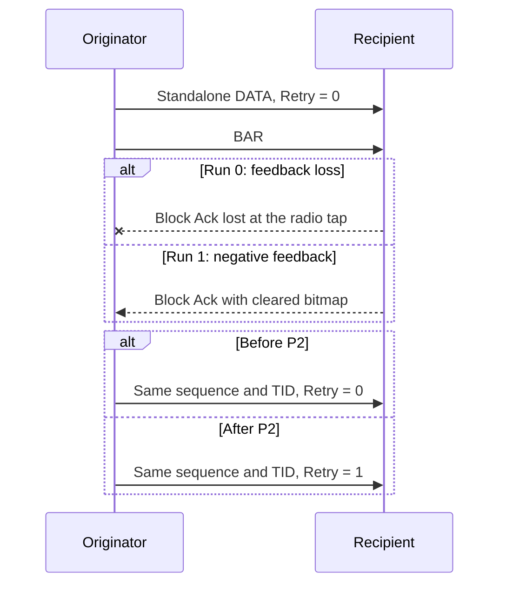

# Standalone DATA Retry after Block Ack failure

> **Kind:** reference · **Status:** current · **Seal:** none · **Owns:** — · **Stands on:** [test](../../../../../../tests/protocol/wifi/common/WifiBlockAckDataRetry.test), [comparison](blockack-data-retry-comparison.md)

The originator must set Retry when it retransmits standalone DATA after failed Block Ack feedback. The test observes the production transmitted header. It requires the retransmission to retain the captured sequence and TID.

## Scenario and requirement

The infrastructure network contains an AP and two stations. A UDP stream starts at sta1 after association. The AP relays its traffic to sta2. Production ADDBA establishes the uplink agreement. Seed 0 and a 0.1 ms send interval make the selected exchange deterministic.

The test selects INET's Basic compatibility profile and disables A-MSDU aggregation. It inherits the lifecycle configuration and its inactive inactivity timer. The continuous stream reaches threshold five without a final-transfer requirement.

IEEE Std 802.11-2024, 9.2.4.1.6 requires Retry for retransmitted standalone DATA. Lost feedback can occur between compliant peers. The cleared bitmap is a controlled negative-feedback input. It tests the originator's response; it does not model the physical cause of every failed DATA reception.

## Faults and assertions

| Run | Fault at sta1 | Required result |
| --- | --- | --- |
| 0 | The radio tap drops the first Block Ack. | The same DATA sequence and TID return with Retry set after timeout. |
| 1 | The radio tap clears all bits in the first Block Ack. | The same DATA identity returns with Retry set after negative feedback. |

The first observed Block Ack DATA must have Retry clear. The test captures its identity before BAR. It next observes BAR, then the retransmission of that identity. Typed header queries avoid an ambiguous field lookup through the packet trailer.

The radio tap changes only received feedback. Association, agreement setup, DATA selection, timeout, ACK status, and retransmission remain production operations.

## Cause and correction

The parent ACK handler already makes missing-feedback and negative-feedback DATA eligible. HCF previously forwarded that frame without setting Retry. The independent correction changes the header before Tx receives the retransmission. No candidate preview or completion DELBA is necessary for this path.

The [reviewer document](../../../../../../tests/protocol/wifi/blockack-data-retry.md) associates this fixture with plan P2. The [comparison record](blockack-data-retry-comparison.md) separates executed evidence from expected behavior.

## Limits

Two fixed-seed cases check header identity and Retry. They do not estimate loss probability, cover aggregates, or establish complete Basic conformance. The tap's cleared bitmap is test stimulus. It is not evidence of a particular physical error pattern.
