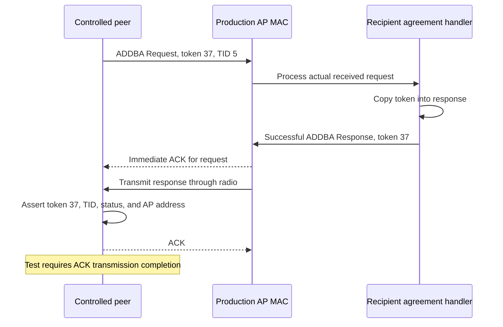
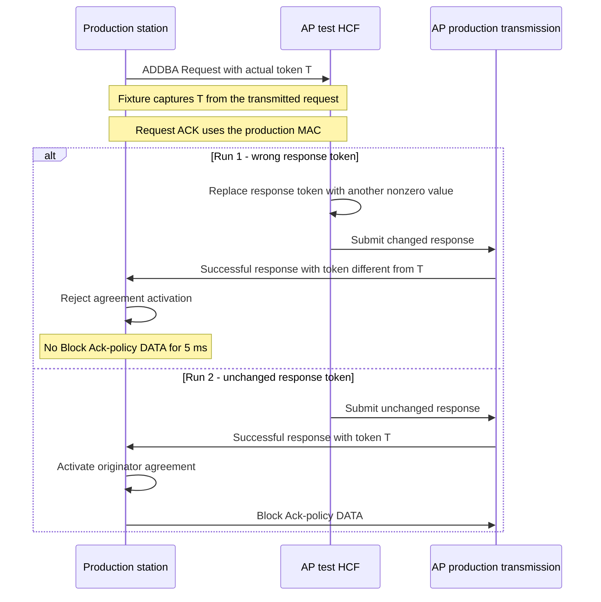

# ADDBA dialog token

> **Kind:** reference · **Status:** current · **Seal:** none · **Owns:** — · **Stands on:** [test source](../../../../../../tests/protocol/wifi/common/WifiBlockAckDialogToken.test), [comparison record](blockack-dialog-token-comparison.md)

The ADDBA Response must copy the request's dialog token. The originator must also reject a successful response whose token does not match its request. This fixture checks both directions of that contract. A third run confirms that a correct token permits setup and Block Ack-policy DATA.

The dialog token correlates the setup response with its request. It is separate from the MAC sequence number used for retransmission and duplicate detection. A successful status alone does not identify the response as the result of the current setup attempt.

## Can compliant stations reach these situations?

Runs 0 and 2 check normal setup obligations. A compliant originator can choose token 37, and a compliant recipient must copy that token into its response. [IEEE Std 802.11-2024, Table 9-466](../../../../../../standards/80211ax-2024.pdf#page=1650) permits a chosen nonzero token for ordinary solicited setup. [Table 9-467](../../../../../../standards/80211ax-2024.pdf#page=1651) requires the response to copy that request's token.

Run 1 does not establish a compliant-peer scenario. It changes the response token from the current request's value to another value. A compliant recipient must not generate that response for the same request. An ordinary ACK loss does not explain the token change.

| Run | Relevance when every peer behaves correctly |
| --- | --- |
| 0: token echo | The selected token and required echo are normal protocol behavior. The controlled sender does not establish complete sender conformance. |
| 1: changed response token | Artificial input for a robustness check. Exclude this run from evidence restricted to compliant-peer situations. |
| 2: unchanged response token | Normal setup control through production management and MAC behavior, subject to the common profile limit. |

A delayed response from another dialog would need a separate scenario that creates both dialogs and explains the response delay. This fixture does not create that sequence. The general dialog-token purpose in [10.28.5](../../../../../../standards/80211ax-2024.pdf#page=2093) does not prove that this mutation represents a reachable late-response case.

Run 0 uses a crafted request and a controlled peer without a normal originator procedure. The peer bypasses normal channel access for that request. This isolates the recipient's obligation. It does not prove complete sender behavior. The shared HT configuration also selects the Basic compatibility profile; see the [profile limits](#profile-limits).

For compliant-peer coverage, use the token-echo obligation and the unchanged-response control. The wrong-token run remains separate robustness evidence. It cannot support the claim that the PR repairs a normal exchange between two compliant peers.

## Three runs and their purpose

| Run | Stimulus | Required result |
| --- | --- | --- |
| 0 | Controlled peer sends request token 37 for TID 5 | AP response copies token 37 |
| 1 | Real setup sends token 1; test changes the response token to 2 | Originator rejects the response |
| 2 | Real setup sends token 1; response remains unchanged | Originator accepts setup and transmits Block Ack-policy DATA |

The token values 1 and 2 in runs 1 and 2 describe the recorded runs. The fixture captures the actual request token. The fault changes the response to a different nonzero token. The comparison therefore remains about equality with the active request.

## Run 0: the recipient must echo the token

The controlled peer sends a crafted ADDBA Request at `1 s`, after real association. The request uses token 37 and traffic identifier (TID) 5. The production AP receives it through the radio and builds its response through its agreement handler.

The test checks the token, TID, successful status, and AP transmitter address at response reception. It also requires completion of the controlled peer's ACK transmission. The controlled peer uses production Tx and Rx, but it does not maintain a normal originator agreement for this crafted request.



Token 37 makes the echo check sensitive to an unchanged default token of 1. A test that used token 1 for this run could pass despite that defect.

## Runs 1 and 2: the originator must correlate the response

These runs start setup through real application traffic and production HCF for TID 6. The fixture captures the transmitted request token. In run 1, a test HCF changes the response token before production transmission. The response then crosses the radio with its normal status and TID.

The station processes the response through production HCF. A read-only observation checks whether its originator agreement is active after that processing. Run 1 requires an inactive agreement. A concurrent guard also prohibits Block Ack-policy DATA for TID 6 during the next 5 ms.



Run 2 requires both an active agreement and a transmitted Block Ack-policy DATA frame. This control proves that the same fixture can establish an agreement when token correlation succeeds. The negative guard in run 1 is bounded; it does not claim silence for all later time.

## Test components and assertion boundaries

The response mutator and observer belong to `DialogTokenHcf`. Its `processMgmtFrame()` override changes the selected field before it calls the production method. Its `processLowerFrame()` override calls production receive processing before it emits the agreement observation. The fixture does not implement token acceptance logic itself.

The controlled peer for run 0 comes from [BlockAckRequestProbe.h](../../../../../../tests/protocol/wifi/BlockAckRequestProbe.h). It consumes the response after Rx validation and sends the ACK through production Tx. Runs 1 and 2 leave that controlled-peer mode inactive, so normal originator HCF processes the response.

The assertions first establish the response's actual token relationship. They then inspect the production result. An absent response or absent mutation signal therefore fails before the test can claim correct rejection.

## Recorded result and failure interpretation

The [comparison record](blockack-dialog-token-comparison.md) compares the negotiation fix with its parent. The parent returns the wrong response token and accepts an altered response token. Both checks pass after the fix. The unchanged-token control passes on both revisions.

An echo failure points to response construction after confirmed request reception. An active agreement after the wrong response points to absent correlation at the originator. A correct-token control failure indicates a broader setup problem and needs separate diagnosis.

## Run and scope

From the INET root, use the normal OMNeT++ and INET environment setup. Run the fixture:

```sh
inet_run_protocol_tests -p inet -m debug -w '^tests/protocol/wifi$' \
  -f '/WifiBlockAckDialogToken\.test$' --no-concurrent
```

The file runs scenarios 0 through 2 with seed 0. The programs `wifi_block_ack_token_echo`, `wifi_block_ack_wrong_token`, and `wifi_block_ack_matching_token` must all report PASS.

These tests cover the Basic profile, one peer, and the selected tokens. They do not exhaust token wrap, stale responses from an earlier setup, wrong-peer responses, or wrong-TID responses. The wrong-token guard covers Block Ack-policy DATA for 5 ms. It does not establish every later recovery transition or full standards conformance.

## Profile limits

The shared configuration selects HT stations and `blockAckVariant = "basic"`. This is INET's historical compatibility profile. [IEEE Std 802.11-2024, Table 9-36](../../../../../../standards/80211ax-2024.pdf#page=719) reserves BAR Type 0. INET's Basic BAR uses that value. A run that ends before a BAR appears does not establish conformance for every encoded field.

The fixtures inspect typed frame objects and selected state transitions. They do not check every encoded field or every channel-access requirement. A frame that crosses the simulated radio is not automatically a complete wire-conformance check.

[HCF](../../../../../../src/inet/linklayer/ieee80211/mac/coordinationfunction/Hcf.cc) rejects Compressed Block Ack selection during initialization at this stage. A permitted variant requires further implementation support. A configuration change alone cannot supply that support.

## Standards evidence

These references use IEEE Std 802.11-2024, corpus ID `ieee80211-2024`. Physical pages refer to the local file `standards/80211ax-2024.pdf`. Its filename does not identify an ax amendment.

| Subject | Clause, table, or figure | Physical PDF pages | Canonical node ID |
| --- | --- | --- | --- |
| BAR variant encoding | Table 9-36 | 719–720 | `ieee80211-2024:table:9-36` |
| Nonzero request token | Table 9-466 under 9.6.4.2 | 1650–1651 | `ieee80211-2024:table:9-466` |
| Response token echo | Table 9-467 under 9.6.4.3 | 1651–1652 | `ieee80211-2024:table:9-467` |
| Immediate acknowledgment | 10.3.2.11 | 1906 | `ieee80211-2024:clause:10.3.2.11` |
| Dialog token purpose | 10.28.5 | 2093 | `ieee80211-2024:clause:10.28.5` |

The [shared procedure](../pr1343-comparison-method.md#standards-corpus) records the corpus checks, extraction limits, and local retrieval artifacts.
