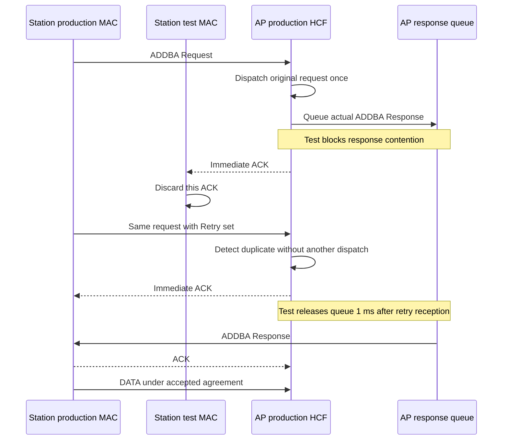
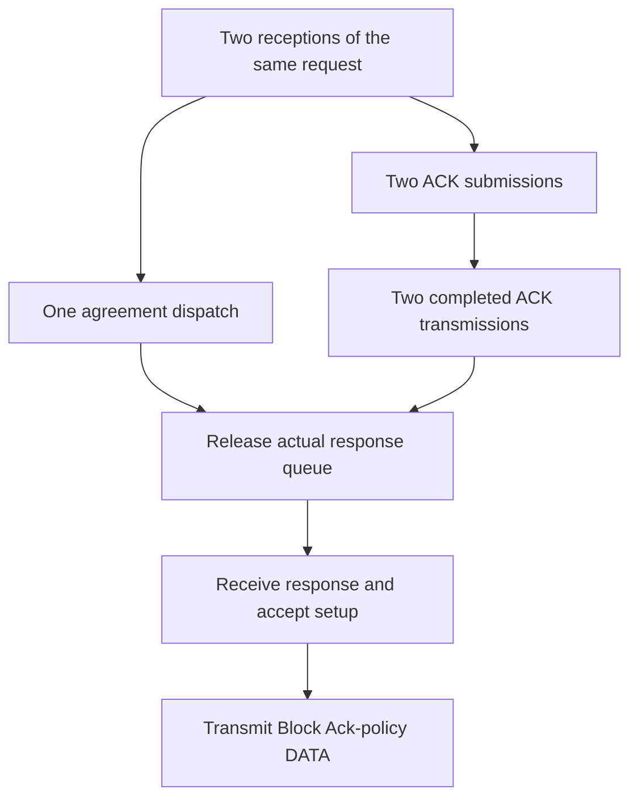

# Duplicate ADDBA Request

> **Kind:** reference · **Status:** current · **Seal:** none · **Owns:** — · **Stands on:** [test source](../../../../../../tests/protocol/wifi/common/WifiBlockAckDuplicateAddba.test), [comparison record](blockack-duplicate-addba-comparison.md)

The recipient must acknowledge a retried ADDBA Request without a second dispatch to its agreement handler. This test forces that retry through a real wireless exchange. It checks that duplicate detection controls agreement processing while acknowledgment remains available.

An ACK confirms reception of the request. The ADDBA Response carries the setup result. These two frames have different roles. A lost ACK can therefore cause another request transmission even when the recipient already processes the original request.

## Can compliant stations reach this situation?

Yes. A station can transmit a correct request while interference prevents reception of its ACK. The originator then retries the request. The recipient's duplicate cache can identify that retry because it already received the original. Neither station needs to send an incorrect frame for this condition to occur.

Hypothetical compliant scenario: the AP receives the request and sends its ACK, but another transmission corrupts the ACK at the originator. The AP's response awaits channel access while the originator retries. The AP must suppress repeated request processing. It must still acknowledge the retry. [IEEE Std 802.11-2024, 10.3.2.11](../../../../../../standards/80211ax-2024.pdf#page=1906) defines immediate acknowledgment. [10.3.2.14.3](../../../../../../standards/80211ax-2024.pdf#page=1916) defines duplicate detection and disposal.

The fixture models ACK loss at the receive boundary. Its forced response hold supplies the required event order without a second interferer or a production contention scenario. The test therefore proves the response to that event order. It does not prove that its exact one-millisecond hold follows from normal channel access.

The shared configuration selects HT stations and INET's Basic compatibility profile. This is not proof of a complete compliant IEEE 802.11-2024 Block Ack exchange. The [profile limits](#profile-limits) explain the reserved Basic BAR encoding and the required separation between scenario validity and fixture conformance.

For evidence restricted to compliant peers, this scenario is relevant. A stronger test would produce the ACK loss and response delay through ordinary radio and channel-access behavior, with a compliant Block Ack variant.

## Scenario

The network contains an AP and two stations. Application traffic from `sta1` to `sta2` crosses the AP after association. The selected exchange establishes an uplink Basic agreement between `sta1` and the AP for traffic identifier (TID) 6. The stations use the [shared lifecycle configuration](../../../../../../tests/protocol/wifi/ini/_blockackLifecycle.ini), with seed 0 and inactivity expiration disabled.

The test applies two controls to create a specific failure condition. The station's test MAC discards the first addressed ACK after its ADDBA Request transmission. The AP's test HCF also blocks contention while its actual ADDBA Response remains queued. Without that response hold, an early response could resolve setup before the request retry.



The diagram shows the causal sequence. The response queue hold does not suppress immediate ACK transmission.

## What the test proves

The fixture compares the retry with the original request. Both must retain the same transmitter, receiver, TID, dialog token, sequence number, and fragment number. Only the retry has its Retry bit set. The test therefore reaches MAC duplicate detection for the original setup request.

The AP must submit two ACKs but dispatch the request only once. A later check requires both ACK transmissions to complete. The test then releases the response queue, observes response reception at the station, and requires Block Ack-policy DATA under an active originator agreement.



Each branch supplies different evidence. An ACK count alone cannot prove duplicate suppression. A dispatch count alone cannot prove that the retry still receives its ACK.

## How the fixture observes production behavior

The test MAC, `DuplicateAddbaMac`, supplies the single ACK loss. The test HCF, `DuplicateAddbaHcf`, supplies the response hold and counts calls to production methods. Its dispatch override calls the production method unchanged. The production recipient data service still performs duplicate detection.

The observer identifies request ACKs by their packet tree IDs. It excludes DATA ACKs from the completion count.

The counters distinguish reception, ACK submission, completed ACK transmission, and agreement dispatch. The fixture emits `addbaReception` after production receive processing. The assertion on the second reception can therefore inspect the completed dispatch decision. The later `requestAcksTransmitted` observation checks physical completion before response release.

## Recorded result and failure interpretation

The [comparison record](blockack-duplicate-addba-comparison.md) compares the dispatch fix with its parent. The parent dispatches both request copies. The fix dispatches once, submits two request ACKs, and completes both transmissions. The complete fixture passes after the fix.

| Failure point | Meaning |
| --- | --- |
| No proof of ACK loss | The fixture does not establish its required fault. |
| No request retry | The required duplicate receive path does not occur. |
| Two dispatches | Duplicate detection does not prevent repeated agreement processing. |
| Fewer than two completed ACKs | The recipient does not preserve acknowledgment behavior for both receptions. |
| No later Block Ack-policy DATA | The exchange does not demonstrate successful setup recovery. |

## Run and scope

From the INET root, use the normal OMNeT++ and INET environment setup. Run the single fixture:

```sh
inet_run_protocol_tests -p inet -m debug -w '^tests/protocol/wifi$' \
  -f '/WifiBlockAckDuplicateAddba\.test$' --no-concurrent
```

The file contains one simulation run. Its required result is `PROTOCOLTEST wifi_block_ack_duplicate_addba: PASS`.

This test covers the Basic profile and one fixed fault sequence. It does not test duplicate DELBA, fragmented Actions, arbitrary response loss, or retry exhaustion. Its internal dispatch observation complements the wireless trace. It does not establish full standards conformance or upper-layer delivery of the final DATA.

## Profile limits

The shared configuration selects HT stations and `blockAckVariant = "basic"`. This is INET's historical compatibility profile. [IEEE Std 802.11-2024, Table 9-36](../../../../../../standards/80211ax-2024.pdf#page=719) reserves BAR Type 0. INET's Basic BAR uses that value. A run that ends before a BAR appears does not establish conformance for every encoded field.

The fixtures inspect typed frame objects and selected state transitions. They do not check every encoded field or every channel-access requirement. A frame that crosses the simulated radio is not automatically a complete wire-conformance check.

[HCF](../../../../../../src/inet/linklayer/ieee80211/mac/coordinationfunction/Hcf.cc) rejects Compressed Block Ack selection during initialization at this stage. A permitted variant requires further implementation support. A configuration change alone cannot supply that support.

## Standards evidence

These references use IEEE Std 802.11-2024, corpus ID `ieee80211-2024`. Physical pages refer to the local file `standards/80211ax-2024.pdf`. Its filename does not identify an ax amendment.

| Subject | Clause, table, or figure | Physical PDF pages | Canonical node ID |
| --- | --- | --- | --- |
| BAR variant encoding | Table 9-36 | 719–720 | `ieee80211-2024:table:9-36` |
| Immediate acknowledgment | 10.3.2.11 | 1906 | `ieee80211-2024:clause:10.3.2.11` |
| Duplicate detection | 10.3.2.14.3 | 1916–1917 | `ieee80211-2024:clause:10.3.2.14.3` |

The [shared procedure](../pr1343-comparison-method.md#standards-corpus) records the corpus checks, extraction limits, and local retrieval artifacts.
