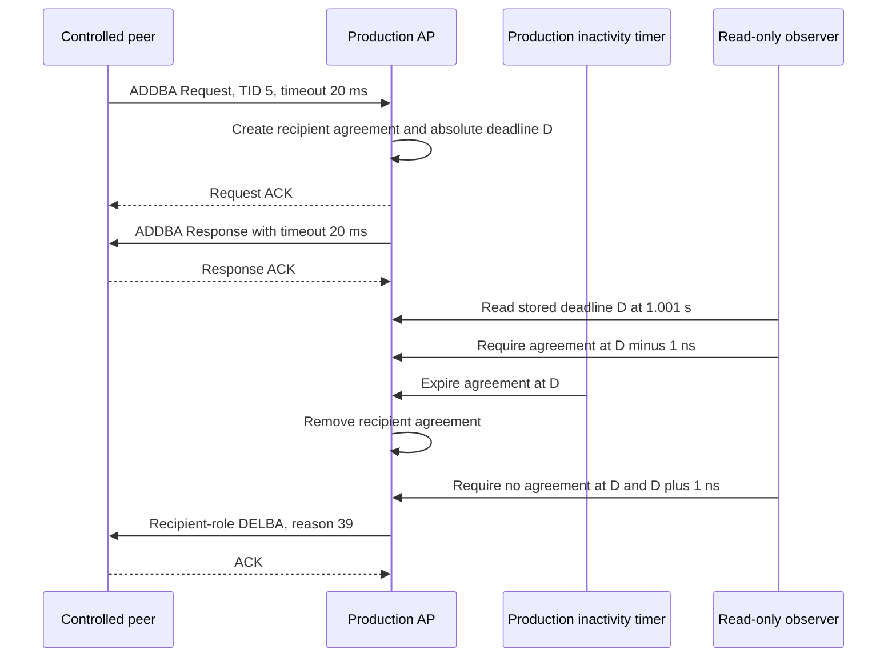
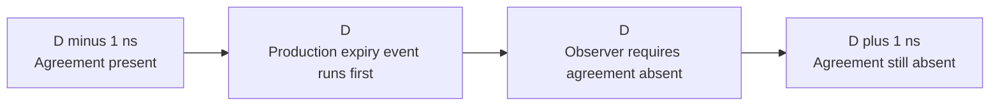

# Absolute Block Ack inactivity deadline

> **Kind:** reference · **Status:** current · **Seal:** none · **Owns:** — · **Stands on:** [test source](../../../../../../tests/protocol/wifi/common/WifiBlockAckInactivity.test), [comparison record](blockack-inactivity-comparison.md)

A finite inactivity deadline must retire the recipient agreement at that absolute simulation time. A zero timeout must leave expiration disabled. This fixture checks both conditions after a real ADDBA exchange. It also requires the finite-timeout recipient to transmit timeout DELBA.

The test starts setup after one second of simulation time. This nonzero start exposes confusion between an absolute deadline and a relative delay. If HCF uses that deadline as another delay at time `1 s`, expiration moves to roughly `2.02 s`.

## Can compliant stations reach this situation?

Yes. A recipient can retain an agreement after a compliant originator ends it if the medium loses the originator's DELBA attempts. The recipient then receives no traffic that refreshes its timer. Its finite inactivity timeout must eventually end the recipient's local agreement.

Hypothetical compliant scenario: the originator completes its final data exchange, ends the agreement, and transmits DELBA. The medium loses all DELBA attempts. The recipient still has an agreement but receives no DATA or BAR for that agreement. Its inactivity timer expires and causes recipient-role DELBA. Both stations follow the protocol; frame loss explains their different local state.

[IEEE Std 802.11-2024, 10.25.4](../../../../../../standards/80211ax-2024.pdf#page=2056) defines teardown after the final exchange. [11.5.4](../../../../../../standards/80211ax-2024.pdf#page=2566) defines timer refresh and timeout DELBA. The heading of 11.5.4 mentions peer failure, but its timeout rule also applies when ordinary frame loss leaves stale local state.

The fixture isolates the timer obligation after ADDBA. It does not reproduce a final data exchange and lost DELBA. Its controlled originator sends no DATA after setup, so this initial condition alone is not proof of a complete compliant originator sequence.

The 20 ms timeout is also a model value, not an exact encoded standard value. [9.4.1.14 and Figure 9-152](../../../../../../standards/80211ax-2024.pdf#page=851) express the field in integer time units of 1.024 ms. Twenty milliseconds is not an integer number of those units. A wire-compliant variant could use 20 time units, or 20.48 ms. Zero remains the standard value that disables expiration.

For strict compliant-peer evidence, use a valid encoded timeout after real setup and a justified loss or inactivity sequence. Apply the same before, at, and after deadline assertions. The [profile limits](#profile-limits) also require a permitted Block Ack variant. The current result proves absolute timer behavior within the Basic compatibility model.

## Scenario and two timeout values

A controlled peer sends an ADDBA Request to the production AP at `1 s`. The selected agreement belongs to that peer and traffic identifier (TID) 5. Both the request and recipient policy specify the same timeout. This equality removes negotiation differences from the condition under test.

| Run | Timeout | Required behavior |
| --- | --- | --- |
| 0 | 20 ms | Agreement exists before its deadline and disappears at that deadline. The AP sends timeout DELBA. |
| 1 | 0 s | Agreement has no finite deadline. It remains active without DELBA during the control window. |

The controlled peer acknowledges the actual ADDBA Response. No DATA refreshes the agreement afterward. The observer starts its state checks at `1.001 s`, after response ACK transmission completes.



DELBA transmission can start at the deadline. The diagram separates state checks from the wireless exchange; it does not require transmission to wait for the final observer check.

## Exact boundary checks

The fixture reads the agreement's stored expiration time. It does not supply its own expiration time to HCF. In the recorded runs, both revisions store `1.020082495879 s`. The observer requires an active agreement one nanosecond before that time and no agreement at that time or one nanosecond afterward.



The exact-time assertion depends on a defined event order. Production schedules its expiry event before the observer schedules its boundary events. At equal simulation time, the expiry event therefore executes first. The observer checks state after that production event.

The observer only reads agreement state. It never changes the agreement deadline, cancels the production timer, or invokes teardown. The test thus checks how the production timer uses the stored absolute time.

## DELBA and the zero-timeout control

A concurrent observation requires at least one transmitted DELBA after the observer reads the deadline. DELBA must identify the controlled peer and TID 5. Its Initiator field must be false, and its reason code must be 39. The frame cannot enter transmission before the captured deadline. The controlled peer must receive and acknowledge it.

The frame observation runs concurrently with the boundary checks because DELBA can enter transmission at the deadline itself. A serial check after the final state observation could miss a correct transmission. The concurrent window lasts 30 ms from the deadline-read observation.

In run 1, the observer requires the stored deadline to equal `SIMTIME_MAX`, which represents no finite expiration. It requires an active agreement at `1.025 s`. A concurrent guard prohibits AP DELBA transmission until `1.031 s`. The control therefore extends beyond the finite run's expected expiration time.

## Test components

The [controlled peer](../../../../../../tests/protocol/wifi/BlockAckRequestProbe.h) uses production Tx and Rx for request, response, and ACK exchange. It supplies the request without a normal originator agreement. The production recipient handler creates the AP agreement. Production HCF owns its timer, retirement, and DELBA submission.

The observer, `BlockAckInactivityObserver`, reads the recipient agreement and emits state observations at the selected times. The support query, `recipientDeadline()`, returns the stored absolute expiration time. These names identify observation roles; neither helper performs expiration.

## Recorded result and failure interpretation

The [comparison record](blockack-inactivity-comparison.md) compares the lifecycle fix with its parent. The parent retains the agreement at its absolute deadline. The fix removes it at the deadline and completes the DELBA assertions. The zero-timeout control passes on both revisions.

An agreement absent before the deadline indicates premature cleanup or a failed setup condition. An agreement present at the deadline isolates late retirement under the selected event order. If DELBA is absent after successful retirement, examine teardown transmission and its observation path.

## Run and scope

From the INET root, use the normal OMNeT++ and INET environment setup. Run the fixture:

```sh
inet_run_protocol_tests -p inet -m debug -w '^tests/protocol/wifi$' \
  -f '/WifiBlockAckInactivity\.test$' --no-concurrent
```

The file runs scenarios 0 and 1 with seed 0. Both `wifi_block_ack_inactivity` and `wifi_block_ack_inactivity_disabled` must report PASS.

The fixture covers one Basic recipient agreement without activity refresh. It does not establish originator expiration, several simultaneous deadlines, DATA refresh, or late timer callbacks. The zero-timeout result applies to its finite observation window. These state and frame assertions do not establish full standards conformance.

## Profile limits

The shared configuration selects HT stations and `blockAckVariant = "basic"`. This is INET's historical compatibility profile. [IEEE Std 802.11-2024, Table 9-36](../../../../../../standards/80211ax-2024.pdf#page=719) reserves BAR Type 0. INET's Basic BAR uses that value. A run that ends before a BAR appears does not establish conformance for every encoded field.

The fixtures inspect typed frame objects and selected state transitions. They do not check every encoded field or every channel-access requirement. A frame that crosses the simulated radio is not automatically a complete wire-conformance check.

[HCF](../../../../../../src/inet/linklayer/ieee80211/mac/coordinationfunction/Hcf.cc) rejects Compressed Block Ack selection during initialization at this stage. A permitted variant requires further implementation support. A configuration change alone cannot supply that support.

## Standards evidence

These references use IEEE Std 802.11-2024, corpus ID `ieee80211-2024`. Physical pages refer to the local file `standards/80211ax-2024.pdf`. Its filename does not identify an ax amendment.

| Subject | Clause, table, or figure | Physical PDF pages | Canonical node ID |
| --- | --- | --- | --- |
| BAR variant encoding | Table 9-36 | 719–720 | `ieee80211-2024:table:9-36` |
| Time unit definition | 3.1, time unit (TU) | 278 | `ieee80211-2024:definition:time%20unit%20%28TU%29` |
| Timeout unit and zero value | Figure 9-152 under 9.4.1.14 | 851 | `ieee80211-2024:figure:9-152` |
| Final-transfer teardown | 10.25.4 | 2056 | `ieee80211-2024:clause:10.25.4` |
| Inactivity and absent-agreement recovery | 11.5.4 | 2566 | `ieee80211-2024:clause:11.5.4` |

The [shared procedure](../pr1343-comparison-method.md#standards-corpus) records the corpus checks, extraction limits, and local retrieval artifacts.
