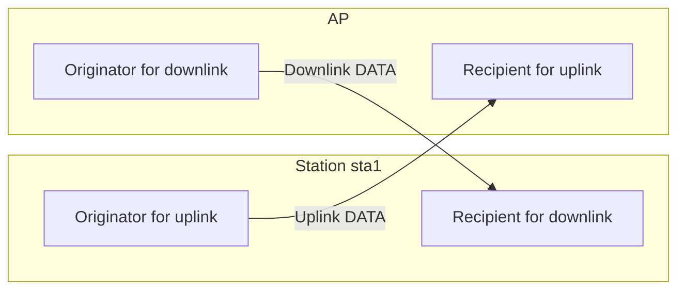
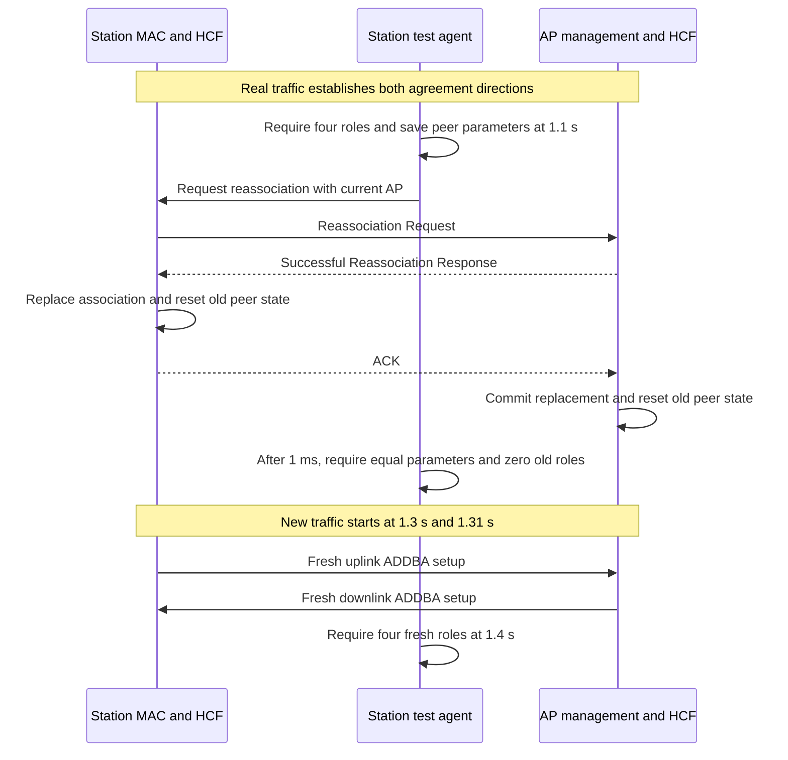

# Block Ack state after same-AP reassociation

> **Kind:** reference · **Status:** current · **Seal:** none · **Owns:** — · **Stands on:** [test source](../../../../../../tests/protocol/wifi/common/WifiBlockAckSameApReassociation.test), [comparison record](blockack-same-ap-reassociation-comparison.md)

Successful reassociation with the same AP must clear old Block Ack agreements even when peer rates and advertised HT capabilities remain equal. New traffic must establish fresh agreements. This test checks both removal of obsolete state and useful operation after replacement.

A capability comparison cannot identify every association replacement. The replacement can retain the same rates and capabilities. Management must therefore send the explicit peer reset at the association boundary. The test selects that condition to distinguish lifecycle cleanup from a capability-change reaction.

## Can compliant stations reach this situation?

Yes. An associated station can request successful reassociation with the same AP. The procedure does not require different peer rates or advertised HT capabilities. Replacement of the association, rather than a capability change, controls the agreement reset.

[IEEE Std 802.11-2024, 11.3.5.4(c)](../../../../../../standards/80211ax-2024.pdf#page=2531) explicitly covers successful same-AP reassociation. It requires deletion or reset of non-GCR Block Ack agreements at the station. [11.3.5.5(q)](../../../../../../standards/80211ax-2024.pdf#page=2536) requires the AP to apply the same treatment. The fixture's unicast agreements fall within that scope.

The test agent supplies a normal reassociation request through the management service. It does not forge a response, change a token, or call the reset operation. Equal peer parameters and a successful replacement therefore form a direct practical condition for this regression. No defective peer or radio fault is necessary.

The fixture does not negotiate management frame protection. A protected association can require additional security procedures before same-AP reassociation succeeds. This test does not establish those procedures. Its HT stations also use INET's Basic compatibility profile; the [profile limits](#profile-limits) limit any complete wire-conformance claim.

The association-reset scenario is relevant to compliant-peer coverage. The current evidence establishes the selected lifecycle behavior, not every requirement of a fully compliant association and Block Ack implementation.

## Why the test requires four roles

UDP traffic runs in both directions between `sta1` and `sta2` through the AP. The selected agreements belong to the link between `sta1` and the AP, for traffic identifier (TID) 6. Each endpoint acts as both an originator and a recipient. The test therefore requires four local agreement roles before reassociation.



The fixture creates these roles through real ADDBA exchanges. It never inserts agreements directly. A read-only query counts accepted originator agreements and present recipient agreements for the selected peer and TID.

## Test sequence

The initial uplink batch starts at `1 s`. The reverse batch starts at `1.01 s`. Both batches end before replacement. At `1.1 s`, the station agent requires all four roles and saves the peer rate sets and advertised HT capabilities at both endpoints.

The agent requests reassociation with its current AP without another authentication exchange. This condition matters because authentication could clear the old association before the test reaches the replacement path. The request's receiver and Current AP field must both identify the current AP.



The one-millisecond delay follows station reassociation confirmation. It permits the AP to receive the response ACK and commit replacement before the joint query. Inactivity expiration remains disabled, so it cannot explain removal of the agreements.

## Assertions and test controls

The first state assertion requires four old roles. The next frame assertion checks same-AP reassociation. After completion, the fixture requires equal peer rate sets and advertised HT capabilities. It then requires zero old roles before the new traffic batches start.

The later batches must trigger fresh ADDBA Requests in both directions. Concurrent observations require new traffic at UDP on both destination stations. At `1.4 s`, the fixture requires four fresh agreement roles. This final condition excludes a repair that clears state but prevents later setup.

The test agent, `BlockAckReassociationAgent`, supplies only the reassociation request, state queries, and observation times. Production management performs the association transitions. Production HCF and its agreement handlers perform setup and cleanup. The agent never calls the peer reset operation.

The test compares advertised HT capabilities, not every field of the negotiated HT state. It counts the selected link's roles. It does not assert preservation of every agreement for the other station.

## Recorded result and failure interpretation

The [comparison record](blockack-same-ap-reassociation-comparison.md) compares the association reset fix with its parent. Both revisions start with four roles and retain equal peer parameters. The parent retains four old roles after replacement. The fix removes them, completes fresh setup, and restores application delivery.

If the initial role count is below four, the required bidirectional setup did not complete. If peer parameters differ, the test does not establish the intended equal-parameter condition. If old roles disappear but fresh roles remain absent, cleanup succeeds but recovery does not satisfy the full test.

## Run and scope

From the INET root, use the normal OMNeT++ and INET environment setup. Run the fixture:

```sh
inet_run_protocol_tests -p inet -m debug -w '^tests/protocol/wifi$' \
  -f '/WifiBlockAckSameApReassociation\.test$' --no-concurrent
```

The file contains one simulation run with seed 0. Its required result is `PROTOCOLTEST wifi_block_ack_same_ap_reassociation: PASS`.

This test uses the Basic profile and successful same-AP reassociation. It does not cover another AP, refused reassociation, association loss, or replacement during an active DATA exchange. The state queries complement the frame trace. They do not establish full standards conformance.

## Profile limits

The shared configuration selects HT stations and `blockAckVariant = "basic"`. This is INET's historical compatibility profile. [IEEE Std 802.11-2024, Table 9-36](../../../../../../standards/80211ax-2024.pdf#page=719) reserves BAR Type 0. INET's Basic BAR uses that value. A run that ends before a BAR appears does not establish conformance for every encoded field.

The fixtures inspect typed frame objects and selected state transitions. They do not check every encoded field or every channel-access requirement. A frame that crosses the simulated radio is not automatically a complete wire-conformance check.

[HCF](../../../../../../src/inet/linklayer/ieee80211/mac/coordinationfunction/Hcf.cc) rejects Compressed Block Ack selection during initialization at this stage. A permitted variant requires further implementation support. A configuration change alone cannot supply that support.

## Standards evidence

These references use IEEE Std 802.11-2024, corpus ID `ieee80211-2024`. Physical pages refer to the local file `standards/80211ax-2024.pdf`. Its filename does not identify an ax amendment.

| Subject | Clause, table, or figure | Physical PDF pages | Canonical node ID |
| --- | --- | --- | --- |
| BAR variant encoding | Table 9-36 | 719–720 | `ieee80211-2024:table:9-36` |
| Station reset after same-AP reassociation | 11.3.5.4(c) | 2531–2533 | `ieee80211-2024:clause:11.3.5.4` |
| Corresponding AP reset | 11.3.5.5(q) | 2533–2536 | `ieee80211-2024:clause:11.3.5.5` |

The [shared procedure](../pr1343-comparison-method.md#standards-corpus) records the corpus checks, extraction limits, and local retrieval artifacts.
