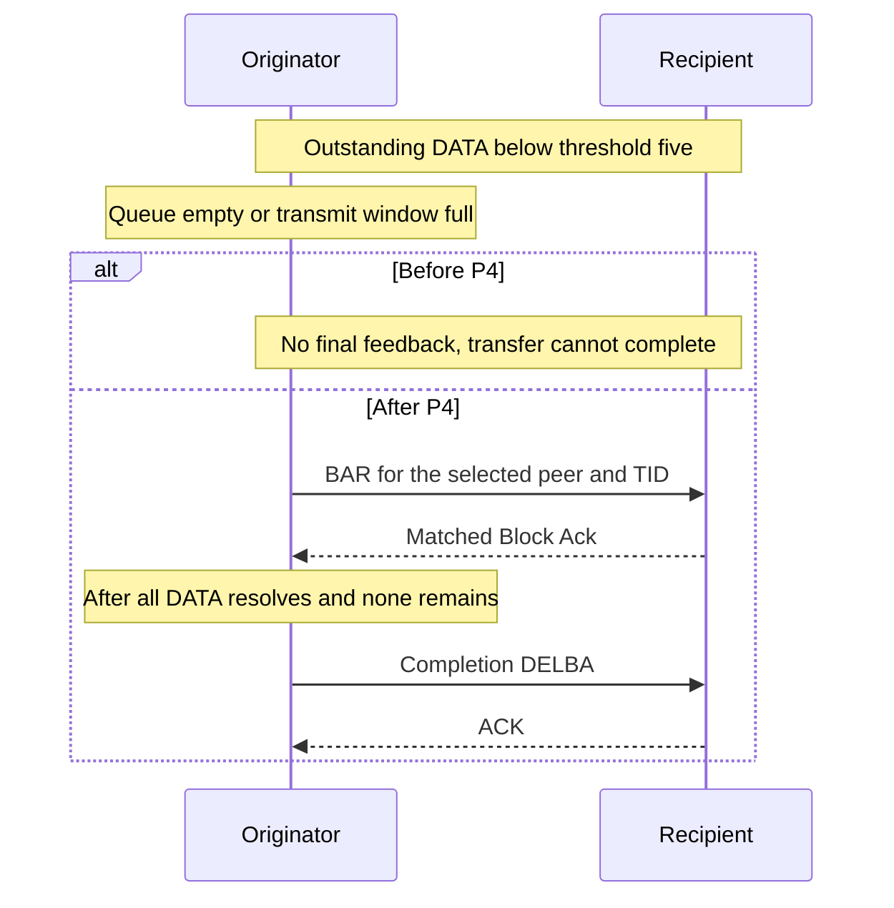

# Basic transfer completion without further DATA

> **Kind:** reference · **Status:** current · **Seal:** none · **Owns:** — · **Stands on:** [test](../../../../../../tests/protocol/wifi/common/WifiBlockAckTransferCompletion.test), [comparison](blockack-transfer-completion-comparison.md)

A short Basic transfer must request its final feedback and end with DELBA. The test observes this sequence through production MAC signals. It covers queue exhaustion and a transmit window smaller than the BAR threshold.

## Scenario and requirement

The network uses real infrastructure association and production ADDBA. A finite UDP burst starts at sta1 after association. The AP receives its uplink DATA. The test selects seed 0, threshold five, no A-MSDU aggregation, and zero inactivity timeout.

IEEE Std 802.11-2024, 10.25.4 requires DELBA when the originator has no DATA and the final Block Ack exchange completes. The low-count BAR trigger is INET policy. Basic remains a compatibility profile rather than a current-standard Block Ack format claim.

| Run | Application input | Accepted window | Trigger |
| --- | --- | --- | --- |
| 0 | Two UDP packets at 0.1 ms intervals. | 64 positions. | Initial Normal Ack DATA precedes one Block Ack DATA; the queue then empties. |
| 1 | Four UDP packets at 0.1 ms intervals. | One position. | One Block Ack DATA fills the window before another sequence can proceed. |

## Assertions and production path

The test observes ADDBA Request and successful Response. It captures the requested TID. It then observes the first DATA with Block Ack policy and captures its sequence.

The next selected DATA-or-BAR transmission must be BAR for that TID and AP. Its starting sequence must equal the captured sequence. This assertion detects further DATA before required feedback. A later matching Block Ack must reach sta1. Completion then requires originator-role DELBA for the same TID and its ACK.

The file requires a PASS line and rejects any FAIL line from this protocol program. A successful run cannot hide the other run's failure. Protocol verdicts end each simulation normally, so the process exit status alone cannot establish success.

The fixture supplies no agreement, injected response, or production state edit. HCF, EDCA, the frame sequence, radio medium, and recipient execute the exchange. Inactivity cannot supply the required DELBA because its timeout is zero.

## Cause and correction

The parent policy requires the threshold before BAR. Its channel access also depends on DATA eligibility. The correction groups outstanding DATA by peer and TID, selects BAR before extraction, and permits BAR-only contention. Feedback resolves the group. HCF starts completion DELBA at the accepted boundary.

The [reviewer document](../../../../../../tests/protocol/wifi/blockack-transfer-completion.md) associates this fixture with plan P4. The [comparison](blockack-transfer-completion-comparison.md) records actual outcomes.

## Limits

The test checks an observed exchange sequence. Existing module and unit fixtures check other peers, expiry, negative feedback, cyclic arithmetic, and timing boundaries. This fixture does not establish those additional properties, general Basic admission, full NAV correctness, or throughput.
