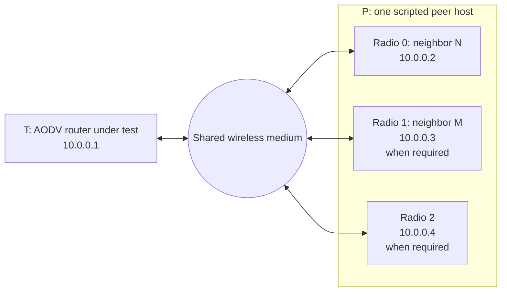
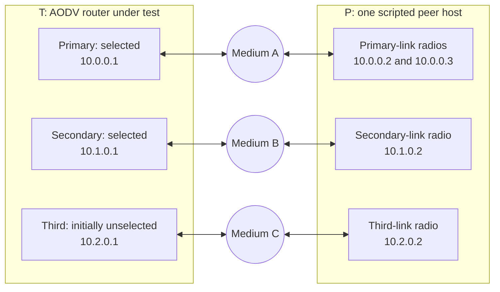
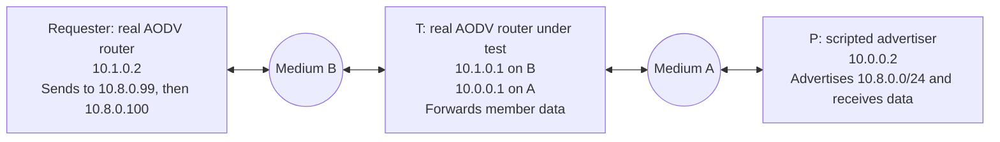

# AODV — behavioral checks

> **Kind:** procedure · **Status:** current · **Seal:** none · **Owns:** — · **Stands on:** [features.md](features.md)

These checks exercise control messages through UDP/IP, data through actual forwarding and queueing, and route state through the public routing table. Each scenario below gives its topology, initial state, stimulus and required observations. It describes what a test checks; execution outcomes and model restrictions belong in the [model results](../../model/aodv/results.md) and [conformance record](../../model/aodv/conformance.md).

RREQ is a route request, RREP a route reply, RERR a route error, and RREP-ACK the one-hop acknowledgment of a reply. In an RREQ, U means the destination sequence is unknown, D requests a destination-only reply, and G requests a gratuitous reply to the destination. A in an RREP requests an acknowledgment. N in an RERR means a nondeleting notification: a path has changed, but the receiver must preserve its route. A precursor is an upstream neighbor that depends on an advertised path and may need a later error notification.

## Check overview

| Feature | Stimulus and required observation |
| --- | --- |
| AODV-F-FRESHNESS | Inject wrapping, equal, stale and unknown sequence information separately in requests, replies, Hellos and errors. Inspect the selected route and whether a reply was relayed. |
| AODV-F-LIFETIME | Inject a nonimproving request and a gratuitous reply late in simulation. Observe independent reverse expiry refresh and remaining whole-millisecond advertisements. |
| AODV-F-DISCOVERY | Exceed one request window with finite demand. Observe FIFO admission, full reply intervals, expanding rings, network-wide backoff, cancellation and terminal disposal. |
| AODV-F-LINK | Validate two neighbors concurrently, fail only one, and replace an in-flight path before reporting failure. Observe only attributable link effects. Incoming transit data refreshes its immediate sender's Hello deadline. |
| AODV-F-ERROR | Inject ordinary and N errors from matching and unrelated links. Observe invalidation versus preservation, prefix ambiguity suppression and complete recipient delivery for admitted partitions. |
| AODV-F-RECOVERY | Restart with pending work and learn a route during recovery. Observe held data, permitted ACK/errors, deadline extension and cleanup. |
| AODV-F-INTERFACE | Discover a secondary local address and return a reply on another selected link. Observe correct source, next hop and interface, with no state changes from unselected control ingress. |
| AODV-F-SUBNET | Combine aggregate and host records, independent counters and pending demand. Observe consistent eligibility for new/queued data and prefix-owned errors. |
| AODV-F-REPAIR | Enable repair for broken transit paths. Observe one bounded transaction, shared member queues, fresh matching-prefix completion, longer-path notification and single terminal cleanup. |

## Topologies and observation points

### Direct wireless peer

Most checks use one router under test, T, and one scripted peer host, P. T runs the real routing protocol. P constructs control packets and observes received control and data; it does not run a substitute route-selection algorithm. Its additional radios represent distinct immediate neighbors, with separate addresses and MAC identities.

The basic preparation and freshness checks need only P's first radio. Subnet checks normally use two, and repair checks normally use three. These are physical radios on one peer host, rather than independent forwarding routers. An advertised remote destination need not exist as another node: P can advertise it and receive the data emitted toward it. A claimed hop count therefore describes injected route information, not a physical chain of that length.

The common IPv4 profile uses /24 interface masks, fixed positions at (10 m, 10 m), a 100 m communication range, 1 Mbit/s radios, a unit-disk medium and a MAC that reports failure when its link acknowledgment does not arrive. Address resolution is supplied globally. The configurator adds no static, default or subnet routes; interface-connected routes still exist and must not stand in for learned multihop reachability. Run 0 uses seed 0. Broadcast and periodic jitter are zero unless the scenario explicitly tests delay, timing or admission. Hello transmission is disabled unless the scenario needs it. Receivers can be switched off to produce a real failed transmission without moving nodes.

Independent IEEE 802.11 DCF variants use ad hoc operation, fixed 1 Mbit/s, disabled QoS, aggregation and fragmentation, and retry-limit failure. They verify the same immediate-neighbor meaning and retained output metadata through that MAC path.

### Separate selected links

Multi-interface checks use independent wireless media so packets on one link cannot be heard on another. The peer host has a radio on each medium, and an extra primary-link radio when a second precursor is needed.

The primary and secondary interfaces are selected for AODV; the third is initially unselected. The primary address remains the discovery originator identity. The third link tests ignored control ingress and selection changes after restart. Error-capacity checks use the same two-medium principle, with precursor receivers at 10.0.0.3 and 10.1.0.4 and the failed next hop at 10.0.0.2. Their route and precursor records are seeded through the public table to isolate partitioning; separate multi-interface checks establish precursor learning through actual requests and replies.

### Additional receivers and actual forwarding chains

The gratuitous-reply lifetime check adds a second real AODV router at 10.0.0.99 on the shared medium. P has two addresses, captures T's emitted advertisement, and replays it to that receiver. This checks recipient expiry against actual reception time; it is controlled replay, rather than a three-router forwarding chain.

The downstream subnet check instead uses two real AODV routers and two isolated media:

The requester cannot hear P. It must discover through T, receive T's cached /24 reply, and forward both member datagrams through T to P.

Forwarded-Hello liveness module checks use three real nodes: source S sends over Ethernet to forwarding router N, which sends over wireless to T. At T the original IP source is S and the immediate source MAC is N. Wireless variants cover the acknowledgment-based MAC and independent DCF. The IPv6 forwarding compatibility check uses the same Ethernet-to-wireless arrangement with native neighbor discovery.

Exact ACK-deadline checks connect T and P by full-duplex Ethernet. Exact Hello-loss checks also use Ethernet. Test adapters own completed UDP packets or incoming IP packets and schedule their final delivery at the measured deadline. Serialization is calibrated; normal event insertion order puts reception either before or after timeout. Repair and reboot tie cases similarly schedule real incoming packets at their deadlines. These checks do not call private protocol handlers or change timer priority.

### What the observations mean

Control assertions inspect packets actually received through UDP, including sequence numbers, flags, prefixes, hop limits and source interfaces. Route assertions inspect ownership, destination/prefix, sequence validity, active state, expiry, next hop and metric. Data assertions observe actual output and delivery, including the selected destination MAC. Packet identities distinguish one logical transmission from broadcast copies received by multiple peer radios.

Queue-disposal checks count destruction of original data packets separately from inspection and transmission copies; repair checks also inspect the owning IP queue. Selected fixtures seed routes, install an independent manual route, or remove ingress/output metadata through test adapters. These isolate a particular decision while retaining the real UDP, IP, MAC, queue and timer paths. An arithmetic helper or a simulation fingerprint alone cannot demonstrate acceptance, forwarding or packet release.

## Freshness and message acceptance

Use the direct wireless topology. Sequence numbers wrap modulo 2^32: zero can be newer than 0xffffffff. A difference of exactly 2^31 establishes freshness in neither direction in the selected model. Known, unknown and retained inactive state must be tested separately.

| Scenario | Initial state and stimulus | Required observation |
| --- | --- | --- |
| Preparation control | P requests T itself with U set and originator sequence 1. | T installs P's active one-hop reverse host route with known sequence 1 and replies with its initial destination sequence 0. P acknowledges an A-flagged reply. |
| Reply freshness | Send successive RREPs across unsigned wrap and the signed boundary, then equal, older and half-range values. | Only an accepted sequence/path changes the selected sequence, next hop and metric. |
| Reverse route | First create an unknown-sequence neighbor, then inject RREQs with known and unknown destination floors and wrapping originator sequences. | Originator sequence validity comes from the originator information, independently of U; stale originator information cannot replace fresher state. |
| Destination sequence | Request T with destination sequences 1, 5, older/equal values, 6, a half-range candidate and U set. | Replies expose the selected node sequence. A known fresher floor is adopted without an additional unconditional increment; older, unknown and ambiguous values do not advance it. |
| Direct-neighbor alias | Install direct destination sequence 20, let its route expire, then receive direct RREPs at 19 and 20. | Stale 19 leaves inactive 20 intact; equal 20 can reactivate it. A neighbor refresh cannot bypass reply acceptance. |
| Forwarded request floor | Send requests with absent, unknown and known destination host records, including wrapping and half-range floors. | Outgoing U and destination sequence reflect available known host information; forwarding does not overwrite the stored destination sequence. |
| Hello acceptance | Send a zero-lifetime Hello, then positive wrapping, stale, half-range and equal Hellos. | Zero lifetime creates no route. Later messages preserve freshness on the sender's direct record. |
| Error freshness | Invalidate a route, recover it across wrap with an RREP, then send stale, half-range and equal ordinary RERRs through its selected link. | Stale and ambiguous errors preserve the recovered active path; applicable nonstale errors invalidate it. |
| Reply releases data | Retain inactive sequence 20, queue one local datagram, and answer discovery first with 19, then 20. | The stale reply emits no data and leaves inactive 20. The accepted reply releases the original once and cancels further requests. |

## Route and advertisement lifetimes

Use the direct topology, adding the replay receiver for the gratuitous case. Start the lifetime scenarios near simulation time 100 s so an absolute expiry cannot accidentally look like a valid remaining duration.

| Scenario | Initial state and stimulus | Required observation |
| --- | --- | --- |
| Nonimproving reverse request | Establish originator sequence 40 expiring near 100.2 s; receive a new, nonduplicate RREQ with older sequence 1 near 100.05 s. | Preserve sequence and selected path, but extend expiry beyond 105 s. The route stays active past the old deadline and becomes inactive after the new one. |
| Already-long reverse lifetime | Start with expiry near 110 s and receive newer originator sequence 41. | Update the accepted originator information without shortening the existing expiry. |
| Gratuitous advertisement | A reverse route expires near 105 s; a G request arrives near 100.1 s from a different next hop than the cached destination. | The gratuitous reply advertises roughly 4.9 s remaining, rather than absolute time 105 s. Replaying it to the second router yields expiry equal to reception time plus advertised lifetime. |
| Encoding boundaries | Set the cached route's remaining duration at actual RREQ reception to 999 microseconds, 1999 microseconds, UINT32_MAX milliseconds, or one millisecond above that maximum. | Respectively: forward the request without replying; reply with 1 ms; reply with the exact maximum; forward without replying. Suppression creates no precursor obligation. |

Companion initialization checks reject destination and Hello advertisement durations below one whole millisecond or above the uint32 millisecond range. They check the diagnostic and absence of undisposed objects; they do not establish runtime forwarding.

## Discovery, admission and queued data

Use the direct wireless topology. Local applications generate real UDP datagrams; P records requests and either replies or remains silent. A request budget is shared across destinations. Admission is FIFO, and a reply wait starts at actual transmission after jitter and rate admission.

| Scenario | Stimulus | Required observation |
| --- | --- | --- |
| Rate-limited destinations | Queue two destinations with one RREQ allowed per second. | Both searches progress in FIFO order; two requests eventually release both datagrams. |
| Reply before admission | Answer the second destination while its search waits for the next budget window. | Both datagrams arrive after only the first request; the obsolete second send is canceled. |
| Route before jitter expires | During a delayed first request, install a usable path through a real Hello or an independent manual host route. | Release data without emitting the delayed RREQ. |
| Independent neighbor completion | A stale reply for one destination independently supplies a usable observation of another, unaliased neighbor with queued data. | Release only the neighbor's queue; preserve the rejected destination's inactive sequence 20. |
| Exhaustion | Two destinations remain silent; permit one request per second and zero additional retries. | Both originals reach terminal disposal, with no data, stranded queue or invented application error indication. |
| Shared gateway | Two external destinations depend on one gateway search; answer once, or never answer. | Success releases both actual-destination queues after one request; failure disposes both. |
| Per-packet output constraint | Queue three packets; make the first, middle or last specify an incompatible output interface or next hop. | Drop only that packet. The other two leave in FIFO order through the selected interface and destination MAC. |
| Transit admission | P sends data for an unknown remote destination using T as next hop. | T drops it and sends the applicable error, without starting a local originating discovery. |

For exact search timing, P remains silent and all requests take the same deterministic radio path. Consecutive reception intervals therefore measure consecutive send intervals with a one-microsecond tolerance. IDs and originator sequences advance only on actual sends.

| Timing profile | RREQ hop limits | Consecutive reception intervals |
| --- | --- | --- |
| Expanding rings | 2, 4, 6, 8, 8 | 60, 100, 140, 160 ms |
| Same rings with 30 ms jitter per attempt | 2, 4, 6, 8, 8 | 90, 130, 170, 190 ms |
| Retained hop count 3, increment 2, threshold 4 | 5, 8, 8 | 120, 160 ms; the initial retained ring is allowed above the threshold. |
| Retained hop count 200, diameter 8 | 8, 8 | 160 ms; clamp the supplied initial hop limit to the diameter. |
| Start at diameter, zero additional retries | 8 | One attempt, then disposal after its full reply wait. |

In profiles with two diameter-8 attempts, the final attempt has a 320 ms reply wait before disposal. The single-attempt diameter profile waits 160 ms. The jitter profile adds its 30 ms send delay without reducing any reply wait. Missing destination state keeps U set; a retained known host supplies its sequence floor.

Companion parameter checks reject zero or out-of-range hop-limit fields, invalid start/threshold/diameter ordering, negative retries/buffer values, zero request/error budgets, invalid durations, negative or excessive jitter, and schedules that overflow simulation time. They also check sampled jitter at use, accepted boundary values, explicit timeout overrides and conservative defaults that cover the complete configured search. These are configuration checks, separate from the wire timing observations.

## Neighbor validation, failed links and Hello loss

### Reply acknowledgment and failure attribution

Use distinct P radios for independent neighbors, the DCF variant for retained wireless-header evidence, and Ethernet for exact ACK ties. Blacklisting is observed by whether a subsequent valid request receives a reply; tests do not inspect a private blacklist map.

| Scenario | Stimulus | Required observation |
| --- | --- | --- |
| ACK independent of route acceptance | Receive accepted, stale, zero-lifetime or direct-inactive A-flagged replies, both as final requester and intermediate router. | Emit a one-hop ACK even when rejecting route information; do not relay stale information or reactivate an invalid path. |
| Independent outstanding validations | Send replies on two links; ACK only one, then send a late ACK on the other. Also repeat a reply on one already-pending link. | Only the acknowledged link succeeds. Repeated replies retain the first deadline; late or unsolicited ACKs cannot clear another validation or undo a blacklist. |
| Failed reply | Turn off the intended receiver during an actual RREP transmission, with A either set or clear; repeat on a custom UDP port and with another validation pending. | Attribute failure to the attempted link and blacklist it regardless of A. A late ACK cannot restore it or cancel the other link's validation. |
| Exact ACK tie | Deliver the ACK exactly at its validation deadline in both insertion orders. | ACK first permits a later request; timeout first keeps it blocked despite the same-time ACK. |
| Missing control ingress | Remove the interface indication or replace it with a nonexistent interface ID on a completed UDP request. | Ignore the request without learning state, replying, or guessing a primary interface. |
| Replacement during flight | Send data toward destination D through N; while it is in flight, install a newer path to D through M, then fail the old transmission. | Preserve D through M. Invalidate only current owned routes still using N on the attempted interface, incrementing a known sequence once. Later data succeeds through M. |
| No trustworthy failed-link identity | Repeat with no learned binding, missing output-interface metadata, a shared MAC, or a rebound MAC. | Do not guess a failed peer from D's current route. Preserve paths when attribution is absent or ambiguous. |
| Binding outlives route | Delete learned neighbor route records before the old transmission fails. | A retained stable IP/MAC binding still identifies N and invalidates its dependent routes while preserving M's replacement. |

The DCF replacement check additionally observes an ad hoc failed frame with both DS bits clear, Retry set and N as receiver. Retained interface and destination-MAC requests must identify that actual attempt. Missing-output tests strip a tag before real MAC admission; they do not fabricate a failure signal.

### Independent Hello observation deadlines

A positive attributable Hello arms a neighbor/interface observation deadline. Incoming traffic from that immediate sender refreshes an already armed deadline. Route-use lifetime and observation lifetime are checked separately: sending toward N proves route use, but does not prove N is still transmitting.

| Scenario | Stimulus | Required observation |
| --- | --- | --- |
| Silence and outgoing-only traffic | Give a dependent route a long lease, arm N, then stop hearing N; optionally keep sending data through it. | N and its current dependent routes become inactive on observation expiry despite the long/refreshed route lease. Ack-based wireless, DCF and Ethernet profiles cover silence. |
| Incoming forwarded traffic | Receive packets whose IP source is S but immediate source MAC is N, then stop them. | Refresh N alone. With S and N armed separately, S expires while N remains live; N and dependent routes expire after later silence. Real three-node forwarding complements scripted nonlocal-source packets. |
| Other control or stale Hello | Receive an unsolicited ACK or a positive stale Hello from an armed neighbor. | Refresh observation without reactivating an inactive route or replacing fresher sequence state. |
| No arming | Receive data without an initial positive Hello, a zero-duration Hello, or traffic with Hello monitoring disabled. | Create no observation deadline. An unlearned but otherwise valid sender neither refreshes N nor disables its detector. |
| Lost attribution | Remove source MAC or ingress identity, rebind a neighbor's MAC, or let two IP addresses claim one MAC. | Cancel affected observation deadlines; later valid traffic cannot re-enable them until restart. Missing link identity disables all selected links because the affected one is unknown. |
| Exact Hello tie | Deliver refresh or missing-metadata input at the exact observation deadline, in both event orders. | Refresh first postpones loss; missing metadata first cancels it. Timeout first performs loss, which the later input cannot undo. |
| Validation and error effects | Let Hello loss occur during outstanding validation, or with/without qualified precursors. | A late ACK cannot undo the failed validation. Notify eligible precursors with the incremented dependent sequence and hop limit 1; emit no unnecessary error when none depend on the route. |

## Route errors and recipient delivery

Use P's distinct neighbor/precursor radios. Multi-interface fan-out and capacity use isolated selected links. Seed public prefix records where needed to isolate error identity; use requests and cached/forwarded replies to establish dependencies in the integration checks.

| Scenario | Initial state and stimulus | Required observation |
| --- | --- | --- |
| Ordinary versus N error | Receive an applicable ordinary RERR at sequence 21 or an N notification, then repeat N with stale, half-range and inactive state. | Ordinary error copies its applicable sequence and invalidates. N preserves validity, counter, activity, expiry, next hop, interface and metric; relay N only to eligible precursors. |
| Inapplicable error | Send stale/half-range ordinary errors, an error from another next hop, or an error affecting a manual route. | Preserve the route. A manual route remains outside protocol ownership even if its attached data resembles a protocol record. |
| Prefix ambiguity | Give the same wire destination multiple possible owned prefixes, including an inactive witness; include an unrelated host entry in the error. | Suppress the ambiguous entry before freshness/activity filtering, but still process the unrelated entry. A uniquely identified prefix accepts its applicable counter. |
| Failed transit | Send through known, unknown, absent, aggregate or host-blocked routes. Repeat with the error budget exhausted. | Increment known counters modulo 2^32 once; unknown counters stay unknown and report zero. Retain invalid state for the deletion interval even if sending is suppressed. Do not create an absent route. Change only the selected host/prefix counter domain. |
| Valid transit | Forward through a usable owned or independent route, including an aggregate behind an unknown inactive host. | Forward actual data without a second conflicting route lookup, RERR or originating discovery. |
| Send-time budget | Delay two errors across a one-second admission boundary. | Charge at actual send: errors admitted in different windows both appear. Distinct packet identifiers distinguish them from broadcast copies. |
| Logical fan-out | Two precursors need the first error; a second destination also fails with only one slot available. | Deliver every required interface copy of the first logical error and suppress the whole second emission. Both local records still invalidate. |
| Wire capacity | Fail one link with 1, 255 or 256 dependent destinations. | All local records invalidate with one increment. Each emitted count fits one byte; 256 destinations become partitions of 255 and 1, each reaching both qualified recipients. Check actual serialization, size and decoded records. |
| Capacity with one budget slot | Repeat 256 destinations with a one-message budget. | Both recipients get the complete first 255-entry partition and neither gets the second. Local invalidation still covers all 256 routes. |

## Restart recovery and lifecycle

Use the direct topology, with additional peer identities for forwarded controls, failures and observation resets. Invoke public stop/start, whole-node crash/start or asynchronous shutdown. Initial startup, including startup of a node initialized down, must have no reboot hold. Every restart, including one at simulation time zero, starts a recovery hold of one deletion interval.

| Scenario | Stimulus | Required observation |
| --- | --- | --- |
| Learn during recovery | Queue local data and learn sequence 20 during the hold. | ACK immediately when requested, but hold data until expiry. Then release once through the learned route without an unnecessary RREQ. |
| Advertisement suppression | During the hold, request this node, request a cached path, or send a reply requiring relay. | Learn permitted state but emit no self/cached/forwarded reply or Hello. After expiry, advertise the learned sequence and relay eligible fresh information. |
| No reply after restart | Supply no qualifying route and allow zero additional network-wide retries. | Begin discovery only after the hold, then exhaust and dispose of the original. |
| Extend recovery | Send transit data during the hold, both for an absent destination and for a learned destination. | Drop transit, permit the applicable budgeted RERR, and extend the global deadline. A learned destination's failure reports 21; a later accepted 22 remains held until the new deadline. ACK/error transmission itself does not extend it. |
| Exact recovery tie | Schedule transit ingress exactly when recovery wakes, in both orders. | Transit first extends the hold and defers unrelated local data; wake-up first ends recovery and later transit takes ordinary handling. |
| Cleanup | Stop with requests waiting for reply, rate admission or jitter, or with data held in recovery; crash with IP disposing first. | Cancel old events, dispose each original once and remove only owned routes. Preserve an independent manual route on isolated routing-module stop. |
| Repeated restart and resets | Restart twice before traffic; separately restart after disabling observation, quarantining a binding, starting ACK validation or establishing a blacklist. | No socket collision, stale callback, old delayed control/error, validation or blacklist survives. New observations can arm and expire normally. |
| Restart during release | Restart the whole node just after the first real IP reinjection in a three-packet release completes. | Stop using old borrowed queue pointers. Destroy the two remaining originals once; the first may already have left or be disposed by lower-layer crash. |

## Selected interfaces and local identities

Use the separate-link topology with T's primary identity 10.0.0.1 and secondary address 10.1.0.1. Selecting an interface authorizes its control participation; data forwarding over a legitimate external route is checked independently.

| Scenario | Stimulus | Required observation |
| --- | --- | --- |
| Shared discovery | Queue two destinations with one request per second; return the first reply on the secondary link. Repeat after initial DOWN startup. | Each logical request appears on both selected links with one primary originator, ID, sequence and rate charge. ACK and data use the reply's actual secondary link; the second discovery waits for the next window. |
| Gateway and address scope | Queue two external destinations through a gateway learned on the secondary; separately target a member of the secondary subnet. | Both external queues use the gateway's actual interface/next hop. The selected secondary subnet remains internal and is searched directly. |
| Local addresses and loops | Request either selected local address on either link; replay requests claiming either local address as originator. | Replies name the requested local address with a shared node sequence. Self-originated requests are suppressed before reverse-route or duplicate-cache changes. |
| Unselected ingress | Inject requests and A-flagged replies on the third link, then a selected request with the same originator/ID. | Unselected control changes no route, binding, ACK, blacklist or duplicate state. The selected copy still receives a reply. |
| Reply-path ownership | Install a competing manual host route through the unselected interface. | Unicast control follows its owned exact reverse path and preserves the manual route. |
| Link isolation | ACK only one selected link; remove MAC metadata on only the primary; send broadcasts/Hellos per link. | Validation, blacklist and observation remain per link. Secondary loss still notifies a primary precursor. Hello source equals that interface's advertised address, and broadcast suppression affects only its sending link. |
| Missing link identity | Remove ingress interface identity after arming both links. | Cancel both observation detectors rather than guessing the affected link. |
| Reconfigure after shutdown | Complete shutdown, replace selection primary/secondary with primary/third, then restart. | Keep the primary originator, use the third link and ignore control on the former secondary. |
| External data directions | Forward selected-link ingress to an external receiver, and external-interface ingress to a MANET peer through a valid manual route. | Both data paths work without spurious discovery/errors or treating the external interface as selected for control. |

Startup rejection checks cover unknown or pattern-based names, duplicates, omitted primary membership, down/loopback/unaddressed interfaces, duplicate local addresses, mixed address families and explicit IPv6 multi-interface selection. Invalid selection while initially down must be diagnosed at actual start. Empty selection preserves the legacy single-interface profile. Live removal and address reassignment are outside these checks.

## Subnet learning, selection and forwarding

Use T's single selected link and P's two-radio direct topology, except the downstream check, which uses the isolated two-hop chain shown above. An aggregate such as /24 and a host /32 have independent sequence counters; a larger aggregate counter does not establish freshness for the host.

| Scenario | Initial state and stimulus | Required observation |
| --- | --- | --- |
| Normalize and use a prefix | Advertise a /24 and send data to two members. | Install its normalized prefix and emit both datagrams through the advertiser's next-hop MAC. |
| Independent counters | Combine aggregate 100/host 5, then aggregate 5/host 100. Also update one prefix across wrap and with a half-range candidate. | Host and aggregate coexist without cross-comparison. Apply freshness only within the exact prefix. |
| Known and unknown host blockers | Retain an expired known /32 beside a usable /24; separately seed an unknown inactive /32. | Known host history blocks aggregate use only for that host until a fresh /32 arrives; other members use /24. An unknown host placeholder imposes no floor. New and queued packets use the same rule. |
| Cached reply and request flags | Request a member using U=1,D=0, then a known floor or D=1. | Only the eligible unknown, cache-permitted request gets the aggregate cached reply. It names the requested host and carries the aggregate sequence and prefix dependency; do not promote aggregate knowledge into a host request floor. |
| Overlapping records and errors | Combine host, /24 and /25 records, including equal address values; receive unique or ambiguous errors and N notifications. | Keep exact records and counters separate. Apply unique errors to their prefix, relay canonical prefix errors/N through learned precursors, and suppress ambiguous entries conservatively. |
| Recovery, retention and member updates | Keep queued member demand across recovery and retained-route expiry, then supply aggregate or independent host updates. | Retain the search's applicable authority, release only eligible members, and preserve unrelated counters. A member-specific error must not mutate an independent aggregate. |
| Retained aggregate request | Start host demand under an inactive known /24, then supply older aggregate information followed by an independent /32. | The request has U=1,D=1 and numeric sequence zero. Keep the searched aggregate past its deletion deadline, reject its older update, and release through the independent host. |
| Sustained demand and quiescence | Repeatedly demand a host whose known inactive /32 blocks a usable /24, then stop demand long enough for ordinary deletion. | Continuing demand retains the host floor across bounded searches. After quiescence and deletion, later data can use the aggregate. |
| Neighbor-address alias | Advertise a /31 that normalizes to the sender's address while its neighbor /32 has unknown sequence state. | Preserve both exact records without transferring the aggregate counter to the neighbor. |
| Manual precedence and ICMP | Add an active manual /32 through P's other radio; separately deliver a real ICMP Host Unreachable quoting a local UDP member datagram. | Manual host precedence selects that radio without changing the aggregate counter. The ICMP member error leaves the aggregate active and able to forward later member data. |
| Reply forwarding | Establish a reverse host with a real request, then receive a nonzero-prefix reply. | Relay with its prefix intact and hop count incremented; subsequent data for another member uses the learned aggregate. |
| Downstream cached aggregate | The real requester sends to 10.8.0.99, learns /24 from T, then sends to 10.8.0.100. | Both real tables contain the normalized prefix at sequence 100 with expected metrics. The second member needs no new discovery. Both data packets traverse T with original source preserved. |
| Broken known router host | Learn router R's host through Hello, fail its actual MAC path, then receive a much-higher-counter /24 through another neighbor. | Another member can use /24, but R's queued data stays blocked until a fresh /32. Do not retain or retransmit the failed MAC-owned original. |

These checks establish received subnet routes, constrained cache replies and forwarding. They do not establish authoritative subnet-router election or originating subnet advertisements. Stable error identity and the host-only request-floor convention are model profile assumptions, not additional RFC requirements.

## Bounded local repair

Use the direct three-radio topology: P supplies old next hop N, upstream source/precursor S, and alternate next hop R on distinct radios/MACs. A source RREQ establishes reverse distance and an RREP establishes the old forward distance. Turn off N's receiver; the 5 ms MAC acknowledgment timeout produces the real failed-frame signal. Subsequent transit and local packets exercise queueing. Hello/one-hop completion variants add a real transit source, while native IPv6 variants use native neighbor discovery.

Repair is optional and defaults off. In the selected enabled profile, the network diameter is 10, per-node traversal time 10 ms, active-route/deletion intervals 0.5 s, and total discovery bound 0.4 s. The maximum eligible old distance defaults to floor(0.3 × diameter). The repair hop limit is max(old destination distance, ceil(reverse source distance / 2)) plus the local increment; the main success case emits hop limit 5 with retained post-failure sequence 21. One reply wait starts at actual send, while the creation-time total deadline also bounds jitter and rate waiting.

| Scenario | Stimulus | Required observation |
| --- | --- | --- |
| Off and ineligible | Leave repair at default/explicit false, exceed maximum old distance, omit reverse distance, set maximum zero, or compute a hop limit above diameter. | Use ordinary invalidation/error handling without a repair request; do not clamp an ineligible repair into acceptance. |
| Host success and longer path | Fail sequence 20, attach later transit and local data, then supply a fresh matching host path. Repeat with a longer accepted path. | One repair request carries floor 21; release eligible queues once. A longer path sends one N notification with saved precursor obligations, remains active and produces no later ordinary timeout error. |
| Stale or missing reply | Answer with old sequence 20 or remain silent. | One bounded attempt ends once; clear repair flags, report ordinary failure and dispose attached originals without another sequence increment. |
| Aggregate success/failure | Queue two members of one retained /24. | Share one prefix owner and U=1,D=1 request. Only a fresh matching /24 completes it. Timeout drops both members and reports one canonical prefix at 21. |
| Independent member recovery | During /24 repair, learn a usable independent /32. | Release that member only, preserving its host counter. The original prefix transaction/deadline remains even when all member queues become empty, until matching success or terminal notification. |
| Unknown host and aggregate | Let an aggregate release an unknown-host repair's data before an exact host update arrives. | Independent release does not finish the host owner. Timeout reports numeric zero and preserves the aggregate; a later committed originator-host update can instead finish the empty owner. |
| Other completion paths | Supply a fresh destination Hello or committed one-hop observation for host repair. | Complete the host transaction through that accepted update; later ordinary idle expiry remains permitted. |
| Originating search already exists | Start a local originating search before a transit break for the same retained host/prefix. | Preserve its purpose; do not convert it into repair. Transit follows ordinary failure while local discovery can complete normally. |
| Deferred routes | Fail a link serving another eligible host or aggregate, then send later transit demand for that route. | Mark it repairable without proactive discovery; later demand starts its own transaction. One success cannot consume another owner's deadline/notification. After deferred-flag expiry, use ordinary failure handling. |
| Admission starvation | Consume the rate window elsewhere, or choose jitter longer than the total repair bound. | Dispose at the total deadline before any repair transmission. Notification keeps its own declared jitter. |
| Constraints and second loss | Give one queued local packet an incompatible next hop; separately fail a newly repaired path again. | Drop only the incompatible packet. The next real loss uses the new metric, increments once to 22 and computes the new hop limit 4 and longer-path notification independently. |
| Exact repair tie | Deliver a completed matching UDP reply exactly at the reply-wait deadline, before or after timeout insertion. | Reply first cancels timeout and releases. Timeout first disposes/notifies once; the later reply may learn a route without reviving the finished transaction. |
| Lifecycle and failed control | Crash, restart, shut down, or stop during rate/jitter wait; separately fail A-flagged and unflagged control replies. | Clear ownership, queued packets and old events. Failed control still blacklists its attributable link but never starts data repair or deferred repair. |

The failed MAC-owned original is observed only during its failure callback and is never queued or retransmitted. IPv4 fixtures track incoming transit originals through real IP admission and require every original destroyed once and the IP hook queue empty. Enabled-parameter checks separately reject a maximum repair distance below zero or above the diameter.

## Native IPv6 compatibility

The compatibility topology retains one selected interface, stable IPv6 addresses, native IPv6/UDP, neighbor discovery and the acknowledgment-based wireless MAC. Its control encoding is the existing custom IPv6 encoding. It does not establish IPv4/IPv6 feature parity, explicit IPv6 multi-interface selection or received IPv6 subnet support.

| Scenario | Stimulus | Required observation |
| --- | --- | --- |
| Incoming request and restart | Send a native multicast request for T, repeat after crash/start and recovery learning. | The control socket receives the multicast request on each startup, installs reverse state and returns a unicast reply; the later reply retains learned sequence floor 50. |
| Native discovery and acceptance | Generate local demand, return stale/wrapping/half-range replies and A-flagged replies. | Observe native requests, acceptance/rejection, ACKs and actual data through the IPv6 path. Neighbor discovery must not itself wait behind data discovery. |
| Rate and deferred completion | Queue two destinations at one request per second; answer a READY search before admission. | Both queues release and obsolete sends cancel under the same shared-budget rules. |
| Restart and queued shutdown | Learn a path during the hold; crash or asynchronously stop with one admitted and one READY search; start fresh demand. | Hold data until recovery ends, dispose old obligations and emit no ghost retry. |
| Real forwarded liveness | S sends five packets over Ethernet to N, which forwards wirelessly to T. Arm N with one initial Hello, then stop traffic. | Preserve IP source S/MAC sender N. N and dependent routes stay active during attributable incoming traffic, including native neighbor-discovery traffic, then expire after silence. Do not create an AODV neighbor record for remote S. |
| Native repair success/failure | Produce a real MAC failure after priming neighbor discovery; supply a fresh alternate host reply or let repair expire. | Success forwards through the resolved alternate MAC. Failure clears repair and emits the existing IPv6 RERR encoding. Check actual RREQ/RREP/RREP-ACK/RERR fields and received-error handling. |

## Scope of the evidence

These deterministic checks cover the selected message, queue, timer and topology conditions above. They do not constitute exhaustive RFC conformance, a statistical mobility study, or evidence for aggregation, infrastructure/WDS bridging and arbitrary custom metadata semantics. Direct-link injected hop counts must not be read as execution through that many real routers. Model-specific restrictions remain explicit in the [conformance record](../../model/aodv/conformance.md); completed runs, parent comparisons and unexecuted work remain in the [results record](../../model/aodv/results.md).
