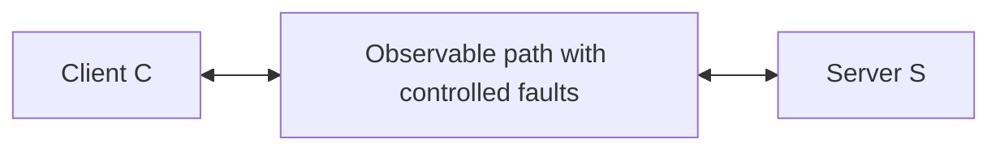

# DTLS English check procedures

> **Kind:** procedure · **Status:** current · **Seal:** none · **Owns:** — · **Stands on:** [features.md](https://github.com/mgonzalezlopezudc/inet/blob/5284847df92eea8451bf056d8722fabb0ddf65bd/doc/project/evidence/protocol/dtls/features.md)

Two endpoints, client C and server S, communicate through a path that can record, lose, delay, duplicate and alter datagrams. Unless a check changes it, both endpoints offer compatible parameters and the path delivers records unchanged. Record observations identify direction, message type, message sequence, epoch and record number. A missing-output observation first confirms the corresponding input or drop.

| Check | Initial condition and stimulus | Required observation |
| --- | --- | --- |
| Record boundaries | Deliver truncated and concatenated records, then a valid separate datagram | Invalid boundaries discard only their unparseable remainder; the next datagram is processed independently |
| Setup | Offer compatible PSK/certificate parameters and complete the exchanged flights | Correct message order and establishment after peer Finished |
| Retry | Require cookie validation; separately send expired, mismatched and valid tokens | Rejected token cannot establish; a valid retry completes; legacy_cookie stays empty |
| Negotiation failure | Offer no common version/suite or select an unoffered suite | Specified alert and no established association |
| Peer isolation | Use two clients sharing a listening endpoint, then replace one association | The unrelated conversation remains usable and the old state survives an unvalidated attempt |
| Lost flight | Drop a selected handshake record or final ACK | Original message/epoch is retransmitted with a fresh record number and finite backoff |
| Reassembly | Reorder and duplicate identical ranges of a large message | One assembled message; no double counting of overlaps |
| Conflicting fragment | Change an already-retained byte in an overlapping range | Abort that handshake with illegal_parameter |
| Selective ACK | Drop one fragment while acknowledging retained records | Retransmit outstanding content only; ACK of unsent content cannot complete a flight |
| Datagrams | Lose and reorder distinguishable application datagrams | No retransmission for application loss; preserve datagram boundaries |
| Replay | Duplicate and age records within a reconstructable sequence range | Deliver a new in-window record once; reject duplicate and too-old identities |
| Expansion | Compare selected-suite framing, inner type, padding and tag lengths | Expansion follows the negotiated representation without changing application boundaries |
| Invalid record | Inject malformed content while a flight timer is pending | No invalid delivery or timer restart |
| KeyUpdate | Drop the update ACK, duplicate the update, then acknowledge it | Retry in original epoch; one receive transition; sender advances only after ACK |
| Close | Deliver and separately lose closure alerts | No alert retransmission; no dependence on reliable peer notification |

Detailed sequences are in [handshake checks](https://github.com/mgonzalezlopezudc/inet/blob/5284847df92eea8451bf056d8722fabb0ddf65bd/doc/project/evidence/protocol/dtls/checks/handshake.md) and [record checks](https://github.com/mgonzalezlopezudc/inet/blob/5284847df92eea8451bf056d8722fabb0ddf65bd/doc/project/evidence/protocol/dtls/checks/records.md). These procedures define expected protocol behavior, not execution outcomes.
