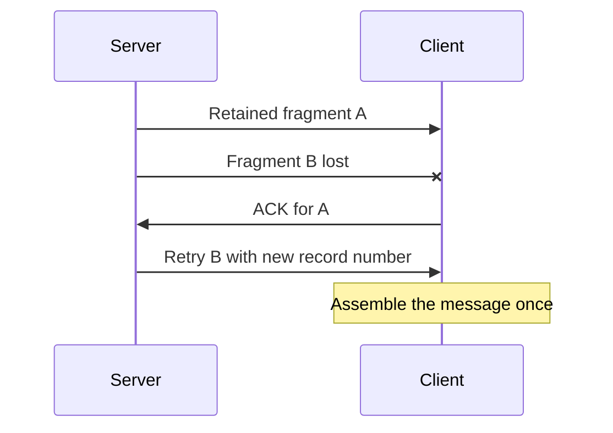

# DTLS handshake checks

> **Kind:** procedure · **Status:** current · **Seal:** none · **Owns:** — · **Stands on:** [checks.md](../checks.md)

## Establishment and cookie

Start two compatible endpoints. Observe ClientHello, the optional cookie retry, ServerHello, the selected authentication flight, client Finished and the final ACK. Repeat with initial client certificate authentication. A retry request must combine cookie and missing-share requirements instead of issuing a second HelloRetryRequest. In each rejection variant, identify the offending input and require the appropriate alert and absence of establishment.

## Loss and fragments

Drop one identified server-flight record. Require an acknowledged received fragment to remain retained and only its unacknowledged content to be sent again. The retry preserves handshake sequence, body bytes and epoch while obtaining a new record number. Separately lose the final ACK and require a repeated ACK in response to the client's final-flight retransmission. A permanently unresponsive path must reach an explicit local attempt deadline.

## Updates

Complete the initial handshake before requesting an update. Lose its ACK, then permit a retransmitted update and its ACK. Require the update's original sending epoch on both transmissions, no duplicate receive transition, and sending under the new epoch only after ACK. Cross two requested updates and require non-requesting responses without a request echo loop. Do not send another requested update until a subsequent peer update has arrived.
