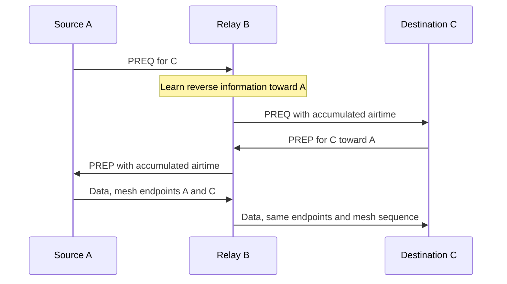

# IEEE 802.11 mesh — check procedures

> **Kind:** procedure · **Status:** current · **Seal:** none · **Owns:** `WIFI-CHECK-*` · **Stands on:** [Features](features.md), [Mesh catalog](../../standard/ieee80211/catalog.md)

These procedures describe controlled stimuli and expected observations. A run must identify its selected profile, capabilities, topology, timer settings and observation window. A missing implementation or unsupported setup does not establish a protocol failure. Use independent encoded-byte expectations for format assertions; a serialization round trip alone is insufficient. Each endpoint derives its state from its own received frames, transmission outcomes and timers.

## WIFI-CHECK-WIRE

Construct literal byte fixtures from the mesh element and action layouts, independently of the codec. Include Mesh Control AE0/1/2; ID, configuration, peering/AID, TIM/DTIM and awake-window elements; PREQ with several targets; PREP; multi-destination PERR; RANN and link metric reporting. Decode and compare every field, presence flag, count, offset and length. Separately build typed content and compare serialization with the same literals. Truncate each variable boundary, mismatch counts/lengths, include unknown optional elements and set reserved receive fields. Expect bounded rejection of malformed content while honoring the standard's individual receive rules for reserved and optional information. A valid prefix followed by malformed content must not partly apply state.

## WIFI-CHECK-PEERING

Start compatible neighbors with no peering. Observe discovery, Open/Confirm and establishment, including local/peer link IDs and assigned AIDs. Check Address 3 equals the transmitter for the selected beacons, probe responses and peering actions; Probe Requests use their wildcard/intended-recipient exception. Exercise both Open-first and Confirm-first ordering, duplicate Open/Confirm and simultaneous opens. Eligibility starts only after establishment. Repeat with a mismatch in each of the seven profile parameters and with incompatible basic sets; no relationship may establish. Confirm advertised TIM/DTIM and required awake-window fields even when no traffic is buffered.

## WIFI-CHECK-PEERING-FAILURE

Suppress Open or Confirm, then deliver controlled Close and stale-instance messages. Observe retry, confirmation and holding timers at just before and at their deadlines. Retry exhaustion closes the instance and enters holding; accepted Close ends holding, while further Open/Confirm in holding does not revive the old instance. A subsequent valid new relationship must not inherit retired instance identity or pending traffic. Check the state/event transitions independently of a successful happy-path exchange.

## WIFI-CHECK-BEACON-TIMING

Give neighboring stations controlled TSF offsets and beacon phases. Delay channel access and compare the transmitted timestamp with the specified symbol reference, rather than enqueue time. At the receiver account for the reference point and PHY elapsed time before updating the neighbor offset. Assert bounded slowing, retained residual correction and correct subsequent TBTT spacing. Verify valid computed FCS after final timestamp preparation. A delayed transmission must not reset the local clock through an infrastructure synchronization procedure.

## WIFI-CHECK-FORWARDING

Use a line A–B–C with no A–C radio reachability and eligible paths/peerings. Send an MSDU from A to C. Observe new hop addresses at B with preserved mesh source/destination, payload and mesh sequence; C delivers once and B does not deliver transit unicast upward. A final-destination TTL-one frame is delivered without a transit decrement; a transit TTL-one frame cannot propagate. Reject invalid incoming wire TTL zero. Repeat with stale duplicates, unsupported AE, nonpeer input and missing precursor admission. Invalid traffic must not acquire a usable forwarding path.

## WIFI-CHECK-GROUP-FORWARDING

Use a cycle with a branch and send native group traffic, including ARP-like payload. Assert local group delivery, bounded forwarding, decremented TTL and suppression of looped-back source traffic. Incoming TTL one decrements to zero but still permits local delivery without onward forwarding; incoming wire TTL zero is invalid and rejected. Retransmission duplicates must not produce repeat delivery. Mesh sequence wrap, per-hop MAC retry sequence and HWMP sequence remain separate. Repeat with a sleeping peer when power save is selected.

## WIFI-CHECK-AIRTIME

Pin outgoing PHY selections independently in both directions. Generate actual unicast payload attempts and controlled ACK losses. Query each directional metric and request a Link Metric Report. Check the selected metric's encoding and outgoing direction; an incoming report must not overwrite local estimates. Verify ID 1 with n=1 and ID 2 with controlled constituent counts, including nested aggregation and retry PPDUs. Exclude unsent holds, group, management and QoS Null traffic from payload/error observations. Error/aggregation estimator details are local choices and their assertions belong with the model policy. The normative oracle uses the catalog's formula, encoding units and test frame size.

## WIFI-CHECK-DISCOVERY

Use A–B–C with no usable A–C path. Observe source PREQ, B's reverse information, target PREP and resulting unicast delivery. Suppress any IP routing between hops. Exercise target-only, reply-and-forward, target sequence unknown and multiple-target cases. With USN=1, vary the reserved target-sequence bytes and require unchanged reply eligibility and own-sequence baseline. With USN=0, cover known requested sequence and the model's explicit half-range baseline. Send the same originator/discovery identity with a better eligible update and a separate unseen identity with equal target sequence. Check the precise PREQ processing predicates instead of rejecting every repeated identity. A PREQ update can release queued traffic only when the corresponding forwarding information has the required validation and precursor admission; creating reverse information alone must not validate a new path. Reject HWMP control from non-established peers and malformed whole action bodies without state mutation; a following valid action must still work.

## WIFI-CHECK-PATH-SELECTION

Use a diamond with unequal outgoing airtime costs and independently controlled destination sequences. Prefer fresher eligible information, then a lower accumulated metric for equal freshness; fewer hops alone must not win. Include wraparound and retained sequence history after expiry. Query immediately before, at and after expiry without intervening refresh. At expiry the path must be unusable; an older reply must not revive it. Ensure arithmetic cannot turn a large accumulated cost into a small preferred value.

## WIFI-CHECK-DISCOVERY-LIMITS

Suppress replies and observe the bounded discovery attempts, fresh identifiers and sequence increments. No retry occurs earlier than twice the configured network diameter traversal time. Exercise packet wait expiry independently of discovery exhaustion, capacity across destinations and release after an accepted usable update. A late reply may update path information but must not resurrect an expired MSDU. Buffer limits and admission policy are local choices; verify them against the declared model policy without calling them standard defaults.

## WIFI-CHECK-PATH-ERROR

Establish several destinations sharing one next hop plus an unaffected destination. Break only that hop and observe invalidation and PERRs to affected precursors. Inject each reason with zero, older, equal and newer sequence values from the selected next hop and a different neighbor. Apply the reason-specific sequence predicates, retaining the unknown-sequence increment case. Test element TTL and precursor expiry. Unaffected paths remain valid. Expected sleep or an unsent local hold must not imitate on-air retry exhaustion.

## WIFI-CHECK-REDISCOVERY

Establish an initial path in a diamond, remove its connectivity while keeping stations operational, then send more traffic. Assert failed-path invalidation, correct path error propagation and bounded discovery of the alternate path. The replacement obeys freshness/metric rules and delivers remaining eligible data once. Genuine expiry drops data; a late reply does not release it.

## WIFI-CHECK-ROOT-PREQ

Enable one proactive-PREQ root with on-demand discovery still available. Observe root PREQ propagation, its proactive flags and reply cases, then send traffic toward the root and between nonroot endpoints. Assert valid root paths and correct independent on-demand state. For flag zero, generate later local-source demand and require its proactive reply before DATA. Exercise sustained refresh and idle-then-leaf-only traffic under the declared proactive-response sequence interpretation, without an ordinary leaf discovery supplying the sequence advancement. Change only the root mode in the matching control to distinguish proactive behavior from ordinary discovery.

## WIFI-CHECK-RANN

Enable one RANN root. Observe announcements, path/forwarding/TTL/interval-gated propagation and individual root-confirmation PREQ/PREP addressing, without adding an unsupported random forwarding delay. Suppress the confirming reply: an announcement alone must not become a completed bidirectional path. Send equal-sequence announcements with lower, equal and higher metrics; equal metric remains eligible under the RANN rule. Change the received Interval and check the shared scalar, own origination timing/advertisement, and preservation of each forwarded wire value. Restore confirmations and require normal delivery.

## WIFI-CHECK-ROOT-COEXISTENCE

Use each root mechanism separately with two simultaneous nonroot discoveries. Exercise root refresh/maintenance deadlines, lost confirmations and stale root information. One destination's discovery or cancellation must not consume another's retry budget or cancel the root procedure. Check station-wide RANN/confirmation Action pacing, common-Address-1 batching, fair distinct receivers and management-body limits. Source retry spacing still applies when a confirmation also serves a source attempt. Root reachability must not turn a root into an unconfigured mesh gate.

## WIFI-CHECK-HT-NEGOTIATION

Pair compatible and incompatible HT mesh stations. Vary basic MCS, receive bandwidth, spatial streams and GI support. Observe advertised and committed directional intersections, legal fixed PHY tuples and rejection of incompatible basic sets. A local HT catalog entry alone must not authorize transmission to an ineligible peer. Unsupported mesh capabilities remain unadvertised.

Treat membership selectors separately from capability and basic-set equality. Decode received `FF` as an HT requirement and `FE` as a VHT requirement, admitting only locally supported requirements in an otherwise valid peer profile. Reject unsupported/unknown requirements and inspect both rate elements. Under the selected non-AP omission policy, absence of transmitted HT/VHT selectors is legal and does not waive typed basic-set checks.

Exercise actual 20/40-MHz geometry and primary-anchored narrower transmission. Keep contention on primary CCA and test secondary-only occupancy separately: a fixed-width hold preserves CW, packet ownership and retry/error state, then resumes without another packet arrival. Check the required idle boundary and reject unsupported protection conditions. Configured catalog membership alone is not radio support.

## WIFI-CHECK-VHT-NEGOTIATION

Repeat negotiation with VHT basic MCS/NSS and receive limits across the selected widths and streams. Inspect actual data PPDUs, including VHT single-MPDU delimiter/EOF bytes. Assert legal directional choices and explicit rejection of unsupported combinations. Also check mesh-wide metric equality when comparing ID-1 and ID-2 profiles.

At operating20, assert the mandatory device20/40/80 baseline independently of Operation fields. Optional160 advertisement requires real support and its baseline; operating160 without it is refused. Exercise width-specific peer Rx SGI bits separately from local Tx activation, including advertised Rx SGI with Tx disabled and a conflicting fixed-short request. Preserve both guard intervals in the legal tuple matrix.

For 20/40/80/160 MHz, distinguish operation center segments from the actual PHY center and verify primary-anchored narrowing. Include both primary halves of the selected contiguous 160-MHz block, invalid pairs/subblocks and capability boundaries. Independently check delimiter length high/low bit placement, CRC, signature, member FCS and EOF instead of relying only on round trips. State the configured allocation's external regulatory/DFS/startup-selection assumptions.

## WIFI-CHECK-HIGH-THROUGHPUT-DATA

Deliver unicast and group traffic through a relay using each selected HT/VHT profile. Inspect negotiated mode, width, MCS, NSS, GI and acknowledgment form on each hop. Verify capture reconstruction and exactly-once upper delivery. Group traffic uses its selected legal unacknowledged format. A profile's advertised capability must correspond to an exercised production path.

Check same-width non-HT duplicate ACK/Block Ack responses to wider DATA, with the legal basic/reference response rate and per-copy duration. Distinguish occupied bandwidth from decoding bandwidth. Under the selected primary-copy decoding policy, secondary-only disjoint interference must leave decoded primary-copy SNIR/error/delivery unchanged, while primary interference changes it; another receiver must still observe full-width transmitted interference and split power. Check that ending a narrow holder exchange does not silently authorize wider DATA in the same unprotected TXOP. Preserve the scalar 20-MHz reference and legacy controls separately from dimensional wider-channel evidence.

## WIFI-CHECK-AMSDU

Aggregate several source MSDUs with common native mesh source/destination and RA/TA/TID, then forward the resulting aggregate through a relay. Compare literal mesh subframe layout, little-endian length, common aggregate mesh sequence, per-subframe TTL/endpoints and padding. Perform duplicate admission once per forwarding unit and require exactly-once delivery of every constituent. Reject mixed native endpoints even if their next hop matches. Exercise malformed lengths and duplicates. Give constituents different lifetime deadlines: an existing A-MSDU remains complete while any constituent remains unexpired, and expires as a unit when all expire. Update aggregation observations once per actual payload PPDU, including an unacknowledged transmission. Transit splitting/merging restrictions are declared model policy, not a normative prohibition inferred from the figure.

## WIFI-CHECK-AMPDU-BLOCK-ACK

Establish the selected immediate Compressed Block Ack agreement, aggregate multiple MPDUs and lose a selected member at the receive PSDU boundary. Inspect delimiter integrity, individual FCS decisions and the matching Block Ack bits. Retransmit eligible missing members without changing sequence identities or redelivering accepted members. Repeat with a lost Block Ack, BAR recovery, nested A-MSDU and whole-PPDU loss. Teardown and reestablish the peer while recovery is pending; retired constituents must not reappear.

## WIFI-CHECK-AGGREGATION-LIMITS

Set negotiated byte, MPDU count, duration and spacing bounds to exact boundaries. Verify the complete PPDU and response fit the selected admission limit before extraction/sequence commitment. Exercise a smaller retry A-MPDU, expiry while awaiting recovery and incompatible aggregation permissions. Distinguish an A-MSDU's all-constituents deadline from a plain MPDU's deadline; do not remove one constituent from a still-valid committed A-MSDU on retry. Decode serialized bytes independently; a typed aggregate object alone does not prove valid framing.

## WIFI-CHECK-POWER-MODES

Request different modes toward two peers. Observe PM/PSL signaling and each endpoint's local effective mode. Lose the ACK of a lower-activity transition and require that the transmitter does not adopt the lower activity. Exercise individual and group higher-activity indications, including one receiver missing a group indication. Verify derived nonpeer mode and ensure one active-mode peering prevents local doze.

## WIFI-CHECK-TIM-DTIM

Buffer traffic for two assigned peer AIDs and for the group. Decode partial bitmap offset/AIDs and DTIM count/period. After the DTIM's actual transmission, require all buffered group traffic before individually addressed traffic and correct More Data termination. Keep an unacknowledged retry pending and require its TIM indication until acknowledgment, expiry or teardown. Awake-peer traffic behind sleeping-peer traffic must progress, and a newly eligible peer must resume queued traffic without requiring a new packet arrival.

## WIFI-CHECK-AWAKE-WINDOW

Delay beacon/probe access and compare the advertised window with actual transmission end. Probe just before and exactly at its deadline. An exchange already admitted holds the radio awake through its required response; it does not authorize a later exchange after the window. Transmit group data and assert PostAwakeDuration and completion/idle obligations. Overlap obligations from different peers and require doze only after all permit it.

## WIFI-CHECK-LIGHT-SLEEP

Use nonzero radio switching time and controlled peer TBTTs. Verify RX readiness before every corresponding peer beacon. TIM individual indication causes RSPI=1 trigger; group indication holds the receiver awake through completion/idle timeout. Show actual sleep intervals, no transmission outside a permitted opportunity, and no link-error samples or PERR from expected holds. Pending peering/probe transactions and exchanges prevent premature sleep.

## WIFI-CHECK-DEEP-SLEEP

Require wake before every own TBTT and advertised window, even without listening to every peer beacon. Exercise the declared local synchronization-maintenance policy and recovery from an invalid timing reference. Wall-clock path and packet lifetimes still expire while asleep. A queued expired packet must not return when the peer wakes.

## WIFI-CHECK-SERVICE-PERIOD

Start with no MPSP and a valid rendezvous between sleeping peers. For RSPI/EOSP 00, 01, 10 and 11 assert respectively transmitter-only, neither, both and receiver-only ownership, with excluded directions toward active-mode recipients. Follow actual trigger ACK outcomes, then deliver buffered data across multiple TXOPs. Opposite directions and different peers may overlap. A recipient-only role does not authorize unrelated outgoing data TXOPs. Both participants stay awake through terminating ACK as required by their endpoint-local state.

## WIFI-CHECK-POWER-RECOVERY

Lose trigger and terminating ACKs separately. Observe the endpoints independently: the receiver cannot query the sender's ACK result. Require applicable retransmission, retry/lifetime limits, and distinction between successful termination and exhausted unconfirmed termination. Resolve retained obligations through a later confirmed exchange or explicit peer closure. A late ACK after closure must not revive the period. Doze requires completion of all remaining obligations.

## WIFI-CHECK-POWER-HT-VHT

Repeat buffered delivery and termination over HT/VHT aggregates with nested A-MSDU. A lost terminating member's Block Ack bit prevents premature successful termination. Retry eligible missing members under the applicable individual or whole-A-MSDU lifetime; never restore an already expired forwarding unit or rebuild a smaller A-MSDU under its existing identity. Repeat metric IDs independently with a single ID per mesh. Combine a sleeping relay with on-demand discovery and each root mode, setting traversal/packet budgets to permit the declared rendezvous interval. Require eventual delivery or bounded genuine expiry, preserved identities, and no payload/error samples from sleep holds or QoS Null signaling.

## Standard parameter defaults

IEEE Std 802.11-2024 Annex C.3 defines the following MIB defaults. A TU is 1024 microseconds. These values identify the default protocol configuration; a deliberate test override must be recorded.

| Parameter | Default | Source span in `ieee80211-2024:clause:C.3` |
| --- | --- | --- |
| Mesh peering maximum retries | 2 | `22418306:22418855` |
| Mesh peering retry timeout | 40 ms | `22418897:22419425` |
| Mesh peering confirm timeout | 40 ms | `22419467:22420389` |
| Mesh peering holding timeout | 40 ms | `22420431:22420977` |
| HWMP maximum PREQ retries | 3 | `22444692:22445686` |
| Network diameter traversal time | 500 TU | `22446316:22446894` |
| PREQ minimum interval | 100 TU | `22446936:22447511` |
| PERR minimum interval | 100 TU | `22447553:22448513` |
| Active path to root timeout | 5000 TU | `22448555:22449256` |
| Active path timeout | 5000 TU | `22449298:22449914` |
| Root PREQ interval | 2000 TU | `22450875:22451874` |
| RANN interval | 2000 TU | `22451916:22452489` |
| Root path maintenance interval | 2000 TU | `22453377:22453994` |
| Root confirmation interval | 2000 TU | `22454037:22455056` |

MeshAwakeWindowDuration and MeshSTAMissingAckRetryLimit have no DEFVAL in this clause. A simulator's chosen defaults must be described as model policy, not attributed to an absent normative default. Informative Annex S guidance does not change that distinction.
