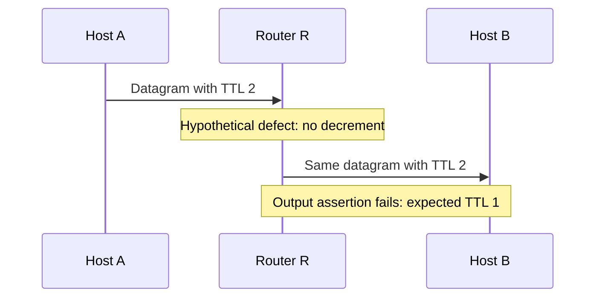

# Write an implementation plan

> **Kind:** procedure · **Status:** draft · **Seal:** none · **Owns:** — · **Stands on:** [planning.md](../rule/planning.md), [contribute-a-change.md](contribute-a-change.md), [documentation.md](../rule/documentation.md)

Use this procedure for a task that calls for an implementation plan. Its proposed requirements are in [planning.md](../rule/planning.md). That document states when the draft approval process applies.

The current [commit series rule](../rule/pull-request.md#pr-series-plan) and [protocol test rule](../rule/testing.md#tr-plan-protocol) apply to plan content. Their requirements do not depend on acceptance of the draft approval process.

## 1. Establish the current behavior

Follow the discovery route in [contribute-a-change.md](contribute-a-change.md). Record the checkout revision and relevant local changes. Trace the behavior through its actual caller and effective configuration. Separate observed facts from assumptions under [PLR-GROUNDED](../rule/planning.md#plr-grounded).

## 2. Define the change

State the intended behavior and acceptance criteria under [PLR-SCOPE](../rule/planning.md#plr-scope). Mark optional work as a separate follow-up. Explain compatibility effects through the design review map below.

Establish the required model detail before you select an implementation. Identify the applicable standard conditions, the selected model's supported detail, and the required observable result. Preserve mandatory behavior within that scope. Use [AR-MOD-FIDELITY](../rule/architecture.md#ar-mod-fidelity) to assess changes to the model's level of detail. A hypothetical correction to frame handling in a packet-level radio model does not itself require new hardware processing delays. An existing model limitation does not excuse a new violation of the supported contract.

## 3. Choose the design

Use [PLR-DESIGN](../rule/planning.md#plr-design) to describe component responsibilities. Compare relevant reuse options before you propose an addition. A useful comparison records these fields:

| Field | Content |
| --- | --- |
| Proposed addition | The class, interface, signal, parameter, or other mechanism |
| Responsibility | The behavior or information that it owns |
| Required consumer | The caller, observer, or documented external extension |
| Reuse option | The existing mechanism that could meet the need |
| Reason for the choice | The specific limitation of reuse and the cost of the addition |

### State, event, and lifecycle decisions

Use [QR-DESIGN-MINIMAL](../rule/quality.md#qr-design-minimal) to choose local, retained, or derived values from their required lifetime. Check whether existing state already represents the required condition. Assess any new event boundary, random draw, or parameter evaluation before you change the control path. Explain only the decisions that affect the proposed behavior.

For lifecycle work, trace the concrete handlers and inherited behavior under [AR-LIFE-OPERATIONS](../rule/architecture.md#ar-life-operations). Distinguish initialization, ordinary stop/start, crash, and module destruction. Ordinary stop/start uses the existing module; initialization does not repeat. In [OperationalMixin](../../../src/inet/common/lifecycle/OperationalMixinImpl.h), the normal message handler also serves start and graceful stop. For example, a new guard that rejects all messages during graceful stop can prevent a required completion. Check the existing lifecycle state before you add another flag.

Keep reusable resources alive across stop/start when their owner requires reuse. The [UdpBasicApp source](../../../src/inet/applications/udpapp/UdpBasicApp.cc) illustrates a timer that initialization creates and lifecycle start reuses. Its stop handler cancels the timer; its destructor releases it. Use the existing owner's cancellation API when the contract only requires cancellation. See the [lifecycle guide](../../src/users-guide/ch-lifecycle.rst) for supported operations.

Separate existing lifecycle limitations from supported guarantees and defects that the proposed change introduces. For IEEE 802.11, consult the [lifecycle analysis](../design/ieee80211-anatomy.md#7-lifecycle-operations) before you infer support from the node's lifecycle interface. Confirm that analysis against the active source. For example, a MAC with empty stop handlers does not establish that its child timers stop. Include repairs to existing limitations only when the requested behavior depends on them or the task explicitly includes them.

### Design review map

Use only the rows that apply. Each linked document owns its technical requirements.

| Concern | Authoritative rules |
| --- | --- |
| Required behavior, reachable failures, and minimal safeguards | [QR-DESIGN-MINIMAL](../rule/quality.md#qr-design-minimal) |
| Reuse and justified additions | [AR-EXT-REUSE](../rule/architecture.md#ar-ext-reuse) |
| Replaceable roles and interface contracts | [AR-ORG-CONTRACTS](../rule/architecture.md#ar-org-contracts), [AR-ORG-CONTRACT-PURITY](../rule/architecture.md#ar-org-contract-purity) |
| Class or module responsibility | [AR-MOD-COMPOSITION](../rule/architecture.md#ar-mod-composition) |
| Member visibility and virtual methods | [AR-EXT-MINIMAL-SURFACE](../rule/architecture.md#ar-ext-minimal-surface), [AR-EXT-VIRTUAL-IS-A-PROMISE](../rule/architecture.md#ar-ext-virtual-is-a-promise) |
| State and object lifetime | [QR-STATE-OWNER](../rule/quality.md#qr-state-owner), [QR-OBJECT-OWNERSHIP](../rule/quality.md#qr-object-ownership) |
| Initialization and supported lifecycle operations | [AR-LIFE-STAGES](../rule/architecture.md#ar-life-stages), [AR-LIFE-OPERATIONS](../rule/architecture.md#ar-life-operations) |
| Calls, notifications, and observations | [AR-COM-DIRECT](../rule/architecture.md#ar-com-direct), [AR-COM-NOTIFY](../rule/architecture.md#ar-com-notify), [AR-OBS-SIGNALS](../rule/architecture.md#ar-obs-signals) |
| Units and configuration | [QR-CMT-UNIT](../rule/quality.md#qr-cmt-unit), [AR-CFG-INFER](../rule/architecture.md#ar-cfg-infer), [AR-CFG-PARAMS](../rule/architecture.md#ar-cfg-params) |
| Protocol requirements and model detail | [QR-CMT-STANDARD](../rule/quality.md#qr-cmt-standard), [AR-MOD-FIDELITY](../rule/architecture.md#ar-mod-fidelity), applicable [domain rules](../domain/README.md) |
| Compatibility and migration | [release.md](../rule/release.md) |
| Tests and recorded expectations | [testing.md](../rule/testing.md) |
| Commit boundaries and order | [pull-request.md](../rule/pull-request.md) |
| Protected paths and document units | [sealing.md](../rule/sealing.md) |

## 4. Define the steps and verification

List every future commit in dependency order under [PR-SERIES-PLAN](../rule/pull-request.md#pr-series-plan). Give each entry a stable identifier, such as `C1`, and a proposed subject. Expand steps that contain several commits. Explain any commit that covers several steps. For example, a hypothetical interface change and its implementation updates need one commit to preserve a buildable tree.

Explain each commit once. Use compact prose or the [commit entry template](#commit-entry-template), according to the detail that the reviewer needs. For a longer series, this optional index can link to the detailed entries:

| Commit and proposed subject | Dependencies | Detailed entry |
| --- | --- | --- |
| `C1: <subject>` | `<earlier identifiers or none>` | `<link to the commit explanation>` |

Apply [PLR-VERIFICATION](../rule/planning.md#plr-verification) to every entry. For each protocol repair or feature, include explicit tasks to write the tests and reviewer document under [TR-PLAN-PROTOCOL](../rule/testing.md#tr-plan-protocol). Name existing tests that expose the gap. State when none exist. Specify how each new or extended case exposes the gap and how the code will change its result.

Compare later commits with their proposed parents. Label effects of earlier planned commits as assumptions. Explain why protocol tests or reviewer documents do not apply to other commits. Keep their appropriate verification explicit. Use [run-the-gates.md](run-the-gates.md) for the applicable build and check procedure.

## 5. Review the plan

Use the checklist below before you request approval. Resolve assumptions that affect the design under [PLR-GROUNDED](../rule/planning.md#plr-grounded). Scale the detail under [PLR-PROPORTION](../rule/planning.md#plr-proportion).

Investigation is sufficient when these facts support a concrete decision:

- The applicable requirement and model scope are clear.
- The actual path, responsible owner, and reachable failure or required new behavior are clear.
- The smallest adequate change and direct verification are clear.

Continue investigation when a specific unresolved fact can change that decision. Successful tests for code that does not yet exist are not a prerequisite for a plan.

### Review checklist

Use the plan's existing explanation as the answer to each applicable row. Add evidence or a specific gap where an answer is missing. A separate checklist report is unnecessary when the plan already supplies the answers. This review evaluates a proposed plan; it does not claim that implementation tests pass.

| Review question | Rule |
| --- | --- |
| Can a maintainer explain the behavior, its reason, and its result from the plan alone? | [PLR-READABLE](../rule/planning.md#plr-readable) |
| Which facts support the chosen owner and production path? | [PLR-GROUNDED](../rule/planning.md#plr-grounded) |
| What observable result establishes completion? | [PLR-SCOPE](../rule/planning.md#plr-scope) |
| Why does each significant addition need to exist? | [PLR-DESIGN](../rule/planning.md#plr-design) |
| Which requirement and reachable failure justify each safeguard? | [QR-DESIGN-MINIMAL](../rule/quality.md#qr-design-minimal) |
| Which check reaches each claimed behavior, and what remains unverified? | [PLR-VERIFICATION](../rule/planning.md#plr-verification) |
| Does the plan enumerate every future commit, with dependencies and behavior relative to its proposed parent? | [PR-SERIES-PLAN](../rule/pull-request.md#pr-series-plan) |
| Does each protocol commit explain the gap, tests to write, expected results, and code correction? | [TR-PLAN-PROTOCOL](../rule/testing.md#tr-plan-protocol) |
| Does each applicable commit include an explicit task for its reviewer `.md`, with its path, test explanations, and necessary diagrams? | [TR-PLAN-PROTOCOL](../rule/testing.md#tr-plan-protocol) |
| Which plan revision and permissions does the approval cover? | [PLR-APPROVAL](../rule/planning.md#plr-approval) |
| Does a revision change an approved decision? | [PLR-REVISION](../rule/planning.md#plr-revision) |
| Is the detail sufficient for the decision and proportionate to the risk? | [PLR-PROPORTION](../rule/planning.md#plr-proportion) |

## 6. Record approval and maintain the plan

Present the concrete plan to the maintainer under [PLR-APPROVAL](../rule/planning.md#plr-approval). Record the actual approval source and scope. Keep material revisions subject to [PLR-REVISION](../rule/planning.md#plr-revision).

Store the plan under `plan/pending/` according to [DR-NAME](../rule/documentation.md#dr-name). Move it to `plan/done/` when the change lands. Use [PR-MSG-PLAN](../rule/pull-request.md#pr-msg-plan) for commit references.

## Plan template

Choose the compact form below when one explanation covers the owner, path, change, and verification. Use the expanded form when interactions need separate explanation. Both forms follow the same plan rules. The placeholders describe content; they are not evidence or approval.

Write the explanation within the selected structure under [DR-EXPLAIN](../rule/documentation.md#dr-explain). Each section must connect its facts so the reader can assess the proposal. A completed template must make sense without a separate chat explanation. The [worked messages](../rule/pull-request.md#worked-messages) show the compact example as a commit message and PR description.

### Compact worked example

This hypothetical example assumes that an edit removed timer cancellation from `UdpBasicApp::handleStopOperation()`. The linked source currently contains that cancellation. The example proposes a repair; it does not report a current defect or executed tests.

**Checkout and approval:** `<checkout, revision, relevant local edit; plan revision; actual approval source and scope, or pending>`.

**Problem and evidence:** After client shutdown, the send timer must not invoke the application while it is down. The hypothetical edit leaves that timer scheduled. [UdpBasicApp](../../../src/inet/applications/udpapp/UdpBasicApp.cc) creates the timer during initialization and reuses it on start. [OperationalMixin](../../../src/inet/common/lifecycle/OperationalMixinImpl.h) rejects self-messages while the application is down. Thus, a later timeout reaches an invalid lifecycle state.

**Change and preserved behavior:** Restore cancellation through the timer owner's existing API in `handleStopOperation()`. Retain the timer object for restart. Preserve the existing socket closure, delayed stop completion, configuration, and cumulative counters. The existing cancellation mechanism prevents the old timeout; no new lifecycle flag or generation counter is necessary. One commit contains the handler repair and its focused regression coverage.

**Commit series:** `C1: UdpBasicApp: prevent send timeouts after shutdown` has no dependencies. It changes the application stop handler and writes the module test below. This hypothetical change repairs an application lifecycle contract, without a protocol exchange change. Protocol tests and a protocol reviewer document therefore do not apply. The module test supplies direct verification.

**Verification:** Derive a proposed `tests/module/udpapp_lifecycle_timer_restart.test` from [udpapp_lifecycle_6.test](../../../tests/module/udpapp_lifecycle_6.test). Choose a send interval that places the pending timeout after shutdown completes. Stop before that timeout, away from its exact timestamp.

Advance beyond that timeout while the client remains down. Check that no send callback occurs during that interval. Restart the client. Check that it sends again and releases the timer at final teardown.

Use the [focused test procedure](run-the-gates.md#during-focused-development) for execution with a fresh debug library. From the checkout root, the proposed command selects the existing case and the new variant:

```sh
inet_run_module_tests -m debug -f 'udpapp_lifecycle_(6|timer_restart)\.test'
```

Confirm that the selector includes both cases after the new test exists. The existing case covers shutdown and teardown; it does not establish restart behavior. The hypothetical edit should fail when the old timeout reaches the stopped application. The repair should suppress that timeout and permit later sends after restart. The new variant's results remain unverified until implementation and execution.

### Protocol worked example

This hypothetical example assumes that an edit removes the TTL decrement from IPv4 unicast forwarding. TTL means time to live. The current [IPv4 source](../../../src/inet/networklayer/ipv4/Ipv4.cc) contains that decrement in `prepareForForwarding()`. The example reports no current defect or executed test result. Its test extension and reviewer document are proposed changes.

**Checkout and approval:** `<checkout, revision, hypothetical local edit; plan revision; actual approval source and scope, or pending>`.

**C1: Ipv4: decrease TTL before unicast forwarding.** This commit has no dependencies. It restores the decrement in `src/inet/networklayer/ipv4/Ipv4.cc`. It also extends the existing TTL-2 test and writes the reviewer document below. All three artifacts belong to C1.

**Protocol gap and correction:** The [TTL requirement](../evidence/standard/rfc791/catalog.md#rfc791-ttl-1) requires a gateway to decrease the TTL. Host A sends one datagram with TTL 2 through router R to host B. Under the hypothetical edit, R forwards the datagram with TTL 2. Restore the decrement before the later output path checks the TTL. R will forward this datagram with TTL 1. The correction uses the existing header update path and adds no state.

**Existing tests:** These fixtures already cover the decrement and its boundary conditions:

- [Rfc791TtlDecrement.test](../../../tests/protocol/ipv4/Rfc791TtlDecrement.test) sends with TTL 32. It requires TTL 31 and a different header checksum at R's output. It also requires TTL 31 at B's input.
- [Rfc1122TtlOneAtDestination.test](../../../tests/protocol/ipv4/Rfc1122TtlOneAtDestination.test) sends with TTL 2 and captures the datagram's identification. It requires that identification and TTL 1 at R's output. It also checks delivery to B's UDP module and no ICMP Time Exceeded response.
- [Rfc791TtlExpiry.test](../../../tests/protocol/ipv4/Rfc791TtlExpiry.test) sends with TTL 1. It requires R to drop the identified datagram and return ICMP Time Exceeded. It also checks that the datagram does not appear at R's output during the final observation interval.

Source inspection indicates that the hypothetical edit will fail all three cases. The first two cases cannot observe their required output TTL. The expiry case cannot observe the required drop because the output path still sees TTL 1. These are expected failures, without execution evidence.

**Task: Extend the protocol test.** Extend `tests/protocol/ipv4/Rfc1122TtlOneAtDestination.test` with a checksum comparison at the existing TTL-2 boundary. Retain `hostA -- router -- hostB`, static ARP, `seed-set = 0`, and the one-second simulation limit. Set `**.checksumMode = "computed"` as in the decrement fixture. Capture the header checksum beside the existing identification capture at A's output.

Require a different checksum in the existing assertion for identification and TTL 1 at R's output. Retain the UDP delivery assertion and the absence check for ICMP Time Exceeded. This extension adds checksum evidence at TTL 2; the TTL boundary already has coverage. Checksum inequality detects an unchanged checksum but does not establish the correct checksum value. The correction should pass all three cases, including the extended case.

**Task: Write the reviewer document.** Add `tests/protocol/ipv4/forwarded-ttl-boundary.md` in C1. Associate it with the plan, C1's subject, and the three test paths. Explain each test's setup, observations, assertions, expected results, and limits. Use the two diagrams below for the TTL-2 scenario. Add an expiry diagram for the distinct drop and ICMP response sequence. The diagrams describe expected behavior, without executed evidence.

Before the correction, the output assertion rejects the unchanged TTL:



After the correction, the router decreases the TTL before output:

```mermaid
sequenceDiagram
    participant A as Host A
    participant R as Router R
    participant B as Host B
    A->>R: Datagram with TTL 2
    Note over R: Decrease TTL from 2 to 1; update checksum
    R->>B: Same datagram with TTL 1
    Note over R: Output assertion checks TTL, identification, and changed checksum
    Note over B: UDP receives the datagram
    Note over A: No ICMP Time Exceeded response
```

**Verification and limits:** Follow [run-the-gates.md](run-the-gates.md) for a fresh debug build before execution. Run this command from the checkout root after the proposed changes:

```sh
inet_run_protocol_tests -p inet -m debug -w '^tests/protocol/ipv4$' -f '^(Rfc791Ttl(Decrement|Expiry)|Rfc1122TtlOneAtDestination)\.test$'
```

Confirm selection of all three files. Record their actual outcomes under [TR-FOCUSED-EVIDENCE](../rule/testing.md#tr-focused-evidence). The cases cover unicast TTL decrement, the TTL-1 expiry response, and delivery to B's UDP module after the TTL-2 boundary. They do not establish multicast behavior, fragmentation, application delivery, or complete checksum correctness. The proposed extension has no executed result. Check diagram rendering before the reviewer document is complete.

### Expanded template

```markdown
# Implementation plan: <subject>

Checkout and revision: <repository, revision, relevant local changes>
Plan revision: <revision or date that identifies the reviewed text>
Approval: <pending, or actual approval source and scope>

## 1. Problem and intended behavior
<Explain the current behavior and intended result through a concrete scenario. An existing failure scenario or reproduction can supply that example.>

## 2. Current implementation and evidence
<Explain how the actual caller, responsible component, and consumers produce the current behavior. Support that explanation with source links and observed evidence.>

## 3. Scope and acceptance criteria
<Required work, optional follow-up work, observable criteria, and preserved conditions.>

## 4. Proposed design and reasons
<Explain how the proposed component actions produce the intended result. Discuss reuse, justified additions, and relevant design choices with rule references.>

## 5. Affected components and compatibility
<Affected artifact types, existing configurations, external consumers, and migration needs.>

## 6. Future commits and dependencies
<List every future commit with a stable identifier, proposed subject, dependencies, purpose, owner, and affected files.>
<Explain each commit once, with compact prose or the commit entry template below. Do not replace commit entries with broad implementation phases.>

## 7. Verification methods and expected results
<Put shared build and execution instructions here. Keep commit-specific scenarios and assertions in the commit entries. Link to those entries instead of repeating them. Keep planned checks separate from observed results.>

## 8. Risks, unresolved decisions, and approval scope
<Design-critical assumptions, required decisions, and any separate permissions.> <For a revision, identify the changed decision and whether renewed approval is necessary.>
```

### Commit entry template

Use this template when its fields help explain the commit. Compact prose can supply the same information. Retain explicit test and document tasks for each applicable protocol commit.

```markdown
### C<n>: <proposed commit subject>

Dependencies: <earlier commit identifiers or none>.
Purpose and scope: <why this commit exists; responsible component and affected paths>.

**Current protocol bug or gap:** <State the requirement and its source. Explain the initial state, trigger, current result, and required result. Cite current code or observed evidence. State any unknown cause. For other changes, explain why protocol fields do not apply.>

**Proposed correction:** <Explain which component changes which action or state, when it changes, and why the result meets the requirement. Compare with the proposed parent. Label assumed effects of earlier planned commits.>

**Existing tests:** <List exact paths and cases that expose the gap. State when no such test exists. Separate observed results from source-based expectations.>

**Task: Write or extend protocol tests.** <Name exact test paths and cases. Define the initial state, configuration, stimulus, production path, observation, and assertion for each case. Explain expected results before and after this commit. Name any prerequisite fixture change and its commit.>

**Task: Write the reviewer document.** <Name the exact .md path beside the tests. Associate it with this commit identifier and subject. List the included tests. Explain the necessary diagrams through the scenarios they must clarify. Use the reviewer document template below.>

**Verification:** <Give the runner, selectors, and coverage limits. Link to shared build and execution instructions. Label commands for absent targets as proposed. Explain any permitted earlier test commit. Keep planned results separate from executed evidence.>
```

### Reviewer document template

The plan names this future artifact and assigns its creation to the applicable commit. Implementation writes the document under [TR-PLAN-PROTOCOL](../rule/testing.md#tr-plan-protocol). It explains that commit's protocol tests to human reviewers. It must make sense without the conversation or test source.

```markdown
# <Protocol behavior>: tests for <commit subject>

Plan and commit: <relative plan link, stable commit identifier, proposed subject>.
Included tests: <relative links to exact test files and case names>.

## Protocol requirement and current gap
<Explain the requirement, applicable conditions, original scenario, incorrect or missing behavior, and source evidence. State the cause or its uncertainty.>

## Code correction and protocol result
<Explain the responsible component, trigger, changed action or state, and resulting protocol behavior. Compare the same scenario before and after the commit.>

## Test scenarios and assertions
<Explain each included test's initial state, configuration, stimulus, production path, observations, and assertions. State what fails before the correction and what passes after it. Explain boundary and failure cases separately when their conditions differ.>

## Protocol diagrams
<Include as many exchange, sequence, state, or timing diagrams as the scenarios need. Label initial state, participants, triggers, relevant boundaries, and observations. Separate original and corrected behavior where this improves the explanation. State why diagrams add no useful information if none are necessary.>

## Execution and evidence
<Give exact build and test commands, mode, selectors, configuration, and seed where applicable. Keep expected results separate from executed results. Include reproducible evidence or state that execution remains unverified. Record whether diagram rendering was checked.>

## Coverage limits
<Explain which production paths and conditions the tests establish, and which remain outside their scope.>
```
