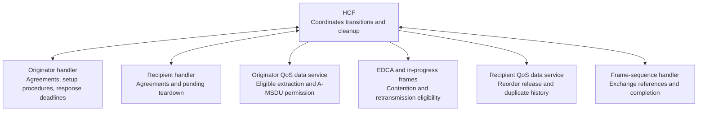
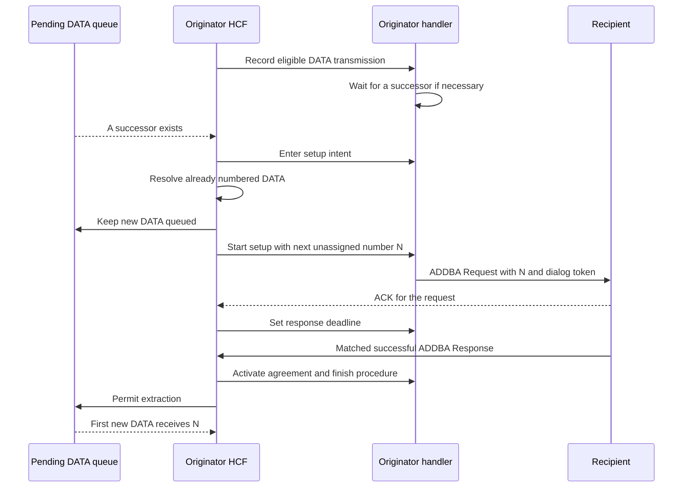
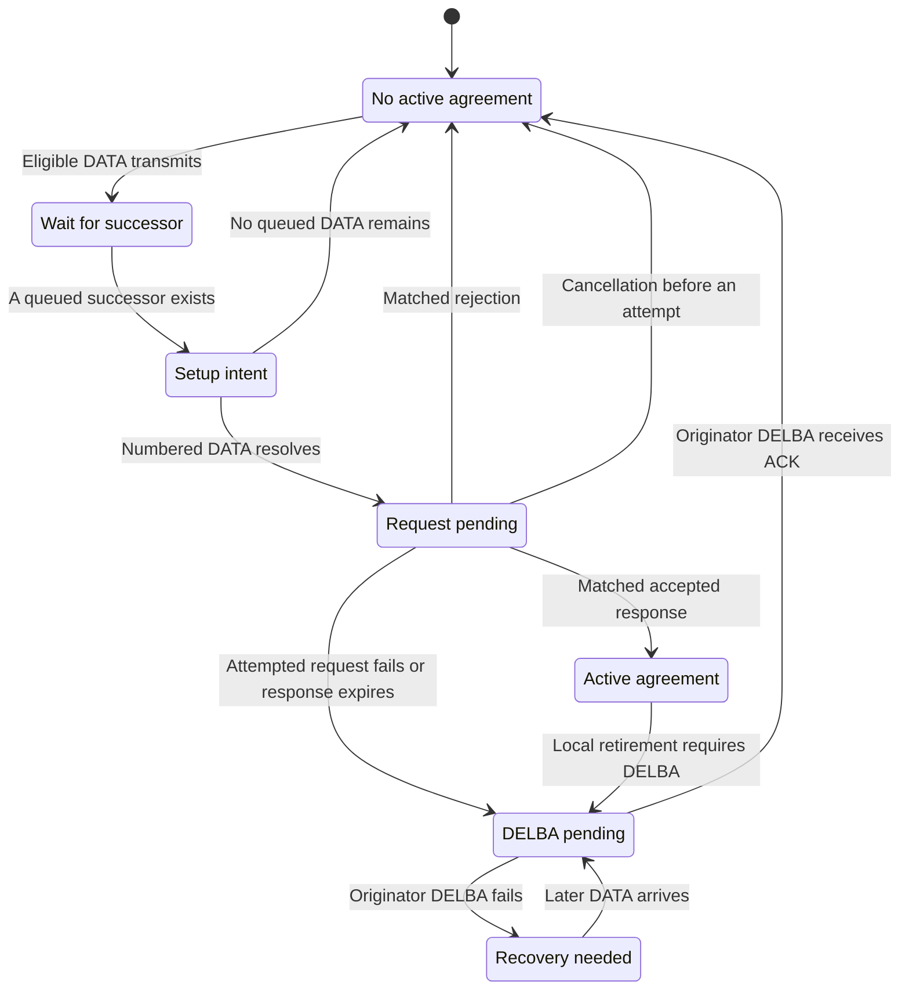
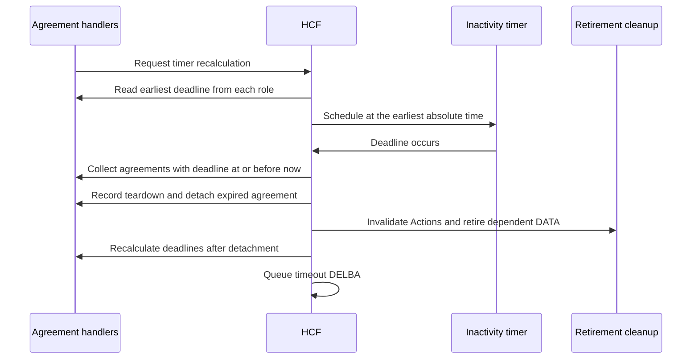
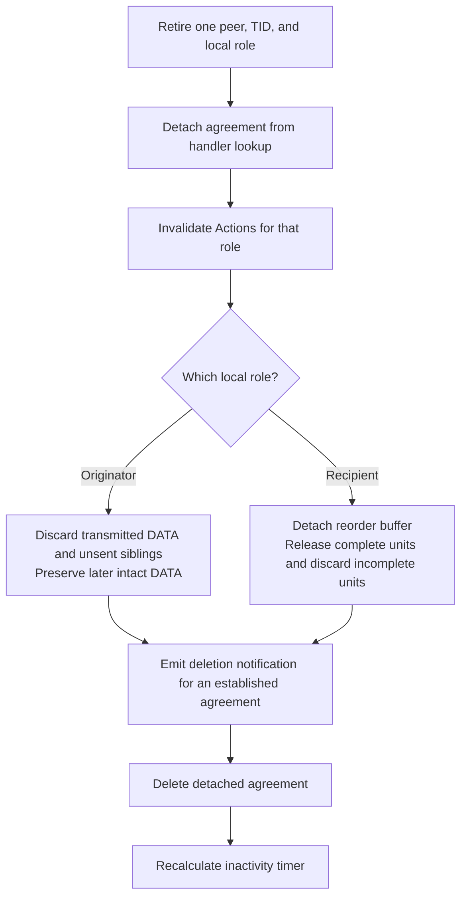
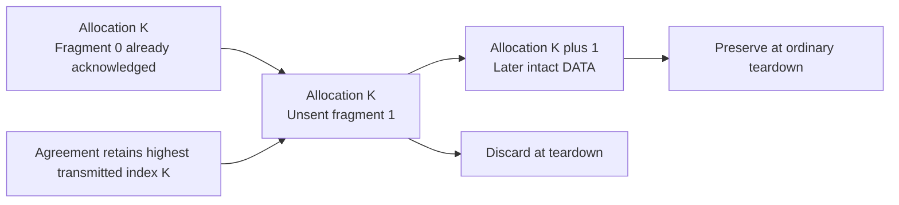
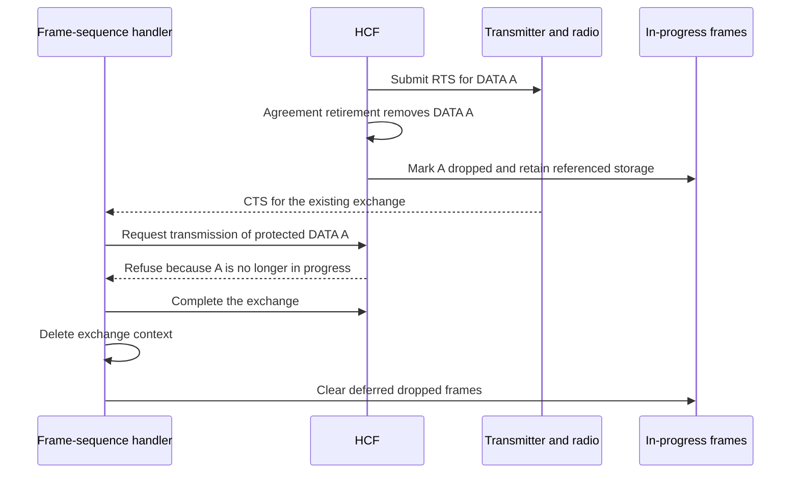
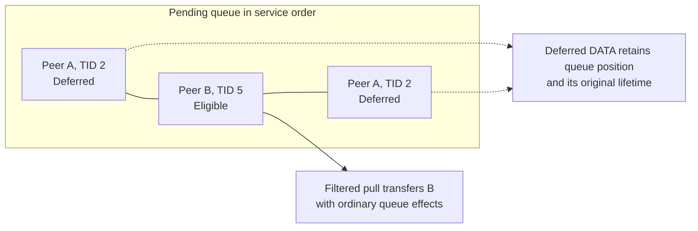

# Block Ack setup and teardown

> **Kind:** history · **Status:** snapshot 2026-10-21 · **Seal:** none · **Owns:** — · **Stands on:** [migration guide](../../src/migration-guide/development/ieee80211-block-ack-agreement-lifecycle.rst), [BAR comparison](../evidence/model/wifi/tests/blockack-bar-without-agreement-comparison.md), [inactivity comparison](../evidence/model/wifi/tests/blockack-inactivity-comparison.md)

The commit `ieee80211: fix: preserve Block Ack setup and teardown boundaries` makes agreement setup and teardown control which DATA frames can proceed. It prevents sequence allocation during unresolved setup, retires expired agreements before timer recalculation, and prevents obsolete exchanges from restoring retired work. These changes connect agreement state to queue extraction, channel access, retransmission, and resource release.

The comparison is with its direct parent, `acdef1761844378991f3afa089f4f7c897825d26`. This snapshot describes those two revisions. The source links identify the responsible files; their worktree contents can include later changes. In particular, this commit does not connect management association replacement to an explicit peer reset. The later commit `ieee80211: fix: clear old peer state before association replacement` adds that connection.

## The problem before the commit

Before this commit, separate components handle agreement events without one common decision about DATA eligibility. HCF can extract more DATA while setup remains unresolved. Extraction can assign sequence numbers that no longer match the first sequence number proposed for the agreement. Teardown can also leave obsolete Actions or unsent fragments associated with a retired agreement.

The inactivity timer has a separate, confirmed defect. Agreement handlers supply an absolute expiration time, but HCF interprets that value as a delay from the current time. An agreement can therefore remain active at its stored deadline.

After this commit, HCF coordinates transitions between the handlers, queue service, and frame exchanges. The handlers retain their agreement and procedure state. HCF decides when a transition requires DATA deferral, retirement, DELBA, or renewed contention.

| Boundary | Before this commit | After this commit |
| --- | --- | --- |
| Setup | Further extraction can advance sequence state. | Already numbered DATA resolves before ADDBA; new extraction waits. |
| Response wait | The policy timeout calculation is unimplemented. | A separate response deadline starts after the request ACK. |
| Inactivity | HCF treats an absolute time as a delay. | HCF schedules the earliest absolute deadline across both roles. |
| Teardown | Agreement removal does not coordinate all dependent work. | HCF detaches the role, invalidates Actions, and cleans its DATA. |
| Channel access | Nonempty queues can represent deferred work. | EDCA checks whether the work is eligible. |
| Late callbacks | Old exchanges can still reach ordinary protocol updates. | HCF excludes obsolete Actions and removed DATA from those updates. |

## Component responsibilities

An agreement belongs to one peer, one traffic identifier (TID), and one local role. The originator role controls outgoing DATA. The recipient role controls incoming DATA. A station can hold both roles for the same peer and TID; ordinary teardown removes only the selected role.

HCF is the hybrid coordination function. EDCA is its contention mechanism, with one access function, or EDCAF, for each access category. The diagram shows local calls and state observations. It does not show radio timing.



The central implementation is [Hcf.cc](../../../src/inet/linklayer/ieee80211/mac/coordinationfunction/Hcf.cc). The [originator handler](../../../src/inet/linklayer/ieee80211/mac/blockack/OriginatorBlockAckAgreementHandler.cc) owns the setup procedure map. The [recipient handler](../../../src/inet/linklayer/ieee80211/mac/blockack/RecipientBlockAckAgreementHandler.cc) owns recipient agreements and the set of pending teardowns.

## Setup preserves the first sequence number

Before this commit, the originator handler can build ADDBA directly after a DATA transmission, from that DATA frame's sequence number plus one. That calculation does not first resolve other DATA that already has sequence numbers. The new setup path instead obtains the next unassigned number from the data service, after already numbered DATA resolves.

After an eligible unicast QoS DATA transmission, HCF records a possible need for setup. If no successor exists, the handler enters `WAITING_FOR_SUCCESSOR`. This state permits ordinary DATA access and has no ADDBA request or response deadline. A later queued successor changes the state to `SETUP_INTENT` before extraction.

During `SETUP_INTENT`, already numbered DATA remains eligible. New DATA for the same peer and TID remains in its queue. HCF starts ADDBA only when queued DATA exists and no already numbered DATA remains. HCF also waits for obsolete Actions that still hold an exchange reference.

The handler builds the request with the next sequence number, without consumption of that number. It records a nonzero dialog token and enters `REQUEST_PENDING`. New DATA remains deferred until setup resolves.



For example, suppose sequence 40 still needs resolution when another DATA frame arrives for the same peer and TID. HCF permits the work for 40 to finish, but keeps its successor queued. If the next unassigned number is 41, ADDBA proposes 41. After successful setup, the first extracted DATA receives 41. This example is hypothetical; the sequence values illustrate the boundary.

An ACK for ADDBA Request confirms request reception; it does not activate the originator agreement. A matched successful ADDBA Response activates that agreement after policy validation. Peer address, TID, and dialog token identify the pending request. A matched rejection ends setup without an active agreement; an invalid successful response does not activate it.

HCF also connects A-MSDU permission to extraction. An active agreement permits A-MSDU only when both negotiated flags permit it. The ACK policy rejects an already formed A-MSDU that violates this permission. The preceding negotiation commit supplies the flag state; this commit activates its use.

## Uncertain setup requires DELBA recovery

The originator cannot infer recipient state from a lost response. The recipient can accept ADDBA even when the originator receives neither the request ACK nor the response. After a request attempt, setup failure therefore requires teardown before surviving DATA resumes.

HCF records whether the transmitter accepts an ADDBA request attempt. A failed or discarded request without an attempt permits local cancellation. A failed attempted request starts DELBA. A missing response after the response deadline also starts DELBA. DELBA is the Action frame that ends an agreement.



The diagram combines handler phases with agreement presence. `Active agreement` and `No active agreement` are explanatory states, not members of `ProcedureState`. Received DELBA can also retire an agreement; the next section explains its direction.

This INET recovery policy uses the DELBA ACK as confirmation before normal access resumes. If originator DELBA fails or the queue discards it, HCF discards the current deferred batch. The handler retains `RECOVERY_NEEDED`. Later DATA triggers one new DELBA exchange; a periodic recovery timer does not run.

For example, a recipient accepts ADDBA but its response is lost. The originator's response deadline starts teardown, while DATA remains deferred. If DELBA also fails, that DATA batch is discarded. A later batch triggers teardown recovery before another setup attempt. Failed recipient-role DELBA instead clears its pending procedure without disposal of outgoing DATA for the opposite role.

The [handler contract](../../../src/inet/linklayer/ieee80211/mac/contract/IOriginatorBlockAckAgreementHandler.h) defines these procedure phases. HCF's `updateAgreementProcedures()` advances them when queue or exchange state changes. Its `beginTeardown()` records teardown, retires the selected role, and queues DELBA.

## Three time limits have different purposes

The response deadline bounds the wait for ADDBA Response after the request ACK. Inactivity bounds an established agreement without qualifying activity. DATA lifetime bounds how long a DATA frame can remain, even while setup or recovery defers it. These limits do not replace one another.

| Time limit | Responsible state | Trigger and result |
| --- | --- | --- |
| ADDBA response | Originator procedure | Request ACK sets the deadline; expiry starts originator teardown. |
| Agreement inactivity | Each agreement role | HCF retires expired agreements and queues timeout DELBA. |
| DATA lifetime | Existing lifetime handler | Expiry discards DATA and can change the setup procedure. |

The originator policy adds `addbaFailureTimeout`, with a default of 100 ms. It must be positive and finite. Both agreement policies reject a nonpositive maximum buffer size or a negative inactivity timeout. A zero inactivity timeout disables inactivity expiration.

HCF derives one inactivity timer from the earliest absolute deadline across both roles. Agreement handlers request recalculation through `scheduleInactivityTimer()` without a deadline argument. HCF cancels the previous event before it schedules the new absolute time. If no finite deadline exists, HCF leaves the timer unscheduled.



For a hypothetical agreement created at 1 ms with a 4 ms inactivity timeout, the stored deadline is 5 ms. The parent schedules a 5 ms delay from 1 ms, which places the event at 6 ms. This commit schedules the event at 5 ms. Retirement removes the expired agreement before recalculation, so its deadline cannot cause an immediate expiry loop.

The recipient handler also recalculates expiration after matching Block Ack-policy DATA, including duplicate DATA. The recorded inactivity protocol comparison does not exercise that refresh path. The [inactivity guide](../evidence/model/wifi/tests/blockack-inactivity.md) explains the exact boundary observations and their limits.

## Teardown removes the selected role before notification

Before this commit, received DELBA paths can identify the peer from the receiver address. For a received frame, that address identifies the local station. HCF now uses the transmitter address to identify the peer. The received Initiator field selects the opposite local role.

If the peer sends DELBA as originator, the local station retires its recipient agreement. If the peer sends DELBA as recipient, the local station retires its originator agreement. This action preserves the opposite local role for the same peer and TID.



Deletion listeners observe an agreement that no longer exists in handler lookup. Cleanup occurs before the synchronous notification. The agreement object remains valid during that notification and is deleted afterward. An unaccepted originator setup does not emit an established-agreement deletion notification.

### Originator disposal follows allocation order

The originator discards transmitted, unacknowledged DATA for the retired agreement. It also discards unsent fragments through the agreement's highest transmitted allocation index. An allocation index records local DATA allocation order before fragmentation. All fragments of that DATA retain the same index, even after ACK processing removes an earlier fragment.

The preceding commit introduces this metadata and the highest-index record. This commit uses that record during retirement. Wire sequence numbers alone cannot establish the boundary across large gaps or wraparound. Retransmission of older DATA cannot move the highest allocation index backward.



For example, fragment 0 with wire sequence 4095 transmits and receives its ACK. Its unsent siblings still belong to that transmitted allocation. Teardown discards those siblings, but preserves a later intact DATA frame with wire sequence 0. The retained local index supplies the order that the wrapped sequence values cannot supply alone.

HCF also checks disposal of the negotiated first DATA. If that DATA never transmits, a successor cannot silently replace its negotiated sequence boundary. Internal-collision disposal, lifetime expiry, and RTS failure can trigger retirement through `firstDataDiscarded()`. HCF queues DELBA while the successor remains deferred.

### Recipient release preserves complete units and duplicate history

The recipient detaches the reorder buffer and visits its sequence positions in cyclic order. It releases complete units even across a gap, then discards incomplete units. The recipient service defragments released units and deaggregates A-MSDU where necessary before HCF sends them upward.

For example, unit 100 is absent while units 101 and 102 are complete. Ordinary teardown releases 101 and 102 before resource release. This release across a gap is INET policy. It does not reconstruct absent unit 100 or complete a partial unit.

The recipient agreement records the highest received sequence and fragment. Retirement transfers that observation to ordinary duplicate removal. A subsequent retry therefore does not lose all duplicate history merely because the Block Ack agreement ended.

The responsible implementations are [RecipientQosMacDataService](../../../src/inet/linklayer/ieee80211/mac/recipient/RecipientQosMacDataService.cc) and [BlockAckReordering](../../../src/inet/linklayer/ieee80211/mac/blockackreordering/BlockAckReordering.cc). Peer cleanup helpers also enter in this commit. Their presence does not establish the later management association reset connection.

## Action results and exchange references remain separate

HCF records locally generated ADDBA requests, ADDBA responses, and DELBA frames by Packet identity. The record identifies the peer, TID, role, Action kind, and transmission attempt state. ACK reception, queue disposal, and terminal transmission failure can therefore reach the corresponding procedure result.

The common result method, `actionTerminated()`, removes the ownership record before it changes the procedure. A later callback without that record cannot repeat the same owned Action result. Intentional invalidation instead removes the Action from ownership and marks referenced work obsolete. HCF removes queued obsolete Actions and clears their ACK and applicable retry state.

An exchange can still hold references after logical retirement. HCF leaves those frame objects alive until the frame-sequence handler releases its context. Physical completion can still emit transmission or reception observations. HCF's callback guards prevent those observations from restoring removed DATA or changing an agreement through an obsolete Action.



The diagram shows logical order and omits SIFS and ACK timing. The late CTS does not authorize another DATA frame as a substitute. The transmit path checks membership and eligibility again before submission. Management sequences also retain the original RTS-protected frame across CTS instead of selecting a new queue head.

Received Block Ack Actions need a related rule during a response wait. HCF first submits the received frame to recipient acceptance and duplicate checks. It applies accepted agreement changes before it selects the interrupted exchange's outcome. If the Action resolves the old work, HCF suppresses obsolete failure feedback; an unrelated Action retains ordinary failure feedback.

For example, an ADDBA Response can arrive during the request's final ACK wait after the request ACK is lost. Successful response acceptance invalidates the request before interruption cleanup. A stale request-failure callback must not tear down that newly accepted agreement.

At this commit, HCF selects the Boolean argument to `interruptFrameSequence(notifyFailure)`. The [frame-sequence handler](../../../src/inet/linklayer/ieee80211/mac/framesequence/FrameSequenceHandler.cc) performs the selected finish or abort path. The later commit `ieee80211: refactor: let frame sequences own interruption outcomes` moves the outcome decision into the handler. That ownership change is outside this snapshot.

## Deferred DATA does not block eligible traffic

HCF uses the same eligibility conditions for pending extraction, in-progress retransmission, and contention. An obsolete Action is ineligible. During setup intent, already numbered DATA can proceed, while new DATA for that peer and TID waits. During request wait and recovery, affected DATA remains deferred.



The selected extraction mechanism enters in an earlier commit. This commit connects HCF's eligibility callbacks to that mechanism. The service uses filtered queue queries and pulls, so eligible DATA can pass a deferred head without removal of the deferred DATA. A nonempty queue alone does not prove that an EDCAF has eligible work.

The [collision controller](../../../src/inet/linklayer/ieee80211/mac/contention/EdcaCollisionController.cc) now asks the EDCAF for eligibility. Deferred work cannot cause an internal collision against eligible work in another access category. Existing lifetime checks still apply; deferral does not restart the DATA lifetime.

## Traffic without an agreement triggers recipient recovery

A valid Block Ack-policy DATA frame or Basic BAR can arrive after the recipient loses its agreement. Before this commit, the orphan-BAR path does not initiate the required recovery. HCF now starts recipient-role DELBA without allocation of a replacement recipient agreement or reorder buffer.

HCF checks the supported fields before this recovery path. A Basic BAR must have a valid peer, TID, and sequence number, with supported fragment, bitmap, and Multi-TID fields. Malformed or unsupported inputs do not enter this recovery path.

For a valid DATA frame without an agreement, HCF queues recipient-role DELBA and discards the DATA without upper delivery. For a valid BAR without an agreement, HCF queues DELBA without a normal Block Ack response. An existing pending recipient teardown suppresses another teardown for the same peer and TID.

The [BAR guide](../evidence/model/wifi/tests/blockack-bar-without-agreement.md) describes the absent-agreement scenario and an established-agreement control. This Basic compatibility fixture does not establish support for current-standard Compressed BAR exchanges.

## Configuration and extension effects

Built-in Basic remains the default, including its historical ad hoc and non-HT compatibility. HCF still rejects Compressed Block Ack selection during initialization. The profile checks and MIB notification path prepare later Compressed behavior; they do not enable Compressed exchanges here. Basic skips the new capability-change retirement path.

Custom components must follow the contracts in the [migration guide](../../src/migration-guide/development/ieee80211-block-ack-agreement-lifecycle.rst). The principal effects at this commit are:

1. Agreement handlers expose procedure observations and detach operations so HCF can coordinate retirement without premature deletion.
2. Inactivity callbacks request recalculation without a deadline argument; HCF derives the earliest absolute time across both roles.
3. Recipient services support directional retirement, complete-unit release, and peer cleanup through their contract.
4. Custom frame-sequence handlers support interruption with the caller-selected failure outcome and release contexts before deferred frame deletion.
5. Custom queue and data-service implementations preserve filtered pull effects, lifetime metadata, and the allocation metadata introduced by earlier commits.

The commit adds no new wire format. It does not implement A-MPDU, delayed Block Ack, Multi-TID exchanges, final-transfer arbitration, or MAC stop/start recovery. It also does not add the later C++ MAC reset interface or its management callers.

## Tests and recorded evidence

The commit adds six module fixtures and extends two existing fixtures. The new fixtures exercise Action disposal, DATA deferral, deferred collision behavior, fragment retirement, lifecycle transitions, and response wait. The [module test directory](../../../tests/module) contains their executable assertions. These fixtures cover selected mechanisms; their presence alone does not prove every production path.

Two new protocol fixtures exercise production reception and recovery paths. Their comparison records report these results:

| Scenario | Recorded parent result | Recorded changed result |
| --- | --- | --- |
| Valid BAR without an agreement | Required DELBA does not arrive within 20 ms. | Recipient-role DELBA identifies the correct peer and TID. |
| BAR with an established agreement | Basic Block Ack arrives; DELBA does not appear. | The same control assertions pass. |
| Finite recipient inactivity | Agreement remains at its stored absolute deadline. | Agreement disappears at the deadline; timeout DELBA and its ACK complete. |
| Zero inactivity timeout | Agreement remains active without DELBA. | The same control assertions pass. |

The [BAR comparison](../evidence/model/wifi/tests/blockack-bar-without-agreement-comparison.md) and [inactivity comparison](../evidence/model/wifi/tests/blockack-inactivity-comparison.md) identify the executed revisions. Those revisions precede a documentation rewrite. Their recorded production tree hashes match this commit and its parent: `d6fb238177e86a61b28a45ab040d5d9c5a3cf3b8` and `3d134699aca48ba038d9dec3a8b947c32b754c2d`, respectively.

These are recorded comparisons, not new executions for this explanation. The inactivity fixture covers one recipient agreement without DATA refresh. It does not establish originator expiration, concurrent deadlines, or refresh behavior. Its 20 ms timeout is not an integer number of IEEE 802.11 time units. The crafted BAR sender bypasses ordinary EDCA channel access, and Basic BAR uses a reserved current-standard type value.

Seven functional fingerprint rows change with this commit. They cover ad hoc `MacQos` run 1, infrastructure `MacQosWithBlockAck`, three Block Ack showcases, `HCFfragblockack`, and TXOP `General`. The commit attributes these changes to numbered DATA resolution before ADDBA and setup only when a successor exists. These boundaries change transmitted frames and event order. The fingerprint files retain their graphical expectations.

The [comparison procedure](../evidence/model/wifi/pr1343-comparison-method.md) supplies reproduction instructions. The commit that introduces this document identifies the historical boundary. This lookup remains valid when a documentation amendment changes the commit ID. From the repository root, use:

```sh
lifecycle_commit="$(git log --diff-filter=A --format=%H -1 -- doc/project/history/ieee80211-blockack-setup-teardown.md)"
git show "$lifecycle_commit":src/inet/linklayer/ieee80211/mac/coordinationfunction/Hcf.cc
git diff "$lifecycle_commit^" "$lifecycle_commit" -- src/inet/linklayer/ieee80211
```
