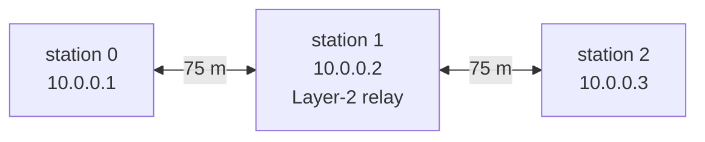
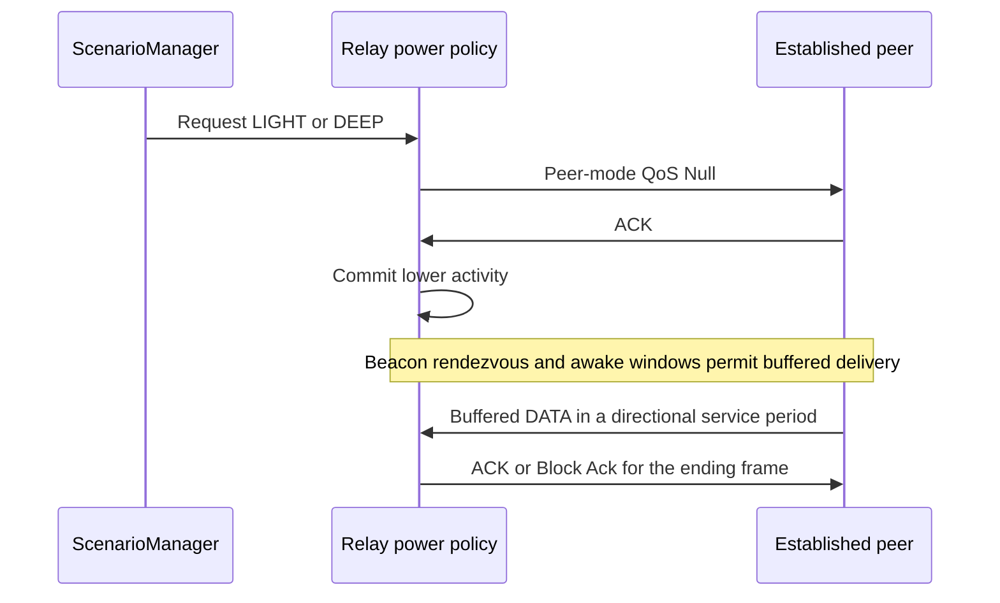

# Native IEEE 802.11 mesh

These examples use ordinary `StandardHost` nodes with `Ieee80211MeshInterface`.
The hosts share one IPv4 subnet and resolve neighbors with dynamic ARP.
IP forwarding is disabled on every host: intermediate stations relay mesh
frames at Layer 2.

From this directory, with INET's environment loaded:

```sh
inet --debug -u Cmdenv -f omnetpp.ini -c LineOfdm -r 0
```

Every named example uses run 0 and seed 0. Results and separate per-station
transmit/good-receive radiotap PCAPs go under `results/<configuration>/`.
The recorders are existing production observation modules; the hosts and
examples need no custom C++ library.



The line's endpoints are 150 m apart. The configured transmit power and
sensitivity select neighboring radio links; inspect the actual reception
and capture evidence when changing propagation or geometry. Every hop has
its own receiver/transmitter addresses, while mesh source/destination and
IPv4 TTL retain their end-to-end meaning.

| Configuration | What to inspect |
| --- | --- |
| `LineOfdm` | Dynamic ARP, PREQ/PREP, and ten UDP messages through station 1 |
| `DiamondOfdm` | Two equal-hop alternatives with 6 versus 24 Mbps directional airtime costs |
| `FailureAlternate` | Station 2 moves at 4 s, breaking its destination link, followed by recovery through station 1 |
| `RootPreq` | Proactive PREQ from root station 0 and traffic toward it |
| `RootRann` | RANN dissemination, unicast path confirmation and traffic toward the root |
| `HtNested`, `VhtNested` | Native A-MPDUs containing native A-MSDUs, with compressed Block Ack |
| `HtNestedMetric1`, `VhtNestedMetric1` | The same physical workload with mesh-wide metric ID 1 |
| `LightRelay`, `DeepRelay` | Real peer-mode requests, cold ARP and UDP through a sleeping relay. DEEP uses ACTIVE endpoints |
| `DtimGroup` | Cold ARP plus an independent broadcast UDP message under DTIM delivery |
| `SleepingHtNested`, `SleepingVhtNested` | Directional service periods combined with nested aggregation |

The nested workload uses six ordinary UDP applications with four messages
each. HT/VHT uses 20 MHz, NSS 1, MCS 7 and long GI. Both aggregation policies
are enabled; A-MSDU size and A-MPDU member limits keep the two aggregation
levels independently visible. Metric ID 2 is the HT/VHT default. OFDM defaults
to ID 1. Each mesh uses one metric ID throughout.

All 14 configurations were exercised in debug mode with run 0 and seed 0.
The captures contain 11,280 independently checked valid member FCS records;
every run ends normally without simulator warnings or ownership diagnostics.
These are observations of this fixed workload, rather than a performance
comparison across topologies or seeds:

| Profiles | Observed delivery and exchange |
| --- | --- |
| Line and diamond | 10/10 each. The diamond selects the lower-airtime branch |
| Failure alternate | 59/60. One packet exhausts seven attempts, followed by a PERR at 4.1067 s. Source traffic resumes through relay 1 at 7.2729 s |
| PREQ and RANN roots | 10/10 each, including the root's required discovery/confirmation exchanges |
| Four awake HT/VHT profiles | 24/24 each. Actual aggregates contain three MPDUs and six MSDUs |
| LIGHT and DEEP relays | 10/10 each before ACTIVE is restored. Cold ARP is generated during actual relay sleep and later relayed |
| DTIM group | 10/10 unicast, plus one broadcast UDP delivery at each of the two receivers |
| Two sleeping HT/VHT profiles | 24/24 each. Ending aggregates contain two A-MSDU MPDUs, EOSP and a matching positive compressed Block Ack |

The failure example retains the medium's explicit coincidence-warning setting;
no such warning occurred in the final run. The earlier setup failures and
their corrections are recorded separately in the model's coverage ledger.

ID 1 encodes airtime in 10.24 microsecond units and uses aggregation factor
one. ID 2 uses 0.01 microsecond units and estimates MSDUs per payload PPDU.
The directional error and payload-count EWMAs have gain 1/8; they start at
zero and one respectively. Peer retirement resets both, while an aggregation
reset clears the payload estimate alone. Sleep holds and QoS Null add no
payload/error samples. Values from different metric IDs are not comparable.



Power examples enable `powerSave` on all three interfaces, including peers
that remain ACTIVE for some relationships. The scripts act after automatic
peering, request lower activity at 0.5 s (and LIGHT endpoints at 0.55 s),
and restore ACTIVE at 4 s. DEEP keeps both endpoints ACTIVE and phases the
destination's beacon inside the relay's own awake window. Its cold ARP begins
at 1.10 s before the selected reference rendezvous. Group frames, including
HWMP management broadcasts, are unacknowledged: a DEEP station may miss peer
beacons, so a different rendezvous/workload can lose these broadcasts.
A request timestamp alone proves neither mode commitment nor physical sleep.
Lower activity requires a real ACK; higher activity takes effect immediately.
An unavailable owner or unestablished peer rejects the command. Requests are
not stored for automatic reapplication after re-peering.

LIGHT uses beacon rendezvous and advertised awake windows. DEEP uses the
lowest-address established reference peer and the model's ten-local-beacon
maintenance policy; loss of usable timing keeps the radio conservatively
awake. Group traffic follows DTIM, while individual buffering uses directional
service periods. Their ending must be confirmed, and other obligations may
keep a radio awake afterward.

Sleep examples set the ordinary QoS DATA lifetime to 3 s and HWMP diameter
traversal time to 2.048 s. These finite budgets accommodate rendezvous;
sleep never renews a packet's lifetime. The normal forwarding queue remains
bounded to 64 packets/256 KiB and five seconds of unresolved waiting. The
power-enabled EDCAF queues default to 64 packets/256 KiB each. The advertised
awake window defaults to 10.24 ms, beacon interval to 102.4 ms and DTIM period
to one beacon, except `DtimGroup`'s explicit period two. Wake lead includes
radio switching delay, one simulation tick and the configured `wakeMargin`.

Inspect peer states/AIDs, MIB peer PHY/power views, HWMP paths and awake requirements
in the runtime inspector. Directional period views are available through
`getServicePeriods()` in a source debugger and the outcome signal reports
completion or withdrawal. Radio-mode vectors
show actual sleep intervals. Captures distinguish transmit observations from
successful receptions, expose mesh TTL/address fields and split native
aggregate members using shared PPDU references. Application sink counts remain
the delivery evidence; a sender capture alone is insufficient.

The supported profile uses open peer links, one fixed channel/interface and
fixed PHY selection. It excludes portals, proxy addressing, security,
adaptive rate control, RTS and fragmentation. HT/VHT requires the matching
dimensional medium and compatible committed peer capabilities. Regulatory
permission and DFS/channel availability are external inputs. Mesh power save
is separate from HT SMPS and infrastructure APSD. These IPv4 examples make
no IPv6, external interoperability or battery-life accuracy claim. Isolated
owner lifecycle coverage does not establish whole-NIC/node restart.

See the user guide's “IEEE 802.11 Mesh and HWMP” section for configuration,
metric encoding, reset behavior and lifetime details.
