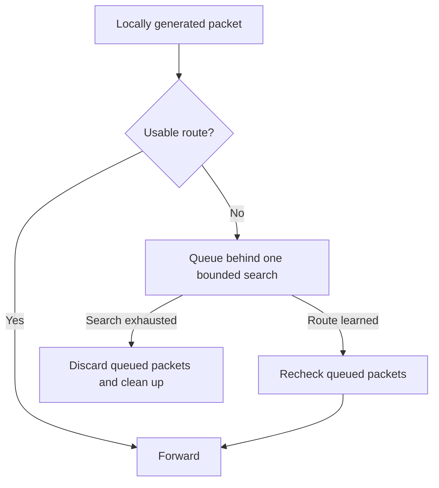
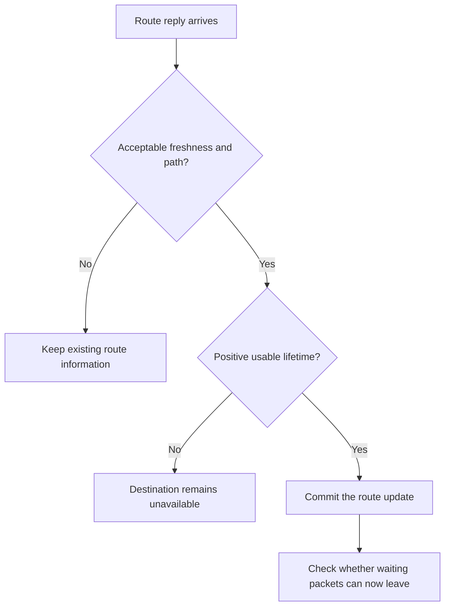
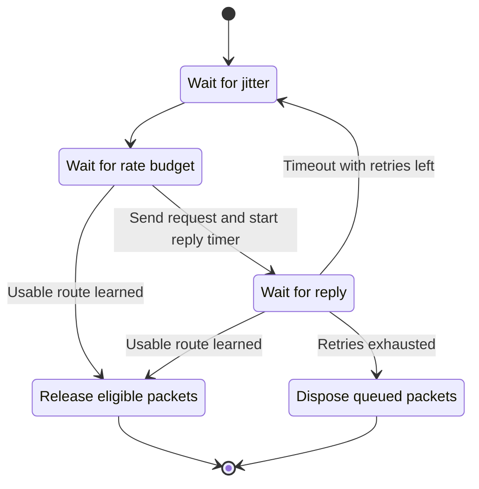
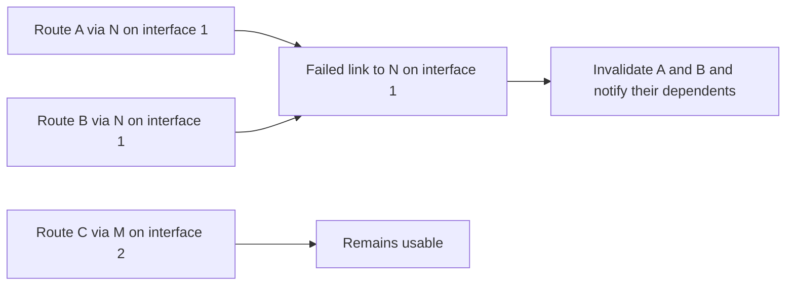
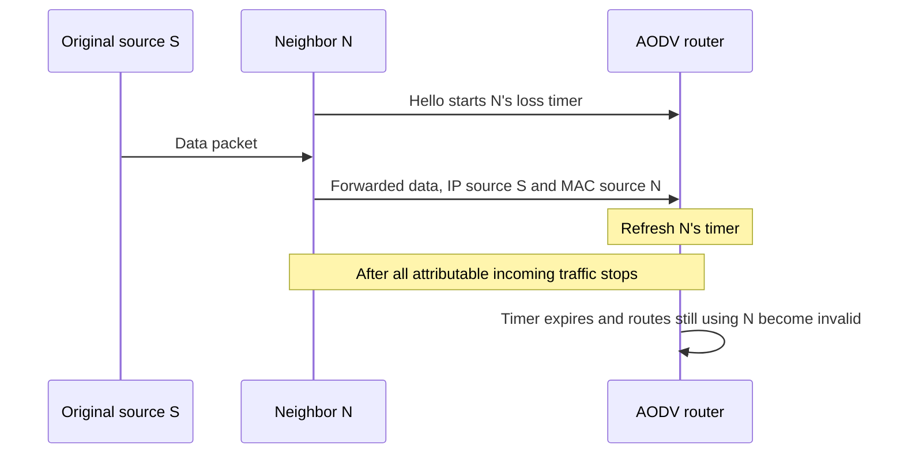
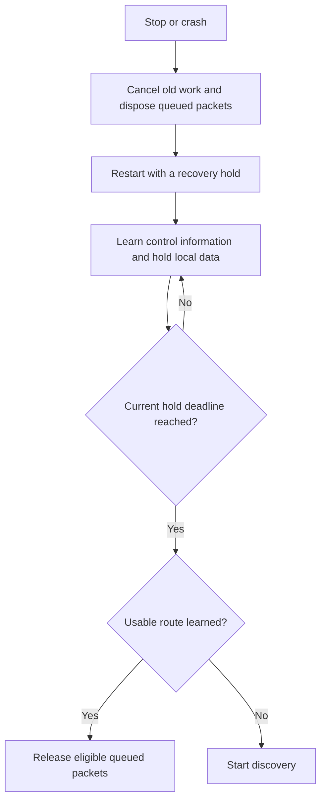
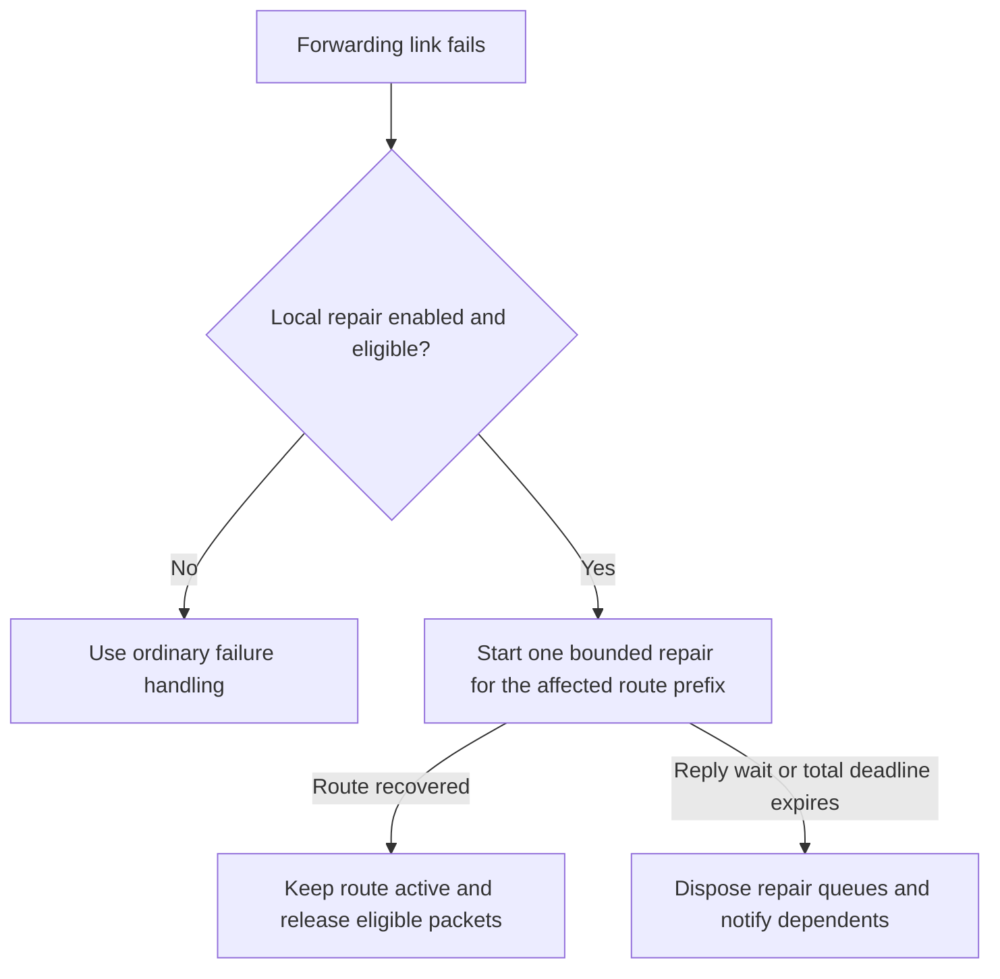

# AODV correction plan: summary

The [AODV plan](aodv-rfc3561-corrections.md) makes route discovery, forwarding and recovery behave consistently when routes age, links fail or routers restart.

It covers six main improvements:

- **Trust fresh routes.** Handle sequence-number wraparound, reject stale replies and advertise how long a route remains usable.
- **Finish every discovery.** Keep queued packets attached to one search, respect rate limits and ensure each search eventually succeeds or cleans up.
- **Identify the failed link correctly.** Track neighbors by address and interface, so a failure affects only routes using that link.
- **Detect neighbor loss reliably.** Incoming traffic from a neighbor keeps it alive—even when that neighbor is forwarding someone else’s packet.
- **Restart safely.** Cancel old timers and queues, observe a recovery period, then reconsider traffic using newly learned routes.
- **Complete optional features.** Support selected IPv4 interfaces, received subnet routes and bounded local repair. Local repair stays disabled by default; existing IPv6 behavior receives compatibility checks.

The central discovery rule is:

Each correction comes with tests showing the original failure and the required result. Existing packet formats are preserved.

## The six improvements in detail

### 1. Trust fresh routes

A route reply must provide acceptable information before it can change a route or release waiting packets. AODV uses sequence numbers to judge freshness, including when the 32-bit counter wraps from its largest value back to zero. An unknown sequence number is kept separate from a known value. Equal sequence numbers follow the message's path-selection rules: for example, an acceptable reply can reactivate an inactive route.

Route lifetime means **time remaining**. If a cached route expires in two seconds, a reply advertises those two seconds. It cannot give the next router a fresh copy of the route's original lifetime. Expired information cannot complete discovery. An idle route retains its last known sequence number for a while, so an old reply cannot erase that history.

### 2. Finish every discovery

When several packets need the same discovery, they wait behind one search. A new packet joins the queue without restarting the search or giving it extra retries. If the request rate limit has been reached, the search waits for budget rather than disappearing or leaving its packets stranded.

The reply timer starts when the request is actually sent, after jitter and rate-limit waiting. A route learned while waiting can complete the search without sending an obsolete request. Success cancels the remaining search work and rechecks each queued packet before forwarding it. Exhausted retries, shutdown or a crash dispose of the affected queues once.

### 3. Identify the failed link correctly

A failure belongs to a particular neighbor on a particular interface. AODV uses the attempted transmission and learned neighbor information to identify that link. It invalidates only routes that still use it. A route that has already switched to another next hop stays usable.

Acknowledgments are matched to the same neighbor and interface, so an ACK from one link cannot clear another link's pending check. Route errors go to the upstream neighbors that depended on the affected routes. Large error lists are split to fit the packet format, while rate limits govern transmission without undoing the local failure decision.

### 4. Detect neighbor loss reliably

A positive Hello message can start a neighbor's loss timer. After that, incoming data or control traffic attributable to that neighbor refreshes it. Sending traffic toward a neighbor does not prove that the neighbor is still there.

Consider `S → N → router`: the arriving packet still has IP source S, but its immediate sender is N. The router uses the incoming interface and source MAC address to refresh N's timer. Data alone does not start a new Hello-loss timer. If sender information becomes missing or ambiguous, this detector is disabled for that interface until restart, with a diagnostic explaining the gap.

### 5. Restart safely

Stopping or crashing cancels old discovery attempts, delayed control packets and neighbor checks. Queued packets are disposed of through the network layer that owns them. A later restart begins without leftover callbacks or transmissions from the previous run.

After a restart that loses sequence state, AODV observes a recovery hold. It can learn routes during this time, but local data stays queued and ordinary discovery, replies and Hellos are suppressed. Required one-hop ACKs and route errors remain possible. Transit data extends the hold. When the hold ends, AODV checks what it has learned and forwards eligible queued packets directly, starting discovery only where a route is still missing.

### 6. Complete optional features

**Selected IPv4 interfaces.** A configuration can name the interfaces that participate in AODV. They share one routing identity and discovery process. Requests are sent on the selected links, and learned routes remember which interface reaches the next hop. Copies of one broadcast request consume one logical rate-limit slot. The empty selection keeps the primary-interface behavior.

**Received IPv4 subnet routes.** A route reply can describe a whole subnet. AODV keeps that subnet's freshness history separate from individual host routes and other prefixes. A covering subnet route cannot bypass retained, known stale state for a more-specific destination. This supports receiving and using subnet routes; automatic subnet-router election and advertisement remain outside the plan.

**Bounded local repair.** With `useLocalRepair` enabled, an eligible failure while forwarding someone else's data can trigger one limited search near the break. Packets that subsequently depend on that repair can wait for it. A fixed total deadline prevents jitter or rate-limit waiting from keeping the repair alive indefinitely. Success releases eligible packets; failure clears the repair, disposes its queues and reports the unreachable route. A successful but longer path sends a notification while keeping the repaired route active.

Local repair remains disabled by default. The new interface-selection and subnet-route profiles target IPv4. IPv6 compatibility checks cover the existing control encoding and shared discovery, neighbor observation, restart and repair behavior.
