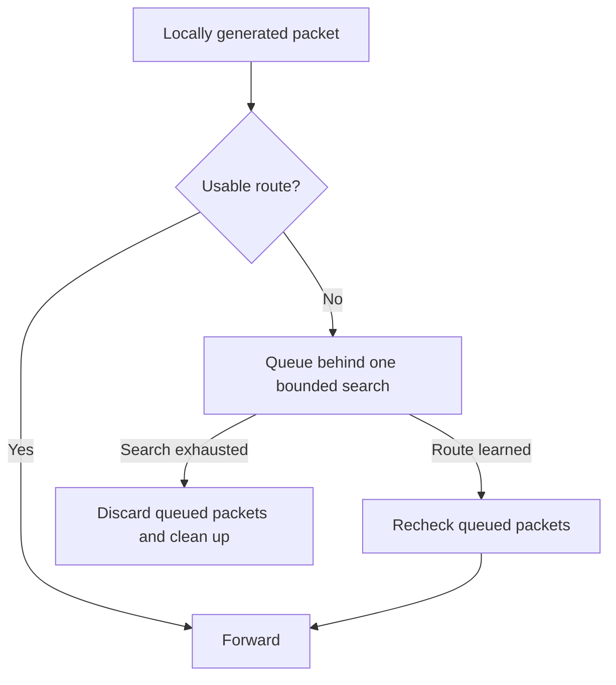
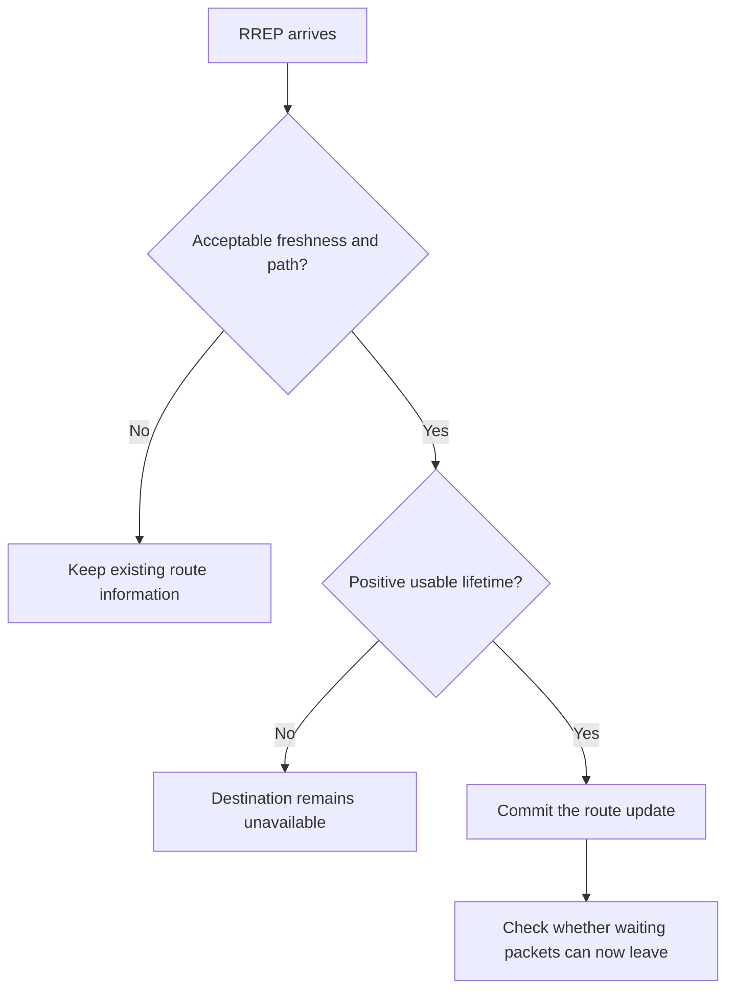
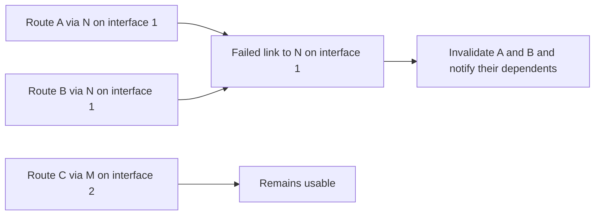
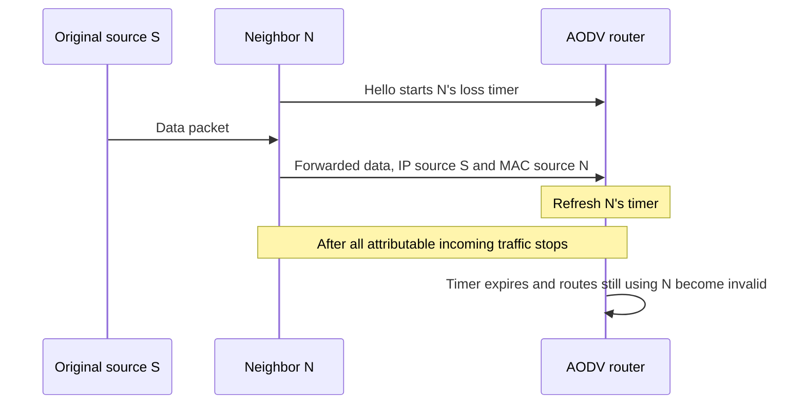
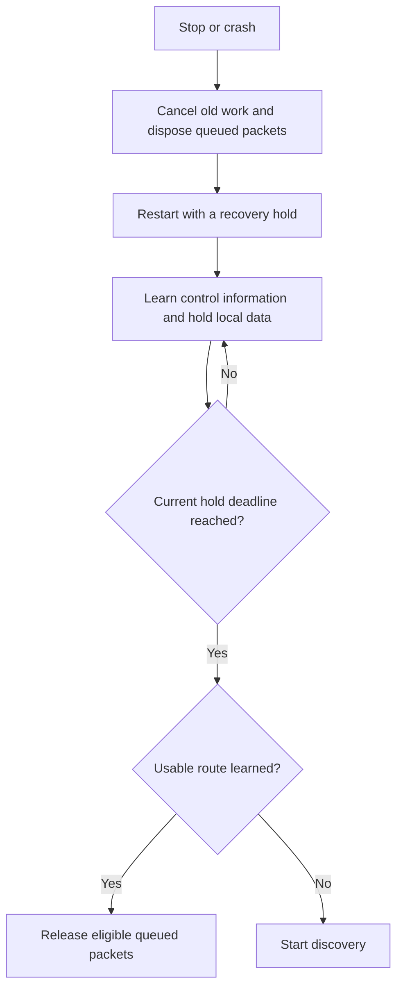

# AODV correction plan: summary

The [AODV plan](aodv-rfc3561-corrections.md) makes route discovery, forwarding and recovery behave consistently when routes age, links fail or routers restart.

It covers six main improvements:

- **Trust fresh routes.** Handle sequence-number wraparound, reject stale RREPs and advertise how long a route remains usable.
- **Finish every discovery.** Keep queued packets attached to one search, respect rate limits and ensure each search eventually succeeds or cleans up.
- **Identify the failed link correctly.** Track neighbors by address and interface, so a failure affects only routes using that link.
- **Detect neighbor loss reliably.** Incoming traffic from a neighbor keeps it alive—even when that neighbor is forwarding someone else’s packet.
- **Restart safely.** Cancel old timers and queues, observe a recovery period, then reconsider traffic using newly learned routes.
- **Complete optional features.** Support selected IPv4 interfaces, received subnet routes and bounded local repair. Local repair stays disabled by default; existing IPv6 behavior receives compatibility checks.

The central discovery rule is:

Each correction comes with tests showing the original failure and the required result. Existing packet formats are preserved.

## The six improvements in detail

### 1. Trust fresh routes

**Previously:** AODV compared sequence numbers as ordinary integers. Some neighbor updates overwrote freshness information before the RREP was checked, and the requesting node could install a stale RREP and release its queued data. Gratuitous RREPs could also advertise an absolute expiration time as though it were a duration.

**Why this was incorrect:** Sequence numbers wrap around, so a small number can be newer than a large one. Overwriting the stored history before comparison defeats the freshness check. Confusing an expiration time with a duration lets another router keep a route long after the information should have expired.

**How the correction works:** AODV compares sequence numbers with wraparound-aware ordering and keeps unknown values separate from known ones. Only an acceptable RREP can update the destination route or complete discovery. An inactive route can recover through an acceptable equal-sequence RREP. Advertisements carry the usable time remaining, and idle expiry retains the last known sequence for a while.

**Examples:** After `4,294,967,295` wraps to `0`, the old integer comparison rejected `0` as older; the corrected comparison recognizes the advance. At simulation time 100 seconds, a gratuitous RREP for a route expiring at 105 seconds previously advertised roughly 105 seconds of validity. It now advertises roughly five seconds.

### 2. Finish every discovery

**Previously:** Reaching the RREQ rate limit could make discovery return without scheduling a wake-up, although its data was already queued. Learning a usable neighbor route did not always complete the waiting search or cancel its delayed RREQ. Gateway discovery could also finish a queue under the gateway's address while overlooking packets queued under their actual external destinations.

**Why this was incorrect:** Queuing a packet creates an obligation to eventually forward or dispose of it. A search with no wake-up can strand that packet indefinitely. A delayed RREQ that survives successful learning wastes transmissions, while a mismatched queue address can leave packets behind even after success.

**How the correction works:** One search tracks its timer, rate-limit admission and every queue depending on it. New packets join without restarting it. The RREP timer begins at actual transmission, after jitter and budget waiting. Learning an eligible route cancels unnecessary search work and rechecks queued packets. Final failure, shutdown or a crash disposes of the affected queues once.

**Example:** Two packets need different routes, but only one RREQ slot remains this second. Previously, the second packet could wait forever. Now its search stays scheduled for the next budget window. If its route is learned in the meantime, the packet leaves without an extra RREQ.

### 3. Identify the failed link correctly

**Previously:** A failed transmission could be attributed by looking up the destination's current route, rather than identifying the link actually attempted. RREP validation also used one shared failed-next-hop value and RREP-ACK timer. A later RREP could replace that value or postpone the outstanding deadline.

**Why this was incorrect:** A route may change while a packet is in flight. Looking it up afterward can blame a healthy replacement path for an older failure. Sharing one validation slot between neighbors also lets activity on one link interfere with another link's failure decision.

**How the correction works:** AODV identifies the attempted neighbor and interface from transmission metadata and stable learned bindings. It invalidates only routes that still use that link. RREP-ACK checks and blacklists are kept separately for each neighbor/interface pair. RERRs reach the upstream neighbors that depended on the affected routes, and large lists are split to fit the packet format.

**Example:** A packet is sent toward destination D through N. Before that transmission fails, an RREP installs a new path to D through M. The old lookup could invalidate D's new path through M. The correction preserves that path and invalidates only routes still using the failed link to N.

### 4. Detect neighbor loss reliably

**Previously:** Hello processing maintained route lifetimes, but there was no separate last-heard deadline that reliably turned neighbor silence into a failure of its dependent routes. Outgoing traffic could continue extending route-use lifetimes even after the next hop stopped transmitting.

**Why this was incorrect:** Using a route and hearing from its next hop answer different questions. Repeatedly sending toward a silent neighbor is not evidence that it is alive. The original IP source is also insufficient to identify the immediate sender of a forwarded packet.

**How the correction works:** A positive, attributable Hello starts a separate neighbor-loss timer. Incoming data or control traffic from that neighbor refreshes it; outgoing traffic does not. The incoming interface and source MAC identify the immediate sender. Data alone cannot start a timer. Missing or ambiguous sender information disables this detector for that interface until restart, with a diagnostic rather than a guessed failure.

**Example:** In `S → N → router`, a forwarded packet still names S as its IP source, but N sent the last hop. Its arrival refreshes N's timer. Once N stops sending any attributable traffic, the timer expires and routes still using N become invalid, even if the router keeps trying to send through it.

### 5. Restart safely

**Previously:** Recovery after losing sequence state was unfinished: locally generated data and RREPs could leave immediately after restart. Cleanup cleared AODV's packet references without disposing of the packets held by IP, and routing-module stop could leave its routes installed. Repeated stop/start operations could also encounter stale socket state and a port-already-in-use error.

**Why this was incorrect:** A restarted router has lost freshness history that other routers may still remember. Immediately advertising reset state bypasses the required recovery period. Forgetting a packet reference does not release the packet from its real owner, and leftover routes or socket indications can affect the next run.

**How the correction works:** Stop and crash cancel pending searches, delayed transmissions and neighbor checks, dispose of queued packets through IP, and remove this AODV instance's routes. Restart uses a fresh socket identity and a recovery hold. Control information can be learned during the hold, but local data, ordinary discovery, RREPs and Hellos wait. Required RREP-ACKs and RERRs remain possible, and transit data extends the hold.

**Example:** A usable route is learned while a local packet waits during recovery. Previously, that packet could leave before the hold should have ended. Now it stays queued until the current deadline, then uses the learned route directly without an unnecessary discovery RREQ.

### 6. Complete optional features

**Previously:** Control transmission was tied to one primary interface, received subnet RREPs were installed as host routes, and the exposed local-repair option had no implemented repair transaction.

**Why this was incorrect or incomplete:** A second ad-hoc link could not participate in a shared discovery. Treating a subnet advertisement as a host route lost its advertised coverage. Enabling the repair option did not provide the promised attempt to recover a broken forwarding path. These gaps need explicit feature support and limits.

**How the correction works:**

- **Selected IPv4 interfaces:** Named interfaces share one routing identity and discovery process. RREQs use the selected links, learned routes retain their next-hop interface, and copies of one broadcast consume one logical rate-limit slot. The empty selection keeps the primary-interface behavior.
- **Received IPv4 subnet routes:** AODV installs the normalized advertised prefix and keeps its freshness history separate from host routes and other prefixes. A covering subnet cannot bypass retained, known stale state for a more-specific destination. Automatic subnet-router election and advertisement remain outside this profile.
- **Bounded local repair:** With `useLocalRepair` enabled, an eligible failure while forwarding someone else's data can start one limited search for the affected route prefix. Subsequent dependent packets may wait for it. Success releases eligible packets; an RREP timeout or fixed total deadline disposes of its queues and reports failure. A successful longer path sends a notification while keeping the route active.

**Examples:** A discovery can leave on two selected wireless interfaces and accept an RREP on the second. An RREP advertising `10.20.30.0/24` creates a subnet route that can serve eligible traffic to `10.20.30.8`, rather than a single host route. If an eligible forwarding path breaks with repair enabled, one bounded repair runs; later packets join it without creating fresh deadlines or duplicate searches.

Local repair remains disabled by default. The new interface-selection and subnet-route profiles target IPv4. IPv6 compatibility checks cover the existing control encoding and shared discovery, neighbor observation, restart and repair behavior.
