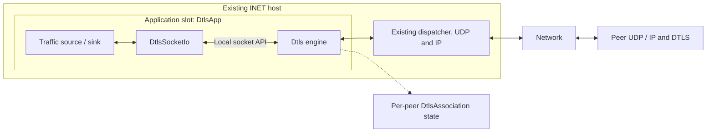
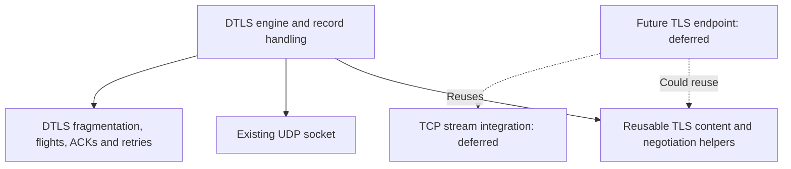
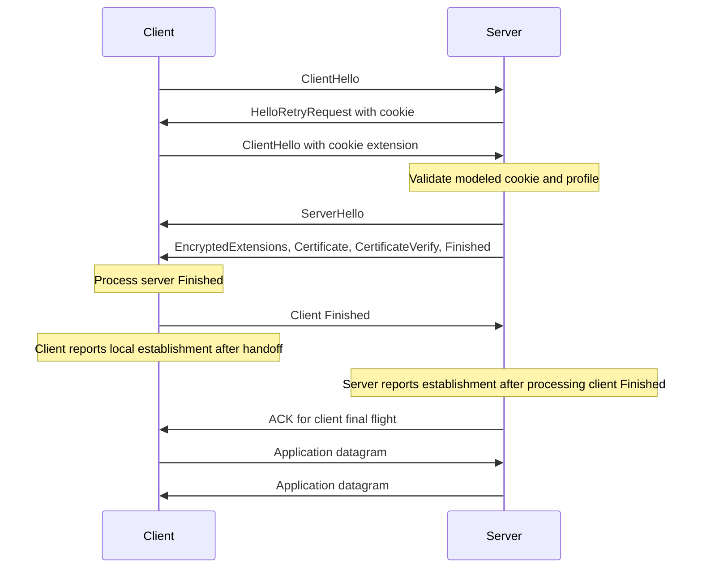
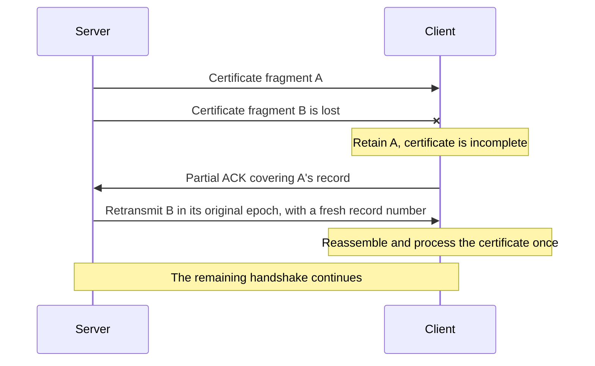
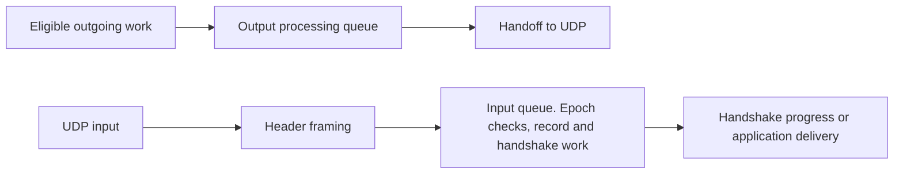
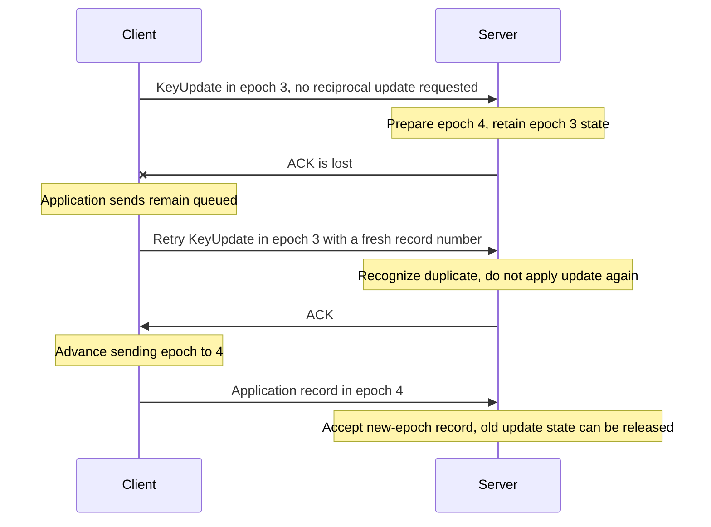

# The DTLS model, explained

> **Kind:** reference · **Status:** current · **Seal:** none · **Owns:** — · **Stands on:** [dtls.md](dtls.md)

This document explains the implemented [DTLS plan](dtls.md), as of 2026-11-16. The diagrams describe the model's behavior. The [verification report](../../doc/project/evidence/model/dtls/results.md) records executed checks and their limits. The detailed plan owns the scope, commit boundaries, parameters and test requirements.

## What the model provides

The DTLS 1.3 simulation model serves applications that send UDP datagrams. A study can measure how much connection setup costs, how packet loss delays the handshake, how large handshake messages affect traffic, and how processing costs affect latency.

An application first establishes an **association**: the state shared by a client and server for one DTLS conversation. Once setup succeeds, it can exchange application datagrams. DTLS recovers lost handshake messages, but application traffic retains UDP semantics: a lost application datagram stays lost, and later datagrams need not wait for it.

The first version covers modeled PSK and certificate handshakes, cookie retries, handshake fragmentation and recovery, record numbering, replay filtering within the model's limits, key updates and closure. PSK means the peers are configured with matching pre-shared-key identities; this model uses identity labels rather than actual secret keys. The initial cipher profile is `TLS_AES_128_GCM_SHA256`.

DTLS 1.2 compatibility, session resumption, early application data before the handshake, connection IDs, address migration and post-handshake client authentication are deferred. Optional client authentication during the initial certificate handshake is included.

## The cryptography follows INET IPsec

The model represents cryptographic overhead and processing time using the same approach as INET IPsec. It wraps immutable packet content in `EncryptedChunk`, accounts for the extra bytes, and unwraps the retained content at the receiver. It does not run encryption, compute authentication tags, generate signatures or validate certificate chains.

This distinction determines what the results mean. The model can answer “How many extra bytes and milliseconds does this exchange add?” It cannot answer “Can an attacker forge this packet?” Certificate, signature, binder and Finished contents are placeholders, and authentication success is modeled from compatible profiles and identities. A Finished message represents completion of the handshake's authentication step; its cryptographic proof is not computed.

Protected packets also have no real ciphertext byte representation. Supported configurations therefore use declared UDP checksums and link frame checks rather than computing them over the protected content. Header encodings and packet lengths can be checked, but complete protected-packet capture/export and interoperability with a real DTLS endpoint are outside this work.

## Where it fits in an INET host

The model uses the existing application slot and UDP stack. There is no need to add a DTLS submodule to every host or modify the node dispatcher.

The solid arrows show the data path. The dotted arrow shows state ownership. Calling the local socket API does not itself add a simulation event; transmission, processing delays and protocol timers supply the necessary event boundaries.

| Part | What it does |
| --- | --- |
| `DtlsApp` | Places the traffic components and DTLS engine in an existing application slot. |
| `DtlsSocketIo` | Adapts a generic traffic source/sink to the DTLS socket API. Client mode has one configured destination; server mode receives into a sink. |
| `DtlsSocket` / `IDtls` | Provides the application-facing operations and callbacks, and the replaceable engine contract. Applications can open, listen, send, close and request a key update. |
| `Dtls` | Owns the UDP socket, selects associations, controls processing queues and dispatches protocol work. |
| `DtlsAssociation` | Holds one peer's handshake progress, record epochs, receive window, pending content and recovery state. |
| Packet types and serializers | Represent messages and encode the fields for which the model supplies bytes. Dissection and printing make that content inspectable. |

A server can serve several peers through one UDP socket. Each conversation has its own local handle, which callbacks use to identify the peer. Closing one handle must leave the other conversations and the listening socket usable. Applications that send replies to several peers use these handles explicitly; the generic traffic source does not guess a destination.

The ownership rule is also explicit: sending a packet transfers it to the engine even if that send is rejected. A receive callback transfers the delivered packet to the application. Accepting a send means local admission, not guaranteed remote delivery.

## Reuse TLS content without implementing TLS first

DTLS 1.3 reuses TLS 1.3 handshake content, but needs different delivery and recovery behavior. The plan separates those concerns so a future TLS endpoint can reuse useful pieces without making TLS over TCP a prerequisite.

The common package supplies handshake bodies, extension encodings and profile-selection helpers. DTLS owns the record format, cookie handling, message sequence, fragments, acknowledgements and retransmission timers. There is no shared TLS/DTLS endpoint state machine.

Even the shared content needs a small DTLS adaptation: its ClientHello body has an extra legacy cookie field. A distinct `DtlsClientHello` type and serializer preserve the correct layout while reusing common fields. This prevents a shared type from silently acquiring the wrong byte encoding.

## What connection setup looks like

This example shows the certificate handshake with the default cookie exchange. A cookie makes the client demonstrate that it can receive packets at its claimed address before the server sends a larger response. The token models this check; it does not provide real cryptographic protection against forgery.

The diagram groups messages for readability; it does not prescribe how many UDP datagrams carry them. In PSK mode the certificate and CertificateVerify messages are omitted. Initial client authentication adds the client's Certificate and CertificateVerify before its Finished.

A **flight** is a group of handshake messages awaiting the peer's response or an explicit acknowledgement. The final ACK completes recovery bookkeeping; the two local establishment callbacks do not both wait for that ACK. Data arriving before the receiver processes peer Finished is discarded under the selected model policy.

Cookie and key-share retry conditions must fit in the single permitted HelloRetryRequest. Before address validation, server output is bounded relative to client input. A blocked attempt cannot consume the shared output processor and prevent another client from completing setup.

## How handshake loss is repaired

Large handshake messages, especially certificates, may need several fragments. The receiver reassembles their contents and can acknowledge fragments it has retained. The sender then retransmits missing content, while keeping the original message identity and protection epoch.

The following is an excerpt from a server flight after the hello exchange:

Without useful feedback, a retransmission timer provides recovery, with backoff between attempts. The timer starts after the relevant records are actually handed to UDP, so time spent waiting for modeled processing is not mistaken for a transmission that has already occurred. A separate handshake deadline bounds attempts that cannot finish.

The receiver accepts identical overlapping fragments without storing the same bytes twice. A retransmission that changes bytes already retained in an overlapping range aborts that handshake. Invalid ranges do not overwrite valid buffered content. Buffer limits are checked before allocation, and incomplete state is released when the attempt ends.

Application datagrams do not use this recovery mechanism. Losing an application record does not cause DTLS to resend it.

## How processing costs affect time

Each engine has separate incoming and outgoing processing queues. They can make progress independently, while each direction services one operation at a time. Handshake work shares these queues with record processing.

For example, suppose outgoing record processing takes 2 ms and three records become eligible at 0 ms, 1 ms and 1 ms. With an initially idle queue, their UDP handoffs occur at 2 ms, 4 ms and 6 ms. These are hypothetical processing times; link transmission and propagation delays come afterward. Incoming work uses the separate input queue.

Default processing costs are zero. Positive costs create scheduled completion events; idle zero-cost work completes synchronously. A retry pays for protecting its new record, but does not regenerate a retained certificate or signature. Work waiting for amplification credit or a key-update ACK stays with its association rather than blocking the shared processor.

## What record epochs and replay filtering mean

An **epoch** identifies a generation of protection state. The selected profile uses epoch 0 for hello messages, epoch 2 for protected handshake content and epoch 3 for initial application traffic. Epoch 1 would belong to early data, which is excluded. Later key updates advance the application epoch.

Records also have sequence numbers. A receive window remembers recently accepted numbers and rejects duplicates and records older than that window. The model tests this behavior within the stated number-reconstruction range. Only the partial epoch and sequence fields actually transmitted appear in the unified header; full numbers remain endpoint state.

This matters because real DTLS uses authentication failure to detect a wrong reconstruction of a truncated number. The model cannot perform that check. Very delayed records, large gaps and old epochs whose transmitted bits match newer ones can therefore be ambiguous. The summary's replay behavior must not be read as a security guarantee for those cases or for protected records from a previous association on the same addresses and ports.

## How a key update progresses

KeyUpdate models moving to a new protection epoch. It does not generate real keys. The sender keeps using the old epoch for the update and its retries, and advances only after an acknowledgement. This example does not request a reciprocal update from the server:

Only one outgoing update can await acknowledgement per association. A peer-requested response uses the non-requesting flag, avoiding an update echo loop. Both manual requests and the configured record-count threshold use this recovery path. Queued data is bounded, and other associations must continue making progress while one waits.

## Closure and restart

| Trigger | Result |
| --- | --- |
| Close one association | Stop new sends on that handle, hand close_notify to UDP when possible, then release the association and report closure. Other peers keep their shared socket. |
| Module stop | Shut down associations and close the engine's UDP socket, with a deadline limiting processing waits. |
| Crash | Cancel pending work and destroy transient state without sending a closure alert. |
| Restart | Rebind UDP and establish fresh associations on the same module instance. Configuration and cumulative statistics remain. |

Closure alerts are not retransmitted and local completion does not depend on receiving a peer alert. If processing cannot finish before the shutdown deadline, closure is forced and reported as such. The API provides full local shutdown; it does not promise to drain every earlier datagram still in flight.

## The seven implementation stages

The [ordered commit series](dtls.md#ordered-implementation-commits) builds one capability at a time. Each protocol behavior commit includes its own tests and a reviewer document explaining their setup, observations and limits.

| Stage | What becomes available | What establishes that stage's result |
| --- | --- | --- |
| C1: Define the profile | The selected standard requirements, model limits and component boundaries. | Reviewed specification mappings; no runtime success is claimed. |
| C2: Build the foundation | Message types, serializers, socket/engine contracts, record state and processing queues. | Header/record unit checks, malformed-input protocol tests and queue/lifetime module tests. No successful handshake yet. |
| C3: Establish associations | Negotiation, cookies, normal Finished/ACK handling and independent server peers. | Small, unfragmented handshake fixtures, rejection cases and peer-isolation tests. Output-credit handling already belongs here. |
| C4: Recover handshakes | Fragmentation, reassembly, selective ACKs, retries and backoff. | Controlled loss, reordering, overlapping fragments, timer boundaries and delayed-processing cases. |
| C5: Exchange application data | Protected datagrams, size accounting and the supported replay-window behavior. | Delivery/boundary assertions, intentional losses, replay cases and overhead/queue checks over IPv4 and IPv6. |
| C6: Finish connection management | Manual/automatic key updates, graceful closure, stop, crash and restart. Queue continuations precede updates; a separate receive-error correction contains asynchronous header decoding; atomic cancellation precedes shutdown. | Lost update ACKs, duplicate updates, raw malformed-header delivery at zero/positive processing cost, closure deadlines and lifecycle tests. Each queue mechanism has a direct module check before its first production consumer. |
| C7: Demonstrate and document | Runnable examples, user documentation and recorded coverage for the supported profile. | Focused DTLS tests, ordinary UDP compatibility checks, both build modes and builds with DTLS disabled. |

The protocol suite has 129 cases, alongside six units and eight module fixtures. The four raw-header regressions require malformed records to be discarded regardless of processing cost, followed by valid delivery without replay-state damage. The six examples cover PSK, certificates, fragmentation, seeded loss, processing cost and IPv6. Their scalar baselines detect future trajectory changes; they do not establish protocol correctness. The verification report distinguishes exact executed revisions, build modes, parent comparisons and baseline evidence.

## About the diagrams

All six diagrams describe the implemented model and are embedded as Mermaid source for a Markdown viewer with Mermaid support. Their sequences have been checked against the source and plan. Local diagram rendering has not been verified.
