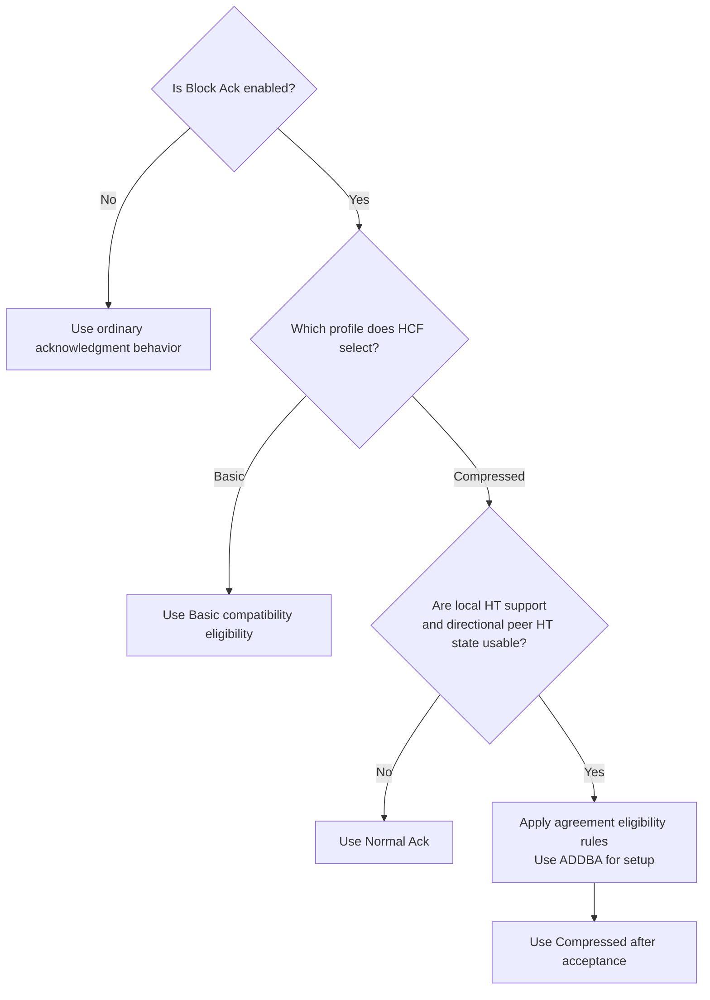
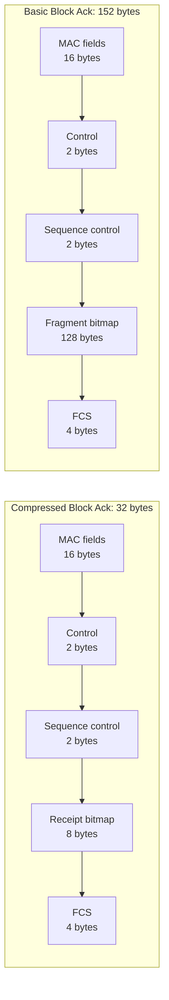
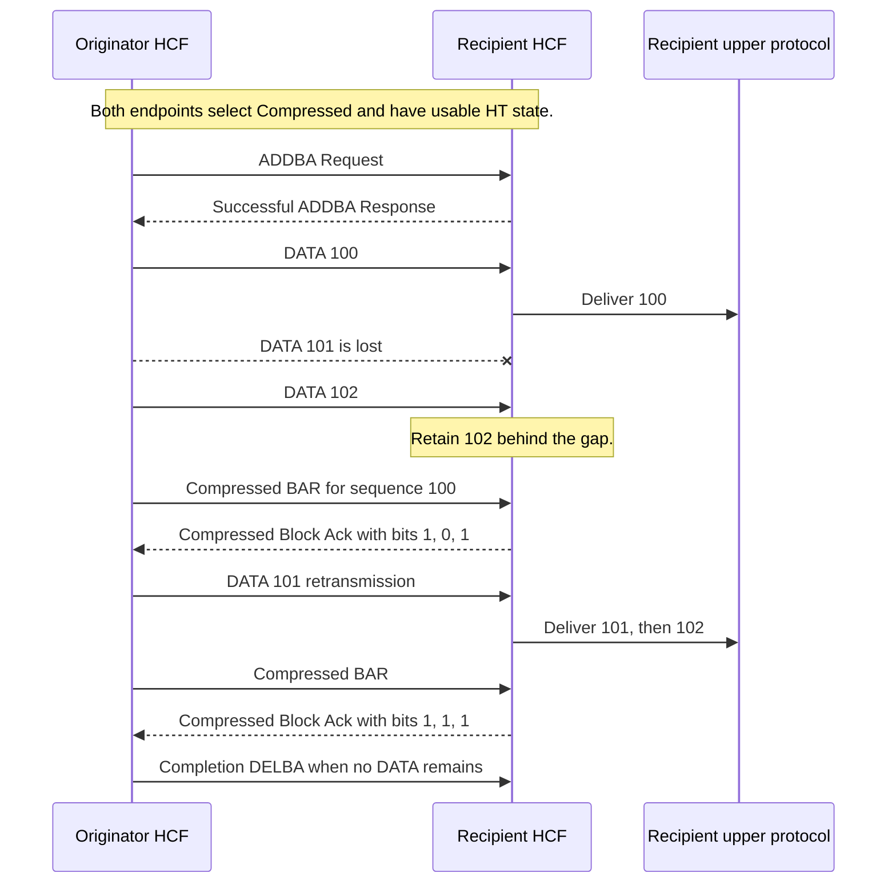
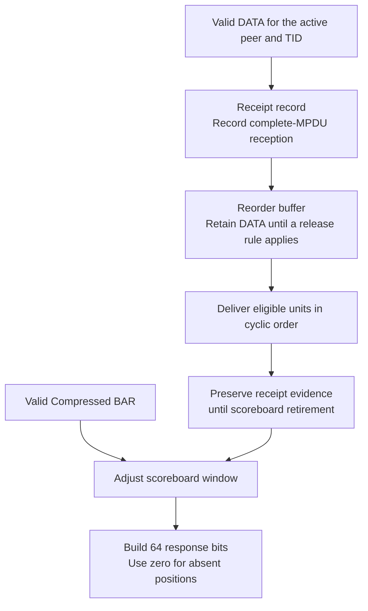
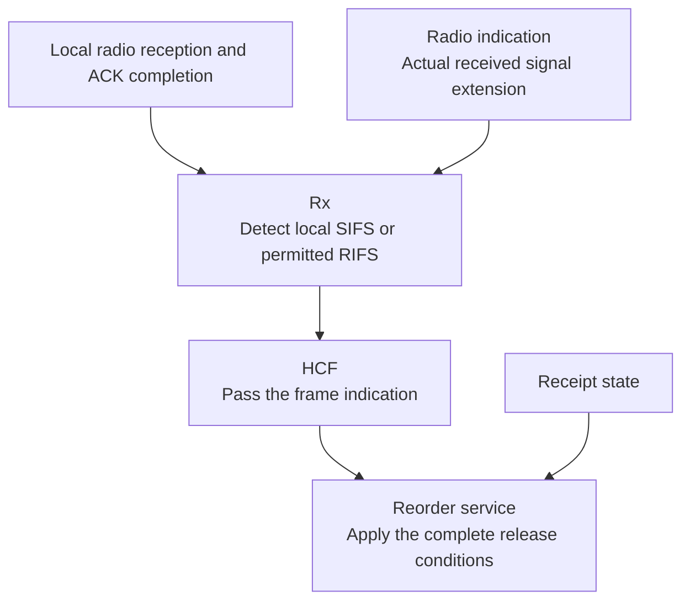
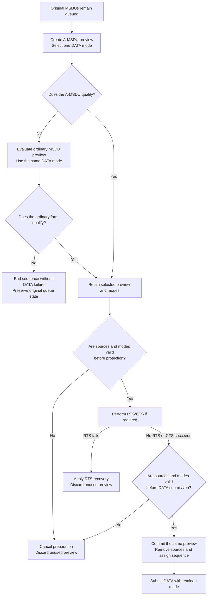

# Basic and Compressed Block Ack implementation summary

> **Kind:** reference · **Status:** current · **Seal:** none · **Owns:** — · **Stands on:** [implementation status](ieee80211-compressed-blockack-replacement.md), [admission contract](ieee80211-compressed-blockack-txop-admission.md), [verification scope](ieee80211-compressed-blockack-s5-execution.md)

HCF defaults to explicit immediate Compressed Block Ack for eligible HT links. Block Ack support remains disabled unless `isBlockAckSupported` enables it. Links without usable local or peer HT state use Normal Ack. Both endpoints must select the same profile because ADDBA does not negotiate it. Explicit `blockAckVariant = "basic"` retains Basic compatibility.

Master contains stage S4 through merged [PR #1344](https://github.com/inet-framework/inet/pull/1344). Its lifecycle, borrowed preview, BAR-first arbitration, window operations, DATA Retry, and completion DELBA form the S5 prerequisites. The ten functional S5 commits add local interval detection, HT signal extension, RIFS permission, wire validation, reversible preparation, receipts, rates, and exchanges. The final functional commit selects the default.

## Which links use Compressed

HCF selects one profile for the interface at initialization. ADDBA establishes an agreement for one peer and traffic identifier, or TID. It does not negotiate the profile selector. State for another peer or TID remains separate. The [configuration contract](ieee80211-compressed-blockack-replacement.md#supported-behavior-and-configuration) defines eligibility and configuration requirements.

Compressed requires usable local HT support and directional peer HT state. A PHY mode name alone does not supply peer capability state. An associated `ac` peer can qualify through its inherited HT support. Without usable HT state, DATA uses Normal Ack instead of a Compressed agreement.

Hypothetical example: an HT ad hoc configuration lacks peer HT records. The default selects Compressed, but DATA uses Normal Ack. To retain a Basic study, the user selects `mac.hcf.blockAckVariant = "basic"` at both endpoints.

## What crosses the wireless link

The originator transmits individual QoS DATA frames and requests receipt status with a Block acknowledgment request, or BAR. The recipient returns a 64-bit Compressed bitmap. Each positive bit acknowledges a complete MSDU or A-MSDU at that sequence position. An A-MSDU combines MSDUs within one MPDU. This DATA path does not supply A-MPDU transfer.

Both BAR profiles occupy 24 bytes with FCS. Compressed responses occupy 32 bytes with FCS; Basic responses occupy 152 bytes. The [wire format contract](ieee80211-compressed-blockack-replacement.md#wire-format-and-control-rates) defines the supported Types and rates.

The serializer decodes all four Type bits. Type 2 selects Compressed; Type 0 retains Basic compatibility. Unsupported Types and malformed fragment fields fail validation. Active Compressed agreements suppress fragmentation for their peer and TID, including DATA that uses Normal Ack within that agreement.

BAR uses a legal non-HT rate from the applicable local, BSS, and peer sets. Initial and later BAR can have different constraints. A configured `controlFrameBitrate` must satisfy those constraints. Response duration, protection, and timeout calculations use the actual response length.

A smaller response alone does not prove lower exchange airtime or higher application goodput. Control rates, contention, explicit BAR, and agreement setup also affect those results.

## How receipt state differs from delivery state

Receipt state records whether a complete MPDU arrived. The reorder buffer holds received MPDUs until delivery is permitted. Delivery removes a buffered unit, but positive receipt evidence must remain available for a later BAR. Scoreboard movement controls receipt retirement. The scoreboard records receipts within the applicable sequence window.

The following hypothetical exchange starts with an accepted agreement and a receipt window at sequence 100. DATA 101 is lost. DATA 102 remains in the reorder buffer until retransmission fills the gap. The example omits other release conditions to show ordinary gap recovery.

The originator interprets bitmap positions relative to the response start, with modulo-4096 sequence arithmetic. A positive receipt does not itself prove upper delivery. The [receipt and delivery contract](ieee80211-compressed-blockack-replacement.md#receipt-state-and-delivery) defines the separate responsibilities.

HCF can obtain channel access for BAR even when no unsent DATA remains. Below the BAR threshold, it defers BAR only when the next eligible DATA belongs to the same group and fits the transmit window. An empty queue, another peer or TID, or an out-of-window candidate can make BAR due. The [DATA and BAR contract](ieee80211-compressed-blockack-replacement.md#data-selection-and-bar-operation) defines this arbitration and completion DELBA.

## How Rx detects local intervals

Some recipient release conditions require SIFS, the short interframe space, or permitted RIFS, the reduced interframe space. Rx uses endpoints at its own station and decoded frame information. It attaches a local result to each accepted frame. HCF passes that result to the recipient service. The reorder service retains all receipt and delivery decisions.

Rx keeps completed evidence separate from permission to become a future predecessor. Later activity can revoke that permission without a change to the completed frame's result. Ambiguous or unavailable evidence supplies no relation. Interval evidence alone does not authorize release; the recipient must also satisfy the receipt and reorder conditions.

The SIFS detector supports coverage class zero. Its local window uses SIFS plus or minus ten percent of the selected slot time. After a local ACK, round-trip propagation can move the gap outside that window. For 2.4 GHz HT, five-microsecond one-way propagation produces a twenty-microsecond gap instead of the supported 8–12 microsecond range. A valid frame can remain buffered with positive receipt evidence until a later BAR permits delivery.

RIFS requires permitted HT operation, the same transmitter and receiver address, and no preceding SIFS response obligation. VHT operation clears RIFS permission. This recipient behavior adds no RIFS transmission scheduler. HT duration at 2.4 GHz includes its six-microsecond signal extension. The [physical interval contract](ieee80211-compressed-blockack-replacement.md#receipt-state-and-delivery) defines these limits.

## How HCF admits DATA before source removal

Active Compressed agreements require complete exchange admission before the data service removes source MSDUs. A final transmit check alone could refuse an A-MSDU after source removal. Reversible preparation avoids that ownership problem: the data service creates a duplicate preview while original MSDUs remain queued.

HCF selects one DATA mode and evaluates the complete exchange cost. If an A-MSDU does not qualify, HCF evaluates its first ordinary MSDU with the same mode. If neither form qualifies, HCF ends the sequence without source removal, deadline replacement, or sequence assignment. The [admission contract](ieee80211-compressed-blockack-txop-admission.md) defines the bounds and event boundaries.

Hypothetical example: 200 microseconds remain, an A-MSDU needs 400 microseconds, and its first ordinary MSDU needs 150 microseconds. HCF admits the ordinary MSDU and leaves the other sources queued.

The data service checks source identities, eligibility, deadlines, sequence state, and A-MSDU permission. HCF checks retained modes and response inputs before RTS and before DATA submission. Expiry or capability loss can cancel preparation without a synthetic RTS failure. Actual RTS failure updates the access category's short retry counter and contention window while original DATA remains queued.

Commitment transfers the same preview pointer immediately before first DATA submission. Ordinary commitment preserves the original deadline and queue metadata. A-MSDU commitment starts the A-MSDU lifetime. Original deadlines bound repeated RTS attempts; preparation creates no provisional sequence counter.

Single protection reserves only the current exchange. A later BAR can require fresh contention. Permitted initial ordinary MSDUs and same-size retransmissions retain their applicable TXOP exceptions. An oversized first-attempt A-MSDU cannot use the retransmission exception. General Basic admission and admission outside active Compressed agreements retain their existing limits.

## How invalid input and failed exchanges behave

A valid addressed BAR with another profile stops the simulation when an agreement exists. HCF reports the profile conflict before agreement updates. ADDBA does not negotiate the selector, so earlier DATA delivery can precede this diagnostic. Both endpoints must use the same profile before a new run.

Malformed input, absent agreements, and failed responses have separate paths. Receipt feedback must satisfy response validation before it can acknowledge DATA. The [lifecycle contract](ieee80211-blockack-agreement-lifecycle.md) defines setup, teardown, and peer reset. The [lifetime contract](ieee80211-edca-data-lifetime.md) defines finite DATA deadlines through setup and retries.

Compressed supports immediate Block Ack only. Keep `delayedAckPolicySupported = false` in both agreement policies. HCF rejects either true value at initialization when Compressed support is enabled. Basic retention does not establish successful delayed Block Ack support.

## What verification establishes

The [verification scope](ieee80211-compressed-blockack-s5-execution.md) defines checks at each replacement boundary and their limits. The [protocol verification record](ieee80211-compressed-blockack-s5-protocol-tests.md) links each functional commit to its reviewer document. Those documents distinguish direct protocol comparisons from helper checks and memory ownership analysis. This summary supplies no independent test or performance result.

| Evidence | What it can establish | Relevant limit |
| --- | --- | --- |
| Receipt and serializer checks | Receipt representation and protocol bytes. | Helper checks alone do not establish negotiation or production use. |
| Prepared DATA and admission fixtures | Source ownership, deadlines, fallback, and admission behavior. | Scoped cases do not establish every configuration. |
| Infrastructure and protocol exchanges | Association, ADDBA, BAR, and response behavior in their selected cases. | An `ac` exchange does not establish complete VHT transfer conformance. |
| Fingerprint comparisons | Agreement with selected recorded expectations. | Matches do not replace direct exchange or interval assertions. |

For example, the [default-profile comparison](../../tests/protocol/wifi/s5-default-profile.md) uses identical fixtures against the final commit and its parent. Explicit Basic and explicit Compressed pass on both sides. The omitted selector resolves to Basic in the parent and Compressed in the final commit. Each fixture checks every run separately and rejects any FAIL verdict.

Recorded results apply to their identified source boundaries. A fixture inventory alone establishes no executed result. Current final-commit results require their own commands and logs; older results cannot establish a current pass.

## Scope and extension limits

S5 supports immediate, one-TID, explicit Compressed BAR exchanges with a 64-position response bitmap. Its DATA path uses individual MPDUs and permitted A-MSDU. The [implementation status](ieee80211-compressed-blockack-replacement.md#excluded-features-and-fragmentation) defines these exclusions:

- A-MPDU, implicit BAR, delayed Compressed Block Ack, and Multi-TID Block Ack remain outside this implementation.
- General Basic admission and admission outside active Compressed agreements retain their limits.
- Complete NAV conformance, complete VHT transfer conformance, MAC stop/start recovery, and general performance remain outside the claim.
- Basic retains historical compatibility without a complete historical or current-standard conformance claim.

Custom MAC, rate, data-service, Rx, radio, and PHY-mode implementations require the applicable interface or indication changes. The [migration guide](../../doc/src/migration-guide/development/ieee80211-compressed-block-ack-extension-points.rst) defines those obligations. Retained Basic classes do not remove them.
