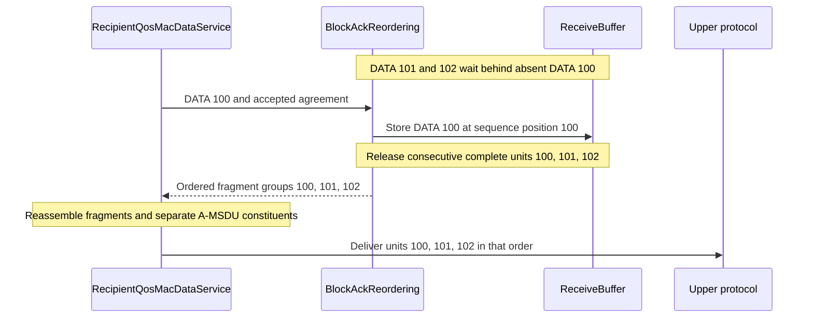
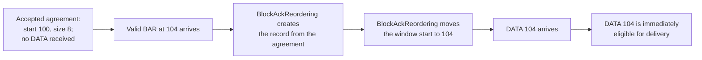

# S1: Basic Block Ack recipient repair — human summary

> **Kind:** report · **Status:** snapshot 2026-10-14 · **Seal:** none · **Owns:** — · **Stands on:** [S1 source record](ieee80211-compressed-blockack-s1.md)

**S1 repairs buffer capacity and delivery at the Basic Block Ack recipient.** Fragments of one MSDU occupy one sequence position. DATA that fills a gap releases every consecutive complete unit. Delivery follows cyclic sequence order, with 4095 before 0 at sequence wrap. A valid BAR can establish the reorder window before any DATA arrives.

This summary follows [ieee80211-compressed-blockack-s1.md](ieee80211-compressed-blockack-s1.md), dated 14 October 2026. That document records the implementation and test results for S1, selected from revision 23 of the Compressed Block Ack plan. The full S1 document owns the exact evidence and approved fingerprints. The results below come from that document; this summary does not add simulation results.

## Why the recipient needed a repair

The implementation parent contains four related faults. Each fault affects the recipient's ability to retain or deliver complete data units.

| Condition | Behavior before S1 | Behavior after S1 |
| --- | --- | --- |
| An MSDU has two fragments, but the buffer permits one sequence position. | Each fragment consumes capacity. The second fragment cannot complete the MSDU. | Both fragments occupy one position. The recipient can reassemble and deliver the MSDU. |
| Complete DATA 101 and 102 wait behind absent DATA 100. | Receipt of DATA 100 releases only DATA 100. | The same operation releases DATA 100, 101, and 102. |
| A release crosses sequence wrap from 4095 to 0. | Numeric map order puts 0 before 4095. | The release result preserves 4095 before 0. |
| A valid BAR arrives before DATA under an accepted agreement. | The recipient creates no reorder record. | The recipient creates the record and applies the BAR to its window. |

A complete unit contains all fragments needed for one MSDU, or one complete A-MSDU. An A-MSDU contains several MSDUs within one MPDU. The recipient must preserve order through fragment reassembly and A-MSDU deaggregation, which separates the constituent MSDUs.

## Which component performs each action

S1 uses three current components. The accepted agreement supplies the initial window and buffer size.

| Component | Responsibility and effect |
| --- | --- |
| `ReceiveBuffer` | Stores fragments by sequence position. All Basic fragments of one MSDU count once. Duplicate fragments consume no additional position. |
| `BlockAckReordering` | Creates the reorder record, moves the window, and returns complete units in cyclic order. Window movement releases older complete units and discards incomplete units outside the new window. |
| `RecipientQosMacDataService` | Supplies the accepted agreement. Preserves released order through fragment reassembly, A-MSDU deaggregation, and delivery. |

The indexed storage can retain its map. The release result needs an explicit order because numeric map order does not represent sequence wrap.

## How DATA and BAR affect delivery

This hypothetical example starts with complete DATA 101 and 102 in the buffer. DATA 100 is absent. Receipt of DATA 100 completes the consecutive range, so the recipient releases all three units in that operation.

Consecutive release stops at the next absent or incomplete unit. The reorder window advances after the last released unit. DATA beyond the window moves the window and can release older complete units.

A BAR needs an accepted agreement even when the recipient holds no DATA. In this hypothetical example, the agreement starts at 100 with capacity for eight sequence positions:

Three input conditions prevent record creation:

- A Basic BAR contains malformed fields.
- The BAR input is unsupported.
- The BAR has no accepted agreement.

When a record exists, an older or equal BAR sequence number leaves the window unchanged. A BAR exactly halfway around the sequence space also leaves it unchanged. IEEE 802.11 uses 4096 sequence numbers, so that half-space distance is 2048.

## What the recorded tests establish

[Ieee80211BlockAckReordering_1.test](../../tests/module/Ieee80211BlockAckReordering_1.test) exercises the production recipient service through eight scenarios. It supplies accepted Basic agreements with known buffer sizes. The scenarios cover fragment capacity, gap release, sequence wrap, BAR before DATA, window movement, incomplete-unit disposal, peer/TID isolation, and A-MSDU order. A TID identifies the traffic class or stream; each peer/TID pair has separate state.

The source records failure of all eight scenarios on the implementation parent. It records success of all eight after S1. These results establish the recipient behavior under supplied agreements. The fixture does not establish ADDBA negotiation or a Compressed exchange.

[Ieee80211RecipientNav_1.test](../../tests/module/Ieee80211RecipientNav_1.test) supplies three current recipient regression scenarios. One scenario covers a Basic exchange. The S1 source names this coverage without a separate pass count.

The initial debug fingerprint comparison selects 12 legacy configurations:

| Comparison | Recorded result |
| --- | --- |
| Implementation parent | All 12 configurations pass. |
| S1 repair, before baseline updates | Eight configurations pass. Four fingerprints differ. |

The four differences follow immediate delivery of additional complete units when DATA fills a gap. The source identifies the first changed recipient operation for each run 0:

| Configuration | Recipient operation after S1 | Result on the parent |
| --- | --- | --- |
| `showcases/wireless/blockack:NoFragmentation` | DATA 14 releases units 14–16. | Only unit 14 is released. |
| `showcases/wireless/blockack:MixedTraffic` | DATA 119 releases units 119–122. | Only unit 119 is released. |
| `showcases/wireless/fragmentation:HCFfragblockack` | Completion of unit 147 also releases unit 148. | Only unit 147 is released. |
| `examples/wireless/qos:MacQosWithBlockAck` | Unit 176 releases four MSDUs, followed by unit 177's two MSDUs. | Only unit 176's four MSDUs are released. |

The maintainer approved these four baseline updates on 14 October 2026. The implementation commit contains the four approved rows and preserves the other fingerprint ingredients and configurations. A fingerprint difference identifies a changed simulation result; the direct scenarios establish the intended recipient behavior.

## Effect on users and external C++ callers

S1 requires no configuration change. Earlier delivery can change simulation results and fingerprints. Basic frame formats and fragment bitmaps remain available, as the [release note](../../WHATSNEW) explains.

The release result now uses `BlockAckReordering::ReleasedFrames`, a vector of sequence-number and fragment-group pairs. This result preserves cyclic order. External callers must follow the [migration instructions](../../doc/src/migration-guide/index.rst):

1. Replace explicit `ReorderBuffer` result declarations with `ReleasedFrames` for `processReceivedQoSFrame()` and `processReceivedBlockAckReq()`.
2. Iterate over the vector in its supplied order.
3. Preserve that order through fragment reassembly, A-MSDU deaggregation, and delivery.
4. Keep released units out of a numeric sequence map.

`ReceiveBuffer::getLength()` and `isFull()` now use occupied sequence positions. Custom diagnostics that need a fragment count must count fragments within each stored position separately.

## Scope and publication basis

S1 is an independent recipient repair. It adds no Compressed exchange, DATA lifetime, agreement lifecycle, or rate-publication capability. The [S1 source record](ieee80211-compressed-blockack-s1.md) excludes those capabilities from this repair. S1's direct fixture supplies accepted agreements; later lifecycle work must verify the negotiated buffer size through its production path.

The S1 source cites IEEE Std 802.11-2024, Clauses 10.25.6.6.2.1 and 10.25.6.6.3.1, for DATA and BAR window rules. Retention of Basic support is an INET compatibility choice. S1 makes no current-standard conformance claim for Basic fragment reassembly.

The implementation comparison uses parent `c15860de93b3764c3e4ead69c6933fc5ae9ce957`. The publication comparison uses upstream `master` at `ac6344cc5bcac972012759281a11b3f8255b5d46`, which contains the merged VHT/HT prerequisite. The source records equal IEEE 802.11 sources, release notes, migration text, and selected baselines on those parents.

The source records authorization for implementation, commit, push, and an upstream PR. It specifies publication verification against the final tree and library on the upstream parent. The source gives no separate final fingerprint pass total. This summary reports the recorded evidence without a new build or test run.
