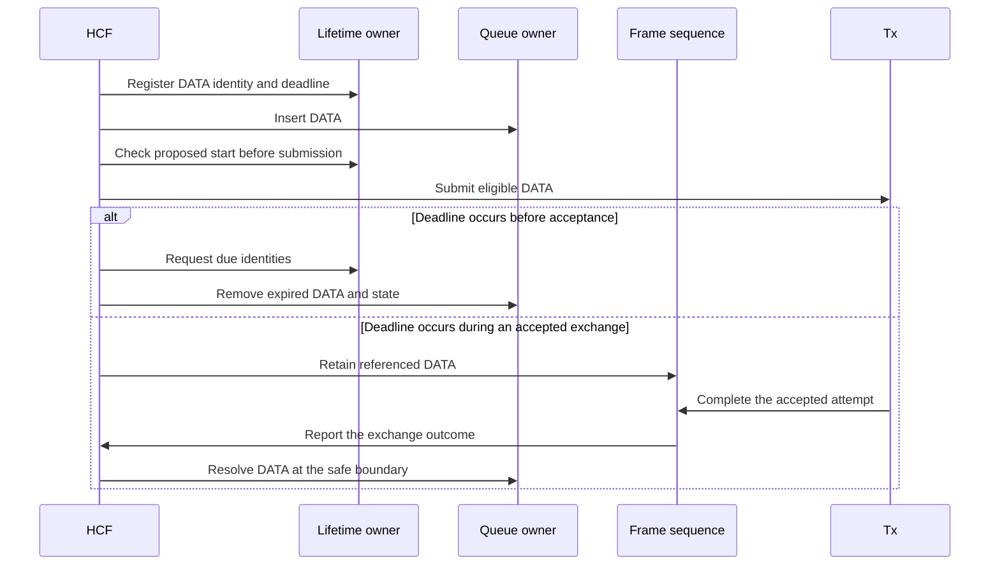

# S2: QoS DATA lifetime

## Scope and source review

S2 adds a finite lifetime to all QoS DATA that HCF accepts. The default is 0.512 seconds for each access category. The Block Ack switch does not control this lifetime. The source parent and comparison base are `1cdb362a2a4b97f564566487079d9d156a5d213d`.

The local lifetime plan defines the accepted behavior. The local umbrella plan requires a fresh source review and a production reproduction before the change. This record supplies the scope, mechanism, and evidence without those unpublished plans. The existing plan files and `AGENTS.md` edit remain separate local work.

The source review confirms that `Edca` declares a lifetime handler but does not construct it. `Hcf::processUpperFrame` inserts DATA without a deadline. `InProgressFrames` selects DATA without a lifetime check. The old handler keys its start times by sequence number. This key cannot distinguish two peers with the same sequence number.

`OriginatorQosMacDataService` replaces source packets during A-MSDU aggregation and fragmentation. Both builders delete their source packets. Deadline transfer must therefore capture source identities and deadlines before either builder runs. Aggregation restarts its timer at construction time. Fragmentation preserves the source deadline.

`FrameSequenceHandler` retains DATA pointers in its context until the exchange ends. `InProgressFrames::dropFrame` moves a packet to a deferred disposal list. The handler deletes that list only after it deletes the context. S2 must preserve this disposal order.

The source paths are unsealed under the [seal registry](../../doc/project/audit/seal-list.md). S2 does not change the sealed packet API. DCF lifetime, management lifetime, agreement lifecycle, and stop/start recovery remain outside this scope.

## Pre-write implementation contract

`EdcaTransmitLifetimeHandler` will own deadlines by local packet identity. `Edca` will construct the handler from each EDCAF's positive, finite `msduLifetime` parameter. HCF will register QoS DATA before queue insertion. The data service will transfer deadline state across packet replacement.

HCF will use one timer for the earliest deadline. HCF will remove expired queued DATA and its lifetime entry. For in-progress DATA, HCF will also remove acknowledgment state. HCF will retain DATA that the current exchange still references until a safe boundary. Expired retained DATA will not cause repeated timer events or another transmission attempt.

Before Tx submission, HCF will compare the proposed transmission start with the DATA deadline. This check includes the proposed interframe space. A refusal will use the existing frame-sequence completion path. An accepted attempt can finish after its deadline. Its response can still acknowledge the DATA.

For example, HCF accepts DATA at 0 seconds while channel access remains blocked. Under the default, HCF discards the DATA at 0.512 seconds. Under a one-second lifetime, the same DATA remains available at 0.7 seconds. The parent retains it in both cases because it has no queue expiration.

## Verification contract

The production fixture will first reproduce queue retention on the parent. Feature cases will cover both Block Ack switch values, identity isolation, frame replacement, expiration before an interframe space, and accepted-exchange completion. Invalid parameter cases will cover zero, negative, and nonfinite values. The fixture will distinguish lifetime disposal from queue loss and retry loss.

The congestion comparison will use the same frames, seed, rate, and blocked channel interval on the parent and feature. It will compare the default with an explicit one-second lifetime. It will record acceptance time, disposal time, age, cause, queue delay, and completion delay. A short run without expiration cannot satisfy S2.

Focused tests will retain the eight S1 recipient cases and the recipient NAV cases. The umbrella plan supplies the 19 selected fingerprint rows. Any baseline proposal requires separate approval. Build results and fingerprints do not replace the production assertions.

## Standards evidence

IEEE Std 802.11-2024 Clause 10.23.2.12.1 defines the transmit timer start, aggregate timer restart, and disposal conditions. The normative corpus node is `ieee80211-2024:clause:10.23.2.12.1`. Its source span is `ieee80211-2024@8388218:8393301`, at physical PDF pages 2016–2017. The corpus resolves its reference to Clause 10.3.2.11. PDF inspection was unnecessary.

The corpus linter reports unrelated heading ambiguities and unresolved references across the full standard corpus. The selected clause has one unambiguous node. S2 uses its retrieved text directly. The Annex C.3 entries for AP and non-AP stations both specify a 500-TU default. The corpus supplied these entries at physical PDF pages 5418 and 5420. These values equal 0.512 seconds.

## Implemented mechanism

An EDCAF is the EDCA function that serves one access category. [EDCA](../../src/inet/linklayer/ieee80211/mac/channelaccess/Edca.cc) owns one lifetime handler for its four access categories. The handler stores each deadline once, in time order. Its identity index refers to the stored deadline and the live packet. The queue owner retains the packet; the lifetime handler holds a borrowed reference.

[HCF](../../src/inet/linklayer/ieee80211/mac/coordinationfunction/Hcf.cc) registers QoS DATA before queue insertion. Its timer requests due identities from the handler. HCF checks each identity for a live packet before disposal. This check also permits another completed drop notification to retire a due packet. HCF uses the pending queue or in-progress queue to remove the packet. It also removes acknowledgment and retry state for in-progress DATA.

[The data service](../../src/inet/linklayer/ieee80211/mac/originator/OriginatorQosMacDataService.cc) removes lifetime references before its builders delete source packets. It completes replacement within the same event. Aggregation registers a new deadline at construction time. Fragmentation registers the captured source deadline for each fragment. Retransmission and ACK-policy changes preserve those deadlines.

The current frame sequence identifies DATA references that must remain valid. Expired referenced DATA remains alive until the sequence reaches its safe completion boundary. The deadline prevents another submission, including a proposed interframe space that would exceed the deadline. A successful response can still acknowledge an accepted attempt after expiration. Deferred packet deletion occurs after context disposal.



The diagram shows ownership and completion order. It does not claim that a timer can interrupt a synchronous function call. The local references and Mermaid structure pass checks. No diagram render is claimed.

## Direct results

The final debug and release builds passed. The debug module runner passed 19 selected fixtures. These fixtures include all 19 lifetime scenarios, both congestion runs, AP/non-AP defaults, four invalid-value cases, and the S1 controls. The four selected mode and response unit fixtures passed. Commands and raw output remain in the evidence paths below.

| Lifetime scenarios | Observed result |
| --- | --- |
| 0–1: queued DATA with either Block Ack switch value. | HCF retains DATA at 0.511 seconds and discards it at 0.512 seconds. No DATA transmission occurs. |
| 2–3: one-second and 100-second values. | The one-second value controls disposal. The 100-second value retains newly accepted DATA through the ten-second interval. |
| 4: equal sequence numbers at two peers. | The first packet expires without a change to the second deadline. |
| 5: A-MSDU construction at 0.4 seconds. | The aggregate remains alive past 0.512 seconds and expires at 0.912 seconds. |
| 6–7: fragments and expired aggregation input. | Fragments retain the source deadline. An expired input cannot enter a later aggregate. |
| 8–11: accepted exchanges, proposed IFS, and acknowledgment. | HCF retains accepted references through completion. HCF prohibits another expired attempt and removes completed lifetime state. |
| 12–13: queue overflow and explicit frame disposal. | Capacity disposal removes lifetime state. Disposal for one peer leaves another peer's deadline unchanged. |
| 14–15: RTS/CTS expiration and repeated failures. | Expired protected DATA cannot reach Tx. Repeated attempts do not extend the original deadline. |
| 16: equal retry identities at two peers. | Expiration leaves the other peer's supplied retry count unchanged. |
| 17: a new arrival at an older deadline. | The older packet expires at 0.512 seconds. The new arrival retains its 1.024-second deadline. |
| 18: large DATA with RTS and DATA retry entries. | Expiration removes both retry entries for that frame. |

Scenarios 16 and 18 supply failure counts directly to the production recovery owner. HCF performs the expiration and disposal. These checks establish state isolation and cleanup. They do not establish complete two-peer or mixed RTS/DATA failure exchanges.

## Controlled congestion comparison

The fixture accepts 20 DATA packets at time zero. It blocks channel access until 0.7 seconds. It uses seed 0, a 6 Mbps DATA rate, fixed zero contention windows, and the same two stations in every comparison. Block Ack support remains disabled. The recipient consumes delivered MAC DATA through the production recipient service.

| Source and lifetime | Delivered DATA | Lifetime disposal | Other disposal | Mean queue residence | Mean delivery delay | Mean exchange completion delay |
| --- | ---: | ---: | ---: | ---: | ---: | ---: |
| Parent; no implemented lifetime. | 20 | 0 | 0 | 0.702881 s | 0.703122 s | 0.703182 s |
| S2; default 0.512 seconds. | 0 | 20 | 0 | 0.512000 s | No delivery. | No completed exchange. |
| S2; explicit one second. | 20 | 0 | 0 | 0.702881 s | 0.703122 s | 0.703182 s |

The parent ignores the proposed lifetime parameter because that parameter does not exist in its source. Its two configuration runs produce the same measured result. The S2 default removes DATA before the blocked channel becomes available. The one-second value permits the retained DATA to complete. Each default disposal records acceptance time zero, disposal time 0.512 seconds, age 0.512 seconds, and `LIFETIME_EXPIRED`.

## Verification commands and artifacts

All commands run from this checkout root unless the command states another directory. Behavioral runners load the fresh debug library. Release is a separate compilation check.

```sh
make MODE=debug -j8
make MODE=release -j8
inet_run_module_tests -m debug -f '(Ieee80211EdcaDataLifetime(_1|Invalid_[1-4]|Defaults_1|Congestion_1)|Ieee80211BlockAckReordering_1|Ieee80211RecipientNav_1|Ieee80211Hcf(Header_1|MultipleProtection_[12]|SingleProtection_1|ManagementRecovery_1|InternalCollision_1)|Ieee80211SingleProtectionGroup_1|Ieee80211TxopProtectionSelectors_[12]|Ieee80211VhtHtSupport_1)\.test$'
inet_run_unit_tests -m debug -f 'Ieee80211(HtModeSet|HtModeCache|VhtHtCapabilities|ResponseModeSelection)_1\.test$'
inet_run_protocol_tests -m debug -w '^tests/protocol/wifi$' -f '(WifiQosDelayedBa|Ac_MultiTidBa|N_Ampdu|Ac_Ampdu|N_BlockAck|N_Amsdu|Ac_BlockAck|N_CompressedBa)\.test$' --no-build
doc/project/enforcement/check-architecture.sh src/inet/linklayer/ieee80211/mac
doc/project/enforcement/check-source-seals.sh --diff
git diff --check
```

The protocol rerun reuses unchanged shared support sources. It still generates and compiles the selected test executables. The final protocol result has four positive passes and four declared failures. Direct stdout identifies the missing requirements below.

| Deferred fixture | First unmet assertion |
| --- | --- |
| `WifiQosDelayedBa` | Step 3 rejects the received immediate Basic Block Ack response. The delayed-response predicate does not hold. |
| `Ac_MultiTidBa` | Step 2 receives no response that meets the Multi-TID predicate within one second. |
| `N_Ampdu` and `Ac_Ampdu` | Step 0 observes no `Ieee80211MpduSubframeHeader` within two seconds. |

These declared failures remain separate from the positive Basic controls. S2 supplies no delayed Block Ack, Multi-TID Block Ack, A-MPDU, or Compressed exchange claim.

Generated evidence is under `tests/module/work/s2-evidence/`. The parent reproduction and congestion stdout remain there. Final runner logs originate from `/tmp/s2-final-module-validation.log`, `/tmp/s2-final-unit-validation.log`, and `/tmp/s2-final-protocol-validation.log`. Fingerprint inputs preserve the 19 plan rows in `/tmp/s2-final-validation.csv`. Each fingerprint case retains its stdout under `tests/fingerprint/results/tmp/s2-final-validation.csv/`.

## Execution evidence

The parent debug build passed in the integration checkout at the selected source parent. The production reproduction used a copy of that library. Both runs retained 20 queued QoS DATA frames at age 0.7 seconds. Channel access remained blocked. The fixture used seed 0 and a 6 Mbps DATA rate. The raw output and fixture inputs are in `/tmp/s2-parent-evidence/`.

The validated contract also includes two required terminal cases from the caller check. HCF releases a contention grant when expiration leaves its queue empty. The QoS `DataFs` path retains the RTS-protected DATA reference after CTS. HCF can then reject expired DATA before Tx submission. These changes preserve the selected exchange and prevent a null-frame access. The paths are unsealed.

Initial verification completed after the ownership and performance corrections below. Its fingerprint comparisons used unchanged parent expectations. S2 adds the standalone lifetime behavior; later stages still own agreement lifecycle and Compressed integration.

The proposed-IFS test exposed a callback defect in `Contention`. HCF refuses the first submission and requests new contention within the grant callback. `Contention` then clears the new callback, so the next grant accesses a null pointer. The required correction clears the completed callback before the call. The new contention request retains its own callback. This path is unsealed and remains within S2's submission-refusal contract.

Publication separates this callback prerequisite from the lifetime owner contract. `Ieee80211ContentionCallback_1` injects callback installation within the grant callback. It requires two grants through the production handler. This fixture adds direct callback coverage without a channel arbitration claim.

Expiration also requires retry-state disposal. The current recovery key omits the peer address. Two peers can retain the same TID, sequence number, and fragment number in one EDCAF. Expiration for one peer would then erase another peer's retry counter. The required correction adds the receiver address to the existing key. A focused owner check combines real HCF expiration with an explicitly supplied failure count for the second peer. It verifies that the second counter survives the first expiration. This check supplies no claim about a complete two-peer failure exchange.

The timer review also identified a same-time boundary. A new arrival can occur at an older DATA deadline before the timer event. Timer selection must retain expired DATA that no exchange references. It must exclude only expired DATA that the current context still references. HCF schedules a due deadline at the current time. A future timer also permits HCF to omit a full queue scan when no unreferenced DATA is due.

The first complete fingerprint run reached the 600-second CPU limit in both ad hoc QoS rows. They stopped near 1.04 seconds of their required ten-second interval. The unlimited queues retained approximately 25,000 packets. Each deadline update scanned every lifetime entry. The required performance correction stores deadlines in time order. The packet identity index refers to those entries, so each deadline has one stored value. Earliest-deadline selection stops at the first eligible entry. Deadline values, disposal rules, and exchange completion remain unchanged.

The same source check found a second cost in expiration. `PacketQueue::getPacket(i)` calls a linked-list lookup. A full indexed scan therefore has quadratic cost in queue length. The lifetime owner now supplies only due packets through borrowed references. Queue discard and frame replacement remove those references before packet deletion. HCF removes each due packet through its queue owner. HCF does not scan retained queue entries at every deadline.

## Fingerprint comparison before baseline approval

The parent passed all 19 selected rows. S2 completed all 19 rows at their recorded time limits, with no runtime error. Eleven rows retain their parent fingerprints. Eight rows differ. This comparison preceded the approved baseline update. The comparison script records exact parent and S2 values in `tests/module/work/s2-evidence/fingerprint-comparison.json`.

The command ran from `tests/fingerprint` in each checkout. The parent used `/tmp/s2-fingerprints.csv`; S2 used `/tmp/s2-final-validation.csv`. Both files contain the same 19 rows and preserve their configurations, runs, time limits, and selected ingredients.

```sh
./fingerprinttest /tmp/s2-final-validation.csv -d -t 4 -m '(showcases/wireless/(blockack|aggregation|fragmentation|qos|txop)|examples/(wireless|adhoc)/qos)' -f tplx -f '~tNl' -f '~tND'
```

The preapproval runner exited with mismatch status because eight baselines still described the parent. It reported eight fingerprint failures and zero execution errors. This status does not replace the direct behavior tests. The later causal audit and explicit approval govern the baseline update.

| Case | Parent fingerprints | S2 fingerprints |
| --- | --- | --- |
| Block Ack showcase: `Fragmentation`, run 0. | `2af7-c4f6/tplx;bdc7-cfd0/~tNl;3135-dd51/~tND` | `2235-516d/tplx;7b51-e67c/~tNl;9a3f-afc7/~tND` |
| QoS showcase: `Qos`, run 0. | `5a33-2cf4/tplx;0683-d978/~tNl;f448-e820/~tND` | `2f30-f17c/tplx;0683-d978/~tNl;a879-de03/~tND` |
| Ad hoc QoS example: `MacQos`, run 0. | `898b-aa3c/tplx;fbaf-8b67/~tNl;3b12-ca4e/~tND` | `dd36-1076/tplx;b703-3ef2/~tNl;e07d-2980/~tND` |
| Ad hoc QoS example: `MacQos`, run 1. | `017f-bfed/tplx;adbc-faea/~tNl;9e6e-f139/~tND` | `b80d-4ae8/tplx;72b7-86c2/~tNl;d385-62e0/~tND` |
| Wireless QoS example: `MacQos`, run 0. | `7ae8-d762/tplx;7a17-6a1d/~tNl;93a3-323a/~tND` | `d929-5913/tplx;f602-4424/~tNl;f2fb-4d98/~tND` |
| Wireless QoS example: `MacQosWithoutAggregation`, run 0. | `8241-1905/tplx;60a4-5565/~tNl;a06d-81c9/~tND` | `0473-f9d2/tplx;e92c-7352/~tNl;317d-aa4f/~tND` |
| Wireless QoS example: `MacQosWithRtsCts`, run 0. | `de32-56b9/tplx;00f9-9ce3/~tNl;e305-c88a/~tND` | `e07a-4c5f/tplx;9f6c-7889/~tNl;29ea-169c/~tND` |
| Wireless QoS example: `MacQosWithBlockAck`, run 0. | `8dc8-a4a7/tplx;0826-0ca5/~tNl;0b4c-d9a2/~tND` | `fbab-b84e/tplx;47cb-b9e5/~tNl;c4f3-fa00/~tND` |

The final ad hoc runs complete their full ten-second intervals within the unchanged 600-second CPU limit. Run 0 takes 239.00 seconds of wall time. Run 1 takes 230.49 seconds. The parent takes 243.79 and 233.01 seconds, respectively. These wall times are observations under concurrent execution, not a controlled performance benchmark.

## Disposal evidence for changed configurations

A diagnostic NED extension adds existing result filters to production HCF. It counts `LIFETIME_EXPIRED`, queue overflow, and retry-limit disposal separately. The extension uses the same HCF C++ class. It changes no traffic, channel, rate, or lifetime parameter. The runs use the same configurations, run numbers, checksums, FCS mode, and time limits as the fingerprint rows.

| Case | Expired DATA packets | Queue overflow | Retry-limit disposal | First lifetime disposal |
| --- | ---: | ---: | ---: | ---: |
| Block Ack `Fragmentation`. | 380 | 9,749 | 0 | 0.516900 s |
| QoS showcase `Qos`. | 400 | 32,575 | 0 | 1.527615 s |
| Wireless `MacQos`. | 3,975 | 0 | 0 | 1.647000 s |
| Wireless `MacQosWithoutAggregation`. | 8,038 | 0 | 0 | 1.528000 s |
| Wireless `MacQosWithRtsCts`. | 4,755 | 0 | 4 | 1.566000 s |
| Wireless `MacQosWithBlockAck`. | 1,496 | 0 | 0 | 1.542273 s |
| Ad hoc `MacQos`, run 0. | 214,369 | 0 | 0 | 1.012000 s |
| Ad hoc `MacQos`, run 1. | 215,491 | 0 | 1 | 1.012400 s |

These counts refer to DATA packets at MAC disposal, including individual fragments. They do not count source MSDUs. The CSV-R exports retain each HCF module's count and vector timestamps. The summary is `tests/module/work/s2-evidence/lifetime-disposal-summary.json`. The controlled fixture separately records each original packet's acceptance time and disposal age.

Lifetime disposal is a confirmed behavior difference in every changed configuration. The diagnostic vectors identify its first occurrence. Those vectors alone do not identify the first changed air frame. The [fingerprint audit](ieee80211-compressed-blockack-s2-fingerprint-audit.md) adds native traces of the first changed transmission in all eight cases. A 100-second control restores all 24 parent ingredient values. The maintainer approved the 23 changed values on 14 October 2026.

## Self-audit and limits

Lifetime replacement preserves aggregation when `msduAggregationPolicy.qOsCheck=false` permits non-QoS sources. The data service supplies only tracked source identities to the strict replacement operation. The builder always produces QoS DATA, so the data service registers the aggregate at construction time. This rule also applies when all sources have no lifetime entry. It creates no source deadline for non-QoS DATA that remains unaggregated.

`Ieee80211EdcaDataLifetimeAggregation_1` checks five cases through HCF, its pending queue, the data service, in-progress frames, and the timer. The cases cover non-QoS sources, both mixed orders, QoS sources, and the enabled QoS check. Each aggregate constructed at 0.1 seconds retains its deadline of 0.612 seconds. It survives the original source deadline, then expires through HCF. The enabled-check case retains ordinary non-QoS extraction without a lifetime entry.

HCF exposes `packetDropLifetimeExpired` through the existing reason filter. The fixture's scalar assertions check one drop and 260 bytes for the aggregate case. They check zero drops and zero bytes for the non-QoS control. The statistic counts discarded MAC frames, including fragments and aggregate MPDUs; it does not count source MSDUs.

The final verification union contains 21 passing module fixtures and four passing unit fixtures. The selected protocol fixtures retain four passes and four declared expected failures. Debug and release compilation pass. All 19 selected fingerprints pass against the existing approved values. No additional baseline value changes. The final test-only scalar assertions also pass in a focused rerun.

The final module selector adds `Aggregation_1` to the `Ieee80211EdcaDataLifetime` group in the command above. The runner logs are `/tmp/s2-repair-module.log`, `/tmp/s2-repair-unit.log`, `/tmp/s2-repair-protocol.log`, and `/tmp/s2-repair-fingerprints.log`. The focused scalar check is `/tmp/s2-repair-aggregation-statistic.log`. Its result files remain under `tests/module/work/Ieee80211EdcaDataLifetimeAggregation_1/results/`.

The fingerprint checks select `tplx`, `~tNl`, and `~tND`. They do not select `tyf`, which uses the fake GUI. The seven affected rows that carry graphical values retain their historical `tyf` values. Those values remain unverified. The fingerprint CI workflow also excludes `tyf`; CI cannot supply this graphical evidence. This record claims no graphical pass or graphical baseline approval.

After the causal audit and approval, the source commit updates 23 ingredient values in eight fingerprint rows. The final debug rerun passes all 19 original rows with zero execution errors. It preserves every configuration, run number, time limit, and other ingredient. The final module, unit, and protocol reruns retain their recorded outcomes. Both compilation modes pass again.

The approved rerun uses `/tmp/s2-approved-validation.csv`, copied from the updated `examples.csv` and `showcases.csv` rows. Its runner log is `/tmp/s2-approved-fingerprints.log`. The command runs from `tests/fingerprint`:

```sh
./fingerprinttest /tmp/s2-approved-validation.csv -d -t 4 -m '(showcases/wireless/(blockack|aggregation|fragmentation|qos|txop)|examples/(wireless|adhoc)/qos)' -f tplx -f '~tNl' -f '~tND'
```

The publication check adds the callback prerequisite to the module selector above. The resulting selector includes `Ieee80211ContentionCallback_1`. All 20 module fixtures pass with the current debug library. The four unit fixtures pass again. The eight protocol fixtures retain four positive passes and four declared failures. Both compilation modes pass again.

The project-wide architecture and interface gates report the same findings as the pinned parent. The project-wide naming gate also reports existing findings. The parent checkout adds six findings from stale generated headers that this checkout lacks. None of these findings describes an S2 source change. These gates do not pass project-wide. The scoped checks and source-seal check remain separate evidence.

The self-audit traced registration, queue loss, aggregation, fragmentation, successful acknowledgment, retry failure, deadline refusal, and safe completion through the current owners. The lifetime handler stores each deadline once. Its identity index holds borrowed packet references. Source replacement removes those references before deletion. The handler forbids copies because its identity index refers to its own ordered entries.

The applicable source-seal check passes for the working diff. The scoped architecture check passes. The scoped naming check reports six existing MSG findings in three unchanged files. A comparison with the pinned parent confirms that S2 changes none of those files. The new EDCAF parameter follows the existing naming and unit rules. `git diff --check` passes.

The checks establish local debug behavior and debug/release compilation. They do not establish CI success or an independent code review. The publication includes the eight approved fingerprint rows in the S2 source commit. The existing `AGENTS.md` edit and the four original plan files remain intact. DCF lifetime, management lifetime, MAC stop/start recovery, and later Block Ack consumers remain outside S2.
