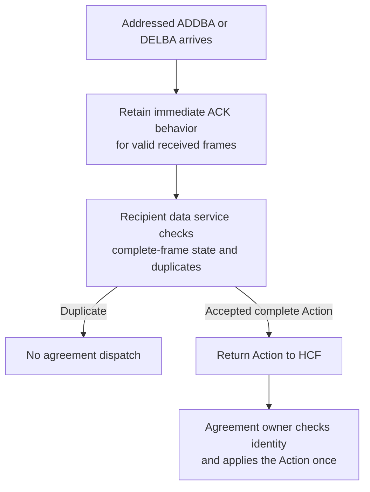
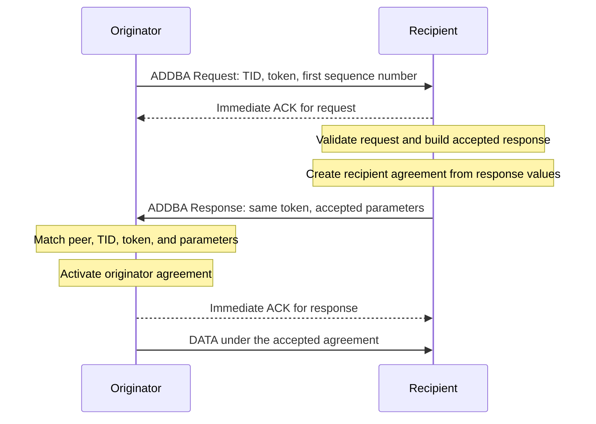
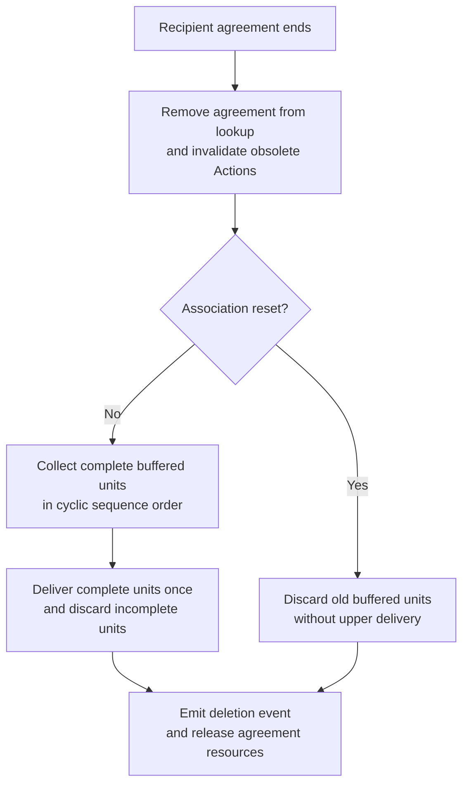
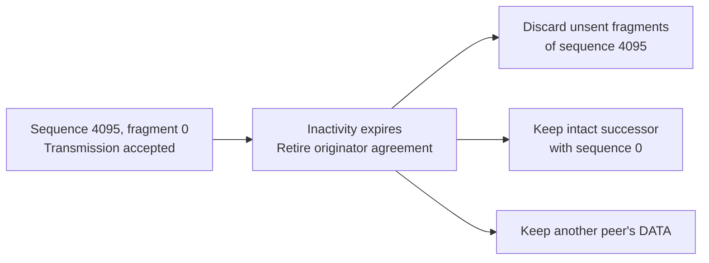
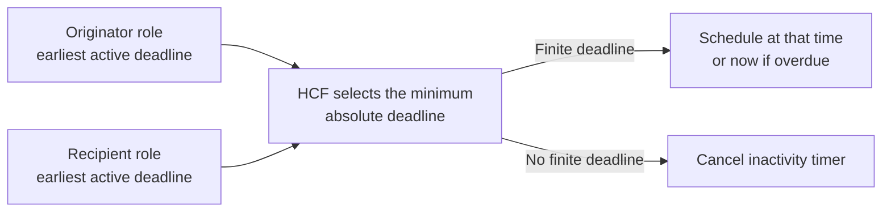
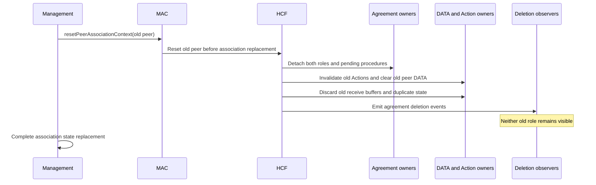
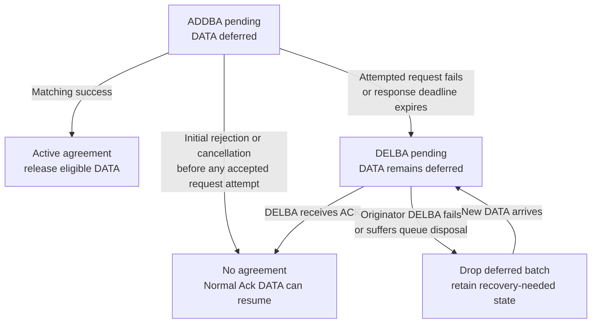
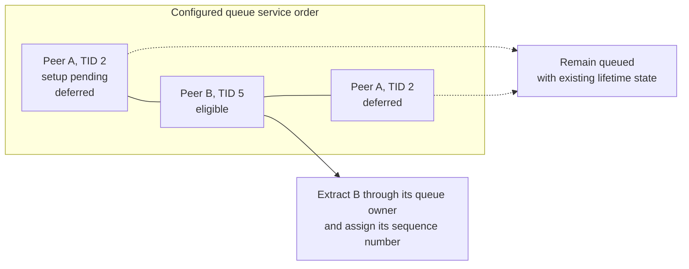

# S3b: safe Block Ack agreement setup and teardown

> **Kind:** reference · **Status:** snapshot 2026-10-21 · **Seal:** none · **Owns:** — · **Stands on:** [replacement summary](../pending/ieee80211-compressed-blockack-replacement-summary.md), [lifecycle plan](../pending/ieee80211-blockack-agreement-lifecycle.md), [implementation record](ieee80211-compressed-blockack-s3b-execution.md)

S3b implements the Basic Block Ack agreement lifecycle. It controls when DATA can use an agreement, how agreement Actions change state, and how cleanup affects queued and received DATA. Production HCF rejects Compressed selection at initialization.

This summary describes branch code at `5860acb229fcb412377b4eb804ecda4df216b015`. S3b implements A1 through A4. The [implementation record](ieee80211-compressed-blockack-s3b-execution.md) identifies the production and test trees, component responsibilities, and current verification. The diagrams explain implemented behavior; they do not represent measured frame traces.

## Agreement behavior

A Block Ack agreement contains the shared parameters that permit Block Ack operation between an originator and a recipient. The originator sends DATA; the recipient receives DATA. ADDBA establishes the agreement through a request and response. DELBA ends the agreement through an Action frame. A BAR is a control frame that requests a Block Ack response.

Safe DATA transmission requires more than a correct Block Ack bitmap. Both stations must agree on the parameters and on whether an agreement exists. Retries, lost responses, queue disposal, inactivity, and association replacement can change that state. S3b gives each event an owner and a defined effect on DATA.

For example, a request ACK can be lost after the recipient accepts ADDBA Request. The retry must receive another ACK without a second agreement dispatch. The recipient data service checks duplicates before HCF dispatches returned Actions. The [HCF receive path](../../src/inet/linklayer/ieee80211/mac/coordinationfunction/Hcf.cc) therefore separates immediate acknowledgment from agreement acceptance.

BAR-only channel access, final-transfer completion, and production Compressed exchanges remain outside this implementation. The [replacement summary](../pending/ieee80211-compressed-blockack-replacement-summary.md) defines those separate requirements.

## Who owns the state

Agreement identity includes the local role, peer, and traffic identifier (TID). One station can hold both roles for the same peer and TID. These records describe opposite DATA directions. Teardown of one role must preserve the other role.

| Component | Responsibility in S3b |
| --- | --- |
| HCF, the hybrid coordination function | Coordinates agreement Actions, frame exchanges, timers, DATA eligibility, and cleanup order. |
| Originator agreement handler | Owns originator agreements, setup procedures, response deadlines, and recovery state. |
| Recipient agreement handler | Owns recipient agreements and recipient teardown procedures. |
| Agreement policies | Check setup parameters and profile admission. |
| Originator QoS data service | Selects eligible DATA, checks A-MSDU permission, and assigns sequence numbers after extraction. |
| Recipient QoS data service | Checks duplicates, returns accepted Actions, and prepares received DATA for delivery or disposal. |
| Reorder owner | Holds received DATA behind sequence gaps and supplies ordered complete units at teardown. |
| Queue components | Own extraction, ownership transfer, queue residence metadata, and pull events. |
| Management and the MIB | Management identifies association reset. The management information base (MIB) owns capability and rate state. |

The [implementation contract](ieee80211-compressed-blockack-s3b-execution.md#implementation-contract) identifies the source owners. HCF reads procedure state and requests transitions through handler operations. The handlers own changes to their stored procedures. Queues do not keep a second copy of agreement state.

## A1: apply each accepted Action once

HCF must distinguish reception of an Action from acceptance of that Action for agreement processing. A valid MAC retry still needs its immediate ACK. It must not create another agreement or apply DELBA twice. The recipient data service therefore returns only complete, nonduplicate Actions for HCF dispatch.

This diagram separates decisions; it does not prescribe ACK timing relative to dispatch. An Action during an active response wait needs an additional order rule. HCF first lets the agreement owner determine whether that Action resolves the pending procedure. HCF then ends the obsolete exchange without an obsolete terminal failure. The retained valid Action still receives its ACK.

Hypothetical example: the peer receives ADDBA Request, but the request ACK is lost. A matched successful ADDBA Response arrives during the request's final ACK wait. The originator accepts the response before request-failure notification. Cleanup must not turn that success into teardown, DATA disposal, or another request retry. An unrelated Action does not suppress the interrupted exchange's ordinary failure result.

The [Action contract](../pending/ieee80211-blockack-agreement-lifecycle.md#3-agreement-behavior) owns this order. The [HCF source](../../src/inet/linklayer/ieee80211/mac/coordinationfunction/Hcf.cc) contains dispatch and response-wait integration. The frame-sequence handler owns the interruption outcome after recipient processing. It suppresses obsolete failure feedback for retired frames. An Action attempt that Tx already accepts retains its context until safe completion; logical retirement does not permit immediate destruction of that context.

## A2: use the parameters that both stations accept

An ACK for ADDBA Request confirms request reception. It does not establish that the originator accepted an agreement. The originator activates its agreement only after a matched successful ADDBA Response passes validation. The response must match the pending peer, TID, and dialog token. It must also specify immediate policy and supported parameters.

The built-in recipient policy chooses `min(64, maximumAllowedBufferSize)` as the accepted buffer size. The request size gives guidance; it does not cap that choice. Both agreement owners use the response timeout value for inactivity. A zero response timeout disables inactivity expiration. The recipient keeps the request's first sequence number for its reorder state.

Hypothetical example: the request suggests eight positions, but the recipient configuration permits 64. The response advertises 64, so both agreement owners use 64. The recipient must not retain eight while the originator uses 64. A rejected modification request leaves the existing agreement unchanged.

A-MSDU permission also belongs to negotiation. An A-MSDU combines multiple MSDUs within one MPDU. Both the request and response flags must permit it before the originator constructs an A-MSDU under the agreement. If either flag denies permission, individual DATA can still use Block Ack. Normal Ack must not bypass a denial for an A-MSDU that already exists.

Basic admission preserves non-HT and legacy ad hoc compatibility. Compressed admission requires local HT operation and valid peer HT state for the relevant direction. S3b checks Compressed admission through isolated policies; this does not enable production Compressed exchanges. The [negotiation contract](../pending/ieee80211-blockack-agreement-lifecycle.md#3-agreement-behavior) defines these conditions and policy choices.

## A3: end the correct agreement without stale work

A3a covers directional teardown and inactivity. A3b covers peer reset. A3c covers Action disposal and recovery when no agreement exists. Every retirement path invalidates obsolete Actions that could change the retired state.

### Directional teardown preserves the opposite role

For received DELBA, HCF uses the transmitter address as the peer. The Initiator field identifies which local role must end. If the peer sends DELBA as originator, the local recipient agreement ends. If the peer sends DELBA as recipient, the local originator agreement ends.

Ordinary recipient teardown first removes the agreement from lookup. The recipient data service then preserves duplicate state and obtains complete buffered units in cyclic sequence order. HCF delivers those units before the deletion event and resource release. Incomplete Basic units undergo disposal. Association reset uses a different policy: it discards old buffered units.

Hypothetical Basic example: sequence 100 is absent, while complete units 101 and 102 remain behind the gap. Ordinary recipient teardown delivers 101 followed by 102 before cleanup. Acknowledgment of those units alone does not establish upper delivery. This release across a gap is an INET policy choice. The [migration guide](../../doc/src/migration-guide/index.rst) explains the implemented teardown policy.

At ordinary originator teardown, HCF discards transmitted, unacknowledged DATA for the selected agreement. HCF also discards unsent fragments through the highest transmitted allocation index. The QoS data service assigns this local index before fragmentation; all fragments retain the same index. The agreement retains the highest transmitted index after ACK processing removes an earlier fragment. Allocation indices preserve order across large sequence gaps and wraparound; older retransmissions cannot move the boundary backward. Later intact DATA and another peer's DATA remain eligible.

The fragment regression supplies a concrete example. Fragment 0 of sequence 4095 enters transmission before inactivity expires. HCF discards its unsent siblings at teardown and preserves the intact successor with sequence 0. The fixture also checks expiration after fragment 0 receives its Normal Ack. A separate collision regression checks disposal of the first DATA before transmission; HCF retires that agreement before its successor can use it.

### Two timers serve different purposes

The ADDBA response timer bounds setup after the request receives its Normal Ack. The inactivity timer bounds an active agreement without relevant activity. S3b uses separate timers because setup uncertainty and agreement inactivity require different state transitions.

| Timer | Start or refresh condition | Expiration effect |
| --- | --- | --- |
| ADDBA response timer | Request ACK starts that peer/TID deadline. The default INET interval is 100 ms. | HCF starts teardown because the peer can hold an agreement. |
| Agreement inactivity timer | Agreement activation starts its deadline. Relevant traffic refreshes it. | HCF retires each overdue agreement and starts DELBA. |

HCF schedules the earliest absolute deadline across both agreement roles. It cancels the inactivity timer when no finite deadline exists. Expiration selects deadlines at or before the current time, so a late callback does not miss an agreement.

Hypothetical timing example: the current time is 1 ms and the absolute deadline is 5 ms. HCF schedules expiration at 5 ms. A relative delay of 5 ms would incorrectly schedule 6 ms. The [timeout contract](../pending/ieee80211-blockack-agreement-lifecycle.md#response-timeout-and-data-lifetime) distinguishes the INET response timeout from DATA lifetime.

### Peer reset clears both roles before callbacks

Association replacement ends the old association even when the replacement publishes identical rates and HT capabilities. A rate-change notification alone cannot identify that event. Management therefore passes the peer identity to HCF before replacement. HCF clears both roles and old peer work before the first agreement deletion callback.

Management uses the typed [IIeee80211Mac contract](../../src/inet/linklayer/ieee80211/IIeee80211Mac.h), which extends `IMacProtocol` and pairs with the NED module interface. Management calls `resetPeerAssociationContext(peer)` before association replacement or loss. The concrete MAC calls `Hcf::resetPeer(peer)` directly. This reset does not use a broadcast simulation signal. Management selects the old association context; MAC components own its cleanup. Custom MAC implementations must implement the C++ interface.

With Block Ack enabled, reset discards the old peer's queued and in-progress QoS DATA, including unsent Normal Ack DATA without an agreement. The recipient data service clears reorder, duplicate, and reassembly state before deletion callbacks. Another peer retains its agreements, DATA, and lifetime records. Management changes association and MIB state separately. The MIB publishes coherent committed state through its boolean notification. The [association-reset contract](../pending/ieee80211-blockack-agreement-lifecycle.md#reassociation-consumers-and-callback-order) explains why the reset call is necessary.

An accepted physical exchange retains its context until completion. Physical statistics still record that exchange, but its callbacks cannot submit retired DATA after CTS. The frame-sequence handler destroys the context before it deletes deferred frame copies.

### Queue loss and uncertain setup require explicit recovery

HCF tracks each locally generated ADDBA or DELBA Action by frame identity, peer, TID, and role. Queue rejection, eviction, retry failure, and acknowledgment reach that Action's owner. Each Action produces one terminal transition. Intentional invalidation removes its procedure identity before queue disposal can report a second failure.

If Tx never accepts a request attempt, local cancellation can release DATA under Normal Ack. After a possible request transmission, no response does not prove that the peer lacks an agreement. HCF must defer DATA until teardown confirms a common state. A successful recipient agreement remains active if its response suffers disposal; response loss does not undo recipient acceptance.

S3b treats a DELBA ACK as teardown confirmation for this INET profile. This policy assumes that the peer processes a valid DELBA. Failed originator DELBA drops the current deferred batch and leaves recovery-needed state without a periodic retry timer. New DATA triggers one fresh DELBA exchange; DATA that arrives during that exchange shares its result.

Failed recipient-role DELBA clears its teardown procedure without an originator recovery record or disposal of opposite-direction DATA. Valid Block Ack-policy DATA or a valid BAR without an agreement triggers recipient-role DELBA. That DATA does not reach upper delivery, and that BAR does not create receive state. Malformed BAR input does not trigger this recovery path. The [lifecycle contract](../pending/ieee80211-blockack-agreement-lifecycle.md#3-agreement-behavior) owns these separate outcomes.

## A4: preserve the first sequence number and unrelated DATA access

The ADDBA request specifies the first sequence number for the agreement. Setup must not consume that number through premature extraction. After the first eligible DATA transmission, more unnumbered DATA for that peer and TID can trigger setup intent. Already numbered DATA first completes or drops under its existing policy. HCF then queries the next sequence number without consumption and creates ADDBA Request.

Hypothetical example: the next unassigned number is 100. HCF requests an agreement with first number 100 while the affected DATA remains queued. After a matching response, extraction assigns 100 to the first DATA. If DATA 100 suffers terminal disposal before transmission, HCF starts teardown before DATA 101 can use that agreement. Extraction alone does not count as first transmission.

Deferral applies to one peer and TID. It must not prevent another peer, another TID, or eligible management traffic from access. The data service selects the first eligible frame in the configured queue service order. HCF uses the same eligibility condition for DATA contention. A nonempty queue that contains only deferred DATA does not justify a new DATA contention request.

Filtered pulls preserve ownership, queue residence metadata, pull events, and compound queue statistics. Collection removal has different effects and cannot replace a pull. HCF uses filtered `canPullPacket()` queries to find unexpired DATA for a peer and TID. The data service uses the same query to select eligible DATA. A filtered `pullPacket()` call transfers that selected frame. Built-in support covers `PacketQueue`, `PriorityScheduler`, and `CompoundPacketQueueBase`.

Custom pending queues must support filtered queries for HCF. The data service retains ordinary dequeue when the advertised next frame is eligible. If every frame is deferred, a supported filtered query returns no frame. If deferred DATA hides eligible DATA, the service pulls only the eligible DATA through an identity filter. The deferred DATA retains its sequence state and lifetime. The [passive source contract](../../src/inet/queueing/contract/IPassivePacketSource.h) defines these operations and their ordinary pull effects.

Before A-MSDU construction, the service checks one proposed source list. The first source must match the selected frame; every source must remain eligible and have permission. An invalid list causes individual extraction of the selected frame. Other sources retain their queue, lifetime, and sequence state. This prevents aggregation that bypasses deferral or the configured service order.

## Current verification

The current debug build passes. All five selected protocol fixtures pass across nine simulation runs on 21 October 2026. The [verification record](ieee80211-compressed-blockack-s3b-execution.md#current-verification) supplies the commands, mode, seed, selected fixtures, and local artifact paths. Their guides explain the tested behavior and limits.

| Protocol fixture guide | Behavior under test |
| --- | --- |
| [Duplicate ADDBA](../../doc/project/evidence/model/wifi/tests/blockack-duplicate-addba.md) | One dispatch and two completed request ACKs after a retry. |
| [Dialog token](../../doc/project/evidence/model/wifi/tests/blockack-dialog-token.md) | Response token echo, altered-token rejection, and matching-token setup. |
| [BAR without agreement](../../doc/project/evidence/model/wifi/tests/blockack-bar-without-agreement.md) | Recipient-role DELBA without an agreement; Basic Block Ack with an agreement. |
| [Inactivity](../../doc/project/evidence/model/wifi/tests/blockack-inactivity.md) | Recipient retirement at the absolute deadline and a zero-timeout control. |
| [Same-AP reassociation](../../doc/project/evidence/model/wifi/tests/blockack-same-ap-reassociation.md) | Removal of four old roles with equal peer parameters, followed by fresh setup and delivery. |

The following module fixtures cover additional boundaries. Their presence does not establish an executed result in this review.

| Behavior under test | Relevant fixtures in this checkout |
| --- | --- |
| Accepted Actions return once; duplicates retain ACK behavior | [Action delivery](../../tests/module/Ieee80211BlockAckActionDelivery_1.test), [Action dispatch](../../tests/module/Ieee80211BlockAckActionDispatch_1.test) |
| A matching Action resolves setup before obsolete exchange failure | [Response wait](../../tests/module/Ieee80211BlockAckResponseWait_1.test) |
| Accepted parameters and profile admission reach their owners | [Negotiation](../../tests/module/Ieee80211BlockAckNegotiation_1.test), [Admission](../../tests/module/Ieee80211BlockAckAdmission_1.test) |
| Directional cleanup and absent-agreement recovery preserve other state | [Lifecycle](../../tests/module/Ieee80211BlockAckLifecycle_1.test) |
| Association replacement clears both roles before observers run | [Association reset](../../tests/module/Ieee80211BlockAckAssociationReset_1.test) |
| Setup deferral preserves sequence state and unrelated progress | [Deferral](../../tests/module/Ieee80211BlockAckDeferral_1.test), [DATA selection](../../tests/module/Ieee80211BlockAckDataSelection_1.test) |
| Filtered pulls preserve queue effects | [Filtered pull effects](../../tests/module/PacketFilteredPullEffects_1.test) |
| First-DATA disposal retires the agreement before successor transmission | [Deferred collision](../../tests/module/Ieee80211BlockAckDeferredCollision_1.test) |
| Teardown removes unsent fragments through the highest transmitted allocation index | [Fragment retirement](../../tests/module/Ieee80211BlockAckFragmentRetirement_1.test) |

The current verification does not run module fixtures, unit fixtures, fingerprints, release behavioral tests, sanitizers, or other platforms. CI remains outside this record. The five protocol fixtures establish selected Basic lifecycle behavior, with controlled stimulus where their guides specify it. They do not establish complete standards conformance.

## Scope limits

The current implementation and verification do not establish these capabilities:

- Production Compressed BAR and Block Ack exchanges, serialization, or receipt-state behavior.
- S4 BAR arbitration, BAR-only channel access, or teardown after the final Block Ack exchange.
- Compressed response-rate and airtime correctness.
- General MAC stop/start recovery.
- A performance guarantee across repeated setup and teardown.

S3b supplies a defined agreement lifecycle with safe DATA eligibility and cleanup. Production Compressed support requires separate exchange behavior and verification.
