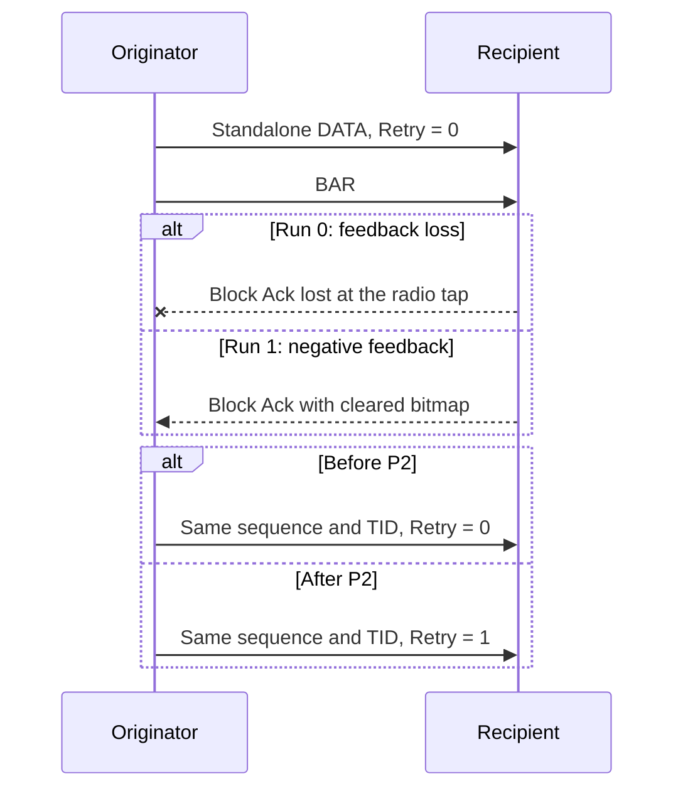
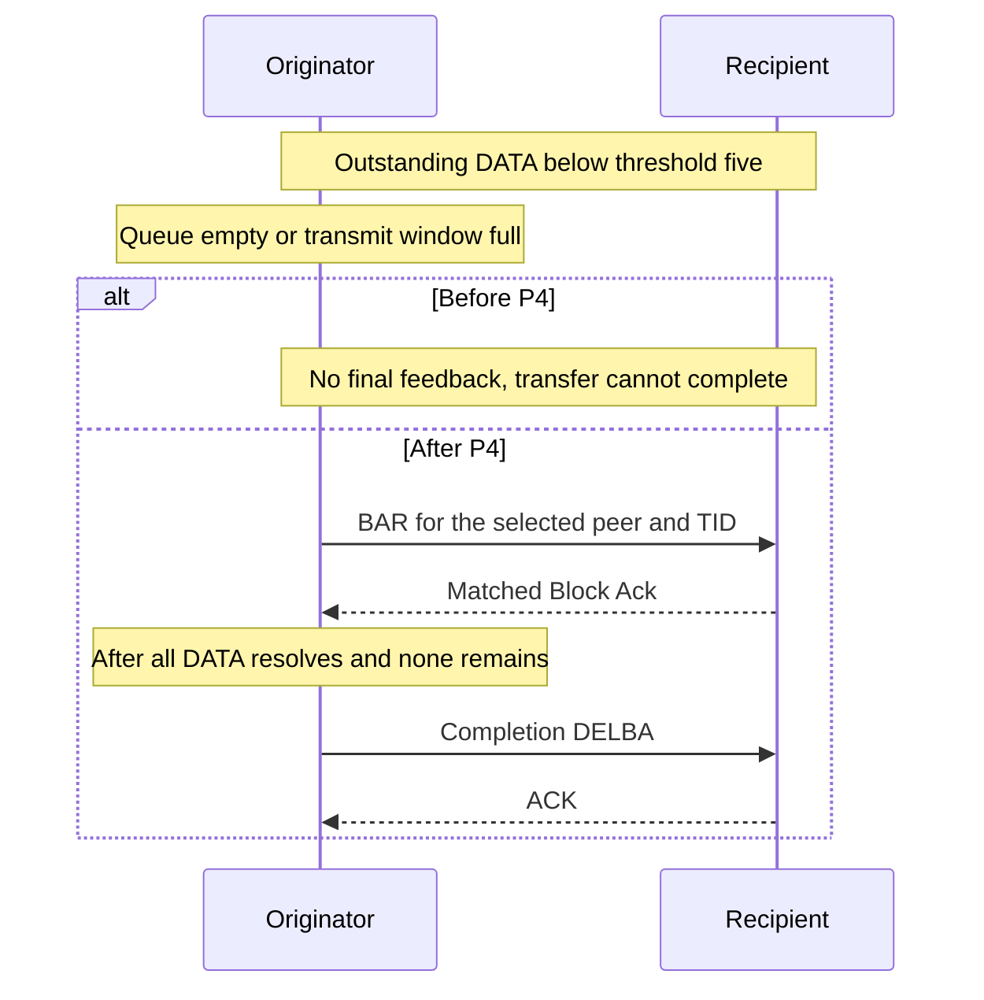

# S4 commit guide: complete Basic Block Ack transfers

> **Kind:** reference · **Status:** current · **Seal:** none · **Owns:** — · **Stands on:** [implementation status](ieee80211-compressed-blockack-replacement.md), [series plan](ieee80211-compressed-blockack-s4-corrections.md)

The series separates preparation, the Retry correction, and transfer completion. Its final production source retains the reviewed Basic behavior. Protocol tests now observe the independent Retry correction and the complete short-transfer sequence.

Agreement setup, finite DATA lifetime, filtered queue operations, and recipient teardown delivery come from earlier PRs. The [scope table](ieee80211-compressed-blockack-replacement.md#previous-prs-and-s4-scope) identifies them.

## P0: Record the correction contract

This documentation commit defines each commit's responsibility and verification. It adds explicit protocol test tasks before the two behavior changes. It changes no production behavior.

## P1: Expose DATA preview without extraction

Before this commit, the shared queue can identify a successor through extraction. Extraction changes ownership and can assign its sequence. BAR selection needs candidate information before those changes.

After this commit, callers can borrow the next eligible frame and query its prospective sequence. Existing calls retain extraction as their default. The DATA-selection fixture checks queue ownership and the unchanged header.

For example, queued DATA retains sequence 77 while preview reports prospective sequence 0. The frame stays in its queue.

```text
Before: queue -> extract -> assign sequence -> inspect candidate
After:  queue -> borrow candidate -> inspect prospective sequence
        queue ownership and stored sequence remain unchanged
```

## P2: Mark DATA retries after failed Block Ack feedback

Before this commit, the ACK handler already permits retransmission after missing or negative feedback. HCF can transmit that DATA with Retry clear.

After this commit, HCF sets Retry before Tx receives the retransmitted DATA. Sequence and TID remain unchanged. This correction needs no preview, BAR arbitration, or completion change.

The [protocol reviewer document](../../tests/protocol/wifi/blockack-data-retry.md) explains the lost-response and negative-bitmap cases. Both use production association and ADDBA.



## P3: Add shared originator window operations

Before this commit, the agreement stores its window start but lacks shared operations for the planned callers. After this commit, it also owns cyclic distance, bitmap membership, and advancement.

No production caller uses those new operations until P4. This preparation changes no packet trajectory. The isolated unit fixture checks wraparound, unresolved positions, and the distinct bitmap boundary.

For example, an accepted window at 4094 with size four includes 4094, 4095, 0, and 1. Its unresolved sequence 4095 prevents advancement to 0.

```text
Before: agreement stores start; planned callers need window operations
After:  caller supplies unresolved identities -> agreement advances window
        caller supplies sequence -> agreement tests membership
```

## P4: Complete Basic BAR transfer resolution

Before this commit, a short group can remain without final feedback. Channel access depends on DATA eligibility. Queue exhaustion or a full window can block completion below the BAR threshold.

After this commit, HCF selects BAR before DATA extraction and permits BAR-only contention. The ACK policy separates peer/TID groups. Matched feedback resolves the group and permits shared window advancement. When no DATA remains, HCF starts completion DELBA.

The sequence also limits Basic single protection to prepared successors. Unextracted DATA starts another TXOP. This policy can increase contention and repeated setup. Multiple protection retains its successor policy.

For example, a one-position window and threshold five permit one outstanding DATA. BAR must resolve that position before another sequence can proceed.

The [protocol reviewer document](../../tests/protocol/wifi/blockack-transfer-completion.md) explains both completion cases. Existing module fixtures retain expiry, collision, feedback, and timing controls.



## P5: Describe current behavior and evidence

This documentation commit distinguishes inherited prerequisites from S4 changes. It records each changed fingerprint row's cause and acceptance. It separates fresh execution from source equality and earlier evidence.

## Evidence and limits

The [verification record](ieee80211-compressed-blockack-s4-execution.md) supplies commands, source identities, and results. The protocol comparison records use identical test inputs on each behavior change and its parent.

Basic remains the default compatibility profile. Compressed exchanges, A-MPDU, general Basic DATA admission, and complete NAV conformance remain outside this PR.
