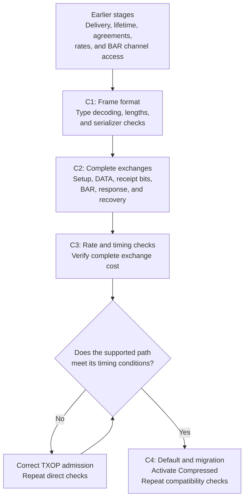
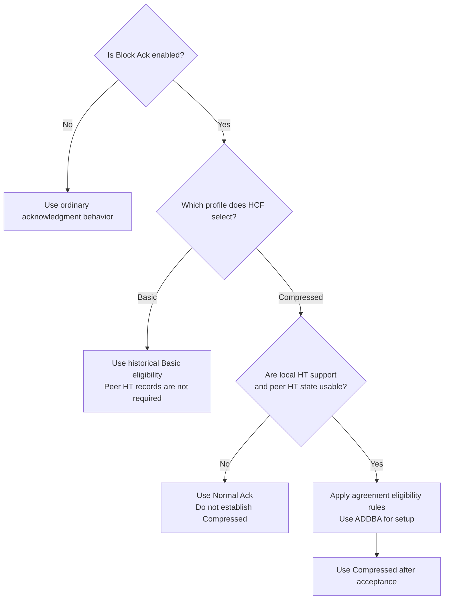
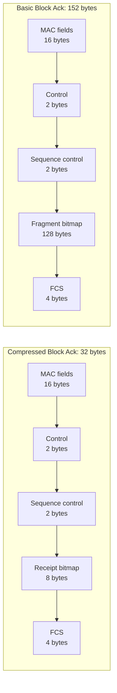
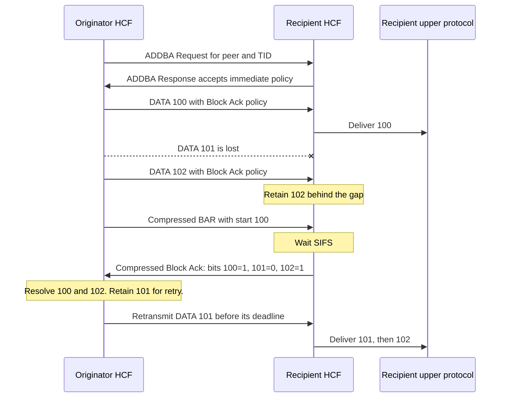
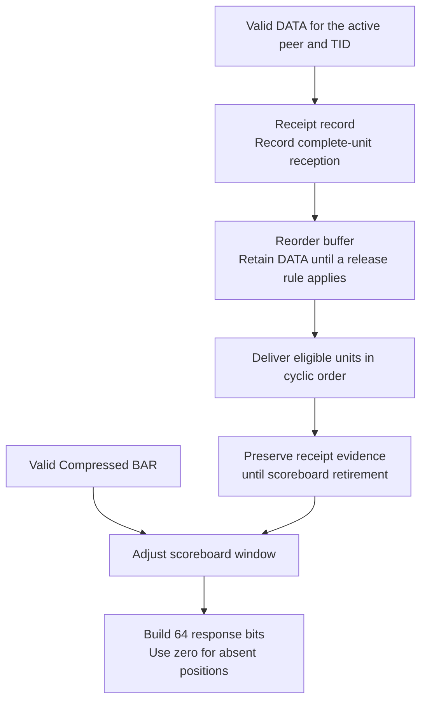
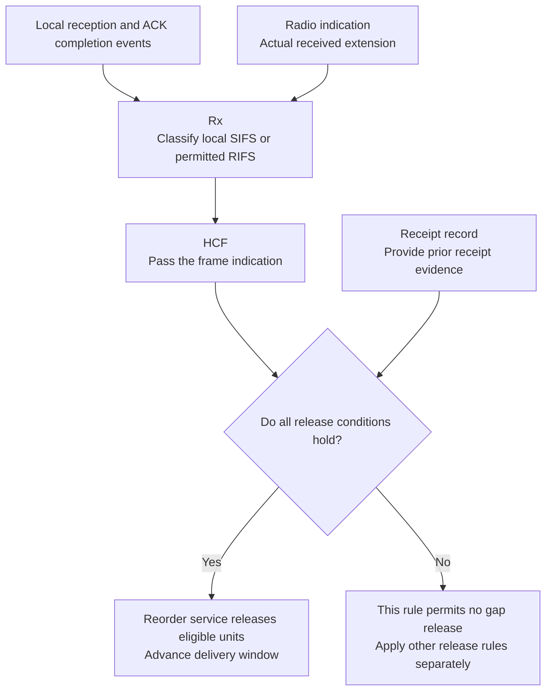
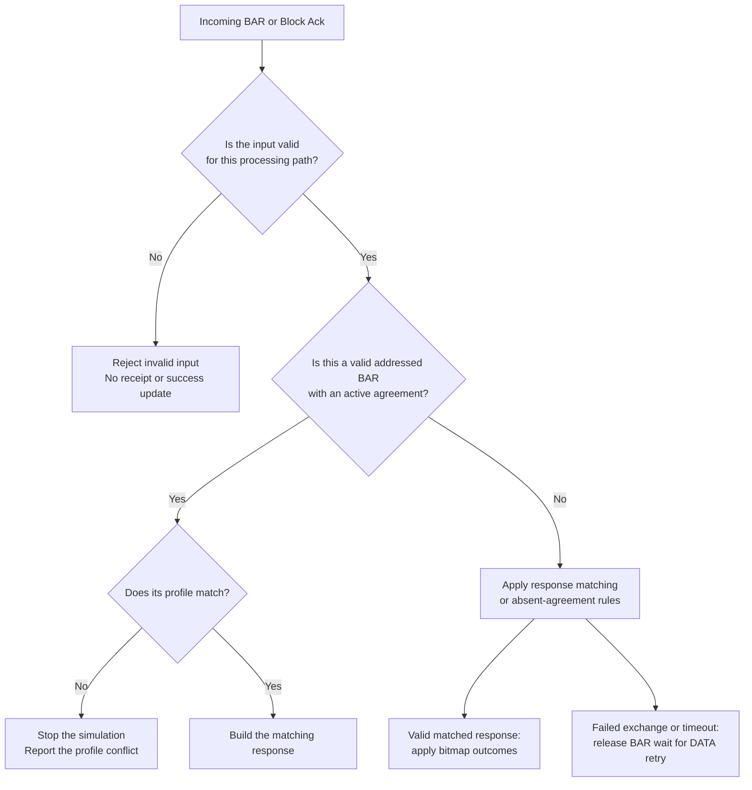
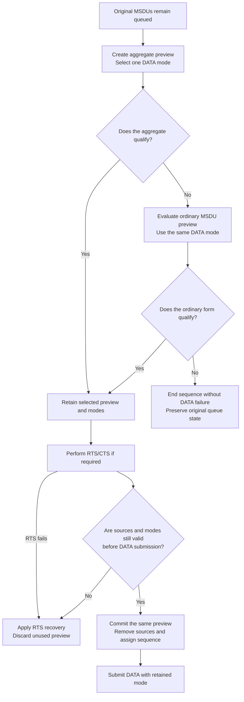

# S5 Compressed Block Ack summary

> **Kind:** reference · **Status:** current · **Seal:** none · **Owns:** — · **Stands on:** [replacement plan](ieee80211-compressed-blockack-replacement.md), [S5 execution record](ieee80211-compressed-blockack-s5-execution.md), [TXOP correction](ieee80211-compressed-blockack-txop-admission.md)

S5 adds complete explicit Compressed BAR and Block Ack exchanges to INET's supported individual-frame MAC path. It makes Compressed the default profile. Explicit Basic remains available for historical compatibility. The originator sends individual QoS DATA frames, requests receipt status with BAR, and uses the response bitmap to resolve transmitted frames.

The [S5 execution record](ieee80211-compressed-blockack-s5-execution.md) reports completion through C1, C2, C3, and C4. The current [HCF configuration](../../src/inet/linklayer/ieee80211/mac/coordinationfunction/Hcf.ned) selects `blockAckVariant = "compressed"` by default. This summary explains that result, the required TXOP correction, and the limits of the recorded evidence.

## What S5 adds to the earlier stages

The earlier stages supply recipient delivery, finite DATA lifetimes, agreement management, rate state, and BAR channel access. S5 connects these mechanisms to the Compressed frame format. It also verifies response airtime before it activates the default. The [replacement steps](ieee80211-compressed-blockack-replacement.md#compressed-replacement-steps) define C1 through C4.

C1 establishes valid protocol bytes. C2 establishes the complete runtime path. C3 checks legal rates and timing. C4 changes the default after those checks pass. During S5, a new continuation overrun required the separate [TXOP correction](ieee80211-compressed-blockack-txop-admission.md). Its recorded acceptance permits C4 completion.

## Which links use Compressed

HCF resolves one profile for the interface at initialization. Both endpoints must select the same profile. ADDBA establishes a Block Ack agreement, but it does not negotiate this profile selector. Each agreement identifies one peer and traffic identifier, or TID. State for another peer or TID remains separate.

Compressed requires usable local HT support and peer HT state for the relevant direction. HT means high throughput. A PHY mode name alone does not supply peer capability state. An associated `ac` peer can qualify through its inherited HT support. Without usable HT state, the Compressed selection uses Normal Ack and does not establish a Compressed agreement. [Profile and capability contract](ieee80211-compressed-blockack-replacement.md#1-core-intended-behavior).

For example, an HT ad hoc configuration can lack peer HT records. The default still selects Compressed, but DATA uses Normal Ack. To retain a historical Basic study, the user selects `mac.hcf.blockAckVariant = "basic"` at both endpoints.

HCF reports the selected profile when Block Ack is enabled. If local HT support is absent, it emits one initialization warning per interface. That warning cannot identify every peer capability gap. Agreement policy logs explain refusals caused by absent peer HT state. Disabled Block Ack produces no irrelevant warning. The [migration guide](../../doc/src/migration-guide/index.rst) explains configuration and extension requirements.

## What crosses the wireless link

Compressed reports one complete-unit receipt bit per sequence position. Its response bitmap contains 64 bits. Basic retains its fragment bitmap. A positive Compressed bit acknowledges the complete MSDU or A-MSDU at that position. An MSDU is the data unit that the MAC receives from its service user. An A-MSDU combines MSDUs within one MPDU.

Both BAR profiles contain 24 bytes with FCS. The Compressed Block Ack response contains 32 bytes with FCS; the Basic response contains 152 bytes. The serializer decodes the complete four-bit Type field. Type 2 selects Compressed. Type 0 retains Basic compatibility. Unsupported types follow the invalid-frame path. [Frame format contract](ieee80211-compressed-blockack-replacement.md#41-select-the-current-or-historical-profile).

The Compressed header chunk contains 28 bytes. The trailer supplies the four-byte FCS. Compressed reserved bits write zero; received reserved values do not change the result. Type bits remain type bits and cannot use that ignore rule. Basic producers must keep the two reserved-field bits that overlap Type equal to zero.

A smaller response does not by itself prove lower exchange airtime or higher application goodput. Control rates, contention, explicit BAR, and agreement setup also affect those results.

## How a complete exchange works

After ADDBA acceptance, the originator sends eligible individual QoS DATA frames for the agreement's peer and TID. HCF can request channel access for BAR even when no unsent DATA remains. The recipient answers a valid addressed Compressed BAR after SIFS, the short interframe space. Its response describes actual receipt state. [Exchange contract](ieee80211-compressed-blockack-replacement.md#43-keep-bar-selection-and-response-state-exact).

The following hypothetical example uses an accepted agreement and a recipient scoreboard that starts at 100. DATA 101 is lost. DATA 102 remains in the reorder buffer until retransmission fills the gap. The example omits other release conditions to show ordinary gap recovery.

The response start can differ from the BAR start. The originator maps each bit from the response start, with modulo-4096 sequence arithmetic. It accepts positive bits only for transmitted, unacknowledged frames inside the active transmit window. A positive bit cannot acknowledge an unsent frame.

A zero bit leaves its frame unacknowledged. Frames outside the response coverage retain their acknowledgment state. Requested frames leave their BAR wait when the exchange ends, so retry selection can proceed. A disjoint response or timeout also releases that wait. The supported recovery path retransmits DATA instead of repeated BAR-only requests.

## Why receipt state survives delivery

Receipt state answers whether a frame arrived. The reorder buffer answers whether the recipient can deliver a frame in order. S5 keeps these responsibilities separate. Delivery removes a buffered unit, but it must preserve the receipt bit for a later BAR. Scoreboard movement controls receipt retirement. [Recipient state contract](ieee80211-compressed-blockack-replacement.md#45-build-recipient-state-and-select-response-airtime).

The recorded recipient test receives DATA 100, 102, and 101. It delivers 100, 101, and 102 in order. A subsequent BAR still receives three positive bits. An empty record produces zero bits, and absent sequence positions remain zero.

Basic keeps its fragment receipt state and reassembly. For an active Compressed agreement, the originator suppresses fragmentation for that peer and TID. This restriction also applies when DATA uses Normal Ack within that agreement. The recipient rejects fragmented DATA before receipt or reorder updates. Outside a Compressed agreement, the existing fragmentation threshold still applies.

## When the recipient can release DATA across a gap

S5 also implements the supported individual-MPDU release condition. The current DATA sequence must lie inside the reorder window and above its start. The recipient must retain positive receipt evidence immediately before the scoreboard start. The required SIFS or RIFS relation must also exist. RIFS means reduced interframe space. The [recipient interframe design](ieee80211-compressed-blockack-s5-execution.md#recipient-interframe-design) defines the remaining profile conditions and timing rules.

For example, the execution record describes an agreement with start 100 and size four. Normal Ack DATA 100 arrives first. DATA 104 later moves the scoreboard start to 101. Receipt evidence for 100 remains. If the required interframe relation exists, the recipient can release 104 despite the gap. Without that evidence or relation, this rule does not permit release.

Rx detects the interval from endpoints at its own station and decoded frame information. It attaches the result to the accepted frame. HCF passes the result to the recipient service. The reorder service retains the receipt and delivery decisions.

Rx discards unusable future history after interruption or overlap. A confirmed local ACK completion can establish new history. Rx retains completed reception evidence until MAC delivery, with separate permission to become a future predecessor. HCF explicitly invalidates history when agreement context becomes obsolete. No remote endpoint, transmission identity, or retained transmission pointer supplies interval evidence.

The detector supports coverage class zero. The local SIFS window extends ten percent of the selected slot time on each side of SIFS. For 2.4 GHz HT, that window is 8–12 microseconds. After a local ACK, five-microsecond one-way propagation produces a twenty-microsecond gap when the peer waits SIFS. Rx supplies no SIFS evidence. A valid frame can retain positive receipt evidence behind a sequence gap until a newer BAR permits delivery.

RIFS recognition requires permitted HT operation and its additional transmitter and address conditions. VHT operation does not permit RIFS. This work adds no RIFS transmission scheduler. The PHY correction also includes the six-microsecond signal extension for 2.4 GHz HT transmission. Consumers must not add that extension again.

## How invalid input and failed exchanges behave

Only a matched, valid response can cause exchange success. The checks include profile, addresses, TID, Fragment Number zero, 64 bitmap bits, and supported length. Malformed responses cannot acknowledge DATA, refresh inactivity, or produce success feedback. The existing failed-BAR path makes requested DATA available for retry. Existing absolute DATA deadlines still apply. [Response validation and recovery](ieee80211-compressed-blockack-replacement.md#43-keep-bar-selection-and-response-state-exact).

A valid addressed BAR with the other profile causes a fatal configuration diagnostic when an agreement exists. HCF stops before agreement, receipt, reorder, response, or inactivity updates. It sends no conflict-triggered DELBA. The diagnostic identifies the local address, peer, TID, and profiles. The user must correct both endpoint configurations before a new run.

This conflict can become visible after earlier DATA delivery because ADDBA does not negotiate the selector. Malformed input and absent agreements have separate paths. Ordinary teardown can release complete buffered units across gaps before disposal. Association reset discards old buffered units under the [lifecycle contract](ieee80211-blockack-agreement-lifecycle.md#recipient-buffer-disposition-at-teardown).

Compressed supports immediate Block Ack only. HCF rejects enabled delayed policy in either agreement policy during initialization, before ADDBA. Basic retains its existing delayed-policy configuration contract. That retention does not establish successful delayed Block Ack support.

## Why S5 also needs a TXOP correction

The historical S5 summary reports a continuation overrun that its S4 parent did not reproduce. In General run 6, later A-MSDUs exceeded a one-millisecond TXOP by 310 microseconds. The exchange selector checked positive time left, but it did not prove that the complete exchange fit. The original publication at `d8f98b8bf3f4477f5780564c983662006c11c27f` retains that reported comparison. The [admission contract](ieee80211-compressed-blockack-txop-admission.md#resolved-implementation-contract) defines the resulting bounds.

A final transmit check alone could refuse an aggregate after the service removed its source MSDUs. The correction therefore makes preparation reversible. The data service creates a duplicate preview while original MSDUs remain queued. HCF selects one DATA mode and checks complete exchange cost. It checks an ordinary MSDU with the same mode if the aggregate does not qualify.

Refusal preserves queued MSDUs, deadlines, and sequence state. Before DATA submission, failed RTS updates the access category's short retry counter and contention window. It creates no provisional sequence counter. Source lifetimes still bound repeated attempts. Expiry or changed capabilities cancel invalid preparation.

The corrected path preserves permitted TXOP exceptions. These include an eligible initial ordinary MSDU and an eligible same-size single-MPDU retransmission. An oversized first-attempt A-MSDU cannot use the retransmission exception. Single protection reserves the current exchange; a later BAR can require fresh contention. Basic and traffic outside active Compressed agreements retain their existing preparation and admission paths. [Resolved admission contract](ieee80211-compressed-blockack-txop-admission.md#resolved-implementation-contract).

## Historical recorded checks

The table below retains historical S5 results from the original publication at `d8f98b8bf3f4477f5780564c983662006c11c27f`. These results do not establish the local-interval reconstruction. The [verification scope](ieee80211-compressed-blockack-s5-execution.md) separates the source boundaries and local records.

| Evidence | Recorded result | What it establishes |
| --- | --- | --- |
| Module fixtures | 44 distinct fixtures pass across the selected batches and reruns. | Scoped integration, compatibility, lifetime, setup, reset, and recovery behavior. |
| Physical interframe cases | All 28 cases pass again after default activation. | Receipt and interval conditions through real PHY reception with supplied agreements. |
| Admission cases | All 24 cases pass again after default activation. | Refusal, fallback, ownership, deadlines, mode retention, cancellation, and actual retries. |
| Scheduling cases | All 76 cases pass after default activation. | Retained Basic cases plus Compressed response matching and small-window arbitration. |
| Infrastructure timing campaign | Sixteen explicit-profile cases pass; all 98 matched BAR/Block Ack exchanges meet their bounds. | Scoped timing after the TXOP correction; the former run 6 violation no longer occurs. |
| Lowest response mode | Both additional cases pass at 6 Mbit/s. | The supported production exchange at that response rate. |
| Constructed serializers | All 278 cases pass; separate golden-octet checks also pass. | Frame representation and byte format. |
| Protocol files | Five supported files pass; four deferred files retain expected failures. | Supported exchanges and explicit limits for deferred features. |
| Regression fingerprints | All nineteen selected rows match without a baseline change. | Selected non-graphical regression behavior. |

Infrastructure and protocol fixtures establish negotiation separately from fixtures with supplied agreements. A passing serializer test does not establish negotiation. Fingerprint matches do not replace direct timing or exchange assertions.

The evidence covers the recorded deterministic cases and seed. Graphical `tyf` fingerprints remain unverified. Production HT catalogs provide no distinct legal alternate response for the tested 32-byte frame; a selector unit checks that contract separately. The recipient prefix release remains an interpretation of ordered delivery together with the individual-MPDU release condition.

## Local interval reconstruction checks

The revised series uses separate protocol fixtures for detector inputs and Compressed delivery consequences. Fifty-one input cases and thirty-three exchange cases pass with seed zero. Five HT infrastructure cases check actual received extension and unavailable duration. Eight management cases check RIFS permission. Fourteen module cases check normal ACK completion, abort, representations, and return switch time.

Each replacement receives debug and release builds and its focused checks. The local record `/tmp/inet-local-interframe-20261028/execution.md` supplies commands, source boundaries, and evidence limits. These checks do not repeat every historical campaign above. They add no fingerprint or statistical baseline changes.

## What remains outside S5

S5 supports immediate, one-TID, explicit Compressed BAR exchanges with a 64-position response bitmap. Its DATA path uses individual MPDUs and can use A-MSDU. It does not provide A-MPDU transfer. The [scope contract](ieee80211-compressed-blockack-replacement.md#2-standard-support-and-model-boundary) defines this intermediate model for bitmap, response, and recovery studies.

The following limits remain relevant:

- S5 excludes implicit BAR, delayed Compressed Block Ack, Multi-TID Block Ack, and HE bitmap lengths.
- S5 excludes dynamic fragmentation and complete HT-immediate transfer through A-MPDU.
- Basic preserves historical compatibility; it does not establish complete historical IEEE conformance.
- Positive `ac` exchanges establish the supported inherited HT path; they do not establish complete VHT transfer conformance.
- The TXOP correction covers active Compressed agreements; inherited admission limits remain outside that scope.
- The recipient history supports the stated timing rules; it adds no MAC stop/start recovery support.

Custom MAC, rate, data-service, radio-medium, cache, and PHY-mode implementations can require interface changes. The [migration guide](../../doc/src/migration-guide/index.rst) gives those obligations. Retained Basic classes do not remove those obligations. Existing Basic demonstrations keep their explicit selector, configurations, and result rows.
