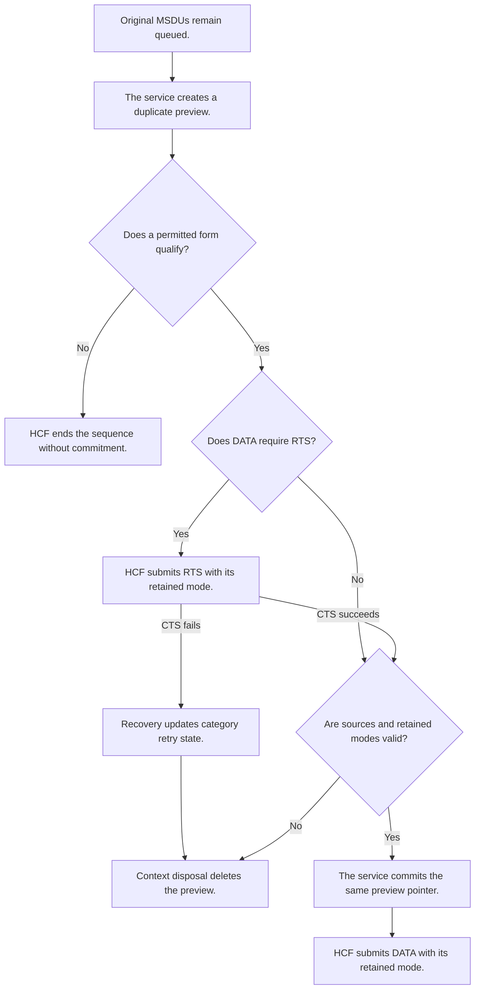

# Compressed DATA admission contract

HCF admits complete DATA exchanges before source removal under active Compressed agreements. The data service preserves original MSDUs until that admission succeeds. Master supplies S4 borrowed preview and BAR-first arbitration. S5 adds reversible preparation and complete exchange admission through those contracts.

## Required result and scope

HCF evaluates the aggregate and an ordinary fallback with one DATA mode. An aggregate must fit its applicable bound. Later ordinary DATA must also fit. A permitted initial ordinary MSDU can use the initial-MSDU exception. A same-size retransmission can use its separate exception under IEEE Std 802.11-2024 Clause 10.23.2.9.

Hypothetical example: 200 microseconds remain, an aggregate needs 400 microseconds, and its first ordinary MSDU needs 150 microseconds. HCF admits the ordinary MSDU and leaves the other sources queued. If neither form qualifies, HCF ends the sequence without commitment.

A zero TXOP limit permits one SU PPDU with one MSDU or A-MSDU, plus required protection and response. With a positive limit, the initial ordinary-MSDU exception permits at most one Data or Management frame. RTS and CTS airtime contributes to cost without an additional Data or Management frame. An oversized first-attempt A-MSDU cannot use the retransmission exception.

Explicit Basic and Normal Ack outside an active Compressed agreement retain their existing admission paths. This contract establishes no general TXOP conformance for those paths.

## Resolved implementation contract

The data service creates duplicate previews through `PreparedQosData`. Each preparation stores original frame identities and its source queue. It retains no original frame pointer across events. HCF requests the aggregate form first. If that form fails admission, HCF requests an ordinary form with the same selected mode.

`QoSContext` owns the preparation and retained modes. The HCF callback returns `LEGACY`, `READY`, or `DEFERRED`. `HcfFs` invokes it after BAR arbitration and before extraction. Refusal ends the sequence without a DATA failure. Legacy contexts retain their existing extraction route.

The data service checks source membership, eligibility, deadlines, sequence state, and A-MSDU permission. HCF separately validates retained modes and response inputs through pure queries. Capability loss or a changed input cancels preparation without another adaptive rate query. HCF repeats validation before RTS and before DATA submission.

Commitment removes accepted sources only before first DATA submission. It transfers the same preview pointer to `InProgressFrames`. Ordinary commitment retains the original deadline and queue metadata. Aggregate commitment starts the A-MSDU lifetime. Commitment assigns one sequence number and allocation index. Context disposal deletes unused previews after frame-sequence step disposal.

## Event boundaries and recovery

Expiry during CTS wait can remove originals safely because preparation stores frame identities. An invalid preparation ends without stale DATA or a synthetic RTS failure. Actual RTS failure updates QSRC and the contention window. QSRC is the short retry counter for an access category. No provisional sequence counter exists. QSRC rollover does not discard queued DATA; original deadlines bound repeated attempts.

Single protection reserves only the current exchange. A later BAR can obtain another TXOP through the S4 arbitration path. Multiple protection retains its reservation formula. A permitted initial ordinary MSDU or same-size retransmission receives protection for its actual exchange, even when it exceeds a positive limit.

At preceding exchange completion, TXNAV admission requires complete cost strictly below the remaining TXNAV. That cost excludes the leading IFS. Positive-limit TXOP containment includes the leading IFS and permits equality. Clauses 10.23.2.8 and 9.2.5.2 support these separate comparisons.

Committed retransmissions retain MPDU size across retries. Retry and Duration field changes do not change that size. Internal collision on the scoped queued path commits one ordinary preview before collision recovery. Other queued MSDUs retain their owners and deadlines. This path creates no aggregate before admission.

## Verification contract

`Ieee80211CompressedBlockAckAdmission_1.test` checks refusal, fallback, source ownership, deadlines, sequence state, RTS cancellation, capability loss, and retry exceptions. `Ieee80211PreparedQosData_1.test` checks the service contract and queue metadata. `Ieee80211CompressedBlockAckExchange_1.test` checks infrastructure exchanges and active Compressed timing assertions.

The infrastructure General configuration includes HT operation, 24 Mbit/s DATA, single protection, aggregation, and a one-millisecond TXOP. Its active Compressed exchanges must satisfy their applicable bounds. The `StrictAllTiming` control also checks paths outside active agreements. Those paths retain separate admission limits.

The [verification record](ieee80211-compressed-blockack-s5-execution.md) defines the selected final-commit checks. Fixture descriptions establish expected coverage, not executed results. No recorded expectation changes as part of this rebase.
