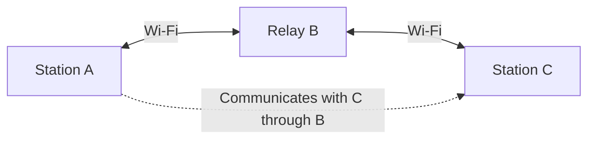
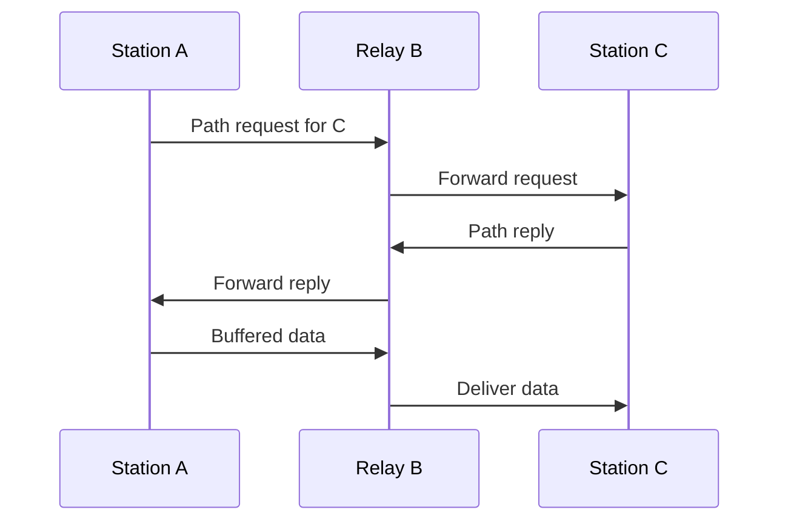
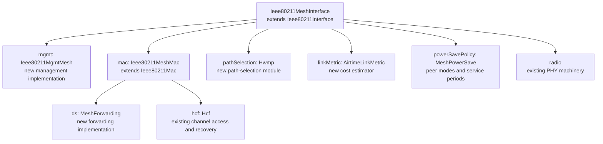
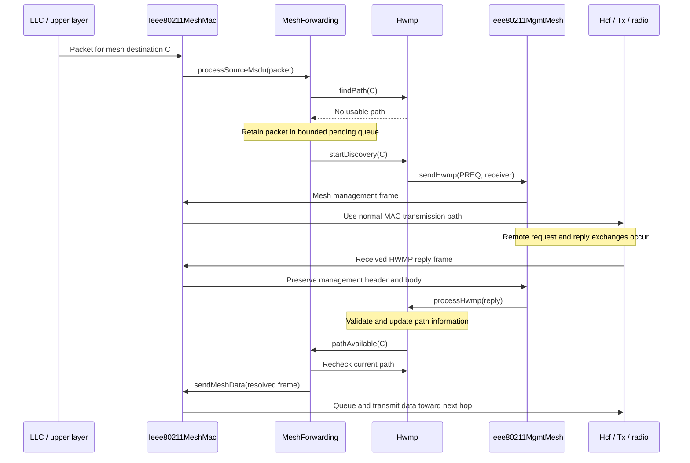
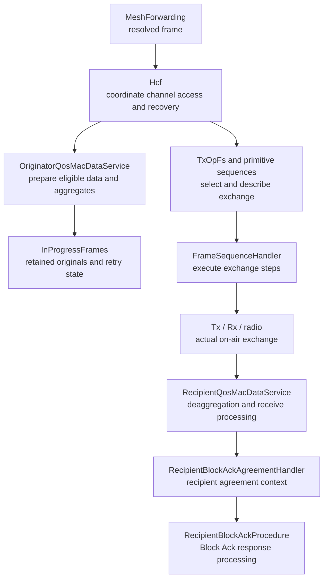
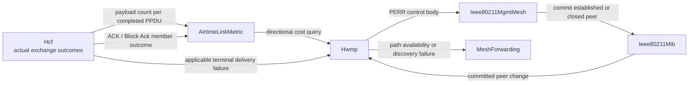
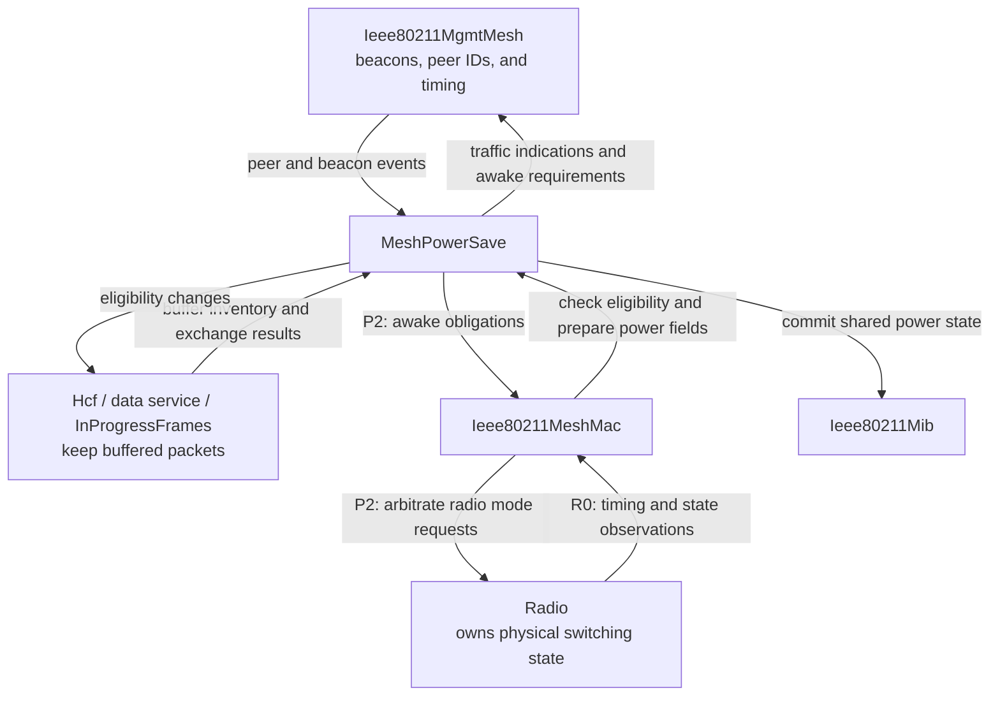
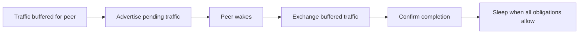
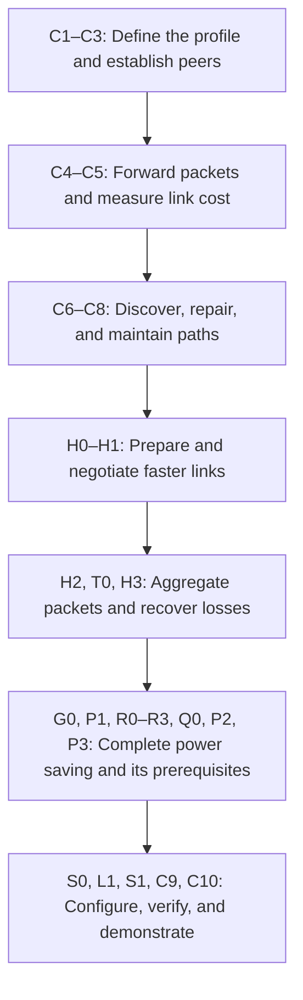
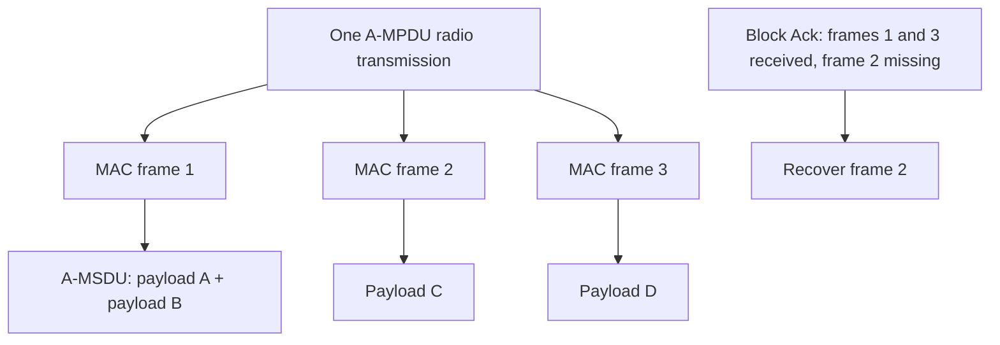

# IEEE 802.11 mesh routing — plan summary

> **Kind:** reference · **Status:** snapshot 2026-11-13 · **Seal:** none · **Owns:** — · **Stands on:** [Implementation plan](ieee80211-hwmp.md), [Implementation ledger](../../doc/project/evidence/model/wifi/hwmp-coverage.md)

The completed [802.11 ad hoc routing plan](ieee80211-hwmp.md) adds **Wi-Fi mesh networking** to INET: stations discover their neighbors and relay packets across several wireless hops, without an access point or an IP routing protocol.

Implementation and planned validation finished on 2026-11-11, with all 28 implementation commits through `66d0b44269` pushed and [upstream PR #1453](https://github.com/inet-framework/inet/pull/1453) opened ready for review. This summary and the detailed plan are archived in `plan/done`. Completion covers the supported simulation profile described below; it does not mean every compatibility test passes or that upstream review is complete.

## How packets find their way

The plan uses **HWMP — Hybrid Wireless Mesh Protocol**. When a station needs a path, it sends a path request. A reply establishes the forwarding information, allowing buffered packets to continue toward their destination.

Paths are chosen using freshness and **estimated airtime cost**, rather than hop count alone. Among equally fresh eligible paths, several fast, reliable links can beat fewer slow or unreliable links.

If a link fails, HWMP invalidates the affected paths, informs the stations that depend on them, and supports discovery of an alternative. It also supports two proactive root mechanisms: a root can send periodic path requests or root announcements to help establish paths in advance. On-demand discovery remains available.

## What the implementation adds

| Part | Purpose |
| --- | --- |
| Mesh management | Discover compatible neighbors and establish peer links. |
| Mesh forwarding | Deliver local packets, relay transit packets, and suppress duplicates. |
| HWMP | Discover, maintain, and repair paths. |
| Airtime metric | Estimate the transmission cost toward each neighbor. |
| HT/VHT support | Negotiate supported rates and use aggregation and Block Ack. |
| Mesh power save | Buffer traffic for sleeping peers and coordinate delivery and wake times. |

These components reuse INET's existing channel access, queues, radio, and acknowledgment machinery.

## Where the functionality lives

The implementation has three cooperating layers. **HWMP decides which path to use. Mesh forwarding moves packets along that path. The existing Wi-Fi MAC sends each hop and handles its acknowledgments and retries.** Mesh management establishes the peer relationships those layers depend on.

The following walkthrough describes the completed composition, including physical sleep and service-period delivery over HT/VHT links. The [detailed component design](ieee80211-hwmp.md#components-and-packet-flow) and [Wi-Fi architecture](../../doc/project/design/ieee80211-model-architecture.md) define the full responsibilities; the ledger records executed checks and their limits.

### The mesh interface assembles the pieces

The new [Ieee80211MeshInterface](../../src/inet/linklayer/ieee80211/Ieee80211MeshInterface.ned) extends the existing `Ieee80211Interface`. It selects mesh management and a mesh MAC, adds path-selection and metric modules, and provides the power-save policy module. In the current wiring that module is named `powerSavePolicy`. Mesh operation is selected explicitly through this interface, with the infrastructure association agent disabled.

This is a composition diagram: its arrows mean “contains,” rather than packet flow. The new MAC keeps the existing HCF/EDCA machinery. The placeholder `Mcf` class is not the engine used by this plan, and HWMP does not populate IPv4 or IPv6 routing tables.

### New classes and the state each one owns

| New class | Where it fits | Responsibility and interaction |
| --- | --- | --- |
| [Ieee80211MgmtMesh](../../src/inet/linklayer/ieee80211/mgmt/Ieee80211MgmtMesh.h) | Extends `Ieee80211MgmtBase` and implements `IMeshManagement` | Owns discovery, peer-link exchanges, beacon scheduling, and neighbor timing. It commits accepted peer state through the existing MIB and passes received HWMP control bodies to `Hwmp`. |
| [Ieee80211MeshMac](../../src/inet/linklayer/ieee80211/mac/Ieee80211MeshMac.h) | Extends `Ieee80211Mac` and implements `IMeshDataMac` | Connects upper packets and received frames to mesh forwarding. It preserves mesh addressing and control information until forwarding has decided whether to deliver, relay, or discard the packet. |
| [MeshForwarding](../../src/inet/linklayer/ieee80211/mesh/MeshForwarding.h) | Replaces `Ds` in the mesh MAC's `ds` slot and implements `IMeshForwarding` | Owns packets waiting for a path, mesh data sequence allocation, duplicate history, and hop-limit handling. It asks HWMP for a path, then gives resolved frames to the MAC. |
| [Hwmp](../../src/inet/linklayer/ieee80211/mesh/hwmp/Hwmp.h) | Implements `IMeshPathSelection` | Owns the path table, path freshness and expiry, discovery attempts, root procedures, and path-error dependencies. It queries link costs and tells forwarding when a destination becomes usable or discovery fails. |
| [AirtimeLinkMetric](../../src/inet/linklayer/ieee80211/mesh/AirtimeLinkMetric.h) | Implements `IMeshLinkMetric` | Owns directional error and aggregation estimates. It consumes actual transmission observations from HCF and answers cost queries from HWMP and management. |
| [MeshPowerSave](../../src/inet/linklayer/ieee80211/mesh/MeshPowerSave.h) | Implements `IMeshPowerSave` | Owns pending power-mode procedures and, as P2/P3 are completed, wake scheduling and directional service periods. It coordinates management, MAC eligibility, and radio use while HCF retains queued packets. |

One important distinction is **who owns a path versus who owns a packet**. `Hwmp` owns the path information and discovery timers. `MeshForwarding` owns source packets while their path is unknown. Once it hands a frame to the normal MAC transmission path, existing queue, lifetime, and recovery owners manage that frame. There is no second packet queue inside HWMP.

### New interfaces connect those responsibilities

These are small C++ contracts between components. Their purpose is to make an interaction explicit without exposing another component's mutable internal state. NED contracts additionally allow the corresponding submodule types to be selected in the composition.

| Interface | Provider | What consumers use it for |
| --- | --- | --- |
| `IMeshPathSelection` | `Hwmp` | Look up a next hop, start or cancel discovery, process HWMP messages, and maintain forwarding dependencies. C4's forwarding tests supply a controlled provider before production HWMP arrives in C6. |
| `IMeshForwarding` | `MeshForwarding` | Accept source payloads, finalize a new source forwarding identity, and react to path availability or discovery failure. It extends the existing received-data contract `IDs`. |
| `IMeshDataMac` | `Ieee80211MeshMac` | Submit a resolved mesh frame directly to transmission, deliver a local payload upward, and retire uncommitted local source traffic. |
| `IMeshManagement` | `Ieee80211MgmtMesh` | Send HWMP control bodies, prepare management transmissions, and expose peer identifiers and beacon timing. |
| `IMeshLinkMetric` | `AirtimeLinkMetric` | Obtain a peer's outgoing cost and reset samples when their relationship or aggregation assumptions change. |
| `IMeshLinkTiming` | Existing `Hcf` | Obtain nominal rate and exchange-overhead information from existing rate-selection and timing authorities. |
| `IMeshPowerSave` | `MeshPowerSave` | Request mode changes, check transmission eligibility, prepare power fields, and report received fields and exchange outcomes. P2/P3 complete the associated wake and service-period behavior. |
| `IMeshPowerBuffer` | Existing `Hcf` | Inspect a copied inventory of buffered traffic and request reconsideration when power eligibility changes. Packets stay with the MAC queue owners. |

### How a local packet starts discovery and reaches the radio

The important entry point is the mesh MAC's upper-packet handling. It delegates the payload to forwarding before ordinary encapsulation would discard the distinction between mesh endpoints and the next hop. Forwarding either resolves the destination immediately or holds the payload while HWMP discovers a path.

This diagram shows the representative PREP completion case. Other accepted information can also make a path usable and release pending traffic. Forwarding rechecks current state as it releases packets, so it cannot keep using a path whose next-hop peer has closed. The resolved-frame call enters transmission directly and does not loop back into source discovery.

On a relay, the receive path preserves Mesh Control and the original mesh endpoints. `MeshForwarding` checks duplicate identity, forwarding admission, hop limit, and next-hop availability. Transit unicast goes back to the MAC for another hop. Only a final local delivery is decapsulated and passed to LLC. Group traffic can require both local delivery and forwarding.

### Existing classes gain specific mesh integration points

| Existing class or family | What the plan adds or extends |
| --- | --- |
| `Ieee80211Mac` | Extension hooks for mesh frame preparation, finalization, receive support, and transmission eligibility. The mesh subclass uses these while retaining the common transmit/receive path. |
| `Hcf` and `Edca` | Mesh action dispatch, actual-transmission feedback, peer cleanup, and eligibility checks around existing contention and queues. HCF keeps Block Ack actions internally and sends recognized mesh actions toward mesh management. |
| `Ieee80211Mib` | Committed mesh profile, peer eligibility, accepted directional capabilities, and shared power-mode state. Management and policy procedures update it through their defined transitions. |
| `QosRateSelection` and `Ieee80211PeerModeSelection` | Legal fixed HT/VHT selection using the accepted peer capability intersection, including VHT eligibility and response-mode rules. |
| `MsduAggregation` and `MsduDeaggregation` | Mesh-specific A-MSDU layout, validation, and constituent handling alongside the existing Basic A-MSDU format. |
| `OriginatorQosMacDataService`, `RecipientQosMacDataService`, and MPDU aggregation/deaggregation helpers | Production aggregate preparation, receive processing, size limits, and integration with existing sequence, lifetime, and recovery state. |
| `InProgressFrames` | Retained originals and retry selection, with peer retirement and power eligibility applied to frames already outside the pending queue. |
| PHY mode classes, `Ieee80211Radio`, transmitter/receiver, and `RadioMedium` | Accurate timing, opt-in wide-channel geometry, received-format information, and the observation contracts needed for channel access and wake scheduling. |

The existing `Ds` implementation remains the infrastructure/ad hoc distribution implementation. Mesh composition selects `MeshForwarding` because mesh needs both source-path lookup and receive-side forwarding. Its extended `IDs` contract supplies that receive-side integration.

### Where the frame-sequence and Block Ack classes fit

The mesh routing algorithm does not execute DATA/ACK exchanges. HCF delegates those to the existing frame-sequence machinery. `TxOpFs` selects the exchange within a transmission opportunity. The sequences in `PrimitiveFrameSequences.cc`, including `AmpduFs`, describe its steps. `FrameSequenceHandler` drives those steps through transmission, reception, completion, and timeout callbacks.

The arrows describe cooperation, rather than every direct method call. `RecipientBlockAckAgreementHandler` owns recipient agreements, including setup, teardown, and peer/TID context. `RecipientBlockAckProcedure` uses the applicable agreement to process Block Ack requests and immediate aggregate responses. Existing originator-side agreement and recovery owners process the returned bitmap and determine what remains outstanding. H3 extends this machinery for mesh aggregates rather than adding a parallel Block Ack implementation in `Hwmp`.

### How radio outcomes affect cost and path repair

HCF exposes separate observations for payload transmission, individual attempt outcomes, and terminal aggregate recovery. `AirtimeLinkMetric` uses those facts to update its estimates. HWMP uses the relevant terminal outcomes to invalidate affected paths. A completed aggregate can update the payload-count estimate even if its later acknowledgment is lost.

The MIB owns the committed shared peer view, while management owns the pending peering procedure. HWMP owns its own path table, and the metric owner owns its samples. A peer address appearing again after teardown must not inherit old retry callbacks or old error estimates. Generic link-broken notifications are insufficient for HWMP because some are also emitted for internal contention failures without a radio attempt.

### How power saving joins the same machinery

P1–P3 add another eligibility condition around existing queues and exchanges. A path may remain valid while its next hop is temporarily asleep. `MeshPowerSave` coordinates that temporary availability, and `MeshForwarding` and `Hwmp` retain their existing responsibilities.

Power policy obtains traffic information through `IMeshPowerBuffer` and causes HCF to reconsider eligibility when a delivery opportunity changes. It does not take ownership of those packets. Management advertises buffered traffic in beacons, and P2 coordinates actual wake readiness with the radio's timing. P3 keeps service periods open until the applicable local exchange rules permit completion. A queued termination frame alone cannot authorize sleep.

### Which commits introduce these connections

| Plan commits | Main implementation homes |
| --- | --- |
| C1 | Standards, feature/check definitions, and the implementation evidence ledger. |
| C2 | Mesh frame definitions and serializers in `mgmt/`, shared MAC frame definitions, and packet dissection/display. |
| C3 | New mesh interface, management, and MAC classes, plus existing HCF dispatch, MIB peer state, and OFDM timestamp support. |
| C4 | New `MeshForwarding`, forwarding/MAC/path-selection contracts, mesh MAC data hooks, and existing peer-reset machinery. |
| C5 | New `AirtimeLinkMetric`, metric/timing contracts, and HCF attempt feedback. |
| C6–C8 | New `mesh/hwmp/Hwmp` for discovery, errors, and proactive roots, using management to send control and forwarding to release packets. |
| H0 and H0a | Existing medium observation contract and PHY mode-set registry. |
| H1 | Management capability exchange, MIB HT/VHT state, rate/peer selection, HCF, and wide-channel PHY support. |
| H2 and T0 | Existing MSDU aggregation services and forwarding identity finalization, then shared HT/VHT mode-duration corrections. |
| H3 | Existing HCF, QoS services, frame sequences, Block Ack owners, aggregate codecs, Tx/Rx, and capture helpers. |
| G0 | Mesh MAC transmit preparation, correcting the acknowledgment-policy field for native group data. |
| P1, R0–R3, P2, P3 | New power policy and contracts connected to existing management, MIB, queues, MAC, and radio. R0 supplies radio observations, R1 permits idle-transceiver contention, R2 prepares safe deferred-transmission cancellation, and R3 observes received members before reordering. |
| Q0 | Existing A-MSDU candidate selection inspects only the queue prefix it needs. |
| S0, S1 | ScenarioManager peer-mode requests and registration of typed service-period outcome signals. |
| L1, C9, C10 | Mechanical corrections in new source, final lifecycle/regression fixtures, examples, and documentation. |

## Faster links and sleeping relays

HT/VHT support covers negotiated transmission capabilities, packet aggregation, and recovery of missing packets through Block Ack. The high-rate airtime metric accounts for the overhead savings from aggregation.

Power saving supports active, light-sleep, and deep-sleep relationships. Stations advertise buffered traffic and arrange delivery opportunities. **A sleeping peer must remain a valid neighbor and path; expected sleep must not be treated as a broken link.**

## How the work is divided

The completed series builds a simple, always-awake mesh first, then adds faster transmissions and sleeping peers. The walkthrough below explains what each stage contributes, including the limits of intermediate stages. The final verification stage brings the focused checks together and checks compatibility with existing Wi-Fi configurations.

The identifiers below match the [detailed commit series](ieee80211-hwmp.md#commit-series-and-direct-verification). They are plan labels, so their letters and numbers do not form one continuous sequence. Shared prerequisites appear immediately before the mesh feature that needs them.

## Stage 1: Give stations a common mesh language

### C1 — Define what this mesh supports

This commit establishes the supported profile and the requirements taken from IEEE Std 802.11-2024. It connects each selected requirement to an observable check, while keeping standard rules separate from model choices such as queue limits and estimator defaults.

The result is a clear contract for the later commits: what must work, what is outside scope, and what evidence will demonstrate it. This is documentation and test design, rather than a working mesh.

### C2 — Encode and decode mesh frames

Stations need to exchange mesh identity, peering information, forwarding headers, path requests, replies, errors, and root announcements. This commit adds their frame representations, byte encoding, decoding, and packet display support.

Tests reconstruct valid messages and reject inconsistent lengths or truncated content safely. They establish that the frame formats work at the codec boundary. Actual over-the-air peering and path discovery come in later commits.

### C3 — Discover neighbors and establish peer links

Compatible stations discover each other through beacons and probes, then exchange Open and Confirm messages to establish a peer relationship. Stations check that their mesh identity, profile, metric selection, and supported rates agree before accepting the relationship.

This commit also adds beacon scheduling and neighbor clock-offset handling. Correct timestamps matter because later power saving relies on knowing when a neighbor will wake. Tests cover successful peering, incompatible profiles, timeouts, and beacon timing. At this point stations can establish peers, but mesh data forwarding is still unavailable.

## Stage 2: Forward packets and choose paths

### C4 — Relay mesh data without losing its endpoints

In A–B–C, B must change the next-hop addressing while preserving A and C as the mesh endpoints. This commit implements source transmission, transit forwarding, and final delivery, along with a hop limit and duplicate suppression. Group traffic is delivered and forwarded without circulating indefinitely.

Peer closure also retires queued and in-progress traffic safely, so a late acknowledgment cannot restart an obsolete transmission. Tests use a controlled path provider to isolate forwarding from routing. Production path discovery arrives in C6.

### C5 — Measure the airtime cost of each direction

This commit estimates how expensive it is to send toward each peer, using the configured PHY rate, transmission overhead, and actual data acknowledgment outcomes. The cost from A to B can differ from the cost from B to A. A queue drop or an internal contention collision must not count as a failed radio transmission.

It supports both standard airtime metrics: ID 1 for the OFDM reference profile and ID 2 for high-rate operation. The whole mesh must agree on one metric. Tests check the arithmetic, wire encoding, directional samples, and resets when a peer relationship changes. Aggregation savings are added when aggregation becomes available.

### C6 — Discover paths when traffic needs them

When A has data for C but no usable path, forwarding buffers the packets and HWMP starts discovery. A path request, or PREQ, travels through the mesh. A path reply, or PREP, establishes the information needed to send the queued traffic.

HWMP checks sequence freshness before comparing path cost, so an attractive stale path cannot replace newer information. Buffer capacity, packet deadlines, and discovery retries are bounded. Tests cover multi-hop discovery, competing paths, sequence boundaries, queue release, and failure to find a destination. A late reply may update a path, but cannot revive an expired packet.

### C7 — Repair paths after a real failure

When an established peer closes or an actual data exchange exhausts its relevant recovery budget, affected paths become unusable. Path error messages, or PERRs, inform the upstream stations that depend on those paths. Unrelated destinations remain usable.

For example, if the selected relay in a diamond topology fails, the source can discover the other branch. Tests check error recipients, stale error rejection, bounded error signaling, and alternate-path delivery. Local cancellation and contention without an on-air attempt must not invent a broken link.

### C8 — Maintain paths around proactive roots

A configured root helps establish paths before ordinary source discovery needs them. The plan supports periodic proactive PREQs, with replies from every station or from stations that need the corresponding path, and root announcements, called RANNs, followed by path-confirmation exchanges.

A RANN announces a root and its cost information. Receiving it alone does not establish a usable bidirectional data path. Tests exercise both mechanisms, refresh after idle periods, multiple roots, and coexistence with ordinary on-demand discovery. The plan does not add a global root-election algorithm.

## Stage 3: Enable faster links and aggregation

### H0 — Make interference observation guarantees visible

Wide-channel access needs to know whether secondary channels have been idle. A radio cannot safely infer that history if medium optimizations hid relevant interference events.

This shared prerequisite lets consumers ask whether the medium provides the necessary observations. It exposes existing configuration guarantees without changing delivery behavior. A focused module test checks the answer under the supported filtering combinations.

### H0a — Provide the missing VHT mode variants

Negotiation needs an authoritative catalog of legal PHY choices. This commit adds an opt-in `ac-complete` catalog with both long and short guard-interval variants for legal VHT combinations. A guard interval is the spacing between data symbols, and selecting its shorter form affects rate and duration.

The existing `ac` catalog and defaults remain available. Tests check catalog completeness and invalid combinations, so later mesh code can select legal modes instead of constructing its own PHY tables.

### H1 — Negotiate HT/VHT operation and support wide channels

Peers advertise their capabilities and derive legal transmission choices for each direction. HT supports the selected 20/40 MHz operation, while VHT extends the profile to 20/40/80/160 MHz. A transmission must fit the sender's capabilities, the receiver's capabilities, and the configured channel allocation. Merely selecting a VHT mode locally is insufficient.

This commit includes the radio and channel-access work needed to make those choices real: correct channel placement, secondary-channel idle checks, and acknowledgment responses appropriate to wider transmissions. If the fixed width is unavailable, the station waits and contends again. It also provides VHT single-MPDU framing before multiple-frame aggregation exists. Tests inspect actual transmitted modes, received data, response widths, and refusal of incompatible configurations.

### H2 — Combine payloads into mesh A-MSDUs

An A-MSDU combines several upper-layer payloads inside one MAC frame. Each constituent needs the proper mesh addressing and control information. New aggregates can combine compatible local payloads sharing the required endpoints and traffic class. A relay preserves a received aggregate as a complete forwarding unit.

Tests check exact bytes, padding, size and airtime limits, exactly-once delivery, and multi-hop forwarding. A committed aggregate keeps its contents intact on retry and expires when all its constituent payloads have expired. This stage also teaches the high-rate airtime estimator how many payloads shared each actual radio transmission.

### T0 — Correct shared HT/VHT transmission timing

Aggregation decisions depend on accurate airtime. This prerequisite corrects shared PHY duration calculations for short guard intervals and the HT encoder selection used in those calculations. The fix belongs in the PHY mode authority so every consumer uses the same answer.

Independent numerical examples and actual radio transmission durations check the correction. This stage establishes the timing foundation for aggregate size and transmission-opportunity limits in H3.

### H3 — Send multiple MAC frames together and recover missing ones

An A-MPDU combines separately identifiable MAC frames into one radio transmission. A Compressed Block Ack reports which frames arrived, allowing recovery of missing frames while preserving successful delivery. Each member can itself contain an A-MSDU.

This commit connects production aggregate construction, reception, acknowledgment agreements, retry windows, and recovery. It enforces negotiated limits, packet lifetimes, PHY duration, and available transmission time. Peer teardown must retire every affected member safely.

Tests cover nested aggregation, partial loss, lost Block Acks, recovery requests, agreement teardown, byte reconstruction, and boundary limits. Capture support exposes individual members for inspection. Airtime feedback counts actual transmitted payloads once per radio transmission and actual outcomes per MAC frame, keeping recovery bookkeeping from inflating the samples.

## Stage 4: Let peers sleep without breaking the mesh

### G0 — Make group-data acknowledgment signaling match the exchange

Native group data is transmitted without an individual acknowledgment, but its QoS header also needs to advertise that policy correctly. This commit sets No Ack in `Ieee80211MeshMac` before the frame checksum is computed, for both source and relay transmissions.

The existing receiver-address logic still determines the group exchange and its retirement. The group-forwarding test checks the actual transmitted policy field as well as delivery, hop limits, and duplicate suppression. This correction is useful independently of power saving and comes before the new power-control signaling.

### P1 — Track power modes and advertise buffered traffic

A station can use active mode toward one peer and a sleeping mode toward another. This commit tracks requested and effective modes and signals changes over the air. Moving to lower activity requires the relevant acknowledgment, so a lost transition ACK cannot authorize the sender to sleep.

Traffic remains in existing MAC queues. Beacon traffic indications identify which peers have buffered packets, and delivery after a DTIM beacon places group traffic before unicast. An ineligible sleeping peer must not block queued traffic for another eligible peer. Tests cover signaling, lost ACKs, buffering, expiry, and indication clearing. The intermediate fixture stays physically awake and does not yet claim complete power-save operation.

### R0 — Expose the radio's real switching time

The wake scheduler must know how long the radio takes to change modes and whether a transition is still underway. This shared prerequisite exposes read-only timing and state information from the radio's existing implementation.

Tests distinguish an instantaneous switch from unavailable timing information and check transition completion and cancellation. The API observes the existing radio behavior without introducing a second timing model.

### R1 — Allow normal contention while the radio is an idle transceiver

P2 keeps an awake radio in transceiver mode so it can receive and respond without an extra receive/transmit switching delay. The existing `Rx` medium-availability predicate must recognize that an idle transceiver can contend. This commit corrects that shared predicate and refreshes it when the effective radio mode changes.

Tests require actual data progress in idle transceiver mode while preserving deferral during switching, transmission, or a busy primary channel. Existing virtual channel reservations still block access. This is a shared receive-side correction, rather than a power-save exception or a change to radio notifications.

### R2 — Cancel a prepared transmission before it starts

Radio switching can defer a transmission after the MAC has prepared it. This shared prerequisite lets the exchange owner withdraw that preparation safely if the intended start becomes unavailable. Tests cover exact readiness boundaries, cancellation, replacement callbacks and later progress with the retained original frame.

### Q0 — Inspect only the needed aggregation candidates

The ordinary QoS compatibility workload exposed unnecessary queue-tail traversal during A-MSDU selection. The selector now stops after the candidate prefix needed for its decision. A counted queue test checks the work, and the ordinary workload completes within its original CPU budget with unchanged fingerprints.

### P2 — Coordinate awake windows and physical sleep

This commit connects mesh policy to actual radio doze and wake transitions. The station starts waking early enough to receive required beacons. Light sleep listens to the corresponding peer beacons, while deep sleep can skip some peer listening and uses a bounded synchronization-maintenance policy.

The station can sleep only when every awake obligation is satisfied. An active relationship, ongoing transmission, expected response, or delivery window can keep it awake. A window closing during an exchange must not switch off the radio before the exchange finishes. Tests inspect real radio readiness and sleep intervals, overlapping peer obligations, and exact timing boundaries. Full sleeping-peer unicast retrieval waits for P3.

### R3 — Observe received members before reordering

Power-save signaling belongs to the received frame, even when that frame is a duplicate or its payload waits in a reorder buffer. This prerequisite exposes each received member before duplicate deletion or payload reordering. A module test checks observation order and safe agreement withdrawal, while existing owners retain payload delivery and Block Ack state.

### P3 — Complete delivery through mesh peer service periods

A mesh peer service period is an exchange opportunity in one direction between peers. It can span several transmission opportunities and keeps the participants awake while buffered data or management traffic is delivered. Opposite directions have separate state.

Ending a service period requires the transmitting owner to receive confirmation for its terminating frame. Sending that frame is insufficient. If the ACK or Block Ack is lost, each endpoint acts on its own observations and follows bounded recovery rules. Tests combine these exchanges with HT/VHT aggregation, lost triggers and termination responses, expiry, and peer closure.

This stage completes the selected power-save profile. Combined tests deliver through a sleeping relay with on-demand discovery and both root mechanisms. Expected sleep does not generate a false path error, and packet and path lifetimes continue advancing.

## Stage 5: Verify and make the result usable

### S0 — Configure peer modes through ordinary scenarios

ScenarioManager scripts can request ACTIVE, LIGHT or DEEP mode toward an established peer. A request starts the existing power procedure; lower activity becomes effective only after its required acknowledgment. Tests exercise normal dispatch, a lost acknowledgment and invalid commands. The ordinary-host examples use this frontend without test subclasses.

### L1 — Apply mechanical C++ quality corrections

This commit addresses findings in newly introduced source, such as header guards, namespace spelling, and override declarations. It keeps mechanical cleanup separate from protocol behavior. A fresh build and existing controls check that the corrections preserve behavior.

### S1 — Register checked service-period outcomes

Ordinary signal checking exposed an unregistered outcome type that the focused protocol runner's disabled signal checks had hidden. Register the existing notification and name its exact class in NED. A module test accepts all six outcome/direction combinations and rejects an unrelated object; the unchanged ordinary LIGHT example then completes with normal checking enabled. This fixes signal declaration compatibility without changing service-period behavior.

### C9 — Check cleanup and compatibility on the combined tree

Each earlier component must already clean up its own state. C9 adds final isolated lifecycle tests covering pending discovery, queued traffic, wake timers, power transitions, and service periods. Stopping or destroying an owner must leave no stale callback or packet release. An isolated restart must start with cleared peer, path, and metric state.

The stage also reruns the selected infrastructure, ad hoc, aggregation, and Block Ack controls, checks the build with Wi-Fi disabled, and compares selected legacy fingerprints. Fingerprints detect changed simulation trajectories and supplement direct behavior assertions. They do not establish protocol correctness, and this plan does not authorize replacing their baselines. The lifecycle fixtures do not establish whole-NIC or whole-node restart support.

### C10 — Supply examples and explain the supported profiles

The final commit makes the work usable through documented configurations: a line, an unequal-airtime diamond, link failure with an alternate path, proactive roots, HT/VHT aggregation, sleeping relays, group delivery, and combined sleep/aggregation operation.

IPv4 examples keep the endpoints on one subnet with IP forwarding disabled, so successful multi-hop delivery demonstrates mesh forwarding. The examples also exercise ARP rather than bypassing it with preconfigured neighbor entries. Documentation explains capabilities, metric defaults, power policies, timing choices, and limitations, alongside reproducible run commands and recorded results.

## Completed validation

The [implementation ledger](../../doc/project/evidence/model/wifi/hwmp-coverage.md) records completion through C10, including exact selections, artifacts and evidence limits. These results describe the implementation checkpoint completed on 2026-11-11; archiving the documents does not imply a new simulation campaign.

| Stage | Recorded status |
| --- | --- |
| Mesh frame encoding, peering, forwarding, and airtime metrics | Passing focused tests |
| On-demand discovery, path repair, and proactive roots | Passing focused tests |
| HT/VHT negotiation and single-MPDU transport | Passing focused tests |
| A-MSDU aggregation | Passing focused tests |
| Multiple-MPDU aggregation and Block Ack recovery | Passing focused tests |
| Power-mode signaling and buffered-traffic indications | Passing focused tests and ordinary-host examples |
| Physical sleep and combined service-period/aggregation behavior | Passing P2/P3 checks and sleeping HT/VHT examples |
| Final lifecycle checks | Isolated owner cleanup and retirement checks pass; whole-NIC restart is outside scope |
| Examples and documentation | All 14 ordinary-host profiles complete with their stated observations; guide and capture analysis complete |

Final validation passes 29 unit runs and 168 module runs. The protocol selection executes all 713 runs: 708 pass, four retain assertion failures and one retains an exact-time transmission abort observed in the controls. No new retained-outcome differences were found. All 56 fingerprint checks across 19 legacy simulations match both the unchanged store and the C1 values. No expected results, fingerprints or time budgets were replaced.

Main debug/release builds, the isolated Wi-Fi-disabled release build and restored enabled builds pass. Restored feature builds use documented matching-object reuse and regeneration, so they are incremental builds. The exact final source tree merged with upstream `7adc565c` passes five directly affected module runs using the unchanged compiled integration model. The ledger retains inherited warnings, residual lint findings, the fingerprint runner's separately qualified outer-session status and the limits of passive process mapping coverage.

The 14 example profiles run with ordinary hosts, dynamic ARP and IP forwarding disabled. Capture analysis validates 88 captures and 11,280 member FCS records. The failure/alternate-path example delivers 59 of 60 messages: one packet exhausts its attempts, a path error follows, and traffic resumes through the other relay at about 7.273 seconds. Sleeping HT/VHT examples deliver all 24 messages each and confirm their ending aggregates with Block Ack. These are functional observations within the supported profile, not loss-free recovery or performance guarantees.

## Scope and limits

The target is a **documented, tested simulation profile**: an unsecured mesh on one fixed channel, with one mesh interface per station. Portals, external clients, adaptive rate control, and whole-node restart support are outside its scope. Full IEEE 802.11 mesh conformance, external interoperability, and battery-life accuracy are not claimed.
