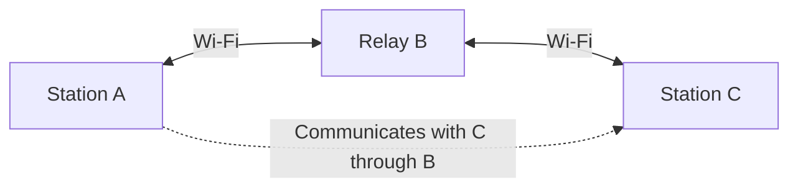
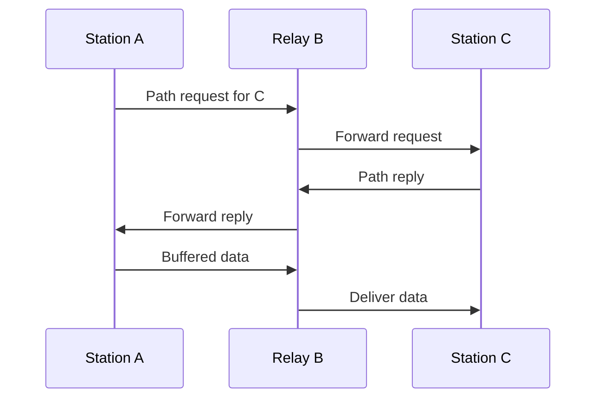
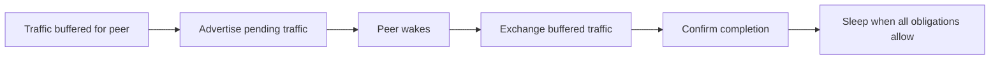

# IEEE 802.11 mesh routing — plan summary

> **Kind:** reference · **Status:** snapshot 2026-11-10 · **Seal:** none · **Owns:** — · **Stands on:** [Implementation plan](ieee80211-hwmp.md), [Implementation ledger](../../doc/project/evidence/model/wifi/hwmp-coverage.md)

The [802.11 ad hoc routing plan](ieee80211-hwmp.md) adds **Wi-Fi mesh networking** to INET: stations discover their neighbors and relay packets across several wireless hops, without an access point or an IP routing protocol.

## How packets find their way

The plan uses **HWMP — Hybrid Wireless Mesh Protocol**. When a station needs a path, it sends a path request. A reply establishes the forwarding information, allowing buffered packets to continue toward their destination.

Paths are chosen using freshness and **estimated airtime cost**, rather than hop count alone. Among equally fresh eligible paths, several fast, reliable links can beat fewer slow or unreliable links.

If a link fails, HWMP invalidates the affected paths, informs the stations that depend on them, and supports discovery of an alternative. It also supports two proactive root mechanisms: a root can send periodic path requests or root announcements to help establish paths in advance. On-demand discovery remains available.

## What the implementation adds

| Part | Purpose |
| --- | --- |
| Mesh management | Discover compatible neighbors and establish peer links. |
| Mesh forwarding | Deliver local packets, relay transit packets, and suppress duplicates. |
| HWMP | Discover, maintain, and repair paths. |
| Airtime metric | Estimate the transmission cost toward each neighbor. |
| HT/VHT support | Negotiate supported rates and use aggregation and Block Ack. |
| Mesh power save | Buffer traffic for sleeping peers and coordinate delivery and wake times. |

These components reuse INET's existing channel access, queues, radio, and acknowledgment machinery.

## Faster links and sleeping relays

HT/VHT support covers negotiated transmission capabilities, packet aggregation, and recovery of missing packets through Block Ack. The high-rate airtime metric accounts for the overhead savings from aggregation.

Power saving supports active, light-sleep, and deep-sleep relationships. Stations advertise buffered traffic and arrange delivery opportunities. **A sleeping peer must remain a valid neighbor and path; expected sleep must not be treated as a broken link.**

## Delivery sequence and progress

The [implementation ledger](../../doc/project/evidence/model/wifi/hwmp-coverage.md) records the following status at the time of this summary. It remains the source for subsequent results.

| Stage | Recorded status |
| --- | --- |
| Mesh frame encoding, peering, forwarding, and airtime metrics | Passing focused tests |
| On-demand discovery, path repair, and proactive roots | Passing focused tests |
| HT/VHT negotiation and single-MPDU transport | Passing focused tests |
| A-MSDU aggregation | Passing focused tests |
| Multiple-MPDU aggregation and Block Ack recovery | Pending |
| Mesh power saving and combined sleep/aggregation behavior | Pending |
| Final lifecycle checks, examples, and documentation | Pending |

The final examples will demonstrate multi-hop delivery, airtime-based path selection, recovery after link failure, proactive roots, aggregation, and sleeping relays. Direct protocol tests establish behavior; existing Wi-Fi regression checks assess compatibility.

## Scope and limits

The target is a **documented, tested simulation profile**: an unsecured mesh on one fixed channel, with one mesh interface per station. Portals, external clients, adaptive rate control, and whole-node restart support are outside its scope. Full IEEE 802.11 mesh conformance, external interoperability, and battery-life accuracy are not claimed.
