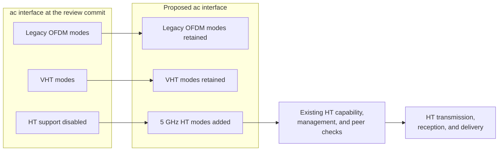
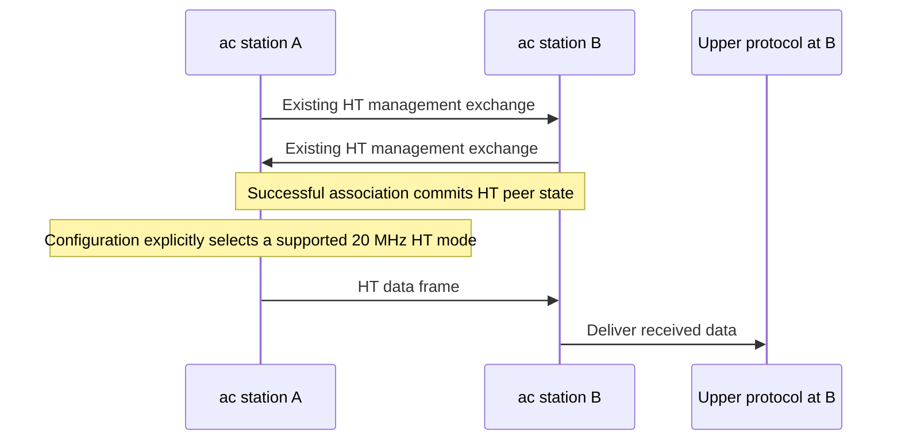
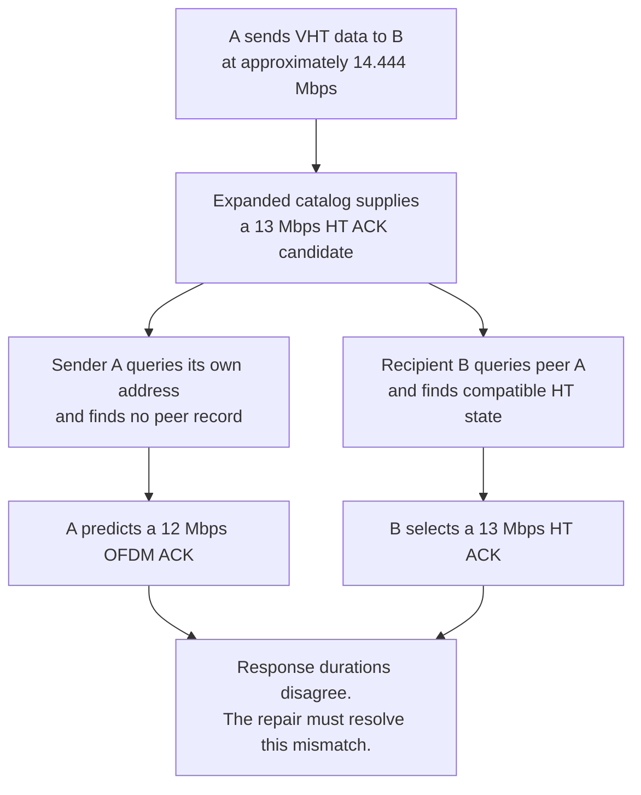

# HT support in VHT stations: plan summary for human review

> **Kind:** reference · **Status:** draft · **Seal:** none · **Owns:** — · **Stands on:** [ieee80211-vht-ht-support.md](ieee80211-vht-ht-support.md)

**The local implementation lets INET's `ac` interfaces use the existing HT support and retain VHT support.** Focused tests establish actual HT transmission, reception, and delivery to an upper protocol.

This summary follows [revision 10 of the plan](ieee80211-vht-ht-support.md), dated 13 October 2026. The [execution record](ieee80211-vht-ht-support-execution.md) contains the build, test, fingerprint results, and three commit boundaries. The planned commits now exist on the local feature branch. The full plan owns the detailed conditions and standards evidence.

The sections below preserve the design summary at review commit `a61363aba5e9492f0c98a24905e050f0cf36966a`. Their descriptions of existing behavior refer to that commit. The review found a mismatch between sender prediction and recipient response selection in existing HT configurations. Revision 10 puts that repair before HT activation and uses an explicit role enum. It adds width checks through rate control and documentation of equal-rate adaptation steps. The user's execution request authorizes the later local implementation and verification.

## The gap in the interface's capabilities

The plan cites IEEE requirements that VHT stations also implement HT. At the review commit, INET's `ac` mode set contains VHT modes and legacy OFDM modes, but no HT modes. A mode set is the collection of PHY modes available to a configuration.

The proposal adds HT modes to this collection. Each VHT mode retains its VHT format and duration calculation.

The reference is INET's `n(mixed-2.4Ghz)` implementation at the review commit. The new path uses corresponding **5 GHz** HT modes, with the appropriate timing for that band.

## Three conditions determine whether an HT mode is usable

A catalog entry alone does not establish operational support. The local radio must support the required capability. The peer must also support the selected HT transmission.

| Condition | Responsible component | Proposed behavior |
| --- | --- | --- |
| The mode exists. | Mode catalog | Add all 128 existing HT combinations: MCS 0–31, two widths, and two guard intervals. |
| The local interface supports the capability. | Radio and MIB | Derive HT capabilities from the catalog, radio limits, and antenna count. |
| The peer supports the transmission. | Management and rate selection | Store HT peer capabilities and apply the existing HT selection checks. |

For one antenna, the proposed local HT capability contains MCS 0–7. Additional antennas extend this set, up to MCS 0–31 and four spatial streams. More than four antennas do not extend HT support beyond that limit.

**Advertised and negotiated HT support remains limited to 20 MHz.** The catalog will also contain 40 MHz HT modes because the reference HT catalog contains them.

This distinction does not create a universal transmitter rejection of 40 MHz requests. The existing transmitter has no separate width check for such a direct request. The plan neither adds that check nor establishes correct 40 MHz operation.

Ordinary unicast rate control already passes through the HT peer filter. AARF or Onoe supplies a catalog candidate, and the production data selector checks it before the MAC requests transmission. Valid 20 MHz peer state excludes wider HT output. Absent or invalid peer state causes an HT candidate to fall back to legacy. These statements assume the normal MIB connection and production capability assembly; they do not cover direct PHY requests.

## Reuse of the existing HT management path

Full management exchanges HT information through management frames. Successful association commits the peer's HT state. Simplified management installs equivalent state through its existing abstraction, without an exchange over the wireless medium. Existing teardown removes that state.

The proposed delivery test uses two `ac` interfaces, one antenna each, on a supported 5 GHz channel:

The test must inspect the selected PHY format and the received frame. Application delivery alone cannot prove that the transmission used HT.

The proposed 7.222 Mbps HT fixture uses short GI. Current HT duration calculation uses 4 μs symbols even though the standard specifies 3.6 μs for short GI. The transmitter uses that same duration. The fixture therefore proves HT selection and delivery within the current model, without a claim of compliant short-GI airtime or performance. The inherited duration defect remains outside this task.

A separate test selects a 20 MHz VHT mode and checks delivery. This confirms that HT activation preserves the existing VHT data path.

The supported path uses `Ieee80211Transmitter` and `Ieee80211Receiver`, or compatible derived components. Incompatible replacements fail initialization through the existing HT checks.

## Channel mapping required by HT management

INET's internal channel index differs from the standard channel number carried in an HT Operation element. The existing arithmetic 5 GHz bands lack the required conversion.

After HT activation, that missing conversion would cause access-point initialization to fail. This also affects simplified management, even when data transmissions still use VHT.

The plan adds `5 GHz (mapped 20 MHz)` through the existing enumerated-band representation:

| INET internal index | Standard channel number | Center frequency |
| ---: | ---: | ---: |
| 0 | 36 | 5180 MHz |
| 1 | 40 | 5200 MHz |
| 2 | 44 | 5220 MHz |
| 3 | 48 | 5240 MHz |

For example, internal index `0` will select 5180 MHz. HT management will advertise standard channel `36`.

The band must also restrict HT40 pairs to 36/40 and 44/48, in either direction. Its inherited geometry check would incorrectly accept 40/44 because those centers differ by 20 MHz. The existing enumerated-band class will accept a fixed list of permitted pairs and apply it through its existing validation interface. Existing bands retain their current behavior when no list applies.

This check matters even when the local STA supports only 20 MHz. Such a STA can process HT Operation elements from a 20/40 MHz BSS. Management must reject an invalid pair before it accepts that operation state. The change supplies validation data; it does not provide 40 MHz PHY support.

The same commit that activates HT must migrate these configuration sources:

- `_ac.ini`, which supplies shared settings for the `ac` protocol tests.
- `lan80211ac/omnetpp.ini`, which supplies the example settings.
- `Ac_160mhz.test`, whose explicit band override would otherwise defeat the shared migration.

All three will use mapped index `0` and an effective center of 5180 MHz. These changes alter effective frequencies, so earlier propagation results and fingerprints do not automatically remain valid.

The mapped band's name describes its channel centers. It does not restrict VHT transmissions to 20 MHz. The existing 80 MHz and 160 MHz configurations retain INET's approximation of one channel center. Their tests inspect mode requests at the MAC output, before the frame reaches the radio. They establish neither actual PHY transmission nor reception. The new 20 MHz fixtures supply the direct delivery evidence.

The wider VHT tests check the requested format and width, with at least one spatial stream. They do not directly assert the configured data rate or exactly one stream. The plan preserves those assertions with these limits on their claims.

## Rate selection and response prediction

The plan retains catalog selection but requires a repair to response prediction. The expanded catalog changes the response candidate from VHT to HT in the example below. That change activates peer checks that sender prediction does not currently apply in the correct direction.

For an exact fixed-rate tie, the existing VHT entry retains precedence. Catalog traversal can also move between equal-rate VHT and HT entries. For example, adjacent VHT and HT MCS 0 entries both supply 6.5 Mbps.

AARF and Onoe advance through adjacent entries after their respective thresholds or intervals. The added entries can change adaptation without an immediate increase in nominal data rate. Equal nominal data rates do not establish equal airtime or throughput. The HT activation commit must explain this effect in WHATSNEW. Its magnitude remains unmeasured; the plan makes no convergence or throughput claim.

The response defect already exists in the current `n(mixed-2.4Ghz)` implementation. With compatible associated peers, HT MCS 1 at 20 MHz and long GI supplies a 13 Mbps response candidate. The sender's self-address lookup selects 12 Mbps ERP-OFDM, while the recipient can retain 13 Mbps HT. A separate prerequisite commit repairs this mismatch before HT activation in `ac`. Its direct reproduction uses the existing `n` catalog. If the recipient also lacks usable peer state, both endpoints can select legacy responses.

Consider associated `ac` stations A and B with compatible HT state. A sends VHT data at approximately 14.444 Mbps to B. The expanded catalog supplies a 13 Mbps HT ACK candidate. Both selectors check the data frame's transmitter address, A:

The sender uses its prediction for Duration/ID, exchange duration, and timeout calculations. Before catalog expansion, the VHT response candidate bypasses HT peer checks. The new HT candidate therefore exposes the mismatch for existing VHT traffic. This finding comes from source inspection; no simulation established packet loss or a timeout.

Current HCF also uses response durations to forecast a queued successor and decide whether a TXOP can continue. A transmission opportunity (TXOP) is a time interval in which a QoS station has the right to start frame exchange sequences. TXNAV is the transmit-side reservation timer. HCF compares the complete exchange cost against TXNAV and the TXOP time left. An incorrect response estimate can change the forecast or admission decision. A successful isolated exchange does not test these boundaries.

The repair adds an explicit role to the existing response queries. At the sender, prediction uses the outgoing frame's receiver address and `localRxPeerTx` capability. At the recipient, response selection uses the received frame's transmitter address and `localTxPeerRx` capability. Both directions describe the same response between the same stations. The implementation reuses existing MIB state and the existing compatibility calculation.

ACK, CTS, and Basic Block Ack queries will require `ResponseQueryRole` with no default value. Sender estimates pass `ResponseQueryRole::PREDICT`; actual response queries pass `ResponseQueryRole::RESPOND`. Both contracts use one shared enum definition. Duration calculations, timeout policies, and actual transmission callers must supply the correct role. External selector implementations and callers also need the new argument. The prerequisite commit includes migration guidance and WHATSNEW for this source compatibility break.

The inventory includes HCF's immediate ACK estimate, queued successor forecast, and single-protection transmission branch. Each sender estimate uses `ResponseQueryRole::PREDICT`. The additional test selectors are in `Ieee80211HcfSingleProtection_1.test`, `Ieee80211SingleProtectionGroup_1.test`, and `Ieee80211Txnav_1.test`. Their overrides must accept and forward the argument. The module-test command includes all three controls.

CTS has the same prediction defect when a QoS sender uses approximately 14.444 Mbps VHT for RTS. The expanded catalog supplies a 13 Mbps HT CTS candidate. The sender also calculates RTS Duration/ID before `Tx` supplies the RTS transmitter address. Thus, a comparison with the local address cannot replace the explicit role.

The responder's exact Tx MCS set can remain unknown in the peer advertisement. Prediction then falls back to legacy, while the actual responder can use private Tx knowledge to select HT. The plan preserves this limitation and association validity. It does not force a legacy response merely to make the estimates agree. Such a rule would violate the HT CTS requirement for a received HT RTS. The legacy prediction is not a proved upper bound on response duration.

Exact prediction assumes identical catalogs and response configuration, with mutually consistent peer state throughout the exchange. The responder must advertise a defined Tx set equal to its Rx set, as current built-in capability assembly does. Unknown Tx capability, independent response overrides, and one-sided or stale peer state remain outside that guarantee. The repair adds no remote configuration exchange, new MIB state, or response cache. It also affects current HT configurations because they use the same response selectors.

After the repair, the proposed associated example retains a 13 Mbps HT ACK with the same duration in the sender's prediction. The default-response scenario leaves the ACK-rate override unset. The test must compare prediction with the actual response. It must check the exchange reservation. It must establish successful acknowledgment without a spurious retry. Focused checks must exercise both selector classes through their production methods.

A separate forced-RTS scenario leaves the CTS-rate override unset. It checks the 13 Mbps HT CTS, sender prediction, RTS Duration/ID, and successful exchange completion. Direct queries also cover Basic Block Ack without a new Block Ack network fixture. Its agreement procedures and wire format remain unchanged.

This HT ACK is a known standards violation for an ordinary exchange without the exceptions in IEEE Std 802.11-2024, Clause 10.6.6.1. The standard requires a non-HT ACK in that case. VHT MCS 0 has a 6 Mbps non-HT reference rate. With the current basic rates, the primary response rate is 6 Mbps. The inherited 12 Mbps fallback for absent peer state also uses a different calculation. The plan records these as INET limitations, separate from the required prediction repair.

The plain VHT-RTS/HT-CTS fixture also retains control-format violations. Its RTS has no HT Control field, so it does not meet Clause 10.6.6.1(e)'s mandatory VHT response condition. Clause 10.6.6.1(a)(2) requires an HT response to an HT RTS. The direct CTS tests therefore use an HT RTS input for that separate assertion. They do not establish full RTS/CTS conformance.

The HT BAR with HT Block Ack likewise tests retained INET behavior. An HT BAR alone does not permit an HT Block Ack response under Clause 10.6.6.1. The format conditions still apply. General control-format repair remains outside this task.

Peer restrictions also remain active. In the proposed asymmetric test, a two-antenna sender requests HT MCS 8 from a one-antenna peer. The selector must choose one-stream HT MCS 1 at 13 Mbps. The peer must receive the frame and deliver its data.

That antenna case does not distinguish the two capability directions. A focused response test therefore gives A short-GI reception support and gives B long-GI-only reception support. Both advertise MCS 0–7 with defined, equal Tx and Rx sets. Both selectors receive the same HT MCS 0 short-GI response candidate. B's response to A must retain short GI; A's response to B must use long GI. Each sender's prediction must match the corresponding response.

The direct CTS checks use HT MCS 0 with long GI for the RTS in both directions. The unknown-Tx-capability cases use the same RTS input. Both stations can receive that RTS within their advertised capabilities. Clause 10.17 requires the intended receiver's advertised short-GI support before short-GI HT transmission, subject to its other conditions. The response candidate retains short GI, so the CTS assertions still test the capability direction.

These assertions must inspect the GI parameter as well as the mode and duration. The inherited HT duration defect gives identical airtime to these short- and long-GI MCS 0 variants. Duration agreement alone cannot expose the wrong GI choice or prove airtime compliance.

## Implementation sequence and required evidence

The implementation sequence has four parts:

1. The band catalog will supply channel conversion and permitted HT40 pairs. Existing tests will check conversion, pair validation, and received HT Operation elements.
2. A separate prerequisite commit will repair response prediction for existing HT. It includes the enum contract, all callers, an `n` reproduction, migration guidance, and separate regression evidence.
3. HT activation will follow that repair and include the required configuration migrations. Tests will verify capabilities, management state, peer restrictions, delivery, consistent responses, and the bounded TXOP continuation decision. This commit also adds the width checks and documents adaptation changes.
4. Final compatibility checks will verify the complete change. Each behavior commit must already contain its own migration guidance and WHATSNEW entry.

The prerequisite reproduction uses both production selectors with compatible `n` peer state and an HT MCS 1 input at 13 Mbps. Prediction and response selection must agree on the HT mode and duration. The old sender query instead selects 12 Mbps ERP-OFDM. This direct-query assertion proves selection behavior, not a complete exchange. Existing HT module controls also run at that commit.

The prerequisite can remain in the same PR as HT activation. Its fingerprint comparison must remain separate from the later activation and channel-migration comparison. Each comparison uses the corresponding commit's parent and identifies the cause of each changed trajectory.

Seven `ac` module scenarios will check after HT activation:

- Full management and HT delivery.
- Simplified management and teardown.
- Asymmetric HT peer restrictions.
- VHT delivery.
- Default ACK responses, sender prediction, the exchange reservation, and successful acknowledgment.
- Default CTS responses, sender prediction, RTS Duration/ID, and successful exchange completion without a spurious RTS retry.
- A queued successor's forecast, reservation, and TXOP admission with default HT ACKs.

The continuation case queues two frames after association and uses single protection with Block Ack disabled. The selected TXOP time left lies between two costs for the complete successor exchange. One uses the incorrect legacy ACK estimate; the other uses the actual HT ACK. Both costs include DATA, the ACK, and the required SIFS intervals. A test control supplies sufficient TXNAV only during admission, so the TXOP limit determines refusal. The control reuses an existing fixture pattern and does not establish correct TXNAV updates.

This scenario (run 6) explicitly uses `ConstantTimePropagation` with `propagationTime = 0s`. HCF's reservation forecast excludes propagation delay. Zero delay aligns that forecast with the observed ACK completion time, so both checks use the specified TXOP budget. This scenario makes no claim about nonzero propagation delay.

Production HCF must reserve only the first exchange and defer the successor. The successor must complete after a new channel grant without a retry caused by refusal. The fixture records actual reservation fields separately from the admission control. This seventh scenario extends the same module fixture; it needs no new test framework.

Focused unit tests will check catalog contents, capability limits, channel conversion, and selection behavior. A production-selector fixture will check directional GI restrictions, default response candidates, unknown Tx capability, and absent peer state. The plan extends `Ieee80211Band_1.test` for the new band. It extends `Ieee80211MgmtStaDiscovery_1.test` for received HT40 pair validation. Existing HT tests remain compatibility controls.

The width sweep extends `Ieee80211PeerModeSelection_1.test` through both production data selectors. A test-local rate controller supplies every catalog candidate for `n` and expanded `ac`. Each catalog must include 128 HT candidates, of which 64 use 40 MHz. Valid 20 MHz peer state excludes wider HT output; absent peer state converts HT candidates to legacy. The MIB remains present in both cases. The sweep proves candidate filtering, not adaptation performance.

The existing AARF module fixture will record raw candidate widths and actual PHY data transmissions. It must observe a raw 40 MHz HT candidate while every actual HT data transmission uses 20 MHz. Its association, antenna-limit, and delivery assertions remain active. This adds no module fixture or full network sweep through every AARF/Onoe combination. The claim covers ordinary unicast rate control, not direct PHY requests.

The command selectors include existing tests whose response calls or overrides need the new role argument. The three added module controls use `opMode = "a"` and explicit legacy ACK rates. They preserve existing protection checks but do not replace the new HT continuation scenario. The module selector includes seven existing tests and the proposed fixture with seven runs. The protocol selector includes all eleven expected-PASS consumers of `_ac.ini`, plus the expected failure of `Ac_VhtIe`.

The final unit selector includes nine existing fixtures and two proposed fixtures. `HtCapabilities`, `HtMgmtElements`, `SupportedRates`, `NonHtReferenceRate`, and `ResponseTimeout` all reside under `tests/unit` with the `Ieee80211` prefix. Their selection remains correct. The plan also supplies separate commands for the prerequisite commit, before the new `ac` tests exist.

Six of those expected-PASS controls reside under `common/`, outside the `11ac/` directory. They check association, authentication, Beacons, Beacon intervals, delivery, and probes. The plan includes them because HT activation and the shared configuration migration affect their production paths.

Two limits on that evidence are important. The example's zero-duration run proves initialization only. The expected failure of `Ac_VhtIe` counts as the known limitation only if evidence confirms the absent VHT Operation element. An initialization failure would not establish that cause.

## Retained limits

The proposal does not add:

- Operational 40 MHz HT support or a primary/secondary channel model.
- VHT peer negotiation, VHT management elements, or automatic VHT-to-HT fallback.
- Compressed Block Ack, new aggregation support, or broader A-MPDU claims.
- Stricter QoS defaults or general corrections to management and response policies, beyond the required prediction repair.
- Exact response prediction when the responder's Tx bitmap is unknown or the stated configuration and peer-state conditions do not hold.
- Repair of the inherited HT short-GI duration defect or general control-format conformance.

The existing `Ac_BlockAck` test checks Basic Block Ack; it does not prove Compressed Block Ack support. The plan makes no full standards conformance claim.

The intended result is specific: **an `ac` interface can use INET's existing HT capabilities in the 5 GHz band, while its VHT support remains available.**
