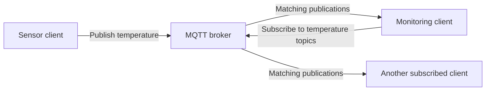
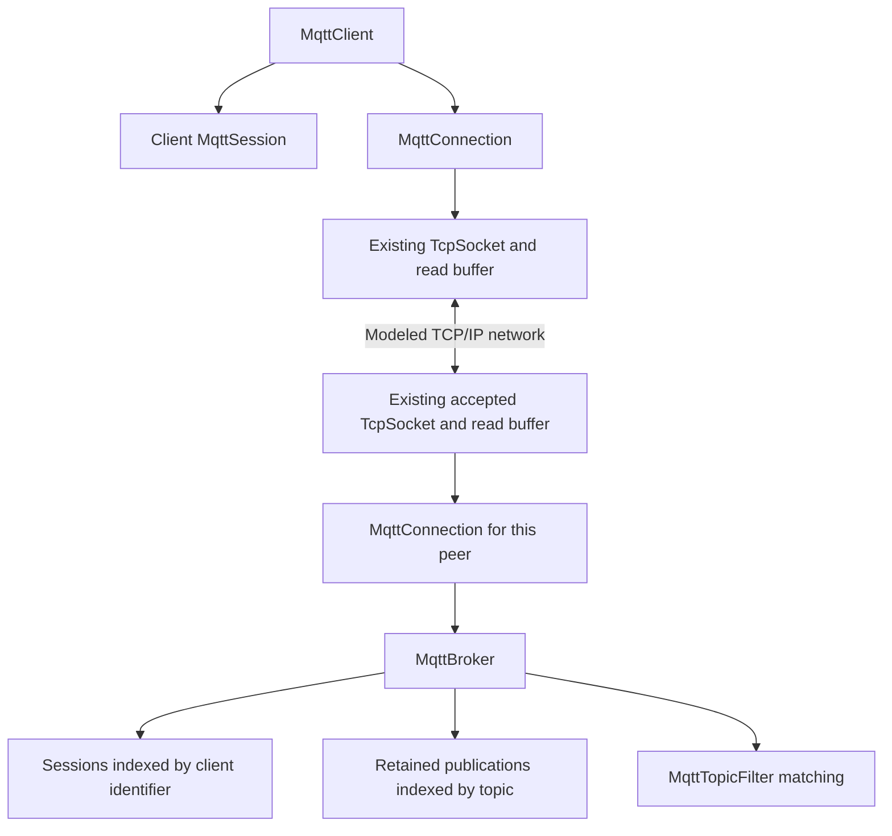
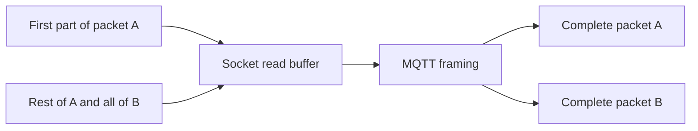
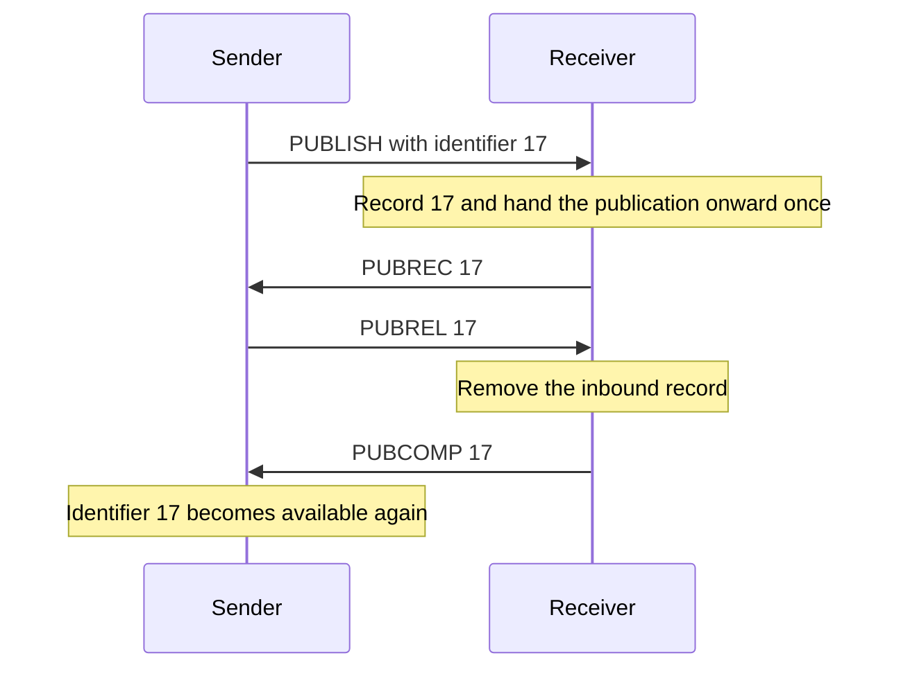
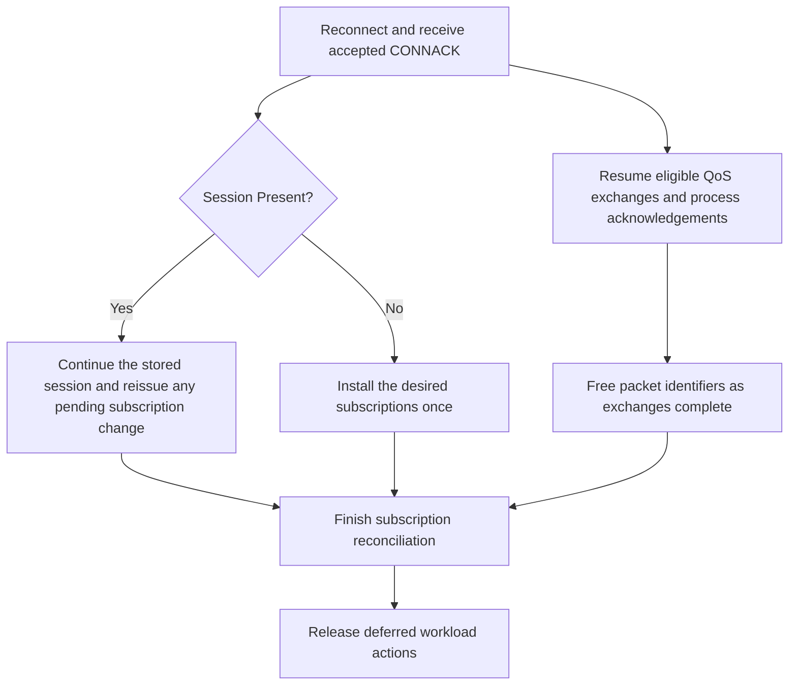
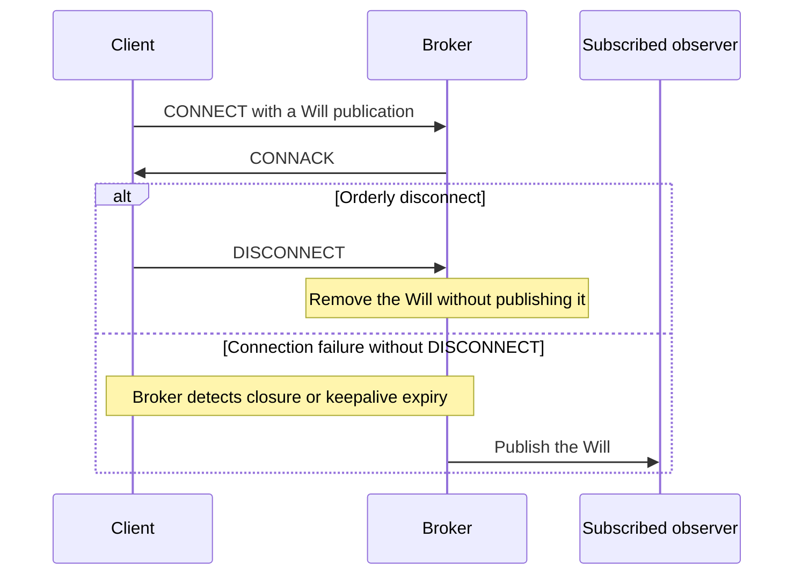

# MQTT implementation summary

> **Kind:** design · **Status:** current · **Seal:** none · **Owns:** — · **Stands on:** [MQTT implementation plan](mqtt.md)

The implementation adds MQTT clients and a broker to INET. A simulation can connect sensors, services and other applications through publish/subscribe messaging, while the existing TCP/IP stack determines network delay, congestion and connection failures. The supported version is MQTT 3.1.1, including all three delivery quality levels, persistent sessions, retained messages, keepalive and Will messages.

The [detailed plan](mqtt.md) owns the implementation stages and test assignments. The [user guide](../../doc/src/users-guide/ch-mqtt.rst) explains configuration, and the [coverage ledger](../../doc/project/evidence/model/mqtt/coverage.md) records executed validation and its limits.

## What the model does

A client can publish messages, subscribe to messages, or do both. Publishers send to a topic, such as `factory/line1/temperature`. Subscribers tell the broker which topics they want. The filter `factory/+/temperature`, for example, matches the temperature topic for one factory line. The broker finds the matching subscribers and sends each an appropriate copy.

Every arrow represents communication over modeled TCP/IP. The publisher has a connection to the broker, and each subscriber has its own connection. The broker takes responsibility for forwarding; a publisher's acknowledgement does not mean that every subscriber has already received the message.

Before a client starts its workload, it establishes TCP and completes MQTT's CONNECT/CONNACK exchange. Workload actions specify when to subscribe, unsubscribe or publish. A subscription action waits for its response before the next workload action, so a following publication does not overtake the intended subscription. The broker also checks connection admission, topic syntax and packet validity.

## Where the behavior belongs

The package lives under `src/inet/applications/mqtt/`. Clients and brokers fit the existing application slots in ordinary INET hosts. They use existing sockets, packet buffers and lifecycle support, with no new host type or changes to the protected packet subsystem.

`MqttClient` owns one logical client and its workload. `MqttBroker` owns the listener, connected peers, subscriptions and routing decisions. `MqttConnection` handles the state tied to one network connection. `MqttSession` holds the longer-lived exchange state needed to resume eligible work after a disconnection. Keeping those lifetimes separate prevents closing a socket from accidentally destroying a persistent session.

`MqttPacket.msg` and `MqttPacketSerializer` define control packets and their actual bytes. `MqttTopicFilter` validates and matches topic filters. The protocol identity, printer and dissector make MQTT packets recognizable to INET's inspection tools. These are supporting classes, not additional simulation processes or a new general messaging framework.

## Reading messages from TCP

TCP delivers a stream of bytes. It can split one MQTT packet across callbacks, or put several MQTT packets into one callback. The receiver must wait for a complete packet, decode it, and continue parsing any remaining bytes.

The framing code checks MQTT's encoded lengths before decoding the packet. Any incomplete suffix remains buffered until more bytes arrive. Connection cleanup clears that suffix before the socket is reused, so an abandoned packet cannot corrupt a later connection. Exact split-point checks test the framing helper directly; separate TCP tests check that the real applications use it correctly.

## What the delivery quality levels mean

MQTT calls its delivery quality setting QoS. Each publisher–broker and broker–subscriber exchange has its own QoS state and packet identifiers. The broker may forward at a lower QoS to respect the subscriber's accepted setting.

| Level | Behavior on one MQTT delivery leg | Exchange |
| --- | --- | --- |
| QoS 0 | Send once without an MQTT acknowledgement; delivery may be lost. | PUBLISH |
| QoS 1 | Keep the publication until acknowledgement; recovery can produce duplicates. | PUBLISH, PUBACK |
| QoS 2 | Track the handshake so a replay does not cause a second application handoff within the session. | PUBLISH, PUBREC, PUBREL, PUBCOMP |

The chosen QoS 2 approach hands the publication onward when the first PUBLISH is accepted, while retaining its identifier to recognize repeats. It does not wait until the whole handshake finishes before forwarding.

If PUBLISH repeats before PUBREL arrives, the receiver answers with PUBREC without another handoff. A repeated PUBREL receives PUBCOMP. The tests interrupt both parts of the handshake and check the resulting recovery. This guarantee concerns MQTT delivery within its session; it does not make an external application's processing transactional or preserve data lost in a broker crash.

## Recovering after disconnection

Clean Session determines whether MQTT state can survive the connection. With Clean Session true, ending the connection ends its exchange state. With Clean Session false, an eligible session preserves subscriptions and unfinished delivery exchanges. The broker also queues required QoS 1/2 deliveries for an offline persistent subscriber; this initial model does not queue optional offline QoS 0 messages.

On reconnect, the broker's Session Present flag tells the client whether the broker still has its session. The client uses that answer to choose one subscription recovery path.

Recovery exchanges continue while subscription restoration waits. This matters when unfinished publications occupy every packet identifier: their acknowledgements must free identifiers before a new SUBSCRIBE can be sent. Ordinary TCP loss recovery remains TCP's job; the model adds no periodic MQTT resend timer to a connection that remains open.

Ordinary client stop/start preserves the workload position and desired subscriptions, with exchange persistence governed by the connection's Clean Session value. A client crash loses runtime state and restarts its workload; its first accepted connection resets incompatible broker state using Clean Session true. An ordinary broker stop/start retains persistent sessions and retained messages, while a broker crash loses them under the in-memory storage model.

## Retained messages and failure notifications

A retained publication gives a newly subscribing client a stored value for a topic. It belongs to the broker, independently of a particular client's session. Replacing it changes the value replayed to future subscribers; publishing a zero-byte retained payload removes the stored value. This is different from an offline session queue, which holds pending deliveries for a specific client.

A Will is a publication configured when a client connects. The broker publishes it when that connection ends without a valid MQTT DISCONNECT, including detected connection failure or keepalive expiry. A network partition does not produce an immediate notification: the broker must first detect the failure.

Keepalive uses MQTT control traffic to detect an idle or unreachable peer. For a nonzero keepalive, the broker disconnects after 1.5 times that interval without receiving a complete control packet. Client ping-response and connection timeouts are separate model settings. The detailed plan states their defaults and the limitation that client send timing is measured at the handoff to TCP, rather than at completion of transmission on the wire.

## How implementation is divided

Each stage corresponds to one planned commit and builds on the preceding stage. Tests arrive with the behavior they check, and every protocol stage has a companion explanation for reviewers.

| Stage | Result | Main evidence |
| --- | --- | --- |
| C1 — Packet representation | MQTT fields, serializers, framing, inspection support and test fixtures. | Independent expected bytes, framing boundaries and serializer round trips. |
| C2 — Basic messaging | Clients connect, subscribe, publish at QoS 0 and unsubscribe. | Production client/broker exchanges, admission, routing and connection cleanup. |
| C3 — Persistent QoS 1 | Unfinished exchanges and offline deliveries survive eligible reconnects. | Retries, session restoration, duplicate handling and identifier exhaustion. |
| C4 — QoS 2 | Both endpoints complete and recover the four-packet delivery handshake. | Interrupted exchanges and application handoff counts. |
| C5 — Stored values and liveness | Retained messages, keepalive and Wills interact correctly. | Replay, deletion, timeout, partition and disconnect cases. |
| C6 — Lifecycle recovery | Restart, crash and malformed exchanges obey the declared state boundaries. | Protocol observations plus timer and object ownership checks. |
| C7 — Examples and documentation | Runnable scenarios, user guidance and recorded verification. | Complete MQTT suite, focused TCP controls, builds and reference exchanges. |

The early stages are deliberately incomplete and must describe that limited scope. The final supported profile is reached only after all the required mechanisms and their tests are present.

## What the evidence checks

The tests check actual wire bytes, routing recipients, acknowledgements, replay, duplicate suppression, malformed input, timeout behavior and state lifetime. Scripted peers create faults that a well-behaved production endpoint would not generate. Direct framing and lifecycle checks cover properties that packet observations alone cannot establish.

The [coverage ledger](../../doc/project/evidence/model/mqtt/coverage.md) lists the MQTT and selected TCP checks, feature-on/off builds, examples and documentation results. The [Mosquitto comparison](../../tests/protocol/mqtt/reference-comparison.md) checks bytes and selected exchanges offline; it is not a claim of live interoperability. The examples report delivered payload counts and byte totals, including duplicate deliveries, separately from MQTT/TCP traffic; dividing byte totals by the observation duration gives throughput.

The initial scope excludes MQTT 5.0, MQTT-SN, TLS, WebSockets, clustering, bridges, durable storage and a configurable broker capacity model. It uses real packet bytes and protocol state without adding CPU or disk timing. Experiments must fit available host memory. Diagram rendering remains unverified because a Mermaid renderer is not available in the current environment.
