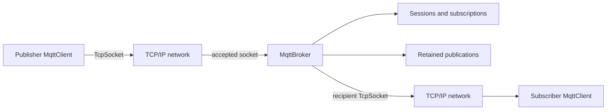
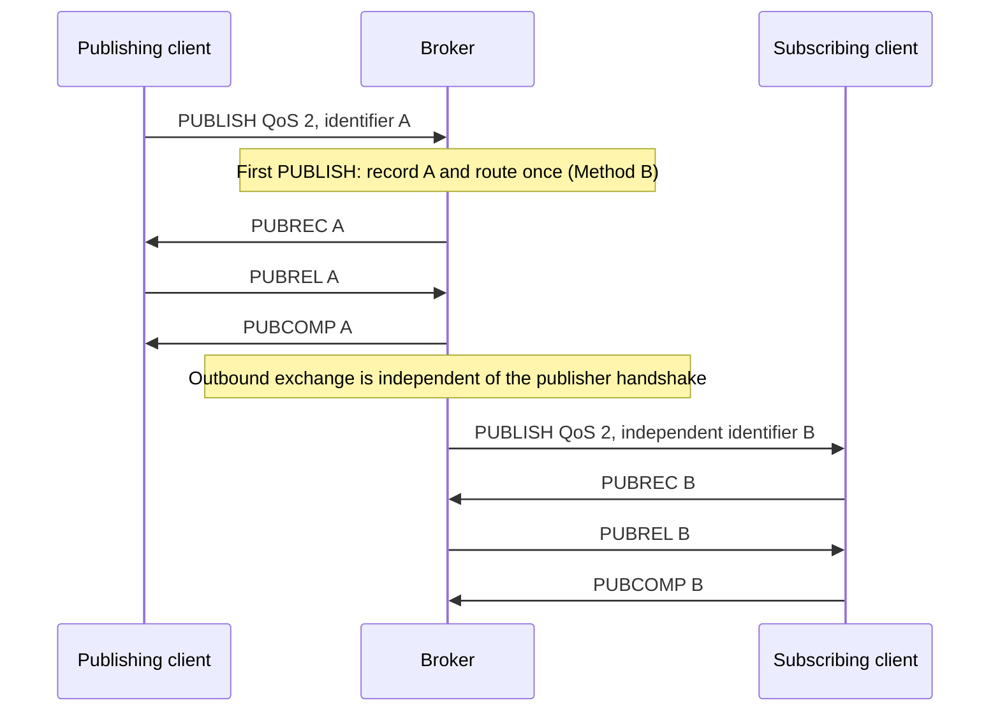

# MQTT implementation plan

> **Kind:** design · **Status:** snapshot 2026-11-16 · **Seal:** none · **Owns:** — · **Stands on:** [protocol anatomy](../../doc/project/design/protocol-anatomy.md), [architecture](../../doc/project/rule/architecture.md), [testing](../../doc/project/rule/testing.md)

Execution of C1–C7 and the C6b verification increment is complete. The [coverage ledger](../../doc/project/evidence/model/mqtt/coverage.md) records the passing integrated checks, exact commands and remaining verification limits. This completed plan and its summary are archived under `plan/done`.

## Intended result and scope

Add an MQTT client and broker to INET so a simulation can measure publish/subscribe delivery over the modeled TCP/IP network. For example, a sensor publishes a binary payload to `factory/line1/temperature`; the broker forwards it to clients subscribed to `factory/+/temperature`, with independent delivery state on the sensor–broker and broker–subscriber connections. Link delay, TCP congestion and reconnection must affect that exchange through the existing network stack.

**Selected version:** implement MQTT 3.1.1 first, using the [OASIS MQTT 3.1.1 standard](https://docs.oasis-open.org/mqtt/mqtt/v3.1.1/os/mqtt-v3.1.1-os.html) as the normative source. This is a scope choice, not a claim that it is the newest version: [MQTT 5.0](https://docs.oasis-open.org/mqtt/mqtt/v5.0/os/mqtt-v5.0-os.html) is a separate standard with additional behavior. Keep 5.0, MQTT-SN, WebSocket transport, TLS, broker clustering and bridges as separate follow-ups. Do not expose a selectable version that lacks a complete implementation.

The target includes all 3.1.1 control packet types; QoS 0, 1 and 2; topic filters and subscriptions; retained publications; persistent sessions across network disconnections; reconnect; keepalive; Will messages; and correct rejection of malformed packets and unsupported protocol levels. Authentication fields are represented on the wire. By default the broker accepts anonymous connections; an optional configured username/password pair requires an exact match and otherwise returns CONNACK code 4. Keep this as a deterministic admission rule, without a pluggable authentication framework. Cryptography, external identity services and authorization policy engines are outside the model. Credentials on plain TCP provide no security guarantee.

Model actual MQTT fields and payload bytes, TCP stream framing, protocol state and required timers. Do not add CPU, disk or thread scheduling delays without a separate experiment requirement. Broker session persistence is in memory and lasts across transport disconnection while the broker is running; durable storage across broker crash is outside this profile and must be documented. Use the protocol's length and packet identifier bounds. Additional configurable memory, queue and in-flight limits are deferred: no experiment currently requires a capacity model, and introducing one would require explicit overload semantics and new tests. Finite experiments must fit host memory; this model does not claim bounded-memory operation.

Revision 4 incorporates iterative review. The user subsequently authorized the entire implementation with “Execute the whole plan.” That authorization covers C1–C7 and the verification refinements below, without unrelated changes to `AGENTS.md`, edits to sealed packet APIs or baseline updates. Execution results and remaining gaps are recorded in the [MQTT coverage ledger](../../doc/project/evidence/model/mqtt/coverage.md). The checkout's planning procedure and planning rules are drafts; the current [commit-series](../../doc/project/rule/pull-request.md#pr-series-plan) and [protocol-test](../../doc/project/rule/testing.md#tr-plan-protocol) content requirements apply independently.

## Current checkout and integration evidence

The inspected checkout is `/home/miguel/workspace/inet-mqtt`, at `91219b0fa7d2794ee67ac8a3dd45c3a09cfc45b0` on 2026-11-15. `AGENTS.md` already has an unrelated local modification and is outside this plan's edits. Searches for MQTT in `src`, `tests`, `examples`, `showcases` and `.oppfeatures` found no existing MQTT implementation or tests. Consequently the first implementation commits add capabilities, rather than repair an observed MQTT runtime defect.

Existing integration points establish the following design:

| Existing mechanism | Evidence and consequence |
| --- | --- |
| Application slot | [IApp](../../src/inet/applications/contract/IApp.ned) exposes `socketIn` and `socketOut`. Both new applications fit the existing host application array; no new host type is necessary. |
| TCP client callbacks | [TcpAppBase](../../src/inet/applications/tcpapp/TcpAppBase.h) provides one socket, connection helpers and counters. Its request/reply-oriented defaults and inherited parameter requirements do not supply MQTT sessions. Reuse `ApplicationBase` and `TcpSocket` directly rather than inheriting irrelevant application policy. |
| Accepted connections | [TcpServerHostApp](../../src/inet/applications/tcpapp/TcpServerHostApp.h) demonstrates listener acceptance and `SocketMap` dispatch, but creates dynamic server-thread modules. Its [stop/crash implementation](../../src/inet/applications/tcpapp/TcpServerHostApp.cc) is not an MQTT persistence contract. Reuse the socket APIs and connection lookup pattern; retain broker sessions in one broker application. |
| TCP byte stream | [TcpSocket](../../src/inet/transportlayer/contract/tcp/TcpSocket.h) provides `BufferingCallback` and a read buffer, backed by [ChunkQueue](../../src/inet/common/packet/ChunkQueue.h). TCP callbacks can contain partial or multiple MQTT packets. Frame complete packets before dispatch; do not interpret one callback as one publication. |
| Protocol identity | [Protocol](../../src/inet/common/Protocol.h) has a public constructor; its [implementation](../../src/inet/common/Protocol.cc) registers identities by name. Define the MQTT identity in the MQTT package; avoid adding a core `Protocol::mqtt` member. |
| Protocol tests | [Protocol test authoring](../../tests/protocol/lib/AUTHORING.md) supports packet/scalar observations and fault injection. Add an MQTT scripted peer where precise byte sequences or interrupted handshakes are needed; exercise production applications rather than substituting helper algorithms for them. |

No MQTT effective configuration exists yet. The planned fixtures use `StandardHost` applications with wired IPv4 and `Tcp` from `TcpInet`, broker port 1883, deterministic payloads and `seed-set = 0`. IPv6 and wireless examples are optional follow-ups, rather than prerequisites for the first MQTT model.

Guidance comes from the [project map](../../doc/project/README.md), [plan procedure](../../doc/project/guide/write-an-implementation-plan.md), [protocol addition guide](../../doc/project/guide/add-a-protocol.md), [minimal-design rule](../../doc/project/rule/quality.md#qr-design-minimal), and [documentation rules](../../doc/project/rule/documentation.md). The [seal registry](../../doc/project/audit/seal-list.md) seals `src/inet/common/packet/`; this design only uses its APIs. Add serializers and tooling under MQTT, without modifying that protected subtree.

## Components and production path

Place production code in `src/inet/applications/mqtt/`, using the `inet::mqtt` namespace. The following names are proposed and should remain consistent across NED, MSG and C++ files.

| Component | Owns and serves | Reuse and reason for addition |
| --- | --- | --- |
| `MqttClient` (`.ned`, `.h`, `.cc`) | One logical client, its TCP socket, client identifier, session state and workload schedule. Sends CONNECT after TCP establishment and permits publish/subscribe work only after accepted CONNACK. | The NED module implements `IApp`; the C++ class derives from `ApplicationBase`. `TcpSocket` supplies transport, but no existing app supplies MQTT behavior. One client can publish and subscribe. Separate publisher/subscriber protocol implementations would duplicate state. |
| `MqttBroker` (`.ned`, `.h`, `.cc`) | Listener, accepted connections, session map by Client Identifier, subscriptions and retained publication map. Routes publications into each recipient's delivery state. | Uses `SocketMap` and `TcpSocket` callbacks. One module avoids new thread-module lifecycle and shared-state ownership contracts. |
| `MqttConnection` (`.h`, `.cc`) | Framing and connection-local protocol state, used by client and broker. | Uses the socket's existing read buffer rather than owning a second receive queue. Client/broker modules own scheduled timers. This helper is not a NED module or another socket abstraction. |
| `MqttSession` (`.h`, `.cc`) | Subscriptions, pending outbound queue, packet identifier allocation and inbound/outbound QoS exchange state. Retained by the logical client or broker across eligible reconnects. | TCP socket state ends with a connection; MQTT session state has a different lifetime. Keep connection handles out of persistent records. |
| `MqttPacket.msg`, `MqttPacketSerializer` | Typed control packets and exact wire representation, including binary payload and variable-length fields. | Existing serializers do not encode MQTT. Declare concrete control-packet fields, lengths and packet identifiers; avoid encoding semantics in packet names or arbitrary parameter maps. Add declarations and serializers together. |
| `MqttTopicFilter` (`.h`, `.cc`) | Topic name/filter validation and matching, shared by client validation and broker routing. | A pure helper keeps matching independent of connection management. A linear subscription scan is sufficient initially; a trie needs measured justification. |
| `MqttProtocolDissector`, `MqttProtocolPrinter`, `MqttProtocol` | Registered introspection and the package-owned protocol identity. | Use existing registration mechanisms; no changes to core dispatch or packet switches. |

Do not add a public `IMqtt` C++ interface or a new application gate contract without an actual replaceable consumer. Configure broker address/port, client identifier, Clean Session, keepalive, connection/reconnect timing and optional credentials/Will through NED parameters. Use one XML workload parameter for ordered `subscribe`, `unsubscribe` and `publish` actions. Each action has a time offset from the first accepted CONNACK; subscription actions carry filters and requested QoS, while publication actions carry topic, QoS, retain and a hex-encoded binary payload. Equal offsets follow XML order. A subscription action blocks later workload actions until its acknowledgement, so a following publication cannot overtake the intended subscription. An action due while disconnected waits until the next accepted CONNACK, preserving action order; actions handed to MQTT are consumed once, and unfinished QoS publications remain session-owned. Record the desired subscription map and the single pending subscription mutation. After reconnect discard the old subscription request's connection-local identifier. For Session Present true, reissue that pending mutation with an available identifier; for Session Present false, install the desired subscription map once instead, without also replaying the old mutation. Complete this reconciliation before releasing deferred workload actions. This handles an interrupted UNSUBACK without duplicate recovery paths. Use explicit repeated publication actions initially, without a second workload scheduler or scripting language. Runtime application composition is a follow-up for a concrete consumer.

A valid SUBACK completes its pending request even when an entry reports failure (`0x80`): release the request identifier, expose the result through the received-packet signal and a diagnostic, and permit later workload actions. Keep the requested filter in the desired map for a future new-session restoration, without immediately retrying a refusal. A valid lower granted QoS is accepted and reported. Invalid SUBACK result values, result counts or identifiers follow the malformed-exchange path. These are client workload choices, separate from the broker's grant policy.

NED declarations are the configuration authority. Specify units and legal values, use port 1883 by default, and distinguish configured protocol settings from workload choices. Declare signals for sent/received complete MQTT control packets, application publication delivery and connection transitions; derive counts and delivered-payload throughput from those signals. Do not add bespoke state signals when packet and lifecycle observations already answer the question. The initial examples report total delivered payload bytes, including duplicate deliveries, and MQTT/TCP bytes separately. Protocol tests use distinct payloads to identify duplicates. General end-to-end delay and deduplicated-throughput analysis are follow-ups requiring their own correlation/recording design; no MQTT timestamp field, tag-propagation assumption or additional observer framework is needed for this implementation.



Each incoming socket indication is resolved to its connection, appended to the socket's read buffer, framed and decoded before the responsible client or broker handles the control packet. Parse complete packets in a loop, retaining an incomplete suffix. Clear the read buffer on connection termination before renewing/reusing a socket: [renewSocket()](../../src/inet/transportlayer/contract/tcp/TcpSocket.cc) changes socket identity and addresses but does not clear it. A partial packet from one connection must never prefix data in the next. The broker's forwarding decision creates an independent outbound exchange for each matching subscriber. Packet identifiers, DUP and acknowledgement state belong to one direction of one session; an incoming publication's identifier is not forwarded as a global identifier.

## State, timing and failure behavior

Use explicit connection phases for TCP establishment, waiting for MQTT acceptance, active operation and closure. Reject traffic that violates the permitted phase. Allocate packet identifiers from 1 through 65535 while excluding identifiers still in use in that direction, including subscription operations; release them only at the relevant terminal acknowledgement. Under exhaustion, queue work until an identifier becomes available instead of reusing an active identifier.

Keep outbound QoS 1 exchanges until PUBACK. For QoS 2 use Method B in section 4.3.3, Figure 4.3: on the first PUBLISH accept ownership, record the inbound identifier and initiate delivery once before sending PUBREC; repeats while awaiting PUBREL only elicit PUBREC. PUBREL removes that receiver record and elicits PUBCOMP, including on repeated PUBREL. Sender state retains PUBLISH until PUBREC, then PUBREL until PUBCOMP. Do not retain completed-identifier tombstones that would block legitimate reuse. QoS guarantees apply to each protocol exchange; they do not promise transactional exactly-once processing in an external application or across broker data loss.

On reconnect with Clean Session false, re-send the pending QoS PUBLISH or PUBREL using its original identifier (section 4.4); PUBLISH retries have DUP set, while PUBREL retains its required fixed-header flags. Session Present false means broker state is new: restore desired subscriptions, but preserve and retry the client's eligible unfinished outbound publications as required. Recovery sends and acknowledgement processing must continue while subscription reconciliation is pending; only new workload actions wait. Otherwise 65535 unfinished publications could occupy every identifier and prevent the SUBSCRIBE that would unblock recovery. Clear inbound QoS 2 duplicate records belonging to the missing broker session before accepting newly allocated server identifiers; exactly-once continuity across broker state loss is outside the profile. Retry pending SUBSCRIBE/UNSUBSCRIBE only through the workload reconciliation above, without keeping their old identifiers reserved as persistent QoS publications. Use FIFO publication queues and preserve the acknowledgement/order requirements of section 4.6. Do not add periodic MQTT retransmissions to an uninterrupted TCP connection. Reconnection uses a fixed `reconnectInterval` defaulting to 1s; TCP owns loss recovery within a connection.

The broker keys persistent sessions by Client Identifier and connections by socket ID. Clean Session determines whether to resume or discard prior session state and the CONNACK Session Present value. Handle a new connection using an already-connected identifier through the standard's takeover behavior, including the old connection's Will consequences. Preserve required QoS 1/2 offline delivery for persistent subscriptions; do not store optional offline QoS 0. For live overlapping subscriptions, send one copy per matching client at the highest matching granted QoS, capped by incoming QoS. Grant the requested QoS when supported, otherwise return the appropriate SUBACK result; the final profile supports all three levels.

Retained state belongs to the broker and survives client session deletion. A zero-length retained publication clears the retained record while still following the live delivery rules. Topic matching must handle empty levels, case sensitivity, multi-byte UTF-8, `+`, `#` and the leading `$` namespace rule. Grant no QoS that the implementation cannot provide, and make unsubscribe/resubscribe behavior observable.

Use section 3.1.2.10 for keepalive: the client measures the gap from finishing one control packet to starting the next, while the broker measures receipt and disconnects after 1.5 times the nonzero keepalive without a complete control packet. At this application's abstraction, handing a complete packet to TCP is the send boundary; TCP transmission completion is not exposed, so the model does not claim exact wire-time keepalive behavior under prolonged TCP backpressure. Zero disables the keepalive timer. Use `pingResponseTimeout = 5s` after PINGREQ, independently of keepalive, and close/reconnect on expiry. Use `connectTimeout = 5s` from TCP connection initiation through accepted CONNACK; the broker also allows 5s after acceptance of a TCP socket to receive CONNECT. These timeout defaults are model choices, not MQTT constants. Cancel or move deadlines through their owner instead of introducing generation counters or simulated threads.

Record Will state on successful connection setup and publish it on the specified abnormal termination paths. Receipt of a valid DISCONNECT suppresses that connection's Will. Network partition, TCP failure, keepalive expiry and duplicate Client Identifier takeover require distinct tests because their triggers differ. Broker shutdown/crash behavior must explicitly distinguish orderly connection handling from loss of the broker itself.

After sending DISCONNECT, the client enters its closing phase, cancels workload/ping sends and sends no further MQTT control packets on that connection (section 3.14.4). Closure callbacks still run; subsequently received data is discarded rather than generating MQTT acknowledgements. Before that boundary, an active client acknowledges valid incoming QoS publications even if they do not match its own requested subscriptions (section 4.5). Subscription matching is a broker routing responsibility, not a client-side condition for acknowledging receipt.

Use existing lifecycle state from `ApplicationBase`. Create reusable timers once; cancel them on stop/crash and release them on destruction. Graceful client stop sends DISCONNECT when possible, then completes socket closure within a 5s stop timeout; it must still process closure callbacks. Ordinary client stop/start retains its workload cursor and desired subscriptions. MQTT exchange state survives only when the previous connection's effective Clean Session value was false, and reconnect uses the same identifier. Ending a Clean Session true connection clears unfinished exchange records; their delivery outcome can be uncertain and they are not silently retried as a persistent session. Client crash discards local runtime state and restarts its configured workload with a new CONNACK time origin. Its first reconnect uses Clean Session true to discard incompatible broker state; repeat that reset value until a connection is accepted, then later connections use the configured value. Store the effective value in the connection record and apply its cleanup rule even if it differs from configuration. Broker graceful stop publishes pending connection Wills while still operational, closes connections and cancels timers, retaining only persistent sessions and retained records for ordinary restart; Clean Session true state ends with its connection. Broker crash clears runtime records and provides no Will-delivery guarantee. A broker restart establishes fresh sockets. Implement basic cleanup with each resource's introduction; C6 verifies interactions rather than leaving earlier commits with unsafe lifecycle behavior.

Frame input with checked Remaining Length decoding before allocating a full packet. Distinguish an incomplete prefix from an invalid one, reject a continuation beyond four length bytes and values outside the 268435455-byte Remaining Length range, and enforce fixed-header flags, field lengths, UTF-8 rules and control-packet sequencing. Do not equate a valid refusal response with a success acknowledgement. Choose the standard's required response for each violation; avoid a blanket close-on-error rule where a CONNACK refusal is required. The initial Client Identifier policy accepts nonempty 1–23-byte ASCII alphanumeric identifiers and rejects other well-formed identifiers with CONNACK code 2; invalid UTF-8 follows the malformed-input rules. Test maximum length prefixes without allocating maximum-sized payloads.

## Commit series and direct verification

Every path in this section is a proposed artifact unless explicitly linked as existing. No MQTT fixture currently exposes these gaps. Each commit is compared with its proposed parent, whose earlier capabilities are assumptions until implemented and tested. Keep each intermediate tree buildable and scope its feature claims to behavior implemented at that point. Every protocol behavior commit includes its tests and its own reviewer Markdown document in the same commit.

For each reviewer document below, explicitly write the requirement and clause references, parent behavior, correction, topology, configuration, stimulus, production path, observations, assertions, expected result and limits for every named test. Include the diagrams needed to explain distinct exchanges and failure timing. Check rendering when tooling is available and record unavailable rendering as unverified. A list of tests is insufficient.

All protocol fixtures start with no connections or stored sessions unless the case explicitly establishes them. Use a wired switch between the required hosts, static IPv4 configuration, 1ms link delay, 100Mbps links, `seed-set = 0` and a 30s simulation limit. C1 uses the codec/framing harness; from C2 onward use the production `MqttClient`/`MqttBroker` for the role under test and a scripted peer for faults or responses the other production endpoint cannot generate. Script actions from observed connection/acknowledgement events rather than relying on guessed setup delays. Give every positive observation a bounded deadline and every absence/count assertion a closed observation window. These are finite deterministic cases; additional random seeds are not a substitute for the listed role and boundary cases.

| Commit | MQTT 3.1.1 requirement sections |
| --- | --- |
| C1 | 1.5, 2 and the wire layouts in 3.1–3.14 |
| C2 | 2.3.1; 3.1–3.3; 3.8–3.11; 3.14; 4.7–4.8 |
| C3 | 3.1.2.4; 3.2.2.2; 3.4; 4.1; 4.3.2; 4.4–4.6 |
| C4 | 3.5–3.7; 4.3.3–4.6 |
| C5 | 3.1.2.5–3.1.2.10; 3.3.1.3; 3.8.4; 3.12–3.14 |
| C6 | 1.5.3; 2.2–2.3; 4.1; 4.8; plus the lifecycle model choices above |

These sections refer to the linked OASIS 3.1.1 standard. C1's catalog records individual normative identifiers and maps each to its owning commit and check. If that specification pass reveals an unassigned mandatory requirement, revise this series before implementing dependent behavior; C6 is not a catch-all for unspecified missing features.

### C1 — `mqtt: define the model profile and encode control packets`

**Dependencies:** none. Write the MQTT 3.1.1 clause/requirement catalog, feature map and model profile before deriving implementation-dependent checks. Proposed evidence paths are `doc/project/evidence/standard/mqtt311/catalog.md`, `doc/project/evidence/protocol/mqtt/{standards,features,checks}.md`, and `doc/project/evidence/model/mqtt/{conformance,coverage}.md`. Follow the existing [standard-derived test workflow](../../doc/project/guide/derive-tests-from-a-standard.md). Inventory mandatory behavior within the chosen profile; do not infer completeness from the shorter scenario list in this plan.

Add `src/inet/applications/mqtt/package.ned` with `@namespace(inet::mqtt)`, packet declarations, serializers, protocol identity, printer/dissector, the framing part of `MqttConnection`, and the `Mqtt`/`MqttTests` features in `.oppfeatures`. `Mqtt` depends on `TcpCommon`; test fixtures additionally depend on `TcpInet`, IPv4, Ethernet and the host/configurator packages they use. Guard MQTT-specific serializer-test includes and fillers so MQTT-off builds do not depend on the package. Map every control packet's required fields and validation rules to standard clauses. Add `tests/protocol/mqtt/MqttScriptedPeer.{h,cc}` and a receive harness. Reuse [TcpTestApp](../../tests/protocol/self/TcpTestAppSockets.test) for existing socket actions; the new fixture only adds MQTT byte schedules/observations that it cannot express. Each `.test` emits its NED fixture with `%file: test.ned` and a C++ wrapper that includes the suite-local peer implementation, using the existing generated-test build pattern. This is necessary because the runner compiles extracted test directories, rather than automatically compiling arbitrary suite-level `.cc` files. Do not make the shared protocol-test library depend on MQTT.

**Write tests:** `tests/protocol/mqtt/MqttWireFormat.test` sends CONNECT, PUBLISH at all QoS levels, and every acknowledgement/control type through the production serializer and framing path. Compare against independently authored expected octets, not just round trips. Cover Remaining Length boundaries 127/128, 16383/16384 and 2097151/2097152, maximum prefixes, zero-length fields where legal, binary zeros and invalid fixed flags/lengths. TCP send calls cannot force exact callback boundaries: add `tests/module/mqtt_framing.test` to supply chunks directly to the production framing helper at every split point of short packets, with concatenated packets and an incomplete suffix. The protocol fixture separately proves the codec/framer path over TCP; C2 tests connection cleanup through the production applications once they exist. Add `tests/serializer/lib/fillers/ChunkFillers_mqtt.cc` and register it through the existing `ChunkFillers.{h,cc}` collector so `tests/serializer/serializer_chunk_roundtrip.test` covers every concrete MQTT chunk. The protocol fixture supplies independent golden-byte checks; round trips alone cannot detect a symmetric encoding bug. Before C1 the identity, codec and framing behavior are absent; after it the harness can exchange exact MQTT bytes, without claiming client/broker operation.

**Write reviewer document:** `tests/protocol/mqtt/wire-format.md`, associated with C1. Verification is the exact-byte codec and framing suite with a fresh debug build; byte fixtures establish representation, not session correctness. Feature-off compilation must show the core does not depend on MQTT.

### C2 — `mqtt: connect clients and route QoS 0 publications`

**Dependencies:** C1. Add `MqttClient`, `MqttBroker` and `MqttTopicFilter` declarations/implementations, connection state in `MqttConnection`, and `MqttSession` records for subscriptions and outgoing SUBSCRIBE/UNSUBSCRIBE identifiers. Introduce the shared identifier allocator here because those operations already require it. Implement CONNECT/CONNACK admission, the XML workload, connection timeout, reconnect scheduling, SUBSCRIBE/SUBACK, UNSUBSCRIBE/UNSUBACK, QoS 0 PUBLISH and DISCONNECT. Include socket/timer cleanup from introduction. Until later commits, constrain workloads to Clean Session true, keepalive zero, no Will, no retained messages and QoS 0; fail unsupported local configurations explicitly and keep that intermediate profile visible. Scripted peers verify supported behavior without treating this intermediate tree as complete MQTT 3.1.1.

**Write tests:** `tests/protocol/mqtt/MqttConnect.test` uses a scripted client against the broker for accepted/refused CONNECT, identifier and credential policies, invalid flags/protocol level, duplicate CONNECT and traffic before acceptance. A scripted broker tests the production client's accepted/refused/malformed CONNACK handling, connection timeout and retry. For both production roles, close with a partially received control packet and establish another connection; assert that a fresh valid packet is decoded without using the old prefix. After client DISCONNECT, inject a packet while TCP is still closing and assert no further MQTT sends before closure completes. `tests/protocol/mqtt/MqttRouting.test` uses publisher P, broker B and subscribers S1/S2 with filters `factory/+/temperature` and `factory/#`; subscribe before publishing a known binary payload, assert SUBACK results and exact recipients/payloads, then unsubscribe S1 and assert it receives no later publications over a bounded interval. Include topic mismatch, empty levels, `$SYS`, invalid wildcard placement, subscription replacement/overlap and matching SUBACK/UNSUBACK identifiers. XML actions at equal offsets and actions due while disconnected test ordering/deferral; withhold SUBACK and verify that a following workload publication waits, then return failure and check that the identifier is released and the following action proceeds without a retry loop. Before C2 only the codec harness can exchange packets; after C2 these flows traverse real TCP connections and production applications.

**Write reviewer document:** `tests/protocol/mqtt/connect-and-routing.md`, associated with C2. Run both tests against the client and broker roles with fixed seeds. This establishes QoS 0 routing and connection admission, not higher-QoS recovery.

**Credential boundary:** add `tests/protocol/mqtt/MqttAuthentication.test` and its reviewer document `tests/protocol/mqtt/authentication.md` in C2. Configure a production broker, publisher and subscriber with username `alice` and an empty password, plus a second publisher with a wrong password. Assert a present zero-length password in CONNECT, accepted/refused CONNACK as appropriate, successful subscription, exact binary delivery and no activation of the refused client. MqttClient must include the password field whenever it sends credentials, so the broker's exact pair comparison can admit matching empty passwords. C2's parent lacks the endpoints; use the pre-correction integrated tree for a compatible failing control. Run `Mqtt(Authentication|Connect|Routing)[.]test$` in debug mode with seed 0; this checks admission and delivery, not security-service behavior.

### C3 — `mqtt: preserve QoS 1 delivery across reconnects`

**Dependencies:** C2. Extend `MqttSession` for persistent ownership, Clean Session/Session Present behavior, QoS 1 acknowledgement state and offline queues. Reuse C2's identifier allocator for outgoing QoS publications and its reconnect scheduler for persistent recovery. Enable QoS 1 and Clean Session false only with these paths implemented.

**Write tests:** `tests/protocol/mqtt/MqttQos1.test` runs P–B–S with QoS 1 on both legs, correlates each PUBACK with its own connection's identifier and verifies delivered bytes. The scripted peer closes after receiving PUBLISH but before acknowledging it, reconnects to the same session and observes retransmission with the original identifier and DUP set. Include QoS downgrade to a QoS 0 subscription, ordered messages on one topic, and repeated PUBLISH after PUBACK: the receiver treats the repeated identifier as a new publication even when DUP is set. A scripted broker sends a valid publication outside the client's requested filters and requires its PUBACK; repeat during closure after DISCONNECT and require no acknowledgement. `tests/protocol/mqtt/MqttSession.test` disconnects a persistent subscriber, publishes while it is offline, reconnects it and checks Session Present and queued delivery. Repeat with Clean Session true to check session removal; cover Session Present false with pending client publications, desired-subscription restoration, interrupted SUBSCRIBE/UNSUBSCRIBE acknowledgements, identifier takeover, identifier reuse and exhaustion with queued work. For interrupted subscription mutations, test both Session Present values and assert one recovery path: replay the mutation for a resumed session, or rebuild the desired map for a new session. An interrupted unsubscribe must not restore its removed filter. Use 65535 small outstanding publications with acknowledgements withheld to reach exhaustion through the production allocator. Reconnect with Session Present false, require publication retries despite blocked subscription restoration, then acknowledge one retry and require the freed identifier to permit SUBSCRIBE and subsequent workload progress. Before C3 QoS 1/persistent-session cases are unsupported; after C3 session ownership and acknowledgement transitions supply them. Check no timer-based MQTT resends on an uninterrupted connection during a stated observation interval.

**Write reviewer document:** `tests/protocol/mqtt/qos1-and-sessions.md`, associated with C3. Cover client and broker as reconnecting senders with scripted peers. Observe wire exchanges and application delivery counts; no claim is made about recovery after broker storage loss.

### C4 — `mqtt: complete QoS 2 delivery state machines`

**Dependencies:** C3. Extend `MqttSession` and the client/broker packet handlers with sender and receiver QoS 2 states, Method B handoff, phase-specific reconnect behavior and duplicate handling. Enable QoS 2 subscriptions/publications when both client and broker can complete these exchanges.

**Write tests:** `tests/protocol/mqtt/MqttQos2.test` checks PUBLISH–PUBREC–PUBREL–PUBCOMP on both delivery legs, including duplicates at each phase, Method B's single handoff before PUBREC, completion, and subsequent identifier reuse. Include routing from QoS 2 to subscriptions granted QoS 0, 1 and 2. `tests/protocol/mqtt/MqttQos2Reconnect.test` interrupts before PUBREC and after PUBREC/before PUBCOMP, restores the persistent session and checks the standard-required resumed exchange and exactly one application handoff within that session. Exercise duplicate PUBREL after a lost PUBCOMP, simultaneous opposite-direction identifier values, and unknown/completed identifier handling according to the standard. Separately, a scripted broker reconnects with Session Present false and sends a new publication using an identifier still present in the client's old inbound state; assert a new handoff rather than erroneous duplicate suppression. That case starts a new broker session and makes no exactly-once claim across its loss. Run permutations with a production client and production broker as sender and receiver. Before C4 QoS 2 is unsupported; after C4 retained sender/receiver phases prevent a replayed exchange from causing duplicate handoff.

**Write reviewer document:** `tests/protocol/mqtt/qos2.md`, associated with C4. Use separate normal and interrupted sequence diagrams. Delivery-count assertions plus wire assertions establish modeled MQTT QoS 2; they cannot establish atomic effects in an external application.



The outbound exchange is shown after the inbound one for readability; tests permit it to begin at the Method B handoff, before the publisher receives PUBCOMP. On the subscriber's first PUBLISH reception, the same Method B rule records its inbound identifier and hands the payload to its application once before PUBREC.

### C5 — `mqtt: handle retained publications keepalive and Will messages`

**Dependencies:** C4. Add `MqttBroker` retained record management and per-connection Will records; add client/broker liveness timers and handlers. Enable nonzero keepalive, retained publications and configured Wills. Complete their interaction with session takeover and subscriber QoS selection.

**Write tests:** `tests/protocol/mqtt/MqttRetained.test` publishes before subscribing, checks retained replay and RETAIN flags on replay versus live forwarding, replaces/deletes the retained record with a zero-byte retained publication and confirms no stale replay. Include resubscription replay, session deletion without retained-record deletion and retained QoS capped by the granted subscription QoS. `tests/protocol/mqtt/MqttKeepAlive.test` uses keepalive 2s, checks an idle client ping and response, a missing PINGRESP, broker expiry at 3s without further complete packets, activity-driven deadline renewal, partial packet reception and keepalive zero. Anchor broker timing to complete packet receipt; send renewal packets at least 10ms away from the expiry boundary to avoid assuming same-time event priority. Keep a separate no-traffic case for expiry itself. Set timer tolerances from simulation resolution and known path delay. `tests/protocol/mqtt/MqttWill.test` compares normal DISCONNECT, abrupt close, protocol-error closure, keepalive expiry and identifier takeover with an observer subscribed to the Will topic. Add a partition case that drops traffic on the publishing client's link while leaving the observer connected; assert that the broker publishes the Will after detecting failure, rather than at partition onset. Assert Will payload, QoS, retain behavior and exactly the required publications. Before C5 these features are explicitly unsupported; after C5 the broker's retained map and module-owned timers/connection Will records supply them.

**Write reviewer document:** `tests/protocol/mqtt/retained-keepalive-and-will.md`, associated with C5. Include timer and disconnect diagrams for distinct triggers. A missing packet assertion must cover a stated interval, not just an instant after the trigger.

### C6 — `mqtt: verify lifecycle recovery and malformed exchanges`

**Dependencies:** C5. Complete client/broker ordinary stop/start persistence and post-crash recovery policies above. Earlier commits already cancel/release resources; this commit adds the persistent-state recovery transitions and checks interactions across features. Complete malformed exchange handling across active states by extending C1/C2 validation rather than adding a parallel validator.

**Write tests:** `tests/protocol/mqtt/MqttFailureHandling.test` injects truncated packets followed by closure, invalid UTF-8, illegal identifiers, invalid length prefixes and invalid phase transitions into each production endpoint; assert the specified close/refusal and absence of unintended forwarding or success acknowledgement. These supplement C1/C2 validation with active QoS and Will state, rather than deferring all input validation until C6. `tests/protocol/mqtt/MqttLifecycle.test` stops and restarts clients/broker while publications and timers are pending, then crashes each separately. Assert persistent-session/retained-state survival across ordinary stop, loss across crash, no sends while down and successful new delivery after restart. After client crash, refuse its first reconnect and verify it keeps sending Clean Session true until acceptance; end that accepted connection with a QoS exchange pending and check that its transient state is discarded before a later configured Clean Session false connection. Verify workload cursor retention on ordinary restart and reset after crash. Check the broker's graceful-stop Will path separately from crash. Add `tests/module/mqtt_lifecycle.test` for timer/object ownership checks that wire observations cannot establish. Before C6 basic cleanup exists but post-crash/session restart semantics are incomplete; after C6 those transitions and their direct checks are present.

**Write reviewer document:** `tests/protocol/mqtt/lifecycle-and-errors.md`, associated with C6. Cover graceful stop and crash separately, including state lost by crash. Verify no suppression of expected close callbacks during graceful stop. The tests establish the declared in-memory persistence boundary, without a durable-storage claim.

### C6b — `mqtt: cover boundary and interrupted exchanges`

**Execution addition; dependencies:** C6. Complete direct verification of the source increments, including publication-queue progress when SUBACK releases the only free identifier, excessive SUBACK grants, positive stop timeouts, safe inspection of partial/malformed TCP captures, and inactive client defaults. Source corrections are folded into the owning C1–C6 increments; this commit adds the expanded checks and their explanations.

**Write tests:** extend the initial stage cases with `MqttBoundaryCases.test`, `MqttInvalidServer.test`, `MqttDefaults.test`, `MqttIdentifierExhaustion.test`, `MqttClientRecovery.test`, `MqttBrokerRecovery.test`, `MqttQos2PublishRetry.test`, `MqttBrokerLiveness.test`, `MqttMissingPingResponse.test`, `MqttPartitionWill.test`, `MqttClientCrash.test` and `MqttBrokerPersistence.test`. Add the focused generic-engine `mqtt_serializer.test` and `mqtt_sessions.test` helpers; extend the original framing, QoS, session and lifecycle cases rather than replacing them. The [reviewer documents](../../tests/protocol/mqtt/wire-format.md) describe each setup and assertion. Fix fixture timing against real TCP delayed acknowledgements and keep count guards separate from first-occurrence assertions. This verification increment is reviewed before the documentation stage.

### C7 — `mqtt: document and demonstrate the supported model`

**Dependencies:** C6b. Add `examples/mqtt/` with publisher–broker–subscriber, retained-message, persistent-reconnect and QoS comparison configurations. Add `MqttExamples` with dependency closure; `MqttTests` already exists from C1. Write `doc/src/users-guide/ch-mqtt.rst` and include it from the user-guide index. Add a release-note entry using the current release procedure. State version, unsupported transports/security/storage features, in-memory resource assumptions, configuration examples, timeout defaults and measurement definitions.

Record evidence in the MQTT model coverage ledger, with exact commands, revision, mode, feature set, seeds, raw output locations and unresolved findings. Run the complete MQTT protocol suite plus the existing TCP controls `tests/protocol/self/TcpTestAppSockets.test` and `tests/protocol/tcp/rfc/Rfc9293DataTransfer.test`. Add further controls only if the actual integration diff affects another shared path. Capture exchanges from Mosquitto with its `mosquitto_pub`/`mosquitto_sub` clients for CONNECT, subscription, normal publication at each QoS, retained replay and persistent reconnect. Record the installed version, configuration, commands and captures, then compare fields, payload bytes and exchange order with the matching INET fixtures. Normalize packet identifiers by exchange rather than requiring two independent implementations to choose identical values. This is an offline comparison of the selected exchanges, not proof of live interoperability or a replacement for the standard. Keep external tools out of the production dependency graph.

C7 adds no protocol behavior; its earlier protocol tests and reviewer documents are the behavior evidence, so it needs no additional protocol reviewer document. Verify all examples initialize and complete in debug mode, build the user documentation, check feature-on/off dependency closure, then perform the required debug/release publication builds. Any new behavior discovered while writing examples belongs in a separately specified behavior commit with tests and reviewer documentation.

## Execution and completion criteria

Use the current [focused gate procedure](../../doc/project/guide/run-the-gates.md). `opp_run_protocol_tests --help` and `opp_run_module_tests --help` were checked during plan review; both runners are available. Source inspection of the installed `opp_repl.test.opp` confirms that `-f` selects `.test` paths and `inet.opp` discovers direct protocol-suite subfolders. From the checkout root, run `opp_run_protocol_tests --load . -p inet -m debug -w '^tests/protocol/mqtt$' -f '<selector>'`, substituting the exact selector below. These selectors define the initial stage cases; the final suite also includes the recovery and boundary matrices described in the [reviewer documents](../../tests/protocol/mqtt/wire-format.md). Reject a zero-case selection.

```text
C1: MqttWireFormat[.]test$
C2: Mqtt(Connect|Routing)[.]test$
C3: Mqtt(Qos1|Session)[.]test$
C4: MqttQos2(Reconnect)?[.]test$
C5: Mqtt(Retained|KeepAlive|Will)[.]test$
C6: Mqtt(FailureHandling|Lifecycle)[.]test$
C7 final pass: Mqtt.*[.]test$
```

C1 additionally runs `opp_run_module_tests --load . -p inet -m debug -f 'mqtt_framing[.]test$'`; C6 uses the same runner with `-f 'mqtt_lifecycle[.]test$'`. C3 supplements production exhaustion/recovery with `mqtt_sessions.test` for retry order across identifier wrap. For C1 serializer coverage, run the available generic `opp_run_opp_tests` from `tests/serializer/` with `--load ../.. -p inet -m debug -f 'serializer_chunk_roundtrip[.]test$'`. This uses the existing serializer support library and newly registered fillers; there is no dedicated serializer runner in this environment. The full-profile follow-up enables its dependencies, includes the MQTT filler object in the tracked test Makefile and adds the missing radiotap filler variants. All 296 cases pass, including every MQTT variant, with zero failures or crashes. The focused `tests/module/mqtt_serializer.test` also runs the same generic round-trip engine with only the MQTT fillers and explicit skips for other protocols, retaining coverage in the smaller feature profile. Record that focused result separately from the full suite's aggregate verdict. Build prerequisites include a fresh debug INET library, generated MSG code, protocol support library and suite-local fixture code. Exact discovery counts, commands and results belong in the coverage ledger.

C7 runs the existing TCP controls separately from the MQTT suite filter:

```sh
opp_run_protocol_tests --load . -p inet -m debug \
    -w '^tests/protocol/(self|tcp)$' \
    -f '(TcpTestAppSockets|Rfc9293DataTransfer)[.]test$'
```

Confirm that discovery selects both existing tests before recording their results.

Start each behavior change with its direct protocol cases and a fresh debug library. Supplement codec cases with serializer tests and lifecycle ownership with module tests. Build with MQTT enabled and disabled; before publication build debug and release and run the applicable architecture, naming, interfaces, source-seal and series gates from the current guide. Do not regenerate existing fingerprint/statistical baselines as a side effect. New fingerprints may supplement, but never replace, protocol assertions.

The implementation is complete when every in-scope mandatory catalog item has an implementation and passing direct check, every supported option has boundary/error coverage, all planned client/broker roles and lifecycle scenarios pass, examples and documentation agree with the implemented profile, feature-off builds succeed, and the independent wire comparison is recorded with its limits. Classify failures and untested items explicitly. A passing codec round trip, one successful publication or a stable fingerprint alone does not satisfy these criteria.

At plan review, source/guidance inspection, runner-help checks and review of the proposed scenario/commit mapping are complete. Builds, new protocol/serializer/module tests, simulations, interoperability checks and baseline comparisons are **NOT_RUN**. Mermaid source has been reviewed for consistency with the proposed design; rendering is **UNVERIFIED** because `mmdc` is unavailable. The skill-package validation commands supplied in `AGENTS.md` cannot run here because `scripts/validate_skill_suite.py` and `scripts/package_skill_suite.py` are absent; no skill sources or package metadata are changed by this plan.
