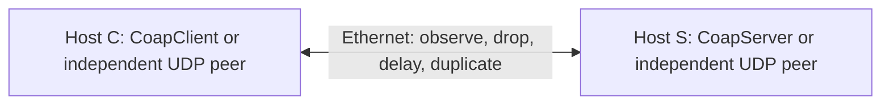

# Implementation plan: CoAP over UDP

> **Kind:** design · **Status:** draft · **Seal:** none · **Owns:** — · **Stands on:** [protocol addition guide](../../doc/project/guide/add-a-protocol.md), [plan procedure](../../doc/project/guide/write-an-implementation-plan.md), [series rules](../../doc/project/rule/pull-request.md#pr-series-plan), [protocol test requirements](../../doc/project/rule/testing.md#tr-plan-protocol)

Checkout: `/home/miguel/workspace/inet-coap`, revision `91219b0fa7d2794ee67ac8a3dd45c3a09cfc45b0`. Plan revision: 2026-11-15, revision 6, including Observe, blockwise transfer, and the review corrections recorded in section 7. Existing local change: `AGENTS.md`; preserve it. Authorization covers investigation, writing, and reviewing this plan. Protocol implementation, commits, and publication are outside this task. The planning policy is a draft; its presence does not establish acceptance of its approval process.

## 1. Intended result and scope

Add a packet-level CoAP application model that users can install in an INET host's application slots. A client requests a resource such as `/temperature`; a server returns its representation. On a lossy link, a Confirmable request can be retransmitted without applying a resource update twice. If the server needs time to produce its answer, it can acknowledge the request immediately and return a separate response later. Record completion, failure, retransmission, and latency so simulations can study these effects.

Clients can also observe changing resources instead of polling, and transfer bodies larger than a single CoAP message through Block1 uploads and Block2 downloads. These features must work together: a notification for a large resource starts a blockwise retrieval, and a newer resource version must never be assembled from blocks belonging to an older version.

The proposed first release is an explicitly bounded, unsecured, unicast UDP profile. It is not a claim of complete CoAP conformance. IPv4 and IPv6 use the same application implementation. Start with ordinary wired hosts so CoAP behavior can be tested independently of radio behavior; wireless and constrained network stacks can carry the same UDP traffic later without CoAP changes.

### Standards and profile

Use [RFC 7252](https://www.rfc-editor.org/rfc/rfc7252.html) as the base specification: message encoding in section 3; messaging and congestion control in section 4; requests, responses, methods, and options in section 5; URI processing in section 6; discovery in section 7. Use [RFC 6690](https://www.rfc-editor.org/rfc/rfc6690.html) for the link-format discovery representation. Derive requirements from these texts before selecting implementation mechanisms.

Include [RFC 7641](https://www.rfc-editor.org/rfc/rfc7641.html) for Observe, especially client/server requirements in sections 3–4, and [RFC 7959](https://www.rfc-editor.org/rfc/rfc7959.html) for Block1/Block2, Size1/Size2, response codes, and interaction with Observe in sections 2.6 and 3.4. Review their status pages and verified errata in C1 as well. RFC 8323's reliable-transport/BERT extensions and Q-Block extensions remain outside this UDP profile.

Before implementation, inventory verified errata and updates listed on the [RFC 7252 status page](https://www.rfc-editor.org/info/rfc7252/). Record their applicability in C1. In particular, [RFC 9175](https://www.rfc-editor.org/rfc/rfc9175.html) changes token processing for secure request/response binding and defines Echo and Request-Tag. Include Request-Tag processing for blockwise request-body association in C6; Echo and secure transport remain follow-ups. This plan offers no secure transport or security claim; the applicability review must still explain which updated requirements affect the chosen unsecured profile. Do not silently treat the original RFC as the entire current specification.

| Included in this series | Explicit follow-up work |
| --- | --- |
| Base message encoding, ordered options, payload bytes, malformed-input handling | Extended tokens from RFC 8974 |
| CON, NON, ACK, RST; piggybacked and separate responses | Reliable transports, BERT, and Q-Block extensions |
| Endpoint-scoped message IDs, tokens, duplicate suppression, bounded retransmission, congestion admission | Multicast/group communication and multicast discovery |
| GET, POST, PUT, DELETE on a configured in-memory resource service | Forward/reverse proxy operation and a general response cache |
| Relevant base options, conditional requests, resource discovery | HTTP translation |
| Observe registration, CON server notifications, CON/NON reception, freshness, and cancellation | DTLS, OSCORE, Echo, and optional server NON-notification mode |
| Block1/Block2, Size1/Size2, Request-Tag, and Observe with Block2 | Advanced transfer extensions beyond the selected RFCs |
| UDP sockets, IPv4/IPv6, application lifecycle, packet inspection, examples | Additional application services |

Proxy options must produce the appropriate unsupported-proxy result instead of being interpreted as local requests. Unknown elective options can be ignored; unknown critical options need protocol handling. Document unsupported general response caching and multicast explicitly; Observe's retained representation and freshness metadata are included. Preserve option bytes so later extensions do not need a new wire representation. Initial tokens are limited to the base format's 0–8 bytes. Resource bodies are opaque bytes: JSON, CBOR, and sensor behavior belong to the scenario, not the protocol engine.

### Acceptance criteria

1. Independent byte fixtures and production-path tests establish correct encoding and rejection behavior, including truncated headers/options, token-length boundaries, extended option delta/length encodings, repeatable options, and payload-marker boundaries.
2. A client and server complete NON and CON exchanges over IPv4 and IPv6. All responses require a matching peer and token; a piggybacked ACK response also requires the original CON's MID. ACK/RST message matching requires peer and MID. Clients accept separate CON or NON responses to either request type. A foreign or late packet cannot complete an unrelated request.
3. Dropping a request, ACK, or separate response produces the specified retry or terminal outcome. Duplicate POST messages within the deduplication interval mutate a resource once. Deliver at most one complete result for an ordinary operation: loss recovered before retry exhaustion/deadline can complete it, while unrecovered loss fails it and a late reply cannot reverse that outcome. This is neither guaranteed delivery nor an exactly-once action guarantee across server crash or a new application-level POST retry.
4. Per-peer outstanding interactions, admission queues, retransmission deadlines, and nonresponsive-peer pacing enforce the selected RFC congestion policy. Exhaustion of identifiers or configured capacity has an explicit result and never silently evicts live duplicate records.
5. Resource methods, URI options, representation metadata, conditional requests, method errors, missing resources, content negotiation errors, and discovery have observable request/response tests.
6. Observe registration retains its token across notifications; ordering, freshness, re-registration, cancellation, terminal responses, and unreachable observers have explicit packet/state assertions. Notification retransmission obeys existing CON reliability and congestion admission.
7. Block1 uploads and Block2 downloads reconstruct exact bodies, handle negotiated block sizes and transfer errors, and bound retained state. An incomplete upload cannot partially apply an atomic resource action; an inconsistent download cannot expose mixed representation versions.
8. Observe and Block2 work together, including a resource changing during retrieval. Follow-up block requests do not reuse the observation token, and incomplete/superseded bodies are never delivered as complete notifications.
9. Stop/restart, crash, and destruction cancel active CoAP work and release partial bodies/observations. Ordinary restart reuses the module without restarting abandoned operations. Module-lifetime identifier reservations prevent a response to an old operation from matching a new one; resource and deduplication persistence follow the explicit lifecycle contract below.
10. The CoAP feature can be disabled without breaking the remaining build. Enabling recording does not change packet exchanges. User documentation states the profile and its limits.

## 2. Current implementation and integration evidence

Source inspection at the revision above found no CoAP files or references in `src/`, `tests/`, or `examples/`, and no CoAP entry in `.oppfeatures`. There is therefore no existing CoAP regression case or configuration to reuse. This is a missing capability, not an observed failure of a current CoAP implementation. No simulation was run for this plan.

The existing production path is suitable for an application protocol:

| Existing owner | Verified contract and consequence |
| --- | --- |
| [ApplicationLayerNodeBase.ned](../../src/inet/node/base/ApplicationLayerNodeBase.ned) | `app[]` uses `IApp`; `socketIn`/`socketOut` connect through the application dispatcher to UDP. Select CoAP applications with `numApps` and `app[i].typename`; enable UDP. No new host wiring is needed. |
| [UdpBasicApp.ned](../../src/inet/applications/udpapp/UdpBasicApp.ned), [UdpBasicApp.cc](../../src/inet/applications/udpapp/UdpBasicApp.cc) | Demonstrate socket binding, address resolution, callbacks, application lifecycle, and reusable timer ownership. Reuse these contracts, not the traffic generator's discard-on-receive behavior. |
| [ApplicationBase.h](../../src/inet/applications/base/ApplicationBase.h) | Supplies application lifecycle integration. Trace inherited start/stop callback behavior again when implementing the endpoint. |
| [Protocol.h](../../src/inet/common/Protocol.h), [Protocol.cc](../../src/inet/common/Protocol.cc) | The public constructor registers an identity by name. A protocol-local `coapProtocol` object can supply the identity without adding a static member to `common/Protocol`. |
| [ProtocolGroup.h](../../src/inet/common/ProtocolGroup.h), [UdpProtocolDissector.cc](../../src/inet/transportlayer/udp/UdpProtocolDissector.cc) | UDP port groups support registration; the dissector looks up destination and then source ports. Register the default CoAP port locally; validate inspection on nonstandard configured ports separately. |
| [DhcpMessageSerializer.cc](../../src/inet/applications/dhcp/DhcpMessageSerializer.cc), [DhcpProtocolDissector.cc](../../src/inet/applications/dhcp/DhcpProtocolDissector.cc) | Demonstrate local serializer/dissector registration using existing packet infrastructure. They are integration examples, not a source of CoAP behavior. |
| [Protocol test authoring guide](../../tests/protocol/lib/AUTHORING.md) | Existing tests can observe packets and inject/drop/delay/duplicate traffic. Add CoAP-specific helpers inside the new suite rather than teaching shared infrastructure about CoAP. |

The [seal registry](../../doc/project/audit/seal-list.md) seals `src/inet/common/packet/` recursively. This plan requires no edits there or elsewhere in `common/`, no dispatcher modification, and no UDP implementation change. Registration is through public extension points. The [architecture exception ledger](../../doc/project/audit/architecture-exceptions.md) and [naming exception ledger](../../doc/project/audit/naming-exceptions.md) contain existing deviations; none supplies a reason to introduce a new one here.

## 3. Proposed design

### Components and responsibilities

Place source under `src/inet/applications/coap/`, with NED package `inet.applications.coap` and C++ namespace `inet::coap`. Use the `Coap` name stem. The following names are proposed, not existing artifacts.

| Component | Responsibility and consumer | Reuse decision |
| --- | --- | --- |
| `CoapEndpointBase.h/.cc/.ned` | Reusable application base owning the UDP socket, codec boundary, message exchange state, duplicate records, and deadlines; used by both client and server | Derive from `ApplicationBase`; use `UdpSocket` and its callback contract. Do not duplicate reliability in each role. |
| `CoapClient.h/.cc/.ned` | Concrete `IApp` workload driver: resolve peer, issue configured requests, consume completion/failure | Protected synchronous endpoint operations and result callbacks suffice; no new cross-layer socket API or speculative public interface. |
| `CoapServer.h/.cc/.ned` | Concrete `IApp` request handler with a configured resource table and optional response delay | Keep resource semantics separate from transport exchange handling; use a local `CoapResource` value type. The endpoint base handles response reliability. |
| `CoapObservation.h/.cc` | Endpoint-owned observation records and Observe ordering/freshness operations; client tracks accepted versions and server tracks subscriptions | Reuse endpoint message transmission, deduplication, congestion admission, and deadline scheduling; do not build a second reliability engine. |
| `CoapBlockwiseTransfer.h/.cc` | Endpoint-owned request-body and response-body transfer records, block slicing/reassembly, version and offset validation | Compose existing request exchanges; use ordinary byte chunks and locally owned buffers rather than changing packet infrastructure. |
| `CoapHeader.msg`, `CoapOption` value representation, `CoapHeaderSerializer.h/.cc` | Typed wire header, token, ordered options, payload-marker accounting, and byte conversion | Use existing chunks and serializer registration; put the body in the following payload chunk. Local metadata never becomes a wire option. |
| `CoapProtocol.h/.cc`, `CoapProtocolDissector.h/.cc`, `CoapProtocolPrinter.h/.cc` | Local protocol identity, UDP-port attachment, inspection, and readable output | Register with existing registries from the feature's own package. No core switch or static identity declaration. |

Observation and transfer types are locally owned records with focused operations, not extra OMNeT++ modules, public interfaces, or independent timer services. Introduce their files with C5/C6 rather than adding unused scaffolding in C2. All protocol callbacks run synchronously inside the endpoint; only network delivery, deadlines, and configured resource changes create simulation events.

Declare NED contracts before behavior: local bind address/port, client peer URI and method, request interval/start/stop, body/content format, server resource configuration and response delay, protocol timing, capacities, RNG stream, and lifecycle stop policy. Give units and defaults in NED. Use UDP port 5683 by default on the server and an ephemeral client port. Validate parameters at initialization and distinguish invalid simulation configuration from a malformed received datagram.

Add Observe registration/cancellation controls, per-resource observability, observer capacity, preferred block size (256 bytes), maximum body size (1 MiB), transfer capacity (16 body-transfer records), and a transfer-buffer budget (16 MiB). The latter covers partial uploads, client reassembly, and retained multi-block operation results; it is not a bound on all application memory. Configured resources, observations, and duplicate reply history retain additional bytes. These are configurable simulation defaults, not RFC limits. Valid UDP block sizes are powers of two from 16 through 1024 bytes. Expire transfer records after EXCHANGE_LIFETIME without a matching block; active observations do not have an arbitrary idle-expiry timer. Drive resource changes through ordinary PUT/POST or a test peer; a second general-purpose resource-update scheduler is unnecessary.

Use the RFC 7252 default transmission profile: ACK_TIMEOUT=2s, ACK_RANDOM_FACTOR=1.5, MAX_RETRANSMIT=4, NSTART=1, MAX_LATENCY=100s, and PROBING_RATE=1 byte/s. For this series keep these values fixed and declared in NED; do not add experimental congestion settings or an RTT estimator. Derived defaults are MAX_TRANSMIT_SPAN=45s, MAX_TRANSMIT_WAIT=93s, EXCHANGE_LIFETIME=247s, and NON_LIFETIME=145s. Ordinary request waiting has an application deadline of EXCHANGE_LIFETIME from first transmission, including after an Empty ACK; terminal message failure can finish it earlier. A whole body transfer instead has a progress deadline refreshed after each accepted block, so a long progressing transfer is not truncated by the first block's deadline.

Use byte payload lengths for transmission size, including all option encodings and a marker only when a payload exists. Test both ordinary typed chunks and incoming serialized byte chunks so simulations cannot bypass malformed-wire handling. Endpoint parsing must not abort the simulation on peer input. Return or discard according to message type and available context; do not answer every malformed packet with the same error.

### State ownership and lifetime

The endpoint owns separate state for message reliability, request matching, observations, and body transfers. An outbound message record, keyed by local/remote endpoint and MID, holds the retained body/message template, retransmit count, and timeout. Ordinary retries preserve the wire message; Observe retries have the header-refresh exception below. An ordinary request record, keyed by peer and token, remains until response, terminal failure, or deadline. Observation and transfer records outlive individual exchanges. An inbound duplicate record, keyed by peer and MID, remembers the accepted action/reply. Retain received CON duplicate records for EXCHANGE_LIFETIME and NON records for NON_LIFETIME; reserve transmitted MIDs for EXCHANGE_LIFETIME. Allocate a randomized initial MID then advance while skipping reserved values. Allocate a new independent operation's 8-byte token from a randomized initial counter, incremented without reuse over the module lifetime, including restart; reject on exhaustion. Observation refresh/cancellation intentionally retains the relation's already allocated token rather than allocating another. Accept any legal 0–8-byte peer token. This is simulation correlation, not secure token generation or protection against forgery.

For a separate response, receiving an Empty ACK releases the request's CON retransmission work and its NSTART slot, but retains its token match until response/deadline. This follows RFC 7252 section 4.7: a request for which neither ACK nor response has arrived consumes one interaction; a CON awaiting ACK also consumes one, and the two conditions count once. A NON request occupies the slot until response/deadline. The server sends a later CON response with the original token and its own MID; that response has its own retry record. The client acknowledges duplicate responses without delivering the body twice. Limit retained pending requests independently (64 by default) so releasing an ACKed request's NSTART slot does not permit unlimited waiting state.

For piggybacked delivery require peer, original CON MID, and token together under RFC 7252 section 5.3.2. A correct token cannot rescue an ACK with the wrong MID. An ACK with a matching MID but wrong response token can acknowledge the message without completing its request. Separate CON/NON responses require peer/token matching and their own message-layer handling regardless of the original request type. The built-in server chooses the response types described below; the client must also interoperate with a peer choosing the other legal separate-response type.

Use one reusable endpoint deadline self-message. Scan the small active request/observation/transfer collections for due work; keep duplicate history and MID reservations in chronological expiry order within each fixed-lifetime class, pruning expired fronts rather than scanning all unexpired history on every packet. The next timer deadline is the earliest active deadline or history front. These are endpoint-local containers, not a new scheduling service or one module per exchange. Finish the current synchronous action before scheduling the next deadline; same-time ordering follows OMNeT++ event order. Sample initial CON timeout once from uniform [2s,3s] using the configured RNG and retain it for exponential backoff. Sample response delay once when accepting a request; duplicates neither resample it nor schedule a second action. Parsing/resource lookup needs no timer.

Prune expired records at their deadlines and before lookup/admission; define retention as the half-open interval ending at its deadline. Keep at most 64 queued local requests and choose the oldest eligible request, preserving per-peer order while skipping peers blocked by NSTART or probing delay. A blocked peer must not stall another peer's admitted work. Reject further local work with a capacity failure. Retain duplicate history for its required lifetime without a separate entry quota or eviction policy: one legal body can require thousands of block exchanges, and filling that history must not prevent its continuation. History memory therefore scales with traffic during the retention interval and is outside the transfer-buffer budget. If the 64-observer limit prevents a new relation, serve normal GET without Observe and leave existing relations intact. Reject an upload exceeding configured byte/transfer capacity with 4.13 and appropriate Size1 when known; report local receive-buffer exhaustion as a local transfer failure rather than fabricating a server response. Do not evict live obligations silently.

For probing a peer that stops answering, account for the serialized CoAP bytes of the last exchange, including retransmissions. After a no-response failure, delay the next new exchange to that peer until at least the failure time plus that byte count divided by PROBING_RATE; keep other peers independent. A matching ACK/response establishes reachability and clears this conservative probing delay. This intentionally slower policy bounds repeated traffic without an adaptive congestion algorithm; the initial exchange still uses the RFC retry schedule. Tests check the long-run byte/time bound as well as admission order. Signal local capacity rejection separately from network timeout. These choices follow [minimal design](../../doc/project/rule/quality.md#qr-design-minimal), [reuse](../../doc/project/rule/architecture.md#ar-ext-reuse), and [lifecycle requirements](../../doc/project/rule/architecture.md#ar-life-operations).

### Resource behavior

The server owns an in-memory resource table configured by an XML parameter with path, initial body, content format, supported methods, observability, and optional link attributes. Retain path permissions/configuration separately from whether a current representation exists; deleting its bytes must not erase permission to recreate it. GET reads; PUT replaces an existing writable resource or creates one only at an explicitly creatable path. POST appends bytes and returns the resulting representation; it is not a generic callback/plugin system. DELETE removes a permitted representation and returns 2.02; repeating DELETE against an absent representation also returns 2.02 without creating anything. Return 2.05 for GET content, 2.04 for replacement/append, and 2.01 for PUT creation. Since the target URI is already known and POST never creates a new URI, this service generates no Location-* options. The client/codec still accepts them from peers. Allocate 8-byte ETags from a server-local revision counter retained for the module lifetime, assigning a new value to each successful mutation, recreation, or crash reset. Reject counter exhaustion as an explicit model error. Max-Age defaults to 60s.

Because the service stores opaque bytes, PUT can replace the representation's Content-Format with any legal numeric value; no decoder registry is needed. POST appends only bytes in the current format and returns 4.15 when an explicitly supplied format differs. An absent format on replacement/append preserves the current metadata; creation without it stores an unspecified format and omits that option in GET responses. These are service choices, not a protocol-wide default for an absent Content-Format. GET Accept is checked against the current representation. A format change is a resource mutation and can terminate observations whose initial response used a different format.

At processing, check conditions then perform the action once. For blockwise uploads, processing starts only after complete body validation. A zero response delay produces a piggybacked ACK response to CON; a positive delay sends an immediate Empty ACK followed by a separate CON response when ready. NON requests receive NON responses after the configured delay, without ACK. Capture the response body and ETag together at processing so a later mutation cannot alter a delayed result. No CPU execution model is implied.

Process Uri-Host/Uri-Port, repeated Uri-Path/Uri-Query, Content-Format, Accept, Max-Age, ETag, If-Match, If-None-Match, and peer Location-Path/Location-Query where their semantics apply. Split URI path/query components before percent-decoding each option value; an encoded slash within a segment must not become another segment. Use 4.04 for GET/POST on missing resources or PUT at an unconfigured path, 4.05 for a disallowed method, 4.06 for unsupported Accept, 4.15 for incompatible POST Content-Format, 4.12 for failed preconditions, and 5.05 for unsupported proxy operation. An unknown critical option in a CON request produces 4.02; in a NON request silently reject it without execution. An unknown critical response option prevents application acceptance: reject CON with RST and ignore NON/ACK responses under RFC 7252 section 5.4.1. Handle malformed messages under section 4 rather than treating every input error as an application response. Serve `/.well-known/core` in link format with `href`, `rt`, and `if` filtering under RFC 6690 section 4. The client has no general response cache; it reuses only fresh representations from an active observation as described below.

### Observe

The client registers with GET and Observe=0. A successful response carrying Observe establishes a relation keyed by peer and token, retaining the target and representation-selection options. An ordinary response without Observe remains a valid response but does not establish observation. The server's observer record additionally identifies the resource and selected representation. Notifications reuse the relation token with fresh message IDs; client request-completion logic must not free that token after the initial response or first notification.

Also index local interest by the complete request cache key (including URI and Accept). Aggregate equivalent observation interests into one registration, as RFC 7641 section 3.1 requires. A normal GET for that key can consume the active relation's fresh complete representation; a stale/incomplete representation cannot satisfy it. Removing one local consumer cancels the wire relation only when no consumers remain. This small relation-local reuse does not introduce a general response cache.

When the relation cannot be admitted because of observer capacity, return a normal GET response without Observe; this does not evict an existing observer. Re-registration updates the existing peer/token entry even when the list is full. Successful notifications keep the initial Content-Format; if a resource changes to an incompatible format, send terminal 4.06 without Observe and remove the relation. A normal GET satisfied from an observation must not expose the Observe option as if it established a new relation.

Explicit cancellation sends GET with Observe=1 and the relation token. Under RFC 7641 section 3.6, copy all other registration options unchanged except that the ETag candidate set may differ; in this client it stays absent. In particular, retain URI, Accept, and any original Block2 size preference. Follow-up Block2 retrieval options belong to their individual exchanges and must not overwrite the stored registration template used for refresh/cancellation.

Track the latest accepted Observe value, reception time, representation, and freshness deadline. Apply RFC 7641's 24-bit serial ordering and strict elapsed-time rule (`Tnew > Told + 128s`) rather than an ordinary integer comparison. The representation becomes stale only when its age exceeds Max-Age. At expiry, schedule re-registration after one uniform [5s,15s] draw, using the same token and original options; cancel that scheduled refresh if a fresh notification arrives first. For simplicity the client sends no ETag candidates during Observe registration/re-registration; server support for an observing peer's supplied ETag remains required and can return 2.03 Valid. A recognized stale CON notification still needs its message-layer ACK; an exact message duplicate never creates another application update. Expose the initial representation and subsequent updates separately from one-shot request completion.

Resource changes drive notification generation. The built-in server sends unsolicited notifications as CON; the client accepts CON and NON notifications from peers. CON-only generation is permitted by RFC 7641 section 4.5 and avoids an optional server NON-pacing/reachability mode and its 24h liveness timer. Keep one newest pending version per observer while another notification is outstanding; finish its normal CON retry sequence before sending the newest pending version. Do not implement section 4.5.2's optional in-flight-body replacement or inherited-retry machinery. Notifications and separate CON responses share per-client NSTART=1 admission, with FIFO service among eligible records and one queued notification per relation; ACK/RST generation does not wait for a slot. Remove the observer on terminal CON failure or matching RST. Support explicit Observe=1 cancellation with the relation token, local cancellation followed by RST for late CON notifications, re-registration, deletion/error termination, and discovery's `obs` marker. Never promise every intermediate resource version.

Generate Observe values from the low 24 bits of simulation time in 1ms ticks, a deliberately conservative clock-based choice permitted by RFC 7641 section 4.4. New notifications for the same relation wait until their tick exceeds its last transmitted tick; coalesce intervening changes. This limits notification generation to 1000/s per relation and satisfies the serial-number growth bound without another counter/window estimator. If a re-registration response must wait for a new tick, acknowledge its CON request immediately and send a separate response. Before each retry refresh Observe to the current tick, retaining MID, token, body, and ETag; this required header update is distinct from optional replacement of the in-flight body. The queued newer body is sent at a later tick after the old message finishes. Retain the full local tick for scheduling/wrap handling; only its low 24 bits go on the wire. Message deduplication still runs before client Observe ordering so a retry does not cause a second delivery.

### Blockwise transfer and its interaction with Observe

Implement sequential Block1 request-body upload and Block2 response-body retrieval using NUM/M/SZX and Size1/Size2. Each block is an ordinary CoAP exchange through shared reliability/congestion. Identify request-body operations by peer, method, and the request options participating in matching, including the complete list of Request-Tag options; exclude Block1/Block2 and elective NoCacheKey options as specified by RFC 7959/RFC 9175. MID and token identify exchanges, not the assembled body. The client serializes untagged operations with the same matching key; a server treats a new untagged block zero as restarting that context, rather than pretending it can identify an ambiguous concurrent upload. Tagged operations remain independent. Preserve Request-Tag across retries and the combined Block2 response phase; it never appears in a response. Start the client with no tag when safe to recycle the absent option, otherwise use a short monotonically allocated tag according to RFC 9175 section 3.4.

The server buffers uploads for atomic PUT/POST and invokes the resource action only after a valid final block completes the body. This atomic policy is a model choice within the specification. Replay same-MID duplicates at the message layer without appending data twice. At the transfer layer reject missing/conflicting blocks or changed Content-Format with 4.08, an invalid Block option length with 4.02, reserved UDP SZX=7 with 4.00 as RFC 7959 section 2.2 requires, and actual body/capacity overflow with 4.13. Accept an identical already-buffered block without appending it again. Use 2.31 Continue for accepted non-final blocks. A legal block-size reduction preserves the accepted byte offset; a client adopts the smaller size for later blocks and never increases it mid-transfer. A 4.13 response carrying a smaller Block1 size triggers one restart at that size; 4.08, a second size-rejection, or an unqualified total-size rejection fails the operation. Before an append, also check the resulting resource/body size so capacity rejection cannot occur after a partial mutation. Do not automatically retry a failed POST as a new operation, since its prior outcome may be unknown. Retransmitting an existing message or retrieving a retained combined Block1/Block2 result must not repeat the resource action.

For GET downloads, serve slices of the current resource with an ETag on every block; do not keep an extra server-side snapshot cache. The client validates contiguous byte offsets and metadata, recalculating NUM from byte offset if SZX decreases. On an ETag mismatch, discard the partial body and restart at block zero once; a second mismatch ends that transfer with a representation-changed result. A missing ETag from a peer on a multi-block response fails assembly explicitly because this profile cannot establish version consistency. This is a documented stricter client policy, not an RFC requirement to include ETag. Keep at most one Block2 retrieval per peer/cache key; serialize further requests. Random-access Block2 serving remains supported independently of automatic sequential client assembly.

When a mutating request produces a multi-block response, retain that operation's immutable result in a bounded response-transfer record. Later requests with nonzero Block2 NUM retrieve its next slice without invoking the mutation again; match the operation options, including Request-Tag, and require sequential continuation after Block1. If that result expired, this server returns 4.08 for the missing operation context rather than repeating POST. These result records and upload/client assembly buffers share the declared body limits and inactivity deadline. Size1/Size2 are estimates, not proof of final byte length; reject actual bytes exceeding capacity but do not reject a valid body solely because an estimate differs. Intermediate responses signal progress; deliver one complete ordinary result after assembly.

Reserve the response-transfer record and its result-buffer budget before applying a mutation that needs a multi-block result. Reuse the completed upload buffer when possible rather than reserving a second copy unnecessarily. If result retention cannot be admitted, return 5.03 with Max-Age indicating the earliest retained-record expiry, release that upload, and leave the resource unchanged. This is temporary result-service exhaustion, distinct from 4.13 for an input/body exceeding its size or reassembly limits. The client reports that error response without automatically issuing a new POST; it is a completed protocol request with an unsuccessful response code, not a no-response failure.

An Observe notification can carry the first Block2 block. Keep the relation token reserved and use a different token for follow-up GET block requests, omitting Observe so those requests do not register another relation. Remember the block-size maximum requested at registration for subsequent notifications. Track notification ordering independently from body assembly. A newer accepted notification cancels the old assembly and starts the new one; late block responses for the old token cannot enter the new buffer. An ETag mismatch without a newer notification fails that assembly, keeps the relation active, and schedules the same jittered re-registration used for stale state. A newer partial representation immediately supersedes the older complete body's freshness: keep it for display if useful, but do not use it to satisfy a GET as fresh. Deliver an update only after assembly, with freshness aged from reception of its first notification block rather than from assembly completion. Cancellation removes the relation and dependent assembly. C7 owns the combined-path proof.

### Lifecycle and observability

On graceful stop, stop admitting workload requests, cancel pending responses/retries, report locally aborted operations, and close the socket through existing lifecycle callbacks. Continue dispatching the socket-close completion during STOPPING_OPERATION; do not add a blanket guard that prevents it. On crash, cancel work and destroy the socket without cleanup traffic. Destruction cancels/deletes the single owned event and releases retained packets. Reuse the event on ordinary restart; initialization does not run again. Preserve configured resource state across ordinary stop/start; reset it to configured initial state on crash.

Clear active observations, pending notifications, and partial body/result buffers on both stop and crash. Do not silently resume them; a configured client may start fresh operations after restart. Preserve allocator high-water marks and unexpired outgoing MID reservations for the module lifetime across both operations, so old replies cannot match newly allocated work. Across ordinary stop/start also retain received duplicate tombstones until expiry, suppressing a previously processed action without retaining canceled response-generation work. Do not replay an old successful response after a crash resets the resources; clear received duplicate state then. No Observe cancellation packet is required by this application's local stop policy.

This lifecycle model deliberately retains allocator identity in the existing simulation module; it does not model process destruction and address/port reuse by a newly created module. It offers no exactly-once resource-action guarantee across crash: an old inbound request can be processed against the reset resource state. Test late replies/notifications against new work and document that limit instead of adding a boot quarantine, epoch counter, or durable storage model. Reject unmatched late CON responses/notifications with RST while operating; stopped modules generate no CoAP traffic.

Declare packet sent/received and request started/completed/failed/aborted, retransmission, duplicate, malformed input, and capacity rejection signals with suitable NED statistics. Measure request latency once per delivered application result; separate application completion from message ACK latency. Recording and visualizers consume signals externally. They must not make protocol decisions or consume protocol RNG draws.

The client workload owns logical request outcome signals. Emit started once per submitted ordinary operation or initial Observe registration, then exactly one completed, failed, or aborted outcome. A valid final CoAP response, including 4.xx/5.xx, is completed with its response code; failed means no usable final response, such as retry/deadline exhaustion, local admission rejection, or body-assembly failure. Aborted means the local lifecycle stopped that unfinished operation. Intermediate ACK/Continue/block responses, internal Observe refreshes, and protocol retransmissions do not create another logical request. Admission rejection emits started then failed; a GET satisfied by a fresh observed representation emits started then completed. Neither has a network-latency sample because nothing was transmitted. Once initial Observe registration completed, later notifications use relation/update signals: stopping that relation emits terminated with a lifecycle reason, not another request-aborted outcome. The server's packet/resource processing does not emit client-workload request counts.

Add relation established/canceled/terminated, notification accepted/stale, representation freshness, transfer started/completed/failed, and body bytes transferred signals. Separate logical body/notification delivery from individual block/message counts. A multi-block notification produces one complete representation update; a superseded partial representation produces none.

Define request latency from first request transmission to delivery of the complete result, including any block exchanges; initial observation registration uses that same definition. Subsequent notification assembly latency runs from first notification-block reception to complete delivery. It does not measure server-change-to-client latency, which requires correlating external server/client observations. Retransmission never restarts a logical operation's measurement origin.

### Typical separate-response exchange

```mermaid
sequenceDiagram
    participant C as CoAP client
    participant S as CoAP server
    C->>S: CON GET /temperature (MID m, token t)
    S->>C: Empty ACK (MID m)
    Note over C: Stop request retransmission; retain token t
    Note over S: Scheduled resource response becomes ready
    S->>C: CON response (MID n, token t, body)
    C->>S: Empty ACK (MID n)
    Note over C: Deliver one application result
```

This is proposed behavior. Rendering has not been checked; the diagram is not execution evidence.

## 4. Future commits and dependencies

Each entry is one proposed commit. All named new paths are future artifacts. Each behavior commit includes its tests and a reviewer document in the same commit. No CoAP-specific tests currently exist. Relative paths below are code-formatted deliberately where the target does not exist yet.

### C1 — `docs: define the CoAP UDP profile and conformance checks`

Dependencies: none. Owner: CoAP specification and design documentation. Create `doc/project/evidence/standard/rfc7252/catalog.md`, applicable `rfc6690`, `rfc7641`, `rfc7959`, `rfc9175` and update catalogs, `doc/project/evidence/protocol/coap/standards.md`, `features.md`, and `checks/{encoding,messaging,resources,observe,blockwise}.md`; create `doc/project/evidence/model/coap/{coverage,conformance}.md`. Follow the [standard-derived test procedure](../../doc/project/guide/derive-tests-from-a-standard.md). Keep the standard catalogs, feature map, and English checks independent of INET implementation names; put model claims and test mappings in the model evidence tree.

Derive catalogs, feature maps, and English protocol checks solely from the standard texts. Separately record section 3's implementation choices in the model conformance document and endpoint transition/ownership table: message versus request completion, observation/token lifetime, body association/atomic commitment, version supersession, and lifecycle persistence. Distinguish RFC assertions from stricter model-policy assertions in test/reviewer descriptions; those choices must not become invented normative requirements. C1 records and cross-checks the selected design rather than deferring it to implementation. Record verified errata/update dispositions; a newly discovered normative conflict requires correcting this plan before dependent implementation. Acceptance is a consistent bounded profile mapped to proposed tests. This commit changes no runtime behavior; protocol tests and a protocol reviewer document do not apply. Verify citations, local links, and agreement with this plan. No conformance verdict is earned by the catalog.

### C2 — `coap: add encoded UDP endpoints and non-confirmable requests`

Dependencies: C1. Owner: endpoint, codec, basic client/server. Add endpoint/client/server declarations, header/serializer, local identity/inspection files, and `src/inet/applications/coap/package.ned` with the matching C++ namespace declaration. Add a minimal read-only resource response and `Coap`/`CoapTests` in `.oppfeatures`. Defer observation/transfer types to C5/C6. `Coap` requires `Udp`; test dependencies additionally name the actual Ethernet, IPv4/IPv6, configurator, and lifecycle fixture features discovered in this checkout. Provide basic lifecycle handlers and packet/request outcome signals immediately; C8 adds comprehensive measurement assertions and the remaining statistics. Use public serializer, printer, dissector, protocol-group, and socket contracts; existing UDP tags carry socket/address metadata, so no new CoAP request/indication tags are needed. Create `tests/protocol/coap/CoapChecks.h` and test-local `CoapTestPeer.h/.cc/.ned` support for independent bytes, socket traffic, and response capture. Reuse shared taps/interception; do not add a shared CoAP dependency.

**Current gap and change:** No application can encode or answer a CoAP datagram. Add a minimal complete NON request/response production path and independent codec validation. The parent C1 only documents behavior; C2 does not claim CON reliability yet. Requirements: RFC 7252 sections 3, 4.3–4.5, and 5.3. Preserve a NON duplicate history and safe ID/token allocation from the first endpoint implementation.

**Task: Write protocol tests.** Add these exact files; each runs a production endpoint against a test peer using the common setup in section 5:

| Future test | Setup, stimulus, observations, and assertions |
| --- | --- |
| `tests/protocol/coap/Rfc7252MessageEncoding.test` | Send NON GET through the client, compare complete UDP payload against independently constructed bytes, feed byte-encoded replies to the production receive path, and test 0/8-byte tokens, option delta/length transitions 12/13 and 268/269, repeated options, and binary bodies. Check decoded fields, total length, and exact re-encoding. Do not use the serializer as its own expected-value generator. |
| `tests/protocol/coap/Rfc7252MalformedDatagrams.test` | In C2 inject NON datagrams with short headers, invalid version/token lengths, reserved option nibbles, truncated extended fields, inconsistent option lengths, and an empty payload marker. Use RFC 7252 sections 3/4.3 expectations: no resource action/result delivery and no response where required to discard. Append a valid request to prove the endpoint remains usable. C3 adds Empty CON ping and malformed CON/ACK/RST cases; do not require CON support from C2. |
| `tests/protocol/coap/Rfc7252NonConfirmable.test` | At time 1s, client sends NON GET to an existing resource; inspect both UDP payloads and the client completion. Drop a second reply and observe through the client deadline: no CON retry and one local timeout. Duplicate a received NON request and assert no repeated resource action. |
| `tests/protocol/coap/Rfc7252ResponseMatching.test` | Keep two requests outstanding to distinct peers. Inject wrong-token, wrong-address/port, delayed, duplicate, and valid responses; only the valid peer/token completes its request, once. Force token/ID boundary allocation through a test-local subclass seam and verify reuse exclusion without introducing a production force-counter parameter. |

Before C2 these cases cannot instantiate CoAP and are absent; after C2 the scoped NON/encoding cases must pass. Codec helper tests supplement these production-path assertions. For nonstandard configured ports, endpoint decoding still works; packet inspection is guaranteed at the CoAP application boundary through its protocol tag. UDP-level automatic dissection of serialized bytes on arbitrary ports is outside the initial inspection claim: register only standard port 5683 rather than adding global per-socket port registrations. Test this documented distinction explicitly.

**Task: Write reviewer document:** `tests/protocol/coap/encoded-udp-endpoints.md`, associated with C2 and all four tests. Explain the wire fixtures, topology, malformed-input cases, matching boundaries, expected before/after behavior, and codec-versus-endpoint coverage. Include NON exchange and rejection diagrams where useful.

**Verification:** Section 5 runner with `-f 'Rfc7252(MessageEncoding|MalformedDatagrams|NonConfirmable|ResponseMatching)\.test$'`, plus an isolated feature-disabled build after adding the feature declarations. These establish the declared subset and initial feature isolation, not reliability, resource-method completeness, or external emulation interoperability. C9 repeats feature-matrix checks on the complete series.

### C3 — `coap: implement confirmable exchanges and congestion control`

Dependencies: C2. Owner: `CoapEndpointBase` exchange records, timer dispatch, duplicate replay, and client/server delayed response callbacks. Extend NED timing/capacity declarations and fixture interception as needed.

**Current gap and change:** On the proposed parent, a lost NON request has no reliability, and CON/separate exchanges are unsupported. Add the RFC 7252 sections 4.2, 4.4–4.8, 5.2, and 5.3 transitions. A piggybacked response completes the request; an Empty ACK only ends request-message retransmission. Retain duplicate state across resource processing and cached ACK replay; admit new interactions according to the selected congestion policy. Track retries of a separate CON response independently.

**Task: Write protocol tests.** Extend `Rfc7252MalformedDatagrams.test` with CON/ACK/RST cases. Extend `Rfc7252ResponseMatching.test` with correct-token/wrong-MID and correct-MID/wrong-token ACKs: neither delivers a response, while only a valid message-layer ACK ends its matching retry. Also require late separate responses not to complete retired requests. Add:

| Future test | Setup, stimulus, observations, and assertions |
| --- | --- |
| `tests/protocol/coap/Rfc7252ConfirmableRetry.test` | Drop the first CON request, then permit delivery/response and require one complete result. A blackhole variant requires five sends at offsets 0, T, 3T, 7T, 15T and failure at 31T, where T is the captured initial timeout in [2s,3s]. Observe through 100s after first send to cover maximum failure and assert no later retry. Inject the formerly matching response after failure and require neither delivery nor a completed outcome, while the endpoint remains usable for a new operation. |
| `tests/protocol/coap/Rfc7252SeparateResponse.test` | Configure processing delay beyond the request ACK interval. Observe Empty ACK, no request retry after it, response with retained token/new MID, then client ACK. Drop the separate CON response or its ACK and require response retry with one delivery. Use the independent peer for NON responses to CON requests and CON responses to NON requests; require valid peer/token delivery and ACK of the separate CON. The selected built-in server policy must not narrow client interoperability. |
| `tests/protocol/coap/Rfc7252DuplicateSuppression.test` | Duplicate CON GET requests and drop the initial piggybacked response/ACK. Count one invocation of the read handler through a test-local subclass counter, with equivalent reply replay. Inject the same MID from another endpoint to prove peer scoping. Exercise duplicate responses and retention just before/at/after the half-open interval boundary. C4 extends this test with production POST append and a subsequent GET proving one mutation; C3 does not depend on a method introduced in C4. |
| `tests/protocol/coap/Rfc7252ResetAndEmpty.test` | Inject an Empty CON ping and require a matching Empty RST. Inject valid and foreign ACK/RST into pending exchanges; only the correctly scoped message changes state. Reject invalid ACK/RST combinations without reply loops. |
| `tests/protocol/coap/Rfc7252CongestionAdmission.test` | Queue requests to one blackholed server and one responsive server. Withhold ACK/response to require one interaction per peer; separately send Empty ACK and require the next admitted request while the first awaits its response. Check queue/pending limits and post-failure byte-budget delay. Reserve all outbound MIDs through the fixture seam and require defer until expiry. Keep a blocked peer at the queue head and require independent progress at a responsive peer. |

Before C3 the CON cases cannot complete on C2. After C3 their traces, timer boundaries, failure counts, and duplicate delivery assertions must pass. Preserve C2 results. No successful result is assumed in this plan.

**Task: Write reviewer document:** `tests/protocol/coap/confirmable-exchanges.md`, associated with C3, the five new files, and the extended C2 cases. Explain lost request, lost ACK, separate response, duplicate replay, and congestion scenarios with exchange/timing diagrams. Show why ACK completion and application completion differ.

**Verification:** Section 5 runner with `-f 'Rfc7252(ConfirmableRetry|SeparateResponse|DuplicateSuppression|ResetAndEmpty|CongestionAdmission|MessageEncoding|MalformedDatagrams|NonConfirmable|ResponseMatching)\.test$'`. Run retry bounds with `seed-set` 0, 1, and 2 as explicitly named cases; the assertion uses observed T rather than assuming a seed's value. This samples reproducibility/bounds, not the distribution's statistical quality. No alternate congestion algorithm or secured token-binding claim follows.

### C4 — `coap: add resource methods, conditional requests, and discovery`

Dependencies: C3. Owner: `CoapServer`, `CoapResource`, client URI construction, and option interpretation. Extend the configured resource service, status selection, ETag/conditional behavior, negotiation, location options, and discovery representation. Requirements: RFC 7252 sections 5–7 and RFC 6690. On C3 only the minimal resource response exists; POST/PUT/DELETE, conditional handling, and discovery are missing. Apply resource actions once through the established deduplication path rather than a second method-specific retry mechanism.

**Task: Write protocol tests.** Add:

| Future test | Setup, stimulus, observations, and assertions |
| --- | --- |
| `tests/protocol/coap/Rfc7252ResourceMethods.test` | Start with an existing resource and a configured creatable path. Exercise GET, PUT replacement/creation, POST append, and DELETE through production endpoints; assert section 3's exact codes/bodies and no server-generated Location options for PUT creation. Repeat DELETE and require 2.02; GET then returns 4.04. Recreate a permitted deleted path without losing its method policy. Retry the same CON POST after dropping its reply and require one mutation. Delete/recreate and crash-reset must not reuse an ETag for different bytes. |
| `tests/protocol/coap/Rfc7252OptionsAndConditions.test` | Send segmented/escaped paths and queries, including `%2F` within one segment, and check decoded option bytes without an extra segment. Test host/port, Accept, Content-Format, critical/elective options, If-Match/If-None-Match, ETag/Max-Age, and no mutation on rejection against section 3. Proxy requests must not execute locally. An independent peer returns 2.01 with Location-Path/Location-Query to check client decoding without requiring the built-in server to create POST targets. Inject unknown critical response options in ACK, CON, and NON and require no application success plus type-specific ignore/RST handling. |
| `tests/protocol/coap/Rfc6690ResourceDiscovery.test` | Configure multiple resources with link attributes; request `/.well-known/core` with and without `href`, `rt`, and `if` filters, including prefix matching and escaping boundaries. Parse returned bytes independently; assert link-format content type, paths/attributes, matching, and omission of deleted resources. C5 adds `obs` assertions. |

Also extend `tests/protocol/coap/Rfc7252DuplicateSuppression.test` with the real POST append/subsequent GET described in C3. Before C4 the new method/condition/discovery cases lack their required response/state on C3; after C4 each explicit result must pass, including the extended duplicate-mutation assertion.

**Task: Write reviewer document:** `tests/protocol/coap/resource-service.md`, associated with C4, the three new tests, and the extended duplicate-suppression case. Explain resource initial state, each operation and resulting state, conditional failure, option rejection, discovery filtering, and duplicate POST. Include state/exchange diagrams where these distinguish outcomes.

**Verification:** Section 5 runner with `-f '(Rfc7252(ResourceMethods|OptionsAndConditions|DuplicateSuppression)|Rfc6690ResourceDiscovery)\.test$'`. These establish the configured service profile; no cache, proxy, Observe, or blockwise claim follows.

### C5 — `coap: add Observe registration and resource notifications`

Dependencies: C4. Owner: `CoapObservation.h/.cc`, client/server observation records and callbacks, Observe option codec/printer handling, NED notification controls, and resource-change/discovery integration. Reuse C3 reliability and deadlines. Implement cleanup for the new state in this commit; C8 adds complete recovery evidence.

**Current gap and change:** C4 supports one-shot responses only; resource changes do not reach an interested client without another request. Implement RFC 7641 sections 2–4 by retaining observation relations independently of individual exchanges and generating ordered, freshness-aware notifications. No Observe tests currently exist. C4's assumed implementation is the proposed parent; these are missing capabilities, not observed runtime defects.

**Task: Write protocol tests.** Extend `tests/protocol/coap/Rfc7252MessageEncoding.test` and `tests/protocol/coap/Rfc7252MalformedDatagrams.test` with Observe option encoding, lengths, repeatability, and invalid request-value handling. Add the following files using section 5's production endpoints/test peer, resource changes through PUT/POST, and deterministic packet interception:

| Future test | Setup, stimulus, observations, and assertions |
| --- | --- |
| `tests/protocol/coap/Rfc7641Registration.test` | Register GET Observe=0; capture peer/token/version, mutate with a peer PUT, and require a notification with the same token/fresh MID. Two equivalent local interests produce one wire relation; a normal GET consumes its fresh complete representation without exposing Observe or making another network GET. Canceling one consumer leaves the other active. Set observer capacity to one: a second distinct registration falls back to normal GET without Observe, the first stays active, and re-registration updates its existing entry without consuming another slot. Also test a nonobservable resource, independent peer/Accept keys, discovery's `obs`, and a peer-supplied ETag producing 2.03 Valid with no body. |
| `tests/protocol/coap/Rfc7641NotificationOrdering.test` | The independent peer injects newer, older, duplicate, wrapped, and half-range-boundary Observe values in CON and NON notifications. Assert serial/time-based acceptance just before/at/after the strict 128s condition. Stale recognized CON messages still receive ACK without an update; NON messages receive no ACK. Separately inspect production-server current 1ms-clock values, low-24-bit wrap at 16777.216s, and deferral/coalescing of new sends within one tick. Set Max-Age=20000s and suppress unrelated workload traffic to avoid refresh interference; start the wrap case just before that boundary. No production force-counter parameter is needed. |
| `tests/protocol/coap/Rfc7641Freshness.test` | Register with short explicit Max-Age, suppress updates, and observe freshness at its boundary and stale state just after it. Require same-token re-registration 5–15s after expiry; inject a fresh notification during that wait and require cancellation of the obsolete refresh. Check preserved options and recovery. Test a terminal response without Observe separately from initial registration being declined. |
| `tests/protocol/coap/Rfc7641NotificationReliability.test` | Drop CON notifications/ACKs and mutate the resource while one message is outstanding. Require current Observe on retries but retained MID/token/body/ETag, normal retry deadlines, and then the newest pending body at a strictly later tick. Assert one application delivery for same-MID duplicates, per-client NSTART=1, and ACK bypass of admission. Blackhole all notification ACKs and require observer removal at terminal retry failure, observing through 100s after first send. Set Max-Age beyond that interval to isolate retry failure from client re-registration. |
| `tests/protocol/coap/Rfc7641Cancellation.test` | Cancel with GET Observe=1 using the relation token and all original options except ETag as allowed by section 3.6; inspect preserved URI/Accept. Require its normal GET response without Observe, then no notification/retry transmissions for that relation. Already-sent packets may arrive and other relations remain active. Separately cancel locally then reject a late CON notification with RST. Delete the resource for terminal 4.04 without Observe; change Content-Format in another case for terminal 4.06 without Observe. One peer/token's termination must leave another observer active. |

Before C5 registration/notification assertions lack the required behavior on C4; after C5 each selected assertion must pass. **Task: Write reviewer document:** `tests/protocol/coap/observe.md`, associated with C5, all five new tests, and both extended codec cases. Explain registration, long-lived token ownership, serial/time boundaries, freshness, reachability, coalescing, cancellation, and limits. Include registration/notification and cancellation exchanges plus ordering/liveness timing diagrams.

**Verification:** Section 5 runner with `-f '(Rfc7641(Registration|NotificationOrdering|Freshness|NotificationReliability|Cancellation)|Rfc7252(MessageEncoding|MalformedDatagrams))\.test$'`; rerun C3 matching/retry/congestion tests when shared code changes. C5 establishes small-body Observe only; blockwise notifications are assigned to C7.

### C6 — `coap: implement Block1 and Block2 body transfers`

Dependencies: C5, using the exchange/resource foundation in C3–C4. Owner: `CoapBlockwiseTransfer.h/.cc`, client/server block sequencing and body delivery, codec/inspection for Block1/Block2/Size1/Size2/Request-Tag, NED transfer controls, and test peer support. Add partial-state cleanup immediately. C5's Observe must continue working for small bodies.

**Current gap and change:** The proposed parent carries each body in one message and cannot upload or retrieve large representations through multiple exchanges. Implement RFC 7959 sections 2–4 and applicable RFC 9175 Request-Tag processing. Buffer atomic uploads, associate their blocks safely, validate response-body versions, and reuse shared reliability/congestion for every exchange. No blockwise tests exist in the current checkout.

**Task: Write protocol tests.** Extend `tests/protocol/coap/Rfc7252MessageEncoding.test` and `tests/protocol/coap/Rfc7252MalformedDatagrams.test` with Block1/Block2/Size1/Size2/Request-Tag wire values, lengths, and repeatability. Add:

| Future test | Setup, stimulus, observations, and assertions |
| --- | --- |
| `tests/protocol/coap/Rfc7959Block1Upload.test` | PUT and POST binary bodies spanning multiple blocks; observe NUM/M/SZX, Continue, final status, and exact subsequent resource bytes. Cover empty, one-byte, exact-block, and partial-final bodies. Before the final accepted block, GET still shows the original resource; a duplicated final block cannot repeat its action. Add a 128 KiB PUT at 16-byte blocks: all 8192 exchanges must finish within the retention window under deterministic link timing, proving that duplicate history does not impose a hidden 4096-message quota. Check the resulting body via an independent peer so this observation does not depend on the uploader's MID reservations. |
| `tests/protocol/coap/Rfc7959Block2Download.test` | GET a large configured body with client-selected and server-selected block sizes; observe complete offset coverage and one exact assembled result. Include random-access block requests, Size2, full-block final payloads, and absence of Block2 for an ordinary small-body response. Assert resource/method/options remain consistent across continuation requests. |
| `tests/protocol/coap/Rfc7959BlockNegotiation.test` | Exercise UDP sizes 16–1024, offset-preserving NUM recalculation after reduction, and approximate Size1/Size2. Require 4.00 for reserved SZX=7 in a request and 4.02 for a Block option longer than three bytes. A 4.13 with smaller Block1 SZX causes one restart at that size; repeated or total-size rejection fails without a new POST. Compare estimates with actual bytes without rejecting a harmless estimate discrepancy. Check the full-payload requirement for M=1 separately from final-block behavior. |
| `tests/protocol/coap/Rfc7959TransferFailures.test` | Drop/duplicate/reorder blocks/responses; require same-MID retransmission, no duplicate append, 4.08 for missing/conflicting/expired upload context or changed Content-Format, and 4.13 for actual capacity overflow, leaving the resource unchanged. Change ETag during GET: require one restart at block zero, then representation-changed failure on a second mismatch. Omit ETag in a multi-block response and require the documented client consistency failure. Complete a healthy transfer to show failure isolation. |
| `tests/protocol/coap/Rfc7959CombinedRequestResponse.test` | POST a multi-block body whose appended result is multi-block, with immediate/separate final responses. Require one action, retained result, sequential Block2 continuation without body/Block1, and one complete delivery despite dropped replies; preserve Request-Tag in continuation requests. After result expiry require 4.08 without another action. For result-slot exhaustion, fill the slots then send a small single-message POST to an existing large resource, so its large result needs a new record but its input needs no upload record. Require 5.03 with the retry hint and unchanged resource. Separately exhaust result-byte budget on final upload processing, allowing reuse of its upload record before concluding that capacity is insufficient. |
| `tests/protocol/coap/Rfc9175RequestTag.test` | Interleave uploads with different Request-Tag lists to the same peer/target and distinct bodies/per-exchange tokens. Assert independent assembly, tag retention across retries and the Block2 phase, no Request-Tag in responses, and no body splicing. Test the client's serialization of untagged operations and the server's replacement of an old untagged context by a new block-zero request; a missing subsequent block must yield 4.08. |

Before C6 the multi-block assertions cannot complete on C5; after C6 exact body, status, isolation, negotiation, and capacity assertions must pass. **Task: Write reviewer document:** `tests/protocol/coap/blockwise.md`, associated with C6, all six new tests, and both extended codec cases. Explain transfer versus exchange identity, atomic resource commitment, Request-Tag, offset negotiation, failures, buffer limits, and combined request/response bodies. Include upload/download sequences, negotiation offsets, and incomplete-body/error diagrams.

**Verification:** Section 5 runner with `-f '(Rfc7959(Block1Upload|Block2Download|BlockNegotiation|TransferFailures|CombinedRequestResponse)|Rfc9175RequestTag|Rfc7252(MessageEncoding|MalformedDatagrams))\.test$'`; rerun C3 duplicate/reliability and C4 resource-method tests after shared-path changes. These do not establish Observe/Block2 integration, BERT, Q-Block, secure transfer, or arbitrary parallel untagged uploads.

### C7 — `coap: combine Observe notifications with Block2 retrieval`

Dependencies: C5 and C6. Owner: client observation-to-transfer coordination, server notification representation metadata, shared cancellation/cleanup paths, and fixture scheduling. Requirements: RFC 7959 sections 2.6 and 3.4 together with RFC 7641 ordering and freshness. The proposed parent has separate capabilities; their combined large-body path is not yet established. Implement the coordination needed to retain relation state while fetching blocks and to deliver only complete, consistent versions.

**Task: Write protocol tests.** Add `tests/protocol/coap/Rfc7959ObserveBlock2.test`: observe a large resource, inspect initial/updated block-zero responses carrying Observe/Block2/ETag, fetch remaining blocks using a different token and no Observe option, and assert one complete update per accepted version. Require the registration's preferred block-size ceiling in later notifications and confirm the relation remains active. Add `tests/protocol/coap/Rfc7959ObserveVersionChange.test`: delay an old continuation block, change the resource with a peer PUT and notify again, then release the old block. Require the newer accepted notification to replace the partial assembly, no mixed-version delivery, and eventual newest complete body when changes stop. Separately induce ETag mismatch without a new notification: require buffer release, retained relation, and jittered re-registration. Cancel mid-assembly and inspect the cancellation's original Block2 NUM=0/size preference rather than the current continuation block, then require relation/buffer cleanup and RST for late CON notifications. Use section 5's setup with updates triggered at named block observations. A partial first block must not make an older complete body fresh.

Before C7 these combined cases have no verified coordination and may expose failures on C6; after C7 all version, token, delivery, and cleanup assertions must pass. Do not assert that the proposed parent has a specific defect before implementing and running it. **Task: Write reviewer document:** `tests/protocol/coap/observe-blockwise.md`, associated with C7 and both files. Include a sequence showing relation token versus block-request tokens and a timing diagram for a newer notification overtaking an old transfer.

**Verification:** Section 5 runner with `-f 'Rfc7959Observe(Block2|VersionChange)\.test$'`; rerun C5 ordering/cancellation and C6 download/failure tests after integration changes. This establishes the chosen unicast combination and supersession policy, not delivery of every intermediate resource version.

### C8 — `coap: verify lifecycle recovery and expose exchange statistics`

Dependencies: C7. Owner: endpoint lifecycle and observability declarations, client/server resource lifetime, fixture lifecycle scenarios. Basic cleanup already exists in C2 and each feature commit; complete and verify C1's restart/stale-packet policy now against all exchange types, observation relations, and body transfers. Add NED statistics and emissions at the owning state transitions. Extend `.oppfeatures` test dependencies for lifecycle fixtures if required.

**Gap and change:** C7's protocol traces do not establish operation across stop/crash or the measurement contract. A retry, notification, or delayed response surviving stop could transmit while inactive; erasing correlation reservations could let a pre-stop packet complete a new request. Enforce the selected cleanup/retention/admission policy through existing lifecycle handlers. Preserve the resource semantics specified in section 3. Relevant contracts are the existing application lifecycle plus RFC message correlation/reuse, not a newly invented CoAP shutdown handshake.

**Task: Write protocol tests.** Add `tests/protocol/coap/CoapLifecycle.test`: stop/crash during a CON request, initial observation registration, established observation, partial Block1 upload, and partial Block2 retrieval in separate cases. Require one aborted outcome for each unfinished logical operation; an already established observation instead emits one lifecycle relation termination without a second outcome for its completed registration. Observe no sends while inactive; restart fresh work, inject captured old replies/notifications/blocks, and require released buffers, retained allocation identity, no old delivery, and successful new communication. Test socket-close completion and timer reuse without reinitialization. Ordinary restart retains resources/processed-request tombstones; crash resets received duplicate history/resources and permits an old inbound request to execute, demonstrating the documented limit.

Add `tests/protocol/coap/CoapStatistics.test`: compare valid 2.xx and 4.xx/5.xx responses, retry exhaustion, local rejection, and lifecycle abort against the outcome definitions. Each submitted operation has one started and one terminal outcome; internal ACK/Continue/block/retry/refresh traffic adds none. A GET satisfied locally from a fresh observation completes without a packet or network-latency sample. A multi-block observation delivers one complete update, and a superseded partial body delivers none. Match request/assembly latency to section 3's event origins and compare packet traces with recording enabled/disabled under the same seed.

Before C8 these scenarios have no established evidence; do not presume that earlier handlers are defective. Add implementation corrections only where contract analysis or the new tests expose a gap. After C8 all lifecycle and statistics assertions must pass.

**Task: Write reviewer document:** `tests/protocol/coap/lifecycle-and-statistics.md`, associated with C8 and both test files. Explain timer/relation/buffer ownership, stop versus crash, stale replies versus replayed inbound requests, resource persistence, retained allocation identity, measurement definitions, and the limit on crash deduplication. Include lifecycle/timing diagrams.

**Verification:** Section 5 runner with `-f 'Coap(Lifecycle|Statistics)\.test$'`; rerun affected C3/C5/C6/C7 tests after any shared-state correction. Add focused module/unit ownership tests only if protocol observations cannot establish a specific cleanup property. A packet trace alone does not prove freedom from memory leaks.

### C9 — `coap: add runnable examples and document the supported profile`

Dependencies: C8. Owner: examples, user guide, final evidence. Add `examples/coap/CoapNetwork.ned`, `examples/coap/omnetpp.ini`, and `examples/coap/package.ned`, with named configurations `NonConfirmable`, `ConfirmableLoss`, `SeparateResponse`, `ResourceDiscovery`, `Observe`, `Block1Upload`, `Block2Download`, `ObserveBlockwise`, and `Ipv6`. Add `CoapExamples` feature dependencies and a CoAP section in existing `doc/src/users-guide/ch-apps.rst`. Explain application selection, observable resource configuration, body/block limits, outputs, freshness/supersession, failure behavior, and unsupported features through runnable scenarios rather than duplicating NED parameter definitions.

This commit adds no new protocol capability, so a protocol reviewer document is not applicable. Validate each example with explicit configuration, run number, seed, and simulation limit. Check feature-on and feature-off builds, and rerun the focused protocol selection after the final build. Update model coverage/conformance with actual commands and results, including failures and unexecuted work; do not turn anticipated outcomes into evidence. If fingerprints are introduced, they supplement behavioral assertions. Existing baselines are unchanged unless separately justified and authorized under the [baseline procedure](../../doc/project/guide/change-a-baseline.md).

## 5. Verification procedure and evidence

The shared setup for proposed endpoint tests is two `StandardHost` nodes over a direct Ethernet link, static IPv4 addressing and `GlobalArp`, or IPv6 with address/neighbor setup completed before the first request. Run the production client/server or replace one side with the independent UDP test peer. For multiple peers/observers use additional application slots with distinct UDP ports on those hosts, naming each local/remote endpoint; add a third host only when the case specifically needs a distinct address. Test-local subclasses exercise protected request/interest operations; do not create a new public application interface just to drive tests. Enable UDP, configure `app[].typename` explicitly, and use `seed-set = 0` for the primary deterministic run. Start requests at 1s after setup. Each test must set an explicit simulation limit beyond its last positive/negative observation; timeout tests cover the entire retry/failure interval. Keep losses/delays in deterministic interception rules rather than random link loss for protocol proofs.



Instantiate independent cases for IPv4 and IPv6 in NON, CON, separate-response, resource, Observe registration, Block1 upload, Block2 download, and Observe/Block2 integration tests; share protocol expectations while naming each configuration. Check the intended cases are actually selected. Tests of unknown options and malformed input inject wire bytes, not just trusted typed objects. Extend encoding/malformed cases with Observe, Block1/Block2, Size1/Size2, and Request-Tag lengths/values in the commits introducing those options. Keep independent expected byte values and protocol response assertions so two endpoints cannot pass by sharing the same bug.

The installed `opp_run_protocol_tests --help` was inspected during planning; it supports `--load`, `-p`, `-m`, `-w`, `-f`, and `--dry-run`. The following commands are **proposed**, because `tests/protocol/coap/` does not exist yet. Run from the checkout root in the configured INET/OMNeT++ environment. Replace the final filter with the commit-specific filter above during development; the final selection below is exactly the new CoAP suite.

```sh
make MODE=debug -j$(nproc)
opp_run_protocol_tests --load . -p inet -m debug -w '^tests/protocol/coap$' -f '(Rfc(7252|7641|7959|9175).*|Rfc6690ResourceDiscovery|CoapLifecycle|CoapStatistics)\.test$' --dry-run
opp_run_protocol_tests --load . -p inet -m debug -w '^tests/protocol/coap$' -f '(Rfc(7252|7641|7959|9175).*|Rfc6690ResourceDiscovery|CoapLifecycle|CoapStatistics)\.test$'
doc/project/enforcement/check-architecture.sh src/inet/applications/coap
doc/project/enforcement/check-naming.sh src/inet/applications/coap
```

An empty selection or a dry run is not a pass. Record selected cases/configurations, seeds, build revision and local changes, mode, exact commands, exit statuses, stdout, and artifact locations in the model evidence and per-commit reviewer documents. Distinguish setup errors, failed assertions, and genuinely unsupported features according to the standard-derived test procedure. Do not declare a defect in a claimed feature an expected failure merely to obtain a green run.

For each reviewer document, include the plan link, stable commit ID/subject, exact tests/cases, setup, stimulus, production path, observations, assertions, before/after expectations, actual evidence or `NOT_RUN`, and coverage limits. Check diagrams against the test and render them; report unavailable rendering explicitly. A test helper or a serializer round trip alone cannot establish network protocol correctness.

Use independent RFC-derived datagrams for byte interoperability checks. Before claiming interoperability with an external implementation, add a separately recorded, version-pinned external peer or packet corpus comparison; choose the tool and invocation when that environment exists. No real-network emulation or security claim is an acceptance criterion for this initial simulation profile.

Before publication, follow the current [gate procedure](../../doc/project/guide/run-the-gates.md): fresh debug and release compilation, project-wide mechanical gates, and repeated explicitly scoped behavioral tests against matching binaries. Verify feature-disabled compilation in an isolated configuration/build and then restore the enabled configuration before final tests. Record exact feature commands after inspecting the checkout's feature tool; do not guess a destructive feature toggle command in this plan. If changes affect existing UDP/socket contracts despite this design, identify and run the exact affected existing tests rather than substituting an unrelated full suite.

## 6. Implementation risks and evidence limits

- **Profile versus full conformance:** This series deliberately omits substantial CoAP capabilities. C1 must keep the public model claim aligned with that scope and decide every applicable erratum/update. An expanded scope requires updated commit and test designs before dependent implementation.
- **Reliability versus application completion:** Empty ACK, duplicate replay, token lifetime, and congestion admission have different state lifetimes. C1's transition table must cover them; C3 tests their externally visible effects.
- **Restart safety:** An old UDP response can remain in flight after local cleanup. C8 must exercise section 3's retained allocation identity, ordinary-stop tombstones, and cleared crash receive history. Module recreation and crash-persistent exactly-once resource updates are outside the contract; no quarantine/durable-store mechanism is required.
- **Observation versus body version:** Notification order, freshness, ETag, per-block exchange tokens, and logical representation delivery are separate contracts. C5 and C6 establish their individual paths; C7 must demonstrate that changing resources and delayed blocks cannot splice versions or lose the observation relation.
- **Blockwise association and memory:** Request tokens alone do not identify a body across exchanges. C1 records section 3's Request-Tag/untagged matching rules, retention, and limits; C6 tests isolation, incomplete-body rejection, and capacity without partially committing an upload.
- **Inspection registration:** Public registration APIs exist, but a feature-local identity/port/printer combination has not been built here. C2 must establish initialization ordering, nonstandard-port inspection behavior, and feature-off isolation. A limitation is a design issue to resolve locally, not permission to edit sealed packet infrastructure.
- **Test expressiveness:** Existing injection/interception is generic; CoAP helpers do not exist. C2 owns test-local fixture support. Any missing generic primitive must be identified concretely and given its own reviewed prerequisite, rather than hidden inside a protocol commit.
- **Resource API and capacity:** C1 records section 3's fixed method, versioning, delay, and overload semantics. XML syntax and field names can be settled during NED declaration without changing those behaviors. Keep the configured byte resource service local rather than creating a general application framework.

## 7. Planning validation and implementation status

Completed during planning: project-map discovery; plan/series/test/documentation rule review; source inspection of application placement, UDP/lifecycle examples, registration and inspection APIs; standards/source discovery; and protocol runner help inspection. These are static investigation results, not protocol validation.

Implementation, compilation, simulations, protocol tests, feature matrix, external interoperability, fingerprint comparisons, and diagram rendering: **NOT_RUN**. The current scope creates this plan only. No baseline modification or sealed-path modification is proposed.

The supplied repository instructions also name skill-suite validation and packaging commands. This checkout contains the INET project and deployed skills, but does not contain `scripts/validate_skill_suite.py`, `scripts/package_skill_suite.py`, or `tests/skill-suite/`. Those checks cannot validate this plan in this checkout; do not manufacture replacements or deploy a skill package into it. Plan verification is limited to whitespace and local link/path checks, with proposed paths distinguished from existing references.

Planning check results on 2026-11-15: revision 1's `git diff --check` exited 0 for tracked changes, and its separate link/whitespace check passed. `python3 scripts/validate_skill_suite.py --root . --check` exited 2 because the script is absent. `python3 -m unittest discover -s tests/skill-suite -p 'test_*.py' -v` exited 1 because its start directory is absent. Packaging into a fresh temporary parent outside the checkout and subsequent deployment validation each exited 2 because their scripts are absent; no deployment was produced. These are unavailable infrastructure checks, not test failures of a CoAP implementation. Document consistency checks cover whitespace, Markdown links/local heading targets, ordered commit dependencies, per-commit test selectors, and all named tests in the final selector; they establish no runtime result.

The review/fix loop addressed deferred policies, NSTART release and cross-peer queue progress, crash guarantees, Observe aggregation/capacity fallback, response matching, mixed response types, current Observe values on retries, result-capacity admission, resource/format/deletion semantics, RFC error/URI boundaries, and commit/test/selector mismatches. It also distinguishes at-most-once result delivery from guaranteed delivery, completed error responses from no-response failure, and lifecycle termination of an established observation from aborting its initial registration. Refresh/cancellation retains the relation token and original registration options. Protocol-timed duplicate history replaces a quota that could block legal body transfers. The server omits unnecessary Location generation and optional NON-notification pacing/liveness machinery while retaining client peer interoperability. Local records and one owner-managed timer avoid new services, a generic resource plugin framework, or restart quarantine. The final review covers scope, design, dependencies, and verification mapping; no further actionable inconsistency, vague behavior claim, or unnecessary mechanism remains identified. Runtime correctness, C1 catalog completion, and diagram rendering remain unverified.

Revision 6 document checks passed: whitespace, 30 Markdown links/local anchors, nine ordered commit entries, seven behavior-commit reviewer-document assignments and selectors, all 27 named tests in the final selector, and balanced code fences. The final review pass found no additional actionable findings. The large-transfer check's 128 KiB/16-byte setup requires 8192 blocks. Skill-suite validation, unit discovery, isolated packaging, and deployment validation were retried and remain unavailable for the missing-infrastructure reasons above. No implementation test was executed.
