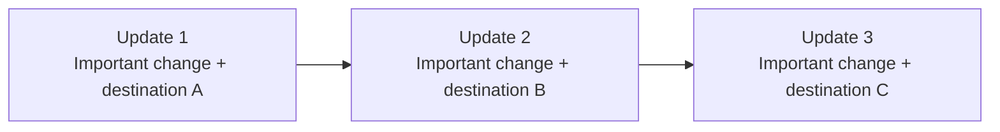
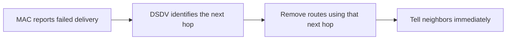
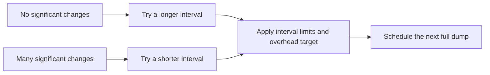

# DSDV extensions: plan summary

> **Kind:** reference · **Status:** draft · **Seal:** none · **Owns:** — · **Stands on:** [implementation plan](dsdv-paper-extensions.md)

The plan adds four features from the original DSDV paper: fairer updates, earlier reaction to failed links, adjustable update frequency and access to an external network through a base station. The [full plan](dsdv-paper-extensions.md) owns the exact policies and tests; the [execution record](../../doc/project/evidence/model/dsdv/paper-extensions-results.md) tracks implementation and validation.

## 1. Give every pending update a turn — C1

Small routing updates send important route changes first. Spare space carries newer sequence numbers, which tell neighbors how fresh a route is. Today, address ordering can repeatedly favor the same destinations. Rotate through these less urgent entries so each gets a turn when space is available. Rotation uses existing send opportunities; it does not create extra broadcasts.

## 2. React sooner to failed links — C2

The MAC, which handles wireless frame delivery, already reports when delivery fails. Let DSDV use that hint to withdraw routes through the failed next hop immediately, instead of waiting for a silence timeout. Identify the actual failed receiver so a route that has already switched to another neighbor survives. Timeouts remain the fallback when the hint cannot identify a neighbor.

## 3. Adjust full-update frequency — C3

A full dump advertises the routing table. Send these less often during quiet periods and more often after substantial route changes, within configured limits. An overhead target also discourages overly frequent large dumps. Urgent withdrawals still go out immediately. This is a documented model policy; its performance benefits must be measured.

## 4. Reach external networks through a base station — C4

Configure one base station with a wireless interface and a wired uplink. It advertises whether it can provide external access. Other nodes then install a default route through their next hop toward that station. The wired network needs a configured return route to the mobile nodes.

If the uplink fails, withdraw the external-access capability while retaining the base station's host route wherever the wireless path remains usable. Losing the wireless path removes the affected routes too. This first version supports one configured base station, with no automatic gateway election. Participating nodes use wire version 2; ordinary host-only networks retain version 1.

## Delivery and checks

Implement C1 → C2 → C3 → C4 as four commits. Each includes tests, a reviewer explanation and user documentation. `DsdvTable` keeps routing decisions; `Dsdv` connects them to packets, timers and IPv4 routes. Tests must observe real routing exchanges, forwarding, failure and recovery.

MAC feedback, adaptive timing and base-station support start disabled. Fair rotation becomes the normal selection behavior.
