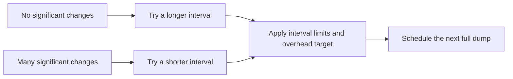

# DSDV extensions: plan summary

> **Kind:** reference · **Status:** current · **Seal:** none · **Owns:** — · **Stands on:** [implementation plan](dsdv-paper-extensions.md)

The implementation adds four features from the original DSDV paper: fairer updates, earlier reaction to failed links, adjustable update frequency and access to an external network through a base station. The [full plan](dsdv-paper-extensions.md) owns the exact policies and tests; the [execution record](../../doc/project/evidence/model/dsdv/paper-extensions-results.md) documents the passing checks and their limits.

## 1. Give every pending update a turn — C1

Small routing updates send important route changes first. Spare space carries newer sequence numbers, which tell neighbors how fresh a route is. The old selection could repeatedly favor the same destinations. When space is scarce, rotation gives each pending entry a turn. When all entries fit, their existing address order is retained. Rotation uses existing send opportunities; it does not create extra broadcasts.

## 2. React sooner to failed links — C2

The MAC, which handles wireless frame delivery, reports when delivery fails. With feedback enabled, DSDV uses that hint to withdraw routes through the failed next hop immediately, instead of waiting for a silence timeout. It identifies the actual failed receiver so a route that has already switched to another neighbor survives. Timeouts remain the fallback when the hint cannot identify a neighbor.

## 3. Adjust full-update frequency — C3

A full dump advertises the routing table. With adaptation enabled, quiet periods try a longer interval and substantial route changes try a shorter one, within configured limits. An overhead target also discourages overly frequent large dumps. Urgent withdrawals still go out immediately. This is a documented model policy; its performance benefits have not been established.

## 4. Reach external networks through a base station — C4

Configure one base station with a wireless interface and a wired uplink. It advertises whether it can provide external access. Other nodes then install a default route through their next hop toward that station. The wired network needs a configured return route to the mobile nodes.

If the uplink fails, DSDV withdraws the external-access capability while retaining the base station's host route wherever the wireless path remains usable. Losing the wireless path removes the affected routes too. This version supports one configured base station, with no automatic gateway election. Participating nodes use wire version 2; ordinary host-only networks retain version 1.

## Delivery and checks

The four behavior changes are implemented as C1 → C2 → C3 → C4, with tests, reviewer explanations and user documentation in each commit. C0 records the plan; C5 records integrated validation. `DsdvTable` keeps routing decisions, while `Dsdv` connects them to packets, timers and IPv4 routes. Corrected C4 passes fresh debug/release and isolated feature-off builds, 4 unit, 8 module and 6 protocol cases, and all 13 selected nonvisual fingerprints. Exact-parent comparisons establish the three repairs. Broader project gates retain unrelated findings recorded in the execution report; PR audits are recorded separately.

MAC feedback, adaptive timing and base-station support are opt-in features. Fair selection is part of ordinary operation. The [module declaration](../../src/inet/routing/dsdv/Dsdv.ned) owns configuration defaults.
