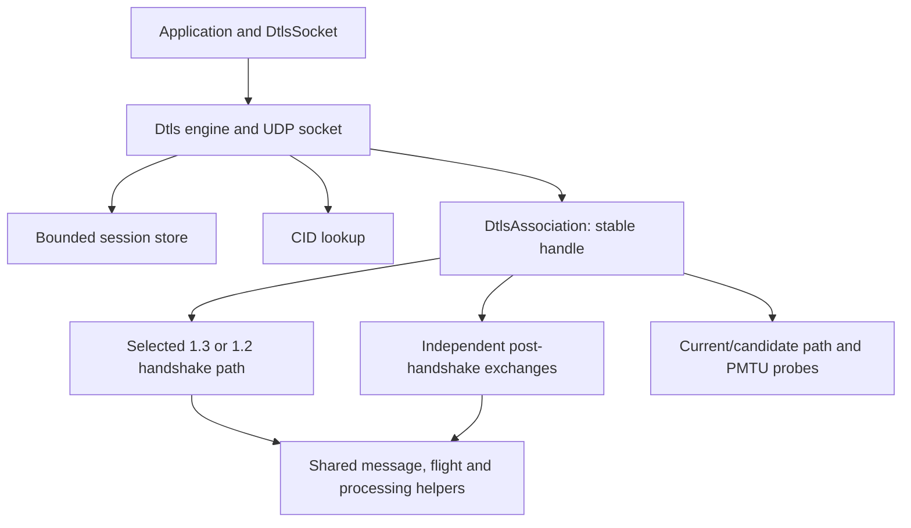

# Extend the DTLS simulation model

**Status:** draft. Related guidance: [implemented DTLS plan](../done/dtls.md), [planning guidance](../../doc/project/guide/write-an-implementation-plan.md), [architecture](../../doc/project/rule/architecture.md), [testing](../../doc/project/rule/testing.md).

Revision 5, 2026-11-16. Active checkout: `/home/miguel/workspace/inet-dtls-extensions`, implementation base `cb1691184444afa64b1819348d446d4cad610474`. The user authorized execution of this plan with “Execute the plan” after its iterative review. This covers the listed implementation, tests and local commit series. It does not authorize unrelated edits, stored-baseline changes or publication. Preserve the unrelated modified `AGENTS.md`.

## Purpose and scope

The current model can establish a DTLS 1.3 association and exchange datagrams, but reconnecting devices repeat setup, moving peers lose address-based association lookup, and packet sizes depend on a configured safe budget. Extend it so simulations can investigate reconnection costs, early traffic, mobility, deferred authentication, algorithm-profile overhead and changing path sizes. Add a finite DTLS 1.2 profile for mixed-version studies.

All seven requested extensions are included:

| Capability | Useful experiment | Completion criterion |
| --- | --- | --- |
| Session tickets and resumption | Sleeping sensors reconnect repeatedly | Reconnect using a selected retained ticket, with observable resumption and bounded expiry/fallback. A resumed 1.3 certificate session omits certificate messages; a resumed 1.2 session uses its abbreviated flight sequence. |
| 0-RTT early data | First-message latency on long-delay paths | Explicitly admitted early datagrams travel in epoch 1; acceptance, rejection and replay policy are visible to the application. |
| Connection IDs and address migration | NAT rebinding, mobility and interface switching | A stable application handle survives a validated peer address/port change; reordered old-path packets cannot revert it. |
| DTLS 1.2 compatibility | Mixed-version peers and version comparisons | Configured 1.2-only and dual-version peers negotiate and exchange data through version-correct records and flights. |
| Post-handshake client authentication | Authentication requested by a later operation | A server requests modeled certificate authentication after establishment without restarting the association. |
| Additional modeled algorithm profiles | Handshake size, fragmentation and processing costs | Negotiation selects concrete supported combinations and uses their actual represented field sizes and configured costs. |
| Automatic path MTU adaptation | Changing tunnels and routes | Per-path confirmed payload budgets grow or shrink from probe results; oversized application sends have explicit outcomes. |

“Except cryptography-related” means retaining the existing simulation abstraction throughout. Additional algorithm profiles describe negotiation, byte lengths, limits and configurable processing delays; they do not execute algorithms. Exclude encryption/decryption, HKDF/PRF computation, real keys, MAC/tag/binder/Finished verification, signatures, X.509 parsing or chain validation, cryptographic cookie/ticket protection and encrypted record-number computation. Also exclude live endpoint interoperability and complete protected-packet byte export. Declared UDP checksums and link FCS remain required. No security proof or attack-resistance claim is introduced.

This is a bounded extension profile, not every optional DTLS mechanism. TLS over TCP, DTLS 1.0, CBC suites, renegotiation and application-data retransmission are outside scope. DTLS 1.2 resumption is included; 0-RTT and post-handshake authentication remain 1.3-only mechanisms. Unsupported combinations must be refused explicitly rather than silently approximated.

## Current behavior and change surface

These are source-verified observations, not fresh runtime results:

- [DtlsSocketIo](../../src/inet/applications/dtlsapp/DtlsSocketIo.cc) calls `DtlsSocket::open/send`; [DtlsSocket](../../src/inet/transportlayer/contract/dtls/DtlsSocket.h) delegates to [IDtls](../../src/inet/transportlayer/contract/dtls/IDtls.h). The API exposes establishment, delivery, send errors, closure and key updates, but no early-data, authentication, migration or size-change outcomes.
- [Dtls](../../src/inet/transportlayer/dtls/Dtls.cc) owns the UDP socket and association map. `socketDataArrived → parseDatagram` selects peers using local/remote addresses and ports. `socketErrorArrived` currently logs and deletes UDP errors; it supplies no path-size adaptation. `sendApplication` applies the configured payload limit.
- [Udp::handleUpperPacket](../../src/inet/transportlayer/udp/Udp.cc) honors source-address and interface request tags. Its ICMP error handlers preserve typed error tags, MTU and quoted payload after removing the UDP header, with address/port tags on the quote. [IPv4](../../src/inet/networklayer/ipv4/Ipv4.cc) consumes `FragmentationReq`; [IPv6::fragmentAndSend](../../src/inet/networklayer/ipv6/Ipv6.cc) currently fragments oversized locally originated packets without consulting it. C11a below is therefore a concrete prerequisite for nonfragmenting IPv6 probes, rather than an assumed existing facility.
- [DtlsAssociation](../../src/inet/transportlayer/dtls/DtlsAssociation.h) owns initial-handshake state, a handshake flight, a separate update flight, timers, replay states and pending application packets. `processHandshake` and `receiveKeyUpdate` implement different stages; extending only the initial-handshake switch will not supply independent post-handshake recovery.
- [DtlsHandshakeFlight](../../src/inet/transportlayer/dtls/DtlsHandshakeFlight.h) and existing reassembly helpers retain messages/fragments and transmission record mappings. Reuse their mechanics. [DtlsRecordProtection](../../src/inet/transportlayer/dtls/DtlsRecordProtection.h) currently fixes the modeled tag at 16 bytes and represents protection through retained content.
- [TlsHandshakeParameters](../../src/inet/transportlayer/tls/TlsHandshakeParameters.h) supports one 1.3 cipher suite, group and certificate signature profile. [Dtls.ned](../../src/inet/transportlayer/dtls/Dtls.ned) exposes profile, sizes, queues, timers and processing delays. There is no automatic PMTU mode.
- [Existing coverage](../../doc/project/evidence/model/dtls/coverage.md), the [recorded results](../../doc/project/evidence/model/dtls/results.md) and [user guide](../../doc/src/users-guide/ch-dtls.rst) document the supported profile and its limits. Existing results do not validate these proposed extensions.

Production changes belong in `src/inet/transportlayer/dtls`, reusable handshake content in `src/inet/transportlayer/tls`, API declarations in `src/inet/transportlayer/contract/dtls`, and application integration in `src/inet/applications/dtlsapp`. C11a additionally extends IPv6's existing fragmentation-request contract. Include affected MSG serializers, printers and dissectors, NED declarations, tests, examples, release notes and evidence mappings in their owning commits. Keep DTLS policy out of generic packet, UDP and IP infrastructure. The source seal registry currently protects the common packet subtree; this design requires no changes there. Recheck protection before implementation.

## Standards and model decisions

Use primary sources and check applicable errata when implementation begins. C1 records clause-level obligations and modeled exclusions before dependent code:

| Area | Primary source and relevant sections |
| --- | --- |
| 1.3 records, post-handshake recovery, epochs, CID updates and PMTU | [RFC 9147](https://www.rfc-editor.org/rfc/rfc9147.html), §§4–5, particularly 4.4, 5.8.4, 6.1, 7–9 and 12–13 |
| Tickets, early data and deferred authentication | [RFC 8446](https://www.rfc-editor.org/rfc/rfc8446.html), §§2.2–2.3, 4.2, 4.6.1–4.6.2 and 8, as adapted by RFC 9147, reconciled with applicable [RFC 9846](https://datatracker.ietf.org/doc/html/rfc9846) clarifications already adopted by the baseline; DTLS omits EndOfEarlyData |
| CID negotiation and address changes | [RFC 9146](https://www.rfc-editor.org/rfc/rfc9146.html), §§3–6; 1.3 uses RFC 9147's record format and update messages |
| 1.2 handshake, records and recovery | [RFC 6347](https://www.rfc-editor.org/rfc/rfc6347.html), §4, and [RFC 5246](https://www.rfc-editor.org/rfc/rfc5246.html), §§6–7; [RFC 5077](https://www.rfc-editor.org/rfc/rfc5077.html) for 1.2 tickets |
| Selected 1.2 AEAD profiles | [RFC 5487](https://www.rfc-editor.org/rfc/rfc5487.html), §2; [RFC 5289](https://www.rfc-editor.org/rfc/rfc5289.html), §3.2; [RFC 8422](https://www.rfc-editor.org/rfc/rfc8422.html) for EC handshake structures |
| Probe transport and size discovery | [RFC 6520](https://www.rfc-editor.org/rfc/rfc6520.html), §§2–5; [IANA extension registry](https://www.iana.org/assignments/tls-extensiontype-values/tls-extensiontype-values.xhtml) for 1.3 heartbeat placement; [RFC 8899](https://www.rfc-editor.org/rfc/rfc8899.html), §§3–6, using its unacknowledged-datagram model |

The following are proposed design decisions. Changes to them require revising this plan before implementing the affected stage.

C1 records the applicable RFC 9846 obligations alongside the original RFC 8446 clauses, preserving the baseline's existing reconciliation. [RFC 9853](https://www.rfc-editor.org/rfc/rfc9853.html) defines a separate negotiated return-routability subprotocol for CID. This finite profile reuses heartbeats already needed for PMTU as its address-validation strategy under RFC 9146 §6; implementing another validation subprotocol is excluded. Record this deliberate scope limit and the RFC 9853 recommendation in C1, and make no RFC 9853 conformance claim.

### Reuse and ownership

Follow [AR-EXT-REUSE](../../doc/project/rule/architecture.md#ar-ext-reuse), [AR-MOD-FIDELITY](../../doc/project/rule/architecture.md#ar-mod-fidelity) and [QR-DESIGN-MINIMAL](../../doc/project/rule/quality.md#qr-design-minimal). Add concrete state owners where lifetimes differ, without adding a pluggable cryptographic framework or a second engine.

| Addition or extension | Responsibility and consumer | Why existing state is insufficient |
| --- | --- | --- |
| Association-owned post-handshake exchange collection | Independent retry/deadline state consumed by ticket, CID, authentication and existing KeyUpdate handling | One `flight` plus one `updateFlight` cannot represent simultaneous categories required by RFC 9147 §5.8.4. Reuse flight and reassembly values, not a single shared timer. |
| Engine-owned bounded session store | Retained resumption identities and anti-replay admission state used by new associations | Association teardown must not destroy reconnect state; no global singleton or remote-configuration lookup. |
| Selected profile value | Sizes and limits used by negotiation, serializers and record accounting | Hard-coded SHA-256 and key-share sizes cannot represent a selected alternate profile. Keep this a value/catalog, not an algorithm plugin interface. |
| Engine CID index; association CID sets | Route received records to an association and retain current/spare IDs | Tuple lookup cannot survive rebinding. CID lookup is a routing operation, not authentication. |
| Association-owned path state and probe state | Directional confirmed size, candidate address, outstanding probe and timers used by transmission | A module-wide payload limit cannot represent different peers or old/new paths. Use one concrete path helper if it keeps these responsibilities out of the engine. |
| Version-specific 1.2 handshake state and record helpers | Encode/interpret 1.2 messages and recovery under the same UDP engine/API | The 1.3 state machine assumes ACKs, unified headers and different epochs. Share storage/processing mechanics where semantics agree, not handshake policy. |

Keep [IDtls's contract](../../doc/project/rule/architecture.md#ar-org-contracts) explicit. Add operations/outcomes alongside their first consumer: resumption options on open, explicit early send/status, authentication request/result, peer-path change, and current maximum application size. Update `DtlsSocket`, `DtlsSocketIo`, the protocol driver and every other callback implementation together. Preserve existing `open/send` behavior for callers using defaults. Callback API changes need migration notes; interface declarations must remain pure under [AR-ORG-CONTRACT-PURITY](../../doc/project/rule/architecture.md#ar-org-contract-purity).



### Session resumption and early data

For 1.3, encode NewSessionTicket and the resumption PSK offer/selection using actual represented fields and correctly sized placeholders. Tickets carry opaque modeled identities, issue/expiry time, age information, selected hash compatibility, peer identity context and early-data allowance. Client/server stores belong to their local engine. The server resolves the ticket from received bytes against its own state; the client never reads server configuration. Retransmitting one ticket message must not create additional cache entries. Issue at most one ticket per association, with recovery independent of other post-handshake categories; route ACKs by their transmitted records. Additional simultaneous ticket issuance has no consumer in this profile and is excluded.

Initially use an in-memory server ticket table rather than simulated encrypted tickets. Default session capacity: 64 entries per engine; default lifetime: 1 hour of simulation time; default issuance: one ticket per successful association when enabled. Disable issuance/resumption by default. Expired or unknown tickets cause a full handshake when policy permits; incompatible identity or profile must not bypass ordinary checks. Use deterministic expiry and eviction for resumable entries. Clear both client and server stores on stop/crash; ordinary association close retains them. Persistent storage and sharing between server instances are excluded.

An opt-in open selects the newest compatible unexpired ticket for the requested remote address/port, version and locally expected peer identity; deterministic issuance order breaks ties. Offer one ticket identity first, with an external-PSK fallback identity only in the configured PSK profile. A certificate-profile server may accept a valid ticket; if it declines resumption, use its ordinary certificate handshake. Thus `profile` selects full-handshake authentication, not a prohibition on ticket PSKs. Extend the existing negotiated `Selection` from its `usePsk` distinction to one authentication-mode value: certificate, external PSK or ticket PSK. Derive message selection and PHA eligibility from that mode; do not mutate the engine's configured profile or retain redundant mode flags. Reject an out-of-range selection or incompatible saved hash. Resumption remains PSK-DHE: it retains the key-share exchange and normally one round trip. Compared with the baseline external-PSK profile, ticket use does not promise fewer flights or lower cost. Verify certificate-message omission against an initial certificate handshake and ticket identity/selection against the external-PSK control, with cookies and costs pinned alike.

Early sending requires an explicit API operation and a usable ticket with nonzero allowance. Default early-data allowance is zero; proposed opt-in default when enabled is 4096 application bytes per ticket, still bounded by per-record and queue limits. Report acceptance/rejection separately from establishment. Deliver accepted early packets through an explicitly marked callback so applications can restrict their operations. Never automatically resend rejected early data as ordinary traffic: report it and let the application decide whether a retry is safe. HRR, incompatible early-data parameters, expired tickets or admission refusal reject early data while allowing the applicable handshake fallback. Preserve datagram boundaries and loss semantics.

Keep `cookieRequired=true` as the default: an HRR cookie exchange rejects early data even with a valid ticket. Successful early-data fixtures explicitly set `cookieRequired=false` and supply the initial key share; retain the engine's prevalidation output-credit limit until reachability is established. Early-data acceptance describes server admission, not proof of individual datagram delivery. Reordered early records that arrive before a usable ClientHello are dropped rather than introducing a new pre-ClientHello buffer.

Epoch 1 has separate receive/send and replay state. Retransmitted handshake messages do not retransmit early application records. Bind accepted early data to the first offered PSK and the required saved parameters. Include the DTLS-specific absence of EndOfEarlyData and the proper transition to application epochs.

Allow early send only on the client attempt before its Finished handoff. Retain early receive state only until the client's Finished is processed or the attempt ends; late epoch-1 datagrams are dropped. Early send transfers packet ownership to the engine even on rejection, as ordinary send does. Refuse local sends beyond the ticket's aggregate application-byte allowance; count admitted sends even if the network later loses them. At the receiver count unique accepted records after replay filtering; a peer exceeding the advertised allowance fails with `unexpected_message`. Recheck queued early records before output handoff: if early sending has ended, cancel them with send errors rather than emitting epoch 1 after Finished. Report local admission errors separately from the server's association-level early-data acceptance; neither outcome acknowledges individual datagram delivery. Do not retain a per-datagram delivery/retry ledger.

Use a single-use early-data policy in the existing server ticket entry: mark it consumed when admitting an attempt and record the accepted ClientHello random and owning association ID. Matching bytes may continue only the live owning attempt, never admit a replacement association. Handshake failure or association close does not reset the consumed flag. A retained consumed entry can still permit ordinary 1-RTT resumption. Expiry or eviction removes the entire entry, so later use is unknown-ticket fallback with early data rejected; no separate anti-replay tombstone store or advance capacity reservation is needed. Encode each opaque ticket identity from the issuer engine's simulation component ID and an engine-lifetime serial, as two network-order uint64 values. Preserve the serial across stop/start and refuse issuance on exhaustion. Distinct engines then cannot accidentally accept each other's first ticket merely because both local serials start at one. The receiver still uses its own ticket table; the client treats these bytes as opaque and reads no remote configuration. This is a deterministic simulation namespace, not cryptographic replay protection; truncated-number and cross-association alias limitations remain explicit.

### Algorithm profiles

Keep the existing profile as the default. Add `TLS_AES_256_GCM_SHA384` and `TLS_CHACHA20_POLY1305_SHA256`, `secp256r1` alongside X25519, and `rsa_pss_rsae_sha256` alongside `ecdsa_secp256r1_sha256` for 1.3. Support each suite with either group and either certificate signature, or with PSK-DHE and no certificate signature. Use 32-byte X25519 and 65-byte uncompressed secp256r1 shares. Select a fixed RSA-2048 identity label with 256-byte signature placeholders; retain the configured ECDSA signature/certificate lengths as modeled size inputs, without claiming DER validation. SHA-384 requires 48-byte Finished/binder placeholders. All selected 1.3 suites have a 16-byte tag, but suite-specific record-use/epoch policies must be mapped explicitly rather than inherited accidentally from AES-128.

Keep the existing external PSK bound to SHA-256. SHA-384 negotiation therefore needs certificate authentication or a SHA-384 ticket; do not infer an external PSK's hash from the selected cipher suite. This avoids an unnecessary per-key configuration system. Resumption with a different same-hash suite is allowed, while early-data acceptance requires the saved early-data parameters, including the original suite.

Expose ordered allowed/preferred values through NED, rejecting unknown or contradictory configuration during initialization. Existing delay parameters remain the fallback; optional per-profile cost overrides use time units and default to those values. Charge each logical handshake operation and each transmitted record according to the existing queue semantics. No default benchmark or hardware performance claim is supplied.

### CID and migration

Negotiate receiver-selected IDs, including empty/unidirectional cases. Use a fixed nonempty receive-CID length of 8 bytes per engine so an incoming record can be parsed before association selection. Allocate deterministic locally unique values and retain only a bounded set (proposed default: four receive CIDs per association). Remove retired IDs from lookup. Use a monotonic engine-lifetime allocator, preserved across stop/start, to avoid assigning an old CID to a replacement association without retaining an unbounded retired-ID set; refuse allocation on exhaustion. Include CID bytes in actual header accounting, serialization and dissection.

Implement 1.3 NewConnectionId and RequestConnectionId as separate reliable categories, including immediate/spare usage and their distinct outstanding-message/request restrictions. ACKing a request does not mean it has been fulfilled. Preserve duplicate recognition, epoch ordering and independent progress during KeyUpdate or authentication. A static 1.2 CID uses RFC 9146's distinct record format; do not send 1.3 update messages in 1.2.

Receiving a CID record on a different tuple selects a candidate path after establishment. Migration in a direction requires a nonempty receive CID and negotiated permission to send heartbeat requests. Otherwise refuse a local migration request and discard changed-tuple input with a visible unsupported-path outcome. Compare the triggering record against the highest accepted epoch/sequence pair before admitting that record, so replay-state advancement cannot make the freshness check self-reject. Commit a peer-address change only after modeled record validity, this freshness check and return-reachability confirmation. Use a correlated protected heartbeat request/response for the candidate path; do not invent QUIC PATH_CHALLENGE frames. Keep ordinary output on the confirmed path until validation succeeds. Only validation probes and bounded heartbeat replies may target the candidate: reply on the request's received tuple, including its local destination/interface, even before that tuple is confirmed. This allows bidirectional validation without waiting for ordinary output to move first. Keep one candidate; do not replace it with each arriving tuple. Timeout abandons the candidate without failing a still-usable old path. At commitment require the confirming response to be newer than the highest previously accepted record, then advance the migration high-water mark; older valid records can still be delivered under normal replay rules but cannot revert the peer address.

Expose confirmed address changes through the API while keeping the association handle stable. Choose local source address/interface explicitly through existing UDP request tags for interface changes. Test NAT rebinding with a translating fixture and local-address changes with the multihomed fixture; a source-tag mutation alone is not proof of bidirectional routing. Support local-port rebind only when the engine owns exactly one established association, has no listener or half-open attempts, and both CID directions and heartbeat permissions support validation. Refuse other cases synchronously. Replace the UDP socket with a fresh socket ID while retaining association/CID state and processing queues; discard old-socket indications using the existing socket-ID matching contract. Clear old-socket probe state and validate from the new port before ordinary sends resume. The scenario must provide a free target port: `Udp::bind` raises a simulation error on collision and supplies no recoverable bind-result indication. Preserve that configuration-error contract; add no UDP API merely to promise a recoverable rebind callback. Validation timeout after a local rebind reports path failure and closes the association because its old local socket is gone. Migration across establishment, simultaneous loss of both peers' known destinations, and moving a shared server socket are excluded.

The standard's cryptographic verification condition is represented only by the existing modeled protection outcome. Matching a CID or heartbeat token cannot establish security against forgery. C1 must document this limitation beside the migration claim.

### Post-handshake authentication

The client advertises `post_handshake_auth`; the server never sends that extension. Permit a server request on a certificate-authenticated or ticket-resumed 1.3 association with that advertisement; refuse it on an external-PSK association under RFC 9846 §4.4.2. No combined external-PSK/certificate extension is added. A server API request emits a CertificateRequest with a unique nonempty context, and the client returns the certificate/verification/Finished sequence with modeled contents. Reuse initial certificate construction and identity checks after generalizing their current zero-context assumptions. Track each exchange by request context and message sequence; do not reset sequence numbering or overwrite another category's flight. Preserve the client's required response-message ordering; independent categories do not authorize arbitrary interleaving within that response.

Permit one locally initiated authentication request at a time as a documented API admission policy, while correctly processing duplicates and peer messages allowed by the selected profile. Unsupported capability or a busy request is a synchronous refusal. Compare the received modeled certificate label with the server's own configured `identity`, reusing the existing expected-identity check; do not read the peer's configuration. An empty certificate, identity mismatch or deadline expiry reports authentication failure and closes the association. On success the requesting server reports the authenticated identity once and retains the association. The client's response/ACK does not establish that the server considers it authenticated; do not synthesize a client-side peer-acceptance result. Default request deadline: the configured handshake timeout. Applications can continue ordinary data while the request is pending, subject to the response ordering, and the server can gate privileged work using its result callback. The engine does not invent an authorization policy or silently hold all data. Reassembly and retries are bounded, including large client certificates and independent KeyUpdate/ticket/CID traffic.

Ticket issuance captures the modeled peer identity and authentication state at issuance. The one ticket issued on establishment is not retrospectively upgraded by later PHA. A resumed association reports resumption and its saved identity context, but emits no fresh PHA-success result; an application requiring current client certificate authentication requests PHA again. Renewing a ticket after PHA on the same association is outside this one-ticket profile.

### Path MTU discovery and adaptation

Keep `udpPayloadLimit` as the configured upper bound and retain fixed-budget behavior by default. Add opt-in discovery with an explicit conservative base UDP payload budget (proposed default 512 bytes), probe ceiling, intervals and retry limit. Validate the base against minimum supported record/handshake sizes and configured version/profile; do not silently raise it. Define all discovery sizes in UDP payload bytes; conversion from reported IP MTU subtracts the actual IP/extension/UDP headers. Additional DTLS header, CID, explicit nonce, tag, content type and padding reduce the application budget.

Choose one deterministic search policy: advance from the confirmed size in 128-byte steps, capped by the configured ceiling, and stop the search after three consecutive failures at a candidate size. On a stable path without unrelated loss this leaves less than one step unused below the lesser of the path limit and configured ceiling; loss can stop the search earlier. Exact MTU inference is not claimed. For this profile MIN_PLPMTU equals the configured base. The 512-byte base deliberately supports small-MTU studies rather than following RFC 8899's recommended 1200-byte IPv4 base. Default probe timeout is 16 seconds, confirmation interval 60 seconds, and raise interval 600 seconds. Validate timeout at least 1 second and confirmation interval below raise interval, following RFC 8899 §5.1.1; scenarios must allow for their link and processing delays. Reuse the same probe timer for retries. Bound the probe ceiling by the represented heartbeat body/record maximum and `udpPayloadLimit`; reject an impossible configuration. After a probe search stops, a later raise interval starts another search; confirmation failure returns to base probing.

Negotiate RFC 6520 heartbeat permissions in ClientHello and the version-appropriate server response (ServerHello for 1.2, EncryptedExtensions for 1.3). Enforce directional permission, length checks and at least 16 bytes of padding; responses echo the payload, not request padding. Keep one outstanding request per association across migration and PMTU, with bounded timeout/backoff; migration cancels a size probe before taking that slot. Probe timeout reports failure to its owner rather than unconditionally closing the association. Send probes only after establishment; suspend them during PHA. Process heartbeats internally through existing input/output queues and ordinary protection/accounting. Match responses to outstanding payload and path; ignore stale responses. No zero-time event is needed merely to defer a direct operation.

Implement RFC 8899's base, search, search-complete and error behavior for unacknowledged datagrams, including confirmation after idle periods, bounded retry/backoff and black-hole recovery. Start the initial handshake at the configured base when discovery is enabled; confirmation and growth begin only after establishment. Initial paths unable to carry that base can fail the handshake; pre-establishment size discovery is excluded. Probe with a heartbeat record sized to the candidate UDP budget using padding, so the response can stay small and does not test the reverse path at the same size. Count success only from the correlated response, not a DTLS handshake ACK. Use `FragmentationReq(dontFragment=true)` for discovery traffic, including initial-handshake traffic; C11a supplies IPv6 support. Separate confirmed budgets by path and direction. Reset confirmation on migration and re-probe from the base; retain the configured ceiling. Absence of heartbeat permission reports unsupported discovery and retains the base as a fixed budget for that association.

Use the existing typed UDP/ICMP Packet Too Big indications only as hints for the currently outstanding size probe; never increase a confirmed budget from ICMP. Match the quoted tuple and sufficient record/probe identity to that probe's most recent handoff; ignore ambiguous, truncated, stale or ordinary-application quotes. Reuse the probe's existing record/size metadata rather than retaining a separate sent-packet history. In the inspected path, ICMP trims its header before forwarding the quoted IP packet; IP and UDP then advance the quote's front offset without trimming it again. That offset at the DTLS callback gives the consumed IP-plus-UDP header length for MTU conversion, without parsing IP internals. Check this contract in the PTB fixtures. IPv6 error indications for leading extension headers can be discarded below UDP; they do not establish general extension-header hint support. Heartbeat probing must still adapt with those hints absent or ICMP suppressed. No generic UDP error API change or dependency on the separate pending IPv6 PMTU plan is proposed.

Once the budget shrinks, re-fragment unsent/retransmitted handshake content while retaining message sequence, body offsets and already acknowledged ranges; give each actual transmission a fresh record number. The existing flight maps sent records to fragment-vector indices, so splitting fragments requires extending this mapping to logical message byte ranges. A delayed ACK for an old larger record must acknowledge its covered ranges after the split, without referring to reused indices or unrelated new records. Preserve range evidence until the exchange ends. Recheck queued application packets at handoff and report oversize errors. Application datagrams are never split into multiple deliveries or retransmitted. Base confirmation failure enters ERROR, suspends ordinary output and reports path unavailable; bounded base probes may recover it, while existing exchange deadlines still apply. A new maximum-size query/notification lets applications adjust future sends. A retained processing task keeps its sampled cost when only its destination changes. Invalidate stale encoded-record operations through the processing queue's existing per-operation eligibility/skipped callbacks, not its association-wide `cancel` operation, which would also remove unrelated control work. An unstarted invalid operation is skipped; an active operation finishes its sampled service before being skipped, preserving the existing queue contract. Charge each replacement record once at its new size; do not re-charge a retained logical handshake operation.

### DTLS 1.2 compatibility

Default to 1.3-only; opt-in allowed versions are `1.3`, `1.2` or both, with 1.3 preferred. Interpret DTLS's reversed wire version ordering explicitly. Negotiate versions and legacy ClientHello/ServerHello forms per RFC 9147's compatibility rules. Do not fall back to 1.2 just because packets time out, and reject an unoffered server selection. Represent downgrade markers and rejection where required, while stating that their transcript authentication remains abstracted.

Start with `TLS_PSK_WITH_AES_128_GCM_SHA256` and `TLS_ECDHE_ECDSA_WITH_AES_128_GCM_SHA256` with modeled secp256r1. Implement version-correct certificate/key-exchange bodies, HelloVerifyRequest/cookie handling, ServerHelloDone, ChangeCipherSpec, 12-byte Finished placeholders and full 16-bit epoch/48-bit record numbers. AEAD overhead includes the 1.2 explicit nonce as well as the tag. Initial protected traffic uses epoch 1. Whole-flight timeout/duplicate-triggered recovery replaces 1.3 selective ACKs. Under [RFC 6347 §4.2.4](https://www.rfc-editor.org/rfc/rfc6347.html#section-4.2.4), the final-flight sender retains response state for at least twice TCP's default MSL after completion, separately from the handshake deadline; use 240 seconds with the two-minute MSL in [RFC 9293 §3.4.2](https://www.rfc-editor.org/rfc/rfc9293.html#section-3.4.2). Duplicate peer final flights trigger fresh-record retransmissions without resetting this retention interval or redelivering establishment. Close/stop/crash still releases association-owned state. Reuse fragmentation only where its semantics agree. Version-specific close/alert and replay behavior must have direct tests. Reject unsupported renegotiation explicitly.

From C13 onward, gate existing and new APIs on the selected version: KeyUpdate, early send, PHA and dynamic CID updates are 1.3-only. A request on a 1.2 association is refused synchronously without emitting a 1.3 record or changing epochs. Since renegotiation is excluded, end a 1.2 association before its configured suite record-use bound or sequence-number exhaustion; never try to reuse the 1.3 KeyUpdate mechanism. C13 adds cases to `Rfc6347Datagrams.test` for these refusals and the boundary with a small configured record-use bound.

Add 1.2 session-ID and opaque-ticket abbreviated handshakes using the shared bounded store and version-specific saved parameters. Include ticket expiry, full-handshake fallback, renewed tickets and duplicate final-flight handling. A 1.2 ticket cannot resume a 1.3 session or authorize early data. Add RFC 9146 static CID/migration and heartbeat/PMTU integration after the basic 1.2 path works. The profile does not claim unrestricted compatibility with arbitrary real 1.2 endpoints.

### Lifecycle, bounds and compatibility

Apply [AR-LIFE-OPERATIONS](../../doc/project/rule/architecture.md#ar-life-operations) to the existing start/stop/crash handlers. Each association owns and cancels exchange, candidate-path and probe timers. Engine stop clears session/CID indexes and transient state after bounded close service; crash clears immediately without alerts. Start rebinds the same engine instance with fresh associations and stores. Destruction releases timer objects through their actual owners. Preserve cumulative statistics and configuration. Closing one association releases its paths/exchanges/CIDs but keeps eligible session entries and unrelated peers.

Use the existing association, reassembly, pending and processing-byte bounds for aggregate retained packet content. Keep at most one locally initiated exchange of each supported category per association; retain the separate session/CID/probe bounds described above. On admission exhaustion, refuse the API operation or skip optional ticket issuance with a resource-limit observation. Ticket-flight deadline expiry releases recovery state while retaining any issued session entry until its ordinary expiry/eviction. KeyUpdate or NewConnectionId recovery exhaustion closes the affected association because continued epoch/CID agreement is uncertain. RequestConnectionId has distinct ACK and fulfillment state: an ACK does not supply spare IDs. Its recovery deadline stops retries without failing ordinary data; refuse a second request until the first is both acknowledged and fulfilled, including when either arrives late. CID-dependent local migration is refused when no suitable ID is available. Authentication and probe failures follow their policies above. Do not block shared processors. Configure new protocol capabilities off by default so existing studies retain their packet trajectories. Add signals only for required observations: resumed/early-data outcome, authentication outcome, confirmed peer path, confirmed UDP budget and probe result. Public enum values and reason codes have explicit stable values.

## Ordered implementation commits

Each row is one proposed buildable commit. If implementation shows a row is too large to review, revise this index with explicit smaller commits before writing it; do not hide unlisted preparation/fixup commits inside a stage. All referenced new test files and reviewer documents below are tasks, not existing evidence. Update coverage and user documentation with the capability that introduces each claim.

| ID and proposed subject | Depends on | Concrete change and verification |
| --- | --- | --- |
| C1 — `dtls: document: specify extension profiles and requirements` | Baseline | Add clause mappings, finite version/algorithm matrix, modeled exclusions and requirement-to-test inventory under `doc/project/evidence/standard` and `doc/project/evidence/protocol/dtls`; extend model scope/coverage. Verify citations, encodings, link integrity and completeness against this plan. Documentation-only: no runtime behavior or protocol reviewer document applies. |
| C2 — `dtls: refactor: share post-handshake exchange recovery` | C1 | Introduce association-owned independent exchange recovery using existing flight/reassembly values; move existing KeyUpdate onto it with identical external behavior. Add `DtlsPostHandshakeExchange_1.test` module checks for independent cancellation and deadlines; extend `Rfc9147KeyUpdate.test`, `Rfc9147SimultaneousUpdates.test` and `Rfc9147UpdatePeerIsolation.test` as controls. Write `tests/protocol/dtls/post-handshake-recovery.md`. Existing controls should pass both parent and child; no new extension is claimed here. |
| C3 — `dtls: add: resume associations with modeled session tickets` | C2 | Implement 1.3 ticket bodies/serializers, engine session store, resumption negotiation and open options/outcomes. Write `Rfc9147Resumption.test` and `resumption.md`; add serializer/store units. Prove ticket ACK-loss recovery, selection and reconnect for certificate and external-PSK origins, certificate fallback, expiry, unknown identity fallback, hash compatibility, shared-server isolation, capacity and stop/crash clearing. |
| C4 — `dtls: add: exchange explicitly admitted early datagrams` | C3 | Add epoch 1, explicit early-send/delivery/status API and single-use ticket admission policy in the session store. Write `Rfc9147EarlyData.test` and `early-data.md`; module-test consumed flags, expiry and eviction in the bounded ticket table. Prove acceptance, HRR/rejection, byte limits, ticket replay across attempts, duplicate records, reordered arrival, loss and no automatic application retry. |
| C5 — `dtls: add: negotiate additional modeled algorithm profiles` | C4 | Add the finite profile catalog, ordered NED preferences, correct lengths and cost selection. Write `Rfc9147AlgorithmProfiles.test` and `algorithm-profiles.md`; extend `TlsHandshakeParameters_1.test`, `TlsHandshakeSerializer_1.test` and `DtlsRecordSerializer_1.test`. Cover every added suite/group/signature, unsupported and unoffered selection, SHA-384 resumption compatibility, fragmentation boundaries and exact configured queue costs. |
| C6 — `dtls: add: negotiate connection identifiers` | C5 | Add CID extension/header serialization, directional negotiation and engine lookup/index cleanup. Write `Rfc9147ConnectionId.test` and `connection-ids.md`; extend record serializer units. Establish with no CID, empty/unidirectional/bidirectional IDs; test unknown, malformed and colliding IDs, close/reuse isolation and changed header budget. Address migration remains unavailable at this stage. |
| C7 — `dtls: add: recover connection identifier updates` | C6 | Implement NewConnectionId/RequestConnectionId with bounded current/spare sets and independent recovery. Write `Rfc9147ConnectionIdUpdate.test` and `connection-id-updates.md`. Drop each message/ACK, exercise immediate/spare selection, duplicate/stale IDs, outstanding-request rules, excessive requests and overlap with KeyUpdate/ticket issuance. |
| C8 — `dtls: add: exchange correlated heartbeat probes` | C7 | Add heartbeat negotiation, message types/serializers and internal protected probe handling through both processing queues. Write `Rfc9147Heartbeat.test` and `heartbeat-probes.md`; add length/padding serializer units. Prove matching responses, disabled negotiation, malformed lengths, unsolicited responses, timeout, bounded reply size, queue service and unrelated-peer progress. This is the probe primitive for C9/C11, not automatic keepalive policy. |
| C9 — `dtls: add: preserve associations across path changes` | C8 | Add candidate/confirmed paths, local address/interface selection and explicit socket rebind while retaining handles; update destinations safely at output handoff. Write `Rfc9147Migration.test` and `migration.md`. NAT and routed multihomed fixtures prove bidirectional progress, validation timeout, old-path reordering, CID rotation, stale responses, rebind and concurrent update/close. Fixtures ship with this commit. |
| C10 — `dtls: add: authenticate clients after establishment` | C9 | Generalize certificate context handling and implement negotiated PHA request/result API and recovery. Write `Rfc9147PostHandshakeAuth.test` and `post-handshake-authentication.md`. Use certificate and ticket-resumed associations for success; assert external-PSK refusal. Exercise large fragmented response and its ordering, ACK loss, duplicate context, wrong/empty certificate, absent capability, busy refusal, deadline and overlapping ticket/CID/KeyUpdate traffic with continuing application delivery outside the ordered response. Check server-only authentication success and that resumption of a pre-PHA ticket does not manufacture a fresh PHA result. |
| C11a — `ipv6: add: honor requests to suppress source fragmentation` | C10 | In `Ipv6::fragmentAndSend`, honor the existing fragmentation request before splitting oversized local traffic; discard it with the existing observable drop path when fragmentation is forbidden. No DTLS policy or new generic interface. Write `tests/protocol/ipv6/Ipv6DontFragmentRequest.test` and `tests/protocol/ipv6/dont-fragment-request.md`. From a static-address two-host fixture, send tagged UDP below and above the source-link MTU and an untagged oversized control: the parent fragments both oversized packets; the child drops only the tagged one, sends the small packet and preserves untagged fragmentation. Assert no Fragment header or delivery for the forbidden packet, with zero and delayed neighbor resolution. Extend `Rfc8200SourceFragmentation.test` as a control. No existing test covers this request. Run `opp_run_protocol_tests --load . -p inet -m debug -w ipv6 -f 'Ipv6DontFragmentRequest\.test$'`, plus that control; repeat in release before publication. This tests a local API capability, not a new RFC wire requirement. |
| C11 — `dtls: add: discover and adapt per-path payload budgets` | C11a | Add the opt-in RFC 8899 state machine, current-size query/notification, nonfragmenting probes and usable PTB hints. Extend flight record-to-range ACK mapping for re-fragmentation. Write `Rfc9147PathMtu.test` and `path-mtu.md`; add path-state module checks and extend `tests/unit/DtlsHandshakeFlight_1.test` with split-range ACK cases. Routed bottleneck fixtures vary MTU, suppress ICMP and inject bounded loss; assert successful probing, base failure, growth/shrink, idle confirmation, IPv4/IPv6 accounting, migration reset, handshake re-fragmentation with delayed pre-split ACKs, and queued application rejection. |
| C12 — `dtls: add: represent version-specific DTLS 1.2 records` | C11 | Add 1.2 body/header/CCS representations and concrete record helpers; expose no successful 1.2 negotiation yet. Add `Dtls12RecordSerializer_1.test`, `Dtls12HandshakeSerializer_1.test` and module protection/replay checks for explicit nonce/tag, epoch/sequence limits and malformed input. Extend `Rfc9147UnsupportedVersion.test` as a 1.3 control; write `dtls12-record-foundation.md` documenting that no 1.2 exchange exists yet. |
| C13 — `dtls: add: negotiate and recover DTLS 1.2 associations` | C12 | Add version configuration, version-specific PSK/certificate state machine, cookie/CCS/Finished, recovery, application and close path. Write `Rfc6347Handshake.test`, `Rfc6347Recovery.test`, `Rfc6347Datagrams.test`, `Rfc9147VersionNegotiation.test` and `dtls12-associations.md`. Cover both 1.2 profiles, initial client authentication, loss/duplicates/reordering, bounded final-flight recovery, version preference/rejection/downgrade representation, replay, sizes, close and lifecycle. |
| C14 — `dtls: add: resume modeled DTLS 1.2 sessions` | C13 | Add session-ID/ticket abbreviated exchanges and version-separated store use. Write `Rfc6347Resumption.test` and `dtls12-resumption.md`; add ticket serialization units. Prove abbreviated flight order, expiry/fallback, renewed ticket recovery, incompatible saved profile, cross-version rejection and no early-data admission. |
| C15 — `dtls: add: support DTLS 1.2 path mobility and discovery` | C14 | Add RFC 9146 record format/negotiation and reuse modeled path validation, heartbeat and PMTU mechanics with 1.2-specific overhead. Write `Rfc9146ConnectionId.test`, `Rfc6347PathMtu.test` and `dtls12-paths.md`; extend header units. Prove static CID migration and budget adaptation, no 1.3 CID updates/ACKs, correct 1.2 explicit nonce accounting and unsupported 1.3-only API outcomes. |
| C16 — `dtls: document: demonstrate extended simulation profiles` | C15 | Add opt-in runnable examples for reconnect/early data, migration, deferred authentication, algorithm costs, MTU changes and mixed versions; update user guide, model coverage/results and release/migration notes. Run focused integration/build matrix below and record actual limits. Examples demonstrate the preceding protocol behavior; no new wire behavior or separate protocol reviewer document belongs here. |

## Test designs and acceptance evidence

### Common fixture and observation contract

For C3–C8/C10 use the existing two-StandardHost Ethernet/PacketTap protocol fixture and production `DtlsTestApp` driver; use three peers for isolation. Pin `seed-set = 0`, declared checksums/FCS, static addressing/neighbor resolution, initial state, exact profile, queue capacities, payload markers, delays and a finite simulation limit. Add driver methods when the corresponding production API ships. Do not replace a production handshake, replay algorithm or discovery state machine with a scripted imitation.

C9/C11/C15 need routed fixtures: client and server with two selectable paths, controllable bottleneck MTU and a translator for IPv4 NAT cases. Test routed address/interface changes and MTU behavior in both IPv4 and IPv6; IPv6 NAT is excluded. Each fixture must explain routes, source/interface selection, translation state where applicable and ICMP policy. Topology and effective configuration must be part of each reviewer document. The proposed parent of these stages is assumed to contain the earlier planned commits, not just today's baseline.

Observe wire types/epochs/message sequences/CIDs, UDP datagram sizes, production signals and application callbacks. A fault test must first demonstrate that the selected packet/probe was sent and that the fault hit it. Match retransmissions by logical message identity and fresh record number, not packet count alone. Test zero and positive processing cost where timing/cancellation or destination changes are material; pin exact costs rather than claiming performance realism.

For every behavior commit above, **write its named protocol tests and reviewer document in that commit** under [TR-PLAN-PROTOCOL](../../doc/project/rule/testing.md#tr-plan-protocol). The document links this plan, commit ID/subject and exact cases, and explains requirement, topology, setup, trigger, production path, before/after result, assertions, exchange/state diagrams, commands and limits. Use sequence diagrams for ticket/early-data and PHA recovery, and topology plus state/timing diagrams for migration/PMTU. Record whether rendering was checked.

### Existing tests and expected parent behavior

No existing test establishes the requested successful resumption, early-data, CID, migration, PHA, alternate-profile, dynamic-PMTU or DTLS 1.2 exchanges. Their absence is a coverage gap, not a measured failing test result. Existing `Rfc9147Handshake.test`, `Rfc9147PskHandshake.test`, `Rfc9147ClientAuthentication.test`, `Rfc9147HandshakeLoss.test`, `Rfc9147SelectiveAck.test`, `Rfc9147KeyUpdate.test`, `Rfc9147SharedPortClose.test`, `Rfc9147Multihomed.test`, `Rfc9147RecordSizeLimits.test` and `Rfc9147Ipv6.test` are regression controls. In particular, multihoming currently proves local identity handling, not migration.

For new feature fixtures using new APIs/NED parameters, today's parent may fail compilation or initialization; report that as unavailable capability, not a demonstrated wire defect. Where the same fixture can run on parent and child, compare exact observations: full versus resumed handshake; discarded versus explicitly admitted epoch-1 data; rejected CID versus routed association; fixed versus confirmed adaptive budget; rejected 1.2 offer versus a version-correct exchange. C2's controls establish preservation of existing behavior. Earlier planned results are assumptions until their owning commits execute checks.

### Required failure and interaction coverage

Each owning commit includes malformed wire lengths/state, limit exhaustion, duplicate handling and cleanup for the state it introduces. Cover callback-driven close/error during delivery, delayed processing followed by deadline/close, and one stalled peer alongside a progressing peer. The table assigns each combination to its owning commits and named tests above. C16 reruns these cases and demonstrates them in examples; it adds no deferred protocol tests. Avoid a Cartesian product of every option.

The filenames in C2–C15 without a directory prefix are relative to `tests/protocol/dtls/` for protocol cases and reviewer documents; helper units/module tests use their existing categories. C9 additionally tests migration without heartbeat permission, validation replies on an unconfirmed tuple, a competing candidate, rebind refusal with multiple associations/listener, old-socket indications after replacement, and validation timeout after rebind. A separate occupied-port fixture expects the existing UDP configuration error, not a callback. C8/C11 test the shared single-probe slot, asymmetric path MTUs and small responses, startup at the base, suppressed ICMP, PHA suspension, and rejection of stale/ambiguous PTB hints. C11 additionally verifies quoted-header offsets, ignoring ordinary-application PTB quotes, and a delayed pre-split ACK while replacement fragments are queued or active; assert skipped output, exact charged service, retained ACK/CID work and unrelated-peer progress. C4 tests failed/closed attempts and cache eviction without restoring early-data eligibility, acceptance with cookies disabled and HRR rejection with the default cookie policy. C6 tests CID non-reuse across close and stop/start. C3/C4 test non-reuse of ticket identities across eviction and restart. For C3 server isolation, first issue a ticket on each of two certificate-profile servers with equal local serials and identity labels; offer server A's captured ticket to B and require non-resumed certificate fallback rather than acceptance of B's entry. C7 tests an ACKed but unfulfilled CID request with continuing ordinary data and refusal of a second request. C13/C14 exercise final-flight duplicate recovery after the sender's 120-second handshake deadline but before 240-second retention expiry, at both the full-handshake server and resumed-handshake client: suppress the final flight, configure the still-waiting peer with a 300-second handshake deadline, and allow a later genuine peer retransmission through. This checks retained response state without first timing out the peer needed to trigger it. Each exchange owner tests its stated admission limit and timeout outcome.

| Combination | Owning commits | Required observation |
| --- | --- | --- |
| Resumption + alternate hash + early data | C5 | Compatible resumption succeeds; incompatible early parameters reject early data explicitly. |
| Ticket + PHA + KeyUpdate + CID update | C10 | Independent retries and deadlines, no sequence reset or ACK misrouting. |
| Migration + PMTU shrink + queued output | C11; repeat with 1.2 in C15 | Stable handle, validated destination at handoff, fresh path budget, explicit oversized-send outcome. |
| Association close during each new retained operation; engine stop/crash | Each commit introducing retained state | No late callback into released state or leaked timers/indexes. Closing one association preserves unrelated peers; engine stop/crash clears all associations and session state. |
| Dual-version shared server | C13–C15 as each 1.2 feature ships | Version-specific records/recovery and per-peer isolation on the same UDP socket. |
| All options disabled | Every behavior commit | Existing 1.3 behavior, ownership and selected trajectories remain unchanged. |

The model still cannot authenticate ciphertext, distinguish every truncated-number alias or establish rejection of all old-association records. Early-data and migration evidence must state these limits rather than treating placeholder validity as a security oracle.

## Execution plan and gates

`opp_run_protocol_tests` resolves in the current environment; its inspected `--help` supports `--load`, `-p`, `-m`, `-w`, `-f` and `--dry-run`. The following commands are **proposed execution**, not completed evidence. New targets do not exist yet. From the checkout root, build the matching library and run the exact owning files first, then the existing DTLS controls:

```sh
make -j$(nproc) MODE=debug
opp_run_protocol_tests --load . -p inet -m debug -w dtls -f 'Rfc9147Resumption\.test$' --dry-run
opp_run_protocol_tests --load . -p inet -m debug -w dtls -f 'Rfc9147Resumption\.test$'
opp_run_protocol_tests --load . -p inet -m debug -w dtls
```

Substitute the exact named test filename(s) from the owning row; verify nonzero selection before treating any result as evidence. C13–C15 include their Rfc6347/Rfc9146 files. Run added helper units and module tests with the checkout's unit/module runners after inspecting their installed help and exact selectors; their execution commands are not yet verified by this planning task. Record revision, mode, selector, configuration, seed, command, exit status and raw artifacts. Do not equate helper checks, compilation or fingerprints with a protocol exchange.

Before publication, build debug and release, run the focused protocol suite in both modes, and check the DTLS-disabled feature build and ordinary UDP controls using the [gate procedure](../../doc/project/guide/run-the-gates.md). Run architecture, naming, interfaces, C++ checks, source protection and commit-series checks on the actual changes; discover exact feature/build selectors at implementation time. New examples get deterministic fixed-seed checks and explicit behavior assertions where they demonstrate a new claim. Statistical/chart/fingerprint baselines are separate evidence; investigate differences and obtain their required authorization before changing stored expectations.

Update `doc/project/evidence/model/dtls/results.md` only with executed results and exact limits. Add a development release note and callback/API migration instructions in the project's existing release-document locations. No security or hardware-performance validation is claimed without separate evidence.

## Readiness and remaining decisions

The component ownership, finite profiles, default-off compatibility policy, lifecycle policy and proposed tests above are the design for revision 5. C1 must turn the cited standards into an explicit obligation matrix, resolve applicable errata and confirm the detailed version-negotiation and record-use limits before dependent implementation. If any mandatory behavior does not fit the selected abstraction, revise the relevant claim/profile before coding it. Those detailed mappings remain a prerequisite, not a claim that this plan is ready for every implementation stage.

The review inspected UDP source/interface selection, typed ICMP quotations and IPv4/IPv6 fragmentation paths. C11a addresses the concrete IPv6 gap. C9/C11 still require runtime validation of the routed/NAT fixtures and quoted-header accounting; insufficient quotes are ignored rather than requiring a generic UDP redesign. Additional infrastructure changes require an explicit plan revision before their consumer.

Plan preparation and revision-5 review checked current source ownership, available existing test names, primary-source text, runner flags and document structure/links. Execution status is maintained in [extensions.md](../../doc/project/evidence/model/dtls/extensions.md); planned tests and gates are not passing evidence until recorded there. The draft planning approval policy is not activated merely by a link; the user's later execution instruction supplies implementation authority for this plan.
