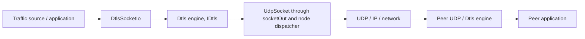

# DTLS implementation plan

**Status:** proposed, revision 7, 2026-11-15. Execution of the whole plan, validation, push and upstream PR was authorized by the user on 2026-11-16. Implementation is in progress; no completed runtime validation is claimed at this checkpoint. The user requires the same cryptographic modeling approach as INET IPsec; that decision is part of this plan. The user also accepted separating reusable TLS handshake components from DTLS delivery and recovery, without implementing TLS over TCP first. The current authorization covers implementation of the selected profile as well as publication.

**Checkout:** `/home/miguel/workspace/inet-dtls`, commit `91219b0fa7d2794ee67ac8a3dd45c3a09cfc45b0`. The existing local edit to `AGENTS.md` is outside this plan and must be preserved.

For a reader-facing explanation of the design, exchanges and stages, see the [illustrated summary](dtls-summary.md).

## Goal and selected scope

Add a DTLS 1.3 model for studying connection setup, datagram overhead, handshake loss recovery, and processing costs over IPv4 and IPv6 UDP. A client opens an association with a server, completes the handshake, exchanges application datagrams, and closes. Loss and reordering during setup must trigger DTLS recovery; loss of application data must retain UDP's unreliable datagram semantics.

The proposed version is **DTLS 1.3**, using [RFC 9147](https://www.rfc-editor.org/rfc/rfc9147.html) and the TLS 1.3 behavior it inherits from [RFC 8446](https://www.rfc-editor.org/rfc/rfc8446.html). C1 must pin the applicable clauses and review published errata and updates before implementation. Do not mix in DTLS 1.2's HelloVerifyRequest or its older flight rules.

The first supported profile includes:

- Client and multi-client server associations, version and cipher-suite negotiation, modeled PSK and certificate handshake flights, and optional client authentication.
- HelloRetryRequest with a modeled cookie/address-validation exchange; handshake message sequencing, fragmentation, reassembly, ACKs, retransmission and backoff.
- Plaintext and unified protected record headers, epoch and record-number tracking, application datagrams, replay filtering with a configurable window size, alerts, close_notify, and KeyUpdate with reliable post-handshake delivery.
- Algorithm-dependent record sizes and configurable processing delays, following the existing IPsec abstraction described below.

DTLS 1.2 fallback, connection IDs and address migration, session tickets/resumption, 0-RTT, post-handshake client authentication, actual cryptography, live-network interoperability, and certificate-chain validation are separate follow-ups. Unsupported optional extensions must not be negotiated. Mandatory behavior of the selected profile remains required; the scope is not a claim of full RFC conformance. Implementing a TLS endpoint over TCP is not a prerequisite or a deliverable of this series. Keep the common handshake content reusable so a later TLS model can use it.

The initial profile selects `TLS_AES_128_GCM_SHA256`: a 16-byte modeled AEAD tag and 32-byte Finished/binder placeholders. Support external PSK with `psk_dhe_ke` and certificate-based authentication with modeled X25519 key shares; certificate mode offers `ecdsa_secp256r1_sha256`. Certificate and signature blobs have configured lengths, not generated X.509/signature contents. Optional client authentication uses the same profile. Other suites, groups and signatures are rejected through negotiation rather than represented by unused algorithm catalogs. The helpers must still handle an unsupported offer and a server-selected value that the client never offered.

## Verified starting point

The source inventory found no DTLS implementation in the transport or application trees. Existing UDP and QUIC tests therefore do not establish DTLS behavior.

The integration path is already available:

1. [ApplicationLayerNodeBase](../../src/inet/node/base/ApplicationLayerNodeBase.ned) provides `app[] like IApp` and connects applications through its `at` dispatcher to UDP. A DTLS compound application can occupy that slot without adding a new node-wide transport submodule.
2. [UdpApp](../../src/inet/applications/udpapp/UdpApp.ned) composes traffic sources and sinks around socket I/O. Its [UdpSocketIo](../../src/inet/applications/udpapp/UdpSocketIo.cc) binds a UDP socket on start, sends packets, and delivers received payloads through `trafficOut`. It has no association or handshake logic.
3. [UdpSocket](../../src/inet/transportlayer/contract/udp/UdpSocket.h) supplies bind, sendTo, receive/error/close callbacks and socket ownership. Server mode must use sendTo and source-address/port indications to serve multiple peers.
4. [Protocol](../../src/inet/common/Protocol.cc) registers identities in its constructor. A DTLS-owned identity can use this existing mechanism without adding `Protocol::dtls` to common code.
5. [Protocol test authoring](../../tests/protocol/lib/AUTHORING.md) provides packet observation, injection, interception, duplication, and delay. The existing [TapPairNetwork](../../tests/protocol/lib/TapPairNetwork.ned) provides two hosts with an intervening packet tap. DTLS-specific traffic and chunk inspection helpers do not yet exist and are explicit work below.

### IPsec cryptographic approach: required reuse

[IPsec.ned](../../src/inet/networklayer/ipsec/IPsec.ned) explicitly excludes actual cryptography and models its network overhead and finite processing cost. [IPsec.cc](../../src/inet/networklayer/ipsec/IPsec.cc) wraps immutable payload data in [EncryptedChunk](../../src/inet/common/packet/chunk/EncryptedChunk.h), accounts for algorithm overhead and a placeholder integrity-check value, and unwraps the original chunk on reception. It does not calculate or verify the integrity value. Its documented performance model queues processing independently by direction.

DTLS will follow that approach:

- Reuse `EncryptedChunk` unchanged. Wrap the inner content and account for the selected DTLS cipher's tag, inner content type and padding. Derive these sizes from DTLS/TLS, not ESP's IV or block-padding rules. DTLS AEAD's implicit nonce is not an extra transmitted ESP-style IV.
- Represent cipher selection and protection epochs, not actual keys, secrets, HKDF, signatures, AEAD operations, or encrypted record-number computations. PSK identities and peer profiles are configuration labels, not secret material. Certificate/signature/binder/Finished fields use configured, correctly sized placeholders; matching profiles represent successful authentication.
- Use separate input and output processing queues. Expose unit-bearing, default-zero protection/unprotection delays and handshake-processing delays. Sample record protection once per transmitted record and unprotection once per structurally valid protected record admitted to a retained epoch's input processing. Malformed headers and unknown epochs are rejected before that operation. Charge handshake generation/processing once per new logical message; retransmitting retained content repeats record protection but does not repeat certificate/signature generation. A handshake operation shares its direction's processing queue rather than introducing a third processor. Evaluate a volatile delay once per operation; service completion is `max(now, directionAvailableAt) + sampledDelay`. Zero cost with an idle queue completes synchronously. A busy queue still imposes waiting time.
- Do not introduce OpenSSL, another crypto library, or a pretend cryptographic algorithm. Reuse the abstraction, not IPsec's network hooks, policy databases, protocol implementation, or incidental scheduling code.

This model can reject malformed records, wrong protocol state, unsupported epochs, replays, modeled packet corruption, and incompatible configured profiles. It cannot detect a forged valid-looking MAC, validate a real certificate, prove a Finished transcript, or reproduce cryptographic attacks. Tests must label those limits. Cookie validation likewise models source binding and freshness with opaque tokens; it does not establish cryptographic resistance to forgery.

Peer identity checks use configured labels carried in the modeled PSK identity or certificate content. Do not read a remote module's configuration or attach hidden wire metadata to claim authentication. Finished/binder validity is an assumed cryptographic success after the modeled profile checks, not a computed result. Without real key separation, overlapping protected records from successive associations on the same host/port quartet can be indistinguishable. Rejection of such old-association records is outside this model's security claims.

Replay claims also have a reconstruction limit. RFC 9147 section 4.2.2 relies on failed deprotection to expose an incorrectly reconstructed epoch or sequence number; this abstraction has no such cryptographic check. Verify replay filtering where the intended sequence number is the unique nearest candidate to the receiver's expected number, within half the transmitted sequence space: 32768 for a 16-bit field and 128 for an 8-bit field, excluding ties. Tests may cross a low-bit wrap while remaining within that range. Far-delayed replays, large loss gaps and records from epochs whose low bits alias a later epoch are outside the modeled replay coverage; no authenticated rejection is claimed for them. Do not add simulated authentication or hidden full-number fields to conceal that limit.

Header and handshake serializers must encode represented fields correctly and validate lengths. Protected payloads remain modeled encrypted chunks. Raw captures cannot reconstruct the retained plaintext or authenticate ciphertext; document that boundary rather than claiming a protected-record byte round trip or interoperability.

In particular, [UDP's computed checksum path](../../src/inet/transportlayer/udp/Udp.cc) serializes the entire UDP payload. Protected DTLS therefore uses UDP `checksumMode = "declared"` and declared link FCS in its supported simulation configurations. Raw-byte packet export, computed checksums/FCS over protected data, and packet-data fingerprints are excluded with this abstraction. Compare represented headers and modeled lengths without converting an entire protected packet to bytes. Document those configuration restrictions prominently; do not repair them by changing `EncryptedChunk` or inventing ciphertext bytes.

## Components and interactions

Use the existing application slot for deployment while keeping DTLS-specific logic under `src/inet/transportlayer/dtls/`, reusable TLS handshake content under `src/inet/transportlayer/tls/`, and the DTLS API under `src/inet/transportlayer/contract/dtls/`. Add `IDtls.ned` in the transport contract package and a paired C++ `IDtls` contract for replacing the DTLS engine. The documented replacement role is a future higher-fidelity engine using the same association and datagram API. Record this composition decision in C1 before adding the interface, as required by the [new-protocol procedure](../../doc/project/guide/add-a-protocol.md).



The arrows show ownership and the data path, not new zero-time message hops. `DtlsSocket` is a callback API for open/listen/send/close/rekey operations and established, data, error and closed indications. Its ownership rules are defined below. Use synchronous typed calls for local control, existing socket dispatch for UDP, and messages only at network or justified timer/processing boundaries.

Make the application contract concrete: `listen` registers an accepting callback, `open` returns a local association handle, and accepting a new peer reports its handle and endpoint quartet before its establishment indication. `send` and `close` name that handle; received-data, failure and closed callbacks carry it. `requestKeyUpdate(handle, requestPeerUpdate)` initiates modeled rekeying for a long-lived association. Reject a second request as busy while its update is unacknowledged; do not queue future updates or fail the association. Handles are local identifiers and are never encoded in DTLS content. A listener can own several handles; closing one does not close the listener or another peer.

`send(handle, Packet *)` transfers packet ownership to the engine on every outcome. For rejection, the engine releases the packet and reports a send-error indication with its identifier and reason; callers must not free or retry the same pointer. Receive callbacks transfer the delivered packet to the application. An accepted send means local admission, not guaranteed remote delivery; report locally failed pending sends on teardown, with no delivery acknowledgement for UDP loss. An invalid or already-closed handle rejects the operation without affecting other associations. Complete terminal state and release pending work before invoking callbacks so a callback can open or close another handle safely.

`DtlsSocketIo` client mode uses its single configured destination. Its server mode delivers received datagrams to the sink and disables the generic traffic source; it does not guess which accepted peer should receive an unaddressed source packet. The bidirectional and multi-peer protocol tests use `DtlsTestApp` to send explicitly on accepted handles. This avoids a second association-routing API or protocol tags solely to select a peer in the generic traffic source.

### Reuse TLS handshake content without building a TLS endpoint first

DTLS 1.3 inherits TLS 1.3 handshake bodies and negotiation, but supplies different record framing and handshake delivery. Implement that distinction directly:

| Reusable TLS content | DTLS-owned behavior | Deferred TLS endpoint work |
| --- | --- | --- |
| ClientHello/ServerHello bodies, extensions, certificate messages, Finished and KeyUpdate bodies | DTLS handshake envelope, message sequence, fragmentation, reassembly and flight scheduling | TLS record framing and parsing over a TCP byte stream |
| Supported-suite/profile descriptions and negotiation helpers | Cookies, peer associations, epochs, record numbers, ACKs, retries, processing queues and replay windows | TCP connection management, buffering and application stream API |

Add `TlsClientHello.msg`, `TlsHandshakeSerializer.{h,cc}` and `TlsHandshakeParameters.{h,cc}` under `transportlayer/tls/`, using namespace `inet::tls`. These are content types and narrowly scoped helpers, not a `Tls` NED module, socket, transport service or protocol identity. `TlsClientHello.msg` declares the selected message bodies and extensions. Its serializers handle those bodies; `DtlsPlaintextHeader.msg` declares the DTLS envelope and a `DtlsClientHello` body derived from the common `TlsClientHello` fields. Register the DTLS serializer for that distinct body type, reusing common field-encoding helpers and inserting `legacy_cookie` after `legacy_session_id`. This keeps generic chunk serialization unambiguous: a single shared ClientHello chunk type cannot select two wire layouts from an enclosing protocol it cannot see. Other unchanged message bodies reuse their common types and serializers. The MSG filenames match declared types, as required by the project's naming checks.

Outgoing `DtlsClientHello` has an empty `legacy_cookie`; the cookie used for retry is in the cookie extension. Incoming nonempty `legacy_cookie` is parsed and causes `illegal_parameter`, as required by RFC 9147 section 5.3. Do not insert a TLS four-byte handshake envelope inside the DTLS envelope. Apply DTLS legacy-version values and disable TLS middlebox compatibility behavior, including ChangeCipherSpec and server echoing of the legacy session ID.

`TlsHandshakeParameters` holds supported profile/suite descriptions and selection helpers used by `DtlsAssociation`. Keep sizes with their message or selected suite; do not add an operation registry or an unused algorithm catalog. Actual delay sampling, queueing, event scheduling and ownership remain in `Dtls`, so reusing a value or helper introduces no additional event boundary. Retained negotiated values belong to the association.

Keep DTLS-specific version handling and extension restrictions in the DTLS caller. Do not extract a common handshake state machine now: DTLS message ordering, flight recovery and epoch changes are closely coupled, and there is no TLS caller yet to establish a useful shared control interface. A later TLS implementation can reuse the content and helpers and assess further extraction against both concrete paths.

Declare a `TlsCommon` build feature for this reusable package; `Dtls` depends on it and UDP. A later `Tls` endpoint feature can depend on `TlsCommon` and TCP. Neither the current common package nor DTLS may depend on TCP, TLS application modules or an external crypto library. Check both DTLS-disabled/TlsCommon-enabled compilation and compilation with both disabled. This preserves a practical reuse boundary without adding a generic secure-transport framework.

| Proposed owner | Responsibility and consumer | Why existing code is insufficient |
| --- | --- | --- |
| `Dtls` (`Dtls.ned`, `.h`, `.cc`) | UDP socket, association lookup, dispatch, processing queues; used by `DtlsSocketIo` | `UdpSocketIo` has no DTLS state; changing it would alter ordinary UDP applications |
| `DtlsAssociation` (`.h`, `.cc`) | Per-peer handshake, record epochs, replay state, pending flights and reassembly | UDP socket identity alone cannot distinguish a server's DTLS peers |
| `TlsClientHello.msg`, serializers, `TlsHandshakeParameters` | TLS-derived bodies, extension encodings and profile helpers; consumed by DTLS now and a future TLS endpoint | Keeps common content independent of UDP, TCP and DTLS recovery |
| `DtlsRecord.msg`, `DtlsHandshake.msg`, serializers | DTLS record and handshake envelopes, lengths and body dispatch; consumed by engine, tests and tools | No existing DTLS wire types exist; delegates shared body encoding to TLS content serializers |
| `DtlsProtocolDissector`, `DtlsProtocolPrinter` | Registered inspection of DTLS-owned content; used by tools and tests | Avoid special cases in sealed packet infrastructure |
| `DtlsSocket` and `DtlsSocketIo` | Association callbacks and source/sink adapter | Reuses UDP beneath DTLS while exposing establishment and failure above it |
| `DtlsApp.ned` under `applications/dtlsapp/` | Compound `IApp` with configurable source, sink and `like IDtls` engine | Fits existing `app[]`; no change to StandardHost or dispatcher is needed |

Keep state with its required lifetime: independent send/receive epoch counters, per-epoch replay windows, expected handshake message sequence, bounded incomplete messages, and unacknowledged message ranges mapped to each transmission's record numbers. Retransmission preserves handshake message sequence but uses new record numbers. An ACK is a distinct content type, not a handshake transcript entry. Do not duplicate timer state with pending flags or add a generic plugin hierarchy. Initialize record numbers separately per sending epoch and reconstruct truncated received numbers using that epoch's receive state. Start the selected profile in epoch 0, use epoch 2 for protected handshake content, and epoch 3 for application traffic and its final ACK. Epoch 1 is unused because early data is excluded.

The unified header chunk stores only its transmitted epoch bits and truncated sequence field. Full sending numbers and reconstructed receiving numbers belong to endpoint state or observation details, not receiver-visible header extensions. Use that same representation for typed-packet processing and header serialization so bypassing serialization cannot bypass reconstruction.

Use an address/port association key initially; reject migration and do not infer a new association from arbitrary application data. For an epoch-0 ClientHello on an existing quartet, keep the current association while a bounded candidate completes cookie validation and its handshake. Replace it only at modeled Finished success; a failed candidate leaves the current association intact. This conservative choice implements the reachability requirement of RFC 9147 section 5.11. Do not claim trial-decryption-based separation of overlapping old/new protected records. Key lookup includes local and remote addresses and ports. A wildcard-bound server uses the received destination address as part of that quartet; a remote tuple alone does not identify an association on a multihomed server. Send replies from the recorded local address using UDP's existing source-address request tag. Add a two-local-address server variant to C3's isolation test to check that replies preserve both local endpoint identity and peer isolation.

Bound half-open associations, reassembly bytes and queued application bytes in NED; report exhaustion and release the affected state without treating it as successful authentication. Keep app admission/overflow policy separate from network losses. Count a replacement candidate against the half-open limit. A full half-open table drops new attempts; a reassembly limit failure aborts that candidate; a full app queue rejects the new send with an error and leaves established state intact.

Proposed defaults are 64 established associations and 16 half-open candidates per engine, 64 KiB incomplete-handshake data and 256 KiB pending application data per association, a 64-record receive window per retained epoch, and 1 MiB queued processing data per direction per engine. Exceeding a processing-queue limit drops the new incoming record or rejects the new outgoing application send; inability to enqueue a required outgoing handshake/control operation fails that association and reports pending sends. It does not evict an unrelated association. At the established-association limit, fail a new candidate before promoting it; replacement of an existing association uses that association's slot. Test half-open/established limits in C3's isolation test, reassembly limits in C4's fragmentation test, and application/processing queue limits in C5's overhead test. C2's processing module test also checks queue overflow because that contract is introduced there.

Charge at least one budget byte for each queued datagram, including an empty application datagram. Reserve the declared total message size, at least one byte, when creating a reassembly entry; check the limit before allocating storage. Identical overlaps consume no further reassembly budget. These rules bound zero-length entries and sparse fragments without adding another set of resource parameters. Test zero-byte app sends and a large declared message with only a small received fragment at the corresponding limits.

Cookies are enabled by default. Model tokens as serialized source-tuple, ClientHello random, issue-time and original-attempt-start data in the cookie extension, with a default 60 s validity interval. Preserve the first structurally valid ClientHello arrival as the handshake start, including time spent in input processing and fragment reassembly; issuing a cookie must not extend that deadline. Match the random in the retry to bind the token to that handshake. There is no cryptographic MAC and no per-client issued-token database. A well-formed retry with an invalid token produces `illegal_parameter`, not a silent retry loop. A client rejects a second HelloRetryRequest for the same handshake. Before validation, limit total server output to three times the bytes received for that attempt, including retries; this requires bounded pre-validation byte accounting even when the token itself needs no stored state. Disabling cookies is a deliberate configuration for an environment without amplification concerns; it does not disable that output budget. Bound pre-validation accounting by the 16 half-open slots and the handshake deadline; do not retain a separate unbounded address table.

Count DTLS bytes actually handed to UDP, including record headers and retransmissions, against received DTLS payload bytes for that attempt. Hold output that would exceed the budget until more input or validation permits it; a handshake deadline still terminates an attempt that cannot progress. Certificate/large-flight fixtures use cookies so address validation precedes their large server response. The no-cookie PSK fixture explicitly verifies that its server flight fits the available credit.

Application sends before establishment are queued within that bound. After establishment, preserve each application datagram; reject oversized sends with an explicit error rather than silently splitting one datagram into several deliveries. Fragment handshake messages to a configured UDP payload budget, subtracting record overhead. Automatic PMTU discovery is deferred; the configured budget asserts a known safe path payload size, not a discovered MTU. Test both IPv4 and IPv6 budgets. The default UDP payload budget is 1200 bytes. Send one application datagram in one record; compute its permitted size after the selected record overhead and configured padding. Default padding is zero. Send unified headers with no CID, a 16-bit truncated record number and an explicit length; receive both permitted record-number widths and the last-record omitted-length form. Test their parsing in C2 and their established-path behavior in C5. No configurable header-selection strategy is needed.

Use `OperationalBase` for the transport engine, with initialization/start/stop hooks at the application lifecycle stage because it binds UDP from an application slot. Keep the traffic adapter a client of that engine; it must not independently close the engine's socket or own a second copy of association state. The inherited mixin's [implementation](../../src/inet/common/lifecycle/OperationalMixinImpl.h) processes messages during graceful stop. Permit required stop callbacks, cancel handshake and processing work, close the UDP socket with a bounded shutdown deadline, and report pending application failures. Crash destroys socket state without network close traffic. Restart rebinds and establishes fresh associations without reinitializing the module. Retain module configuration and cumulative statistics; destroy transient association state. Cancel queued completion events before releasing their packets.

Every commit that adds pending work also implements its cancellation on teardown, stop and crash. C6 adds graceful protocol closure and full restart coverage, not the first safe destruction path. Test initial-down/start behavior in C2. On association failure remove its queued operations and cancel its timers before callbacks; do not allow a queued completion to dereference destroyed association state.

Per-association close leaves the engine's shared UDP socket bound. Module stop closes that socket only after association shutdown completes or the stop deadline expires.

Declare establishment time, handshake retransmissions, record overhead, replay and malformed-record drops, association failures, and processing delays as NED signals and statistics. Observers must not control protocol progress.

Declare per-record accepted/dropped observations with a local drop-reason code and association transition observations so the C2 parser test and subsequent limit tests can identify their outcomes. These are model observations, not extra wire fields or control inputs.

## Ordered implementation commits

All file names below are proposed unless linked above. Each commit must remain buildable and include the tests that establish its own added behavior. Later entries assume the specified earlier commits have landed; they are not observations of current source. No existing DTLS tests expose these gaps.

### Preparation boundaries and receive-error correction

The review separates independently testable mechanisms from their first production owners. The C1–C7 labels below remain logical capability stages; the actual review series additionally contains these preparation commits, each with its own build and direct test:

| Before stage | Preparation commit | Direct verification |
| --- | --- | --- |
| C2 | Introduce the bounded directional processor and its module fixture before the endpoint shell uses it. | DtlsProcessingQueue_1 |
| C2 | Introduce record-number reconstruction and replay-window state before the endpoint consumer. | DtlsRecordState_1 |
| C3 | Introduce common TLS offer decoding and parameter selection using the existing C2 body types. | TlsHandshakeParameters_1 |
| C4 | Introduce flight range/record accounting and RTT eligibility before recovery integration. | DtlsHandshakeFlight_1 |
| C4 | Introduce bounded fragment retention/reassembly before the association consumer. | DtlsHandshakeReassembly_1 |

No preparation claims a completed handshake or changes an existing expectation. Clause references accompany the source decision they explain. Flight accounting has no public reset operation solely for unit-fixture reuse; its owner replaces a flight when starting another exchange.

After C6-KEYS and before graceful closure, add `dtls: fix: contain handshake decode errors after processing delays`. Its two narrow guards cover retained-handshake epoch classification and current-epoch KeyUpdate header decoding, before replay/state changes. A raw header conversion may throw after the original datagram-parser catch scope has returned; processing cost must not change a malformed record from a discard into a simulation-ending exception. Application callbacks remain outside these decode-only guards.

That correction owns four full-UDP protocol cases, `Rfc9147MalformedRetainedHandshakeSync`, `Rfc9147MalformedRetainedHandshakeQueued`, `Rfc9147MalformedCurrentHandshakeSync` and `Rfc9147MalformedCurrentHandshakeQueued`, plus `malformed-handshake-records.md`. Establish real peers, observe receipt of the raw malformed header, require the malformed-record observation and later valid delivery, and prove no replay/state change. The queued cases use 1 ms input cost, with zero-cost controls. Require the same fixture to demonstrate the queued failures on its unfixed parent and all four to pass after the correction. This is a simulation decode/event-boundary regression, independent of actual cryptographic computation.

### C1 — `dtls: define the DTLS 1.3 simulation profile`

**Dependencies:** none. Finalize clause-level requirements, the composition decision and the TLS-content/DTLS-control boundary before code. Record which TLS body fields DTLS changes or excludes; reuse must not imply identical wire envelopes or a shared state machine. Write `doc/project/evidence/protocol/dtls/standards.md`, `features.md`, `checks.md` and feature check documents; add applicable catalogs under `doc/project/evidence/standard/rfc9147/` and `doc/project/evidence/standard/rfc8446/` without replacing any existing catalog. Keep those artifacts specification-derived. Write model-specific scope and coverage under `doc/project/evidence/model/dtls/`, and add the engine placement decision to `doc/project/design/decisions.md` using the next available decision identifier.

Verification: compare every selected behavior and exclusion with the standards, check references and model claims, and resolve mandatory/profile conflicts. No protocol test or reviewer document applies to this specification/documentation-only commit. This commit must not claim achieved conformance or executed tests.

### C-PREP — `tests: add: select interception targets with typed predicates`

**Dependencies:** C1's approved scope; no DTLS source dependency. This implementation-discovered preparation precedes C2 in the actual series and is required by C4's precise fault cases. Extend `tests/protocol/lib/ProtocolTest.h` and `InterceptionRules.cc` with a generic `bool(const Packet *)` interception predicate, combined with the existing expression before occurrence counting. Document the overload in `AUTHORING.md`. Preserve expression-only behavior and keep DTLS-specific field knowledge out of shared packet switches.

Ship `tests/protocol/udp/TypedTapPredicate.test` and its reviewer document `typed-tap-predicate.md`. Interleave short and long UDP payloads and a long payload to another destination port. Drop the second packet matching both the expression and typed predicate. Require the other packets to arrive and identify the intended dropped sequence number, since delivery counts alone cannot distinguish the wrong victim. The exact fixture cannot compile against the parent API; distinguish that setup comparison from an observed protocol failure. Verification: fresh debug library, focused protocol runner with this test, and existing UDP controls. This is a test-framework capability, not new DTLS behavior.

### C2 — `dtls: add: record types and the UDP-backed engine contract`

**Dependencies:** C1. Add the contracts, DTLS-owned protocol identity, engine shell, socket API, adapter, compound application, chunks, serializers, dissection and printing. Add the reusable `TlsClientHello.msg` and body serializers described above, together with `TlsCommon`, `Dtls` and `DtlsTests` feature declarations in `.oppfeatures`. Add the examples feature in C7 with its first actual example package. Include only actual dependencies; compile with DTLS disabled too. Shared content and its DTLS consumer belong in this buildable commit; no independent TLS endpoint or unconsumed common handshake framework is introduced. Implement IPsec-style chunk wrapping, size accounting and directional delay queues. Implement common record number/epoch processing and replay windows here because protected handshake records need them in C3. Invalid records are silently dropped without resetting handshake timers. Implement UDP bind/error/close ownership and safe stop/crash cancellation for the engine shell and its queues. Prevent counter wrap in the record primitives: protected records use a 64-bit sequence space; plaintext headers carry a 48-bit sequence. C6 adds key-update policy before exhaustion, not the first overflow check. Do not expose an establishment-success path before the handshake exists.

The current gap is that a received UDP payload has no DTLS record parser or owner. RFC 9147 section 4 requires parsing record boundaries and discarding invalid input. Add `tests/protocol/dtls/Rfc9147RecordParsing.test`: start a listening DTLS endpoint, inject truncated headers, impossible lengths, multiple complete records and an unknown epoch through UDP, and assert one parser outcome per input record, the expected malformed/unknown-epoch drop reason and no application delivery. Use well-formed epoch-0 ACK records for the multiple-record framing case; they have no outstanding flight to acknowledge and do not require C3 handshake behavior. A truncated record discards the unparseable remainder, not bytes in a later UDP datagram. Capture the matching UDP input so an absence assertion cannot pass without the stimulus. Before C2 the configured module does not exist; afterward malformed input drops without a crash. Valid handshake processing remains C3.

Write `tests/protocol/dtls/record-foundation.md` for C2, with parser boundaries and test limitations. Add serializer unit tests for represented fields, boundary lengths and malformed bytes, including shared TLS body encoding inside the DTLS envelope. Assert that the DTLS handshake header is followed directly by the body, with no nested TLS handshake header. Invoke generic chunk serialization on `DtlsClientHello` and verify that its registered serializer includes `legacy_cookie` at the correct byte offset; compare the common TLS body separately to ensure that it does not acquire this DTLS field. Put serializer cases in `tests/unit/TlsHandshakeSerializer_1.test` and `tests/unit/DtlsRecordSerializer_1.test`. Add `tests/unit/DtlsRecordState_1.test` for sequence reconstruction, per-epoch replay windows and invalid-record checks using local record state, without a fake handshake. Verify that typed and serialized/reparsed unified headers expose the same truncated values and lead to the same reconstruction, including low-bit wrap and half-space boundary cases. Include the alias example expected number 65537 with a 16-bit field of 1: reconstruction yields 65537 whether that header originated in record 1 or 65537. This tests reconstruction arithmetic and records why authentication-dependent disambiguation is excluded. These helper checks cannot establish an exchange. Add `tests/module/DtlsProcessingQueue_1.test` for `EncryptedChunk` ownership, overhead, queued input/output service, and zero-delay processing; these establish the local model contract without claiming an authenticated exchange. Add `tests/module/DtlsEngineLifecycle_1.test` for initial-down/start, cancellation of delayed processing, socket errors and teardown. These tests are extended as later commits add timers and associations.

### C3 — `dtls: add: establish modeled client and server associations`

**Dependencies:** C2. Implement `DtlsAssociation` negotiation using the common profile helpers added as `TlsHandshakeParameters.{h,cc}` in this commit, construct shared TLS message bodies, and implement DTLS-owned PSK/certificate flight selection, expected message ordering, cookie retry, per-peer state and handshake completion. Add loss-free explicit final-flight ACK generation and processing in C3; C4 extends this to disrupted flights. Use the C2 protected record path for handshake messages. Use RFC 9147 sections 5.1–5.4, 5.7, 5.11, 7 and the selected TLS 1.3 handshake clauses. Profile compatibility represents authentication success; never describe placeholder comparisons as cryptographic verification. Enforce the standard's pre-validation sending restrictions and allocate a full association only after address validation when cookies are required. Unsupported versions/suites and incompatible profiles fail clearly. Bound an incomplete C3 handshake by a configured deadline; C4 supplies recovery before that deadline. Add `tests/unit/TlsHandshakeParameters_1.test` for offer/selection validation, and extend the C2 lifecycle test to cancel pending handshake deadlines and queued sends.

Amplification eligibility and credit reservation belong to C3 because its cookie and isolation tests need them. Keep a blocked response in its association's pending-handshake state; admit only sendable operations to the shared output queue. Reserve the known record bytes against pre-validation credit before queue admission so queued records cannot spend the same credit. At UDP handoff move that reservation to the transmitted-byte count, and release it on cancellation. A credit-blocked attempt therefore cannot prevent another peer's response. C4 reuses this path for retransmitted and fragmented flights.

C3's certificate fixtures use 512-byte modeled certificates and otherwise size each handshake message to fit the 1200-byte UDP payload budget, including DTLS overhead. This exercises certificate and optional client-authentication flows without requiring fragmentation before C4. Larger certificate bodies and fragmentation-dependent cases first appear in C4. The C3 handshake deadline is already active with the proposed 120 s default; C4 adds retransmission timers rather than introducing the first timeout.

Write these protocol tests under `tests/protocol/dtls/`:

- `Rfc9147Handshake.test`: configured client/server, no loss, one queued application send; observe ClientHello, server flight, client Finished and final ACK, and one establishment callback per side. The client callback follows processing server Finished and actual UDP handoff of its own Finished; the server callback follows processing client Finished and handoff of its server Finished. Both are modeled profile checks, not cryptographic verification. Do not require both callbacks to wait for the final ACK. Assert epoch 0 for the hello messages, epoch 2 for protected handshake messages and epoch 3 for the final ACK. Disable cookies only in the controlled-network PSK variant and check that its complete server flight fits the three-times input budget. Use cookies for certificate and optional client-authentication variants, including their retry flight in the expected sequence. C2 cannot complete these exchanges.
- `Rfc9147CookieRetry.test`: require cookies; observe HelloRetryRequest and the second ClientHello. Inject a missing, expired and wrong-source token in separate runs; verify bounded pre-validation transmission and no establishment for rejected attempts. Require `illegal_parameter` for an expired, wrong-source or wrong-random token. A fresh ClientHello without a cookie gets one retry, not establishment; an already-retrying client rejects any second HelloRetryRequest. A valid retry completes. Assert the retry cookie appears in the extension and `legacy_cookie` stays empty. Inject a nonempty legacy cookie in a separate validly framed ClientHello and require `illegal_parameter`. This tests protocol modeling, not token security. Add a deliberately oversized no-cookie server-flight variant: observe output withheld at the budget and local failure at the handshake deadline. After its initial ClientHello, drop all further client-to-server traffic at the tap so retries/partial ACKs cannot replenish the server's amplification credit. Neither sending beyond the limit nor reporting successful setup is acceptable.
- `Rfc9147NegotiationFailure.test`: offer incompatible versions/suites or profiles; require `protocol_version` for no common version and `handshake_failure` for no common suite, and local failure with no established callback or application delivery for incompatible modeled identities. Also inject a server-selected unoffered suite (`illegal_parameter`), require a group/key-share retry when necessary, and reject a second HelloRetryRequest (`unexpected_message`). For a ClientHello offering the supported group but no usable share, require one HelloRetryRequest combining the requested X25519 share with the cookie when cookie validation is enabled. The second ClientHello carries both and setup completes; do not issue separate successive retry requests for the two conditions.
- `Rfc9147AssociationIsolation.test`: two clients share one server port; correlate each flight/callback with its peer, then attempt a same-tuple fresh handshake. Assert that a rejected retry preserves the established association, a successful replacement releases the old local state, and the unrelated peer is unaffected. Do not assert cryptographic rejection of indistinguishable delayed old records. After accepting peers, assert distinct local handles and callback correlation. Hold one candidate at its amplification budget while a second completes setup, proving that credit starvation does not occupy the shared output processor.

Write `tests/protocol/dtls/association-establishment.md` in C3. Show successful and cookie-retry sequence diagrams and explain the shared-port and restart cases. Use the common runner below, selecting these four files explicitly. Packet delivery after establishment is a C5 claim; C3 must not silently bypass the DTLS record layer. The queued send in C3 is used only to verify admission and cleanup; C5 adds its delivery assertion.

### C4 — `dtls: add: recover fragmented handshakes over lossy UDP`

**Dependencies:** C3 and C-PREP. Extend loss-free ACK handling with bounded fragment reassembly, flight retention, record-to-message-range ACK tracking and timeout/backoff in the engine/association. Follow RFC 9147 sections 5.5, 5.8 and 7. Restarting a transmission must not advance the logical handshake twice. ACK only retained/processed handshake content, use the required epoch, and do not ACK ACKs or application data. Retain final-flight recovery state for the required period, including after the application sees establishment. Use the RFC 9147 section 5.8.2 timer procedure: default initial timeout 1 s, double on retransmission up to a 60 s cap, and use 1.5 times an eligible measured RTT after a non-retransmitted message is acknowledged. Tests without an eligible sample keep the initial/backoff values. The local handshake deadline defaults to 120 s and can be configured separately; it does not replace ACK retention. After completing the main handshake, the server responds to retransmitted client final flights for at least twice the default TCP MSL (240 s). This is distinct from the application's local establishment callback. Bound bursts to at most ten records before waiting for ACK/progress. Add a delayed ACK timer for a partial flight, initially one quarter of the current retransmission timeout. Extend `DtlsEngineLifecycle_1.test` for retransmission, delayed-ACK and retention timers. Incomplete reassembly expires with the association's handshake deadline; do not add an independent timer for every fragment buffer. Arm the flight retransmission timer after its final record, or the final record of the currently permitted partial burst, is actually handed to UDP, not when protection work is enqueued. Measure eligible RTT from that handoff to ACK processing. Start a partial-flight ACK delay when the first record is admitted as processed/buffered; the ACK's own protection may add queueing delay. Apply the handshake deadline independently, including while processing or amplification credit blocks output.

At most one operation per direction is in service. Retain logical content and its original protection epoch for retransmission. A newly generated message selects its sending epoch when first protected; a retransmission reuses that saved epoch while allocating a fresh sequence number within it, as required by RFC 9147 section 4.2.1. Keep both values through processing completion. A later KeyUpdate does not move retained handshake content into the new epoch. Retain the needed old protection state for the outstanding exchange and its specified final-ACK response period. Only records actually handed to UDP are eligible to acknowledge sent content; a reserved sequence number for queued or canceled work is not evidence of transmission.

Re-evaluate current association state before a queued operation starts; cancellation must prevent completion on a released association. This models the actual delay boundary without a second lifecycle state machine. Record replay checks and updates occur in input service order.

Reuse C3's output-admission and credit-reservation rules for retransmissions and partial flights. Blocked flight content stays with its association instead of occupying the shared output processor. C6 extends that eligibility check to application data held during KeyUpdate; neither extension introduces a priority scheduler or a second control queue.

Write these tests under `tests/protocol/dtls/`:

- `Rfc9147HandshakeLoss.test`: the tap drops one selected handshake record, then a final ACK in a separate run. Observe the drop, retransmission time and backoff, completion, unique message processing and eventual timer cancellation. A blackhole variant reaches the configured handshake deadline and frees pending state. A retention-boundary variant retransmits the client's final flight just before establishment time plus 240 s and checks that the server responds; after retention expiry, check release of the response state. An RTT variant checks the eligible-sample update separately from backoff. Use a 500 s simulation limit for these default-timer variants. Add a positive-cost variant where outgoing protection takes longer than the initial timeout. Assert no retry before actual UDP handoff plus that timeout; after an injected loss, recovery uses the same timing rule. Exercise a received flight while an ACK is queued, and timeout/cancellation with queued records.
- `Rfc9147FragmentReassembly.test`: use a certificate flight larger than the configured payload budget; reorder and duplicate fragments. Assert datagram size bounds, one complete message and successful setup. Inject conflicting/out-of-bounds fragments and exercise the reassembly limit without unbounded allocation. Include a flight exceeding ten records to check bounded flight transmission and progress. Accept identical overlapping fragments without double counting retained bytes. Discard an out-of-range fragment without overwriting retained content or restarting recovery timers; a later consistent retransmission can still complete. If a fragment changes retained bytes in an overlapping range, abort that handshake with `illegal_parameter`, following RFC 9147 section 5.5. Treat inconsistent total message lengths as an invalid handshake and abort the affected attempt as well. Run conflicting-byte, inconsistent-length and recoverable out-of-range cases in separate associations so the expected abort is not confused with recovery. These checks compare represented handshake bytes, not a cryptographic integrity value. Treat an incomplete but in-range fragment as pending input, rather than an error, until its handshake deadline or resource limit applies.
- `Rfc9147SelectiveAck.test`: lose one fragment, ACK retained fragments and inject an ACK for an unsent record. Assert that only outstanding content is retransmitted, message sequence is preserved, retransmitted records get fresh record numbers, and the invalid ACK cannot release unrelated flight state. Inject an ACK for a reserved-but-not-yet-transmitted record while its protection is delayed and assert that it cannot complete the flight. A reordered protected record received before ServerHello must not be falsely acknowledged as processed; include recovery after that ordering.

C3's loss-free path cannot supply these recovery results. Write `tests/protocol/dtls/handshake-recovery.md` in C4 with loss, fragmentation and timer diagrams. Use deterministic fault positions and exact timer expectations with a stated simulation-time tolerance. Add any missing DTLS chunk helpers in this commit; use C++ predicates on typed chunks instead of editing common packet-field switches.

### C5 — `dtls: add: deliver protected datagrams with epoch and replay checks`

**Dependencies:** C4. Complete the application send/receive path through the IPsec-style protected record representation. Reuse C2's record number reconstruction, per-epoch replay windows, valid-state checks and record-size limits from RFC 9147 sections 4 and 10. Commit replay-window changes only after a record passes the checks available in this abstraction. Do not require in-order application delivery or add application retransmission.

Enforce the TLS content limit of 16384 bytes independently of the configured UDP budget. A handshake record's content includes its 12-byte envelope, leaving at most 16372 fragment bytes. Group ACK entries within the same content bound. Received ciphertext is at most 16640 bytes excluding the unified header; retained inner plaintext, including type and zero padding, is at most 16385 bytes. Remove trailing zero padding before extracting the inner type while retaining payload chunks and region tags. Drop malformed/oversized received records before replay commit under RFC 9147 section 4.5.2. Locally reject non-octet-aligned or oversized app sends with the normal ownership/error callback contract. Admit output capacity using the complete wire length, and allocate/protect an application record only for admitted service so a rejected send consumes no successful-record usage count.

Write these tests under `tests/protocol/dtls/`:

- `Rfc9147ApplicationDatagrams.test`: establish peers, send distinguishable datagrams in both directions, drop one and reorder two. Assert retained boundaries, no recovery traffic for the lost application datagram and delivery in arrival order. Queue one datagram before establishment and assert exactly one delivery after peer Finished is processed, with no earlier application delivery. Include rejected sends on unknown handles and the specified ownership/error callback contract. Repeat for IPv4/IPv6 and the configured size limit; oversized sends report errors. In a separate fault case, hold peer Finished while later epoch-3 application data arrives. Discard that data without advancing its replay window or delivering it; after Finished is processed, a new valid application datagram is delivered.
- `Rfc9147ReplayWindow.test`: replay one protected record, send reordered records inside the window and an older record outside it, and cross truncated sequence reconstruction boundaries. Assert one delivery for the replayed number, acceptance of unseen in-window records, and drops outside the window. Test configured replay window sizes separately from duplicate rejection within the stated reconstruction scope; no replay-disable switch is included in this profile. Keep the replay and out-of-window cases inside the half-space bound and report that bound in the reviewer document. Explain the C2 unit-test alias example as evidence for the model limit; do not add a large wire campaign or a fake MAC-rejection test to prove arithmetic already covered there. The supported protocol cases still require passing assertions without an expected-failure waiver.
- `Rfc9147RecordOverhead.test`: compare inner and outer lengths for the selected suite, fixed outgoing header and padding boundaries. Add nonzero processing costs and a burst in each direction; assert independent service queues and expected departure times. Inject valid alternative received header forms, including a final record without a length. Test app-queue and processing-queue capacity boundaries with the specified rejection behavior, and check handshake and record cost sampling separately so the same operation is not charged twice.
- `Rfc9147InvalidRecord.test`: inject unsupported epochs, malformed inner content and modeled corruption before a valid record. Assert no invalid delivery or replay window poisoning and successful valid delivery. A handshake-phase variant injects malformed records while waiting for a flight and asserts that the existing retransmission deadline is unchanged. This does not test forged MACs.

C3/C4 already expose protected datagrams for handshake integration. Their application behavior supplies controls; C5 completes the size/padding/admission boundaries and the full delivery/replay/processing matrix. Write `tests/protocol/dtls/protected-datagrams.md` in C5, including delivery/replay diagrams and explicit distinctions between protocol checks and cryptographic omissions. Distinguish controls already passing on the parent from newly implemented boundary behavior.

### C6 — `dtls: add: handle key updates, closure and lifecycle transitions`

**Dependencies:** C5. Implement RFC 9147 sections 5.10 and 8 and applicable TLS closure semantics. KeyUpdate changes modeled directional protection state without generating real keys; acknowledge and retransmit it with the correct epoch ordering. Send KeyUpdate under the current sending epoch and advance that sending epoch only after its ACK. Retain the receiver's pre-update state until a record in the new epoch is accepted. Permit only one unacknowledged outgoing KeyUpdate per association; the peer's simultaneous update is independent. Use the configured handshake deadline (default 120 s) as the deadline for each outgoing KeyUpdate exchange; terminate on expiry. A retransmission or rejected busy request does not restart that deadline. Enforce the selected 128-bit suite's sending-epoch ceiling of `2^48-1`; do not impose that sender ceiling on received epochs. Model successful-record usage limits; actual AEAD failure counts and forgery-limit enforcement are excluded because authentication is not computed.

For this profile, trigger automatic rekey at a configurable `rekeyAfterRecords` threshold (default `2^23`, permitted range 1 through `2^23`) and enforce a conservative fixed maximum of `2^24` protected records per sending epoch. The gap leaves room for KeyUpdate retransmissions without exceeding the profile's cap. Automatic updates apply to application-traffic epochs: before the next application send, rekey if that epoch's count has reached the threshold. Handshake epoch 2 cannot initiate KeyUpdate; exceeding its cap fails setup instead. Stop app-data protection once an update is pending, queue admitted application data within its existing bound, and resume under the new epoch after ACK. If the fixed cap would be exceeded, terminate rather than send another record. This cap is stricter than the AES-GCM recommendation in RFC 8446 section 5.5; it is a model policy, not an assertion that the standard specifies `2^24`.

KeyUpdate is the only supported post-handshake handshake message, and its body is one byte. Validate its declared message length as one and accept its complete nonempty fragment at offset zero; an empty fragment contributes no body bytes, is not acknowledged and creates no reassembly entry. A later complete retransmission is processed normally. Impossible lengths or fragment ranges are malformed input. There is no partially retained nonempty KeyUpdate body and no new post-handshake reassembly timer. If a later feature introduces larger post-handshake messages, that feature must define their bounded retention and expiry. Complete duplicate KeyUpdate messages are acknowledged without applying the update a second time. Keep handshake message sequencing across post-handshake exchanges; only record numbering restarts with a new epoch. Discard an out-of-order future KeyUpdate without ACK rather than allocating a future-message queue. A conforming sender must wait for acknowledgement of its preceding KeyUpdate before sending another.

Honor peer `update_requested` with a response whose flag is `update_not_requested`, before protecting further application data. If another local update is pending, defer that response until the outstanding update is acknowledged, keeping application data queued through the response. This does not block ACK processing or unrelated peers. Any received request flag other than 0 or 1 terminates that association with `illegal_parameter`. At the sending epoch ceiling, ignore the request flag as permitted by RFC 9147 section 8 rather than advancing past the limit. Manual requests before establishment are rejected.

Stop accepting new app sends during close, report pending work, and bound graceful shutdown. Make close a local full shutdown of this socket API; do not claim TLS half-close support. Deliver close_notify at most once per local close; do not wait for a peer alert to complete the operation.

Cancel queued application/recovery work for the closing association, enqueue its close_notify under the current usable sending epoch, and keep that association and the shared UDP socket alive until the alert is handed to UDP. Then release its state and notify local closure. A default 2 s close/stop deadline bounds processing waits; on expiry abort pending alert work and report that closure was forced. Crash skips the alert path entirely. Repeated close calls while closing are idempotent.

Add `tests/protocol/dtls/Rfc9147KeyUpdate.test`: request an update in an established association, lose its ACK, reorder old/new-epoch records and attempt simultaneous updates. Observe update/ACK epochs, bounded retained state, eventual progress and no duplicate application delivery. Exercise sender counter/epoch ceilings and cap policy in a module fixture using a subclass of the actual `DtlsAssociation` owner with a real engine. Seed protected fields near their limits and invoke the production allocation/advance operations without adding public test setters. Check configured threshold boundaries through module initialization. Keep `tests/unit/DtlsRecordState_1.test` scoped to receive reconstruction and replay state. For the protocol test, configure `rekeyAfterRecords = 4` to trigger automatic updates on the production path, check that manual requests use the same path, and issue a second request while waiting for ACK to verify a busy rejection without resetting recovery. The helper boundary checks do not claim a wire exchange at the astronomical sequence/epoch ceilings. Include a peer-requested update while a local one awaits ACK, checking an eventual `update_not_requested` response before further app-data protection, no echo-update loop and no second simultaneously outstanding local KeyUpdate. Include an invalid request-flag variant requiring `illegal_parameter` and no successful update. Confirm that a low threshold does not trigger KeyUpdate during the initial handshake. Trace each retransmitted KeyUpdate after ACK loss and require its original epoch with a fresh record number; assert a repeated ACK but only one receive-epoch transition for that logical message. Inject an empty KeyUpdate fragment and assert no ACK, reassembly allocation or epoch transition; then deliver the complete one-byte fragment and require normal completion. Inject an impossible declared length or offset in separate malformed-input cases and assert no retained reassembly state or successful update. With one peer's update ACK withheld, require another peer on the shared engine to continue sending and receiving, proving that held app data cannot block ACK or unrelated output service.

Add `tests/protocol/dtls/Rfc9147Close.test`: initiate close, observe close_notify and local closed indication; drop the alert in a second run and assert bounded local completion without claiming reliable peer notification. Inject an alert and check its standard-defined disposition and lack of application delivery. Include nonzero protection delay to prove the socket is not closed before the alert handoff, a processing-delay/deadline variant with forced closure, and a shared-port server variant that closes one handle while a second continues exchanging data. Include reordered application records on either side of the closure alert's epoch/sequence pair. Once a valid closure alert has been processed, subsequently received records ordered after it must never be delivered (RFC 9147 section 5.10). This does not require predicting a closure alert that has not arrived or undoing an earlier delivery. This API's local full shutdown may also discard earlier records still in flight; do not claim guaranteed draining or add a reorder-wait timer to provide it. Test the mandatory after-alert exclusion and document this delivery limit. Alerts are never retransmitted.

Write `tests/protocol/dtls/key-update-and-close.md` in C6 with epoch and closing sequences. Extend `tests/module/DtlsEngineLifecycle_1.test` for stop during handshake, queued crypto work, crash without close traffic, and stop/start on the same instance. Advance beyond old deadlines while down, then confirm a fresh handshake after restart. Protocol tests establish exchanges; module tests establish cancellation, callback and object lifetime. C5 already has safe cancellation; C6 adds post-handshake recovery, graceful close and assertions for the complete restart contract.

### C7 — `dtls: add: demonstrate the supported simulation profile`

**Dependencies:** C6. Add `examples/dtls/` with loss-free, lossy-handshake, fragmentation and processing-cost configurations, and declare its `DtlsExamples` feature in `.oppfeatures` with the required dependencies. Document setup, profile selection, limits and signals in `doc/src/users-guide/ch-dtls.rst`, link it into the guide, and add the current release-note entry through the checkout's release procedure. Complete model-side conformance and coverage documents with actual evidence. Include reproducible field/overhead comparisons against independently calculated RFC layouts; compare represented header encodings with published bytes where available. Full protected-packet captures are not a deliverable with this abstraction.

Run the full focused DTLS set in debug, compile debug and release, test feature-on and feature-off builds, and select existing UDP tests as compatibility checks. Record example runs with fixed seeds and inspect establishment, bytes and completion. No new protocol behavior is assigned to C7, so a new protocol reviewer document is not applicable. Add only justified fingerprint coverage; do not refresh unrelated baselines. Field traces and fingerprints do not establish cryptographic interoperability.

Current upstream also requires first-record scalar regression results for new runnable example configurations. Prepare only the new DTLS results using the pinned statistical workflow and its `first-record` attribution, with a separate statistics proposal linked from the INET PR. C7 carries the corresponding statistics pin and `statistical` obligation. First recording is distinct from updating an existing expectation; existing baseline updates remain outside the authorization. Do not claim a nonexistent parent run for newly introduced configurations.

## Test fixture and verification procedure

Each protocol test is a self-contained `.test` using the existing protocol framework. C2 adds `tests/protocol/dtls/DtlsTestApp.h`, `DtlsTestApp.ned` and `DtlsTestUtils.h` for socket callbacks, configured traffic and chunk inspection. Keep the test application implementation in its header, included and registered once in each test executable; include the suite root in each case's NED search path. This uses the existing generated test executable and avoids a separate suite support library. Helpers drive the production engine; no test-only replacement handshake or replay algorithm may stand in for it. Implementation identified one missing framework API: interception accepts only PacketFilter strings, which cannot select a nested DTLS handshake fragment in this modeled protection representation. Add a generic typed packet predicate to interception, combined with existing filters before occurrence counting, plus a regression proving that unrelated packets do not consume a selected occurrence. This preparation belongs before C4's precise fragment and ACK fault cases. Do not add DTLS-specific fields to shared switches or substitute a test handshake for the engine.

Default fixture: two StandardHosts with UDP and DTLS applications, Ethernet and an intervening PacketTap, static addressing/neighbor resolution, `seed-set = 0`, no unrelated traffic, compatible profiles and a stated simulation limit. Three-host variants cover server peer isolation. Each case pins payload budget, timing, buffer limits, profiles and injected faults instead of relying on defaults. Set UDP checksums and Ethernet FCS to declared mode explicitly. Protocol fault injection modifies typed chunks or their modeled error state, without attempting to calculate an integrity value over an `EncryptedChunk`. Observe both UDP input/output and the DTLS engine's declared events. Match peer, epoch, record/message numbers and payload identity; every fault/absence assertion must first prove that the targeted stimulus occurred. Use the DTLS protocol identity on packets observed at the engine boundary. At UDP or link taps, inspect retained typed chunks through `DtlsTestUtils.h`; registration of a DTLS dissector alone does not teach UDP arbitrary application-port mappings. No automatic port-based decoding or inspection inside real ciphertext is claimed.

For C2–C6, write the named reviewer document in the behavior commit. Associate it with this plan, its C identifier, proposed subject and every included test. Explain requirements, setup, production path, stimulus, assertions, before/after behavior, expected exchanges, diagrams and limits. All named tests/docs are future work. Before their owning commit they may fail setup because the module/capability is absent; do not relabel a setup failure as a demonstrated protocol defect. Once the model claims a capability, its faithful test must pass without an expected-failure waiver merely to hide a defect.

Use the current [gate procedure](../../doc/project/guide/run-the-gates.md) and [protocol runner instructions](../../tests/protocol/lib/AUTHORING.md#10-running-tests). The documented command forms are below; unit/module filters select the proposed files named in the commit entries:

```sh
make -j$(nproc) MODE=debug
opp_run_unit_tests --load . -p inet -m debug -f '(TlsHandshake(Serializer|Parameters)|DtlsRecord(Serializer|State))_1\.test'
opp_run_module_tests --load . -p inet -m debug -f 'Dtls(ProcessingQueue|EngineLifecycle)_1\.test'
opp_run_protocol_tests --load . -p inet -m debug -w '^tests/protocol/dtls$' -f 'Rfc9147RecordParsing\.test$'
opp_run_protocol_tests --load . -p inet -m debug -w '^tests/protocol/dtls$' -f 'Rfc9147(Handshake|CookieRetry|NegotiationFailure|AssociationIsolation)\.test$'
opp_run_protocol_tests --load . -p inet -m debug -w '^tests/protocol/dtls$' -f 'Rfc9147(HandshakeLoss|FragmentReassembly|SelectiveAck)\.test$'
opp_run_protocol_tests --load . -p inet -m debug -w '^tests/protocol/dtls$' -f 'Rfc9147(ApplicationDatagrams|ReplayWindow|RecordOverhead|InvalidRecord)\.test$'
opp_run_protocol_tests --load . -p inet -m debug -w '^tests/protocol/dtls$' -f 'Rfc9147(KeyUpdate|Close)\.test$'
opp_run_protocol_tests --load . -p inet -m debug -w '^tests/protocol/dtls$' -f 'Rfc9147.*\.test$'
opp_run_protocol_tests -m debug -w '^udp$' -f 'Rfc(768Checksum|1122ApplicationTtlAndTos)\.test'
make -j$(nproc) MODE=release
```

These are planned invocations, not executed evidence or verified selection counts. Confirm nonzero selectors against the installed runner after the files exist. Run mechanical architecture, naming, interface, classification and seal gates per the current project procedure. For each executed check retain commands, mode, feature set, seed/configuration, selected cases, exit status and raw artifacts. Report setup errors separately.

## Completion criteria and limits

The work is complete when every selected profile feature has a concrete passing protocol test, the named reviewer documents explain those tests, lifecycle and ownership checks pass, examples run, both build modes compile, and the DTLS-disabled build leaves ordinary UDP applications usable. Verify no changes to sealed `src/inet/common/packet/` or unrelated behavior are needed. Any required shared-core repair must become an explicit prerequisite rather than an incidental DTLS edit.

The user-selected IPsec approach and reusable TLS-content/DTLS-control separation are fixed for this plan; implementing TLS over TCP first is excluded. DTLS 1.3 and the concrete profile, limits and defaults above are proposed design choices. C1 resolves clause-level obligations before dependent code; if a mandatory mechanism cannot fit this profile, revise its scope explicitly. No performance calibration, security proof, actual cryptographic verification, runtime tests or rendered-diagram checks have been completed by writing this plan.

Planning follows the current [series rule](../../doc/project/rule/pull-request.md#pr-series-plan) and [protocol-test rule](../../doc/project/rule/testing.md#tr-plan-protocol), using the [plan guide](../../doc/project/guide/write-an-implementation-plan.md). The separate draft approval procedure is not treated as activated merely by its presence. Implementation and publication are authorized by the 2026-11-16 request.

## Plan preparation checks

On 2026-11-15, all local Markdown link targets in this plan resolved, the seven commit identifiers were present, and `git diff --check` passed for tracked changes. The plan's whitespace was checked separately because it is a new untracked file. Diagram rendering remains unverified.

Revision 7 underwent repeated review and correction of commit dependencies. Amplification-aware output admission and credit reservation are assigned to C3, where the first tests require them; C4 reuses them for recovery. C3 certificate fixtures are explicitly unfragmented, and C4 owns the larger fragmentation cases. The examples feature is declared in C7 with the package it controls, avoiding an unused feature in earlier commits. The final review pass found no further actionable findings within this plan's scope. This is a plan review result, not implementation or conformance evidence.

The project link checker reported zero broken links across `plan/pending/`; separate checks verified whitespace, balanced fences, seven ordered commit entries, reviewer-document tasks for C2–C6, and selectors covering all 14 proposed protocol test files. Selection against an installed runner remains future work.

The current `AGENTS.md` requests skill-suite validation, unit discovery and an isolated `results` profile package check. All three command sequences were attempted. They could not run: `scripts/validate_skill_suite.py`, `scripts/package_skill_suite.py` and `tests/skill-suite/` are absent in this checkout. This is a guidance/tooling gap, not passing package evidence. No source, tests, skill metadata, existing local edits or baselines were changed for this plan.
