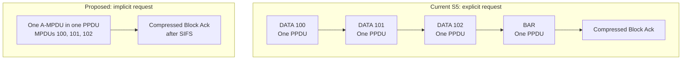
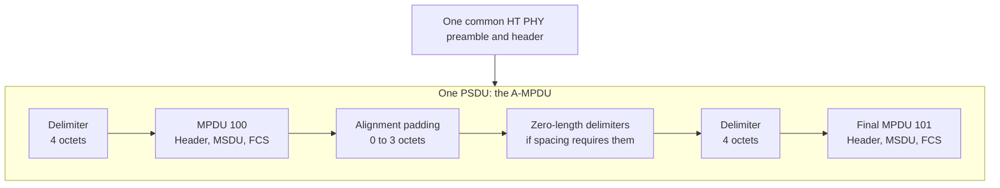
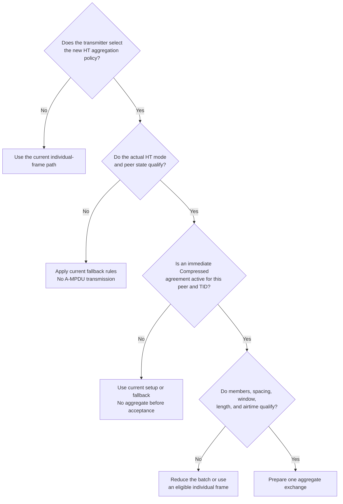
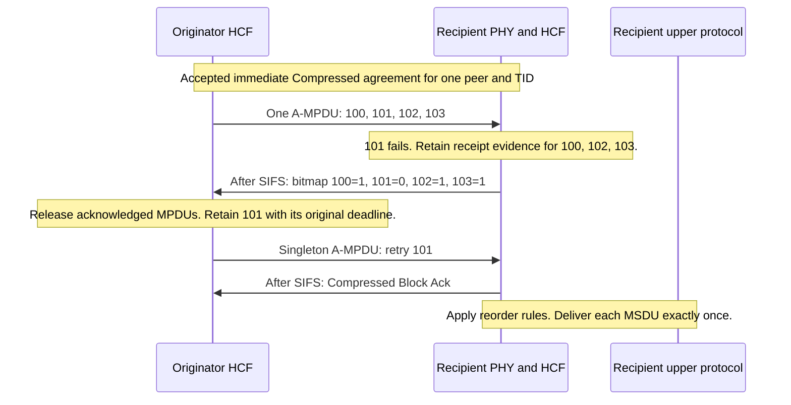
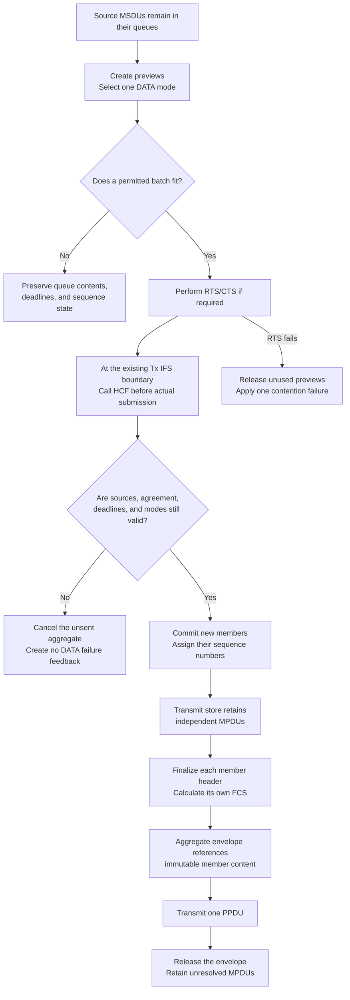
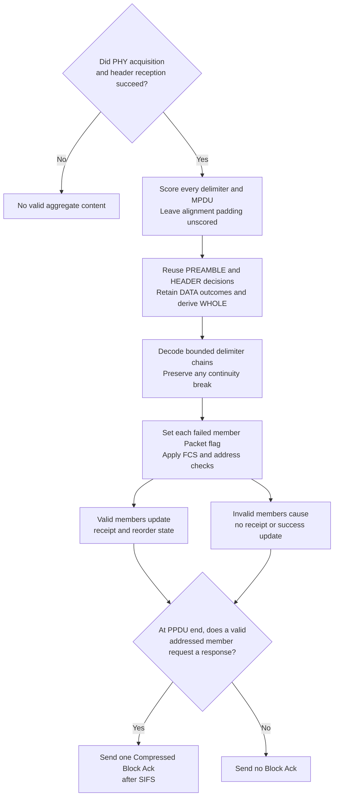
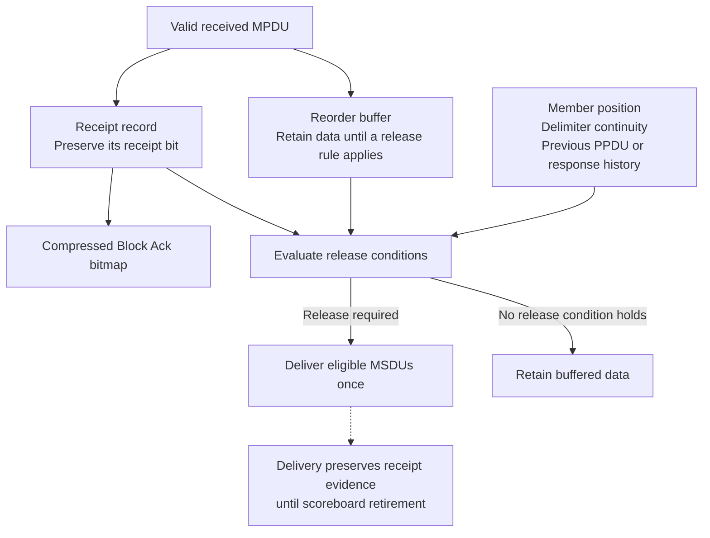
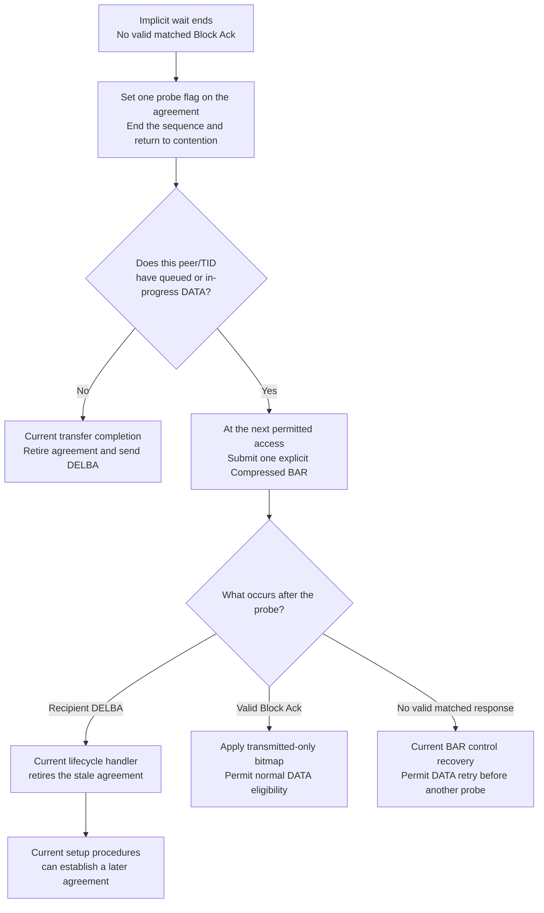
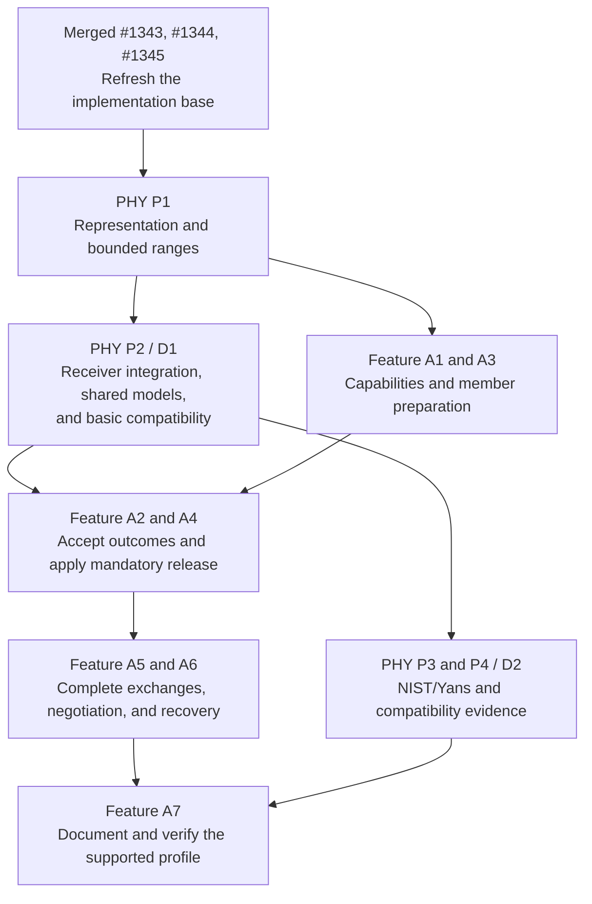

# A-MPDU with implicit Compressed Block Ack: plan summary

> **Kind:** reference · **Status:** draft · **Seal:** none · **Owns:** — · **Stands on:** [feature plan](ieee80211-ampdu-implicit-blockack.md), [PHY plan](ieee80211-ampdu-phy-reception.md)

This plan proposes several independently acknowledged MPDUs in one HT transmission. The recipient sends one Compressed Block Ack after the transmission ends. The aggregate requests that response without a separate BAR. The originator retries only the MPDUs that remain unacknowledged.

This summary describes revision 12 of the [feature plan](ieee80211-ampdu-implicit-blockack.md) and revision 11 of the [PHY plan](ieee80211-ampdu-phy-reception.md), dated 2026-10-17. Their source reference is branch `work/compressed-blockack-s5` at `4fa5cc0de15ee57388bcb3f20e866cab5972a670`. The feature remains proposed. The diagrams describe the design, not executed simulation traces.

The PHY plan supplies aggregate reception before the MAC feature uses it. Its first gate proves deterministic member outcomes and includes the shared NIST/Yans implementation. It also preserves default HT operation and reception without an error model. Its second gate extends the NIST/Yans and compatibility evidence. The MAC feature can reach deterministic integration between those gates.

Implementation waits for merged PRs [#1343](https://github.com/inet-framework/inet/pull/1343), [#1344](https://github.com/inet-framework/inet/pull/1344), and [#1345](https://github.com/inet-framework/inet/pull/1345). Read-only source checks can occur now. Both plans require a refreshed merged base before source implementation. This is the agreed delivery policy for one shared S5 baseline.

## What changes after S5

S5 is the stage that supplies explicit Compressed BAR exchanges for individual MPDUs. The originator sends those MPDUs in separate PPDUs. It later sends BAR to request their receipt status. The proposed path puts several MPDUs into one A-MPDU and requests receipt status through that aggregate. [Problem and intended behavior](ieee80211-ampdu-implicit-blockack.md#1-problem-and-intended-behavior).

This illustration assumes an accepted agreement and three MPDUs. Both paths end with a Compressed Block Ack. The proposed path needs fewer separate PHY transmissions for those MPDUs. Protection, contention, response rates, and loss still affect goodput; the plan promises no fixed performance gain.



An A-MSDU and an A-MPDU combine different units. An A-MSDU combines MSDUs inside one MPDU. An A-MPDU combines complete MPDUs, each with its own FCS. Separate receipt bits therefore permit selective retry within the aggregate.

## What the aggregate contains

One common PHY preamble and header serve the complete aggregate. Each MPDU retains its MAC header, payload, sequence number, and FCS. A delimiter identifies each MPDU boundary and length. The aggregate has no additional outer MAC header or outer FCS. [Representation and limits](ieee80211-ampdu-implicit-blockack.md#42-eligibility-and-limits).

PHY P1 extends the modeled HT-SIG fields and their serializer together. HT-SIG is the HT signal field that carries PSDU length and the Aggregation property. Golden bytes and independent decode must preserve both values in the 48-bit header. A singleton must retain Aggregation equal to one after byte conversion. This work covers the modeled HT-SIG header without a new waveform model. [HT-SIG representation and verification](ieee80211-ampdu-phy-reception.md#41-representation-and-bounded-ranges).

The radio already assigns that 48-bit header length. P0 records its current value and the mode/PSDU duration path. P1 completes byte conversion within the same length; ordinary HT controls must preserve airtime under identical inputs. Changed byte content alone establishes no airtime change or reason to update a fingerprint expectation.

Correct bytes alone do not establish rejection of an invalid received header. P1 also defines one stateless HT-SIG validator. P2 applies it before member outcomes and before radio decapsulation trusts HT Length. Invalid CRC or unsupported fields cause HEADER failure without delimiter or member draws. The current header-failure paths prevent receipt updates, delivery, and responses. [HT-SIG receive validation](ieee80211-ampdu-phy-reception.md#ht-sig-receive-validation).

A separate bounds check refuses modeled PSDU content shorter than a valid header's HT Length. HEADER retains success and the decoded Aggregation property. DATA reports failure without range outcomes or draws, and MAC refuses the content before header or trailer peeks. Decapsulation skips length-based trailer removal. This case proves bounds safety for malformed input. It establishes no physical carrier-loss behavior or acceptance of a received prefix.

The diagram shows two members. Nonfinal HT subframes need alignment padding of zero to three octets. The final HT subframe has no alignment padding. Extra zero-length delimiters can provide the minimum MPDU start spacing that the receiver requires.



Each complete HT member must fit the 4095-octet delimiter limit. The whole aggregate must fit both the peer's advertised limit and the HT maximum of 65535 octets. Its airtime must also satisfy the PHY and TXOP limits. A byte count alone cannot establish that an aggregate qualifies.

## Which traffic can use the first version

The first transmit profile uses packet-level `Ieee80211Radio`, scalar or dimensional reception, HT mixed format, 20 MHz, and long GI. Aggregate transmission requires fixed DATA rates and no HCF rate-control submodule. Each aggregate serves one recipient and TID under an accepted immediate Compressed agreement. Compressed responses retain the 64-bit bitmap. Multiple peers and agreements can coexist; each retains separate state. [Supported profile](ieee80211-ampdu-implicit-blockack.md#first-supported-profile).

Receive support also covers advertised HT20 short-GI modes at the permitted MCS and NSS values. Before the MIB update, the MAC supplies its exact mode set, effective channel widths, and NSS limit for receiver validation. The check covers advertised modes; unsupported catalog modes outside those limits do not cause rejection. A peer can select an advertised short-GI receive mode even when the local aggregate transmitter uses long GI. The new transmit policy remains limited to long GI. [Required receive coverage](ieee80211-ampdu-phy-reception.md#42-optional-role-and-shared-implementation).

HCF coordinates eligibility and the exchange. Management and the MIB supply local and peer capabilities. The proposed HT policy selects members within those capabilities and the agreement's transmit window. The policy cannot grant an agreement or bypass a PHY limit.



The transmit feature requires an explicit policy choice. The default policy continues to select no A-MPDU. A receiver must recognize supported received aggregates even when its own transmitter uses the default policy. Absent peer HT state retains S5's Normal Ack fallback.

The WLAN receiver checks role presence at PHY initialization. The MAC requests exact coverage validation later, before its MIB update at link-layer initialization. Absent roles and incomplete advertised coverage cause failure before management sends capability information. These checks apply even when local transmit aggregation remains disabled. Non-HT custom models retain ordinary MPDU reception without that role. [Early compatibility checks](ieee80211-ampdu-phy-reception.md#44-model-detail-and-diagnostics).

HT length exponent zero still advertises 8191 octets; it cannot disable aggregate reception. A model that exposes the role but lacks advertised short-GI support therefore fails initialization. A one-antenna configuration must pass when the model supports every advertised mode. The catalog can contain unsupported modes for more spatial streams. The validation adds no second capability store or independent filter.

BerTable remains outside the HT aggregate profile. Its current initializer rejects HT operation strings before the new role check. This delivery adds no aggregate role to BerTable. The migration guide directs supported HT configurations to NIST or Yans. The PHY fixture compares a non-HT parent control and verifies the current HT refusal separately from the custom-model role diagnostic. [Compatibility decision and checks](ieee80211-ampdu-phy-reception.md#5-affected-components-and-compatibility).

An absent error model retains the current error-free abstraction after PHY acquisition, possibility, attempt, and SNIR checks. Successful common checks permit physical success for bounded delimiter and member ranges without new error draws. Delimiter, FCS, address, and agreement checks still control MAC acceptance. This case adds no replacement module or interface requirement.

The proposed settings are:

```ini
**.mac.hcf.isBlockAckSupported = true
**.mac.hcf.blockAckVariant = "compressed"
**.mac.hcf.rateControl.typename = ""
**.mac.hcf.rateSelection.dataFrameBitrate = 6.5Mbps
**.mac.hcf.rateSelection.dataFrameBandwidth = 20MHz
**.mac.hcf.rateSelection.dataFrameNumSpatialStreams = 1
**.mac.hcf.originatorMacDataService.mpduAggregationPolicy.typename = "HtMpduAggregationPolicy"
```

`HtMpduAggregationPolicy` does not exist yet. The fixed rate above selects HT MCS 0 with one spatial stream under the required HT20 long-GI configuration. These settings also need compatible modes, usable peer HT state, and accepted agreements. An `ac` interface qualifies only through an actual supported HT transmission. It does not establish VHT A-MPDU support. [Configuration and compatibility](ieee80211-ampdu-implicit-blockack.md#5-affected-components-and-compatibility).

## How partial loss leads to selective retry

Consider this hypothetical exchange with MPDUs 100 through 103. The recipient receives 100, 102, and 103 correctly. MPDU 101 fails. The recipient reports those separate results in one bitmap after the complete PPDU and SIFS.



The originator releases 100, 102, and 103 from its transmit store. It retains 101 until acknowledgment or terminal disposal. The retry preserves 101's sequence number and absolute deadline. A singleton A-MPDU still requests Block Ack. One member does not turn it into a standalone MPDU with an individual ACK.

The wire ACK policy bits remain `00`. In a standalone MPDU, those bits ordinarily mean Normal Ack. In the supported aggregate context, they mean Implicit BAR. The PHY aggregation property and MAC exchange context preserve that distinction. [Implicit exchange and recovery](ieee80211-ampdu-implicit-blockack.md#47-originator-exchange-timing-and-recovery).

## Why preparation must preserve the source frames

The MAC must know whether the complete exchange fits before it removes source MSDUs from their queues. The QoS data service therefore creates previews first. HCF selects one DATA mode and checks the batch with that mode. A refusal leaves the source MSDUs, deadlines, and sequence counter intact. [Preparation and ownership](ieee80211-ampdu-implicit-blockack.md#43-preparation-commitment-and-ownership).

The current fixed-rate rules select the DATA mode by recipient before the service calculates mode-dependent spacing and aggregate length. If padding makes the batch too large, HCF reduces it and checks the smaller batch at that same mode. The design adds no size-aware DATA rate-control API.

HCF rejects aggregate transmit opt-in with a rate-control submodule, also when fixed-rate settings would bypass that controller's rate choice. AARF can change its rate and probe state after a member callback. Separate callbacks for one PPDU can therefore describe a probe at a rate that no transmission used. The first profile avoids that false result through fixed rates. Adaptive aggregate feedback needs a separate design; existing individual-frame configurations retain their current rate-control behavior.

The proposed policy selects transmitted retries first, numbered unsent MPDUs second, and queued new members last. Both committed groups use cyclic sequence order; queued new members use queue order. This order is an INET choice. Previews of queued members use candidate numbers without counter advancement. Commitment validates that reference before actual assignment. Already numbered members retain their numbers and deadlines.

An internal collision can cause the current HCF handler to extract and number one frame without a DATA transmission. The EDCAF that loses the collision retains its current single-frame recovery, including terminal disposal. Aggregate preparation accepts a retained numbered frame without another sequence allocation. Current acknowledgment state keeps Retry clear for its first DATA transmission. The feature plan's [source-state table](ieee80211-ampdu-implicit-blockack.md#43-preparation-commitment-and-ownership) defines that distinction.

A1 supplies capability propagation and aggregate construction calculations for spacing, serialization, and member layout. A3 uses those calculations for dynamic member selection, spacing at the retained mode, and batch reduction. A3 also retains canonical member ownership. [Implementation responsibilities](ieee80211-ampdu-implicit-blockack.md#6-implementation-steps-and-dependencies).



The transmit store, `InProgressFrames`, owns each committed MPDU until acknowledgment, expiration, or another terminal outcome. The envelope holds references to member content. Envelope disposal must not destroy the MPDUs that still need retry. Each MPDU retains its own lifetime; aggregate construction does not restart it.

DATA submission means the actual call from Tx to the radio. Tx acceptance before SIFS leaves source MSDUs uncommitted. At its existing IFS timer boundary, Tx calls HCF before it copies or sends the PSDU. HCF validates the batch before the service commits new members. Tx then finalizes each member and submits the envelope within that synchronous call chain. Zero IFS uses the same callback immediately.

HCF sets each member's Retry bit, ACK policy, and common Duration/ID. Tx applies the local TA and calculates each member's FCS after those header edits. The builder then constructs the delimiter envelope without an outer MAC header or outer FCS. Selective retry requires a fresh member FCS after any header change. [Member finalization](ieee80211-ampdu-implicit-blockack.md#43-preparation-commitment-and-ownership).

If the originator inactivity timer retires the agreement during SIFS, the start callback refuses the cancelled preparation. No DATA reaches the radio, and no source receives a new sequence number. The frame sequence context retains the preparation until submission or cancellation. Reset cancels the pending Tx request before it releases that context.

With an active agreement, aggregate RTS failure applies one contention update for new members, committed members, or both together. It adds no member retry increment, DATA attempt, DATA outcome, or pending probe. Queued sources remain queued; committed members retain their numbers, acknowledgment state, recovery state, and deadlines. The contention retry boundary resets access-category state without member disposal. Independent expiry or agreement retirement can still remove members. Current individual-frame RTS recovery and internal collision recovery retain their existing rules, including suppression of obsolete completion feedback.

## Why the PHY needs separate member results

The current receiver obtains a whole-data success decision. That decision cannot represent one failed MPDU beside three successful MPDUs. The plan adds separate delimiter and MPDU outcomes, with common PHY acquisition and header success. [Partial reception design](ieee80211-ampdu-implicit-blockack.md#44-phy-representation-and-partial-reception).



The cache keeps separate entries for each receiver, transmission, and signal part. PREAMBLE preserves the current per-part checks without early HEADER or DATA calculation. HEADER reuses PREAMBLE before its own header calculation. DATA owns bounded range outcomes or structural refusal after successful header reception. A WHOLE query derives its summary from those entries without another error draw. Aggregate success queries must use those same entries.

In separate-part mode, PREAMBLE or HEADER failure aborts the attempted reception before a container reaches MAC. Existing radio state notifications let HCF invalidate its physical history. Whole-signal mode can supply a failure container that MAC rejects before header or trailer parsing. Both paths prevent acceptance, responses, and range draws. The design preserves their existing event boundaries.

The PHY scores every four-octet delimiter, also when its MPDU length is zero. It scores each nonzero MPDU range once. Alignment padding still contributes airtime but has no separate error draw. The model cannot represent errors confined to alignment padding. Header failure prevents all range draws. A failed spacing delimiter preserves a continuity break even if a later delimiter becomes recoverable.

P0 checks cache insertion, replacement, cleanup, and direct success queries against the merged base. P2 checks PREAMBLE at its actual boundary before any HEADER or DATA calculation. Later HEADER, DATA, WHOLE, and repeated result queries must reuse their retained outcomes. The [PHY design](ieee80211-ampdu-phy-reception.md#43-decision-ownership-and-random-draws) defines that ownership. The aggregate result path preserves valid members despite a failed PPDU summary.

With a present error model, aggregate results retain `ErrorRateInd` with all three probability fields set to `NaN`. The new range model supplies retained outcomes without an aggregate probability estimate. Result construction must preserve applicable power, SNIR, timing, mode, and channel metadata. Without an error model, the common base's existing probability tag presence and exact values remain valid. Ordinary MPDU metadata keeps its current calculations. [Aggregate metadata contract](ieee80211-ampdu-phy-reception.md#aggregate-error-rate-metadata).

The tag contract permits `NaN` for unknown probabilities. P0 must audit readers, filters, and recorders that can receive aggregate metadata before P2 implements this contract. A reachable incompatibility blocks that implementation until the PHY plan records its resolution. Tag omission requires evidence that all affected consumers accept absence. The PHY fixture must verify the identified consumer paths before D1 closes.

The [PHY plan](ieee80211-ampdu-phy-reception.md#42-optional-role-and-shared-implementation) defines an optional WLAN role for per-range probabilities and a pure mode-support query. A shared WLAN base implementation reuses the current length-based calculations for NIST, Yans, and compatible custom subclasses. P2 supplies this implementation and the MAC validation call before it enables the HT compatibility checks. The receiver checks the exact MAC capability inputs without a probability call or random draw. It calls the probability operations only for aggregates. An absent model follows the explicit error-free case.

Deterministic tests supply probabilities of zero or one through the same role. The real receiver still produces and caches the outcomes. Those tests establish receiver integration and selective recovery. They do not establish the full NIST/Yans profile.

The shared NIST/Yans implementation uses independent delimiter and MPDU outcomes under the current scalar SNIR reduction. This is a packet-level abstraction. It does not model correlated FEC errors or reconstruct interference within each MPDU. D2 extends the evidence for that implementation before completion of the documented profile.

The decoder checks lengths, alignment, delimiter CRC, and signature before it trusts a member boundary. It can recover a later valid delimiter after corruption. That recovery does not erase the earlier continuity break.

The decoder creates a separate Packet for each complete recoverable member. A failed PHY range sets only that member's bit-error flag. Rx rejects the flag before any FCS-mode branch. Other valid members retain their own outcomes and intact shared chunks. A valid FCS cannot override the member's error flag. [Receive validation](ieee80211-ampdu-implicit-blockack.md#45-receive-validation-and-one-response-per-ppdu).

Rx reports one complete aggregate outcome for contention after all member checks. A correctly received member suppresses EIFS, also when that member addresses another station or lacks an agreement. A delivered container with no correct member invokes the existing corruption procedure once. Separate-part header failure retains the earlier radio abort. An individual member failure must not invoke HCF's ordinary corruption callback or erase valid aggregate history. The PHY's WHOLE summary cannot replace this MAC decision.

## Why receipt and delivery need separate state

Receipt state answers whether an MPDU arrived correctly. The reorder buffer answers when the recipient can deliver its contents. A positive Block Ack bit does not prove immediate upper delivery. Conversely, delivery must not erase receipt evidence that a later Block Ack needs.



Aggregate release rules need more information than S5's individual-MPDU interframe check. The reorder service needs member position, delimiter continuity, prior receipt evidence, and the applicable physical interval. HCF supplies those facts through copied timing history. The reorder service releases eligible data when an applicable condition requires that action. [Reorder release and history](ieee80211-ampdu-implicit-blockack.md#46-reorder-release-and-physical-history).

The hypothetical loss of 101 does not imply that every later MPDU must remain buffered. Clause 10.25.6.6.2.1 requires release when an applicable condition in (a)(2)(i–iv) holds. Conservative gap retention cannot replace that action. Tests must prove each reachable condition and its required release action. Sequence arithmetic must also remain correct across 4095 and 0.

## How timing constrains an aggregate

HCF checks the complete exchange: optional RTS/CTS, required interframe spaces, the DATA PPDU, and Block Ack. The actual selected mode and delimiter padding determine DATA airtime. All members carry the same Duration/ID value, referenced to PPDU end. The PHY mode calculation remains the authority for airtime.

RTS selection uses the complete PSDU length, including members, delimiters, alignment, and spacing. Clause 10.3.5 requires RTS/CTS when that length exceeds the threshold. The current policy also selects protection at equality, which the clause permits. HCF supplies an exact aggregate preview and a separate valid member header to that policy. Every batch reduction reevaluates protection and complete-cost admission at the same retained DATA mode. The preview reaches no radio and establishes no commitment or attempt.

In a hypothetical case, a retained retry and a new preview each contain a complete 1500-octet MPDU. With zero extra spacing, the PSDU measures 3008 octets and exceeds a 2346-octet RTS threshold. HCF therefore selects RTS/CTS although each member falls below the threshold. If CTS does not arrive, HCF records one contention failure and releases the previews. The queued source stays queued; the retained member keeps its retry state and deadline. [RTS selection and recovery](ieee80211-ampdu-implicit-blockack.md#47-originator-exchange-timing-and-recovery).

For a hypothetical later exchange, assume 200 microseconds remain in the TXOP. If the complete aggregate exchange needs 240 microseconds, HCF must reduce the batch or defer it. The source MSDUs remain available for a later attempt. A positive amount of time left does not prove that the exchange fits.

| Condition | Proposed result |
| --- | --- |
| TXOP limit is zero. | Permit one A-MPDU DATA PPDU with its required protection and acknowledgment. Do not add a second DATA PPDU. |
| TXOP limit is positive and the aggregate contains multiple MPDUs. | The complete exchange must fit, even when every member is a retry. |
| A singleton retry can exceed the limit. | Apply the same-size retry exception only when its full conditions and TXOP history permit it. |
| An initial singleton carries an ordinary MSDU under the agreement. | Apply its separate exception only when the TXOP conditions permit it. A first-attempt A-MSDU cannot use that exception. |
| HT mixed-format duration reaches its L-SIG limit. | Require calculated `L_LENGTH` at or below 4095. For this profile, `TXTIME - SignalExtension` must not exceed 5484 microseconds. |
| HT PPDU duration reaches its separate PHY limit. | Also apply the HT limit of 10 ms independently of the L-SIG and TXOP rules. |

For a hypothetical 5 GHz aggregate that needs 6 ms, the 10 ms check passes but calculated `L_LENGTH` reaches 4482. HCF must reduce the batch or defer it. The signal extension changes the corresponding total-duration boundary in 2.4 GHz. [HT duration conditions](ieee80211-ampdu-implicit-blockack.md#42-eligibility-and-limits).

The first profile uses legal non-HT RTS/CTS and non-HT OFDM or ERP-OFDM Block Ack responses. The recipient first selects the highest permitted BSS basic rate at or below the actual HT PPDU's non-HT reference rate. If none qualifies, it selects the highest permitted mandatory rate at or below that same reference rate. A legal alternate must preserve response duration and modulation class. HCF must reject a forced incompatible control format before aggregate submission.

The response deadline starts at PHY transmission completion. It covers SIFS, one slot, and the PHY receive-start delay. Once an eligible reception starts, HCF waits for reception end and validates the response. It does not replace that procedure with an arbitrary whole-response delay. [Timing and response rules](ieee80211-ampdu-implicit-blockack.md#47-originator-exchange-timing-and-recovery).

## What happens when the exchange fails

One aggregate produces one contention outcome, but it can produce different delivery outcomes for its members. A valid matched Block Ack completes the response exchange even when its bitmap contains no positive bits. Members without positive acknowledgment still need retry. An absent or invalid response produces one contention failure.

| Event | Result for the proposed path |
| --- | --- |
| A valid bitmap acknowledges some members. | Release those members. Retain the other members with their original deadlines. |
| A valid bitmap acknowledges no members. | Complete the response exchange. Retain unresolved DATA for retry. |
| The implicit wait ends without a valid matched Block Ack. | Report one response-exchange failure. End the sequence and arm one explicit BAR probe before further DATA for that agreement. |
| DATA lifetime expires. | Dispose of the affected member through its current owner. Do not restart its deadline through another aggregate. |
| Valid addressed Implicit BAR DATA arrives without an agreement. | Discard the DATA. Send no Block Ack or individual ACK. That DATA triggers no DELBA or receive state. |
| A valid addressed implicit aggregate conflicts with an active Basic agreement. | Report the profile conflict before receipt or reorder updates. Do not silently send a Basic response. |

Silent discard is the first profile's explicit policy choice. Clause 11.5.4 names Block Ack-policy DATA in its absent-agreement DELBA rule. This plan does not extend that rule to Implicit BAR DATA. Current explicit BAR and inactivity recovery retain their separate triggers. [Receive validation and absent-agreement recovery](ieee80211-ampdu-implicit-blockack.md#45-receive-validation-and-one-response-per-ppdu).

Silence gives the originator no immediate agreement-loss notice. Finite batches already have a recovery trigger. After the last DATA expires, HCF checks transfer completion at a safe exchange boundary. It retires the accepted agreement when that peer/TID has no queued or in-progress DATA. This works with inactivity timeout zero.

Continuous arrivals can keep DATA queued. The first failed implicit response wait therefore sets one boolean probe requirement in the current originator agreement. The BAR policy selects one real explicit Compressed BAR before further DATA for that agreement. Admission refusal preserves the flag. Actual submission consumes it. Current EDCA classification derives the probe's access category from the agreement's TID; no category is stored with the flag.

The probe is INET policy beyond the standard's requirements. Clause 10.25.6.7.1 also permits direct DATA retransmission after a lost Block Ack. A submitted probe adds BAR airtime, channel access delay, and a response exchange or timeout. This cost also applies when the agreement remains healthy. Transfer completion can retire an empty agreement before probe submission.

A valid probe response applies the current bitmap rules. Probe failure returns to DATA retry if the agreement remains active. It does not arm another probe by itself. For each agreement, at most one submitted probe occurs between DATA attempts. A valid zero-bit implicit Block Ack does not arm a probe. The probe adds no DATA attempt or duplicate member feedback.

In this hypothetical case, fresh DATA continues to arrive, but the recipient lacks the agreement. It silently discards an implicit aggregate. The failed wait causes an explicit probe. The recipient answers that BAR with DELBA under S5's current rule. The originator retires its stale agreement and can establish a later agreement without queue drain.



The diagram describes the proposed recovery policy. The probe waits for Block Ack. DELBA uses the current Action path and can arrive after that wait. It still retires the agreement.

A6 checks finite batches and continuous arrivals with zero and nonzero inactivity values. The finite case forces probe failure so DATA expiry reaches the current completion trigger. The continuous case verifies an actual BAR, recipient DELBA, and later setup while fresh DATA remains queued. [Recovery transitions and checks](ieee80211-ampdu-implicit-blockack.md#appendix-c-recovery-transitions-and-acceptance-cases).

A separate A6 case keeps a healthy agreement active while selected implicit Block Ack responses fail. Full, partial, and absent probe responses must permit actual subsequent DATA transmission before another probe. Original deadlines, per-member feedback, and exactly-once upper delivery remain required. This controlled case establishes no general fairness or goodput bound.

With an active agreement, valid Implicit BAR DATA refreshes recipient inactivity. A duplicate can refresh inactivity without another delivery. Invalid members cannot refresh it. The originator accepts positive bitmap bits only for applicable transmitted MPDUs.

The originator validates received responses against the active receive interval, peer, TID, profile, and frame fields. Frames outside that interval and callbacks from retired local contexts cannot complete the wait. Compressed Block Ack has no identifier for an individual exchange. A hypothetical delayed frame with identical fields inside a later valid interval follows ordinary response validation. The plan promises no rejection based on a hidden link to an earlier exchange. Supported peers send their immediate responses after the required SIFS.

Recovery and observations report each attempted member's actual outcome. The first aggregate transmit profile has no rate-control submodule, so member results cause no rate-control callbacks. Contention counters must not increase once for every member of the same failed exchange. Block Ack DATA retries remain bounded by the current lifetime policy; the plan adds no new member retry limit. General stop/start recovery remains outside this work.

## How the work reaches a complete feature

Two linked plans separate the receiver prerequisite from the MAC feature. The PHY plan owns representation, bounded delimiter parsing, cached outcomes, and error-model integration. The feature plan owns selection, independent member state, reception, mandatory release, responses, and recovery.

D1 is the PHY plan's receiver integration gate. It includes deterministic reception evidence, the shared NIST/Yans implementation, and basic compatibility checks. Feature A2 accepts copied PHY indications and refusal behavior; A4 supplies MAC reception and required release. A5 connects complete exchanges, with the short-GI response check, and A6 verifies negotiation and recovery. None of those steps can omit A4. [Feature steps](ieee80211-ampdu-implicit-blockack.md#6-implementation-steps-and-dependencies).

D2 is the PHY plan's broader NIST/Yans and compatibility evidence gate. Those checks can follow deterministic MAC integration because D1 already includes the implementation and preserves default HT operation. Feature A7 needs both A6 and D2 before the supported profile reaches completion. This split gives each delivery a clear evidence boundary. [PHY steps and gates](ieee80211-ampdu-phy-reception.md#6-implementation-steps-and-dependencies).



The two plans retain nine proposed fixtures across unit, module, and protocol tests. The PHY plan owns two; the feature plan owns seven. They must check wire bytes, capability propagation, source ownership, partial PHY reception, reorder release, complete exchanges, recovery, timing, and production negotiation. Current Basic, explicit Compressed, lifetime, reset, and disabled-feature checks provide regression coverage. Compatible configurations with disabled transmit aggregation must preserve current frame sequences and random draws. [Verification methods](ieee80211-ampdu-implicit-blockack.md#7-verification-methods-and-expected-results).

Direct exchange assertions must prove one DATA PPDU, one response after SIFS, correct receipt bits, selective retry, and exactly-once upper delivery. Physical reception tests must produce the partial results through the real receiver. An injected bitmap cannot prove that PHY integration. Fingerprints can detect a changed trajectory; they cannot replace these assertions.

The planned campaign also checks member flags under declared-correct and computed FCS modes. It covers 2.4 GHz and 5 GHz, HT MCS 0 and 7, legal response modes, and supported protection combinations. Boundary checks cover sequence wrap, buffer sizes 1, 2, and 64, expiration order, and independent peers and TIDs. Deterministic loss cases prove the causal paths. The small additional seed campaign establishes no statistical goodput claim.

The corrected checks also cover production member FCS before and after selective retry, partial-reception EIFS suppression, and agreement removal during SIFS. Admission checks distinguish the HT mixed-format L-SIG condition from the separate 10 ms limit. A nonzero-spacing case proves that batch reduction retains one DATA rate decision.

RTS checks use complete PSDU lengths below, equal to, and above the configured threshold. Spacing and batch reduction must cause renewed protection selection. Recovery checks cover mixed batches, numbered unsent members, internal collision survivors, and terminal collision disposal. Repeated aggregate RTS failure reaches the contention retry boundary without member retry increments, member disposal, DATA outcomes, or a pending probe. Probe checks derive ownership from the agreement's TID after member expiry. These cases remain proposed verification.

PHY checks also prove HT-SIG golden bytes and independent decode, PREAMBLE query order, and the two failed-header delivery paths. Invalid CRC and unsupported fields cause HEADER failure with successful header probabilities and without an error model. A separate malformed-input case retains HEADER success but refuses insufficient modeled PSDU content at DATA. Metadata checks verify the aggregate probability fields and the applicable receive tags without another probability call or random draw. The same proposed fixtures own these cases; the inventory remains nine. None of these checks establishes physical carrier-loss behavior.

Configuration checks reject aggregate transmit opt-in with AARF. They also reject absent aggregate roles and incomplete advertised receive-mode coverage before capability advertisement. D1 controls preserve ordinary HT reception with NIST, Yans, and an absent error model. Aggregate checks without an error model retain PHY checks, delimiter validation, and FCS rejection without new error draws. Response checks separate observable mismatches and retired callbacks from indistinguishable valid frames inside an active interval. These are proposed checks; no runtime evidence establishes their results yet.

A fixture peer supplies a valid HT20 short-GI aggregate through the real radio. D1 and A2 verify copied PHY indications without MAC receipt or response requirements. After A4 supplies member validation, A5 verifies MAC receipt and one Compressed response after SIFS. A6 verifies production capability negotiation with the local aggregate transmit policy at long GI. This receive case does not establish short-GI selection from production transmit queues. [Receive acceptance cases](ieee80211-ampdu-implicit-blockack.md#proposed-direct-checks).

## What the first version leaves for later

The first transmit policy selects ordinary MSDU members. It does not add nested A-MSDU selection. Current individual A-MSDU operation remains available, and reception preserves the current negotiated A-MSDU checks and deaggregation.

The first version excludes these larger features:

- VHT PPDUs, HT40, HE/EHT, Multi-TID, and multi-user aggregates.
- Short-GI aggregate transmission through the new HT policy.
- Delayed Block Ack, partial-state scoreboards, protected agreements, dynamic fragmentation, and group-addressed aggregates.
- Reverse direction, mixed control/data aggregates, adaptive aggregate transmission, new rate-control algorithms, and general MAC stop/start recovery.
- Bit-level FEC behavior, correlated error accuracy, errors confined to alignment padding, and a guaranteed performance gain.

Custom data services, MPDU policies, Tx/Rx modules, response policies, and response-rate selectors can need interface updates. The DATA rate-control API remains unchanged; aggregate transmit opt-in requires its HCF submodule to be absent. Present custom HT models need the optional PHY role with coverage of advertised receive modes. This includes configurations that previously used only ordinary MPDUs. Non-HT custom reception and operation without an error model remain available without that role. The implementation must document those obligations.

The design reuses the public Packet API and proposes no edit to its sealed implementation. Related feature branches remain separate integration work. [Compatibility and scope](ieee80211-ampdu-implicit-blockack.md#5-affected-components-and-compatibility).

The user's approved revision covers these documents only. It adds no implementation approval or runtime evidence. The two linked plans own the detailed decisions, source references, standard clauses, commands, and verification limits.
