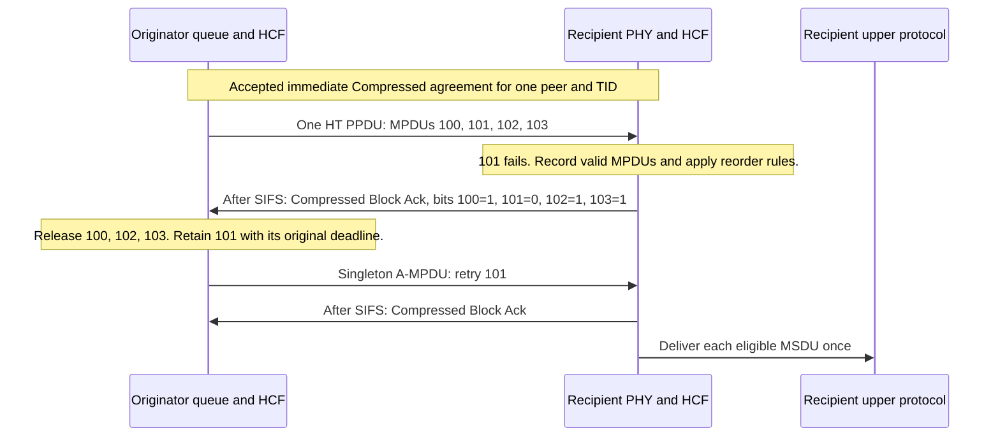

# Implementation plan: A-MPDU with implicit Compressed Block Ack

> **Kind:** procedure · **Status:** draft · **Seal:** none · **Owns:** — · **Stands on:** [PHY prerequisite plan](ieee80211-ampdu-phy-reception.md), [S5 execution record](ieee80211-compressed-blockack-s5-execution.md), [implementation plan procedure](../../doc/project/guide/write-an-implementation-plan.md), [IEEE 802.11 rules](../../doc/project/domain/ieee80211.md)

Checkout: `/home/user/omnetpp_ws/inet-compressed-blockack-s5`, branch `work/compressed-blockack-s5`, HEAD `4fa5cc0de15ee57388bcb3f20e866cab5972a670`.

Plan revision: 12, 2026-10-17. The user's `proceed, including the optional simplification` authorizes the reviewed document corrections. This revision defines PSDU-based RTS selection, recovery before DATA submission, and a boolean probe requirement with a derived access category. This document accompanies PHY revision 11 and the revised summary. The delivery gates and PHY behavior retain their current scope. Implementation, expectation changes, commits, and publication remain outside this authorization.

The project plan procedure remains a draft; this document uses its structure without an additional approval requirement.

A1 is complete on the separately approved base `56b75c959af104b5db931bef022bdfe5578eead9`. The user authorizes A1 before the prerequisite merges on 2026-10-18. The later request `Execute stages A2-A7` extends that authority on the same base. A2 through A7 are complete within the recorded profile and verification limits. The user subsequently authorizes commit, push, and PR creation.

The [execution record](ieee80211-ampdu-implicit-blockack-execution.md) states the changes, evidence, and limits. This exception does not close A0. Expected-result changes, commits, and publication retain their separate authority requirements.

This feature plan consumes the [PHY prerequisite plan](ieee80211-ampdu-phy-reception.md). That plan owns aggregate representation, bounded delimiter parsing, cached partial reception, and error-model integration. This plan owns member selection, MAC reception, mandatory release, implicit responses, and recovery.

Implementation normally waits for merged PRs [#1343](https://github.com/inet-framework/inet/pull/1343), [#1344](https://github.com/inet-framework/inet/pull/1344), and [#1345](https://github.com/inet-framework/inet/pull/1345). The assessment on 2026-10-16 confirmed all three as open. The exception above permits A1 through A7 on the approved base. Read-only A0 checks can occur before merge. A0 cannot close until the merged dependency chain and refreshed implementation base exist.

The [delivery table](#6-implementation-steps-and-dependencies) identifies the stages and their prerequisites. The [fixture table](#7-verification-methods-and-expected-results) identifies acceptance evidence. Detailed standards and execution commands remain in the appendices.

## 1. Problem and intended behavior

The proposed feature sends multiple QoS MPDUs in one HT PPDU. The recipient returns one Compressed Block Ack after SIFS. The aggregate itself requests that response, so the successful exchange needs no separate BAR. Each MPDU retains its own sequence number, FCS, lifetime, and retry state.

S5 supplies explicit Compressed BAR exchanges for individual MPDUs. It does not connect A-MPDU selection, aggregate reception, or the implicit response sequence. The current aggregate builder alone cannot provide those mechanisms. This plan adds the complete path through production queues, PHY reception, and acknowledgment recovery.

This hypothetical case defines the main acceptance scenario. An immediate Compressed agreement exists for one peer and TID, with a transmit window that starts at 100. Four queued MSDUs become MPDUs 100 through 103 in one A-MPDU. The recipient receives 100, 102, and 103 correctly; MPDU 101 fails its FCS check. The recipient sends one Compressed Block Ack after the PPDU ends. The bitmap reports 100, 102, and 103 as received.

The originator retains 101 for retry and releases the other transmitted MPDUs. A singleton A-MPDU can carry the retry of 101 and request another Block Ack. Each MSDU reaches the upper protocol exactly once. The reorder service applies every release condition that the supported aggregate path requires; an applicable release condition requires delivery across a gap.



The diagram describes proposed behavior. It is not an executed trace.

## 2. Current implementation and evidence

The facts below come from the pinned source. The [S5 record](ieee80211-compressed-blockack-s5-execution.md) supplies historical verification; this plan supplies no new runtime result.

| Component and source | Confirmed behavior | Required consequence |
| --- | --- | --- |
| [QoS data service](../../src/inet/linklayer/ieee80211/mac/originator/OriginatorQosMacDataService.cc) | Lines 309–313 contain the commented A-MPDU invocation. Reversible preparation currently produces one MPDU or A-MSDU. | Extend preparation to a batch without premature queue extraction. |
| [Default MPDU policy](../../src/inet/linklayer/ieee80211/mac/aggregation/BasicMpduAggregationPolicy.cc) | The policy always returns `nullptr`. | Add an explicit HT policy; preserve the current default. |
| [Aggregate builder](../../src/inet/linklayer/ieee80211/mac/aggregation/MpduAggregation.cc) | The helper concatenates MPDUs with delimiters and alignment padding. It deletes its inputs. | Retain canonical MPDUs separately for selective retry. |
| [Aggregate decoder](../../src/inet/linklayer/ieee80211/mac/aggregation/MpduDeaggregation.cc) | The helper assumes valid lengths and derives names from the aggregate name. | Consume bounded parsing from the PHY plan. Apply MAC validation without name-dependent behavior. |
| [HT capability state](../../src/inet/linklayer/ieee80211/mib/Ieee80211HtCapabilities.h) | Directional state retains the receiver's maximum A-MPDU length exponent. It omits minimum MPDU start spacing. | Carry spacing through local advertisement, peer state, and directional negotiation. |
| [Management conversion](../../src/inet/linklayer/ieee80211/mgmt/Ieee80211HtMgmtElements.h) | The wire element contains spacing, but conversion does not retain it. | Preserve all supported spacing values through real management paths. |
| [MAC receive entry](../../src/inet/linklayer/ieee80211/mac/Ieee80211Mac.cc) and [Rx](../../src/inet/linklayer/ieee80211/mac/Rx.cc) | Rx expects one MAC trailer and one MAC header. | Recognize an aggregate before the ordinary MPDU FCS and header path. |
| [Tx](../../src/inet/linklayer/ieee80211/mac/Tx.cc) and [its contract](../../src/inet/linklayer/ieee80211/mac/contract/ITx.h) | Tx finalizes one MPDU before SIFS, retains a copy, and sends that copy when its timer expires. | Add aggregate submission at the actual start, with per-member finalization and an explicit cancellation result. |
| [RTS policy](../../src/inet/linklayer/ieee80211/mac/originator/QosRtsPolicy.cc) and [its contract](../../src/inet/linklayer/ieee80211/mac/contract/IRtsPolicy.h) | The policy reads the supplied Packet's length and a separate MAC header. Its current threshold comparison includes equality. | Supply the complete aggregate preview and a valid member header. Reevaluate protection after batch reduction. |
| [HCF recovery before DATA](../../src/inet/linklayer/ieee80211/mac/coordinationfunction/Hcf.cc) | Internal collision recovery can number an unsent frame. RTS failure updates only contention for an uncommitted preview; committed frames also receive member retry accounting. | Include numbered, unsent candidates. Define aggregate RTS recovery independently of one representative member's state. |
| [Rx failure processing](../../src/inet/linklayer/ieee80211/mac/Rx.cc) and [HCF corruption callback](../../src/inet/linklayer/ieee80211/mac/coordinationfunction/Hcf.cc) | Ordinary rejection notifies contention. The MAC also invokes HCF's corruption callback, which clears interframe history. | Separate member rejection from the complete aggregate outcome for contention and history. |
| [DATA rate selection](../../src/inet/linklayer/ieee80211/mac/rateselection/QosRateSelection.cc) and [rate control](../../src/inet/linklayer/ieee80211/mac/contract/IRateControl.h) | Current rate control selects a rate by recipient address. It takes no aggregate size. | Select one mode before mode-dependent spacing. Reuse the current recipient-based decision. |
| [AARF feedback](../../src/inet/linklayer/ieee80211/mac/ratecontrol/AarfRateControl.cc) | Each callback can change the selected rate and probe state. The callback contains no actual transmission mode. | Separate callbacks for one aggregate can describe a probe at a rate that no member used. Restrict the first transmit profile to fixed rates. |
| [PHY receiver](../../src/inet/physicallayer/wireless/ieee80211/packetlevel/Ieee80211Receiver.cc) and [error model](../../src/inet/physicallayer/wireless/ieee80211/packetlevel/errormodel/Ieee80211ErrorModelBase.cc) | The receiver obtains a whole-data success decision. The WLAN error model supports whole-Packet corruption only. | Consume cached delimiter and MPDU outcomes from the PHY plan. |
| [HT PHY header](../../src/inet/physicallayer/wireless/ieee80211/packetlevel/Ieee80211PhyHeader.msg) | The modeled HT header has no aggregation field. | Consume the PHY plan's HT aggregation property for both singleton and multiple-member aggregates. |
| [Frame sequence](../../src/inet/linklayer/ieee80211/mac/framesequence/TxOpFs.cc) and [acknowledgment handler](../../src/inet/linklayer/ieee80211/mac/originator/QosAckHandler.cc) | `NORMAL_ACK` selects an ACK wait. An explicit BAR creates the current Block Ack wait. | Add an aggregate exchange with a Block Ack wait and no synthetic BAR. |
| [Reorder service](../../src/inet/linklayer/ieee80211/mac/blockackreordering/BlockAckReordering.cc) and [HCF history](../../src/inet/linklayer/ieee80211/mac/coordinationfunction/Hcf.h) | S5 supplies individual-MPDU interframe evidence. The reorder call accepts one interframe boolean. | Supply aggregate position, delimiter continuity, and previous PPDU facts for aggregate release rules. |
| [HCF transfer completion](../../src/inet/linklayer/ieee80211/mac/coordinationfunction/Hcf.cc) | Lifetime expiry and exchange completion invoke `completeTransfers()`. An accepted agreement with transmitted DATA retires when its peer/TID has no queued or numbered DATA. | Name this finite-batch recovery trigger. Preserve transmitted-member records for aggregate submissions. |
| [QosAckHandler](../../src/inet/linklayer/ieee80211/mac/originator/QosAckHandler.cc) and [BAR policy](../../src/inet/linklayer/ieee80211/mac/originator/OriginatorQosAckPolicy.cc) | Current BAR selection uses `BLOCK_ACK_NOT_YET_REQUESTED` members. It does not select failed implicit waits automatically. | Define an explicit probe trigger that also works while fresh DATA remains queued. |

Prior local edits affect `AGENTS.md`, the replacement plan, its summary, the agreement lifecycle plan, and the EDCA lifetime plan. The S5 summary and planning history also exist as untracked files. This plan does not alter those files. The source revision above remains the implementation reference; local prose does not establish additional runtime support.

## 3. Scope and acceptance criteria

### First supported profile

The first aggregate transmit profile targets packet-level `Ieee80211Radio` with scalar or dimensional reception, HT mixed format, 20 MHz, and long GI. Aggregate transmission requires a fixed DATA rate and no HCF rate-control submodule. The transmitter must select an actual HT mode. An `ac` interface can qualify only when its actual transmission uses this HT profile and valid peer HT state. This does not add VHT PPDU support.

Reception also covers HT20 short GI when local HT capability advertises that receive mode. The PHY contract requires coverage of the advertised MCS and NSS values within the effective radio limits. Interface presence alone cannot establish that coverage. The MAC supplies its exact capability inputs to the receiver for validation before the MIB update. This receive requirement does not extend the new aggregate transmit policy to short GI. [PHY receive contract](ieee80211-ampdu-phy-reception.md#42-optional-role-and-shared-implementation).

Each aggregate contains unfragmented, individually addressed QoS Data MPDUs for one RA, TA, and TID. An accepted immediate Compressed agreement must exist. Multiple peers and agreements can coexist; each aggregate remains within one agreement. The first transmit policy forms ordinary MSDU members. New selection of nested A-MSDUs remains separate work; current individual A-MSDU operation remains available.

The recipient must preserve the current negotiated A-MSDU checks and deaggregation when it accepts an otherwise valid received member. The new transmitter must not use nested A-MSDU selection to bypass an absent peer length limit. An A-MSDU retry from S5 can retain the individual path.

A-MPDU transmission uses a new `HtMpduAggregationPolicy` through the current optional `mpduAggregationPolicy` slot. The default `BasicMpduAggregationPolicy` retains its no-aggregation behavior. The receiver recognizes supported aggregates independently of its own transmit policy. No new on-wire capability bit or Block Ack profile selector represents this local choice.

When no aggregate qualifies, use the current individual-frame path where its conditions permit transmission. Absent peer HT state retains S5's Normal Ack fallback. An enabled policy does not grant an agreement or override a PHY limit.

The PHY plan rejects a present HT model without the aggregate role or required receive-mode coverage before management advertises capabilities. This check applies independently of local transmit aggregation. An absent error model retains the current error-free abstraction after the required PHY checks. The PHY plan's [compatibility section](ieee80211-ampdu-phy-reception.md#5-affected-components-and-compatibility) defines custom-model migration and the supported absent-model case.

This work remains outside this plan:

- VHT PPDUs, HT40, HE/EHT, Multi-TID, and multi-user aggregates.
- Short-GI aggregate transmission through the new HT policy.
- Delayed Block Ack, partial-state scoreboards, protected agreements, and dynamic fragmentation.
- Group-addressed aggregates, reverse direction, and mixed control/data aggregates.
- New stop/start recovery, general TXOP repair outside this feature, adaptive aggregate transmission, and rate-control algorithms.
- Bit-level FEC simulation, time-resolved error correlation, and a performance improvement guarantee.

Current explicit Compressed and Basic exchanges remain supported. A valid explicit BAR still receives its current response. The new feature preserves the S5 profile conflict diagnostic and finite QoS DATA lifetime.

### Observable completion

1. Production association establishes the HT limits and immediate agreement before aggregate transmission.
2. One HT PPDU carries at least two independently identifiable MPDUs from production queues.
3. A valid member with ACK policy bits `00` causes one Compressed Block Ack after the complete PPDU and SIFS.
4. The successful implicit exchange contains no BAR and no individual ACK for its members.
5. Partial loss produces correct receipt bits and selective retry without duplicate delivery.
6. A singleton aggregate retry still receives Block Ack; MPDU count does not change its response kind.
7. Refusal, RTS failure, expiration, and agreement removal preserve or dispose of each owned frame through its current owner.
8. Aggregate length, member length, spacing, transmit window, PPDU duration, and TXOP conditions hold at actual transmission.
9. Compatible feature-off cases preserve current sequences and random draws. Separate peers and TIDs retain independent state.
10. Absent-agreement Implicit BAR DATA causes discard without a response to that DATA. Finite and continuous traffic cases prove recovery and later setup.
11. Deterministic integration and NIST/Yans support have separate evidence gates. Completion of the documented profile requires the PHY plan's D2 gate.
12. A failed implicit response wait arms one explicit BAR probe before further DATA for that agreement. Valid zero-bit Block Ack does not arm a probe. One boolean retains the requirement; current EDCA classification derives its access category from the agreement's TID.
13. Admission checks the L-SIG length condition for HT mixed format. The separate 10 ms HT duration limit also applies.
14. Production transmission calculates each member's FCS after its final header fields, including changes for selective retry.
15. A correctly received aggregate member prevents EIFS, an access delay after specified reception errors. This also applies to valid overheard members.
16. Agreement removal during SIFS cancels an unsent aggregate before queued-source commitment, new sequence assignment, or DATA attempt accounting. Existing canonical members retain their assigned numbers unless current disposal rules remove them.
17. Aggregate transmit opt-in with a rate-control submodule fails initialization, even when a fixed-rate override would bypass its rate selection.
18. Present HT models without the aggregate role or required receive-mode coverage fail before capability advertisement, also with local transmit aggregation disabled.
19. Response acceptance uses the active receive interval and observable frame fields. Retired local callbacks cannot complete another wait.
20. An absent error model preserves current PHY checks and adds no error draws. PHY D1 preserves default NIST and configured Yans operation.
21. The modeled HT-SIG header preserves HT Length and Aggregation through serialization and independent decode.
22. PREAMBLE queries add no early HEADER or DATA calculation. Failed-header delivery follows the radio's actual reception mode.
23. Aggregate results preserve applicable receive metadata and use the PHY plan's explicit probability contract.
24. Advertised HT20 short-GI aggregates reach MAC validation without an extension of the new long-GI transmit policy.
25. Invalid encoded HT-SIG prevents member outcomes, receipt updates, delivery, and responses through the current header-failure paths.
26. Insufficient modeled PSDU content causes structural DATA refusal without range draws. The valid HEADER result retains its decoded Aggregation property.
27. RTS selection uses the complete PSDU length, including delimiters and padding. Batch reduction reevaluates that decision before complete-cost admission.
28. Numbered, unsent MPDUs remain eligible without another sequence assignment. Aggregate RTS failure produces one contention failure without member retry increments or RTS-triggered member disposal.

## 4. Proposed design and reasons

### 4.1 Requirements that control the design

IEEE Std 802.11-2024 controls the supported HT profile. [Appendix A](#appendix-a-standard-requirements-and-evidence) retains the detailed clauses, canonical corpus IDs, PDF pages, and extraction limits.

The design preserves these conditions:

- The actual HT aggregation property distinguishes a singleton A-MPDU from a standalone MPDU.
- The receive contract covers advertised HT20 long-GI and short-GI modes independently of the local transmit policy.
- HT-SIG CRC and field validation precede acceptance of Aggregation, HT Length, and member outcomes.
- Each accepted member needs valid delimiter context, a successful PHY outcome, and a valid FCS.
- One eligible aggregate requests one Compressed Block Ack after the complete PPDU and SIFS.
- Clause 10.25.6.6.2.1 requires release when an applicable condition in (a)(2)(i–iv) holds. Conservative gap retention cannot replace that behavior.
- Table 19-25 specifies an HT `aPPDUMaxTime` of 10 ms. Clause 10.13 applies that bound independently of TXOP admission.
- Clause 10.27.4 also requires the calculated HT mixed-format `L_LENGTH` to remain at or below 4095 octets.
- Clause 10.3.2.3.7 prohibits EIFS when at least one member of an A-MPDU arrives correctly.
- Clause 10.3.5 requires RTS/CTS when the complete PSDU exceeds the applicable RTS threshold in this HT profile.
- Clause 10.23.2.12.1 distinguishes ordinary frame retry accounting from Block Ack operation. It separately requires frame retry increments after internal collisions.

The source assessment confirmed the commented A-MPDU call at `OriginatorQosMacDataService.cc:309–313`. PDF inspection confirmed the mandatory release text and the 10 ms table value.

### 4.2 Eligibility and limits

HCF decides whether the proposed exchange qualifies under the active profile, agreement, and actual PHY mode. The HT policy selects eligible members within those supplied limits. Management and the MIB remain the owners of advertised and negotiated capabilities. The policy does not read unrelated module parameters or invent peer capability state.

Add minimum MPDU start spacing to local HT capability state and its directional receiver limits. Preserve its encoded value from 0 through 7. Extend equality checks, management conversion, full association, simplified management, and cleanup through the current capability path. Keep the current zero-spacing default. An asymmetric test must prove that the peer receiver's value controls local transmission.

The aggregate must satisfy all applicable limits:

- Each member's complete MPDU length fits the HT delimiter limit of 4095 octets.
- The complete PSDU fits the peer maximum and the HT maximum of 65535 octets.
- Member sequence numbers fit the active transmit window and negotiated buffer capacity.
- Alignment and zero-length delimiters meet the peer spacing requirement at the retained DATA mode.
- The selected mode's airtime satisfies the L-SIG length condition, HT PPDU duration bound, and applicable TXOP rule.

The L-SIG field is the legacy signal field in the HT mixed-format preamble. Its `L_LENGTH` value tells non-HT stations when the PPDU ends.

The mode API owns airtime. Extend the HT mode contract to expose both duration conditions for the aggregate admission check. Clause 10.27.4 requires `L_LENGTH = ceil((TXTIME - SignalExtension - 20 us) / 4 us) * 3 - 3` to remain at or below 4095. For the supported long-GI profile, this limits `TXTIME - SignalExtension` to 5484 microseconds. The signal extension is zero in 5 GHz and six microseconds in 2.4 GHz when applicable. Table 19-25's separate 10 ms limit also applies.

In a hypothetical 5 GHz case, an aggregate needs 6 ms and otherwise fits the peer and TXOP limits. Its calculated `L_LENGTH` is 4482, so HCF must reduce the batch or defer it. The 10 ms check alone would accept an illegal HT mixed-format transmission. These are HT requirements; no VHT duration limit supplies either check. The current `getMpduMaxLength()` value does not define the member delimiter limit.

### 4.3 Preparation, commitment, and ownership

Extend the current reversible preparation mechanism to retain a batch of candidate MPDUs. New candidates remain in their queues until commitment. `InProgressFrames` retains committed candidates, including transmitted retries and numbered, unsent MPDUs. Preparation owns previews and copied membership keys; it borrows committed canonical members. It stores no second acknowledgment map or lifetime table.

Retain current EDCAF arbitration and the first eligible peer/TID choice. The HT policy uses the selection order below within one agreement and its current transmit window. This order is an INET policy, not an HT requirement. Current acknowledgment state distinguishes transmitted retries from numbered, unsent candidates.

| Selection order and source state | Preparation and commitment |
| --- | --- |
| 1. Eligible transmitted retries, in cyclic sequence order. | Borrow canonical members from `InProgressFrames`. Preserve their sequence numbers and original deadlines. Derive the Retry bit from current acknowledgment state. |
| 2. Eligible numbered, unsent MPDUs, in cyclic sequence order. | Borrow canonical members from `InProgressFrames`. Preserve their assigned numbers, recovery state, and deadlines. Keep Retry clear before their first DATA submission. |
| 3. Eligible new members, in queue order. | Retain source MSDUs in their queues. Previews use consecutive candidate numbers without counter advancement. Commitment verifies that reference before actual assignment. |

The current internal collision handler can extract and number one frame before any DATA transmission. Preserve that single-frame recovery path, including its counter update and terminal disposal. It must not prepare or commit an aggregate for the EDCAF that loses the collision. A frame that remains after collision recovery retains `FRAME_NOT_YET_TRANSMITTED` in the acknowledgment handler. Aggregate preparation accepts it through the second row above without another allocation.

In a hypothetical case, an internal collision assigns sequence number 100 to one frame but transmits no DATA. Later aggregate preparation selects that retained frame and a queued new member. Only the new member receives sequence number 101 at DATA submission. Member 100 retains its deadline and collision recovery state. Its first DATA transmission keeps Retry clear.

HCF selects one actual DATA mode through the current fixed-rate DATA rules. Existing interface-wide or per-receiver rate settings supply that choice. HCF supplies the selected member's recipient and header context, without a delimiter envelope or a size-aware rate-control API. The service then calculates delimiter spacing and exact aggregate length at that retained mode. HCF can reduce the proposed batch without a second rate decision. A reduced batch requires another length and airtime calculation, not another rate selection.

HCF rejects aggregate transmit opt-in during initialization when its optional rate-control submodule exists. This includes a controller whose rate selection a fixed-rate override would bypass, because HCF still sends feedback to that controller. AARF can change its probe state after the first member callback. A later callback for the same PPDU can then describe a probe at a rate that no transmission used. Fixed-rate aggregate transmission avoids that false result without a new feedback API or changes to existing rate algorithms.

In a hypothetical AARF case, nine successes precede a two-member aggregate at rate R. The increase threshold is ten, and a faster rate exists. The first member succeeds, so its callback selects the faster rate and sets probe state. The second member fails at R, but its callback treats that failure as a failed probe at the faster rate. The fixed-rate profile rejects this controller configuration before any aggregate attempt.

For a hypothetical peer with nonzero minimum spacing, a faster selected mode can require more zero-length delimiters between short MPDUs. HCF therefore obtains the mode before the service calculates that padding. If the padded batch exceeds a limit, HCF removes candidates and checks the smaller batch at the same mode. The selector receives no claim that the preliminary candidate size equals the final aggregate size.

A new batch normally starts with two members. A batch with a transmitted retry can contain one member and retain aggregate response semantics. A numbered, unsent singleton can use the current individual-frame path. If no batch qualifies, the current individual-frame path can proceed under its own conditions.

Here, DATA submission means the actual call that sends the aggregate from Tx to the radio. Acceptance of a delayed request by Tx does not commit source MSDUs. At actual submission, HCF checks agreement state, mode permissions, candidate membership, and complete-cost admission. The service checks queue identities, sequence references, and deadlines through their current owners. One synchronous commit assigns sequence numbers only to queued new members and transfers them to `InProgressFrames`. The commit preserves all previously assigned numbers and original deadlines.

HCF sets each member's Retry bit, ACK policy, and common Duration/ID before Tx finalizes the member. Tx applies the local TA and configured FCS mode through a shared MPDU finalizer. For computed FCS, Tx calculates each member's FCS over that member's final header and payload. Header or trailer edits use copy-on-write before the new envelope takes references. The aggregate builder then combines those complete MPDUs with delimiters and padding. Tx sends that envelope without an outer MAC header, outer FCS, or another ordinary MPDU finalization pass.

`InProgressFrames` owns canonical committed MPDUs until acknowledgment, expiration, or terminal disposal. The aggregate envelope owns delimiter chunks and references to immutable member content. Envelope destruction releases only its own content references. It does not destroy the canonical MPDUs. Region tags retain the correct member offsets and lengths. Aggregate names do not encode protocol identity.

Extend the aggregate Tx contract with a start callback to HCF and a cancellation result. For delayed submission, Tx invokes that callback at its existing `endIfsTimer` boundary, before it copies or sends the PSDU. With zero IFS, Tx invokes the same callback synchronously. HCF validates the batch before the service commits it and Tx finalizes its members. Tx then submits the complete envelope to the radio in that synchronous call chain. Tx reports actual submission once so HCF can record each transmitted member.

The frame sequence context owns the preparation until submission or cancellation. Agreement retirement marks an unsent preparation as cancelled. Tx clears its pending callback before it reports refusal to the frame sequence handler. Refusal ends the pending aggregate step without DATA failure feedback or an implicit-response probe. Reset must cancel a pending aggregate request through Tx before it releases the context. Ordinary synchronous calls consume no simulation time; this extension adds no timer, zero-delay event, or generation counter.

Tx reports `hasTransmission()` while the aggregate request awaits its start or physical completion. It derives that result from the retained request or transmitted envelope. This preserves the current deferral of radio configuration commands. Commitment also preserves current queue notifications.

In a hypothetical case, an originator inactivity deadline falls between CTS reception and the prepared aggregate's DATA start. The [current inactivity handler](../../src/inet/linklayer/ieee80211/mac/coordinationfunction/Hcf.cc) retires that agreement through `beginTeardown()`. At the existing Tx timer event, HCF refuses the cancelled preparation. No aggregate reaches the radio, and no new source receives a sequence number. Independent expiry or teardown can still dispose of frames through their current owners. Section 4.7 defines aggregate RTS failure without commitment or member retry accounting.

### 4.4 PHY representation and partial reception

The [PHY plan](ieee80211-ampdu-phy-reception.md#4-proposed-design-and-reasons) owns the HT aggregation property and cached delimiter and MPDU outcomes. Its D1 gate supplies deterministic reception through the real radio and receiver. This feature consumes that result without a second error draw. Member count and transmit-only tags cannot replace the decoded HT property.

PHY P1 also owns the modeled HT-SIG fields and serializer. Its wire fixture must prove HT Length and Aggregation through golden bytes and independent decode. A1 consumes that representation for singleton and multiple-member aggregates. The work covers the modeled HT-SIG header without a new waveform model. [HT-SIG representation](ieee80211-ampdu-phy-reception.md#41-representation-and-bounded-ranges).

The radio already declares a 48-bit HT header. PHY P0 records this length and the current mode/PSDU duration path. P1 preserves the declared length through serialization and independent decode. Ordinary HT controls must preserve airtime under identical mode and PSDU inputs. Byte or fingerprint changes require separate evidence; they establish no necessary airtime change.

PHY P1 defines one stateless HT-SIG validator; P2 applies it at the receiver's HEADER boundary. Invalid CRC or unsupported fields prevent delimiter and member draws. MAC receives no accepted Aggregation property from that header. Current header-failure paths prevent receipt updates, delivery, and responses. Encoded-header rejection needs separate evidence from probabilistic header loss. [HT-SIG receive validation](ieee80211-ampdu-phy-reception.md#ht-sig-receive-validation).

The PHY separately bounds valid HT Length against the available modeled PSDU before range calculation or length-based decapsulation. Insufficient content denotes malformed model input. HEADER retains success and its decoded Aggregation property; DATA refuses the content without range outcomes or draws. The radio skips length-based trailer removal and supplies a failure container. MAC refuses that content before header or trailer peeks. This case establishes bounds safety, with no claim about physical carrier loss or acceptance of a received prefix.

PHY P2 defines PREAMBLE, HEADER, DATA, and WHOLE decisions at their actual radio boundaries. PREAMBLE must not construct HEADER or DATA. A2 accepts the mode-specific failed-header paths and applicable receive metadata. The PHY plan owns the aggregate probability fields; MAC must not present an aggregate estimate as a member estimate. [Decision and metadata contracts](ieee80211-ampdu-phy-reception.md#43-decision-ownership-and-random-draws).

PHY P0 must close the audit of aggregate metadata consumers before P2 implements its probability contract. The proposed `NaN` fields follow `ErrorRateInd`'s documented contract for unknown probabilities. A reachable incompatible reader blocks that implementation until the PHY plan records its resolution. Omission requires evidence that all affected readers accept an absent tag. Ordinary MPDU metadata retains its current behavior.

The PHY plan keeps its optional WLAN contract separate from generic `IErrorModel`. Its shared WLAN implementation reuses the current per-length success calculation for NIST, Yans, and compatible custom subclasses. A present custom HT model outside that base also needs the aggregate role, even for ordinary MPDU operation. Its mode-support query must cover advertised HT20 long-GI and short-GI reception without a probability call or random draw. Non-HT custom models retain ordinary MPDU reception without that role.

BerTable remains outside this HT aggregate profile and receives no aggregate role. Its current initializer already rejects HT operation strings before the proposed role check. The PHY plan owns its named compatibility decision, migration text, non-HT parent control, and expected HT refusal case. That current refusal supplies no evidence for the new custom-model diagnostic. [BerTable compatibility](ieee80211-ampdu-phy-reception.md#5-affected-components-and-compatibility).

An absent error model follows the current error-free abstraction after PHY acquisition, possibility, attempt, and SNIR checks. The receiver records successful physical ranges without error-model calls or random draws only after those checks succeed. MAC delimiter, FCS, address, and agreement checks still control acceptance. An absent model needs no substitute role or module.

D1 permits MAC integration and deterministic exchange checks. It includes the shared NIST/Yans implementation before the early HT check becomes active. D2 completes the broader NIST/Yans and compatibility evidence. A7 requires D2 before the feature claims the full NIST/Yans profile. The abstraction uses common PHY acquisition and header success with independent range outcomes under scalar SNIR reduction. It makes no claim about correlated FEC errors or interference within each member.

### 4.5 Receive validation and one response per PPDU

The MAC and Rx recognize aggregate context before the ordinary header and trailer peeks. MAC rejects a delivered failure container after common header failure before those peeks. That failure does not establish a decoded aggregation property. The shared decoder from the PHY plan bounds every delimiter, MPDU length, alignment interval, and zero-length delimiter against the PSDU. Each iteration must advance. Invalid input must cause a bounded refusal or resynchronization, never an out-of-range read.

Separate-part PREAMBLE or HEADER failure aborts the radio's attempted reception before any container reaches MAC. Existing radio state notifications let HCF invalidate the relevant physical history. Whole-signal mode can supply a failure container that MAC must reject. Both paths prevent acceptance, responses, and range draws. Do not add a failure event solely to produce identical container delivery.

Delimiter recovery scans valid alignment positions for a valid signature and CRC. It cannot use an unchecked length or the transmitter's private member list to bypass corruption. Record any broken delimiter chain even when a later member becomes recoverable. This distinction controls the reorder release rules.

The decoder creates a separate Packet for each recoverable complete MPDU. Before it deletes the envelope, it projects the typed range outcome onto that member. It calls `setBitError(true)` on a failed member Packet. The [Rx FCS predicate](../../src/inet/linklayer/ieee80211/mac/Rx.cc) rejects that flag before declared-correct, declared-incorrect, and computed FCS branches.

This uses the public Packet API without a false checksum or shared chunk mutation. Partial DATA failure must not mark the entire envelope incorrect or copy one global error flag onto every member. A failed delimiter still prevents member acceptance until valid bounded resynchronization.

Rx validates each complete member through its current FCS predicate. A successful FCS check cannot override the member's PHY error flag. An invalid or unaddressed member cannot update receipt state, refresh inactivity, or trigger a response. Retain the applicable received NAV behavior for valid overheard members.

The aggregate Rx entry must separate member checks from ordinary corrupt-frame callbacks. Rx records member rejection without an EIFS notification for each failed member. After all member checks, Rx reports one aggregate outcome for contention. If any member passes delimiter, PHY, and FCS checks, Clause 10.3.2.3.7 prohibits EIFS. This decision also counts valid overheard members and valid DATA without an agreement. With no correctly received member, Rx invokes the existing corruption procedure once for that PPDU.

A partial member failure must not invoke `Hcf::corruptedFrameReceived()` or erase valid aggregate history. HCF receives the aggregate context with its member failures and delimiter facts. Common PHY failure still invalidates history through the current owner. In the main scenario, failed MPDU 101 causes neither EIFS nor loss of valid history for 100, 102, and 103. A separate all-member-failure case must exercise the existing corruption procedure without a Block Ack response.

HCF processes valid members in receive order with explicit aggregate context. That context identifies PPDU membership, member position, delimiter continuity, and the valid member. The ordinary `NORMAL_ACK` path must not send individual ACKs for these members. The agreement handler records the valid DATA under the agreement even though its policy bits equal `00`.

Validate the shared address, TID, policy, and Duration/ID conditions before agreement or delivery updates. A malformed context cannot produce success. For a valid addressed implicit aggregate under an active Basic agreement, report the profile conflict before receipt or reorder updates. Do not send a Basic response or silently reinterpret the implicit request. An absent agreement follows the separate recovery policy below.

After the entire PPDU, HCF requests one immediate Compressed Block Ack when at least one valid addressed member qualifies. The response procedure uses the updated recipient scoreboard and its actual window start. Delivery does not erase receipt evidence. If all members fail, the recipient sends no Block Ack.

For valid addressed Implicit BAR DATA without an agreement, the recipient discards the DATA. It sends no Block Ack or individual ACK. That DATA also triggers no DELBA, receipt state, reorder state, or upper delivery. Clause 11.5.4 explicitly names Block Ack-policy DATA in its absent-agreement DELBA rule. This first profile does not extend that rule to Implicit BAR DATA.

Silence leaves the originator without immediate agreement-loss information. Finite batches already have a recovery trigger in [HCF](../../src/inet/linklayer/ieee80211/mac/coordinationfunction/Hcf.cc). The lifetime timer expires DATA and invokes `completeTransfers()` when no exchange runs. Exchange completion also expires DATA and invokes that check. An accepted agreement with transmitted DATA retires when its peer/TID has no queued or numbered DATA.

That trigger works with inactivity timeout zero. The new aggregate submission must retain each actual member's `recordTransmittedData()` update. This preserves the agreement's first-transmission condition and teardown boundary. HCF then uses its current originator-role DELBA procedure. Later DATA uses the current Normal Ack and ADDBA procedures.

Continuous arrivals can prevent the empty-transfer condition. A failed implicit response therefore arms the explicit probe in [Section 4.7](#47-originator-exchange-timing-and-recovery). The recipient retains silent discard for implicit DATA. A later explicit BAR without an agreement retains S5's recipient-role DELBA response.

In a hypothetical case, the recipient loses its agreement while fresh DATA continues to arrive at the originator. The recipient silently discards an implicit aggregate. The failed response wait arms one probe, which takes priority over further DATA for that agreement. The recipient receives the explicit BAR and sends DELBA. The originator retires its stale agreement and can establish a later agreement without queue drain.

With an active agreement, valid Implicit BAR DATA refreshes recipient inactivity under Clause 11.5.4. A duplicate can refresh inactivity without a second delivery. Invalid members cannot refresh it. Preserve the current S5 behavior for an explicit BAR without an agreement.

### 4.6 Reorder release and physical history

Replace the single interframe boolean at the aggregate call boundary with the facts that the release decision needs. Reuse the S5 physical timing snapshots for real PPDU intervals. HCF retains previous aggregate delimiter facts and completed Block Ack history through its current history owner. The reorder service remains the owner of delivery decisions.

Implement the applicable conditions in 10.25.6.6.2.1(a)(2)(i–iv), as well as the current individual-MPDU condition (v). The checks must distinguish a first member, a later member, and a standalone MPDU. A zero-length spacing delimiter does not become a DATA member. The receipt bit immediately before the scoreboard start and the required delimiter chain remain separate conditions.

These are mandatory conditional actions within the supported HT-immediate profile. The clause states that the record `shall be modified as follows` before its release instructions. The [history table](#release-history-required-by-the-supported-profile) maps the fields to those conditions. Retain each history field only for a reachable release condition. A deferred condition needs evidence that the declared profile cannot reach it.

Clear the relevant history after unrelated or abandoned receptions. Clear it after PHY acquisition or header failure. Receptions that overlap and incompatible local transmissions also invalidate the relevant history. A failed member alone does not erase valid PPDU history. Preserve its failure and delimiter facts for the applicable release check.

A completed Block Ack can establish the history that the aggregate rules permit. No RIFS transmit scheduler enters this change. Reuse the current HT/BSS RIFS permission checks when a received sequence requires them.

Tests must distinguish receipt from delivery. A positive Block Ack bit proves reception; it does not prove immediate upper delivery. No test may impose unconditional gap retention where an applicable aggregate release rule requires delivery.

### 4.7 Originator exchange, timing, and recovery

Add an aggregate transmit step followed by a Block Ack receive step. The exchange context identifies the peer, TID, transmitted member keys, and expected response kind. It reuses the current frame sequence timer. It does not construct an unsent BAR to obtain a timeout or response mode.

The RXSTART deadline follows Clause 10.23.2.2: SIFS plus slot time plus the PHY receive-start delay, measured from PHY transmission completion. After an eligible reception starts, the step waits for its reception end and validates the response. Reuse the current HCF start/end reception mechanism. Do not replace it with an arbitrary whole-response delay.

After actual aggregate submission, record every transmitted canonical member's allocation index through the current agreement owner. Queue commitment alone does not establish transmission. This preserves first-DATA tracking and the monotonic teardown boundary.

All members use wire ACK policy bits `00`. The aggregate context determines that these bits mean Implicit BAR. The acknowledgment handler sets a Block Ack wait for each submitted member. Ordinary standalone MPDUs retain their current policy interpretation.

Factor response-rate selection and response construction so explicit and implicit callers share the legal Compressed response rules. The implicit caller supplies the actual aggregate PPDU mode and valid response context. It must not pass a fabricated BAR or the mode of an unrelated member. Prediction and actual response selection must agree on legal format, rate, and airtime.

The initial profile has no STBC or HT Control conditions that permit an HT/VHT control response. Block Ack therefore uses non-HT OFDM or ERP-OFDM under Clause 10.6.6.1. Choose the highest permitted BSS basic rate at or below the actual HT non-HT reference rate. If none qualifies, use the highest permitted mandatory rate at or below that same reference rate. Clause 10.6.6.5.2 applies this upper limit to both choices. Retain S5's explicit fallback for unknown BSS rate state.

An alternate must preserve the primary response duration and modulation class under Clause 10.6.6.5.4. In a hypothetical HT MCS 0 case, no BSS basic rate qualifies. The available mandatory OFDM rates are 6, 12, and 24 Mbps. The non-HT reference rate is 6 Mbps, so the recipient selects 6 Mbps. A 24 Mbps fallback would exceed the reference rate.

For aggregate protection, use legal non-HT RTS and CTS. A forced incompatible control format must prevent aggregate submission with a clear diagnostic. It must not create a new control-format violation. This restriction applies to the new profile; general control-response repair remains separate work.

Clause 10.3.5 requires RTS/CTS when the complete PSDU exceeds `dot11RTSThreshold` in this HT profile. The complete length includes every member, delimiter, alignment interval, and zero-length spacing delimiter. A single member's length cannot supply that decision. Equality does not require protection under that clause, but the current RTS policy also selects protection at equality. Retain that permitted policy choice and ordinary-frame behavior.

After mode-dependent spacing, preparation constructs an aggregate preview with the exact PSDU length. HCF passes that preview and a valid selected-member header to the current RTS policy. The preview supplies length; the separate header supplies frame kind and receiver address. The preview uses copied member content before finalization and carries no outer MAC header. It establishes no commitment or transmission attempt and never reaches the radio. Every batch reduction rebuilds that preview and reevaluates protection before complete-cost admission at the same retained DATA mode.

In a hypothetical case, one retained retry and one new preview each contain a complete 1500-octet MPDU. Zero extra spacing gives a complete PSDU length of 3008 octets. With an RTS threshold of 2346 octets, HCF requires RTS/CTS although neither member exceeds that threshold. If CTS does not arrive, HCF records one contention failure. It discards the unused previews without commitment of the queued source. The retained member keeps its retry state and deadline.

HCF checks the complete aggregate exchange before transmission: optional RTS/CTS, required interframe spaces, DATA PPDU, and the expected Block Ack. The retained mode and exact delimiter padding control DATA airtime. All members receive the same Duration/ID value, referenced to PPDU end. Recipient response transmission retains the current local NAV choice.

A zero TXOP limit permits one A-MPDU DATA PPDU with its required protection and acknowledgment under Clause 10.23.2.9. It does not permit a second DATA PPDU. For a positive limit, every multi-MPDU aggregate must fit, even when all members are retries. The same-size retry exception can apply to a singleton aggregate only when no other DATA or management frame enters that TXOP. An initial singleton ordinary MSDU under the agreement can use its specified exception. A first-attempt A-MSDU cannot use that exception.

Validate Block Ack addresses, profile, TID, length, fragment field, and bitmap before success. Reuse S5 modulo-4096 mapping and its rule that positive bits apply only to transmitted MPDUs. A partial bitmap releases only positively acknowledged canonical members. Absent or invalid responses end the batch wait without false success or inactivity refresh. They arm the probe before DATA retry.

Response reception must satisfy the active frame sequence's receive interval and expected peer, TID, and profile. A response outside that interval cannot complete the wait. A callback from a retired local context cannot complete a later wait. The supported peer sends each immediate response at the required SIFS boundary. No additional exchange identifier exists in the supported Compressed Block Ack format.

In a hypothetical injected case, an old probe response enters a later active interval with identical addresses, TID, SSN, and bitmap. Observable fields cannot distinguish that frame from a valid response to the later exchange. Apply normal response validation and transmitted-only bitmap updates; do not promise rejection based on its hidden origin. This profile adds no simulator-only correlation tag or replay detector.

Use DATA retransmission for unacknowledged members, as permitted by 10.25.6.7.1. A singleton A-MPDU can carry the last retry member. An absent or invalid implicit response first causes one explicit Compressed BAR probe. A valid Block Ack with zero positive bits completes the response exchange and does not arm that probe.

The required probe is an INET policy choice beyond the standard's requirements. Clause 10.25.6.7.1 also permits direct DATA retransmission after a lost Block Ack. This version retains one probe after the first failed implicit response to expose a stale agreement under continuous traffic. Each submitted probe adds BAR airtime, channel access delay, and a Block Ack response exchange or timeout. A healthy agreement incurs that cost too. Transfer completion can retire an empty agreement before probe submission.

When the implicit wait ends without a valid matched Block Ack, HCF sets one pending-probe flag on the current originator agreement. It ends the sequence and returns to contention. The BAR policy prioritizes that peer/TID's probe before further DATA for the same agreement. Other eligible peers and TIDs can continue.

Represent the pending state with one boolean in the current originator agreement. HCF derives its EDCAF from the agreement's TID through current EDCA classification. BAR selection compares that derived category with the candidate EDCAF. Only that EDCAF can submit or count the probe. The fixed TID mapping needs no retained category or second mapping table.

The pending flag survives member expiry and admission refusal until submission or agreement retirement. This state is necessary because the next contention grant occurs after the failure. The flag belongs to the current agreement; add no separate recovery map, failure counter, or timer. Empty-transfer completion takes priority over an unsent probe.

The probe uses the agreement's current transmit-window start and the actual explicit Compressed BAR exchange. It bypasses ordinary BAR threshold deferral. The acknowledgment handler attaches retained transmitted members within its bitmap range to that BAR wait. Selection must not depend only on `BLOCK_ACK_NOT_YET_REQUESTED`.

Actual probe submission consumes the pending flag. A valid probe response applies the ordinary transmitted-only bitmap rules and permits eligible DATA retry. A failed probe returns to DATA retry through current control recovery if the agreement remains active. It does not arm another probe by itself. For each agreement, at most one submitted probe occurs between DATA attempts.

A valid recipient-role DELBA uses the current lifecycle handler to retire the agreement. Reset and teardown clear an unsent probe with its agreement. An accepted probe retains its physical completion context under S5's retirement rules. [Appendix C](#appendix-c-recovery-transitions-and-acceptance-cases) defines the transitions and direct acceptance cases.

Recovery counters and rate-control feedback describe different outcomes. A valid matched Block Ack completes one successful response exchange, even when its bitmap has no positive bits. This follows the response-based success definition in Clause 10.23.2.2. Unacknowledged members still need retry. An absent or invalid response produces one contention failure, not one failure per member. Preserve the current HCF choice to end the sequence and return to contention after response failure.

Extend the recovery owner's API to separate per-member attempt counts from access-category contention updates. Do not call `dataFrameTransmissionFailed()` once per member: that method also changes station counters and CW. Use current member keys and count storage where their meanings fit. Keep Block Ack DATA retries subject to the current lifetime bound; add no new member retry limit.

For an active agreement, aggregate RTS failure before DATA submission applies one ordinary control contention failure through the current recovery owner. This rule covers batches of new members, committed members, and both together. It adds no member retry increment, DATA attempt, DATA outcome, or pending probe. Queued sources remain queued; committed members retain their numbers, acknowledgment state, recovery state, and deadlines. Preparation releases its previews. Expiry and agreement retirement remain independent disposal causes.

An aggregate RTS failure does not invoke the current per-frame RTS retry limit or discard a representative member. At the access-category retry boundary, the recovery owner applies the current contention reset without member disposal. This aggregate policy extends the current uncommitted-preview path to every aggregate composition. Clause 10.23.2.12.1 requires associated-RTS frame retry increments for DATA outside a Block Ack agreement; it does not require them here. Current individual-frame RTS recovery and internal collision recovery retain their existing counter and disposal rules. Current lifecycle resolution suppresses obsolete completion feedback.

Record each attempted member's outcome through the current recovery and observation owners. Positive bitmap members report success; other attempted members report failure and retain eligibility until expiry or other current terminal disposal. Report terminal disposal once. The first aggregate transmit profile has no rate-control submodule, so these outcomes cause no `IRateControl::frameTransmitted()` calls. Current individual-frame configurations with rate control retain their existing callbacks. Adaptive aggregate feedback requires a separate design that preserves the actual PPDU mode across all member results.

A probe adds no DATA attempt or duplicate per-member feedback. Its own contention outcome follows ordinary BAR accounting.

### 4.8 Reuse and justified additions

These choices apply [minimal design](../../doc/project/rule/quality.md#qr-design-minimal), [reuse](../../doc/project/rule/architecture.md#ar-ext-reuse), and [contract purity](../../doc/project/rule/architecture.md#ar-org-contract-purity).

| Addition or extension | Required owner and consumers | Why current state is insufficient |
| --- | --- | --- |
| `HtMpduAggregationPolicy` and supplied selection limits. | QoS data service and replaceable policy. | The default policy deliberately selects no aggregate. An explicit HT policy preserves that default. |
| Batch preparation and aggregate transmit step. | Data service, `InProgressFrames`, and frame sequence context. | One-MPDU preparation cannot retain independent members and one PPDU response wait. |
| Aggregate start callback and cancellation result. | Tx calls HCF through the retained frame sequence context at the existing IFS boundary. | Current Tx copies an MPDU before SIFS and cannot revalidate an aggregate at its actual start. |
| Shared MPDU finalizer and aggregate Tx entry. | Tx finalizes members before the builder constructs the envelope. | Ordinary Tx processing assumes one header and one FCS. It cannot finalize a delimiter envelope. |
| Complete aggregate outcome for contention. | Rx supplies one outcome after member validation; HCF retains member history. | Ordinary rejection would invoke EIFS and clear history for an individual failed member. |
| HT aggregation property and receive indication, owned by the PHY plan. | WLAN PHY supplies values to MAC receive entry and HCF. | Policy bits and member count cannot distinguish standalone DATA from a singleton aggregate. |
| Cached aggregate reception, owned by the PHY plan. | WLAN receiver and current medium cache supply the result to MAC. | Whole-Packet corruption cannot report partial reception or delimiter continuity. |
| Aggregate reorder context and history extension. | HCF and reorder service. | A single interframe boolean cannot represent the additional mandatory release conditions. |
| Shared Compressed response source context. | Rate selection, recipient Block Ack procedure, and receive step. | Current public calls require an explicit BAR, which an implicit exchange does not transmit. |
| Aggregate preview for RTS selection. | Preparation supplies exact PSDU length; the current RTS policy uses its separate member-header argument. | One member's length can omit required protection. The existing callable contract needs no outer aggregate MAC header or second threshold selector. |
| One pending-probe flag in the current originator agreement. | HCF and the BAR policy retain a probe requirement across contention. | Continuous arrivals can prevent transfer completion. Member expiry must not erase the probe requirement while fresh DATA remains queued. |

Keep new interfaces pure. Put reusable calculations in implementations. Add no parallel agreement store, acknowledgment map, expiry timer, or generic Packet extension. The new metadata and classes belong in the WLAN MAC or PHY packages that own their facts.

## 5. Affected components and compatibility

| Change surface | Declarations and consumers |
| --- | --- |
| Capability propagation | MIB C++/NED, HT capability structures, management conversion, association and simplified-management consumers, serializer checks. |
| Transmit preparation | QoS data-service contract and implementation, MPDU policy C++/NED contract, new HT policy, aggregate builder, `InProgressFrames`, lifetime handoff. |
| PHY dependency | The PHY plan owns HT header/tag MSG inputs, HT-SIG serialization and validation, receiver, radio, and the error-model contract/base. It also owns the MAC coverage handoff before the MIB update, per-part decisions, receive metadata, and shared delimiter parsing. |
| MAC receive path | MAC, Rx contract/implementation, aggregate decoder, recipient QoS data service and agreement handler, reorder contract and implementation. |
| Exchanges | HCF, frame sequence declarations/steps/context, acknowledgment handler, recovery procedure, RTS policy consumers, Compressed response policy/procedure, response-rate contracts, Tx contract/implementation and callbacks. The aggregate transmit profile requires fixed DATA rates. |
| Representation and observations | Current WLAN serializers and dissector, member region tags, semantic outcome signals, protocol-test observation boundary. |
| User documentation | `WHATSNEW`, user guide, migration guide, a focused example, and scoped Wi-Fi evidence. |

The proposed transmit configuration is:

```ini
**.mac.hcf.isBlockAckSupported = true
**.mac.hcf.blockAckVariant = "compressed"
**.mac.hcf.rateControl.typename = ""
**.mac.hcf.rateSelection.dataFrameBitrate = 6.5Mbps
**.mac.hcf.rateSelection.dataFrameBandwidth = 20MHz
**.mac.hcf.rateSelection.dataFrameNumSpatialStreams = 1
**.mac.hcf.originatorMacDataService.mpduAggregationPolicy.typename = "HtMpduAggregationPolicy"
```

`HtMpduAggregationPolicy` implements this opt-in profile. The fixed rate above selects HT MCS 0 with one spatial stream under the required HT20 long-GI configuration. These settings also require compatible modes, usable peer HT state, and accepted agreements. The example configures those conditions explicitly. The initial policy adds no local count or byte cap. It derives those limits from the agreement, peer, and PHY.

Custom data services, MPDU policies, Tx/Rx modules, response policies, and response-rate selectors can need interface updates. The migration guide must list each changed method and distinguish unsupported capability from an empty valid result. It must cover aggregate start, cancellation, member finalization, and the complete receive outcome. The DATA rate-control API remains unchanged; aggregate transmit opt-in requires its HCF submodule to be absent. Current `BasicMpduAggregationPolicy` configurations retain their rate-control behavior. The PHY plan owns error-model migration and preserves operation without an error model.

Custom RTS policies retain the current callable signature but must accept an aggregate preview with a separate valid member header. The supplied Packet represents the complete PSDU for length checks. It has no outer MAC header. The migration guide must explain that distinction and the aggregate RTS recovery rule. Current individual-frame recovery remains the compatibility control.

Use current owner-emitted simulation signals for actual transitions. Aggregate-level observations count one PPDU; member-level observations identify each MPDU. Document that boundary wherever a recorder or protocol assertion consumes it. No synthetic per-member PHY transmission event may imply multiple PPDUs.

The current [seal registry](../../doc/project/audit/seal-list.md) seals `src/inet/common/packet/`. This design uses its current public API and proposes no edit there. Recheck seals before implementation. General MAC stop/start recovery remains a current limitation; ordinary agreement reset and object destruction must still dispose of the new transient state safely.

## 6. Implementation steps and dependencies

Each step becomes one coherent commit or a short series with its tests and migration text. This plan defines the MAC feature PR. The PHY plan defines separate receiver implementation and broader evidence deliveries. Contract changes and their required consumers remain buildable together.

The PHY plan defines two gates. D1 proves cached aggregate reception with deterministic probabilities through the production receiver and includes the shared NIST/Yans implementation. D1 also preserves default HT initialization and compatible ordinary reception. D2 completes the broader NIST/Yans and PHY compatibility evidence. A2 accepts D1; A6 can close deterministic integration before D2. A7 requires both A6 and D2.

| Step and purpose | Responsible components and proposed change | Expected result and verification | Dependency |
| --- | --- | --- | --- |
| A0: Establish the merged implementation base. | Check source claims and record dependency heads now. Before implementation, require merged #1343, #1344, and #1345. Pin their integrated base and compare contracts. | Confirm the commented call, default policy, owners, and resolved choices. Record the feature-off baseline before source changes. Revise changed contracts or owners. | Read-only checks can start now. Closure requires all three merges. |
| A1: Preserve capabilities and construct legal aggregates. | Extend MIB/management spacing state. Consume PHY P1 representation, HT-SIG serialization and validation, and bounded parsing. Implement aggregate construction calculations for spacing, serialization, and region-tag rules. | Capability and representation checks prove directional limits, valid aggregate bytes, and singleton identity after byte conversion. The PHY plan owns the shared wire fixture and HT-SIG round trips. | A0; PHY P1. |
| A2: Accept deterministic PHY reception. | MAC/Rx consumers adopt the PHY D1 indication and aggregation property. Accept the four per-part decisions, header rejection, structural refusal, actual failure paths, and receive metadata contract. | Valid long-GI and short-GI aggregates supply copied PHY outcomes without a second error draw. Failure containers stop before MAC header or trailer peeks. Incomplete advertised receive-mode support fails before the MIB update. An absent model follows its supported error-free case. MAC receipt and response acceptance belong to A4 and A5. | A1; PHY D1. |
| A3: Prepare and retain independent members. | Add the HT policy, dynamic member selection, and batch preparation. Require fixed DATA rates and reject aggregate transmit opt-in with a rate-control submodule. Select one mode before spacing and batch reduction. Apply A1's construction calculations at that mode. Include numbered, unsent candidates through current acknowledgment state. Preserve single-frame internal collision recovery and current queue/lifetime handoff. | Unsupported rate-control combinations fail before DATA attempts. Refusal preserves source ownership and sequence state. Numbered, unsent members retain their assigned numbers and first-DATA Retry value. Commitment retains independent deadlines. | A1. |
| A4: Receive aggregates and apply mandatory release. | Project range outcomes onto separate member Packet flags before Rx validation. Integrate one contention outcome, receipt updates, reorder context, and history. | Physical reception proves FCS rejection, correct EIFS behavior, delimiter continuity, mandatory release, and exactly-once delivery. Silent discard creates no receive state. | A1, A2. |
| A5: Complete the implicit exchange and probe recovery. | Add aggregate steps, Tx start/cancellation, member finalization, Block Ack wait, response calculation, admission, and transmitted-member records. Select RTS from the complete aggregate preview after each reduction. Apply one contention outcome after aggregate RTS failure without member retry accounting. Derive the probe EDCAF from TID. Apply the observable response acceptance rules. | Exchanges prove computed FCS, SIFS cancellation, selective retry, response validation, probe priority, unchanged deadlines, and both HT duration conditions. Threshold cases prove PSDU-based protection. Mixed-batch RTS failure preserves member state at the contention retry boundary. A short-GI aggregate updates MAC receipt and receives one Compressed response after SIFS. At most one probe occurs between DATA attempts. | A2, A3, A4. |
| A6: Verify negotiation, recovery, and compatibility. | Add infrastructure and compatibility coverage. Verify absent-agreement recovery for finite batches and continuous arrivals with zero and nonzero inactivity values. Verify DATA progress for a healthy agreement under controlled response loss. | Real management establishes limits. Tests prove transfer completion, probe-driven retirement without queue drain, later setup, continued DATA transmission, and historical compatibility. | A5. |
| A7: Document and verify the supported profile. | Add the example, user and migration text, release note, and execution record. Reconcile relevant expected-failure declarations under separate authorization. | A6 and PHY D2 evidence support the documented profile. Required publication checks pass before any separately authorized publication. | A6; PHY D2. |

A1 and A3 can supply reviewed preparation changes before the complete feature exists. A5 and A6 establish deterministic integration after A4. They do not establish NIST/Yans support. The final feature claim requires A7. Dependencies describe delivery order; they assign no concurrent agents.

## 7. Verification methods and expected results

### Proposed direct checks

The seven fixtures below belong to this feature plan. A1 implements `Ieee80211AmpduCapabilities_1.test` with the existing association and PHY controls. The other six fixtures remain proposed. A1 also adds the unit fixtures `Ieee80211AmpduCapabilityEncoding_1.test` and `Ieee80211AmpduConstruction_1.test`. The [A1 execution record](ieee80211-ampdu-implicit-blockack-execution.md) states their coverage and limits.

The [PHY plan](ieee80211-ampdu-phy-reception.md#7-verification-methods-and-expected-results) owns three implemented fixtures: `Ieee80211AmpduWire_1.test`, `Ieee80211AmpduPhyReception_1.test`, and `Ieee80211AmpduPhyCompatibility_1.test`. P4 adds the third fixture for parent-compatible ordinary reception comparisons. The combined inventory is twelve. The [PHY execution record](ieee80211-ampdu-phy-execution.md) states the completed PHY evidence and its limits. That evidence does not establish MAC feature completion.

Fixed causal cases use seed 0. Injected agreements or deterministic error models establish only the stated boundary. Infrastructure cases separately prove production negotiation. [Appendix B](#appendix-b-verification-commands-and-campaigns) contains commands, campaign bounds, and evidence requirements.

| Fixture and category | Trigger and production boundary | Required observation |
| --- | --- | --- |
| `Ieee80211AmpduCapabilities_1.test`, module. | Full and simplified management with asymmetric receive limits. Include an absent aggregate role, a role without advertised short-GI support, and an absent error model. Use exact MAC inputs with a one-antenna limit and catalog modes outside that limit. | Exponents 0–3 and spacing values 0–7 reach the correct directional consumer; reset removes old peer limits. Absent roles fail before advertisement; incomplete coverage fails before the MIB changes local HT capability. Unsupported unadvertised modes do not cause rejection. An absent model retains valid HT initialization and negotiation. Compatible models retain advertised HT20 short-GI support. |
| `Ieee80211AmpduPreparation_1.test`, module. | Production queues, HT policy, fixed DATA rates, batch preparation, and commitment. Include internal collision survivors and aggregate transmit opt-in with AARF. | Source identities, sequence wrap, independent deadlines, count/window/byte limits, and refusal before extraction. Numbered, unsent members keep their allocation and first-DATA Retry value. Internal collision terminal disposal still affects its selected frame only. Batch reduction retains one rate decision. AARF fails initialization with and without fixed-rate overrides. |
| `Ieee80211AmpduReordering_1.test`, module. | Physical reception, member Packet flags, Rx FCS modes, and copied PPDU history. | Separate cases cover each reachable condition in 10.25.6.6.2.1(a)(2)(i–iv), retained condition (v), delimiter chains, and receipt evidence before the window. Declared-correct and computed FCS cannot accept a PHY-failed member. Partial loss preserves valid history and suppresses EIFS. Required release cannot become unconditional gap retention. |
| `Ieee80211AmpduExchange_1.test`, module. | Production HCF, frame sequences, Tx/Rx, PHY, and recipient response. | Exactly one response after PPDU end and SIFS; no per-member ACK or successful-path BAR; singleton aggregate response remains Block Ack. Successful initial transmission and selective retry verify each member's final header and computed FCS. Without a qualifying basic rate, the recipient selects a mandatory fallback at or below the HT reference rate. |
| `Ieee80211AmpduRecovery_1.test`, module. | Aggregate RTS failure, bitmap results, implicit response loss, probe refusal/results, expiry, DELBA, and reset. Cases cover new, committed, and mixed batches. Other cases cover absent or healthy agreements under finite or continuous traffic. | One contention outcome after RTS failure, unchanged member counters, no RTS-triggered member disposal, and no DATA outcome or probe. Other cases prove selective recovery, unchanged deadlines, safe disposal, derived probe ownership, and at most one probe between DATA attempts. No case permits duplicate DATA feedback. Finite and continuous traffic permit later setup. Healthy agreements retain DATA progress. |
| `Ieee80211AmpduAdmission_1.test`, module. | Actual aggregate transmission under zero and positive TXOP limits, with and without RTS/CTS. Include threshold boundaries and batch reduction. | Complete-cost admission, separate L-SIG and 10 ms checks, one retained mode, and correct common Duration/ID. Complete PSDU length controls RTS selection after spacing and each reduction. Originator inactivity expiry during SIFS cancels DATA before new commitment or DATA attempt accounting. |
| `N_AmpduImplicitBa.test`, protocol. | Production association and application traffic through AP and STA paths. | Negotiated limits, aggregate contents, implicit response, selective retry, and exactly-once upper delivery. |

A2 accepts copied PHY indications from valid long-GI and short-GI aggregates through the real radio. Its checks stop at that indication and refusal boundary. A4 supplies member validation and MAC receipt. A5 owns the complete short-GI receive exchange in `Ieee80211AmpduExchange_1.test`, after A4. A2 requires neither MAC receipt updates nor a Block Ack response for closure.

For A5, a fixture peer supplies legal aggregate bytes at an advertised HT20 short-GI mode through the real radio and MAC. Verify valid member receipt and one Compressed response after SIFS. Keep the local aggregate transmit policy at long GI. This case proves receive coverage; it does not establish short-GI selection from production transmit queues. A6 separately verifies the production capability negotiation.

The PHY fixture separately supplies invalid encoded HT-SIG with successful header probabilities and without an error model. A2 verifies HEADER failure and refusal of any delivered container before MAC header or trailer peeks. Invalid CRC and unsupported field combinations use the current header-failure paths. A separate malformed-input case retains HEADER success but refuses insufficient modeled PSDU content at DATA. A4 and A5 verify no receipt update, delivery, or response after either refusal.

The current [N_Ampdu](../../tests/protocol/wifi/11n/N_Ampdu.test) presence assertion needs the Compressed profile and supported HT configuration. Retain its aggregate observation and add completion evidence; do not replace it with a declaration. The current [Ac_Ampdu](../../tests/protocol/wifi/11ac/Ac_Ampdu.test) requirement remains deferred for actual VHT PPDUs. An inherited HT transmission from an `ac` interface cannot close that VHT requirement.

Retain the current Compressed admission, exchange, input, interframe, and originator fixtures. Retain Block Ack scheduling, lifetime, lifecycle, association reset, fragment retirement, Basic, and disabled-feature checks. Map each changed contract to an explicit fixture before execution. A fixture with injected HCF responses does not prove PHY reception or association.

The receive cases include partial loss, all-member failure, common header failure, and an overheard aggregate while local DATA remains queued. At least one correct member must suppress EIFS regardless of its address or agreement state. A delivered container with no correct member must invoke the existing corruption procedure once. Separate-part common header failure instead preserves the radio's abort and HCF history invalidation. Member rejection must not clear valid aggregate history through the ordinary HCF corruption callback.

The computed-FCS exchange starts with valid production DATA and verifies a successful aggregate before it injects a selective member loss. Its retry changes the Retry bit and can change Duration/ID. Every transmitted member must pass the receiver's computed-FCS check after those edits. No outer FCS may replace a member FCS.

Drive internal collisions through production EDCAF arbitration before aggregate preparation. Verify one numbered, unsent survivor without an aggregate commitment or DATA attempt. Later aggregate submission must preserve its number, deadline, and collision recovery state. Its first DATA transmission keeps Retry clear. A separate retry-limit case verifies current collision disposal before aggregate selection.

For aggregate RTS failure, cover batches of new members, committed members, and both together. Include a committed candidate that remains `FRAME_NOT_YET_TRANSMITTED` and a transmitted retry. Withhold CTS through the access-category retry boundary. Verify one contention update per failed RTS and the current boundary reset. Verify unchanged member counters, numbers, acknowledgment states, and deadlines. No member disposal, DATA outcome, or pending probe may result from that failure alone.

Absent-agreement recovery is an A6 acceptance gate. Cover finite batches and continuous arrivals with zero and nonzero negotiated inactivity values. For the finite case, force probe failure so DATA expiry reaches transfer completion. For continuous traffic, keep fresh DATA queued and provide a legal probe admission opportunity. Observe actual BAR, recipient DELBA, retirement, and later successful setup without queue drain.

A valid zero-bit Block Ack must cause retry without a probe. Probe failure must permit a DATA attempt before another probe. Refusal must preserve the pending flag and DATA deadlines. Response tests cover frames outside an active receive interval, wrong peer/TID/profile, retired local callbacks, and an indistinguishable valid frame inside a later interval. The last case follows ordinary validation; no hidden exchange identity controls acceptance. [Appendix C](#appendix-c-recovery-transitions-and-acceptance-cases) maps the recovery cases to their expected results.

A6 must also prove DATA progress for a healthy agreement under deterministic response loss. Keep fresh DATA queued with inactivity timeout zero. Appendix C separates full, partial, and failed probe cases and defines the required DATA observations. A5 checks the state transitions and counters for these cases.

### Evidence status

The paragraphs below record the plan review on 2026-10-17. The [A1 execution record](ieee80211-ampdu-implicit-blockack-execution.md) supplies the later implementation and test evidence on its approved base. A1 completion does not establish the later MAC stages.

The source assessment checked the commented invocation, error-model APIs, mandatory release text, HT duration table, and prerequisite PR state. These are source and standards observations. No INET build, module test, protocol test, or simulation ran for this revision. Document checks cannot establish PHY or MAC behavior.

All 144 local links resolve across the three documents. Changed prose passed sentence-length and paragraph checks. Hash checks confirmed preservation of the seven unrelated local files. These checks establish document properties only.

The documents contain 12 Mermaid diagrams. One diagram label now states the aggregate RTS failure rule. No parser or browser check ran for this revision.

## 8. Risks, unresolved decisions, and implementation scope

The proposed transmit scope is HT20 with long GI. Reception also covers advertised HT20 short-GI modes. Other decisions include fixed DATA rates, explicit transmit opt-in, full-state receipt records, and cached partial PHY outcomes. Recovery uses DATA retry after one response-failure probe. These are model and implementation choices. They do not redefine IEEE ACK policy bits or the mandatory release conditions within the supported path.

A threshold for consecutive failures remains optional follow-up work because it adds history and reset rules. Probe-cost measurements can guide a later trigger change.

The source and standard checks resolve the main exchange choices:

| Decision | Confirmed requirement or source behavior | Proposed implementation |
| --- | --- | --- |
| Implicit response format and rate. | 10.6.6.1 requires non-HT format for this profile. 10.6.6.5.2 explicitly covers Implicit BAR. | Factor the S5 selector around actual PPDU mode and addresses. Preserve primary/alternate rules. |
| Absent agreement after aggregate reception. | 11.5.4 explicitly covers Block Ack-policy DATA. This profile does not extend that DELBA rule to implicit DATA. | Discard implicit DATA silently. Current completion handles a drained transfer; the new probe handles continuous arrivals. A6 proves later setup. |
| Aggregate TXOP exceptions. | 10.23.2.9 excludes every multi-MPDU aggregate from the listed overrun exceptions. | Require full fit for multiple members. Check singleton composition and TXOP history before an exception. |
| Response-failure probe. | 10.25.6.7.1 permits BAR or direct DATA retransmission after response loss. Current BAR selection omits failed implicit waits. Continuous arrivals can prevent transfer completion. | Require one probe as INET policy before further DATA. Consume it on submission; probe failure returns to DATA retry. A6 checks a healthy agreement under controlled response loss. |
| Aggregate recovery counters. | 10.23.2.2 defines response success independently of bitmap delivery. Clause 10.23.2.12.1 separates ordinary associated-RTS retry increments from Block Ack operation. | Apply one contention outcome after aggregate RTS failure without member retry increments or disposal. Preserve current individual-frame and internal collision recovery. |
| Aggregate RTS selection. | 10.3.5 applies the threshold to the complete PSDU. The current policy accepts a Packet and a separate MAC header. | Supply an exact aggregate preview and valid member header. Reevaluate protection after each reduction. Retain the current permitted equality policy. |
| Aggregate rate control. | AARF can change rate and probe state after one member callback without knowledge of the actual PPDU mode. | Require fixed DATA rates and no HCF rate-control submodule for aggregate transmission. Leave adaptive aggregate feedback for a separate design. |
| Response correlation. | Clauses 9.3.1.8.1 and 9.3.1.8.2 define no identifier for an individual exchange. | Validate the active receive interval and observable fields. Reject retired local callbacks. Apply ordinary rules to an indistinguishable valid frame. |
| HT error-model compatibility. | HT length exponent zero advertises 8191 octets. Short-GI capability covers HT PPDU reception. MAC supplies effective limits to the MIB at link-layer initialization. BerTable already rejects HT operation strings. | Check role presence at PHY initialization. Validate exact MAC inputs before the MIB update. Preserve absent-model operation. Include shared NIST/Yans support for advertised HT20 receive modes in D1. Document BerTable's HT exclusion and compare non-HT parent controls. |
| HT-SIG receive validation and content bounds. | Clause 19.3.21 distinguishes invalid HT-SIG CRC from physical carrier loss after a valid header. Current radio validation omits the CRC check. | P1 defines a shared stateless header validator. P2 applies it through current HEADER failure paths. A separate DATA bounds check refuses insufficient modeled content without a carrier-loss claim. |
| HT mixed-format duration. | 10.27.4 limits calculated `L_LENGTH` to 4095. The separate 10 ms bound also applies. | Check both conditions through the HT mode contract before commitment and actual submission. |
| Partial aggregate reception. | 10.3.2.3.7 prohibits EIFS when any member arrives correctly. Ordinary MAC rejection also clears HCF history. | Separate member rejection from one complete receive outcome. Preserve valid aggregate history. |
| Deferred aggregate submission. | Current Tx copies and finalizes one MPDU before its IFS timer expires. | Use the existing timer boundary for HCF validation, commitment, member finalization, and actual aggregate submission. |

Silent absent-agreement discard, one probe after a failed implicit wait, and the PHY independence assumption are model choices. The standard evidence does not establish measured error accuracy or performance. A materially different owner, PHY abstraction, or supported profile requires a plan revision before its implementation.

The PHY prerequisite contains the partial reception risk. D1 must pass before the MAC exchange can claim deterministic selective recovery. It includes the NIST/Yans implementation and basic compatibility checks. D2 must pass before the full NIST/Yans profile forms part of the feature claim. A whole-PPDU failure plus a MAC-injected bitmap does not establish this feature. A second risk is incorrect aggregate history: a valid later delimiter must not repair a broken continuity condition silently.

The current short-GI, VHT negotiation, control-response, channel-width, LDPC, and Minstrel topic branches are not assumed prerequisites. The new transmit profile retains its stated limits. The short-GI receive checks use current mode calculations; they establish no new short-GI transmit or duration-repair claim. Reconcile shared interfaces against their actual heads before any later integration. This plan does not authorize a merge or a rebase of those branches.

The authorized deliverable is this document revision and the linked PHY plan. Implementation, expectation changes, protected-source edits, commits, and publication retain their separate task scope. The current design needs no protected Packet API edit. If that changes, update the design and obtain the permission that the seal owner requires.

## Appendix A. Standard requirements and evidence

IEEE Std 802.11-2024 is the normative reference for this profile. Its local source is `80211ax-2024.pdf`; the filename does not identify the document revision correctly. The corpus document ID is `ieee80211-2024`. Physical PDF pages below differ from printed page numbers.

| Requirement | Normative source | Physical PDF pages and corpus locator |
| --- | --- | --- |
| ACK policy bits `00` mean Implicit BAR inside the applicable aggregate context. | Clause 9.2.4.5.4; Table 9-13. | 676–679; `ieee80211-2024:clause:9.2.4.5.4`, `ieee80211-2024:table:9-13`. |
| The modeled HT-SIG header preserves PSDU length, Aggregation, field positions, and the specified CRC. | Clause 19.3.9.4.3; Table 19-11; Figure 19-6; Clause 19.3.9.4.4. | 3431–3434; `ieee80211-2024:clause:19.3.9.4.3`, `ieee80211-2024:table:19-11`, `ieee80211-2024:figure:19-6`, `ieee80211-2024:clause:19.3.9.4.4`. |
| Invalid HT-SIG CRC prevents PHY-RXSTART. Unsupported field combinations also require rejection through the PHY receive procedure. | Clause 19.3.21. | 3486–3487; `ieee80211-2024:clause:19.3.21`; PDF fallback for the receive validation text. |
| Signal loss after a valid header produces CarrierLost. A short modeled PSDU fixture does not establish that physical behavior. | Clause 19.3.21. | 3486–3487; `ieee80211-2024:clause:19.3.21`; PDF fallback for the carrier-loss distinction. |
| Compressed Block Ack carries addresses, TID, sequence control, and bitmap, without an identifier for an individual exchange. | Clauses 9.3.1.8.1 and 9.3.1.8.2. | 722–723; `ieee80211-2024:clause:9.3.1.8.1`, `ieee80211-2024:clause:9.3.1.8.2`. |
| Each member has a delimiter and its own MPDU/FCS. Nonfinal HT subframes align to four octets; the final subframe has no alignment padding. | Clause 9.7.1; Figures 9-1326 through 9-1331; Table 9-659. | 1840–1843; `ieee80211-2024:clause:9.7`, `ieee80211-2024:figure:9-1326`, `ieee80211-2024:table:9-659`. |
| An HT delimiter uses the 12-bit low length field. Its CRC covers the previous 16 bits; the signature is `0x4E`. | Clause 9.7.1; Table 9-659. | 1841–1842; `ieee80211-2024:table:9-659`. |
| Members share the applicable address, ACK policy, and Duration/ID conditions. | Clause 9.7.2; Clause 10.12.1. | 1843 and 1976; PDF fallback for the exact subclauses. |
| The receiver advertises maximum length and minimum MPDU start spacing. Maximum HT length is `2^(13 + exponent) - 1` octets. | Table 9-225; Clauses 10.12.2 and 10.12.3. | 1126, 1976–1979; `ieee80211-2024:table:9-225`, `ieee80211-2024:clause:10.12.3`; PDF fallback for 10.12.2. |
| Short-GI capability describes reception of HT PPDUs, without a separate restriction to standalone MPDUs. | Table 9-224. | 1124–1125; `ieee80211-2024:table:9-224`. |
| Additional spacing uses zero-length delimiters. The selected PHY data rate controls the required spacing. | Clause 10.12.3, Equation 10-12. | 1977–1979; `ieee80211-2024:clause:10.12.3`. |
| This HT profile requires RTS/CTS when the complete PSDU exceeds the RTS threshold. Additional protection remains permitted. | Clause 10.3.5. | 1930; `ieee80211-2024:clause:10.3.5`. |
| Associated-RTS frame retry increments apply to DATA outside a Block Ack agreement. Internal collisions separately increment the affected frame retry counts. | Clause 10.23.2.12.1. | 2016–2017; `ieee80211-2024:clause:10.23.2.12.1`. |
| HT PPDU duration must satisfy its PHY limit; TXOP conditions apply separately. | Clause 10.13; Table 19-25; Clause 10.23.2.9. | 1982–1983, 3493–3494, and 2012–2014; `ieee80211-2024:clause:10.13`, `ieee80211-2024:table:19-25`, `ieee80211-2024:clause:10.23.2.9`. |
| HT mixed format also requires calculated `L_LENGTH` at or below 4095, with the signal extension excluded from that calculation. | Clause 10.27.4; Equation 10-18. | 2091–2092; `ieee80211-2024:clause:10.27.4`. |
| One or more correctly received aggregate members prohibit EIFS. | Clause 10.3.2.3.7. | 1891–1892; `ieee80211-2024:clause:10.3.2.3.7`. |
| This profile's Block Ack uses non-HT OFDM or ERP-OFDM. Both basic-rate selection and mandatory-rate fallback remain at or below the HT non-HT reference rate. An alternate preserves the required duration and modulation class. | Clauses 10.6.6.1, 10.6.6.5.2, and 10.6.6.5.4. | 1942–1947 and 1950; canonical clause IDs use `ieee80211-2024:clause:`. |
| The recipient updates its scoreboard before one Block Ack response after SIFS. At least one valid member must exist. | Clauses 10.25.6.3, 10.25.6.5, and 10.25.6.7.1. | 2060–2064 and 2068–2070; canonical clause IDs use `ieee80211-2024:clause:`. |
| Mandatory aggregate release depends on delimiter validity and previous aggregate or Block Ack history. | Clause 10.25.6.6.2.1(a)(2)(i–iv). | 2065–2066; `ieee80211-2024:clause:10.25.6.6.2.1`. |
| A lost Block Ack permits DATA retransmission. Received bits update only the applicable transmitted MPDUs. | Clauses 10.25.6.7.1 and 10.25.6.8. | 2068–2072; canonical clause IDs use `ieee80211-2024:clause:`. |
| EDCA distinguishes a received response from absent reception; contention state belongs to the exchange. | Clause 10.23.2.2. | 1999–2001; `ieee80211-2024:clause:10.23.2.2`. |
| Valid Implicit BAR DATA refreshes recipient inactivity. The explicit absent-agreement DELBA rule names Block Ack-policy DATA. | Clause 11.5.4. | 2566; `ieee80211-2024:clause:11.5.4`. |

The corpus was rebuilt with the tracked standards launcher. Lint reports 76 heading ambiguities and 425 unresolved references across the corpus. This is not a clean global corpus. Structural retrieval lacks separate nodes for 9.7.1, 10.12.1, and 10.12.2. PDF text supplied their relevant requirements. Visual inspection of Table 9-13 confirmed the two distinct meanings of bits `00`.

The retrieved references from 10.25.6.5 resolve, but the extractor omits some inline clause references from its reference list. Direct retrieval separately confirmed 10.25.6.3, 10.25.6.4, and 10.25.6.7.1. Partial-state and DMG/TDD requirements do not enter this profile. No absent corpus edge establishes a protocol exception.

The review assessment also inspected physical PDF page 2065 and Table 19-25 on physical PDF page 3493. The release instruction is mandatory when its conditions hold. The table specifies `aPPDUMaxTime = 10 ms`. The Clause 10.13 reference to Table 19-25 resolves. Its unresolved 10.12.2 corpus edge does not alter the directly checked HT duration requirement.

The latest review retrieved normative Clauses 10.27.4 and 10.3.2.3.7 through their canonical nodes. Visual inspection of physical PDF page 2092 confirmed the ceiling operation in Equation 10-18 and the 4095-octet prohibition. Clause 10.27.4 references to 6.7.4, 6.7.5, and Table 19-25 resolve. The extracted 10.3.2.3.7 reference to 10.3.7 also resolves. Its EIFS prohibition required no PDF fallback. These retrieved clauses add requirements that the separate 10 ms table value does not replace.

The response review retrieved normative Clauses 9.3.1.8.1 and 9.3.1.8.2, plus Table 9-225. Their corpus text establishes the frame fields and the minimum advertised HT aggregate length. The references from 9.3.1.8.2 to Figures 9-54 and 9-48, and Clause 10.25.6.5, resolve. Table 9-225's reference to 10.12.3 also resolves. These checks required no additional PDF inspection.

The serialization correction retrieved normative Clauses 19.3.9.4.3 and 19.3.9.4.4, Table 19-11, and Figure 19-6. Their corpus locators and physical pages appear in the table above. The clause references to Table 19-11 and Figure 19-8 resolve. The extracted text establishes the fields and CRC without additional PDF inspection. P1 must verify the actual encoded bytes against those requirements.

The receive-contract review retrieved normative Table 9-224 and Clause 19.3.21. Table 9-224 defines short GI as a receive capability. Its reference to 19.1.4 resolves; its reference to 10.11 remains unresolved. Clause 19.3.21 references Figures 19-25 through 19-27, which resolve. The extractor places later receive text under Figure 19-27. PDF text inspection of physical page 3486 confirmed the invalid-CRC rule without reliance on that extraction boundary.

The RTS and recovery correction retrieved normative Clauses 10.3.5, 10.23.2.12.1, and 10.23.2.2 through their canonical nodes. Their physical PDF pages appear above. The extracted references to 26.2.1, 10.27, and 10.3.2.11 resolve. Clause 10.23.2.2's extracted references also resolve. No additional PDF inspection was necessary for these text requirements. The aggregate RTS rule and retained internal collision path remain distinct implementation decisions within that evidence.

### Release history required by the supported profile

The table maps Clause 10.25.6.6.2.1(a)(2) to the required history. Here, `WinStartR` is the receipt window start; `WinStartB` is the reorder window start. The prior receipt bit is the bit for `WinStartR - 1`. Release across a gap also requires `SN > WinStartB` and the clause's other profile conditions.

| Condition | Required facts | Reachable in this profile? |
| --- | --- | --- |
| (i) | The received MPDU is a later aggregate member. The prior receipt bit is set. Delimiters from the MPDU at that sequence number to this member are valid. | Yes. A later member in the same aggregate supplies the proposed case. |
| (ii) | The first aggregate member follows an aggregate after SIFS/RIFS, or a Block Ack transmission after SIFS. The prior receipt bit is set. All delimiters after the MPDU at that sequence number in the prior aggregate are valid. | Yes. A first aggregate member can follow the prior Block Ack after SIFS within a positive TXOP. |
| (iii) | The received MPDU follows an aggregate after SIFS/RIFS, or a Block Ack transmission after SIFS. The prior receipt bit is set. All delimiters after the MPDU at that sequence number in the prior aggregate are valid. | Yes. Individual fallback can follow Block Ack after SIFS within a positive TXOP. |
| (iv) | The first aggregate member follows an MPDU after SIFS/RIFS, or an ACK transmission after SIFS. The prior receipt bit is set. | Yes. An aggregate can follow individual Block Ack-policy DATA after SIFS. |
| (v), retained from S5 | The individual MPDU follows an MPDU after SIFS/RIFS, or an ACK transmission after SIFS. The prior receipt bit is set. | Yes. The retained individual-MPDU path supplies a SIFS case. |

These are proposed reachability cases, not executed evidence. A4 must verify each case through physical reception. No condition is deferred in this revision. Any later deferral must identify the excluded path and its source or fixture evidence.

HCF supplies member position, valid delimiter history, prior event kind, and physical intervals. The reorder service owns the release decision. These facts explain the history extension; they do not require a second receipt map or timer.

## Appendix B. Verification commands and campaigns

The bounded timing campaign uses both 2.4 GHz and 5 GHz, HT MCS 0 and 7, long GI, and a legal fixed non-HT response. It covers no protection and RTS/CTS under both current protection mechanisms. Test one case immediately below, at, and above each applicable admission bound. Derive boundary values from the selected mode. Separate clock tolerance from protocol airtime; do not add the HT signal extension twice.

Set the RTS threshold immediately below, equal to, and above the same complete PSDU length. Verify required protection above the threshold and the current policy's permitted protection at equality. Include two individually short members whose aggregate exceeds the threshold. Add nonzero spacing that crosses the threshold. Reduce a batch across that threshold and verify renewed protection selection, complete-cost admission, and one retained DATA mode.

Include the HT mixed-format boundary at `TXTIME - SignalExtension = 5484 us` where the selected mode can reach it. Verify that HCF refuses a 6 ms 5 GHz candidate despite its duration below 10 ms. Test the separate 10 ms predicate directly because legal HT mixed-format transmission reaches the L-SIG bound first.

Place the originator inactivity deadline after CTS reception but before the delayed aggregate's SIFS timer expires. Let the production inactivity handler retire the agreement. Verify that the start callback refuses the cancelled preparation. No DATA submission, source commitment, sequence assignment, member failure feedback, or response-failure probe may result from that cancelled request. Independently scheduled expiry and teardown retain their current disposal effects. A separate reset case verifies cancellation before context release and no callback after release.

Use two peers and two TIDs in isolation controls. Exercise sequence numbers around 4095/0 and buffer sizes 1, 2, and 64. Cover aggregate completion before, at, and after DATA expiry where those orders are reachable. Use deterministic probabilities for the essential selective-loss cases. The PHY plan owns NIST/Yans seeds 0, 1, and 2. Its campaign checks invariants and reproducibility, not statistical goodput.

The current checkout provides the module, protocol, and fingerprint runners. Their CLI and selection rules were inspected. The commands below are planned; new fixture selectors cannot run until those fixtures exist. Use the checkout's normal OMNeT++ environment. A zero-case selection is `NOT_RUN`.

```sh
make MODE=debug -j$(nproc)

inet_run_module_tests -m debug \
  -f 'Ieee80211Ampdu(Capabilities|Preparation|Reordering|Exchange|Recovery|Admission)_1\.test$'

inet_run_module_tests -m debug \
  -f 'Ieee80211(CompressedBlockAck.*|BlockAck.*|Edca.*Lifetime.*)_1\.test$'

inet_run_protocol_tests -p inet -m debug -w '^tests/protocol/wifi$' \
  -f '/(N_AmpduImplicitBa|N_Ampdu|N_BlockAck|Ac_BlockAck|Ac_BlockAckFallback)\.test$' \
  --log-file /tmp/inet-ampdu-protocol.log

( cd tests/fingerprint && ./fingerprinttest \
  -m '(showcases/wireless/(blockack|aggregation|fragmentation|qos|txop)|examples/(wireless/qos|adhoc/qos))' )
```

Preview each new selector with the runner's `--dry-run` option. Reconcile selected files and executed configurations. Do not run protocol runners concurrently against shared generated directories. Preserve logs and generated artifacts before a later run can replace them.

Run the full Wi-Fi protocol suite once after the focused cases pass. Separate observed passes, declared expected failures, unexpected failures, and setup errors. Expected-failure declarations for unrelated unsupported features remain visible. A changed marker or expected result follows [baseline rules](../../doc/project/rule/testing.md#tr-baseline-deliberate); source approval alone does not authorize that change.

For each result, record HEAD, local source diff, environment, library mode, exact command, selected files, configuration, run, seed, verdict, and artifact path. Compare affected behavior with the pinned parent under identical inputs. Fingerprint differences require causal explanation and direct correctness evidence. Graphical `tyf` coverage needs its own environment and must not receive an inferred pass.

Before publication, follow the [gate procedure](../../doc/project/guide/run-the-gates.md). It requires debug and release compilation, scoped correctness evidence, and the applicable architecture, naming, interface, seal, and series checks. Use the actual implementation base for range checks. No publication command forms part of this plan request.

## Appendix C. Recovery transitions and acceptance cases

The pending probe is one boolean in the originator agreement. It exists because response failure and the next admission occur at different events. Member expiry can occur between those events. Current EDCA classification derives the responsible access category from the agreement's TID. HCF coordinates the state with the current BAR policy and acknowledgment handler. It creates no retained category, second mapping table, separate agreement store, or periodic recovery task.

| Trigger | Required state change and result |
| --- | --- |
| An implicit wait ends without a valid matched Block Ack. | Set the agreement's pending-probe flag. End the sequence with one contention failure. Defer further DATA for that peer/TID until the probe attempt or retirement. |
| A valid matched implicit Block Ack has no positive bits. | Leave the probe flag clear. Complete one successful response exchange. Retain unresolved members for DATA retry. |
| Probe admission refuses transmission. | Retain the pending flag. Preserve all DATA deadlines and sequence state. Other eligible traffic remains available. |
| The radio accepts the explicit probe. | Consume the pending flag. Only the EDCAF derived from the agreement's TID submits and counts the attempt. Retain its physical context and mark applicable transmitted members for that actual BAR wait. Use the current agreement window start. |
| A valid matched Block Ack answers the probe. | Apply transmitted-only bitmap updates. Release acknowledged canonical members. Permit unresolved or new DATA under normal eligibility. Do not repeat DATA feedback. |
| The probe ends without a valid matched response and its agreement remains active. | Apply ordinary BAR control recovery. Return unresolved members to DATA retry. Do not re-arm a probe until another implicit DATA wait fails. |
| A valid recipient-role DELBA arrives. | Use current lifecycle retirement and Action invalidation. Clear unsent probe state. Preserve any accepted physical completion context. |
| A finite transfer becomes empty at a safe boundary. | Run current transfer completion before an unsent probe. Retire the accepted agreement and send originator-role DELBA independently of inactivity timeout. |
| Reset or teardown retires the agreement. | Remove its pending flag with that agreement. Another peer/TID retains its state. |

Continuous-traffic recovery assumes a responsive peer and a legal BAR admission opportunity. A6 must keep fresh DATA queued while the probe occurs. A BAR received without a recipient agreement triggers S5's DELBA path. The originator then retires its stale agreement before later setup.

The finite-batch case must reach the current completion trigger even if probes fail. Preserve actual-member transmission records so the completion predicate can succeed. Withhold probe recovery responses until DATA expires, then permit normal teardown completion. This is a deterministic fixture condition, not a claim that radio loss always ends within a fixed time.

Healthy-agreement recovery is a separate A6 case. Production management establishes accepted agreements at both peers. Fresh DATA remains queued with inactivity timeout zero. Deterministic PHY outcomes cause selected implicit Block Ack losses. The partial-bitmap case also causes selected DATA reception failures. Each case provides legal access for the probe and subsequent DATA.

| Probe result under a healthy agreement | Required observation |
| --- | --- |
| A valid probe Block Ack acknowledges all retained transmitted members. | Release those members. Observe a new DATA transmission before another probe. |
| A valid probe Block Ack acknowledges some retained transmitted members. | Release only those members. Retain unresolved members for retry. Observe the next eligible DATA transmission before another probe. |
| The probe response is absent or invalid. | Observe an eligible DATA transmission before another probe while the agreement remains active. |

In every case, the agreement remains active while fresh DATA remains queued. Each required DATA observation belongs to the tested agreement. Probes preserve DATA deadlines and add no DATA attempt or duplicate member feedback. Once normal responses resume, the recipient delivers each accepted MSDU once. The cases prove DATA progress under controlled access and loss conditions. They establish no general fairness or goodput bound.

Expire the members from the failed DATA attempt before probe admission while fresh DATA remains queued. The probe must still transmit. This case proves that member expiry does not erase the agreement's retained probe requirement. A second access category must neither submit that probe nor receive its contention outcome.

The probe waits for Block Ack. DELBA follows the current Action path and can arrive after that wait. It still retires the agreement. Current lifecycle resolution suppresses obsolete probe completion feedback.

The probe is a submitted control exchange, not a synthetic input for implicit response calculations. It adds no DATA transmission attempt. Its positive bitmap cannot acknowledge an unsent or already discarded member. A result from a retired local context cannot resolve another exchange. Received frames follow the active receive interval and observable validation rules in [Section 4.7](#47-originator-exchange-timing-and-recovery). No probe result restarts a DATA lifetime.
