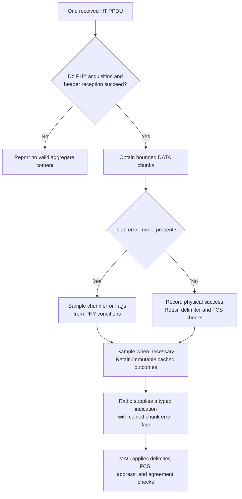
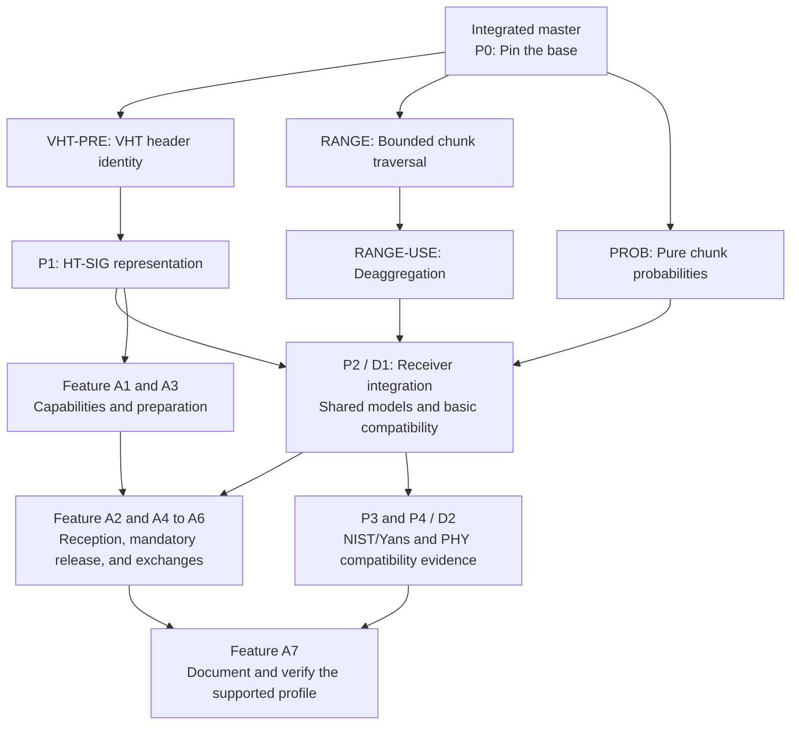

# Implementation plan: partial PHY reception for HT A-MPDU

> **Kind:** procedure · **Status:** draft · **Seal:** none · **Owns:** — · **Stands on:** [S5 execution record](../done/ieee80211-compressed-blockack-s5-execution.md), [implementation plan procedure](../../doc/project/guide/write-an-implementation-plan.md), [IEEE 802.11 rules](../../doc/project/domain/ieee80211.md)

Checkout: `/home/user/omnetpp_ws/inet-ieee80211-ampdu-implicit-blockack`, branch `work/ieee80211-ampdu-implicit-blockack`. The implementation base is `master` at `f5612791b773bc83f654dbfdefa26e243f756c86`.

Master contains the merged explicit Compressed Block Ack implementation from PR #1345. Rx owns local interframe observations. The radio supplies metadata for Radiotap. The PHY integration must preserve both contracts.

The feature plan defines PSDU-based RTS selection, recovery before DATA submission, and a boolean probe requirement with a derived access category. This PHY plan supplies its reception prerequisites. MAC implementation and expectation changes remain outside this PR.

The project plan procedure remains a draft.

The ten-commit series supplies P0 through P4 for the declared PHY profile. The [final record](ieee80211-ampdu-phy-execution.md) states verification and its limits. Only the final commit receives build and test execution. Earlier commits receive structural checks only. MAC acceptance and implicit Block Ack remain pending.


## PR boundary and current evidence

The [deaggregation prerequisite](ieee80211-mpdu-deaggregation.md) supplies bounded chunk traversal and ordinary member extraction. It stops at an invalid delimiter. The recovery PR adds a search for later delimiters, HT-SIG support, and partial PHY reception. The PHY receiver records outcomes as traversal supplies each delimiter and MPDU chunk. No `MpduRange` or `MpduLayout` production type remains.

For example, a malformed middle delimiter declares 2000 octets where only 124 remain. The prerequisite returns only the first MPDU. Recovery examines later delimiter candidates at four-octet intervals and also returns the final complete MPDU. Extraction grants no MAC acceptance.

The maintainer deferred all builds and tests for this revision. Historical results below apply only to their recorded source revisions. They do not verify the shared traversal or the new commit boundaries. Both PRs require new build and test evidence.

## 1. Problem and intended behavior

The WLAN receiver currently produces a whole-data success result. That result cannot describe a failed MPDU beside valid MPDUs in the same A-MPDU. The [MAC feature plan](ieee80211-ampdu-implicit-blockack.md) needs those separate results before it can acknowledge and retry members correctly.

This hypothetical case defines the required result. One HT PPDU carries MPDUs 100 through 103. PHY acquisition and header reception succeed, but MPDU 101 fails. The receiver must preserve valid outcomes for 100, 102, and 103. Two later reads of that reception result must return the same outcomes without additional random draws.

The PHY reports reception facts. The MAC separately checks delimiters, FCS values, addresses, and agreement state before acceptance. This plan supplies no Block Ack response or upper delivery by itself.



This diagram describes proposed behavior. It is not an executed trace.

## 2. Current implementation and evidence

The source assessment established the facts below at the pinned revision. The companion plan's [standards appendix](ieee80211-ampdu-implicit-blockack.md#appendix-a-standard-requirements-and-evidence) retains the common normative evidence.

| Source and current behavior | Consequence |
| --- | --- |
| The PER operation in [IErrorModel](../../src/inet/physicallayer/wireless/common/contract/packetlevel/IErrorModel.h) accepts an SNIR object and signal part. It has no arbitrary range-length argument. | An aggregate calculation needs an explicit callable range boundary. A generic whole-DATA call cannot score each member. |
| [Ieee80211ErrorModelBase](../../src/inet/physicallayer/wireless/ieee80211/packetlevel/errormodel/Ieee80211ErrorModelBase.h) declares protected header and DATA success calculations with a bit length. | The shared WLAN implementation can reuse those calculations for chunk probabilities. |
| [NIST](../../src/inet/physicallayer/wireless/ieee80211/packetlevel/errormodel/Ieee80211NistErrorModel.h) and [Yans](../../src/inet/physicallayer/wireless/ieee80211/packetlevel/errormodel/Ieee80211YansErrorModel.h) derive from that WLAN base. | One base implementation can support both models and compatible custom subclasses. |
| [BerTable](../../src/inet/physicallayer/wireless/ieee80211/packetlevel/errormodel/Ieee80211BerTableErrorModel.h) derives directly from the generic base. Its [initializer](../../src/inet/physicallayer/wireless/ieee80211/packetlevel/errormodel/Ieee80211BerTableErrorModel.cc) rejects HT operation strings at the local stage. | BerTable remains outside the HT aggregate profile. Its current HT refusal remains unchanged. |
| [Ieee80211Receiver](../../src/inet/physicallayer/wireless/ieee80211/packetlevel/Ieee80211Receiver.cc) delegates reception results to the common receiver path. | Aggregate reception needs its own outcomes before whole-DATA failure can discard valid members. |
| [Ieee80211PhyHeader.msg](../../src/inet/physicallayer/wireless/ieee80211/packetlevel/Ieee80211PhyHeader.msg) has no modeled HT aggregation field. | A PHY property must distinguish an A-MPDU from a standalone MPDU. This also applies to a singleton aggregate. |
| The HT methods in [Ieee80211PhyHeaderSerializer](../../src/inet/physicallayer/wireless/ieee80211/packetlevel/Ieee80211PhyHeaderSerializer.cc) write no fields and reconstruct an empty header. | P1 must extend the typed HT-SIG header and serializer together. A new MSG field alone cannot survive conversion to bytes. |
| [Ieee80211Radio](../../src/inet/physicallayer/wireless/ieee80211/packetlevel/Ieee80211Radio.cc) validates some PHY headers but performs no HT CRC check. | Correct serialization alone cannot establish rejection of an invalid received HT-SIG. P2 needs receive validation before chunk error flags. |
| [MpduDeaggregation](../../src/inet/linklayer/ieee80211/mac/aggregation/MpduDeaggregation.cc) creates separate member Packets, but assumes valid lengths and uses the aggregate name. | Shared bounded parsing must replace unchecked range discovery. Feature A4 projects the PHY outcome onto each member Packet. |
| [CommunicationCacheBase](../../src/inet/physicallayer/wireless/common/base/packetlevel/CommunicationCacheBase.cc) stores decision pointers per receiver, transmission, and signal part. It deletes replaced decisions and retained decisions at entry destruction. | The cache can own a derived WLAN decision. Separate signal-part slots need explicit sample ownership. |
| [RadioMedium](../../src/inet/physicallayer/wireless/common/medium/RadioMedium.cc) caches decision lookups, but directly computes `isReceptionSuccessful()`. Its result path requests a WHOLE decision. | Aggregate queries must share cached samples across both paths and signal parts. Generic cache presence alone does not prevent repeated draws. |
| Separate-part reception in [Radio](../../src/inet/physicallayer/wireless/common/radio/packetlevel/Radio.cc) queries PREAMBLE before HEADER. A failed PREAMBLE or HEADER removes the attempted reception. | Preserve the per-part checks without early HEADER or DATA calculation. That aborted attempt supplies no result to MAC. |
| [FlatReceiverBase](../../src/inet/physicallayer/wireless/common/base/packetlevel/FlatReceiverBase.cc) attaches error-rate metadata through the old whole-PSDU calculation. [ReceiverBase](../../src/inet/physicallayer/wireless/common/base/packetlevel/ReceiverBase.cc) supplies power, SNIR, and reception times. | Aggregate result construction needs an explicit probability contract. It must preserve the other applicable receive metadata. |
| [Rx](../../src/inet/linklayer/ieee80211/mac/Rx.cc) rejects a Packet bit-error flag before its FCS-mode branches. | A failed member can use its own Packet flag without a false checksum or shared chunk mutation. |
| [Ieee80211Receiver](../../src/inet/physicallayer/wireless/ieee80211/packetlevel/Ieee80211Receiver.cc) sets its mode set at local initialization. [FlatReceiverBase](../../src/inet/physicallayer/wireless/common/base/packetlevel/FlatReceiverBase.cc) resolves its error model at that stage. | The receiver supplies bounded DATA content after header success. No aggregation role check applies. |
| [Ieee80211Mac](../../src/inet/linklayer/ieee80211/mac/Ieee80211Mac.cc) calculates effective channel widths and NSS at link-layer initialization, before its MIB update. | The model no longer needs an aggregation role or a separate capability handoff. |
| [FlatReceiverBase](../../src/inet/physicallayer/wireless/common/base/packetlevel/FlatReceiverBase.cc) permits reception without an error model after its SNIR check. The [VHT/HT fixture](../../tests/module/Ieee80211VhtHtSupport_1.test) uses this path with transmit aggregation disabled. | An absent error model is a supported case. The DATA corruption path must preserve it. |
| [Ieee80211Radio](../../src/inet/physicallayer/wireless/ieee80211/packetlevel/Ieee80211Radio.ned) selects NIST by default for scalar and dimensional reception. | D1 supplies the shared DATA probability calculation without a separate HT interface check. |
| [Ieee80211Mib](../../src/inet/linklayer/ieee80211/mib/Ieee80211Mib.cc) derives local HT capability from the mode set and effective radio limits. This includes short GI. | Receive support must cover those advertised modes before capability publication. HT length exponent zero still advertises 8191 octets. |

The feature plan and its summary describe the proposed MAC implementation. The execution record supplies results for the completed PHY series.

## 3. Scope and acceptance criteria

The scope is packet-level `Ieee80211Radio` with scalar or dimensional reception and HT mixed format at 20 MHz. Reception covers long GI and short GI at the advertised MCS and NSS values. The MAC feature's aggregate transmit policy remains limited to long GI. D1 supplies receiver integration, the shared NIST/Yans implementation, and basic compatibility checks. Deterministic probabilities establish its partial-reception evidence. D2 completes the NIST/Yans and compatibility evidence under the documented scalar SNIR abstraction.

The plan owns PHY representation, cached DATA chunks, generic error-model integration, and header indications. Bounded delimiter parsing belongs to MAC extraction. The MAC feature plan owns member selection, spacing, ownership, release rules, responses, and recovery.

The required results are:

1. A decoded HT aggregation property survives radio encapsulation and decapsulation.
2. A singleton aggregate retains aggregate identity.
3. Header failure prevents valid aggregate content.
4. A failed delimiter or member does not automatically discard every later recoverable member.
5. Each outcome belongs to a bounded byte range in the actual PSDU.
6. Repeated decision and result access causes no additional random draw.
7. After successful header reception, whole-signal and separate-part reception produce consistent aggregate outcomes.
8. Compatible ordinary MPDU reception preserves its calculations and random draw sequence.
9. Error models calculate DATA chunk probabilities without an aggregation role or MAC delimiter knowledge.
10. NIST and Yans share the WLAN base implementation without duplicate aggregate algorithms.
11. Spacing delimiters receive outcomes, but alignment padding consumes no separate random draw.
12. The indication permits a failed member Packet to retain its error without an incorrect whole envelope.
13. The WHOLE summary does not replace the MAC's member validation or its complete receive outcome for contention.
14. Non-HT custom models retain ordinary MPDU reception without the optional aggregate role.
15. An absent error model retains PHY acquisition and SNIR checks without new error draws or an interface requirement.
16. D1 preserves default NIST initialization, configured Yans initialization, and compatible ordinary MPDU reception before D2 extends the evidence.
17. PREAMBLE queries preserve per-part acquisition checks without HEADER or DATA draws.
18. HT-SIG serialization preserves length and aggregation for standalone, singleton, and multiple-member cases.
19. Aggregate error-rate metadata follows the explicit probability contract in Section 4.3.
20. Advertised HT20 short-GI reception has aggregate support even when the local transmit policy uses long GI or selects no aggregate.
21. Invalid HT-SIG CRC or unsupported fields cause HEADER failure before delimiter or member draws.
22. A valid header with insufficient modeled PSDU content causes bounded DATA refusal without DATA draws. Its HEADER result remains valid.

This plan excludes correlated FEC errors, bit-level decoding, interference reconstruction within each member, and statistical accuracy or goodput claims. It cannot represent errors confined to alignment padding. It adds no MAC recovery timer, agreement store, or sealed Packet API change.

## 4. Proposed design and reasons

### 4.1 Representation and bounded ranges

Extend the modeled HT PHY header with its aggregation property. The radio derives the receive indication from that property. A transmit-only tag or the member count cannot substitute for decoded state.

HT-SIG is the HT signal field that carries PSDU length and other PHY control values. The packet-level model represents its fields without a waveform model.

P1 owns the HT-SIG representation and [HT PHY header serializer](../../src/inet/physicallayer/wireless/ieee80211/packetlevel/Ieee80211PhyHeaderSerializer.cc). Extend the typed header and its serializer together. The existing `lengthField` remains the sole PSDU length value. The serializer maps that value to HT Length. New typed fields represent the other HT-SIG values, including Aggregation. The radio obtains mode-dependent values from the selected mode.

IEEE Std 802.11-2024, Table 19-11 and Figure 19-6, define the fields and their positions. Clause 19.3.9.4.4 defines the HT-SIG CRC. Serialization must preserve the standard's field, reserved, CRC, and tail conditions. The encoded header must match the mode's 48-bit HT-SIG length. P1 must check golden bytes and independent reconstruction of standalone, singleton, and multiple-member cases. Full preamble waveform representation and VHT headers remain outside this profile.

Current [radio encapsulation](../../src/inet/physicallayer/wireless/ieee80211/packetlevel/Ieee80211Radio.cc) already assigns 48 bits from the selected HT header mode. The [HT length calculation](../../src/inet/physicallayer/wireless/ieee80211/mode/Ieee80211HtMode.cc) supplies that value despite the empty serializer. P1 preserves this declared length and completes byte conversion within it. Fresh decode must consume those same 48 bits. The [transmitter](../../src/inet/physicallayer/wireless/ieee80211/packetlevel/Ieee80211Transmitter.cc) calculates airtime from the selected mode and PSDU length. P1 preserves those duration inputs and calculations for ordinary HT MPDUs.

In a hypothetical singleton case, the radio sets Aggregation to one and HT Length to the complete PSDU length. Conversion to bytes must preserve both values. A fresh decode must recover them without tags, names, or access to the original typed header. The recipient must therefore retain aggregate identity after that conversion. A typed-object copy alone cannot establish this result.

#### HT-SIG receive validation

The WLAN PHY owns one stateless HT-SIG validator beside the header representation and serializer. The serializer preserves the received CRC; decode must not replace it with a newly calculated CRC. The radio calculates the transmit CRC after all HT-SIG fields reach their final values. P1 defines this validator and its wire checks. P2 calls it at the receiver's HEADER decision boundary.

At that boundary, the receiver checks CRC, supported field combinations, and agreement between encoded mode fields and the actual PHY mode. Invalid CRC or unsupported fields cause HEADER failure without delimiter or member draws. The radio reuses the validator before decapsulation relies on HT Length. On failure, decapsulation must not use the untrusted length for PHY trailer removal.

An invalid header supplies no accepted Aggregation property. Separate-part reception uses the current abort; whole-signal reception uses the current failure-container path. MAC rejects that container before any MAC header or trailer peek. These header checks apply Clause 19.3.21 within the packet-level model without a new radio event or PHY primitive.

A separate bounds check compares a valid header's HT Length with the available modeled PSDU before chunk corruption or length-based decapsulation. Insufficient content denotes malformed model input. The HEADER decision retains success and its decoded Aggregation property. The DATA decision reports failure with no chunk error flags or DATA draws. The radio uses the current failure-container path without length-based trailer removal. MAC rejects that refused content before header or trailer peeks.

This structural refusal does not represent physical signal loss. Clause 19.3.21 distinguishes invalid HT-SIG CRC from carrier loss after a valid header. The short-content fixture proves bounds safety only. It establishes no carrier-loss behavior or acceptance of a physically received prefix. Physical carrier-loss behavior remains outside this plan.

Bad encoded bytes and probabilistic header loss remain separate test causes. In a hypothetical case, the error model reports header success, but the transmitted HT-SIG has an invalid CRC. The receiver rejects that header before any member draw or Block Ack response. Repeat the case without an error model. A successful probability result cannot override invalid encoded content.

Extend the current aggregate decoder with bounded delimiter traversal that the WLAN receiver and MAC can reuse. Check every length, alignment interval, zero-length delimiter, CRC, and signature against the available PSDU. Each scan must advance. A malformed length cannot produce an accepted range or an out-of-bounds read.

The shared parser supplies range facts, not delivery permission. The MAC must apply the received delimiter outcome before it trusts a boundary. A later recovered delimiter does not erase an earlier continuity break. The parser must not use names or a transmitter-private membership list to bypass corruption.

The received packet retains chunk correctness flags. The indication retains header success, aggregation identity, and content completeness. It contains no separate outcome table.

#### Chunk errors

The error model receives a bounded DATA chunk view. It samples each chunk once from PHY conditions and bit length. This includes padding chunks. Zero and unit probabilities consume no random number. An intermediate probability consumes one draw. Header failure or insufficient content prevents DATA draws.

For example, an incorrect payload chunk remains inside its MPDU after extraction. That MPDU reports incorrect content. Other MPDUs can remain correct. MAC delimiter and FCS checks still control acceptance.

Typed content can preserve delimiter and member structure. Byte conversion merges the transmission into one byte chunk. Its DATA view receives one outcome. The error model does not reconstruct MAC boundaries. Independent chunk errors do not model correlated FEC failures.

The wire fixture covers HT-SIG serialization, validation, delimiters, member limits, alignment, and bounded recovery. Feature A1 owns capability propagation and aggregate construction calculations for spacing, serialization, and member layout. Feature A3 owns dynamic member selection, spacing at the retained DATA mode, batch reduction, and canonical member ownership.

### 4.2 Generic DATA corruption

Add `IErrorModel::computeReceivedData(snir, data)`. The input and output are shared chunk content. The operation preserves length and bytes. It marks failed chunks in the result without a change to the transmitted chunks. It permits an entirely correct result and performs no retry.

`ErrorModelBase` supplies the common traversal and sampling. Its protected `computeChunkSuccessRate(snir, bitLength)` uses DATA BER. An invalid or unavailable BER causes a runtime error. Direct interface implementations must supply the new operation.

`Ieee80211ErrorModelBase` overrides the probability calculation through `getDataSuccessRate()`. It obtains mode and SNIR from the PHY reception. NIST and Yans inherit this calculation. The models receive no delimiter, MPDU, or aggregation information. No aggregation role or MAC capability check applies.

An absent error model preserves the original DATA chunks after the common PHY checks. Ordinary reception keeps its existing whole-packet path. BerTable retains its current HT configuration limit.

### 4.3 Decision ownership and random draws

The current [medium lookup](../../src/inet/physicallayer/wireless/common/medium/RadioMedium.cc) computes a decision on a cache miss. The [cache implementation](../../src/inet/physicallayer/wireless/common/base/packetlevel/CommunicationCacheBase.cc) retains the decision's dynamic type. Its key contains the receiver, transmission, and signal part. A result lookup can request WHOLE after a DATA lookup. The direct success-query path can also bypass the decision cache.

P0 must confirm these paths against the merged implementation base. Record cache insertion, replacement, entry destruction, and result consumption. The current `receivePacket()` consumes the cached result but leaves its decision entries. The sample guarantee applies for as long as those entries exist. The copied receive indication remains valid after cache cleanup.

For aggregates, retain a PREAMBLE decision in its current cache slot. Its calculation preserves current per-part acquisition, possibility, attempt, and SNIR checks. It does not request HEADER or DATA. Shared WLAN NIST/Yans calculations add no PREAMBLE error draw. Direct PREAMBLE queries reuse that decision.

HEADER first checks cached PREAMBLE success. DATA obtains cached HEADER success before its own calculation. The immutable DATA decision retains received chunks or structural refusal. WHOLE and result queries reuse the same chunks without additional samples.

| Query | Required calculation and retained result |
| --- | --- |
| PREAMBLE | Apply current per-part checks. Retain its decision without HEADER or DATA calculation. |
| HEADER | Reuse PREAMBLE. Retain one header outcome at the header boundary. |
| DATA | Reuse HEADER. Refuse insufficient content before DATA draws. Otherwise, sample the bounded chunk content once and retain its error flags. |
| WHOLE | Reuse prerequisite decisions. Derive the summary without another error draw. |

The WHOLE slot owns a separate summary decision. It does not own the DATA pointer. Aggregate result construction reads the DATA outcomes and copies them into the WLAN indication. This design uses the current cache and adds no second outcome store.

The WLAN receiver must route aggregate `computeIsReceptionSuccessful()` queries through those cached decisions. Its aggregate `computeReceptionDecision()` override constructs misses through calculation helpers. Construction must not call the cache-backed query recursively. Ordinary MPDU branches retain their current calculation and draw order.

For aggregate DATA, bypass the inherited whole-PSDU error draw. WHOLE success requires common PHY success, valid PSDU bounds, and success for every scored range. This is a PPDU summary only. Aggregate result construction preserves the envelope's intact content after partial DATA failure. It must not invoke whole-Packet corruption or mark the envelope incorrect for one failed member.

The WHOLE summary does not decide whether the MAC invokes EIFS. Feature A4 applies delimiter, member PHY, and FCS checks before it reports one aggregate outcome for contention. A correct member suppresses EIFS even when the WHOLE summary reports failure. The feature plan owns that rule and the preservation of valid HCF history after partial loss. [Aggregate receive outcome](ieee80211-ampdu-implicit-blockack.md#45-receive-validation-and-one-response-per-ppdu).

The radio converts retained facts into a typed WLAN indication with copied values. It retains no pointer to a reception or transmission whose lifetime can end first. Feature A4 maps a failed complete member to that member's `Packet::setBitError(true)` before the normal Rx FCS predicate.

In separate-part reception, a failed PREAMBLE or HEADER makes `Radio::continueReception()` abort the attempted reception. That attempt supplies no result or failure container to MAC. Existing radio state notifications let HCF invalidate its physical history. If whole-signal reception supplies a container after header failure, MAC rejects it before format-specific header or trailer peeks. Its indication reports failure without a decoded aggregation property. Both paths prevent aggregate acceptance, responses, DATA draws, and stale history without a new notification event.

#### Aggregate error-rate metadata

The ordinary [result path](../../src/inet/physicallayer/wireless/common/base/packetlevel/FlatReceiverBase.cc) calculates whole-PSDU error rates. The aggregate path retains `ErrorRateInd` with PER, BER, and SER set to `NaN`. Chunk flags retain sampled outcomes separately from those unknown probability estimates.

The [tag contract](../../src/inet/physicallayer/wireless/common/contract/packetlevel/SignalTag.msg) permits `NaN` for unknown probabilities. P0 must trace aggregate results through direct readers, [result filters](../../src/inet/common/ResultFilters.cc), and the [configured radio recorders](../../src/inet/physicallayer/wireless/common/radio/packetlevel/Radio.ned). The [network configurator](../../src/inet/networklayer/configurator/base/L3NetworkConfiguratorBase.cc) requires the tag for an ordinary probe; this read alone establishes no aggregate path. P0 must verify behavior with unknown values and absent tags for reachable consumers. A reachable incompatibility blocks P2's metadata implementation until the plan records its resolution. Tag omission requires evidence that all affected consumers accept absence.

The aggregate result path must not call the old WHOLE probability operations to populate those fields. It also must not substitute a realized success or failure for a probability. Without an error model, preserve the common base's existing tag presence and exact values. Preserve applicable power, SNIR, reception times, transmission identity, mode, and channel metadata in both cases. Ordinary MPDU reception retains its current metadata calculations and values.

In a hypothetical partial reception with a present model, MPDU 101 fails beside valid MPDUs 100, 102, and 103. The typed indication reports those distinct outcomes. The aggregate's probability fields remain `NaN` because the first profile supplies no aggregate estimate. A member must not inherit an aggregate probability as its own probability. The receiver needs no probability cache or additional error-model call for this metadata policy.

### 4.4 Model detail and diagnostics

The abstraction uses common PHY acquisition and header success, followed by independent chunk outcomes under scalar SNIR. It adds no separate PHY header per member. Chunk flags describe physical errors without a MAC acceptance decision.

This abstraction does not model correlated FEC errors or variation of interference within a member. It cannot represent errors confined to alignment padding. Padding still contributes to PSDU length and PPDU airtime. More detailed error models remain separate work. NIST/Yans integration reuses current calculations; it does not establish new PHY accuracy.

The WLAN receiver checks HT-SIG and available PSDU length before DATA corruption. It does not require an aggregation-specific error-model role. Models use their existing PHY mode calculations. Exponent zero still represents 8191 octets under Table 9-225.

The MAC calculates effective channel widths from transmitter and receiver support. It calculates the NSS limit from antenna count and its mode set. Before `updateLocalHtCapabilities()`, the MAC calls the receiver's pure coverage operation with those exact values and the same mode set. The receiver checks the HT20 MCS and GI combinations that those inputs advertise. Failure prevents the MIB update and capability publication. No probability call or random draw occurs.

In a hypothetical configuration, one antenna limits advertisement to one spatial stream. The mode catalog also contains modes for more spatial streams. A model with complete support for the advertised modes must pass validation. Unsupported modes outside those effective limits must not cause rejection. This case prevents an incorrect coverage requirement for the full catalog.

`setModeSet()` retains its existing PHY mode assignment. It does not require an aggregation role or a second receive-capability store.

The check must not clear short-GI capability to obtain model compatibility. A present model must not substitute uniform success or one whole-PSDU result for the required aggregate outcomes. An absent model follows the explicit error-free case in Section 4.2. No new capability bit or mutable support flag represents this local compatibility condition.

In a hypothetical configuration, a custom model supplies DATA BER through the common base. HT initialization succeeds without an aggregation role. The first valid DATA request samples its chunk structure through BER. An unavailable BER causes an explicit runtime error.

A custom model can supply DATA BER through the common base without any aggregation interface. A model with unavailable BER must override the chunk probability calculation or the received-DATA operation. An invalid probability causes a runtime error before a draw.

### 4.5 Reuse and justified additions

| Addition | Responsible component and consumer | Reuse decision |
| --- | --- | --- |
| HT-SIG fields, serializer, validator, and typed indication. | WLAN radio and receiver validate header fields before MAC/Rx receives aggregate content. | Current PHY state cannot distinguish singleton aggregates. Its empty HT serializer cannot preserve the new property through bytes. Current radio validation omits HT CRC. |
| Generic DATA corruption. | The common PHY interface accepts chunk content. The WLAN base supplies its existing DATA probability calculation. | The operation needs no delimiter, MPDU, or aggregation type. |
| Shared probability implementation. | `Ieee80211ErrorModelBase` serves NIST, Yans, and compatible custom subclasses. | Current protected per-length calculations already supply the required arithmetic. |
| Immutable aggregate decision. | Current medium cache owns outcomes for receiver and radio consumers. | Recomputed random decisions would change repeated observations. No second cache is necessary. |
| Aggregate error-rate metadata. | WLAN receiver preserves applicable receive tags and reports unspecified probability fields through `NaN`. | The old whole-PSDU estimate describes a different calculation. This policy needs no new probability store. |
| Bounded delimiter traversal. | MAC extraction uses the existing traversal. PHY error models use only chunk structure and bit lengths. |
| Early HT compatibility checks. | WLAN receiver checks role presence. MAC supplies exact advertised-mode inputs for receiver coverage validation before the MIB update. | PHY initialization lacks the effective advertisement limits. A runtime aggregate diagnostic occurs after capability advertisement. Exponent zero cannot represent absent aggregate reception. |
| Explicit case without an error model. | WLAN receiver preserves current PHY checks and supplies bounded physical outcomes. | The current error-free abstraction needs no new role, module, or random draw. |

These choices follow [minimal design](../../doc/project/rule/quality.md#qr-design-minimal), [reuse](../../doc/project/rule/architecture.md#ar-ext-reuse), and [contract purity](../../doc/project/rule/architecture.md#ar-org-contract-purity).

## 5. Affected components and compatibility

Changes affect MSG inputs for the HT PHY header and WLAN receive tag. They also affect the HT header serializer, receiver, radio, WLAN error-model contracts/base, NIST/Yans declarations, and aggregate decoder. The MAC adds the receiver coverage call before its current MIB update. P2 owns that required consumer with the receiver operation. Generated files follow the normal build procedure. Tests exercise the real medium and receiver.

HT-SIG serialization completes byte conversion for ordinary HT MPDUs as well as aggregates within the current 48-bit header length. P0 records that declared length and the current mode/PSDU duration path. P1 verifies 48-bit serialization and decode; ordinary HT controls verify unchanged airtime under identical mode and PSDU inputs. Record byte changes separately from reception calculations, frame sequences, and random draws. Any fingerprint change needs its own causal explanation. Any affected recorded expectation follows the current baseline rules and authorization scope.

D1 changes no default transmit aggregation policy. It supplies NIST/Yans chunk probabilities through their shared PHY base. Ordinary HT initialization and reception remain valid. Deterministic fixtures establish chunk propagation. D2 adds seeded production-model evidence.

The early diagnostic changes compatibility for present custom HT models without the role or required receive-mode coverage. This includes configurations that previously used only ordinary MPDUs. Those configurations require model migration. Compatible ordinary MPDU calculations retain their current behavior and draws. Non-HT custom configurations need no aggregate implementation. Invalid encoded HT-SIG content now causes reception failure; valid ordinary HT content retains its current calculations.

BerTable retains its current HT operation-mode refusal. The fixture uses a valid table to separate that refusal from a file error. Its non-HT control remains a compatibility check. No aggregation role or separate capability check applies.

An absent error model remains valid for ordinary HT operation, including current `Ieee80211UnitDiskRadio` configurations. The receiver preserves their current PHY checks without error draws. The aggregate profile remains scalar or dimensional reception under the declared HT conditions. This compatibility requirement adds no aggregate support claim for unit-disk reception.

The migration guide must explain generic DATA corruption, chunk error flags, custom-model requirements, and cache ownership. It must state the loss of separate error regions after byte conversion. It must distinguish an absent model from an unavailable BER. The [seal registry](../../doc/project/audit/seal-list.md) protects `src/inet/common/packet/`. This plan uses its public API.

The guide must explain HT-SIG byte conversion, header validation, per-part failure delivery, and the aggregate probability fields. It must distinguish structural PSDU refusal from header failure and physical carrier loss.

General MAC stop/start recovery remains outside this plan. Current agreement reset and object destruction must safely release new transient metadata through their current owners.

## 6. Implementation steps and dependencies

Each step forms a buildable commit or short series with its required consumers and tests. D1 and D2 are separately reviewable deliveries. D1 supplies receiver integration without an intermediate loss of default HT operation. D2 completes the NIST/Yans and compatibility evidence for the declared profile.

| Step and purpose | Responsible component and proposed change | Expected result and verification | Dependency |
| --- | --- | --- | --- |
| P0: Establish the merged base and cache contract. | Pin the integrated master base. Trace all signal parts, direct success queries, result construction, failure delivery, and cache lifetime. Audit header length, the duration path, BerTable controls, and aggregate metadata consumers. | Record keys, insertion, replacement, destruction, result consumption, and shared-sample paths. Record the current 48-bit header length, duration inputs, and BerTable parent controls. Close the audit of aggregate metadata consumers before P2 implements its contract. Confirm error-model APIs and the feature-off baseline. | The merge prerequisite is satisfied on master. |
| P1: Define HT-SIG representation. | Extend typed HT-SIG state and its serializer together. Define the shared stateless validator. Derive mode fields and aggregate identity during radio encapsulation. | Golden bytes and independent decode preserve HT Length and Aggregation within the current 48-bit header length. Ordinary HT controls preserve airtime for identical mode and PSDU inputs. Wire checks distinguish invalid headers from insufficient modeled PSDU content. | P0 and VHT-PRE. Independent RANGE and RANGE-USE commits supply bounded parsing. |
| P2: `ieee80211: add+change: retain partial HT PHY errors in chunks` | The receiver caches received DATA chunks. Rx rejects aggregate containers before standalone checks. The parent lacks partial chunk propagation and the header indication. | Include `WifiHtAmpduPartialReception.test` and its guide and comparison record. Thirty-two seed-zero runs cover typed partial errors, raw byte errors, both GIs, and both reception-part modes. An accepted CTS must still set NAV after the drop. |
| P3: Verify NIST/Yans aggregate outcomes. | Exercise the shared implementation from P2 through the real receiver. Compare chunk probabilities with the current per-length calculations. | Deterministic reference checks and fixed-seed runs prove cache use, repeatability, and supported model selection. No additional interface implementation is necessary to restore default HT initialization. | D1. Feature A3–A6 need not wait. |
| P4: Close PHY compatibility evidence. | Complete migration text, affected receiver controls, and the execution record. Compare feature-off calculations and draws with the pinned parent. | NIST/Yans and unsupported-model cases match the documented boundary. Scoped checks close D2. Feature A7 requires D2. | P3. |

### Commit boundaries

The table assigns each commit its own purpose and verification. Each entry assumes only its stated prerequisites. These entries describe expected results. The final execution record states observed results.

| ID and subject | Purpose, owner, and affected files | Dependency, expected result, and verification |
| --- | --- | --- |
| PLANS: `plan: add: define HT A-MPDU reception stages` | The three plan documents define PHY and MAC owners, limits, and artifact assignments. | This is the first commit. It changes no runtime behavior, so no protocol fixture or reviewer document applies. Check links and commit assignments. |
| VHT-PRE: `ieee80211: fix: create VHT headers for VHT signal modes` | The VHT mode factory must create the existing VHT header rather than an HT header. Change `Ieee80211VhtMode.h` and its release note. | After PLANS, two production-radio runs must observe a VHT header for long and short GI. Include `WifiVhtHeaderIdentity.test` and `vht-header-identity.md` from the protocol table below. |
| RANGE: `ieee80211: add: visit bounded A-MPDU subframes` | `MpduDeaggregation::visitSubframes` supplies bounded chunk traversal in master through the deaggregation prerequisite PR. The helper passes chunks directly to callbacks. It stores no intermediate layout. Retain `tests/unit/Ieee80211MpduDeaggregation_1.test`. | The prerequisite checks bounds, alignment, and truncation. Recovery adds typed/raw recovery cases. Existing callers remain unchanged. This pure query adds no protocol transition, so unit checks apply without a protocol reviewer document. |
| RANGE-USE: `ieee80211: fix: recover bounded MPDUs during deaggregation` | The shared traversal adds recovery after invalid delimiters. `MpduDeaggregation` receives recovered MPDU chunks through its existing callback. Add the direct protocol fixture and reviewer document. | After RANGE, complete and malformed aggregates must return only complete bounded members in typed and byte representations. Include `WifiMpduDeaggregation.test` and `mpdu-deaggregation.md`. Extraction grants no MAC acceptance. |
| P1: `ieee80211: add: preserve HT-SIG fields through byte conversion` | The HT MSG header, field helpers, serializer, and radio preserve HT-SIG. Retain the wire unit fixture and production wire protocol fixture. | After VHT-PRE, independent octets verify field positions, CRC, and singleton identity. RANGE is not a prerequisite for serialization. Include `WifiHtAmpduWire.test` and `ampdu-ht-sig-wire.md`. |
| PROB: `physicallayer: add: sample DATA errors in existing chunks` | The common error-model interface and base supply unconditional DATA corruption. The direct fixture checks local flags, unchanged bytes, invalid probabilities, and an all-correct result. | After PLANS, `DataChunkCorruption_1.test` checks the common operation without a MAC format. The receiver does not use the operation yet. |
| P2: `ieee80211: add+change: retain partial HT PHY errors in chunks` | The receiver caches received DATA chunks. Rx rejects aggregate containers before standalone checks. The parent lacks partial chunk propagation and the header indication. | Include `WifiHtAmpduPartialReception.test` and its guide and comparison record. Thirty-two seed-zero runs cover typed partial errors, raw byte errors, both GIs, and both reception-part modes. An accepted CTS must still set NAV after the drop. |
| P3: `tests: add: verify seeded NIST and Yans aggregate reception` | The receiver fixture consolidates direct probability checks and adds seeded real-model observations. | After P2, independent generators verify probabilities, samples, draw counts, and cache reuse. This test-only change adds no protocol behavior, so no separate protocol reviewer document applies. |
| P4: `tests: add: verify ordinary PHY compatibility with the parent` | The ordinary compatibility fixture records unchanged reception properties. Migration text states the model abstraction. | After P3, run the 576 ordinary controls. A fresh parent comparison requires separate execution. This test-only change adds no protocol behavior, so no separate protocol reviewer document applies. |
| RECORD: `plan: change: record HT A-MPDU PHY completion on master` | The final plan record states scope, exact verification, and limits. | After P4, verify the final source tree and run the explicit final selectors. Documentation changes add no protocol behavior, so no separate protocol fixture or reviewer document applies. |

VHT-PRE, RANGE, and PROB can stand as separate prerequisites. The deaggregation prerequisite introduces the first production caller. RANGE-USE adds delimiter recovery to the same loop. P1 preserves wire fields independently of delimiter traversal. P2 combines their completed contracts before it supplies chunk error flags to Rx.



D1 includes the shared NIST/Yans implementation and basic compatibility checks. D2 can follow deterministic MAC integration because it extends the evidence. That exchange still needs MAC receive step A4 and all applicable release conditions. Completion of the documented profile requires D2 and feature A7.

## 7. Verification methods and expected results

### Protocol artifacts assigned to the behavior commits

VHT-PRE, RANGE-USE, P1, and P2 each include their protocol fixture and reviewer document. The documents explain the requirement, setup, stimulus, assertions, expected parent result, and coverage limits.

| Commit ID and proposed subject | Purpose, owner, and parent comparison | Exact protocol artifacts and verification |
| --- | --- | --- |
| VHT-PRE: `ieee80211: fix: create VHT headers for VHT signal modes` | The VHT factory creates an HT object on the parent. Later HT validation would then receive a VHT mode without an HT MCS. Existing module controls check integrated VHT delivery but do not directly assert the header class. | Add `tests/protocol/wifi/common/WifiVhtHeaderIdentity.test` and `tests/protocol/wifi/vht-header-identity.md` in VHT-PRE. At 1 ms, the driver sends an ordinary PSDU through a production scalar radio. Two seed-zero runs select VHT20 MCS 0. Long GI uses one stream; short GI uses two streams from the existing catalog. Observe `transmissionStarted`. Require VHT class, exclude HT class, and compare the selected header length before the tester event. The parent fails the class check. Select `WifiVhtHeaderIdentity\.test$`. Typed transmission only; no serializer or delivery claim applies. |
| RANGE-USE: `ieee80211: fix: recover bounded MPDUs during deaggregation` | The prerequisite parent stops at an invalid delimiter. It returns earlier members but loses later complete members. The prerequisite fixture checks extraction but expects a stop at an invalid delimiter. | Extend `tests/protocol/wifi/common/WifiMpduDeaggregation.test` and `tests/protocol/wifi/mpdu-deaggregation.md` for recovery. Four seed-zero runs cover complete and overlong layouts as typed and byte representations. The driver calls production deaggregation, verifies exact returned members, and deletes all outputs. A valid first member precedes a malformed 128-octet segment. A later 20-octet member begins at offset 212. The parent stops before the final complete member and cannot complete the required recovery. Select `WifiMpduDeaggregation\.test$`. This tests extraction, not radio reception or MAC acceptance. |
| P1: `ieee80211: add: preserve HT-SIG fields through byte conversion` | The radio and serializer must preserve singleton aggregation through byte conversion. The parent declares a 48-bit HT header but supplies no HT-SIG octets. After P1, a transmitted singleton must match the independent six-octet vector. This entry depends on P0 and VHT-PRE. | Add `tests/protocol/wifi/common/WifiHtAmpduWire.test` and `tests/protocol/wifi/ampdu-ht-sig-wire.md` in P1. Two seed-zero runs submit a 104-octet singleton PSDU through the production radio. Typed and raw bytes must preserve MCS 0, 20 MHz, long GI, Aggregation, Length, and CRC. Select `WifiHtAmpduWire\.test$` with the debug protocol runner. A missing transmission or different byte vector fails. No existing protocol case establishes this path. |
| P2: `ieee80211: add+change: retain partial HT PHY errors in chunks` | The receiver caches received DATA chunks. Rx rejects aggregate containers before standalone checks. The parent lacks partial chunk propagation and the header indication. | Include `WifiHtAmpduPartialReception.test` and its guide and comparison record. Thirty-two seed-zero runs cover typed partial errors, raw byte errors, both GIs, and both reception-part modes. An accepted CTS must still set NAV after the drop. |

These fixtures add protocol observations to the unit and module coverage. VHT-PRE checks transmitted header identity. RANGE-USE checks production extraction. P1 checks HT-SIG bytes. P2 checks physical reception and the current MAC rejection boundary. None establishes member delivery or implicit Block Ack.

Build the current debug library before the explicit protocol selectors. The execution record states observed results separately from these expected results.

The PHY plan owns its unit, module, and protocol fixtures. RANGE supplies `Ieee80211MpduDeaggregation_1.test`. P1 supplies wire checks. P2 supplies receiver and MAC rejection checks. P4 supplies ordinary controls whose source can compile on the parent without new PHY interfaces. The feature plan owns seven proposed fixtures; its MAC features remain separate.

| Proposed fixture | Boundary and required observations |
| --- | --- |
| `Ieee80211MpduDeaggregation_1.test`, unit. | Direct callback checks cover delimiter lengths, alignment, truncation, final padding, typed error flags, and bounded typed/byte recovery. This fixture checks shared chunk traversal without a production caller. |
| `Ieee80211AmpduMacBoundary_1.test`, module. | Production radio reception reaches default Rx rejection before standalone FCS and MAC header checks. Sixteen cases cover DCF/HCF, typed/raw bytes, scalar/dimensional radios, and both reception-part modes. |
| `Ieee80211AmpduWire_1.test`, unit/serializer. | HT-SIG golden bytes and independent decode preserve length, Aggregation, CRC, and the current 48-bit header length. Cover standalone, singleton, and multiple-member cases. Validator cases reject invalid CRC and unsupported field combinations. The field-limit case refuses an HT Length above 65535 octets. The receiver fixture separately checks insufficient PSDU content. |
| `Ieee80211AmpduPhyReception_1.test`, module. | Actual reception proves all-good, first/middle/last member loss, regular/spacing delimiter failure, all-member failure, per-part header failure, and query consistency. It distinguishes HT-SIG rejection from structural DATA refusal before DATA draws. It also verifies copied indication lifetime, metadata with reachable consumers, and HT20 short-GI indications without MAC response acceptance. D1 checks NIST/Yans initialization, ordinary reception, absent-model operation, BerTable controls, and exact coverage at the MAC handoff. Absent roles and incomplete advertised coverage fail; unsupported unadvertised modes do not cause failure. D2 extends NIST/Yans aggregate evidence. |
| `Ieee80211AmpduPhyCompatibility_1.test`, module. | The same source runs on the pinned parent and feature branch. NIST, Yans, absent-model, and non-HT custom controls expose exact outcomes, duration, metadata, draw counts, and subsequent random values. Three noise levels and seeds 0, 1, and 2 cover scalar and dimensional reception with whole and separate signal parts. |

Use deterministic probabilities and seed 0 for the causal cases. Cover whole-signal and separate-part reception with scalar and dimensional models. Verify indication values after the producer's source objects leave their normal lifetime.

Add a fixed probability between zero and one for cache checks. Record random draw counts before and after repeated reads. Those reads must add no draws. Count error-model calls to distinguish cached access from repeated probability calculations.

Exercise PREAMBLE, HEADER, DATA, and WHOLE lookups, direct success queries, result creation, and repeated access in each supported reception configuration. At the production PREAMBLE boundary, verify no HEADER or DATA calculation or draw. Repeat that query without a new draw. Query WHOLE before DATA in a separate case at the valid result boundary. Both later lookup orders must use the same retained outcomes and add no duplicate draws. Verify result consumption and cache cleanup against P0's recorded ownership.

Force PREAMBLE and HEADER failure separately through the production radio in separate-part mode. Verify that the failed attempt supplies no container to MAC. Verify no later DATA draws, response, accepted member, or retained physical history. In whole-signal mode, verify rejection of any delivered failure container before aggregate or ordinary MAC header parsing. These checks preserve the existing event boundaries and require no synthetic failure delivery.

With a present model, check all three `ErrorRateInd` fields for `NaN` after aggregate result construction and repeated reads. Count the old WHOLE probability calls; aggregate metadata must add none. Check power, SNIR, reception times, transmission identity, mode, and channel at their existing boundaries. Without a model, compare tag presence and exact values with the current common-base behavior. Ordinary MPDU controls must retain their existing metadata. Member results must never present an aggregate probability as a member estimate.

P0 records each metadata consumer, its aggregate reachability, and its behavior with unknown probabilities or an absent tag. The PHY module fixture exercises the reachable consumers that P0 identifies, with the configured filters and recorders. An unresolved incompatibility in P0 blocks P2's metadata implementation. A fixture failure blocks D1 until its documented resolution passes. Verify safe behavior with unknown values before D1 closes. Do not replace `NaN` with an absent tag without evidence that affected readers accept absence.

P1's controls compare ordinary HT header length and PPDU duration with the pinned parent under identical mode and PSDU inputs. Verify the 48-bit header length before byte conversion and after independent decode. Verify unchanged PPDU airtime separately from changed bytes or fingerprint values. The wire fixture supplies representation evidence; the PHY module fixture verifies actual transmission duration. P1 adds ordinary HT duration controls to the PHY module fixture. P2 extends that fixture with partial-reception cases.

The wire fixture must decode fresh HT-SIG bytes without access to the original typed header. Check Aggregation zero for standalone MPDUs and one for singleton or multiple-member aggregates. Check HT Length against the complete PSDU length. Golden bytes must also establish the reserved, CRC, tail, and field-position conditions in the cited standard. Compare the encoded length with the mode's HT-SIG length.

Corrupt an encoded HT-SIG bit without repair of its CRC. Separately encode an unsupported field combination with a valid CRC. Run both cases through the production receiver with successful header probabilities and without an error model. Verify HEADER failure, no accepted Aggregation property, and no delimiter or member draws. Preserve the current separate-part abort and whole-signal failure-container paths.

Separately supply a valid HT-SIG whose HT Length exceeds the available modeled PSDU. Verify HEADER success and preservation of the decoded Aggregation property. Verify DATA refusal with no chunk error flags or draws. Verify bounded decapsulation and MAC refusal before header or trailer peeks in both reception modes. Repeat this case without an error model. This malformed-input check establishes no physical carrier-loss result.

Use distinct padding chunks and verify their separate outcomes. Include zero-length spacing delimiters. Each existing chunk receives one outcome. The feature A4 fixture separately proves delimiter continuity and FCS rejection.

Feature A4 also verifies EIFS suppression after partial reception and one corruption notification after total failure. Feature A5 owns production member finalization, computed-FCS retry checks, and aggregate cancellation during SIFS. The PHY wire fixture does not establish those MAC transmission results. [Feature acceptance fixtures](ieee80211-ampdu-implicit-blockack.md#proposed-direct-checks).

P3 also compares chunk probabilities against each model's current per-length calculation. NIST/Yans runs use seeds 0, 1, and 2 to check invariants and reproducibility. These runs establish no statistical goodput or error-accuracy claim. Repeated cache access must leave later random draws unchanged.

Feature-off controls compare compatible ordinary MPDU results and subsequent draws with the pinned parent under identical inputs. A non-HT custom model without the role must retain ordinary MPDU reception. Its HT configuration must fail initialization before any capability advertisement, also with the default transmit policy. After initialization, a change to an HT mode set without the required role must fail before receiver acceptance. The feature capability fixture separately proves the absence of management advertisements and association after the initialization failure.

Use a generic BER model without an aggregation role. Verify successful production MAC initialization. Verify that the common DATA operation samples chunks through BER. Test an unavailable BER and an invalid probability as explicit runtime failures.

With complete coverage, receive a valid HT20 short-GI aggregate through the production radio. D1 and feature A2 verify the copied PHY indication and member outcomes. Feature A5 separately verifies MAC receipt and one Compressed response after SIFS. The local aggregate transmit policy remains at long GI. Any later capability-update caller must use the same validation boundary; this plan adds no such runtime caller.

D1 also checks ordinary HT reception with an absent error model and with each shared NIST/Yans implementation. Compare results and subsequent draws with the pinned parent. Retain the current VHT/HT fixture's absent-model configuration. Within the aggregate profile, an absent model produces successful physical ranges only after all common PHY checks succeed. Failed acquisition or SNIR checks still prevent valid aggregate content. Delimiter and FCS rejection remain active without a model, and no error draw occurs.

The PHY module fixture retains a non-HT BerTable control and its expected HT configuration refusal. A valid table file separates the operation-mode refusal from a file error. No additional role check applies.

The planned commands use the current runners. They cannot establish a result before the fixtures exist:

```sh
make MODE=debug -j$(nproc)

opp_run_unit_tests -m debug -f 'Ieee80211AmpduWire_1\.test$'

opp_run_module_tests -m debug -f 'Ieee80211AmpduPhyReception_1\.test$'
```

Preview each selector with `--dry-run`. Record selected files, configurations, seeds, exact commands, HEAD, local source diff, library mode, verdicts, and artifacts. A zero-case selection is `NOT_RUN`. Compare the actual changed receiver dependencies before any broader campaign.

Use the [gate procedure](../../doc/project/guide/run-the-gates.md) before publication under separate authorization. Coordinate final Wi-Fi coverage with the feature plan so one unchanged revision does not need duplicate broad runs. Release compilation remains required; debug behavioral evidence does not establish release behavioral coverage.

The [execution record](ieee80211-ampdu-phy-execution.md) records final-commit verification and its limits. Proposed MAC tests supply no executed evidence.

## 8. Risks, decisions, and implementation scope

The main risks are accidental whole-PSDU rejection, repeated random draws, unbounded delimiter parsing, and confusion between singleton aggregates and standalone MPDUs. D1 addresses those risks before MAC exchange integration.

The scalar SNIR and independent-range assumptions are explicit model choices. Mandatory MAC release conditions remain in the feature plan. This split does not make those conditions optional.

P1 owns HT-SIG representation and validation so that aggregate identity survives byte conversion without acceptance of invalid headers. P2 applies the validator through current HEADER failure paths. A separate DATA bounds check refuses malformed modeled content without a carrier-loss claim. The first profile reports aggregate outcomes through typed metadata and leaves probability estimates unspecified when an error model is present. PREAMBLE caching and current failed-header aborts preserve actual radio boundaries. These choices add no probability store, failure event, or expanded waveform model.

Feature step A2 accepts D1. This plan owns the PHY implementation work, including the shared NIST/Yans implementation in P2. Broader NIST/Yans evidence can follow deterministic MAC integration. The documented profile requires D2; default HT operation must remain valid at D1.

Both plans use the integrated master base stated above. Master supplies the explicit Compressed Block Ack lifecycle, local interframe observations, and reversible DATA preparation.

The merge prerequisite is satisfied. P0 pins the integrated master base. A changed owner, result contract, or model-detail assumption requires a plan revision before the dependent implementation.
