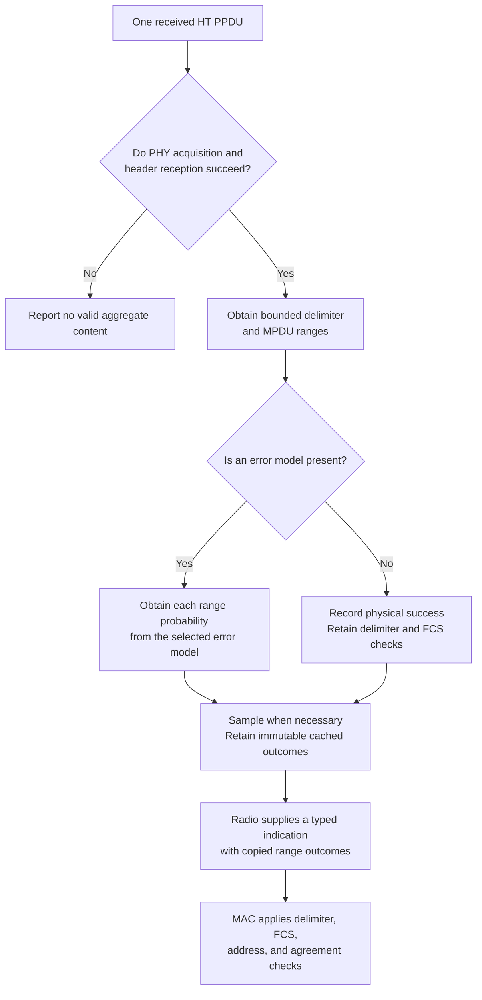
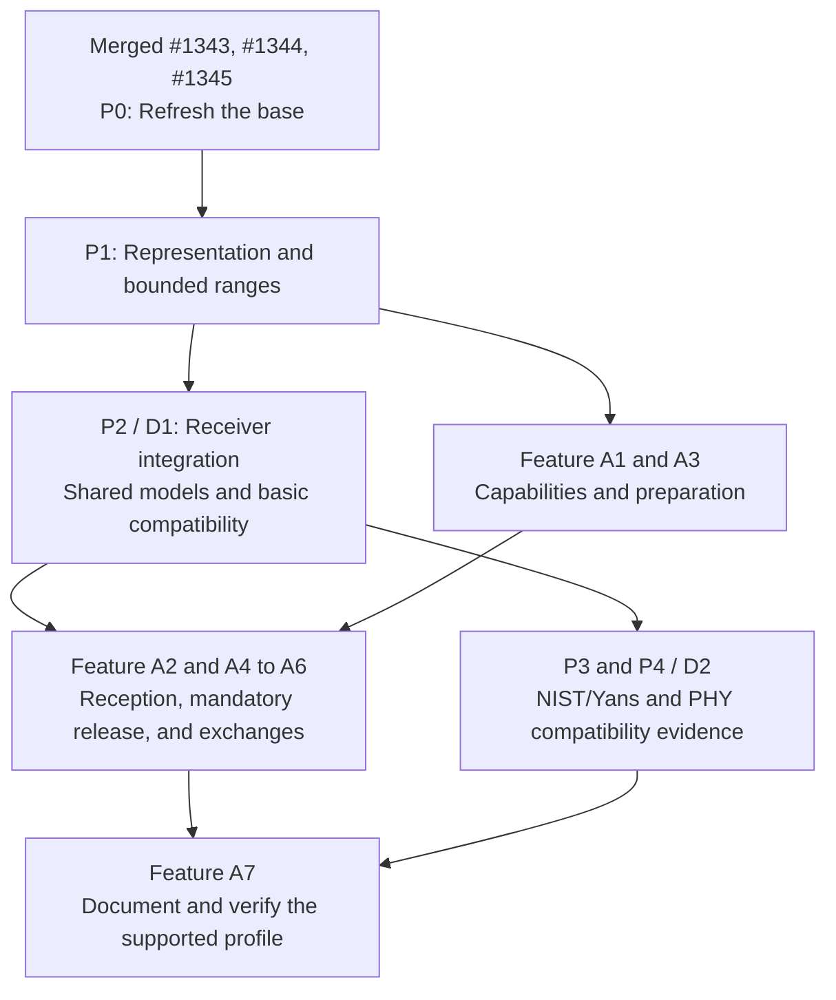

# Implementation plan: partial PHY reception for HT A-MPDU

> **Kind:** procedure · **Status:** draft · **Seal:** none · **Owns:** — · **Stands on:** [S5 execution record](ieee80211-compressed-blockack-s5-execution.md), [implementation plan procedure](../../doc/project/guide/write-an-implementation-plan.md), [IEEE 802.11 rules](../../doc/project/domain/ieee80211.md)

Checkout: `/home/user/omnetpp_ws/inet-compressed-blockack-s5`, branch `work/compressed-blockack-s5`, HEAD `4fa5cc0de15ee57388bcb3f20e866cab5972a670`.

Plan revision: 11, 2026-10-17. The user's `proceed, including the optional simplification` authorizes the reviewed document corrections. This document accompanies feature revision 12 and its revised summary. The feature plan defines PSDU-based RTS selection, recovery before DATA submission, and a boolean probe requirement with a derived access category. This PHY revision synchronizes those references; its behavior and delivery gates remain unchanged. Implementation, expectation changes, commits, and publication remain outside this authorization.

The project plan procedure remains a draft.

Execution status, 2026-10-17: P0, P1, and P2 are complete under the user's approved exception to the merge prerequisite. The [execution record](ieee80211-ampdu-phy-execution.md) identifies the active checkout, implementation, checks, and limits. The proposal below retains its pre-implementation design and evidence status. P3 and P4 remain pending.

## 1. Problem and intended behavior

The WLAN receiver currently produces a whole-data success result. That result cannot describe a failed MPDU beside valid MPDUs in the same A-MPDU. The [MAC feature plan](ieee80211-ampdu-implicit-blockack.md) needs those separate results before it can acknowledge and retry members correctly.

This hypothetical case defines the required result. One HT PPDU carries MPDUs 100 through 103. PHY acquisition and header reception succeed, but MPDU 101 fails. The receiver must preserve valid outcomes for 100, 102, and 103. Two later reads of that reception result must return the same outcomes without additional random draws.

The PHY reports reception facts. The MAC separately checks delimiters, FCS values, addresses, and agreement state before acceptance. This plan supplies no Block Ack response or upper delivery by itself.



This diagram describes proposed behavior. It is not an executed trace.

## 2. Current implementation and evidence

The source assessment established the facts below at the pinned revision. The companion plan's [standards appendix](ieee80211-ampdu-implicit-blockack.md#appendix-a-standard-requirements-and-evidence) retains the common normative evidence.

| Source and current behavior | Consequence |
| --- | --- |
| The PER operation in [IErrorModel](../../src/inet/physicallayer/wireless/common/contract/packetlevel/IErrorModel.h) accepts an SNIR object and signal part. It has no arbitrary range-length argument. | An aggregate calculation needs an explicit callable range boundary. A generic whole-DATA call cannot score each member. |
| [Ieee80211ErrorModelBase](../../src/inet/physicallayer/wireless/ieee80211/packetlevel/errormodel/Ieee80211ErrorModelBase.h) declares protected header and DATA success calculations with a bit length. | The shared WLAN implementation can reuse those calculations for range probabilities. |
| [NIST](../../src/inet/physicallayer/wireless/ieee80211/packetlevel/errormodel/Ieee80211NistErrorModel.h) and [Yans](../../src/inet/physicallayer/wireless/ieee80211/packetlevel/errormodel/Ieee80211YansErrorModel.h) derive from that WLAN base. | One base implementation can support both models and compatible custom subclasses. |
| [BerTable](../../src/inet/physicallayer/wireless/ieee80211/packetlevel/errormodel/Ieee80211BerTableErrorModel.h) derives directly from the generic base. Its [initializer](../../src/inet/physicallayer/wireless/ieee80211/packetlevel/errormodel/Ieee80211BerTableErrorModel.cc) rejects HT operation strings at the local stage. | BerTable remains outside the HT aggregate profile. Its current HT refusal must remain distinct from the new role check. |
| [Ieee80211Receiver](../../src/inet/physicallayer/wireless/ieee80211/packetlevel/Ieee80211Receiver.cc) delegates reception results to the common receiver path. | Aggregate reception needs its own outcomes before whole-DATA failure can discard valid members. |
| [Ieee80211PhyHeader.msg](../../src/inet/physicallayer/wireless/ieee80211/packetlevel/Ieee80211PhyHeader.msg) has no modeled HT aggregation field. | A PHY property must distinguish an A-MPDU from a standalone MPDU. This also applies to a singleton aggregate. |
| The HT methods in [Ieee80211PhyHeaderSerializer](../../src/inet/physicallayer/wireless/ieee80211/packetlevel/Ieee80211PhyHeaderSerializer.cc) write no fields and reconstruct an empty header. | P1 must extend the typed HT-SIG header and serializer together. A new MSG field alone cannot survive conversion to bytes. |
| [Ieee80211Radio](../../src/inet/physicallayer/wireless/ieee80211/packetlevel/Ieee80211Radio.cc) validates some PHY headers but performs no HT CRC check. | Correct serialization alone cannot establish rejection of an invalid received HT-SIG. P2 needs receive validation before range outcomes. |
| [MpduDeaggregation](../../src/inet/linklayer/ieee80211/mac/aggregation/MpduDeaggregation.cc) creates separate member Packets, but assumes valid lengths and uses the aggregate name. | Shared bounded parsing must replace unchecked range discovery. Feature A4 projects the PHY outcome onto each member Packet. |
| [CommunicationCacheBase](../../src/inet/physicallayer/wireless/common/base/packetlevel/CommunicationCacheBase.cc) stores decision pointers per receiver, transmission, and signal part. It deletes replaced decisions and retained decisions at entry destruction. | The cache can own a derived WLAN decision. Separate signal-part slots need explicit sample ownership. |
| [RadioMedium](../../src/inet/physicallayer/wireless/common/medium/RadioMedium.cc) caches decision lookups, but directly computes `isReceptionSuccessful()`. Its result path requests a WHOLE decision. | Aggregate queries must share cached samples across both paths and signal parts. Generic cache presence alone does not prevent repeated draws. |
| Separate-part reception in [Radio](../../src/inet/physicallayer/wireless/common/radio/packetlevel/Radio.cc) queries PREAMBLE before HEADER. A failed PREAMBLE or HEADER removes the attempted reception. | Preserve the per-part checks without early HEADER or DATA calculation. That aborted attempt supplies no result to MAC. |
| [FlatReceiverBase](../../src/inet/physicallayer/wireless/common/base/packetlevel/FlatReceiverBase.cc) attaches error-rate metadata through the old whole-PSDU calculation. [ReceiverBase](../../src/inet/physicallayer/wireless/common/base/packetlevel/ReceiverBase.cc) supplies power, SNIR, and reception times. | Aggregate result construction needs an explicit probability contract. It must preserve the other applicable receive metadata. |
| [Rx](../../src/inet/linklayer/ieee80211/mac/Rx.cc) rejects a Packet bit-error flag before its FCS-mode branches. | A failed member can use its own Packet flag without a false checksum or shared chunk mutation. |
| [Ieee80211Receiver](../../src/inet/physicallayer/wireless/ieee80211/packetlevel/Ieee80211Receiver.cc) sets its mode set at local initialization. [FlatReceiverBase](../../src/inet/physicallayer/wireless/common/base/packetlevel/FlatReceiverBase.cc) resolves its error model at that stage. | The receiver can check role presence at the physical-layer stage. That stage does not supply the exact limits for capability advertisement. |
| [Ieee80211Mac](../../src/inet/linklayer/ieee80211/mac/Ieee80211Mac.cc) calculates effective channel widths and NSS at link-layer initialization, before its MIB update. | Exact coverage validation belongs at that handoff, with the same mode set and effective limits. |
| [FlatReceiverBase](../../src/inet/physicallayer/wireless/common/base/packetlevel/FlatReceiverBase.cc) permits reception without an error model after its SNIR check. The [VHT/HT fixture](../../tests/module/Ieee80211VhtHtSupport_1.test) uses this path with transmit aggregation disabled. | An absent error model is a supported case. The new interface check must preserve it. |
| [Ieee80211Radio](../../src/inet/physicallayer/wireless/ieee80211/packetlevel/Ieee80211Radio.ned) selects NIST by default for scalar and dimensional reception. | D1 needs the shared implementation before it enables the HT interface check. Otherwise, ordinary default HT configurations fail initialization. |
| [Ieee80211Mib](../../src/inet/linklayer/ieee80211/mib/Ieee80211Mib.cc) derives local HT capability from the mode set and effective radio limits. This includes short GI. | Receive support must cover those advertised modes before capability publication. HT length exponent zero still advertises 8191 octets. |

The feature plan and its human summary are local draft documents. Other local changes affect `AGENTS.md` and earlier Block Ack plans and records. This plan preserves those unrelated files. No source change or new runtime result supports the proposed behavior yet.

## 3. Scope and acceptance criteria

The scope is packet-level `Ieee80211Radio` with scalar or dimensional reception and HT mixed format at 20 MHz. Reception covers long GI and short GI at the advertised MCS and NSS values. The MAC feature's aggregate transmit policy remains limited to long GI. D1 supplies receiver integration, the shared NIST/Yans implementation, and basic compatibility checks. Deterministic probabilities establish its partial-reception evidence. D2 completes the NIST/Yans and compatibility evidence under the documented scalar SNIR abstraction.

The plan owns PHY representation, shared bounded delimiter parsing, the optional aggregate error-model role, cached decisions, and receive indications. The MAC feature plan owns member selection, negotiated spacing, canonical MPDU ownership, release rules, responses, and recovery.

The required results are:

1. A decoded HT aggregation property survives radio encapsulation and decapsulation.
2. A singleton aggregate retains aggregate identity.
3. Header failure prevents valid aggregate content.
4. A failed delimiter or member does not automatically discard every later recoverable member.
5. Each outcome belongs to a bounded byte range in the actual PSDU.
6. Repeated decision and result access causes no additional random draw.
7. After successful header reception, whole-signal and separate-part reception produce consistent aggregate outcomes.
8. Compatible ordinary MPDU reception preserves its calculations and random draw sequence.
9. A present HT model without the aggregate role or required receive-mode coverage fails before capability advertisement, independently of local transmit aggregation.
10. NIST and Yans share the WLAN base implementation without duplicate aggregate algorithms.
11. Spacing delimiters receive outcomes, but alignment padding consumes no separate random draw.
12. The indication permits a failed member Packet to retain its error without an incorrect whole envelope.
13. The WHOLE summary does not replace the MAC's member validation or its complete receive outcome for contention.
14. Non-HT custom models retain ordinary MPDU reception without the optional aggregate role.
15. An absent error model retains PHY acquisition and SNIR checks without new error draws or an interface requirement.
16. D1 preserves default NIST initialization, configured Yans initialization, and compatible ordinary MPDU reception before D2 extends the evidence.
17. PREAMBLE queries preserve per-part acquisition checks without HEADER or DATA draws.
18. HT-SIG serialization preserves length and aggregation for standalone, singleton, and multiple-member cases.
19. Aggregate error-rate metadata follows the explicit probability contract in Section 4.3.
20. Advertised HT20 short-GI reception has aggregate support even when the local transmit policy uses long GI or selects no aggregate.
21. Invalid HT-SIG CRC or unsupported fields cause HEADER failure before delimiter or member draws.
22. A valid header with insufficient modeled PSDU content causes bounded DATA refusal without range draws. Its HEADER result remains valid.

This plan excludes correlated FEC errors, bit-level decoding, interference reconstruction within each member, and statistical accuracy or goodput claims. It cannot represent errors confined to alignment padding. It adds no MAC recovery timer, agreement store, or sealed Packet API change.

## 4. Proposed design and reasons

### 4.1 Representation and bounded ranges

Extend the modeled HT PHY header with its aggregation property. The radio derives the receive indication from that property. A transmit-only tag or the member count cannot substitute for decoded state.

HT-SIG is the HT signal field that carries PSDU length and other PHY control values. The packet-level model represents its fields without a waveform model.

P1 owns the HT-SIG representation and [HT PHY header serializer](../../src/inet/physicallayer/wireless/ieee80211/packetlevel/Ieee80211PhyHeaderSerializer.cc). Extend the typed header and its serializer together. The existing `lengthField` remains the sole PSDU length value. The serializer maps that value to HT Length. New typed fields represent the other HT-SIG values, including Aggregation. The radio obtains mode-dependent values from the selected mode.

IEEE Std 802.11-2024, Table 19-11 and Figure 19-6, define the fields and their positions. Clause 19.3.9.4.4 defines the HT-SIG CRC. Serialization must preserve the standard's field, reserved, CRC, and tail conditions. The encoded header must match the mode's 48-bit HT-SIG length. P1 must check golden bytes and independent reconstruction of standalone, singleton, and multiple-member cases. Full preamble waveform representation and VHT headers remain outside this profile.

Current [radio encapsulation](../../src/inet/physicallayer/wireless/ieee80211/packetlevel/Ieee80211Radio.cc) already assigns 48 bits from the selected HT header mode. The [HT length calculation](../../src/inet/physicallayer/wireless/ieee80211/mode/Ieee80211HtMode.cc) supplies that value despite the empty serializer. P1 preserves this declared length and completes byte conversion within it. Fresh decode must consume those same 48 bits. The [transmitter](../../src/inet/physicallayer/wireless/ieee80211/packetlevel/Ieee80211Transmitter.cc) calculates airtime from the selected mode and PSDU length. P1 preserves those duration inputs and calculations for ordinary HT MPDUs.

In a hypothetical singleton case, the radio sets Aggregation to one and HT Length to the complete PSDU length. Conversion to bytes must preserve both values. A fresh decode must recover them without tags, names, or access to the original typed header. The recipient must therefore retain aggregate identity after that conversion. A typed-object copy alone cannot establish this result.

#### HT-SIG receive validation

The WLAN PHY owns one stateless HT-SIG validator beside the header representation and serializer. The serializer preserves the received CRC; decode must not replace it with a newly calculated CRC. The radio calculates the transmit CRC after all HT-SIG fields reach their final values. P1 defines this validator and its wire checks. P2 calls it at the receiver's HEADER decision boundary.

At that boundary, the receiver checks CRC, supported field combinations, and agreement between encoded mode fields and the actual PHY mode. Invalid CRC or unsupported fields cause HEADER failure without delimiter or member draws. The radio reuses the validator before decapsulation relies on HT Length. On failure, decapsulation must not use the untrusted length for PHY trailer removal.

An invalid header supplies no accepted Aggregation property. Separate-part reception uses the current abort; whole-signal reception uses the current failure-container path. MAC rejects that container before any MAC header or trailer peek. These header checks apply Clause 19.3.21 within the packet-level model without a new radio event or PHY primitive.

A separate bounds check compares a valid header's HT Length with the available modeled PSDU before range calculation or length-based decapsulation. Insufficient content denotes malformed model input. The HEADER decision retains success and its decoded Aggregation property. The DATA decision reports failure with no range outcomes or range draws. The radio uses the current failure-container path without length-based trailer removal. MAC rejects that refused content before header or trailer peeks.

This structural refusal does not represent physical signal loss. Clause 19.3.21 distinguishes invalid HT-SIG CRC from carrier loss after a valid header. The short-content fixture proves bounds safety only. It establishes no carrier-loss behavior or acceptance of a physically received prefix. Physical carrier-loss behavior remains outside this plan.

Bad encoded bytes and probabilistic header loss remain separate test causes. In a hypothetical case, the error model reports header success, but the transmitted HT-SIG has an invalid CRC. The receiver rejects that header before any member draw or Block Ack response. Repeat the case without an error model. A successful probability result cannot override invalid encoded content.

Extend the current aggregate decoder with bounded delimiter inspection that the WLAN receiver and MAC can reuse. Check every length, alignment interval, zero-length delimiter, CRC, and signature against the available PSDU. Each scan must advance. A malformed length cannot produce an accepted range or an out-of-bounds read.

The shared parser supplies range facts, not delivery permission. The MAC must apply the received delimiter outcome before it trusts a boundary. A later recovered delimiter does not erase an earlier continuity break. The parser must not use names or a transmitter-private membership list to bypass corruption.

The indication identifies each scored range by kind, byte offset, byte length, and outcome. It also retains common header success. A spacing delimiter has a four-octet delimiter range and no MPDU range. These values define the member-error projection before P2 starts.

#### Scored ranges

These choices define the packet-level error abstraction. They do not claim that the standard specifies independent error draws.

| PSDU content | Probability and outcome rule |
| --- | --- |
| Each four-octet delimiter. | Score 32 bits once. This includes every zero-length spacing delimiter. Its failure breaks the applicable delimiter-continuity chain. |
| Each nonzero MPDU range. | Score its complete header, payload, and FCS once. Its outcome belongs to that member only. |
| Alignment padding. | Do not score it. It contributes airtime but has no error outcome or separate error draw. |

Evaluate common acquisition and header success first. Header failure prevents all delimiter and member draws. After header success, process the bounded transmitted ranges in wire order: delimiter, member if present, padding, and the next delimiter. Probabilities zero and one give fixed outcomes without an RNG draw. An intermediate probability consumes one draw.

A failed delimiter does not stop the physical calculation for known later ranges. MAC delimiter validation and bounded resynchronization still control which members it can accept. The range indication cannot authorize a jump through a failed delimiter.

The wire fixture covers HT-SIG serialization, validation, delimiters, member limits, alignment, and bounded recovery. Feature A1 owns capability propagation and aggregate construction calculations for spacing, serialization, and member layout. Feature A3 owns dynamic member selection, spacing at the retained DATA mode, batch reduction, and canonical member ownership.

### 4.2 Optional role and shared implementation

Add a paired pure C++/NED WLAN contract for aggregate error probabilities. Its caller supplies the selected mode, modeled SNIR, and bounded delimiter or member ranges. The role distinguishes supported probabilities, invalid input, and unsupported aggregate reception. A pure mode-support query lets the receiver check required coverage before capability publication. That query performs no probability calculation or random draw.

An implementation must support every advertised HT20 receive mode, whether it uses long GI or short GI. The MAC supplies its mode set, effective channel widths, and NSS limit to the receiver's coverage operation before the MIB update. These are the same values that the MAC supplies to `updateLocalHtCapabilities()`. Validation follows that operation's current MCS and GI rules. It adds no second capability store or independent filter. Unsupported input denotes modes or reception detail outside this contract.

Table 9-224 defines short-GI support for reception of HT PPDUs. It supplies no separate short-GI permission for standalone MPDUs and aggregates. A model cannot advertise short-GI reception and refuse an otherwise valid short-GI aggregate. HT40 and VHT aggregate reception remain outside this plan. A later extension of advertised receive modes requires receiver support for those modes before advertisement.

Keep the generic `IErrorModel` API free of WLAN dependencies. The receiver calls aggregate probability operations only for aggregate reception. When an error model is present, HT operation requires the role because advertised HT capability includes aggregate reception. Non-HT custom models retain their ordinary MPDU path without the new role. Custom HT models need the role even when local transmit aggregation remains disabled.

This plan adds no aggregate role to `Ieee80211BerTableErrorModel`. Its current HT refusal precedes the new role check. The plan claims no loss of supported HT reception through BerTable. P0 records that boundary and a non-HT parent control. P2 compares the control and verifies the expected HT refusal. Tests for the new role diagnostic use the custom model, whose local initialization permits HT operation.

Place the reusable probability calculation in `Ieee80211ErrorModelBase`. That implementation calls the current protected `getDataSuccessRate()` for each range length at the selected scalar SNIR. The pure contract contains no default method body. NIST, Yans, and compatible custom subclasses inherit the shared implementation. P2 includes this implementation before it enables the HT compatibility check. P3 extends its evidence rather than its interface availability.

An absent error model retains the current error-free abstraction after PHY acquisition, possibility, attempt, and SNIR checks. After those checks succeed, the receiver records successful physical outcomes for bounded delimiter and member ranges without error-model calls or random draws. Delimiter CRC, bounds, and member FCS checks still control MAC acceptance. A failed common PHY check still prevents valid aggregate content. This case adds no substitute error-model module or support flag.

The deterministic test model implements the same role with probabilities of zero or one. Thus, tests control error conditions while the production receiver still creates the reception outcomes. Models outside the WLAN base can supply their own implementation.

The new role has concrete substitutes: the deterministic model and the shared WLAN implementation for NIST/Yans. A new callable boundary is necessary because the public generic API cannot accept an arbitrary member length. No synthetic reception object or temporary PHY length change supplies that absent argument.

### 4.3 Decision ownership and random draws

The current [medium lookup](../../src/inet/physicallayer/wireless/common/medium/RadioMedium.cc) computes a decision on a cache miss. The [cache implementation](../../src/inet/physicallayer/wireless/common/base/packetlevel/CommunicationCacheBase.cc) retains the decision's dynamic type. Its key contains the receiver, transmission, and signal part. A result lookup can request WHOLE after a DATA lookup. The direct success-query path can also bypass the decision cache.

P0 must confirm these paths against the merged implementation base. Record cache insertion, replacement, entry destruction, and result consumption. The current `receivePacket()` consumes the cached result but leaves its decision entries. The sample guarantee applies for as long as those entries exist. The copied receive indication remains valid after cache cleanup.

For aggregates, retain a PREAMBLE decision in its current cache slot. Its calculation preserves current per-part acquisition, possibility, attempt, and SNIR checks. It does not request HEADER or DATA. Shared WLAN NIST/Yans calculations add no PREAMBLE error draw. Direct PREAMBLE queries reuse that decision.

HEADER first checks the cached PREAMBLE result before its own calculation. It retains common header success once the header decision boundary permits that calculation. An immutable WLAN decision in DATA retains the bounded delimiter and member outcomes, or structural refusal without ranges. A DATA lookup first obtains the cached HEADER result. A failed prerequisite or structural refusal prevents range draws. A WHOLE lookup derives its summary from these entries at the valid result boundary.

| Query | Required calculation and retained result |
| --- | --- |
| PREAMBLE | Apply current per-part checks. Retain its decision without HEADER or DATA calculation. |
| HEADER | Reuse PREAMBLE. Retain one header outcome at the header boundary. |
| DATA | Reuse HEADER. Refuse insufficient modeled content before range draws. Otherwise, retain each bounded delimiter and member outcome once after successful header reception. |
| WHOLE | Reuse prerequisite decisions. Derive the summary without another error draw. |

The WHOLE slot owns a separate summary decision. It does not own the DATA pointer. Aggregate result construction reads the DATA outcomes and copies them into the WLAN indication. This design uses the current cache and adds no second outcome store.

The WLAN receiver must route aggregate `computeIsReceptionSuccessful()` queries through those cached decisions. Its aggregate `computeReceptionDecision()` override constructs misses through calculation helpers. Construction must not call the cache-backed query recursively. Ordinary MPDU branches retain their current calculation and draw order.

For aggregate DATA, bypass the inherited whole-PSDU error draw. WHOLE success requires common PHY success, valid PSDU bounds, and success for every scored range. This is a PPDU summary only. Aggregate result construction preserves the envelope's intact content after partial DATA failure. It must not invoke whole-Packet corruption or mark the envelope incorrect for one failed member.

The WHOLE summary does not decide whether the MAC invokes EIFS. Feature A4 applies delimiter, member PHY, and FCS checks before it reports one aggregate outcome for contention. A correct member suppresses EIFS even when the WHOLE summary reports failure. The feature plan owns that rule and the preservation of valid HCF history after partial loss. [Aggregate receive outcome](ieee80211-ampdu-implicit-blockack.md#45-receive-validation-and-one-response-per-ppdu).

The radio converts retained facts into a typed WLAN indication with copied values. It retains no pointer to a reception or transmission whose lifetime can end first. Feature A4 maps a failed complete member to that member's `Packet::setBitError(true)` before the normal Rx FCS predicate.

In separate-part reception, a failed PREAMBLE or HEADER makes `Radio::continueReception()` abort the attempted reception. That attempt supplies no result or failure container to MAC. Existing radio state notifications let HCF invalidate its physical history. If whole-signal reception supplies a container after header failure, MAC rejects it before format-specific header or trailer peeks. Its indication reports failure without a decoded aggregation property. Both paths prevent aggregate acceptance, responses, range draws, and stale history without a new notification event.

#### Aggregate error-rate metadata

The current [result path](../../src/inet/physicallayer/wireless/common/base/packetlevel/FlatReceiverBase.cc) obtains `ErrorRateInd` through a whole-PSDU probability calculation. That estimate includes content outside the new scored ranges. It does not describe the selected range model. With a present error model, the aggregate result retains `ErrorRateInd` with `packetErrorRate`, `bitErrorRate`, and `symbolErrorRate` set to `NaN`. The typed WLAN indication separately supplies the retained outcomes. This first profile exposes no aggregate probability estimate.

The [tag contract](../../src/inet/physicallayer/wireless/common/contract/packetlevel/SignalTag.msg) permits `NaN` for unknown probabilities. P0 must trace aggregate results through direct readers, [result filters](../../src/inet/common/ResultFilters.cc), and the [configured radio recorders](../../src/inet/physicallayer/wireless/common/radio/packetlevel/Radio.ned). The [network configurator](../../src/inet/networklayer/configurator/base/L3NetworkConfiguratorBase.cc) requires the tag for an ordinary probe; this read alone establishes no aggregate path. P0 must verify behavior with unknown values and absent tags for reachable consumers. A reachable incompatibility blocks P2's metadata implementation until the plan records its resolution. Tag omission requires evidence that all affected consumers accept absence.

The aggregate result path must not call the old WHOLE probability operations to populate those fields. It also must not substitute a realized success or failure for a probability. Without an error model, preserve the common base's existing tag presence and exact values. Preserve applicable power, SNIR, reception times, transmission identity, mode, and channel metadata in both cases. Ordinary MPDU reception retains its current metadata calculations and values.

In a hypothetical partial reception with a present model, MPDU 101 fails beside valid MPDUs 100, 102, and 103. The typed indication reports those distinct outcomes. The aggregate's probability fields remain `NaN` because the first profile supplies no aggregate estimate. A member must not inherit an aggregate probability as its own probability. The receiver needs no probability cache or additional error-model call for this metadata policy.

### 4.4 Model detail and diagnostics

The first abstraction has common PHY acquisition and header success, followed by independent delimiter and MPDU outcomes. Each range uses the current scalar SNIR reduction. The calculation adds no separate PHY header to every member.

This abstraction does not model correlated FEC errors or variation of interference within a member. It cannot represent errors confined to alignment padding. Padding still contributes to PSDU length and PPDU airtime. More detailed error models remain separate work. NIST/Yans integration reuses current calculations; it does not establish new PHY accuracy.

The WLAN receiver owns the HT compatibility operations. At `INITSTAGE_PHYSICAL_LAYER`, it rejects a present HT model if the aggregate role is absent. This stage follows local error-model initialization. Exact coverage validation occurs later, before the MAC updates local HT capability at `INITSTAGE_LINK_LAYER`. Both checks precede management capability advertisements and apply independently of the local transmit policy. Exponent zero cannot disable advertised A-MPDU reception because it represents 8191 octets under Table 9-225.

The MAC calculates effective channel widths from transmitter and receiver support. It calculates the NSS limit from antenna count and its mode set. Before `updateLocalHtCapabilities()`, the MAC calls the receiver's pure coverage operation with those exact values and the same mode set. The receiver checks the HT20 MCS and GI combinations that those inputs advertise. Failure prevents the MIB update and capability publication. No probability call or random draw occurs.

In a hypothetical configuration, one antenna limits advertisement to one spatial stream. The mode catalog also contains modes for more spatial streams. A model with complete support for the advertised modes must pass validation. Unsupported modes outside those effective limits must not cause rejection. This case prevents an incorrect coverage requirement for the full catalog.

After initialization, `setModeSet()` checks role presence before it accepts an HT set. That setter alone cannot establish exact advertised-mode coverage. The current capability-update caller exists only in MAC initialization. Any later capability-update path must validate its exact inputs before the MIB changes local HT capability. This plan adds no runtime capability-update mechanism or second capability store.

The check must not clear short-GI capability to obtain model compatibility. A present model must not substitute uniform success or one whole-PSDU result for the required aggregate outcomes. An absent model follows the explicit error-free case in Section 4.2. No new capability bit or mutable support flag represents this local compatibility condition.

In a hypothetical configuration, a custom model supports ordinary HT MPDUs but lacks the aggregate role. The default transmit policy still selects no A-MPDU. Initialization must fail before any capability advertisement or association, rather than at the first received aggregate. The custom model needs an aggregate implementation before this HT configuration can run. The same model can retain its current non-HT MPDU operation without that role.

In another hypothetical case, a custom model supplies the role but supports only long GI. The effective limits permit advertised HT20 short-GI reception. The mode-support query must cause initialization failure before the MIB update or advertisement. With complete support, a peer's short-GI aggregate must produce a valid PHY indication. Feature A5 separately verifies MAC receipt and the response. The local transmitter can retain long GI throughout this case.

### 4.5 Reuse and justified additions

| Addition | Responsible component and consumer | Reuse decision |
| --- | --- | --- |
| HT-SIG fields, serializer, validator, and typed indication. | WLAN radio and receiver validate header fields before MAC/Rx receives aggregate content. | Current PHY state cannot distinguish singleton aggregates. Its empty HT serializer cannot preserve the new property through bytes. Current radio validation omits HT CRC. |
| Optional aggregate error-model role. | WLAN receiver checks receive-mode support before it calls deterministic or shared WLAN probability implementations. | Generic `IErrorModel` has no range-length argument. Interface presence alone cannot establish coverage of advertised receive modes. |
| Shared probability implementation. | `Ieee80211ErrorModelBase` serves NIST, Yans, and compatible custom subclasses. | Current protected per-length calculations already supply the required arithmetic. |
| Immutable aggregate decision. | Current medium cache owns outcomes for receiver and radio consumers. | Recomputed random decisions would change repeated observations. No second cache is necessary. |
| Aggregate error-rate metadata. | WLAN receiver preserves applicable receive tags and reports unspecified probability fields through `NaN`. | The old whole-PSDU estimate describes a different calculation. This policy needs no new probability store. |
| Bounded delimiter inspection. | Current decoder supplies common range rules to PHY and MAC. | Unchecked lengths cannot establish valid ranges or delimiter continuity. |
| Early HT compatibility checks. | WLAN receiver checks role presence. MAC supplies exact advertised-mode inputs for receiver coverage validation before the MIB update. | PHY initialization lacks the effective advertisement limits. A runtime aggregate diagnostic occurs after capability advertisement. Exponent zero cannot represent absent aggregate reception. |
| Explicit case without an error model. | WLAN receiver preserves current PHY checks and supplies bounded physical outcomes. | The current error-free abstraction needs no new role, module, or random draw. |

These choices follow [minimal design](../../doc/project/rule/quality.md#qr-design-minimal), [reuse](../../doc/project/rule/architecture.md#ar-ext-reuse), and [contract purity](../../doc/project/rule/architecture.md#ar-org-contract-purity).

## 5. Affected components and compatibility

Changes affect MSG inputs for the HT PHY header and WLAN receive tag. They also affect the HT header serializer, receiver, radio, WLAN error-model contracts/base, NIST/Yans declarations, and aggregate decoder. The MAC adds the receiver coverage call before its current MIB update. P2 owns that required consumer with the receiver operation. Generated files follow the normal build procedure. Tests exercise the real medium and receiver.

HT-SIG serialization completes byte conversion for ordinary HT MPDUs as well as aggregates within the current 48-bit header length. P0 records that declared length and the current mode/PSDU duration path. P1 verifies 48-bit serialization and decode; ordinary HT controls verify unchanged airtime under identical mode and PSDU inputs. Record byte changes separately from reception calculations, frame sequences, and random draws. Any fingerprint change needs its own causal explanation. Any affected recorded expectation follows the current baseline rules and authorization scope.

D1 changes no default transmit aggregation policy. It includes the shared NIST/Yans implementation before the early HT check becomes active. D1 must retain default HT initialization and compatible ordinary MPDU reception. Its deterministic test model establishes partial-reception integration. Those deterministic results alone do not establish the full NIST/Yans profile; D2 completes that evidence.

The early diagnostic changes compatibility for present custom HT models without the role or required receive-mode coverage. This includes configurations that previously used only ordinary MPDUs. Those configurations require model migration. Compatible ordinary MPDU calculations retain their current behavior and draws. Non-HT custom configurations need no aggregate implementation. Invalid encoded HT-SIG content now causes reception failure; valid ordinary HT content retains its current calculations.

BerTable receives no HT support in this delivery. Its current initializer rejects `opMode="n"` and the HT operation strings that the radio supplies before the new role check. The migration guide lists this current limit and directs supported HT configurations to NIST or Yans. It must distinguish the current initializer error from the new diagnostic for an otherwise valid custom HT model. Non-HT BerTable controls compare initialization and reception with the pinned parent; they add no aggregate-role requirement. A failure in the parent remains a prior limitation, with no inferred compatibility pass.

An absent error model remains valid for ordinary HT operation, including current `Ieee80211UnitDiskRadio` configurations. The receiver preserves their current PHY checks without error draws. The aggregate profile remains scalar or dimensional reception under the declared HT conditions. This compatibility requirement adds no aggregate support claim for unit-disk reception.

The migration guide must identify the optional role, mode-support query, shared base, typed indication, range semantics, and early HT diagnostics. It must explain the MAC-to-receiver coverage handoff before the MIB update. It must distinguish absent, compatible, and incompatible models, such as a present role with incomplete receive-mode coverage. It must separate HT20 short-GI reception from the long-GI transmit policy. The current [seal registry](../../doc/project/audit/seal-list.md) protects `src/inet/common/packet/`. This plan uses its public API.

The guide must explain HT-SIG byte conversion, header validation, per-part failure delivery, and the aggregate probability fields. It must distinguish structural PSDU refusal from header failure and physical carrier loss.

General MAC stop/start recovery remains outside this plan. Current agreement reset and object destruction must safely release new transient metadata through their current owners.

## 6. Implementation steps and dependencies

Each step forms a buildable commit or short series with its required consumers and tests. D1 and D2 are separately reviewable deliveries. D1 supplies receiver integration without an intermediate loss of default HT operation. D2 completes the NIST/Yans and compatibility evidence for the declared profile.

| Step and purpose | Responsible component and proposed change | Expected result and verification | Dependency |
| --- | --- | --- | --- |
| P0: Establish the merged base and cache contract. | Retain the agreed merge gate. Pin the integrated base. Trace all signal parts, direct success queries, result construction, failure delivery, and cache lifetime. Audit header length, the duration path, BerTable controls, and aggregate metadata consumers. | Record keys, insertion, replacement, destruction, result consumption, and shared-sample paths. Record the current 48-bit header length, duration inputs, and BerTable parent controls. Close the audit of aggregate metadata consumers before P2 implements its contract. Confirm error-model APIs and the feature-off baseline. | Read-only preparation can start now. Closure requires all three merges. |
| P1: Define representation and scored ranges. | Extend typed HT-SIG state and its serializer together. Define the shared stateless validator. Define range kinds, offsets, outcomes, and member-error projection. Harden shared delimiter inspection. Fix scoring and evaluation order. | Golden bytes and independent decode preserve HT Length and Aggregation within the current 48-bit header length. Ordinary HT controls preserve airtime for identical mode and PSDU inputs. Wire checks distinguish invalid headers from insufficient modeled PSDU content. Other wire cases prove limits, truncation, alignment, and singleton identity. Spacing delimiters receive outcomes; padding has no outcome or draw. | P0. |
| P2: Deliver receiver integration and basic compatibility. | Add the optional role, mode-support query, and shared WLAN implementation for NIST/Yans. Preserve reception without an error model. Include the role check and MAC coverage handoff with their required implementations. Apply HT-SIG validation at HEADER and structural content bounds at DATA. Add the deterministic model, per-part decisions, WHOLE summary, cache-backed queries, copied indication, and defined metadata. | Actual reception proves partial loss, delimiter failure, per-part failure delivery, query consistency, cache lifetime, and metadata without duplicate draws or probability calls. Invalid headers and structural refusal prevent range draws through distinct decisions. Advertised HT20 short-GI aggregates produce valid PHY indications. Default NIST, configured Yans, absent-model operation, and non-HT BerTable controls match their documented parent behavior. Incompatible present models fail before advertisement; BerTable's current HT refusal remains distinct. This closes D1 without MAC receipt or response acceptance. | P1. Close the metadata audit before its dependent implementation. Cache reuse, scored ranges, and member-error projection must be defined first. |
| P3: Verify NIST/Yans aggregate outcomes. | Exercise the shared implementation from P2 through the real receiver. Compare range probabilities with the current per-length calculations. | Deterministic reference checks and fixed-seed runs prove cache use, repeatability, and supported model selection. No additional interface implementation is necessary to restore default HT initialization. | D1. Feature A3–A6 need not wait. |
| P4: Close PHY compatibility evidence. | Complete migration text, affected receiver controls, and the execution record. Compare feature-off calculations and draws with the pinned parent. | NIST/Yans and unsupported-model cases match the documented boundary. Scoped checks close D2. Feature A7 requires D2. | P3. |



D1 includes the shared NIST/Yans implementation and basic compatibility checks. D2 can follow deterministic MAC integration because it extends the evidence. That exchange still needs MAC receive step A4 and all applicable release conditions. Completion of the documented profile requires D2 and feature A7.

## 7. Verification methods and expected results

Both fixture names are proposed. Neither exists at this revision. The feature plan owns seven additional fixtures; the combined inventory remains nine.

| Proposed fixture | Boundary and required observations |
| --- | --- |
| `Ieee80211AmpduWire_1.test`, unit/serializer. | HT-SIG golden bytes and independent decode preserve length, Aggregation, CRC, and the current 48-bit header length. Cover standalone, singleton, and multiple-member cases. Validator cases reject invalid CRC and unsupported field combinations. A separate bounds case refuses content shorter than valid HT Length. Real delimiter/member layouts prove CRC/signature, lengths 0/4095/4096, every alignment remainder, no final HT padding, truncation, and bounded resynchronization. |
| `Ieee80211AmpduPhyReception_1.test`, module. | Actual reception proves all-good, first/middle/last member loss, regular/spacing delimiter failure, all-member failure, per-part header failure, and query consistency. It distinguishes HT-SIG rejection from structural DATA refusal before range draws. It also verifies copied indication lifetime, metadata with reachable consumers, and HT20 short-GI indications without MAC response acceptance. D1 checks NIST/Yans initialization, ordinary reception, absent-model operation, BerTable controls, and exact coverage at the MAC handoff. Absent roles and incomplete advertised coverage fail; unsupported unadvertised modes do not cause failure. D2 extends NIST/Yans aggregate evidence. |

Use deterministic probabilities and seed 0 for the causal cases. Cover whole-signal and separate-part reception with scalar and dimensional models. Verify indication values after the producer's source objects leave their normal lifetime.

Add a fixed probability between zero and one for cache checks. Record random draw counts before and after repeated reads. Those reads must add no draws. Count error-model calls to distinguish cached access from repeated probability calculations.

Exercise PREAMBLE, HEADER, DATA, and WHOLE lookups, direct success queries, result creation, and repeated access in each supported reception configuration. At the production PREAMBLE boundary, verify no HEADER or DATA calculation or draw. Repeat that query without a new draw. Query WHOLE before DATA in a separate case at the valid result boundary. Both later lookup orders must use the same retained outcomes and add no duplicate draws. Verify result consumption and cache cleanup against P0's recorded ownership.

Force PREAMBLE and HEADER failure separately through the production radio in separate-part mode. Verify that the failed attempt supplies no container to MAC. Verify no later range draws, response, accepted member, or retained physical history. In whole-signal mode, verify rejection of any delivered failure container before aggregate or ordinary MAC header parsing. These checks preserve the existing event boundaries and require no synthetic failure delivery.

With a present model, check all three `ErrorRateInd` fields for `NaN` after aggregate result construction and repeated reads. Count the old WHOLE probability calls; aggregate metadata must add none. Check power, SNIR, reception times, transmission identity, mode, and channel at their existing boundaries. Without a model, compare tag presence and exact values with the current common-base behavior. Ordinary MPDU controls must retain their existing metadata. Member results must never present an aggregate probability as a member estimate.

P0 records each metadata consumer, its aggregate reachability, and its behavior with unknown probabilities or an absent tag. The PHY module fixture exercises the reachable consumers that P0 identifies, with the configured filters and recorders. An unresolved incompatibility in P0 blocks P2's metadata implementation. A fixture failure blocks D1 until its documented resolution passes. Verify safe behavior with unknown values before D1 closes. Do not replace `NaN` with an absent tag without evidence that affected readers accept absence.

P1's controls compare ordinary HT header length and PPDU duration with the pinned parent under identical mode and PSDU inputs. Verify the 48-bit header length before byte conversion and after independent decode. Verify unchanged PPDU airtime separately from changed bytes or fingerprint values. The wire fixture supplies representation evidence; the PHY module fixture verifies actual transmission duration. P1 adds ordinary HT duration controls to the PHY module fixture. P2 extends that fixture with partial-reception cases.

The wire fixture must decode fresh HT-SIG bytes without access to the original typed header. Check Aggregation zero for standalone MPDUs and one for singleton or multiple-member aggregates. Check HT Length against the complete PSDU length. Golden bytes must also establish the reserved, CRC, tail, and field-position conditions in the cited standard. Compare the encoded length with the mode's HT-SIG length.

Corrupt an encoded HT-SIG bit without repair of its CRC. Separately encode an unsupported field combination with a valid CRC. Run both cases through the production receiver with successful header probabilities and without an error model. Verify HEADER failure, no accepted Aggregation property, and no delimiter or member draws. Preserve the current separate-part abort and whole-signal failure-container paths.

Separately supply a valid HT-SIG whose HT Length exceeds the available modeled PSDU. Verify HEADER success and preservation of the decoded Aggregation property. Verify DATA refusal with no range outcomes or draws. Verify bounded decapsulation and MAC refusal before header or trailer peeks in both reception modes. Repeat this case without an error model. This malformed-input check establishes no physical carrier-loss result.

Vary alignment padding without a separate outcome or draw. Add zero-length spacing delimiters and verify their extra scored ranges. A failed spacing delimiter must preserve the continuity break after later recovery. The feature's A4 fixture separately proves rejection under declared-correct and computed FCS modes.

Feature A4 also verifies EIFS suppression after partial reception and one corruption notification after total failure. Feature A5 owns production member finalization, computed-FCS retry checks, and aggregate cancellation during SIFS. The PHY wire fixture does not establish those MAC transmission results. [Feature acceptance fixtures](ieee80211-ampdu-implicit-blockack.md#proposed-direct-checks).

P3 also compares range probabilities against each model's current per-length calculation. NIST/Yans runs use seeds 0, 1, and 2 to check invariants and reproducibility. These runs establish no statistical goodput or error-accuracy claim. Repeated cache access must leave later random draws unchanged.

Feature-off controls compare compatible ordinary MPDU results and subsequent draws with the pinned parent under identical inputs. A non-HT custom model without the role must retain ordinary MPDU reception. Its HT configuration must fail initialization before any capability advertisement, also with the default transmit policy. After initialization, a change to an HT mode set without the required role must fail before receiver acceptance. The feature capability fixture separately proves the absence of management advertisements and association after the initialization failure.

Use a custom model that exposes the role but supports only long GI. Use exact MAC inputs that permit short-GI advertisement. Verify initialization failure before the MIB changes local HT capability. The mode-support query must add no probability call or random draw. Also verify success with one antenna and unsupported modes outside the effective NSS limit. These checks must use the production MAC handoff and its exact mode set, channel widths, and NSS limit.

With complete coverage, receive a valid HT20 short-GI aggregate through the production radio. D1 and feature A2 verify the copied PHY indication and member outcomes. Feature A5 separately verifies MAC receipt and one Compressed response after SIFS. The local aggregate transmit policy remains at long GI. Any later capability-update caller must use the same validation boundary; this plan adds no such runtime caller.

D1 also checks ordinary HT reception with an absent error model and with each shared NIST/Yans implementation. Compare results and subsequent draws with the pinned parent. Retain the current VHT/HT fixture's absent-model configuration. Within the aggregate profile, an absent model produces successful physical ranges only after all common PHY checks succeed. Failed acquisition or SNIR checks still prevent valid aggregate content. Delimiter and FCS rejection remain active without a model, and no error draw occurs.

The PHY module fixture includes a non-HT BerTable control and an expected HT refusal case. Supply a valid table file so that a file error cannot mask the operation-mode refusal. Compare the non-HT control with P0's parent evidence. Record any parent failure separately from feature regressions. Verify that BerTable's current error at local initialization precedes the new role check. Keep the custom HT model case as the direct proof of that new check.

The planned commands use the current runners. They cannot establish a result before the fixtures exist:

```sh
make MODE=debug -j$(nproc)

inet_run_unit_tests -m debug -f 'Ieee80211AmpduWire_1\.test$'

inet_run_module_tests -m debug -f 'Ieee80211AmpduPhyReception_1\.test$'
```

Preview each selector with `--dry-run`. Record selected files, configurations, seeds, exact commands, HEAD, local source diff, library mode, verdicts, and artifacts. A zero-case selection is `NOT_RUN`. Compare the actual changed receiver dependencies before any broader campaign.

Use the [gate procedure](../../doc/project/guide/run-the-gates.md) before publication under separate authorization. Coordinate final Wi-Fi coverage with the feature plan so one unchanged revision does not need duplicate broad runs. Release compilation remains required; debug behavioral evidence does not establish release behavioral coverage.

The [feature plan's evidence status](ieee80211-ampdu-implicit-blockack.md#evidence-status) records this revision's document checks. No build, fixture, simulation, or noisy-channel campaign ran.

## 8. Risks, decisions, and implementation scope

The main risks are accidental whole-PSDU rejection, repeated random draws, unbounded delimiter parsing, and confusion between singleton aggregates and standalone MPDUs. D1 addresses those risks before MAC exchange integration.

The scalar SNIR and independent-range assumptions are explicit model choices. Mandatory MAC release conditions remain in the feature plan. This split does not make those conditions optional.

P1 owns HT-SIG representation and validation so that aggregate identity survives byte conversion without acceptance of invalid headers. P2 applies the validator through current HEADER failure paths. A separate DATA bounds check refuses malformed modeled content without a carrier-loss claim. The first profile reports aggregate outcomes through typed metadata and leaves probability estimates unspecified when an error model is present. PREAMBLE caching and current failed-header aborts preserve actual radio boundaries. These choices add no probability store, failure event, or expanded waveform model.

Feature step A2 accepts D1. This plan owns the PHY implementation work, including the shared NIST/Yans implementation in P2. Broader NIST/Yans evidence can follow deterministic MAC integration. The documented profile requires D2; default HT operation must remain valid at D1.

The full merge gate is the agreed delivery policy for one integrated S5 baseline. It keeps both plans on the same contracts and verification parent. Pure PHY calculations do not inherently require the MAC agreement lifecycle changes. An independent PHY base would need its own pinned dependencies and compatibility evidence.

Implementation requires merged PRs [#1343](https://github.com/inet-framework/inet/pull/1343), [#1344](https://github.com/inet-framework/inet/pull/1344), and [#1345](https://github.com/inet-framework/inet/pull/1345). P0 must pin their integrated base. Read-only preparation does not satisfy that gate. A changed owner, result contract, or model-detail assumption requires a plan revision before the dependent implementation.
