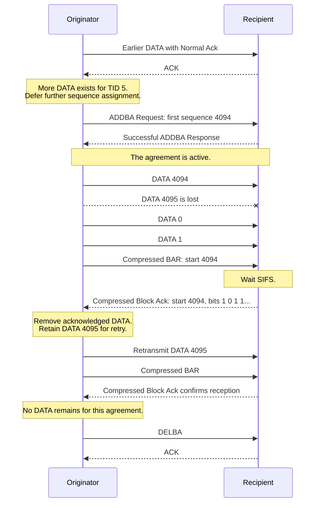
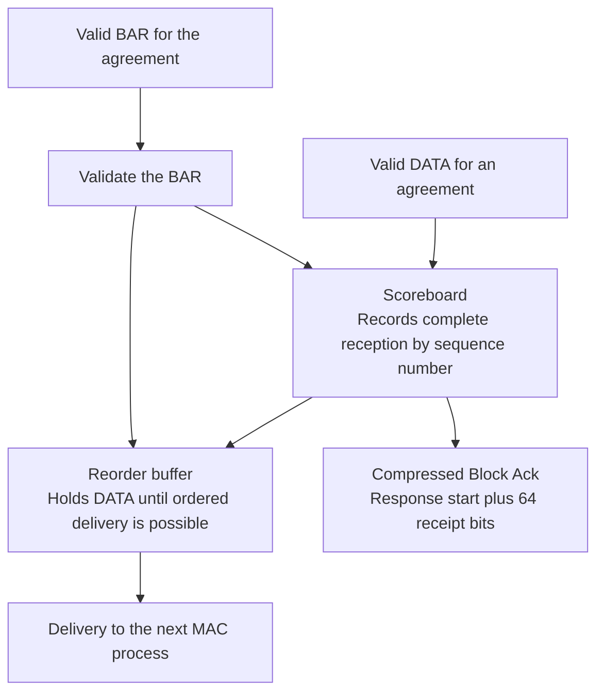
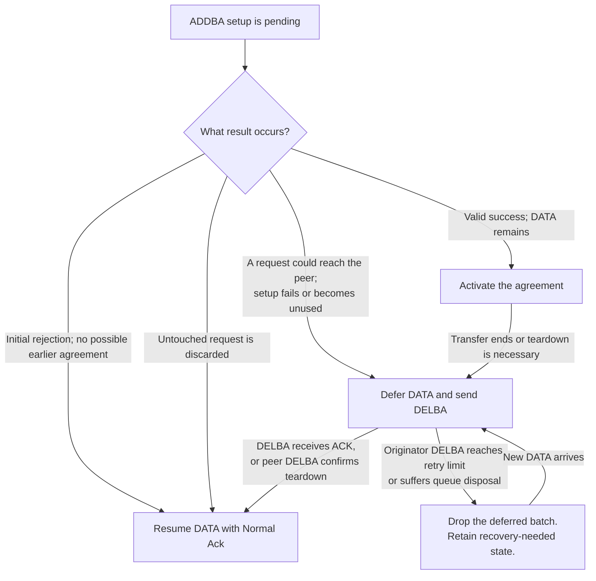
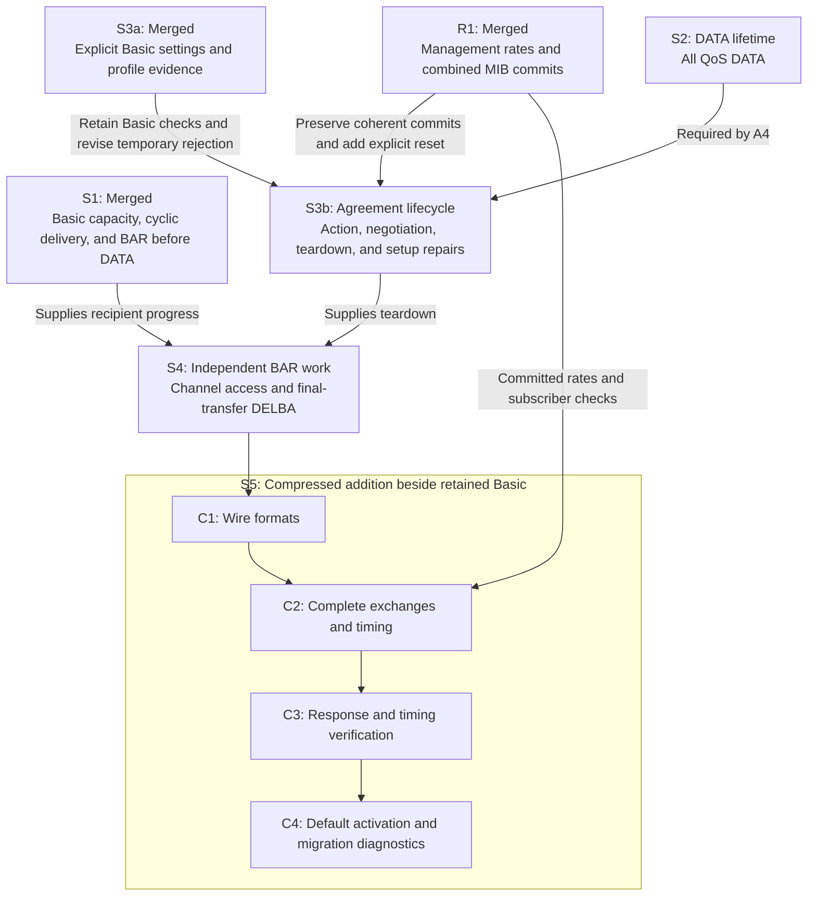
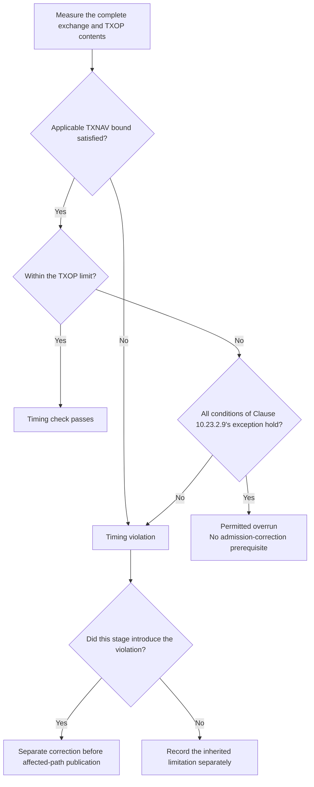

# Compressed and retained Basic Block Ack plan summary for human review

> **Kind:** reference · **Status:** snapshot 2026-10-15 · **Seal:** none · **Owns:** — · **Stands on:** [ieee80211-compressed-blockack-replacement.md](ieee80211-compressed-blockack-replacement.md)

**S1, R1, and S3a are merged; the remaining stages add Compressed Block Ack beside explicit Basic compatibility.** Management already publishes rates. Legacy demonstrations already select Basic explicitly. Basic originated in IEEE Std 802.11e-2005 and is unsupported by IEEE Std 802.11-2024. Further work covers DATA lifetime, agreement lifecycle, BAR channel access, and Compressed integration with its final default.

This summary follows revision 31 of [ieee80211-compressed-blockack-replacement.md](ieee80211-compressed-blockack-replacement.md), dated 15 October 2026. Its integration source is local `master` at `633b071e213b825ce6019ff3e344ae49f52791ff`. It also follows lifetime revision 11 and lifecycle revision 21. The review checkout contains separate S2 source, test, and plan edits. The umbrella records its exact revision and the unavailable remote check. Earlier instructions accept the five policy decisions and strict individual-MPDU release; this request authorizes the corrections for merged prerequisites, without new implementation or publication authority.

This document update adds no runtime result. All five decisions are accepted; stage reviews, prerequisites, and verification remain required. The [decision table](ieee80211-compressed-blockack-replacement.md#maintainer-decisions) records all five statuses.

S1 merged through [PR #1320](https://github.com/inet-framework/inet/pull/1320) on 14 October 2026. Its recorded verification belongs to original feature head `fcc06450355a52b9c8b0f8f2647e0654711bfaca`. The [completed S1 record](ieee80211-compressed-blockack-replacement.md#completed-s1-and-recorded-verification) preserves that source boundary and its scope. This document update supplies no fresh runtime verification of the merged source.

The [completed R1 and S3a record](ieee80211-compressed-blockack-replacement.md#completed-r1-and-s3a) identifies their commits and evidence limits. R1 supplies management rate publication and combined MIB commits before notification. S3a supplies selector validation and explicit Basic consumers. Basic remains the default; explicit Compressed selection stops initialization until A2 replaces that temporary rejection. Neither stage supplies a complete Compressed exchange.

S3a's recorded comparisons preserve thirteen demonstration outcomes, eight capability probes, and every calculated ingredient across nineteen fingerprint rows. Fifteen rows retain graphical `tyf` baseline mismatches; the fingerprint runner exits 1. Four protocol fixtures retain expected FAIL results. These historical results do not establish a fresh combined-master pass or complete protocol support.

The [earlier source comparison](ieee80211-compressed-blockack-replacement.md#source-comparison-for-evidence-reuse) covers `6aefaef1` and `c15860de` before S1. Only three documentation files differ between those revisions; their `src`, `tests`, and `bin` trees match. That equality does not describe the source after S1. Earlier checks remain evidence only within their recorded limits.

The [EDCA DATA lifetime plan](ieee80211-edca-data-lifetime.md) owns DATA expiration. The [agreement lifecycle plan](ieee80211-blockack-agreement-lifecycle.md) owns setup, recovery, and teardown. The replacement plan owns recipient delivery repairs, independent BAR channel access, and final Compressed support. The sections below explain the intended combined behavior; the implementation section separates the changes.

## The intended exchange

Block Ack lets one response report reception status for several DATA frames. The **originator** sends DATA. The **recipient** receives DATA and reports its status.

The agreement applies to one peer and one **traffic identifier (TID)**. A TID identifies a traffic class or stream. Three exchanges control its use:

- **ADDBA** establishes the agreement.
- **BAR**, a Block acknowledgment request, asks for reception status.
- **DELBA** ends the agreement.

The accepted scope uses individual DATA frames before an explicit BAR. It requires usable high throughput (**HT**) capability state at both stations. Its purpose is controlled study of Compressed bitmap, response, and recovery behavior in the current individual-frame MAC. On 14 October 2026, the maintainer accepted that [intermediate scope](ieee80211-compressed-blockack-replacement.md#purpose-of-the-individual-data-profile). The scope decision before C2 is satisfied. Complete HT-immediate transfer requires a separate A-MPDU design.

The response MPDU decreases from 152 bytes for Basic to 32 bytes for Compressed. That frame-length result does not establish lower exchange airtime or higher application goodput. Explicit BAR, control rates, contention, and repeated setup also affect performance. Direct exchange and airtime evidence must establish the supported result.

This hypothetical example uses TID 5, an accepted buffer size of 64, and sequence numbers near their wrap point:

SIFS is the short interval before the immediate response. The diagram omits the ordinary ACKs for ADDBA management frames.

Sequence numbers wrap from 4095 to 0. In this example, bitmap positions represent 4094, 4095, 0, and 1, in that order.

## Receipt status and delivery order

The Compressed Block Ack contains 64 bits. Each positive bit confirms a complete data unit at one sequence position. The scoreboard retains Basic fragment status. The Compressed response derives one complete-unit bit per sequence position without removal of that Basic state. HCF rejects fragmented DATA only under the Compressed HT-immediate profile. Basic retains its fragment map and reassembly after final integration.

The accepted buffer size limits the recipient window. The response still contains 64 bits; positions beyond that window contain zero. An empty scoreboard also produces zero bits.

The BAR supplies a starting sequence number, **not a range length**. The recipient can return a different starting sequence number after it adjusts its receipt window. The originator must interpret each bit relative to the response start.

The recipient therefore needs two separate mechanisms:

The **scoreboard** answers, “Which complete units did the recipient receive?” The **reorder buffer** answers, “Which units can the recipient deliver now?”

Compressed delivery does not erase receipt status from the scoreboard. Scoreboard movement controls receipt retirement and preserves the preceding-position evidence required by the individual-MPDU rule below. The current delivery call erases earlier entries through `removeAckStates`, so C2 must change that contract for Compressed agreements. The Basic getter also infers positive status for absent earlier positions. C2 cannot use that inference for Compressed bits. The [recipient design](ieee80211-compressed-blockack-replacement.md#45-build-recipient-state-and-select-response-airtime) owns the complete contract and Basic compatibility.

`BlockAckReordering` creates its reorder record on the first valid DATA or BAR for the accepted agreement. It uses the negotiated buffer size and request sequence number before it applies that frame's window update. A BAR can therefore advance the empty reorder window before any DATA reception. Hypothetical example: the request starts at 100 with buffer size eight, and the recipient receives BAR at 104 before any DATA. Subsequent DATA 104 must be eligible for immediate delivery. Invalid BAR and BAR without an agreement create no reorder record.

S1 now releases every consecutive complete unit when DATA fills a gap. Its recipient fixture buffers DATA 101 and 102 behind absent DATA 100. Receipt of DATA 100 releases 100, 101, and 102 in order in the same operation. The recipient needs no later DATA reception or BAR. S1 also supplies record creation for Basic BAR before DATA; C2 must verify the same result through Compressed reception.

C2 adds another release condition for individual MPDUs under Clause 10.25.6.6.2.1(a)(2)(v). An in-window unit beyond `WinStartB` can pass a gap when its interframe relation and receipt evidence satisfy that condition. HCF supplies the actual SIFS/RIFS relation after the previous MPDU, or SIFS after ACK completion. The agreement-owned scoreboard supplies receipt evidence at `WinStartR - 1`, even when it lies outside the response window. RIFS means reduced interframe space. The reorder owner uses these inputs without another timer or scheduler.

Hypothetical example: an accepted agreement starts at 100 with size four. Normal Ack DATA 100 reaches delivery and receives ACK; the reorder start becomes 101. DATA 104 arrives one SIFS after ACK, and the scoreboard start becomes 101. Positive receipt evidence for 100 requires delivery of 104 despite absent positions 101–103. A false receipt bit or non-SIFS interval leaves 104 buffered. C2 tests the production relation and both controls.

The receipt checks also cover delivery followed by BAR. DATA 100, 102, and 101 must reach delivery in order, with all three receipt bits retained for BAR at 100. A separate size-eight case receives only 115 and moves the scoreboard to 108–115. Only 115 has a positive bit; absent positions 108–114 remain zero. These checks expose the current deletion path and inferred positives.

Hypothetical example: DATA 100 is absent, but DATA 101 is complete. The reorder buffer holds 101. A valid BAR at 101 can advance delivery past the gap. The scoreboard independently supplies the response bitmap.

Both mechanisms must preserve cyclic sequence order. If one operation releases DATA 4095 and DATA 0, the recipient must deliver 4095 first.

The recipient repair counts sequence positions, not individual fragments. Its Basic-path test supplies two fragments of one DATA unit to a one-position buffer. Both fragments must fit and permit complete-unit delivery. Final Basic compatibility retains that fragment case. It does not establish valid fragmentation under the Compressed HT-immediate profile.

## Agreement setup and the first sequence number

The agreement lifecycle prerequisite preserves the sequence number through setup. The first DATA transmission under an accepted agreement must use the sequence number from its ADDBA Request.

The plan therefore defers further DATA extraction for that peer and TID during setup. Extraction matters because the current data service assigns sequence numbers at that point.

Already numbered DATA resolves under its existing ACK policy before the request starts. Other peers and TIDs remain eligible.

Hypothetical example: setup specifies sequence 100. Deferred DATA receives 100 after acceptance. If DATA 100 expires before transmission, DATA 101 cannot replace it as the agreement’s first transmission. The originator must end that agreement first. It must not reuse sequence 100.

The accepted response controls the agreement parameters:

| Parameter | Proposed behavior |
| --- | --- |
| Buffer size | The built-in recipient selects `min(64, maximumAllowedBufferSize)`. The request size is advisory. |
| Inactivity timeout | Both roles use the response value. Zero disables inactivity expiration. |
| A-MSDU permission | Both negotiated flags must permit A-MSDU construction. |
| Response identity | Acceptance requires the pending peer, TID, dialog token, success status, immediate policy, and positive buffer size. |

An **A-MSDU** combines several service data units inside one DATA frame. If the agreement denies A-MSDU use, the originator sends individual DATA frames. A change to Normal Ack cannot bypass that restriction.

For example, request size 8 and configured maximum 64 produce response size 64 under the proposed built-in policy.

## Block Ack after a short burst

The plan identifies two obstacles in the pinned source. BAR selection depends on a DATA candidate, and the default threshold is five outstanding frames. These paths can leave a finite burst of four frames without a BAR trigger. Production tests must reproduce that failure before the implementation changes those paths.

The proposed selection rule considers outstanding DATA separately for each peer and TID. BAR can request channel access even when no DATA candidate exists.

Hypothetical example: peer A has four outstanding frames, while peer B continuously supplies DATA. Before another DATA transmission to B, the policy selects BAR for A.

The policy can defer BAR below the threshold only when the next DATA belongs to the same agreement and fits its transmit window.

BAR selection and duration calculation must also leave queued DATA untouched. Neither operation may extract DATA or assign its sequence number.

## Recovery after uncertain setup

The agreement lifecycle prerequisite supplies recovery after uncertain setup. A lost ADDBA Response creates uncertainty. The recipient might hold an agreement that the originator never accepted.

The originator cannot safely treat that uncertainty as an initial rejection. It must defer DATA until teardown confirms that the old agreement no longer applies.

This diagram shows the originator’s main paths. Acceptance with no DATA also enters teardown.

Hypothetical example: the recipient processes DELBA, but every ACK is lost. The originator drops the deferred batch and retains recovery-needed state. Later DATA triggers one fresh DELBA exchange. A successful exchange releases that new DATA under Normal Ack.

The plan adds no periodic DELBA retry. DATA expiration alone does not prove that the peer cleared its agreement.

## The three time limits

| Limit | Purpose | Rule and decision status |
| --- | --- | --- |
| ADDBA response timeout | Bounds the wait for a response after the request receives its ACK. | The accepted `addbaFailureTimeout` default is 100 ms; the parameter remains positive, finite, and configurable. |
| Agreement inactivity timeout | Ends an agreement without qualifying activity. | Both roles use the accepted response value. Zero disables this timeout. |
| DATA lifetime | Bounds retention of DATA despite retries or setup delays. | The maintainer accepted the 0.512-second default per access function. The [lifetime decision](ieee80211-edca-data-lifetime.md#lifetime-compatibility-decision) before L1 is satisfied. |

The accepted 100 ms ADDBA response timeout is an INET policy choice. The DATA lifetime matches the IEEE 802.11-2024 MIB defaults: 500 TU, or 512 milliseconds, for AP and non-AP stations.

The standards basis does not establish the compatibility cost in current simulations. The maintainer accepted the 0.512-second lifetime default on 14 October 2026. S2 must still measure expiry with Block Ack disabled. Congestion alone does not prove that retained DATA reaches that age. An opt-in or unlimited mode needs a separate design and a disposal bound for Block Ack recovery.

DATA lifetime starts when HCF accepts DATA from above, before queue insertion. HCF is the MAC component that coordinates these exchanges. Queue residence and setup deferral therefore consume lifetime. Retransmission does not restart the deadline.

The lifetime owner tracks local frame identity, so equal sequence numbers at different peers cannot share a deadline. Fragments retain their source deadline. Each MSDU addition restarts the aggregate timer, as the [lifetime plan](ieee80211-edca-data-lifetime.md#3-proposed-ownership-and-behavior) specifies. The current builder adds all inputs at one simulation time. Pending setup prohibits that aggregation.

Hypothetical example: an MSDU arrives at 0 seconds and joins an A-MSDU at 0.4 seconds under Normal Ack. This example has no active Block Ack agreement and no pending setup or teardown for that peer and TID. The default lifetime places the aggregate deadline at 0.912 seconds. The original 0.512-second deadline must not discard the aggregate. The lifetime tests must also prove that aggregation cannot revive an already expired input.

Hypothetical example: DATA arrives at 0 seconds, and ADDBA Request acknowledgment occurs at 0.1 seconds. Without a successful response, HCF starts DELBA recovery at 0.2 seconds. DATA expires at 0.512 seconds, so 312 ms remains for teardown and transmission. A successful response at 0.15 seconds instead releases DATA under the agreement.

The [lifecycle timeout contract](ieee80211-blockack-agreement-lifecycle.md#response-timeout-and-data-lifetime) records the accepted 100 ms default. Earlier queue delay and later DELBA recovery still consume DATA lifetime. Request acknowledgment at 0.45 seconds would place the response deadline at 0.55 seconds, after the original DATA expires. Tests must cover both orders; the selected default does not guarantee delivery.

The lifecycle tests compare 100 ms with a longer positive timeout under identical controlled contention. They measure delayed-response teardown, delivery, disposal, and management airtime. They also distinguish a canceled queued response from a late received response. Successful DELBA permits surviving DATA to resume under Normal Ack without mandatory new setup. The accepted default remains 100 ms; no measured acceptable-loss threshold is claimed.

No new DATA transmission may start after its deadline. An accepted transmission can finish safely after that deadline. A successful response can still acknowledge it, but expiration prohibits another attempt.

The lifetime prerequisite applies to all QoS DATA, with either value of `isBlockAckSupported`. It includes Normal Ack DATA without an agreement. DCF and complete management-frame lifetime remain outside its scope.

EDCA is the channel-access method for QoS traffic. An EDCAF serves one access category. Its positive, finite `msduLifetime` parameter controls DATA lifetime. This change can affect existing EDCA simulations under congestion even when Block Ack support is disabled. A finite value supplies a deadline, not a guarantee of prompt recovery or expiry within the run.

The [lifetime plan](ieee80211-edca-data-lifetime.md#3-proposed-ownership-and-behavior) permits a larger finite value for compatibility studies. Hypothetical example: a 100-second lifetime prevents lifetime expiry for newly accepted DATA during a 10-second simulation. It does not promise unchanged fingerprints or complete legacy behavior. Earlier success, teardown, or other disposal can still resolve DATA. A recovery path that relies on lifetime expiry inherits the larger delay; the plan adds no unlimited mode.

Hypothetical example: HCF accepts Normal Ack DATA at 0 seconds, but contention prevents transmission before 0.7 seconds. With the default lifetime, HCF discards the DATA at 0.512 seconds under either switch value. An explicit one-second setting still permits an attempt at 0.7 seconds.

Before S2 completes, it requires [measured expiry under controlled congestion](ieee80211-edca-data-lifetime.md#5-verification-and-evidence) with Block Ack disabled. A selected QoS row without expiry cannot satisfy that requirement. If the common rows do not reach the boundary, the lifetime owner must add a controlled congestion variant. Evidence must separate lifetime disposal from queue-capacity loss and retry-limit loss.

The response timeout does not bound earlier contention or later DELBA recovery. The lifecycle plan requires separate measurements for these intervals, delivered DATA, and disposal. The 100 ms default does not bound the complete setup and recovery procedure.

## Response validation and retry

The originator checks the response type, addresses, TID, fragment field, bitmap size, and frame length before it reports exchange success.

It applies bitmap results only within the active agreement’s transmit window:

- Positive bits can acknowledge covered, transmitted DATA, even if those frames did not await this particular BAR.
- Zero bits leave DATA unacknowledged and release the relevant frames for retry.
- DATA below the response start remains unacknowledged.
- A response without overlap, or a timeout, releases requested DATA for retransmission.

The profile uses DATA retransmission after a failed exchange. It does not repeatedly send BAR alone to poll for status.

Individual DATA retransmission preserves its sequence number and sets Retry to one under Clause 9.2.4.1.6. Zero bits and BAR timeout do not count as synthetic Normal Ack retry failures. DATA lifetime supplies the disposal bound; successful Block Ack responses cannot extend it.

For example, a response for another TID cannot acknowledge DATA from the pending exchange. A malformed matching response cannot refresh inactivity or report success.

## Teardown and obsolete work

The two directions can hold separate agreements for the same peer and TID. DELBA must end only the selected direction.

The [source assessment](ieee80211-blockack-agreement-lifecycle.md#2-current-source-and-required-evidence) distinguishes deletion notifications from agreement removal. HCF uses the wrong peer address for both roles' deletion-signal lookups. The recipient handler also uses the wrong address for removal, while the originator handler uses the correct transmitter address. A3a tests both signal payloads and agreement removal, with the opposite role preserved.

At originator teardown, the proposed **discard-all policy** removes every transmitted, unacknowledged frame in that agreement. Unsent DATA retains sequence continuity. Ordinary recipient teardown preserves the required duplicate state.

Hypothetical example: DATA 100 through 102 remain unacknowledged at teardown. The originator discards all three. New DATA uses sequence numbers after 102.

Inactivity expiration also applies discard-all to transmitted, unacknowledged DATA, even when its lifetime deadline is later. For example, DATA 100 can remain unacknowledged when agreement inactivity expires before DATA lifetime. Teardown then discards it and records inactivity as the cause. User documentation must explain this consequence; measurements separate it from lifetime expiry and other teardown causes. A5 completion leaves no unresolved DATA for discard-all. Unsent DATA is outside this discard-all rule.

Clause 11.5.3.4 permits a narrower alternative: retry only the highest transmitted unacknowledged frame outside the agreement, with its sequence number retained. Earlier unacknowledged frames must still be discarded. That alternative cannot retry the retained frame within a new agreement. In the example above, only DATA 102 qualifies.

The proposed policy avoids this retry across agreement boundaries. A performance estimate requires an isolated implementation of the alternative for a controlled comparison. An eligible-frame count alone does not prove recoverable delivery. The comparison adds no second production policy or configuration switch.

Clause 10.25.4 requires DELBA when no DATA remains after the final Block Ack exchange. Zero inactivity timeout does not disable this separate requirement. The accepted INET predicate checks for no queued DATA, in-progress DATA, or pending BAR exchange for that agreement at an exchange boundary. The clause does not prescribe this queue predicate.

Hypothetical example: a burst completes and no DATA remains for its agreement before another burst arrives. The accepted interpretation queues DELBA during that gap. Later DATA waits for teardown and can incur another setup exchange. The [transfer-completion record](ieee80211-blockack-agreement-lifecycle.md#transfer-completion-decision) states the maintainer's acceptance of this predicate. The lifecycle plan must still measure its cost separately from inactivity expiration.

Several event cases need explicit treatment:

- Duplicate ADDBA frames receive the ordinary ACK but do not repeat agreement actions.
- An addressed ADDBA or DELBA during a response wait first ends that unsuccessful exchange, then enters normal recipient processing.
- Queue disposal produces one terminal outcome for each owned management Action.
- Obsolete queued Actions leave the queue before another attempt.
- An Action already accepted by Tx finishes safely, without an obsolete retry or agreement change.
- Association reset clears that peer’s agreement state, even when replacement capabilities are identical.

A valid BAR without an agreement causes DELBA, without an immediate ACK or Block Ack. DATA with Block Ack policy under the same condition is discarded and causes DELBA. Malformed frames create neither receive state nor recovery exchanges.

The [reassociation consumer assessment](ieee80211-blockack-agreement-lifecycle.md#reassociation-consumers-and-callback-order) found no current production subscriber or NED statistic for `rateStateChanged`. A unit-test observer subscribes, and HCF will become a new production subscriber. Both rate-selection components read peer HT state directly. The public signal contract also permits external listeners.

Hypothetical example: a Compressed peer's successful AP reassociation retains identical HT capabilities and rate sets. R1's combined MIB commit can emit no rate notification. A3b must explicitly retire the old agreement before new DATA selection. The handoff must also cover Basic peers without HT records. A3b must preserve coherent callback state and verify final peer-compatible rates and rate statistics.

## Frame format and compatibility

HCF resolves `blockAckVariant` once into an immutable typed profile. Merged S3a keeps that value private and exposes no profile query. A2 and C2 must pass the value to their consumers through the smallest required interface. Compressed is the final default; legacy consumers retain explicit Basic selection. Policies must not infer the profile from PHY mode. The serializer decodes the actual wire type independently, without a variant registry or second agreement store.

IEEE Std 802.11e-2005 introduced the mechanism and the frame format later called Basic Block Ack. Clauses 7.2.1.7 and 7.2.1.8 define BAR and Block Ack, with a 128-octet fragment bitmap. Clause 9.10 defines their operation. Direct inspection of the local PDF confirms these clauses, their frame figures, and the historical page references. The [umbrella source notes](ieee80211-compressed-blockack-replacement.md#appendix-b-standards-source-notes) record the filename, checksum, pages, and lack of corpus indexing. The [IEEE publication record](https://standards.ieee.org/ieee/802.11e/3131/) identifies the amendment.

IEEE Std 802.11-2024 Tables 9-36 and 9-37 reserve type 0 and identify type 2 as Compressed. INET retains Basic for historical compatibility; that current standard does not support it. Existing INET studies can use later PHY modes and existing Basic response behavior. Retention does not claim complete IEEE Std 802.11e-2005 conformance.

Keep Basic classes, serializers, builders, fillers, and fragment bitmaps. Decode type 0 as Basic and type 2 as Compressed. Other unsupported variants follow the invalid-frame path. A response must match the pending BAR variant before any success or receipt-state update.

The old nine-bit `reserved` field overlaps the upper two bits of the complete Type field. C1 preserves Basic field round trips only when they encode Type 0. It rejects a Basic value that encodes another Type before serialization. The common fields remain available to existing callers. Figures 21b and 21e of the 2005 amendment reserve B0–B11. Retained ACK-policy fields are INET compatibility fields, not semantics from those figures.

Both Compressed serializer producers already exist. C1 adapts their old ACK-policy and reserved-field expectations with its serializer change. Compressed writes zero in B0 and B5–B11; received values in those reserved positions are ignored. B3 and B4 remain Type bits and cannot use that ignore rule. C1 verifies both complete inventories; C4 adds remaining coverage.

ADDBA gains no variant negotiation field. Both endpoints must select the same profile. A valid addressed BAR that conflicts with an active peer/TID agreement causes a fatal configuration error before state updates. HCF reports both addresses, TID, expected profile, and received variant. Malformed input, unknown variants, and absent agreements retain their separate validation or recovery paths.

The accepted [profile-conflict policy](ieee80211-blockack-agreement-lifecycle.md#profile-conflict-detection-and-termination) stops the entire simulation, including unrelated traffic. It replaces conflict-triggered DELBA and continued operation after mismatch. The user must correct endpoint profiles and start a new run. DATA can reach the recipient before conflict detection; the stopped run does not establish successful compatibility or a completed performance comparison.

Basic responses remain 152 bytes with FCS. The Compressed header chunk is 28 bytes; its FCS makes the MPDU 32 bytes. Timeouts, durations, and protection use the actual variant. Retain Basic response-mode assertions as compatibility evidence. Add non-HT Compressed cases beside them.

Compressed responses use qualifying basic or mandatory rates. Non-HT BAR supplies the rate bound, modulation class, and preamble type. HT or VHT BAR supplies its non-HT reference rate and an OFDM or ERP-OFDM response. Legal alternate rates preserve duration; invalid overrides fail clearly.

Originated Compressed BAR uses a non-HT PPDU. Initial BAR uses a BSS basic rate, or a mandatory rate when that set is empty. Later BAR uses the known peer operational set. Unknown peer state uses the basic or mandatory fallback. Unknown BSS state uses the documented INET mandatory-rate fallback.

The merged [R1 stage](ieee80211-compressed-blockack-replacement.md#r1-publish-production-rate-state) publishes rate state through existing MIB operations. Full management commits advertised or accepted local, BSS, and peer rates. Simplified management publishes equivalent static state. Associated-AP Beacons refresh records; association loss clears them. Unknown sets remain distinct from known empty sets.

Direct MIB injection does not prove production publication. R1 has its own parent comparison and production fixture. C2 consumes the completed state and repeats its lifecycle-subscriber interaction.

HCF will classify initial and later Compressed BAR from actual frame-sequence progress before mode selection. The current initiator predicate always returns false and cannot supply that classification. Fresh channel access requires initial classification again. Retain unrelated RTS/CTS and ACK behavior.

Rate-only notifications must preserve unchanged agreements in either profile. Missing HT state cannot retire Basic compatibility. Management must still notify HCF of real association reset for Basic peers without HT records. Lifecycle A3b owns that handoff and its callback-order checks.

Compressed requires usable local and peer HT state; its capability-gap cases use Normal Ack. Explicit Basic retains existing ad hoc and non-HT capability assumptions. It requires no new peer HT records or IBSS capability implementation.

Clause 10.2.7 prohibits fragmentation under the Compressed HT-immediate agreement, regardless of DATA ACK policy. Basic preserves historical fragment handling. An HT PHY mode alone does not select the Compressed profile.

The [legacy inventory](ieee80211-compressed-blockack-replacement.md#s3a-demonstration-migration-and-fallback-inventory) preserves the Block Ack and TXOP ad hoc networks. Both QoS examples retain their modes, topology, and traffic. Preserve S3a's explicit Basic settings in the existing scopes.

Retain `Fragmentation`, `HCFfragblockack`, `PacketSizeHCFfragblockack`, `TxPowerHCFfragblockack`, `ThresholdHCFfragblockack`, and `OnlyPacketSizeHCFfragblockack`. Keep their analysis inputs, result filters, plot series, fingerprint rows, and six speed records. Other Basic showcase records also remain.

Hypothetical example: the Block Ack `Fragmentation` configuration selects Basic at both ad hoc hosts. It still reports fragments through its Basic bitmap. A valid Compressed agreement transmits the same MSDU without fragmentation. These profiles need different expectations.

At each relevant description or analysis caption, state Basic's historical origin and its absence from IEEE Std 802.11-2024. Keep existing images and results when evidence still supports them. Shared repairs can change results despite unchanged topology and traffic. Regenerate only affected material after measurement.

Every legacy demonstration must retain ADDBA, Basic BAR, Basic responses, and positive receipt status. Check fragments in the fragmentation cases. Ad hoc QoS run 1 retains Basic; run 0 remains support-disabled. Check Compressed capability-gap fallback separately.

Infrastructure protocol fixtures supply Compressed coverage through real capability exchange. `N_CompressedBa` must require Compressed and positive bits. `Ac_BlockAck` remains positive coverage for eligible `ac` peers. The absent-peer-state fallback fixture selects Compressed and static management without Beacon refresh.

Retain Basic NAV, multiple-protection, header, and serializer assertions. Add Compressed cases with valid HT state. Retain 152-byte Basic response-mode cases beside new 32-byte Compressed cases. Preserve directional queries, asymmetric state, peer isolation, and ACK/CTS controls.

The four deferred protocol obligations remain distinct from successful exchanges. Explicit Basic retains `WifiQosDelayedBa` and its missing delayed behavior. A separate fixture verifies Compressed initialization rejection for delayed policy. This revision adds no new Basic initialization guard.

Migration guidance explains the default, explicit Basic setting, and added interface obligations. HCF logs the resolved profile when support is enabled. If Compressed lacks usable local HT support, it emits one initialization warning for that interface. Basic and disabled support produce no irrelevant warning.

That local warning cannot detect HT ad hoc management without peer HT records. The existing policy decision log must identify the capability-gap refusal. C4's external-style fixture omits the selector and tests legacy modes plus HT ad hoc operation. It must prove Normal Ack fallback and the applicable diagnostics. Explicit Basic must restore Basic exchanges. The default remains independent of the mode set.

## Implementation order and verification

S1, R1, and S3a are merged. The remaining stages are S2, S3b, S4, and S5. S3b must use a parent that contains R1 and S3a. A4 requires S2; earlier lifecycle units can proceed independently of S2. The arrows below show required dependencies:

S2 implements the lifetime prerequisite. S3a already records explicit Basic settings and legacy exchange evidence against its original parent. S3b uses a parent with merged S3a and R1 and implements A1, A2, A3a through A3c, and A4. These units repair Action dispatch, negotiated values, safe teardown, and uncertain setup. A3c owns recovery for valid BAR and Block Ack-policy DATA without an agreement. A4 requires S2 and the earlier lifecycle repairs; A1, A2, and A3a through A3c do not require S2.

The lifecycle plan separates A3 into [three review units](ieee80211-blockack-agreement-lifecycle.md#5-reviewable-stages-and-dependencies):

| Review unit | Responsibility |
| --- | --- |
| A3a | Directional teardown, deletion signals, duplicate state, and inactivity. |
| A3b | Association reset, the AP management change, and consumer and callback verification. |
| A3c | Complete Action disposal and absent-agreement recovery. |

The split does not establish independent publication boundaries. Action invalidation and safe completion must accompany the first retirement or reset path that needs them. Hypothetical example: A3a retires an agreement while a successful ADDBA Response remains queued. A3a must invalidate that response before another attempt; it cannot defer that protection to a later published A3c change.

C2 must implement Clause 10.25.6.6.2.1(a)(2)(v), including its surrounding agreement, station, sequence-window, receipt-bit, and timing conditions. The [history and timing design](ieee80211-compressed-blockack-replacement.md#interframe-history-and-timing-design) is implementation work within that requirement. Its owner must resolve timestamp mapping, event observation, stored state, and invalidation before the affected implementation is complete. These details require source and standards evidence, not another policy choice or an optional omission of the rule.

If PHY observations cannot establish the timing relation, the C2 owner records the gap and proposes the smallest correction. The code reviewer checks that correction against the standard and supported PHY model. A model approximation or reduced scope requires an explicit maintainer-approved plan revision with stated compliance limits. No such approximation is approved here.

Local experimental code may support that investigation. The affected release path cannot be published until its design review and direct verification pass. Independent work may continue if it neither exposes nor depends on that incomplete path. No runtime switch is required solely to disable an unfinished rule.

Tests must distinguish receipt-bit and timing conditions through separate positive and negative cases. They must include propagation delay, intervening frames, and cleanup. The implementation must not add unsupported same-peer, address, or TID restrictions. The rule can change Compressed delivery timing; Basic retains S1 behavior and needs separate evidence for any changed fingerprint.

The [stage conditions](ieee80211-compressed-blockack-replacement.md#stage-conditions) distinguish start, continuation, completion, and publication. The lifetime review precedes S2 implementation. S2 reproduces absent queue expiration before the production change and demonstrates corrected expiry before completion. The lifecycle review and completed S3a preparation precede S3b implementation, including A1. The umbrella review does not establish either prerequisite plan's correctness or completed verification.

The [maintainer decision table](ieee80211-compressed-blockack-replacement.md#maintainer-decisions) records all five accepted choices:

- The maintainer accepted the 0.512-second lifetime default for S2/L1, with Block Ack enabled or disabled.
- The accepted 100 ms response timeout satisfies the A4 decision condition.
- The maintainer accepted the queue predicate for A5 in S4.
- The maintainer accepted the individual-DATA purpose and scope for C2.
- The accepted fatal configuration error satisfies C2's profile-conflict decision condition.

S1, R1, and S3a retain their separate completed scope and recorded verification. The remaining stages are S2, S3b, S4, and S5. The explicit decision approvals select all five policy outcomes. They establish no completed implementation or verification of those remaining stages.

Other stages follow their applicable review and prerequisites. S3b requires a parent that contains merged S3a and R1. A2 must revise S3a's temporary Compressed rejection and its selector fixture. `Ac_BlockAck` remains a positive requirement and adds no deferral approval gate.

S1 corrects recipient delivery and capacity through Basic tests with supplied agreements and known buffer sizes. Its eight scenarios include complete gap release and BAR before DATA. Retain all eight as Basic regression checks through later stages. S3b/A2 must verify that negotiation supplies the accepted size and sequence number to the repaired recipient. C2 and C4 must verify Compressed integration separately. S1 does not establish the final Compressed bitmap representation.

Before S4 starts, its owner confirms that S3b supplies teardown and S1 supplies recipient progress. S4 adds BAR work without DATA extraction and integrates A5 with the accepted transfer-completion predicate. S4 compares changed Basic BAR timing with its pinned parent before publication. Any new unlawful overrun requires resolution at that boundary, without a future C2 or C3 result. S4 preserves Basic fragment rules. S5 retains them beside the Compressed restriction.

S5 consists of C1 through C4 after its required S1–S4 contracts. R1 already satisfies the publication prerequisite. C2 repeats subscriber integration and supplies actual BAR classification and Compressed response calculations. Those calculations cover response-rate selection, override validation, BAR timeout, recipient duration, and protection airtime. C2 records the selected modes, first airtime result, and admission decision before C3 or C4 proceeds. C3 verifies supported response modes and exchange boundaries; it supplies no missing runtime operation required by C2.

The first C2 timing result is not a prerequisite for S5 to start. Each step must build:

| Step | Change and required result |
| --- | --- |
| C1 | Define the 28-byte Compressed header chunk and complete Type decoding beside Basic. Retain Basic round trips that encode Type 0. Adapt existing Compressed producers and field expectations with the serializer change. |
| C2 | Consume R1 rates and add complete Compressed exchanges without loss of Basic fragment state. Preserve receipt truth after delivery and add the individual-MPDU interframe release condition. Supply actual BAR classification, legal control modes, durations, and profile validation. Enforce the Compressed fragmentation boundary. Record the first Compressed timing result before C3 or C4. |
| C3 | Verify initial and later BAR rates, primary and legal alternate responses, mandatory-rate fallback, and HT/VHT reference rates. Preserve directional response queries and ACK/CTS controls. Repeat timing checks across supported modes and exchange boundaries, with permitted-overrun conditions explicit. |
| C4 | Activate the final Compressed default after runtime and timing checks. Add migration diagnostics and the external-style fixture. Retain explicit Basic consumers and all legacy result rows. Add Compressed-only delayed-policy rejection. |

Basic remains through every prerequisite and the final implementation. Each publication boundary must preserve a Basic path that passes direct checks. A partial recovery state machine is not publishable. S3a temporarily retains the Basic default; C4 activates the requested Compressed default after C2 and C3.

Basic fragment scenarios remain after C4. Compressed fragment input must cause no receipt-state update, positive bit, or delivery. Ordinary Normal Ack fragmentation remains outside Compressed agreements. Timing evidence and any required admission correction still control S5 completion.

A wire-only change cannot establish the required exchange behavior. Hypothetical example: an empty receive record must produce zero Compressed bits. A correct type 2 header cannot compensate for false positive receipt status.

## Verification and performance evidence

Verification combines both wire formats, production assertions, the full fixture inventory, and all 19 selected fingerprint rows through C4. Explicit Basic preserves the legacy scenarios. Shared repairs can still change results. Production assertions establish behavior; fingerprints expose regression effects.

The current [Ieee80211BlockAckReordering_1.test](../../tests/module/Ieee80211BlockAckReordering_1.test) supplies the completed S1 recipient checks. Its default selects scenarios 0 through 7 with seed 0. The [umbrella verification section](ieee80211-compressed-blockack-replacement.md#6-verification-and-scope-limits) gives its exact module selector with the current NAV fixture. These checks supply no ADDBA negotiation or Compressed exchange evidence.

The planned focused fixtures separate lifetime, agreement lifecycle, and Compressed integration. They include `Ieee80211EdcaDataLifetime_1.test`, `Ieee80211BlockAckAgreementLifecycle_1.test`, `Ieee80211CompressedBlockAck_1.test`, and `Ieee80211HcfCompressedBlockAck_1.test`. The current `N_CompressedBa.test` must assert Compressed frames and positive receipt bits. These later checks are proposed, with no completed results.

R1's existing production fixtures compare committed MIB rates with real advertisements without direct rate injection. Their [evidence record](../../doc/project/evidence/model/wifi/r1-rate-publication.md) covers publication, callback state, cleanup, membership selectors, and nonfinite inputs. Retain `Ieee80211MgmtRatePublication_1.test` and `Ieee80211MgmtStateCommit_1.test` after affected changes. C2 must repeat subscriber effects after S3b exists. HCF checks must distinguish initial and later BAR rates, including initial classification after fresh channel access. RTS/CTS and ACK controls remain.

The protocol selection includes eight original fixtures and the proposed absent-peer-state `ac` fallback fixture after it exists. The original module selection includes four fixtures that can enable Block Ack, five support-disabled controls, and the separate S1 recipient fixture. Add S3a's selector and Basic observation fixtures, plus R1's existing publication and state-commit fixtures, to affected regression checks. Retain HT mode-set, VHT/HT capability, response-mode, and MIB unit coverage. C1 checks existing serializer producers and inventories; C4 adds remaining serializer coverage and delayed-policy rejection. Record observed outcomes and their actual failure causes separately from deferred obligations.

The common fingerprint selection through final C4 covers these simulation paths:

| Path | Retain after C4: 19 rows |
| --- | --- |
| `showcases/wireless/blockack` | `NoFragmentation`, `MixedTraffic`, `Fragmentation` |
| `showcases/wireless/aggregation` | `NoAggregation`, `Aggregation`, `VoicePriorityAggregation` |
| `showcases/wireless/fragmentation` | `DCFnofrag`, `DCFfrag`, `HCFfrag`, `HCFfragblockack` |
| `showcases/wireless/qos` | `NonQos`, `Qos` |
| `showcases/wireless/txop` | `General`; run 0 |
| `examples/wireless/qos` | `MacQos`, `MacQosWithoutAggregation`, `MacQosWithRtsCts`, `MacQosWithBlockAck`; run 0 |
| `examples/adhoc/qos` | `MacQos`; runs 0 and 1 |

Block Ack-disabled EDCA rows check the broader lifetime scope. DCF rows provide controls for shared changes. Each row retains its recorded run number, time limit, and fingerprint ingredients; the four wireless QoS rows use run 0. The TXOP row records five seconds, and both ad hoc QoS rows record ten seconds. Block Ack `General` has no separate fingerprint row; direct exchanges and its speed record cover that configuration.

Each behavior repair must first reproduce its old failure through production code. It compares its corrected result with a pinned parent before another stage changes the same path. S3a records explicit Basic settings without topology or mode changes. Prerequisite tests retain Basic. S5 repeats integration checks with Compressed and rechecks Basic compatibility.

Tests cover short bursts, sequence wrap, lost responses, queue disposal, uncertain setup, DATA expiration, and reassociation. Each changed fingerprint needs a cause from the stage that introduces it. The implementation must preserve raw results and comparison revisions. S1's four approved changes retain their [separate authority and exact values](../done/ieee80211-compressed-blockack-s1.md). This plan revision authorizes no additional baseline update.

The [direct verification cases](ieee80211-compressed-blockack-replacement.md#6-verification-and-scope-limits) also cover one peer with two TIDs and buffer sizes below BAR threshold five. They check shifted responses, positive bits for transmitted frames outside the BAR wait, and retry release after a response without overlap. Positive bits must not acknowledge unsent frames or frames outside the active window. HCF module assertions establish these integration results; helper tests and fingerprints cannot replace them.

Performance checks must separate request contention, response wait, DELBA completion, and total DATA deferral. They must measure delivery, lifetime disposal, teardown disposal, management airtime, and progress for another eligible peer or TID. Teardown measurements must separate inactivity-driven disposal from other causes and record whether discarded DATA still had an unexpired lifetime deadline. Controlled comparisons retain the same traffic, seed, rates, and channel conditions. The plans assume no performance improvement or acceptable loss threshold.

For bursts with idle gaps, count ADDBA and DELBA exchanges, including retries. Measure application goodput as useful bytes delivered per unit of simulated time over a fixed interval. A separate experimental policy can estimate agreement-reuse effects with otherwise identical inputs. Without that experiment, report observed costs without a claim about agreement-reuse performance.

S4 needs timing evidence before publication of its changed Basic BAR paths. Test standalone BAR, final BAR after one or four DATA frames, and late continuation near a positive TXOP limit. Exercise single and multiple protection. Compare with S4's pinned parent and apply the exact TXNAV and TXOP conditions. The [umbrella timing contract](ieee80211-compressed-blockack-replacement.md#airtime-acceptance-and-admission-dependencies) owns the required observations and correction boundary.

Fragmentation suppression needs further airtime checks at C2. At a fixed mode, one unfragmented frame takes longer than one constituent fragment, although the complete fragment sequence can cost more. Block Ack-enabled HCF lacks complete-cost single-protection admission. A positive remaining TXOP interval does not prove that the next complete exchange fits.

Hypothetical example: a previous DATA exchange ends with 100 microseconds left, but another DATA exchange needs 200 microseconds. The positive remaining interval does not authorize that continuation. C2 must measure the applicable TXNAV and TXOP bounds before C3 or C4 proceeds. Its checks cover Compressed infrastructure fixtures. Retained Basic showcase hops need separate regression observations.

C3 repeats affected checks across supported response modes and exchange boundaries. No current evidence proves timing compliance for the final configurations.

Clause 10.23.2.9 permits specific overruns when a TXOP contains at most one Data or Management frame. One permitted case is initial transmission of an unaggregated MSDU under a Block Ack agreement. The MSDU must satisfy the clause's aggregate conditions. The timing record must prove every exception condition and any independent TXNAV requirement. An initial A-MSDU does not qualify for that exception. A second DATA exchange also defeats the one-frame condition.

Hypothetical example: the first unaggregated MSDU under an agreement needs 200 microseconds within a 100-microsecond TXOP limit. No other Data or Management frame exists in that TXOP, and the aggregate conditions hold. The TXOP exception permits that overrun. The same result for an initial A-MSDU or a second DATA exchange requires a different assessment.

Each responsible stage records permitted overruns, inherited violations, and new violations against its own parent. A permitted overrun creates no admission-correction prerequisite. S4 resolves new unlawful overruns before publication of its affected Basic path. S5 waits for any correction required by Compressed integration and its direct checks. C3 repeats the classification across supported response modes and exchange boundaries. The C2 comparison cannot relabel an unresolved S4 violation as acceptable inherited behavior.

An alternative configuration restriction needs direct evidence of timing compliance within its stated scope. A fixed MSDU cap alone cannot establish that a later exchange fits the remaining TXOP. The plan selects no automatic size cap or silent Normal Ack fallback.

The integration source is local `master` at `633b071e213b825ce6019ff3e344ae49f52791ff`, with S1, R1, and S3a merged. Original S1 verification retains feature head `fcc0645035` and publication base `ac6344cc5bcac972012759281a11b3f8255b5d46`. Each remaining stage must pin its actual merged parent and comparison base. Shared HCF paths establish overlap but do not prove a merge conflict. The older lifetime and lifecycle observations require fresh source and caller checks against their selected parents.

S1's final-series record reports debug and release builds, eight recipient scenarios, three NAV runs, and 12 selected fingerprints as successful. Four separately approved fingerprint changes belong to its delivery commit. The [S1 evidence](ieee80211-compressed-blockack-replacement.md#completed-s1-and-recorded-verification) states the exact scope and commands. Those 12 configurations do not verify the proposed 19-row common selection.

The earlier 13 October review passed two capability unit fixtures, `Ac_BlockAck`, and the seven-scenario VHT/HT module fixture after a debug build. Those results retain their [historical source and limits](ieee80211-compressed-blockack-replacement.md#branch-verification-record). The plan retains 19 fingerprint rows and ten speed records for later verification. Six speed records cover fragmentation configurations; four cover other Block Ack and TXOP configurations. This document update executes no runtime check. Final performance, lifetime integration, lifecycle repairs, and Compressed behavior remain unverified.

## Scope limits

The plan excludes these features:

- A-MPDU and implicit BAR.
- Delayed Block Ack and Multi-TID Block Ack.
- HE bitmap lengths and dynamic fragmentation.
- Groupcast Block Ack.
- New complete-cost TXOP admission and BAR forecasts.

A-MPDU means several MAC frames within one aggregate. A TXOP is an interval in which a station can start frame exchanges.

The individual-DATA profile does not establish complete HT-immediate transfer coverage. The plan also makes no stop/start recovery claim.
