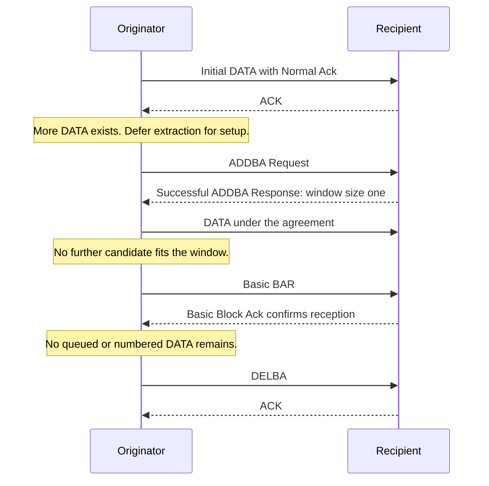

# Basic Block Ack implementation summary

> **Kind:** reference · **Status:** current · **Seal:** none · **Owns:** — · **Stands on:** [implementation status](ieee80211-compressed-blockack-replacement.md)

This checkout supports Basic Block Ack agreement setup, DATA deferral, BAR-only channel access, and transfer completion. Basic is the default profile. HCF rejects Compressed selection at initialization. Compressed frame classes and isolated admission policies do not establish production Compressed support.

## Previous PRs and S4 scope

This summary covers the integrated source on `work/compressed-blockack-s4`, the branch for [PR #1344](https://github.com/inet-framework/inet/pull/1344). The current behavior combines inherited prerequisites with S4's transfer-completion changes.

| Source of the behavior | Contribution |
| --- | --- |
| Merged [PR #1320](https://github.com/inet-framework/inet/pull/1320) | Recipient capacity, cyclic delivery, gap release, and Basic BAR progress. |
| Merged [PR #1331](https://github.com/inet-framework/inet/pull/1331) | Finite QoS DATA lifetime and safe completion across expiry. |
| Merged [PR #1343](https://github.com/inet-framework/inet/pull/1343) | Agreement setup, Action dispatch, directional teardown, DATA deferral, and recipient teardown delivery. |
| Merged [PR #1368](https://github.com/inet-framework/inet/pull/1368) | Peer cleanup before association replacement, even when capability values remain identical. |
| This S4 branch, PR #1344 | Borrowed queue preview, BAR-only contention, peer/TID-specific feedback, window progress, completion DELBA, and prepared-successor reservations. |

S4 does not introduce the lifetime owner, filtered queue API, or recipient teardown policy. It uses those prerequisites to complete the final Basic exchange. Its preparation commit supplies shared window calculations before their callers. The [main reference](ieee80211-compressed-blockack-replacement.md#previous-prs-and-s4-scope) gives the detailed attribution and S4 commit boundaries.

Compressed exchanges and the Compressed default belong to separate S5 [PR #1345](https://github.com/inet-framework/inet/pull/1345). They are absent from this S4 source. The sections below describe the combined Basic behavior, not only the lines changed by S4.

## Agreement and DATA behavior

HCF coordinates one agreement for each role, peer, and traffic identifier (TID). ADDBA establishes an agreement. A Block acknowledgment request (BAR) requests reception status. DELBA ends the agreement. The [lifecycle contract](ieee80211-blockack-agreement-lifecycle.md) defines setup validation, response waits, teardown, and peer reset.

Without an agreement, the originator sends eligible initial DATA with Normal Ack. When more eligible DATA exists, setup deferral preserves the requested first sequence number. Matching ADDBA success permits DATA under the accepted agreement. Uncertain setup holds surviving unsent DATA until teardown resolves the peer state.

The ACK policy counts outstanding DATA separately for each peer and TID. Below the BAR threshold, it waits only when the next eligible DATA belongs to that group and fits its accepted window. HCF can contend for BAR when the queue is empty or the next candidate cannot proceed.

Hypothetical example: a window of one and a threshold of five permit one outstanding DATA frame. The next sequence lies outside the window. HCF sends BAR instead of waiting for five frames. Positive feedback permits window progress. With no queued or numbered DATA at the safe exchange boundary, HCF starts DELBA.

The following sequence describes that supported Basic case. It omits management ACKs and ordinary channel-access delays.

## State ownership and failure behavior

The data service previews queued DATA without extraction or sequence assignment. Queue owners perform filtered pull operations when extraction occurs. The originator agreement owns cyclic window operations. The recipient keeps receipt status separate from the reorder buffer that controls delivery.

BAR failure updates contention without a DATA retry charge. Failed feedback makes later DATA retransmission set Retry. The finite [DATA lifetime](ieee80211-edca-data-lifetime.md) continues through retries and setup deferral. Final resolution or expiry can trigger completion DELBA even with zero inactivity timeout.

Ordinary recipient teardown delivers complete buffered units before cleanup. Association reset instead discards old peer state without delivery into the replacement association. Acknowledgment alone does not establish delivery.

## Compatibility and evidence limits

Basic is an INET compatibility profile for the IEEE Std 802.11e-2005 format. It is not Basic support under IEEE Std 802.11-2024. Basic preserves existing fragment and ad hoc behavior. The [implementation status](ieee80211-compressed-blockack-replacement.md) defines configuration and extension contracts.

Basic single protection reserves only prepared successors; unextracted DATA requires another TXOP. This can increase contention and repeated setup. General Basic DATA admission, complete NAV conformance, Compressed exchanges, A-MPDU, delayed Block Ack, and Multi-TID Block Ack remain outside the implementation claim.

The [current verification record](ieee80211-compressed-blockack-s4-execution.md) identifies the build, module, unit, protocol, and fingerprint results. It gives exact commands and explicit limits. This summary adds no simulation or performance result.
