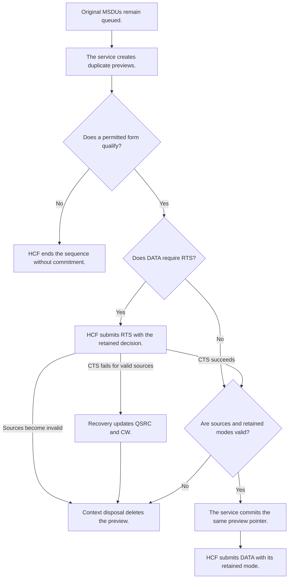

# TXOP prerequisite: admit Compressed DATA before destructive preparation

This correction is complete and removes the active Compressed timing blocker. The [replacement plan](ieee80211-compressed-blockack-replacement.md#excluded-features-and-fragmentation) excludes complete-cost TXOP admission from its original scope. On 2026-10-16, the maintainer authorized this separate correction and subsequent S5 completion. The resolved contract below passed source validation and independent review before production edits. The [S5 execution record](ieee80211-compressed-blockack-s5-execution.md#authorized-txop-correction-and-c3-acceptance) supplies the final runtime evidence and scope limits.

## Problem and required result

The final S5 candidate sends two later A-MSDUs beyond their TXOP bounds in a supported case. The exact parent has no such violation in that case. The [S5 execution record](ieee80211-compressed-blockack-s5-execution.md#confirmed-timing-blocker) supplies the comparison and its limits. IEEE Std 802.11-2024, Clause 10.23.2.9 does not permit the observed continuation.

The correction must establish the complete exchange cost before DATA commitment. An aggregate must fit its applicable bound. A later ordinary MSDU must also fit. The correction must retain the permitted initial unaggregated MSDU exception. It must not strand an oversized aggregate until lifetime expiry.

A zero TXOP limit permits one SU PPDU with one MSDU or A-MSDU, plus its required protection and response. It does not mean zero permitted airtime. With a positive limit, the initial unaggregated MSDU exception permits at most one Data or Management frame. RTS and CTS airtime counts toward the exchange cost, but those Control frames do not increase that count. A same-size retransmission has a separate permitted exception under Clause 10.23.2.9; the implementation contract must state its retry policy.

Hypothetical example: a TXOP has 200 microseconds left. The proposed aggregate needs 400 microseconds, while its first ordinary MSDU needs 150 microseconds. The service must commit that ordinary MSDU and leave the other MSDUs queued. If neither form qualifies, the sequence must end without queue removal or sequence assignment.

The initial implementation scope covers active Compressed agreements. Explicit Basic and Normal Ack fallback outside an agreement retain their current preparation paths. This boundary avoids an unrelated compatibility repair. It does not claim that those retained paths satisfy every TXOP constraint.

## Confirmed cause

The [data service](../../src/inet/linklayer/ieee80211/mac/originator/OriginatorQosMacDataService.cc) removes aggregation candidates before HCF selects the actual DATA mode. The aggregation builder deletes the constituent frames. The service replaces their lifetime records and assigns a sequence number. At that point, a final HCF refusal cannot recover the original queue form.

The [frame sequence](../../src/inet/linklayer/ieee80211/mac/framesequence/HcfFs.cc) tests whether positive TXOP time remains. That test does not prove that a complete later exchange fits. HCF excludes Block Ack support from its existing complete-cost DATA guard. A guard at final submission therefore needs a preparation correction as well.

AARF and Onoe can change state when the rate selector queries them. Separate mode queries for a preview, RTS protection, and DATA submission can produce different decisions. The cost calculation must use the actual selected mode without extra rate-control queries.

## Proposed ownership and sequence

| Step | Responsible component and proposed action | Expected result and verification |
| --- | --- | --- |
| 1. Prepare without commitment. | The data service obtains borrowed candidates from the aggregation policy. It constructs a preview from duplicates. | Queue ownership, deadlines, and sequence counters remain unchanged. A focused fixture records them before and after refusal. |
| 2. Select one DATA mode. | HCF selects the mode once for this preparation. The frame-sequence context owns that decision and the preparation state. | Aggregate evaluation, ordinary-MSDU evaluation, protection, and submission use one mode decision. A test rate control counts queries. |
| 3. Calculate complete cost. | HCF derives the applicable IFS, DATA duration, protection, and immediate response from their existing owners. | Admission checks the TXOP bound and the applicable TXNAV bound. PHY mode objects supply durations. |
| 4. Select a permitted form. | HCF first evaluates the aggregate. If it fails, HCF evaluates the selected ordinary MSDU with the same mode. | An oversized aggregate does not cause permanent refusal. The ordinary MSDU can fit or qualify for the initial-MSDU exception. |
| 5. Defer when necessary. | The frame sequence ends normally when neither form qualifies. | The queue remains intact. Refusal causes no DATA retry outcome, sequence assignment, or aggregate lifetime replacement. |
| 6. Commit at a safe boundary. | The data service commits only the accepted form. HCF uses its retained mode for the actual exchange. | Extraction, lifetime replacement, and sequence assignment occur once. No committed aggregate waits indefinitely because its form cannot fit. |

BAR arbitration must precede DATA preparation, as S4 requires. The correction adds no BAR forecast. A final BAR can obtain a later TXOP through the existing arbitration path.

The existing final false-transmit result remains a safety check. The frame-sequence handler removes a refused step and ends the sequence without a transmission-failure result. Normal admission refusal must occur before destructive source commitment.

## Boundary requirements

RTS creates an event boundary between preparation and DATA submission. A capability update, lifetime expiry, or RTS failure can occur before DATA starts. The implementation contract must identify the owner of each preview and original frame throughout that interval.

The resolved contract retains reversible preparation until the first DATA submission. A failed RTS or invalidated capability discards the preview and its selected mode. Original queue frames retain their existing deadlines and sequence state. A later attempt obtains a new preparation and mode decision. The source trace established that this boundary fits the existing ownership and lifetime contracts.

The frame-sequence API must distinguish preparation refusal from an empty queue and a failed transmission. `InProgressFrames` must not convert those outcomes into a DATA retry. The integration must preserve S4's preview and BAR-first contracts.

Admission refusal causes no DATA retry outcome. An actual RTS failure retains its required recovery behavior while the service discards reversible preparation. The implementation contract must keep those paths separate.

For DATA under an active Block Ack agreement, an actual RTS failure updates QSRC and the contention window. QSRC is the short retry counter for an access category. Clause 10.23.2.12.1 applies its associated-RTS increment rule to MSDUs and A-MSDUs outside a Block Ack agreement. A preview must not create a sequence-keyed counter before sequence assignment. QSRC rollover therefore does not discard queued DATA; its lifetime still bounds repeated attempts. This changes INET's former per-frame RTS discard behavior on this scoped path. Basic and Normal Ack outside an agreement retain their existing recovery.

At the preceding exchange completion, TXNAV admission compares complete exchange cost strictly below the remaining TXNAV. That cost excludes the leading IFS. Positive-limit TXOP containment includes the leading IFS and permits equality with the bound. Clauses 10.23.2.8 and 9.2.5.2 support these separate comparisons. The correction must not move the strict TXNAV comparison to a later reference that rejects an exact single-protection reservation.

The correction must not retain an illegal mode after peer capabilities change. It must also avoid a second adaptive-rate query merely to validate an unchanged prepared decision. The implementation contract must specify that validation separately from mode selection.

These are engineering checks for the approved scope. They do not require the maintainer to choose a cache format or callback signature. If source analysis needs a different behavior or a wider compatibility change, the owner must update this proposal first.

## Resolved implementation contract

The data service owns duplicate previews through `PreparedQosData`. Each preparation records original frame IDs and its source queue. It retains no original frame pointer across events. `prepareFrame(queue, allowAggregation)` creates one form without extraction. HCF first requests the aggregate form. If that form fails admission, HCF requests the ordinary form with the same DATA mode.

`QoSContext` owns the selected preparation and its retained modes. HCF supplies a preparation callback with three outcomes: `LEGACY`, `READY`, and `DEFERRED`. `HcfFs` calls it after BAR arbitration and before extraction. Refusal ends the repeat normally. Legacy contexts retain their existing extraction route.

`isPreparationValid()` checks source membership, eligibility, deadlines, next sequence, and A-MSDU permission. HCF separately validates every retained mode and response input through pure queries. These checks include mode-set changes. A changed input cancels preparation without another adaptive DATA query. HCF repeats validation before RTS and before DATA submission.

`commitPreparedFrame()` removes the accepted sources only before first DATA submission. It transfers the same preview pointer to `InProgressFrames`. Ordinary commitment transfers the original absolute deadline. Aggregate commitment starts the existing A-MSDU lifetime. Commitment assigns one sequence number and allocation index. Frame-sequence steps retain valid borrowed pointers until their disposal.

Expiry during CTS wait can remove originals safely because preparation stores their IDs. An invalid preparation ends without stale DATA or a synthetic RTS failure. A valid preparation with failed CTS causes one actual RTS recovery outcome. Context disposal deletes unused previews after step disposal.

The scoped single-protection path reserves only its current exchange. It makes no forecast for unprepared successor DATA. A later BAR can contend through the existing S4 route. Multiple protection retains its reservation formula. This choice can increase contention and change simulation trajectories for active Compressed agreements.

Committed retransmissions use the same-size single-MPDU exception from Clause 10.23.2.9 when no earlier Data or Management frame occurred in the TXOP. This exception can include a retransmitted A-MSDU. It does not permit an oversized first-attempt A-MSDU. The supported Compressed path has no fragmentation or A-MPDU operation. Its committed MPDU retains its size across retries; Retry and Duration field changes do not change that size. Basic and outside-agreement fallback retain their existing paths.

A bounded LLDB observation established why conservative retry containment cannot satisfy the supported exchange. AP DATA at 6 Mbit/s needs a 1.166-millisecond protected exchange within a nominal one-millisecond TXOP. Its first ordinary transmission qualifies for the initial exception. A real BAR collision makes that DATA retry eligible. Conservative containment then refuses every attempt despite the permitted same-size exception. The root validated the required policy correction before source edits. Evidence is `/tmp/inet-s5-txop-diagnostic-lldb-cost.out`.

Internal collision has a separate preparation entry. The existing HCF branch extracts DATA before it updates collision recovery. On the scoped queued path, HCF instead commits one ordinary preview before that existing recovery action. It must not create an aggregate before admission. Other queued MSDUs retain their ownership and deadlines. An unsent ordinary MSDU still qualifies for the first-transmission exception when its conditions hold.

Multiple protection must reserve the actual exchange when a permitted initial ordinary MSDU or same-size retransmission exceeds a positive limit. The scoped path uses the existing helper's current-exchange form for that case. It must not reduce protection to zero merely because DATA exceeds the limit. The helper's reservation formula remains unchanged.

The root validated this contract against the current source. An independent review found no unresolved blocking gap. This contract review supplies no runtime proof. Production implementation and focused verification follow this gate.

## Proposed verification

The direct reproduction uses `Ieee80211CompressedBlockAckExchange_1.test`, General run 6, seed zero. It selects HT operation, 24 Mbit/s DATA, single protection, aggregation, and a one-millisecond TXOP. The candidate must eliminate both 310-microsecond continuation overruns. The raw comparison remains in `/tmp/inet-s5-exchange-parent-candidate-comparison.json`.

Add a focused preparation fixture at the proposed path `tests/module/Ieee80211CompressedBlockAckAdmission_1.test`. That fixture does not yet exist. Its cases must establish these results:

- An initial aggregate that cannot fit becomes an ordinary MSDU before commitment.
- A permitted initial unaggregated MSDU can exceed the TXOP limit under the applicable exception.
- A smaller ordinary MSDU can replace an aggregate when it fits the remaining interval.
- Refusal preserves queue ownership, deadlines, and sequence counters when neither form qualifies.
- RTS failure, lifetime expiry, and capability changes discard invalid preparation without stale DATA transmission.
- RTS protection, DATA duration, and admission consume one selected mode.
- Basic controls preserve their existing behavior.

Repeat S5's complete infrastructure campaign after the correction. Retain the lowest-response cases and exact BAR/Block Ack bounds. Repeat the affected lifetime, setup, frame-sequence, and fragmentation fixtures. Repeat the nineteen selected fingerprint rows without a baseline update.

C3 can pass only after the supported corrected exchanges meet their applicable bounds. C4 and default activation must follow that result. This proposal grants no publication or fingerprint-baseline authority.

## Execution result

All 24 focused admission cases pass. All sixteen infrastructure cases pass the active Compressed timing assertions. Both lowest-response cases pass. Independent review accepts C3. C4 activates the default only after that decision and repeats its required checks.

The former run 6 violation no longer occurs on either hop. Outside-agreement admission retains its inherited limits. `StrictAllTiming` preserves their separate reproduction. Basic settings and recorded fingerprint expectations remain unchanged. The final nineteen-row fingerprint campaign passes without a baseline update.
