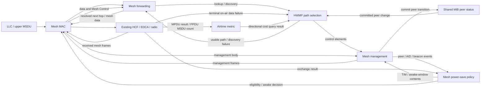

# IEEE 802.11 mesh: HWMP, power save, and HT/VHT

> **Kind:** reference · **Status:** draft · **Seal:** none · **Owns:** — · **Stands on:** [Plan procedure](../../doc/project/guide/write-an-implementation-plan.md), [Protocol addition](../../doc/project/guide/add-a-protocol.md), [Wi-Fi architecture](../../doc/project/design/ieee80211-model-architecture.md), [Wi-Fi rules](../../doc/project/domain/ieee80211.md)

Implement an open, single-channel IEEE 802.11 mesh in which stations establish peer links and use the Hybrid Wireless Mesh Protocol (HWMP) to select paths by airtime cost. A source must be able to reach another mesh station through intermediate stations without an IP routing protocol. Include on-demand discovery, path maintenance, both proactive root mechanisms, mesh power save, and HT/VHT operation with aggregation and Block Ack. Deliver documented simulation profiles, with evidence for their individual mechanisms; do not claim complete IEEE 802.11 mesh conformance.

## Scope and evidence

Plan revision 11, 2026-11-10. Active checkout: `/home/miguel/workspace/inet-ieee80211-adhoc-routing`, branch `feat/ieee80211-adhoc-routing`, starting source revision `91219b0fa7d2794ee67ac8a3dd45c3a09cfc45b0`. The existing local modification to `AGENTS.md` predates this work and must be preserved. The scope includes mesh power save, HT/VHT, and both airtime metrics, with ID 2 as the HT/VHT default and IEEE Std 802.11-2024 as the sole normative standard. Implementation, validation, commit/push and an upstream PR were requested on 2026-11-10. C1 source extraction corrects the proposed mesh A-MSDU endpoint, sequence and lifetime rules before their implementation; the [implementation ledger](../../doc/project/evidence/model/wifi/hwmp-coverage.md) records progress and executed evidence.

The current planning procedure and planning rules are drafts. Use their structure to explain the proposal; this task does not establish acceptance of their draft approval process. The current [commit-series rule](../../doc/project/rule/pull-request.md#pr-series-plan) and [protocol-test rule](../../doc/project/rule/testing.md#tr-plan-protocol) independently govern this plan's commit and test content.

### Verified current behavior

| Component | Evidence and consequence |
| --- | --- |
| Interface composition | [Ieee80211Interface.ned](../../src/inet/linklayer/ieee80211/Ieee80211Interface.ned) has replaceable management, MAC, LLC, agent, and radio roles. Its defaults describe an infrastructure station; no mesh configuration is selected by the current defaults. |
| Ad hoc management | [Ieee80211MgmtAdhoc.cc](../../src/inet/linklayer/ieee80211/mgmt/Ieee80211MgmtAdhoc.cc) selects `INDEPENDENT` mode and discards beacons and association exchanges. It provides neither mesh discovery nor mesh peering. |
| Mesh placeholder | [Mcf.h](../../src/inet/linklayer/ieee80211/mac/coordinationfunction/Mcf.h) throws `Unimplemented!` from its frame entry points; [Mcf.cc](../../src/inet/linklayer/ieee80211/mac/coordinationfunction/Mcf.cc) only registers the module. The production MAC selects DCF or HCF, not this placeholder. |
| Data path | [Ieee80211Mac.cc](../../src/inet/linklayer/ieee80211/mac/Ieee80211Mac.cc) sends upper packets through `handleUpperPacket()` and `encapsulate()` into a coordination function. Receive processing eventually calls `sendUpFrame()`, which decapsulates and invokes the distribution service. Encapsulation and decapsulation reject modes other than independent and infrastructure. |
| Distribution service | [Ds.cc](../../src/inet/linklayer/ieee80211/mac/Ds.cc) implements independent delivery and AP distribution, and rejects mesh mode. [IDs.h](../../src/inet/linklayer/ieee80211/mac/contract/IDs.h) exposes only received-data processing, so replacing `ds` alone cannot implement source path lookup and buffering. |
| Wire representation | [Ieee80211Frame.msg](../../src/inet/linklayer/ieee80211/mac/Ieee80211Frame.msg) and its [serializer](../../src/inet/linklayer/ieee80211/mac/Ieee80211MacHeaderSerializer.cc) already represent Address 4. The data header has no Mesh Control field or Mesh Control Present subfield. Address 4 support alone does not make a mesh frame. |
| Timestamp and FCS | [Ieee80211MgmtFrame.msg](../../src/inet/linklayer/ieee80211/mgmt/Ieee80211MgmtFrame.msg) already provides explicit `hasTimestamp`/`timestamp` fields for beacons and probe responses. Its [serializer](../../src/inet/linklayer/ieee80211/mgmt/Ieee80211MgmtFrameSerializer.cc) otherwise substitutes serialization-time `simTime()`. [Tx.cc](../../src/inet/linklayer/ieee80211/mac/Tx.cc) computes FCS before any requested IFS and before `sendDownFrame()`. Mesh timestamps must therefore be finalized before that FCS calculation; changing bytes only in `sendDownFrame()` would leave a computed FCS stale. |
| Receive timing | [ReceiverBase.cc](../../src/inet/physicallayer/wireless/common/base/packetlevel/ReceiverBase.cc) attaches received-signal start/end times in `SignalTimeInd`; [Ieee80211Radio.cc](../../src/inet/physicallayer/wireless/ieee80211/packetlevel/Ieee80211Radio.cc) supplies the received PHY mode in `Ieee80211ModeInd`. These existing indications can locate the timestamp's reception instant without treating management delivery after the whole frame as that instant. |
| OFDM symbol timing | [Ieee80211OfdmMode](../../src/inet/physicallayer/wireless/ieee80211/mode/Ieee80211OfdmMode.h) exposes preamble/header durations, symbol interval, rate, and SERVICE length through its mode objects. The data-mode `getDuration()` includes TAIL and PAD for a complete DATA field, so it is not a bit-offset query. Add the needed symbol-offset calculation to this existing PHY authority and share it between timestamp transmission and reception. |
| Management reception | [Hcf.cc](../../src/inet/linklayer/ieee80211/mac/coordinationfunction/Hcf.cc) consumes received Action frames in its Block Ack dispatch path and deletes them, including actions it does not handle. Mesh actions must reach management through an explicit HCF dispatch change. [Ieee80211MgmtBase.cc](../../src/inet/linklayer/ieee80211/mgmt/Ieee80211MgmtBase.cc) rejects unsupported subtypes and recovers a header at a fixed 24-byte offset; mesh reception must preserve an explicit header/body boundary. |
| Transmission feedback | [FrameTransmissionDetails.msg](../../src/inet/linklayer/ieee80211/mac/contract/FrameTransmissionDetails.msg) provides acknowledged, retry-limit, and pre-transmission-drop outcomes. HCF emits completion outcomes for management frames, with some drop paths restricted to tagged transactions. Its `linkBrokenSignal` also fires on internal-collision retry exhaustion, so it cannot distinguish a failed radio link by itself. Data attempts need a typed observation identifying actual ACK outcomes and terminal failure; management completion and generic link-broken signals are insufficient. Tx's actual transmission completion calls HCF once per PPDU, providing the boundary for a separate mesh payload-MSDU count; no mesh aggregation estimate currently exists. |
| Lifecycle | The MAC's stop/crash handlers are empty. Management cleanup clears BSS/peer state. Neither establishes safe cancellation of every child MAC timer during an active exchange. |
| Peer teardown | `Ieee80211Mac::resetPeerAssociationContext()` delegates to `Hcf::resetPeer()`. The latter invalidates receive history, then returns early when Block Ack agreement handling is absent. It therefore does not establish removal of queued/in-progress Normal Ack mesh data, which this profile requires on peer closure. |
| HT/VHT integration | [Ieee80211ModeSet.cc](../../src/inet/physicallayer/wireless/ieee80211/mode/Ieee80211ModeSet.cc) contains HT 20/40 MHz and VHT 20/40/80/160 MHz modes. The MIB and management frame definitions provide model-backed HT state, but no corresponding VHT capability/operation state or elements. A VHT PHY mode alone does not establish negotiated VHT mesh operation. |
| Mesh aggregation | [MsduAggregation.cc](../../src/inet/linklayer/ieee80211/mac/aggregation/MsduAggregation.cc) and [MsduDeaggregation.cc](../../src/inet/linklayer/ieee80211/mac/aggregation/MsduDeaggregation.cc) implement Basic A-MSDU addressing without mesh subframe Mesh Control. HCF implements Compressed Block Ack for separately transmitted MPDUs. A-MPDU construction helpers exist, but [OriginatorQosMacDataService.cc](../../src/inet/linklayer/ieee80211/mac/originator/OriginatorQosMacDataService.cc) comments out their production invocation, `BasicMpduAggregationPolicy` returns no aggregate, and [RecipientQosMacDataService.cc](../../src/inet/linklayer/ieee80211/mac/recipient/RecipientQosMacDataService.cc) leaves A-MPDU reception as a TODO. [Ac_Ampdu.test](../../tests/protocol/wifi/11ac/Ac_Ampdu.test) records this deferred capability as an expected failure. H1/H3 must add the missing PPDU integration while reusing the existing Block Ack owners. |
| MAC queue eligibility | [Hcf.cc](../../src/inet/linklayer/ieee80211/mac/coordinationfunction/Hcf.cc) supplies eligibility callbacks to the QoS data service, EDCA and [InProgressFrames.cc](../../src/inet/linklayer/ieee80211/mac/queue/InProgressFrames.cc). `OriginatorQosMacDataService::peekEligibleFrame()` can select an eligible packet behind an ineligible queue head, and `isPreparationValid()` checks a prepared frame before commitment. P1/P2 must compose peer power eligibility with those existing predicates and notify HCF when eligibility changes; a second sleep queue or polling scheduler is unnecessary. |
| Mesh power save | Frame Control already has `powerMgmt`/`moreData`, and QoS Control has `eosp`, without mesh power-save behavior. Mesh Power Save Level, RSPI, mesh TIM/AID ownership, awake-window scheduling, and mesh peer service periods are absent. [IRadio](../../src/inet/physicallayer/wireless/common/contract/packetlevel/IRadio.h) supports `RADIO_MODE_SLEEP`, but the MAC currently forces transmitter mode on send and receiver mode after transmission. Radio sleep needs coordinated MAC eligibility, not an independent periodic radio toggle. |
| Tests | No HWMP/mesh case was found in `tests/protocol/wifi`. The existing [suite](../../tests/protocol/wifi/README.md) and [authoring infrastructure](../../tests/protocol/lib/AUTHORING.md) supply packet observation, injection, interception, and explicit test selection. Mesh fixtures and typed mesh observations must be added. |

### Standards basis

Use **IEEE Std 802.11-2024**, document ID `ieee80211-2024`, for all normative requirements in this plan, including mesh, HT/VHT, aggregation, Block Ack, and power save. Every unqualified clause, table, and figure reference below belongs to this edition. HWMP is specified in 14.11; do not derive its rules from INET AODV.

The local source is `standards/80211ax-2024.pdf`. Despite its filename, this is the 5,956-page IEEE Std 802.11-2024 base standard, not an amendment. Its SHA-256 is `c08beb0e16bf8c36465a331d349dd8b8ea79b28d4a320288312ddeb5ce8d9bb1`. The local processor recognizes the renamed file and its corpus is built and fresh. Reused HCF/PHY fields must satisfy the 2024 requirements; source-code comments do not select a different normative edition.

The following nodes were retrieved from the local corpus. These are normative clauses; the listed pages are physical PDF pages, not printed page numbers. A clause's heading span need not contain its children: retrieve each algorithm subclause and table before implementation.

| Subject | Canonical node ID | PDF pages |
| --- | --- | --- |
| Mesh dependencies, including QoS | `ieee80211-2024:clause:14.2` | 3192 |
| Mesh identity and profile | `ieee80211-2024:clause:14.3.2`, `ieee80211-2024:clause:14.3.3` | 3192–3193 |
| EPD capability and membership indication | `ieee80211-2024:clause:11.51` | 2930 |
| Peering procedures and FSM | `ieee80211-2024:clause:14.4`, `ieee80211-2024:clause:14.5` | headings 3196, 3202 |
| Mesh Control and its placement | `ieee80211-2024:clause:9.2.4.8.3` | 707; retrieve field-format children |
| Transmit timestamp reference and receive elapsed-time correction | `ieee80211-2024:clause:11.1.3.1`, `ieee80211-2024:clause:11.1.3.9` | 2428–2429, 2442–2443 |
| OFDM DATA layout and symbol timing | `ieee80211-2024:clause:17.3.5`, `ieee80211-2024:table:17-4`, `ieee80211-2024:table:17-5` | 3354, 3347–3348 |
| HWMP action body and elements | `ieee80211-2024:clause:9.6.16.3`, `ieee80211-2024:clause:9.4.2.110`–`9.4.2.113` | 1773, 1222–1227 |
| Mesh forwarding | `ieee80211-2024:clause:10.37`, `ieee80211-2024:clause:10.37.2` | heading 2144; forwarding information 2144–2145 |
| Metric reporting | `ieee80211-2024:clause:14.9.3` | 3224 |
| Airtime formulas, selection and encoding | `ieee80211-2024:clause:14.10.1`, `ieee80211-2024:clause:14.10.2`, `ieee80211-2024:table:14-4`, `ieee80211-2024:table:14-5` | 3224–3226 |
| HWMP modes | `ieee80211-2024:clause:14.11` | heading 3226; on-demand/proactive children 3228–3230 |
| Sequence numbers, forwarding information, retries | `ieee80211-2024:clause:14.11.8.3`, `ieee80211-2024:clause:14.11.8.4`, `ieee80211-2024:clause:14.11.8.5` | 3233–3236 |
| PREQ, PREP, PERR, RANN mechanisms | `ieee80211-2024:clause:14.11.9`, `ieee80211-2024:clause:14.11.10`, `ieee80211-2024:clause:14.11.11`, `ieee80211-2024:clause:14.11.12` | headings 3236, 3246, 3250, 3254 |
| Root-confirmation addressing and PREQ fields | `ieee80211-2024:clause:14.11.7`, `ieee80211-2024:table:14-14` | 3231–3232, 3240–3241; Case D trigger text in 14.11.9.3 confirmed against PDF page 3239 |
| Neighbor-offset measurement, TSF slowing, beacon ordering | `ieee80211-2024:clause:14.14.2.2.2`, `ieee80211-2024:clause:14.14.2.2.3`, `ieee80211-2024:clause:14.14.3.1` | 3268–3270 |
| Mesh HT/VHT configuration and basic sets | `ieee80211-2024:clause:14.3.4`, `ieee80211-2024:clause:14.3.7`, `ieee80211-2024:clause:10.6.4` | 3193–3195, 1938–1939 |
| Mesh A-MSDU layout | `ieee80211-2024:clause:9.3.2.2.3`, `ieee80211-2024:figure:9-124` | 775; figure visually checked |
| A-MPDU and VHT single-MPDU operation | `ieee80211-2024:clause:10.12`, `ieee80211-2024:clause:10.12.8`; Block Ack `ieee80211-2024:clause:10.25` | 1976, 1982, 2049; retrieve algorithm children before implementation |
| Mesh power modes and higher/lower activity transitions | `ieee80211-2024:clause:14.15.2.2`, `ieee80211-2024:clause:14.15.2.3`, `ieee80211-2024:clause:14.15.3.1`–`14.15.3.3` | 3278–3280 |
| TIM/DTIM, awake windows and doze conditions | `ieee80211-2024:clause:14.15.4`, `ieee80211-2024:clause:14.15.5`, `ieee80211-2024:clause:14.15.6`, `ieee80211-2024:clause:14.15.8.3`–`14.15.8.6` | 3280–3283 |
| Directional mesh peer service periods | `ieee80211-2024:clause:14.15.9.1`–`14.15.9.4`, `ieee80211-2024:table:14-33` | 3283–3285 |

Lint of the 2024 document completed with 14 ambiguous-heading errors, 56 unresolved-reference warnings, and other diagnostics. All 17 extracted outgoing references from the eight inspected forwarding, timing, configuration, awake-window, doze, termination and PERR nodes resolve; remaining dependencies are not exhaustively checked. Ambiguous or missing retrievals require source-PDF confirmation.

The airtime formula on physical PDF page 3224 was visually checked because text extraction obscures its brackets: `(O/n + Bt/r) / (1 - ef)`, with `Bt = 8192` bits. Support both metrics defined in 14.10.1–14.10.2 and Tables 14-4/14-5:

| Mesh metric | Aggregation factor `n` | Encoding unit | Profile default |
| --- | --- | --- | --- |
| ID 1, airtime link metric | Fixed at 1 | 0.01 TU = 10.24 microseconds | OFDM reference |
| ID 2, high PHY rate airtime link metric | Estimated MSDUs sharing a payload transmission | 0.01 microseconds | HT/VHT |

Clause 14.10.1 recommends ID 2 when the PHY is capable of transmitting above 54 Mb/s. Its aggregation factor amortizes transmission overhead, and its finer encoding avoids the coarse quantization of ID 1 at high rates. Retain ID 1 as an explicit HT/VHT comparison option. The selected ID belongs to the common mesh profile under 14.3.3; it never changes independently per peer or with the rate of an individual transmission.

Table 14-25's propagated-PERR sequence field refers to an increment in 14.11.10.4.3 step b), which is a PREP procedure. Source-PDF inspection on pages 3253–3254 confirms the mismatch: the increment is specified in the PERR procedure, 14.11.11.4.3 step b). Use that explicit increment rule and record this interpretation in C1; corpus link resolution alone cannot detect a reference to the wrong procedure.

## Intended profile and completion criteria

All supported profiles use unsecured mesh stations on one fixed primary channel, with one mesh interface per node. Mesh peers are the endpoints: no proxied stations, mesh portals, or external distribution system. HCF/EDCA carries QoS data, with TID 0 when no upper-layer priority is supplied. Keep an always-awake OFDM reference profile (`opMode = "a"`, default 6 Mb/s per peer, Normal Ack, aggregation/Block Ack disabled) for C2–C8 and causal comparisons. It is the foundation, not the final scope limit. RTS, fragmentation, and adaptive rate control remain disabled in the selected profiles.

| Profile dimension | Required scope in this plan |
| --- | --- |
| HT mesh | `n(mixed-2.4Ghz)`, or HT-only policy over the 5 GHz `ac` catalog: 20/40 MHz, supported HT MCS/NSS combinations, directional negotiation, and long/short GI where both ends and the radio support it. |
| VHT mesh | `ac` on 5 GHz: 20/40/80/160 MHz and catalog-supported VHT MCS/NSS combinations, constrained by the local radio/antenna configuration and peer Rx capability; include VHT single-MPDU transport as well as multiple-MPDU aggregates. |
| Aggregation | Mesh A-MSDU subframes, HT/VHT A-MPDU, nested A-MSDU in A-MPDU when negotiated, and immediate Compressed Block Ack with setup, recovery, limits, and teardown. Group frames retain unacknowledged legacy transmission in these profiles; optional group A-MPDU remains disabled. |
| Mesh power save | Peer-specific active, light sleep, and deep sleep; derived nonpeer mode; acknowledged mode changes; TIM/DTIM buffering and delivery; mesh awake windows; directional mesh peer service periods (MPSPs); actual PHY doze/wake while the interface remains operational. Exercise these with legacy, HT, and VHT peers. |

Use fixed configured per-peer PHY selections that are legal within the negotiated intersection. A changed accepted PHY tuple clears its old metric samples; no adaptive-rate algorithm is added. The HT/VHT and power-save profiles are complete only after H1–H3 and P1–P3 below. Support is bounded by the advertised catalog/radio capabilities, not by every optional feature in the HT/VHT standards.

Configuration must identify this as a mesh simulation profile. Mesh activation must require QoS and compatible mesh configuration. Reject unsupported mesh combinations explicitly at initialization; do not silently run them as IBSS or substitute hop-count routing. Existing infrastructure and IBSS defaults remain unchanged.

The mesh profile advertises HWMP ID 1, the selected airtime metric ID (1 or 2), congestion control ID 0, neighbor-offset synchronization ID 1, and authentication ID 0, plus the configured Mesh ID (14.3.3 and Tables 9-279–283). Use LLC/SNAP with EPD support disabled, the seventh profile parameter in 14.3.3; EPD operation and EPD-required channels are outside this profile. Check the EPD capability/membership indication under 11.51 as well as the other six parameters before peering. The mesh interface owns one initialization-time `pathSelectionMetricId` parameter, stored in the MIB's shared mesh configuration and read by management, HWMP and the metric owner. Default it to 1 for OFDM and, from H1, to 2 for enabled HT/VHT profiles; explicit 1 or 2 is allowed for comparisons. Reject unsupported configured IDs and refuse peerings with a different metric ID. Keep the selected ID fixed while a member of the mesh BSS. A profile change requires leaving it, closing peerings, and discarding session/path state before joining with the new profile under 14.3.3; live metric switching is outside this plan.

Management owns a local timing synchronization function (TSF) counter derived from simulation time, with the origin and accumulated slowing needed by 14.14.2.2; no separate clock module or oscillator-noise model is needed. TBTTs are one configured beacon period apart in local TSF time. The required slowing can delay the next TBTT in simulation time, within the 0.04% per-period bound of 14.14.2.2.3. Honor beacon channel-access ordering under 14.14.3.1 and stamp the transmitted frame from the local TSF at the standard's timestamp reference point, rather than at queue insertion. These are C3 obligations, not consequences of simply advertising synchronization ID 1.

Security/SAE/AMPE, key management, multi-interface selection, channel switching, MCCA reservations, optional mesh beacon collision avoidance, mesh gates/proxy updates, HE/EHT, 80+80 MHz, beamforming/MU-MIMO, and LDPC are separate follow-ups. Clause 14.2 excludes STBC for HT mesh and AP-dependent mechanisms such as HCCA and APSD. Keep these capabilities disabled rather than advertising them through generic HT/VHT templates. Reject nonzero mesh address-extension modes in this endpoint-only profile; codec tests may still decode their structure. No supported profile may advertise an omitted feature as implemented.

Completion requires the following observable results:

1. Compatible stations discover one another and establish peer links through Open/Confirm exchanges. Incompatible profiles and non-established peers cannot carry transit mesh data or HWMP exchanges requiring a peer link.
2. In a line A–B–C where A cannot directly reach C, A discovers C using PREQ/PREP, then sends an MSDU through B. Hop receiver/transmitter addresses change at B; mesh endpoint addresses and payload remain correct. Intermediate nodes do not deliver transit unicast to their upper layer.
3. A diamond selects a fresher valid path, then a lower-airtime path among equally fresh eligible alternatives. A shorter path must not win solely because it has fewer hops. Sequence comparison handles wrap-around according to the standard. Both metric IDs have direct encoding and path-selection assertions; ID 2 includes aggregation-dependent costs, and different metric profiles cannot peer or mix accumulated values.
4. Unknown destinations cause bounded discovery and buffering. A valid reply releases eligible queued packets once. Failed discovery, expiry, and capacity exhaustion produce explicit drops without timer loops or leaked packets.
5. A broken established peer invalidates affected paths and propagates the required PERR information. Unaffected destinations remain usable. Rediscovery can select an alternate path. Replies obey their freshness rules; PERRs obey selected-next-hop and reason-specific sequence rules, including the special unknown-sequence case.
6. Proactive PREQ and proactive RANN each construct the required root paths while on-demand operation remains available. RANN reception alone must not be mistaken for completed bidirectional path establishment.
7. Group-addressed data, including ARP/IPv6 neighbor discovery traffic used by the selected examples, is delivered/forwarded with mesh TTL and duplicate suppression. Mesh sequence numbers are distinct from per-hop MAC retry sequence numbers and HWMP sequence numbers.
8. Wire bytes, lengths, dissection, and capture decode agree with the modeled mesh fields. Malformed control elements cannot create paths or overrun the parser.
9. Mesh-owned timers, callbacks, and buffered packets are cleaned up on stop, crash, and destruction. Reuse mesh resources safely when their handlers are restarted in an isolated lifecycle fixture. Whole-NIC/node stop-start, whether idle or mid-exchange, is not a supported guarantee of this profile because existing MAC child cleanup is incomplete. Topology-failure tests keep nodes operational and remove radio connectivity or close a peer.
10. Existing non-mesh selected regressions retain their recorded behavior. Fingerprints supplement direct mechanism assertions and do not establish HWMP correctness.
11. HT/VHT mesh peerings advertise and enforce common basic rate/MCS sets and directional capabilities. Captures show legal negotiated PHY format, bandwidth, MCS, NSS and GI; incompatible basic sets prevent peering, and an ineligible peer cannot receive an HT/VHT data frame merely because the local `opMode` allows it.
12. Mesh A-MSDU subframes retain each MSDU's mesh endpoints, TTL and mesh sequence. Compressed Block Ack/A-MPDU recovery retransmits only missing eligible MPDUs, without duplicate upper delivery. VHT single-MPDU delimiter/EOF encoding, nested aggregation, capability limits and byte reconstruction all have direct assertions.
13. A station can use different power modes toward different peers. A failed lower-activity transition does not authorize doze. Sleeping receivers have bounded buffered traffic advertised by the correct locally assigned AIDs, receive group traffic after DTIM before unicast, and receive unicast through valid awake windows/MPSPs. Awake is a node-wide condition: a peering in local active power mode or any outstanding awake obligation prevents doze.
14. Light sleep wakes for the peer's beacons; deep sleep still wakes for the station's own TBTT/awake window and configured synchronization maintenance. MPSP RSPI/EOSP combinations, acknowledged termination and missing-ACK recovery work with HT/VHT aggregates as well as Normal Ack. Expected sleep alone does not cause PERR, close a peer, count as an on-air error, or pause wall-clock packet/path lifetimes.

## Components and packet flow

Use the existing interface's replaceable roles and the MAC's virtual extension points. Introduce `Ieee80211MeshInterface` as an opt-in composition with mesh management, mesh MAC, mesh distribution, path selection, and metric components. Its host example uses an ordinary network stack with a mesh interface; IP routing between mesh hops is disabled so it cannot conceal a forwarding defect.

| Proposed component | Responsibility and consumers | Reuse and reason for addition |
| --- | --- | --- |
| `Ieee80211MgmtMesh` under `mgmt/` | Discovery beacons/probes, neighbor-offset synchronization, compatibility, peering FSM, mesh action dispatch. Management owns peer-link transitions; publish established/closed status through the MIB's state/notification pattern. | Reuse `IIeee80211Mgmt`, management helpers, rate advertisement, and typed action codecs. `MgmtAdhoc` has no peering behavior. HWMP algorithm state stays outside management. |
| `Ieee80211MeshMac` under `mac/` | Mesh encapsulation/decapsulation and the source/received mesh entry points. Calls mesh forwarding before discarding Mesh Control information. | Derive from `Ieee80211Mac`, whose upper-packet, encapsulation, decapsulation, and send-up methods are virtual. Reuse Tx/Rx, HCF, EDCA, rate selection, Normal Ack, and existing four-address serialization. Do not activate the empty `Mcf` class or duplicate contention machinery. |
| `MeshForwarding` under `mesh/` | Source lookup, pending MSDUs, received-data delivery/forwarding, group flooding, Mesh TTL and mesh duplicate cache. Consumed by mesh MAC and implements the received-data `IDs` role. | Existing `Ds` is AP/IBSS-specific, and `IDs` lacks an outgoing operation. Add a small typed mesh forwarding contract for the mesh MAC's outgoing call; retain `IDs` for receive integration. |
| `Hwmp` under `mesh/hwmp/` | All HWMP sequence/discovery/root state and the authoritative path table; processes received HWMP elements and committed peer changes, queries link costs, and coordinates queue progress with forwarding. | A new `IMeshPathSelection` contract separates forwarding from the algorithm. Do not use IPv4/IPv6 routing tables, UDP sockets, or an AODV subclass. Consumers need MAC paths and airtime metrics. |
| `AirtimeLinkMetric` under `mesh/` | One owner of directional error/aggregation samples and computed link costs for the profile's selected metric ID. Queried by HWMP and mesh metric-report handling through a read-only API. | Reuse PHY rate/duration authority, per-MPDU ACK outcomes, and one actual-PPDU constituent-count observation. Share formula and state ownership across both IDs; a second metric module or replaceable interface solely for tests is unnecessary. |
| `MeshPowerSave` under `mesh/` | Peer-specific requested/effective local modes, learned peer modes, directional MPSPs, awake obligations, and wake scheduling. Management supplies peer/AID/beacon events and queries TIM information; mesh MAC/HCF query transmission eligibility and coordinate radio state through typed calls. | A separate policy owner is needed for cross-peer awake decisions and exchange-completion state; management retains discovery/peering and HCF retains contention, queues and ACK/retry machinery. The MIB exposes the committed shared power view without duplicating writable state in forwarding or HWMP. |

These additions follow the [reuse and composition rules](../../doc/project/rule/architecture.md) and [minimal-design guidance](../../doc/project/rule/quality.md#qr-design-minimal). New contracts hold declarations only. Place their signatures beside the first consumers; do not add unused extension interfaces or mutable duplicate peer/path tables. In the final composition, `Ieee80211MeshInterface` extends the existing interface, selects mesh management/MAC and `agent.typename = ""`, and adds `pathSelection`, `linkMetric`, and `powerSave` submodules. The power-save policy defaults to active mode. `Ieee80211MeshMac` extends the MAC NED/C++ types and selects `MeshForwarding` in its `ds` slot. Use module-path parameters for these dependencies; do not rely on sibling initialization order.

Stage that composition with its implementations. C3 retains the existing `Ds` submodule, rejects mesh data before reaching it, and defines neither `pathSelection` nor `linkMetric`. C4 replaces `ds` with `MeshForwarding` and adds the optional path-selection slot, empty by default and supplied by the forwarding fixture's test provider. C5 adds the production `linkMetric` submodule. C6 selects `Hwmp` as the production path-selection default. Each revision must initialize its own named fixtures without resolving a type or module-path dependency introduced only by a later commit; no placeholder production implementations are needed.

H1 adds negotiated HT/VHT operation, H2 adds mesh A-MSDU, and H3 adds multiple-MPDU aggregation/Block Ack. P1 adds `powerSave` with active/awake defaults and power-mode signaling/TIM support; P2 connects its awake decision to HCF/radio; P3 completes MPSPs and combined aggregation behavior. Keep the OFDM reference configuration available throughout. C9 and C10 remain the final verification/documentation commits after these additions; their identifiers are unchanged.



The mesh MAC's source entry delegates the MSDU before ordinary MAC encapsulation. Forwarding either consumes it into a bounded pending queue or requests transmission with resolved next-hop and endpoint information. The transmission callback enters encapsulation/channel access directly, not the source lookup again. Receive processing preserves the header and Mesh Control until forwarding has classified local delivery, transit, duplicate, or TTL exhaustion. Only local delivery strips mesh encapsulation and passes the MSDU to LLC. This prevents the current decapsulation-before-distribution path from losing required forwarding information.

For a single non-proxied unicast MSDU, set To DS/From DS to 1/1 and addresses 1–4 to next hop, local transmitter, mesh destination, and mesh source. For a single native group MSDU, use 0/1 and three addresses: group destination, local transmitter, and mesh source. Both use AE = 0 and a six-byte Mesh Control field. With mesh A-MSDU, each subframe instead carries Mesh DA, Mesh SA, Length, and its own Mesh Control under Figure 9-124; the little-endian Length field counts the MSDU, while padding accounts for the whole mesh subframe header. Under 10.11, native mesh A-MSDU constituents share mesh source and mesh destination as well as RA/TA/TID; matching next hop alone is insufficient. Allocate one new mesh sequence per newly originated A-MSDU under 9.2.4.8.3 and 10.37.3.1, rather than one per constituent. Duplicate admission applies once to the aggregate forwarding unit before processing all its constituents. As an explicit endpoint-profile policy, preserve a received transit A-MSDU as one unit with its original constituent list and mesh identity; do not split it or merge independently sequenced transit units. Each subframe still carries its serialized Mesh Control, including the applicable TTL updates. Unicast TTL is decremented only for transit; reaching zero prevents forwarding but does not prohibit final-destination delivery of a TTL-1 frame. Group TTL is decremented on reception; reaching zero prevents retransmission while still allowing local delivery. Cache duplicate identity as `(mesh source, mesh sequence)` from the applicable mesh source field (10.37.3–6); MAC retry sequence does not replace it.

Before aggregate commitment, expire individually pending MSDUs under their declared wait/lifetime policy. After forming an A-MSDU, 10.11 defines its lifetime by expiry of all its constituent MSDUs: use the latest constituent deadline and preserve the complete aggregate on retries. Do not remove an older constituent or rebuild a smaller A-MSDU under the same MPDU/mesh identity while the aggregate remains valid. Drop the whole aggregate when its aggregate lifetime expires. Apply this rule to nested A-MSDU and power-save buffering as well; a plain MPDU retains its individual lifetime. These are corrections from the C1 source check, not permission to revive packets already discarded before aggregate formation.

For unicast, enforce the standard's precursor admission check and refresh source/destination forwarding lifetimes and precursor lifetimes at the specified forwarding/delivery points. HWMP owns these records; forwarding calls its typed admission/refresh operation rather than maintaining a second table. A usable lookup requires an unexpired valid path and a currently established next-hop peer in the committed MIB state, so peer-notification listener order cannot authorize sending through a closed peer. For an unknown transit destination choose the standard-permitted PERR response to the transmitter; source-originated unknown destinations trigger discovery and buffering. With no mesh gates in this profile, discovery exhaustion discards remaining MSDUs under 10.37.8 rather than forwarding them to a root as if it were a gate. C4's test path provider must supply precursor/lifetime information as well as next hops, so it cannot bypass these checks. Production source discovery and unknown-transit PERR become available in C6 and C7 respectively; earlier intermediate commits explicitly drop the unsupported cases.

Peer eligibility must also cover data already transferred to HCF. On mesh peer closure, management makes the peer ineligible for new data and coordinates the MAC's typed peer-reset operation: remove pending unicast mesh data for that peer from every access category and retire corresponding in-progress data through the frame-sequence owner's existing cancellation/retirement mechanism. Do not directly delete a packet still referenced by an exchange. A PPDU already on air may finish, but its late ACK/timeout must not start another retry, restore a retired frame, or supply an error sample to a newly established relationship. Clear the metric owner's peer samples through its typed API and complete MAC recipient cleanup before publishing the closed-peer transition. Required cleanup cannot depend on which notification listener runs first. Re-peering at the same address starts with fresh peer metric samples and MAC recipient context while preserving node-owned HWMP and mesh sequence counters. This is peer teardown inside an operational NIC, not support for restarting the NIC.

HCF continues to consume Block Ack actions internally. It sends recognized mesh actions to the mesh MAC's management delivery path after existing receive/ACK processing; the mesh MAC preserves the management header/body boundary for `Ieee80211MgmtMesh`. This change must not forward already-consumed Block Ack actions a second time. Management dispatches received HWMP elements to path selection and sends generated elements through the existing management/MAC gate. Share each typed wire definition across sender, receiver, serializer, dissector, and tests. Existing frame identities suffice; a new global protocol identity or core packet change is not justified.

### HT/VHT and power-save interaction

Management advertises local enabled HT/VHT capability/operation elements and checks mesh configuration/basic-set compatibility before peering. Commit directional Tx/Rx capability intersections with the established peer before enabling high-throughput selection or Block Ack. Reuse existing HT MIB helpers; add equivalent typed VHT state and fields rather than treating `opMode = "ac"` as peer negotiation. Shared PHY catalogs/radio capabilities remain authoritative for MCS, NSS, bandwidth, GI and duration. Beacons, mesh discovery and group traffic use a common legal legacy basic PHY in these profiles, retaining the validated timestamp path. A fixed channel excludes runtime channel switching, not negotiated narrower per-peer transmissions on the same primary channel.

Power management is per relationship; actual doze is a node-wide decision. `MeshPowerSave` owns pending local transitions. A lower-activity transition requires an acknowledged individually addressed mesh Data or QoS Null frame (14.15.3.3). Higher-activity transitions may use group or individually addressed signaling (14.15.3.2); enter the required awake state before signaling, and do not wait for an ACK to a group frame. Peers learn modes from frames they actually receive. If a lower-activity indication arrives but its ACK is lost, the sender retains its prior effective mode while the receiver may already buffer for the indicated mode; do not synchronize the two nodes through an internal callback. Store committed local modes and learned remote modes in the MIB; keep pending exchanges, wake scheduling and MPSPs private to the policy owner. Use local/remote peering AIDs in TIMs, distinct from link IDs. Derive nonpeer mode from all local peer modes under 14.15.3.1. A peer can be established and have a valid HWMP path while temporarily ineligible for transmission because it is asleep; neither forwarding nor HWMP may turn that condition into a missing path or broken peer.

Keep resolved MSDUs and MMPDUs in the existing HCF/EDCA queues. Compose power eligibility with the existing extraction, in-progress retry and prepared-frame checks; include management and aggregation candidates. An ineligible head must not block a later eligible frame for another peer in the same AC. A mode, awake-window or MPSP change calls HCF to reconsider contention through its existing machinery; no polling timer is needed. Derive TIM state from all unexpired buffered traffic, including retry frames retained in `InProgressFrames`, without transferring packets to a second store. P1 adds bounded mesh-management expiry beside the existing data-lifetime owner and defines finite pending capacity. The unknown-destination queue in forwarding remains separate and keeps its existing deadline. Management queues HWMP group control for the applicable DTIM delivery opportunity; discovery traversal/wait budgets in sleeping-topology examples must cover their configured rendezvous delays. Path lifetimes and packet deadlines continue in simulation time.

Wake before own TBTT, required peer TBTTs, and scheduled awake obligations early enough for the configured radio switching delay. In light sleep, listen to every corresponding peer beacon and trigger retrieval when its TIM indicates buffered unicast. Deep sleep may skip peer beacons; P2 defines the bounded resynchronization policy using an established peer and the existing TSF/neighbor-offset mechanism. Awake windows start at actual beacon/probe-response transmission end, include the required PostAwakeDuration after group traffic, and retain DTIM group-before-unicast ordering and More Data semantics. Doze requires all conditions of 14.15.8.6, plus completion of in-progress PHY/response exchanges; an active-mode peering prevents it. Inactivity alone does not authorize sleep.

MPSPs are directional, at most one per peer/direction, and may span several TXOPs. Implement Table 14-33's four RSPI/EOSP combinations subject to 14.15.9.2's initiation conditions; no MPSP is created toward an active-mode recipient. Keep requested and acknowledged EOSP termination distinct and apply the missing-ACK retransmission rule and limits of 14.15.9.4. The transmitting owner's successful-termination decision requires an ACK or Block Ack confirming the terminating MPDU; a missing bitmap bit cannot satisfy it. The recipient observes receipt and transmission of its response, not whether the owner received that response. Lost ACK tests must allow these local views to differ and exercise the standard recovery without a cross-node completion callback. Include data and buffered management delivery. Peer closure retires PS transactions, MPSPs and queued frames through their owners before publishing the closed relationship. Physical doze keeps the interface operational and does not invoke the unsupported whole-NIC lifecycle restart.

### State and event rules

HWMP retains one path record per destination containing next hop, destination sequence value with a known/unknown flag, metric, hop count, expiry, path validity, and the standard-required forwarding/error dependencies. Retain invalid information only as required for freshness and error processing. A path expiry must not silently erase sequence history needed to reject stale updates. PREQ duplicate identity and eligibility for a better update come from the PREQ processing rules, not a blanket “seen once, discard forever” cache.

Keep the local HWMP sequence and discovery ID in HWMP and the mesh data sequence in forwarding. Use unsigned 32-bit serial comparison; do not use signed overflow. A difference strictly between 0 and `2^31` is newer; an exactly half-range difference is unordered and must not replace retained information on freshness alone. This resolves an otherwise ambiguous serial comparison as a documented model choice. Metric accumulation uses a wider intermediate and saturates at `UINT32_MAX`; never allow a high cost to wrap into a preferred low cost. Saturation is an encoding policy, not an implicit link-down indication.

USN=1 makes the requested target-sequence field reserved: ignore its bytes for sequence comparison and target reply generation. USN=0 supplies a known requested sequence. When a target prepares its reply, use that requested value as the increment baseline only if it is serial-newer than the station's own value; otherwise increment the own value modulo `2^32`. Choosing the own baseline at the unordered half-range is the model's explicit resolution, not a uniquely defined circular maximum. Discovery IDs are opaque identities compared for equality; they are not serially ordered sequence numbers.

Forwarding owns pending packets, buffer accounting, and the mesh data duplicate cache. HWMP owns discovery attempts and their deadlines. Packets are grouped by destination, with limits shared across all pending destinations: propose 64 packets, 256 KiB, and a five-second per-packet maximum wait as modeling defaults. Count the queued MSDU's packet data length, including its existing LLC header and excluding mesh headers not yet added. Admit a packet only if both the packet-count and byte limits would remain satisfied; otherwise drop the new packet before starting a discovery solely for it. On each attempt or packet expiry, apply the corresponding deadline; the earlier terminal condition wins. When the last packet for a destination leaves the queue, forwarding tells HWMP to cancel any discovery driven only by that queue, cancel its retry timer, and clear its attempt state. A new packet then starts a fresh discovery if no usable path exists. Root-driven procedures remain independent, and a late reply may still update path information.

Discard duplicate-cache entries after a configurable one-second retention interval; this bounds history, not all possible duplicates after eviction. Seed the cache for locally originated group traffic to suppress looped-back copies. These queue/cache values and the byte-accounting convention are modeling choices, not IEEE requirements.

Any accepted path update that makes a destination usable, including reverse information learned from PREQ, asks forwarding to retry that destination's pending queue. For each packet, query current peer/path eligibility and remove that packet from the pending queue before transferring ownership to HCF; do not retain a route or queue iterator across a call that emits synchronous notifications. Leave other destinations' packets alone and stop draining if the path becomes unusable. Cancel the destination's discovery retry when its required path becomes usable. Ordinary draining consumes no simulation time; a scheduled Close, expiry, or ACK timeout cannot interrupt it, although synchronous callbacks still run. Use the same lookup and ownership rules rather than an additional drain state machine. A later peer closure is handled by the HCF teardown above. A late PREP may establish a valid path after a queue deadline, but must not resurrect expired packets. Completion/failure coordination uses typed calls; do not maintain a second discovery retry timer in forwarding.

Retain protocol history across events only when required. Use existing timer scheduling state rather than parallel pending flags where equivalent. Direct lookup and notification consume no simulation time. Propagate PREQ/PREP/PERR without an added forwarding delay under 14.11.8.2, subject to their stated rate limits; ordinary MAC channel access still delays actual transmission. Implement RANN's specified propagation delay separately. Do not add generic per-hop jitter or zero-delay self-messages. Where a standard timer requires a random delay, evaluate it once for that scheduled event. Keep defaults in NED with units and documented standard provenance or modeling rationale.

For airtime, query the existing rate-selection authority for the fixed configured rate toward that peer. Retain one error estimate per peer, initialized to zero; update `ef = 7/8 * ef + 1/8 * sample`, where sample is 0 for an acknowledged actual unicast-data attempt and 1 for an actual attempt whose ACK times out. Include each failed retry separately. Ignore internal EDCA collisions without an on-air attempt, group traffic, local queue/TTL drops, and management frames. Estimating standard-size error from those traffic samples assumes size-independent frame-error probability; document that approximation explicitly. This is a local estimator choice, not a claim of measured error probability for every packet size. Fixed rates make one estimate per directional peer sufficient; adaptive rate changes are outside this profile.

For ID 2, the metric owner retains an aggregation estimate per directional peer, initialized to `n = 1`. H2 adds one typed observation from HCF's actual transmission-complete path per mesh unicast payload PPDU, carrying the peer, transmitted mode and count `m` of payload MSDUs. A plain MPDU contributes 1; an A-MSDU contributes its subframe count; H3 sums these counts across all payload MPDUs in an A-MPDU, including nested A-MSDUs. Delimiters, padding, QoS Null, control and management frames contribute no MSDUs. Update `n = 7/8 * n + 1/8 * m` once for a PPDU with `m >= 1`, regardless of its later ACK outcome. A retry PPDU supplies its actual retransmitted MSDU count as a new observation; ACK/Block Ack callbacks do not update `n` again. Retain fractional `n` rather than rounding it to an integer. This EWMA weights each transmitted payload PPDU equally, including retries; it is a local estimate of aggregation, not a standard-prescribed estimator or a prediction of available throughput.

Capture the constituent count where the existing aggregation builder has its input list. H2 adds one nonserialized MSDU-count packet tag under `mac/contract/`, carried by Packet duplication into Tx's retained frame; a plain payload MPDU without the tag counts as 1. H3 sums the constituent counts when building each actual A-MPDU, including a smaller retry aggregate. HCF reads this metadata at actual transmission completion; no serializer or sealed packet-core change is needed. C5's per-MPDU error observation and H2's per-PPDU count are distinct events on the MAC feedback contract; neither requires a packet store or a second aggregate-history table. Discard observations for retired peer data under C4's existing teardown rule. Peer closure or an accepted PHY-tuple change clears both estimates. A change of negotiated aggregation permissions/limits resets only the aggregation estimate; when neither A-MSDU nor A-MPDU is eligible, use `n = 1`. With no new transmissions, including while a peer sleeps, estimates do not decay or acquire synthetic samples. ID 1 always computes with `n = 1`, irrespective of observed aggregate size.

Compute `O` from the configured AC_BE AIFS, mean initial contention `CWmin/2 * slotTime`, the selected PHY mode's preamble/header duration, SIFS, and the selected legal acknowledgment exchange duration (Normal Ack or, in H3, Compressed Block Ack), without sampling the current random backoff. AC_BE is the metric's reference traffic class; this approximate cost does not predict contention delay or sleep waiting time for every packet; ID 2 adds the declared approximation for aggregation gain. Evaluate `(O/n + Bt/r) / (1 - ef)` with `Bt = 8192` bits and units-safe duration arithmetic. Ceiling-convert to 0.01 TU for ID 1 or 0.01 microseconds for ID 2, then clamp a finite link cost to `[1, UINT32_MAX]`. Root/path accumulation starts at 0 under Table 14-5. Add already encoded costs using the profile's one selected unit; never mix IDs or repeatedly convert an accumulated path value. Invalid/nonpositive rates or nonfinite `n` or `n < 1` inputs are configuration/model errors. For `ef = 1`, report saturated cost without division by zero. H3 extends sampling to per-MPDU Block Ack outcomes; do not count a whole A-MPDU as one data attempt, QoS Null signaling as payload data, or queueing while a peer sleeps as a failed transmission. Keep link eligibility separate from cost; peer closure or C7's final-failure handling establishes an unusable link. For a PREQ received at Y from X, add the local outgoing cost Y→X to the received accumulated cost to create the path toward the PREQ originator. For a PREP, add Y→X to create the path toward its target (Table 14-9). Do not substitute X→Y or infer an outgoing cost from received signal strength. HWMP queries the current link estimate at that processing step; a sample update alone does not rewrite cached end-to-end metrics or trigger an extra discovery. A Link Metric Report request is answered with the local outgoing estimate; received reports do not overwrite that estimator. C5 implements both encodings with `n = 1` for its unaggregated profiles, C6 connects them to path selection, H1 makes ID 2 the HT/VHT default, H2 adds the A-MSDU estimate, and H3 extends it to A-MPDU/nested aggregation. P3 verifies both metrics across sleep.

Mesh management, forwarding, HWMP, metric, and power-save state must define paired lifecycle handlers: cancel owned timers, dispose of pending packets, and disconnect callbacks/subscriptions on stop/crash/destruction; restore required subscriptions on the isolated restart. Clear transient power transitions, wake obligations and MPSPs on relationship teardown and isolated owner restart while retaining configured policy. Retain reusable timer objects until destruction. Lifetime/deadline tests cover these owners in isolation; they do not assert that existing HCF children stop safely. Whole-interface restart is deferred. Do not add epoch counters to solve an untraced hypothetical late callback.

## Commit series and direct verification

The entries define the implementation series; executed progress is recorded in the [model ledger](../../doc/project/evidence/model/wifi/hwmp-coverage.md). Paths for components or tests not yet implemented remain proposed. Each commit must build with its proposed parent. Where a public contract and its first implementation depend on one another, keep them together. Unqualified source paths below are relative to `src/inet/linklayer/ieee80211/`. Unqualified protocol-test and reviewer-document filenames are relative to `tests/protocol/wifi/mesh/`. Every new component ships its NED parameters, units, defaults, required state-change/drop signals, and inspector-visible peer/path state with its first production use. The expected parent behavior below is source-grounded unless explicitly described as an assumption about an earlier planned commit.

The execution order is `C1–C8 → H1 → H2 → H3 → P1 → P2 → P3 → C9 → C10`. H/P identifiers add the requested scope while preserving C1–C10. For every protocol commit C2–C8, H1–H3 and P1–P3, **write the named tests and reviewer document in that commit**. Link the reviewer document from this plan and the implementing commit body when the file exists. Each reviewer document must explain the requirement, previous gap, responsible code action, each scenario's setup/stimulus/assertions, before/after expectations, and limits. Include exchange/state diagrams where they explain event order; check rendering when the documents are created. Executed results and diagram rendering are recorded in each completed stage's reviewer document and ledger.

### C1 — `doc: add: define the supported HWMP mesh profile`

**Dependencies:** none. **Owner/files:** create `doc/project/evidence/standard/ieee80211/catalog.md`, `doc/project/evidence/protocol/wifi/standards.md`, `doc/project/evidence/protocol/wifi/features.md`, `doc/project/evidence/protocol/wifi/checks.md`, and `doc/project/evidence/model/wifi/hwmp-coverage.md`. No IEEE catalog or protocol-side Wi-Fi evidence directory currently exists. The standards map pins IEEE Std 802.11-2024 for the mesh profile and all its dependencies; the catalog records its checkable statements, the feature map groups those statements, and the checks describe their stimuli and expected observations. Keep standard requirements free of INET component names, test paths, and implementation verdicts under the [evidence-boundary procedure](../../doc/project/guide/derive-tests-from-a-standard.md).

Transcribe the selected 2024 profiles' peering, PREQ/PREP/PERR/RANN, precursor, forwarding, beacon/neighbor-offset, mesh power-save and HT/VHT requirements into the check procedures. Include both metric IDs, their units/initial value/accumulation, mesh-wide metric and EPD compatibility, the above-54-Mb/s recommendation, basic-set/capability compatibility, mesh A-MSDU layout, VHT single-MPDU transport, Compressed Block Ack, the complete RSPI/EOSP table, acknowledged mode transitions, TIM/AID mapping, DTIM ordering, wake/doze conditions, and applicable Block Ack/data-lifetime rules during sleep. Record standard timer defaults in protocol-side evidence and queue/cache/error-and-aggregation-estimator/deep-sleep synchronization choices in model-side coverage. Map each selected feature through its catalog statements and check to the planned test tasks in the model ledger; all execution verdicts remain `NOT_RUN` in C1. Retrieve algorithm children and tables, not only parent headings. Record a source locator for each rule and check ambiguous corpus references against the PDF. State the mesh-only scope in the Wi-Fi evidence files and the other IEEE 802.11 areas excluded from this catalog; this work is not a complete Wi-Fi conformance survey. C1 documents this design; it is not an unspecified future decision to select a different estimator, scope, or component architecture.

This is a specification/design commit with no runtime behavior; protocol tests and a protocol reviewer document do not apply. Verify references, rule-to-check completeness, and agreement with the source PDF. If that extraction contradicts a stated design choice, correct the plan before implementing the affected commit; do not silently substitute another protocol rule.

### C2 — `ieee80211: add: encode mesh frames and control elements`

**Dependencies:** C1. **Owner/files:** `mac/Ieee80211Frame.msg`, its serializer, `mgmt/` mesh elements/action bodies and serializers, plus IEEE 802.11 dissector/printer support. Represent both path metric IDs and the EPD capability/membership indication needed to reject unsupported EPD peerings. Add declarations for Mesh ID/Configuration/Peering including peering AIDs, TIM/DTIM and Mesh Awake Window elements needed by mesh beacons, Mesh Control, mesh action categories, PREQ/PREP/PERR/RANN, and Link Metric Report. Reuse Address 4 and the existing explicit beacon/probe-response timestamp fields. Represent variable counts, presence flags, and wire lengths explicitly; validate element-local lengths before reading. Preserve legacy byte encodings and capture-visible FCS/length handling. H1/H2/P1 add their remaining high-throughput and power-signaling fields with their first consumers. Keep the mesh source and shared frame additions in the existing `Ieee80211` feature; mesh activation is an interface/configuration choice, so no separate compilation feature is needed.

**Gap/requirement:** 9.2.4.8.3, 9.6.16.3 and element clauses 9.4.2.110–113 require wire information absent from the current model. A typed packet alone must not conceal missing bytes.

**Write:** `tests/protocol/wifi/mesh/MeshWireFormats.test` and reviewer [hwmp-c2-wire.md](../../tests/protocol/wifi/mesh/hwmp-c2-wire.md). Extend the existing `tests/protocol/wifi/WifiTestSupport.h` for typed mesh observations, and add direct serializer tests in `tests/unit/Ieee80211MeshSerializer_1.test`. The protocol fixture sends reconstructed mesh action bytes through a codec-boundary harness using the registered production serializers and dissectors. It checks decoded packet fields and rejection at that boundary; it does not yet claim live MAC dispatch, peering, or HWMP state changes. Cases cover each element, multiple elements/targets, AE lengths, unknown optional elements, truncation, inconsistent length/count, and reserved fields. Send reserved fields as zero; apply the standard's receive rule rather than treating every nonzero reserved field or unknown optional element as a malformed frame. Valid bytes must expose the encoded fields; invalid lengths must produce the documented rejection without an out-of-bounds read. The parent lacks mesh decoding; missing types/setup are capability evidence, not an executed failing protocol assertion. C3 adds over-air management dispatch, and C4/C6 prove production data/HWMP use of these codecs, including rejection of unsupported address-extension profiles before path creation or forwarding.

Mesh data decoding requires explicit mesh context. The generic data header preserves the complete raw high QoS octet; the opt-in mesh data header interprets its mesh-specific bits. Neither address layout nor QoS bit 8 alone distinguishes mesh from all legacy roles. Generic byte-only inspection without mesh context must not consume presumed Mesh Control from an ordinary LLC payload. The mesh receive boundary supplies the explicit type when it knows the interface role; malformed Mesh Control is inspected permissively and rejected without a strict chunk-peek exception. This preserves legacy QoS byte values and keeps role interpretation with the mesh consumer.

The byte oracle must be independent of the codecs under test: derive literal valid byte fixtures and expected offsets/lengths from the cited standard, decode those bytes, and compare separately constructed typed frames against the same fixtures on serialization. Mutate those literal fixtures for malformed-length cases. A round trip through the production serializer and parser is supplementary; two matching codec mistakes must not satisfy the wire-format assertion.

Malformed received mesh fields are a packet rejection, not a fatal simulation error. Reuse the existing management decoder's chunk-validity pattern: check element boundaries/counts before reading and mark malformed or truncated decoded content incorrect/incomplete. Keep the fixed MAC/action identity used by HCF separate from the typed mesh action body. This lets valid MAC reception retain its existing receive/ACK processing while mesh management inspects body-validity flags, using permissive chunk-peek flags only for that inspection. Decode and validate the complete mesh action body before applying its elements, so a valid-looking prefix followed by a truncated element cannot partially update peer or path state. This requires one validity check before dispatch, without rollback state. `MeshWireFormats.test` must assert these validity results; unknown optional elements and reserved fields still follow their own standard receive rules. C3/C6 add the live discard-and-continue checks once their production consumers exist.

### C3 — `Ieee80211: add: establish open mesh peer links`

The always-awake C3 beacon includes TIM/DTIM accounting with no PS-buffered traffic and the mandatory DTIM Mesh Awake Window element; peering assigns and retains local/remote AIDs for later TIM use. Link IDs remain separate. Include these fields in `MeshPeering.test`/`MeshBeaconTiming.test` assertions; P1 subsequently connects TIM bits to real buffered traffic. HT/VHT and power-save activation remain gated until their own commits.

**Dependencies:** C2. **Owner/files:** `mgmt/Ieee80211MgmtMesh.{ned,h,cc}`, mesh peer state in `mib/`, `mac/coordinationfunction/Hcf.{h,cc}` action/beacon handling, a transmit-preparation extension in `mac/Ieee80211Mac.{h,cc}`, `src/inet/physicallayer/wireless/ieee80211/mode/Ieee80211OfdmMode.{h,cc}` for the shared symbol-offset query, and `Ieee80211MeshInterface.ned`/`mac/Ieee80211MeshMac.{ned,h,cc}` composition needed for over-air management. Implement compatible discovery, neighbor-offset synchronization, beacon scheduling, and the unsecured peering FSM with its timers/link IDs. Keep FSM/link-ID state in management and commit the shared accepted profile/rates/peer eligibility into the MIB before notifications. Forward recognized mesh actions out of HCF and bypass the management base's fixed-offset header recovery for this explicit mesh header/body representation. Reuse legal rate negotiation and ACK policy. Add `pathSelectionMetricId` to the mesh composition with default 1 for this OFDM-only stage and accept IDs 1/2. Disable the infrastructure agent, enable HCF/QoS, and advertise/check the selected metric and the other profile parameters, including disabled EPD. Reject mesh data with an explicit unsupported result until C4.

Add a read-only query to the existing OFDM mode class for the PPDU-relative start time of the DATA symbol containing a specified MPDU bit offset. Include SERVICE bits and preamble/SIGNAL timing from the selected mode; do not include a synthetic tail or pad for a shortened frame prefix. Management uses this same query for transmit and receive timestamp positioning, keeping the PHY calculation in one owner. The query and its first production consumers belong together in C3; no separate timing component or amendment-wide interface expansion is needed.

HCF calls one typed MAC transmit-preparation operation after mode selection and before passing a frame to Tx. The base MAC leaves the packet unchanged; the mesh MAC delegates beacon/probe-response timestamp preparation to management. Management supplies the explicit local TSF value for the timestamp's transmission reference instant under 11.1.3.1, accounting for the known IFS and the selected PHY mode's symbol timing. Apply pending TSF slowing before preparing a beacon. This placement lets Tx compute FCS over the finalized bytes and retain the same timestamp in its completion copy; a late mutation in `sendDownFrame()` cannot do that. No extra hardware-processing delay is introduced in this packet-level profile.

For neighbor-offset reception, preserve the received `SignalTimeInd` and `Ieee80211ModeInd` through mesh management dispatch. Use signal start and the received mode's symbol timing to evaluate local TSF at the corresponding timestamp reception instant, then compute the signed offset of 14.14.2.2.2 in microseconds. Equivalently, account for the elapsed receive time as in 11.1.3.9 before comparing counters. Whole-frame completion and the later management callback are not the timestamp reception instant. This reuses existing receive metadata and the local TSF; it needs no new PHY clock, timer, or event. Directly injected timing-test frames must supply the equivalent receive metadata. Apply the mesh neighbor-offset adjustment procedure, rather than infrastructure BSS clock replacement.

**Gap/requirement:** 14.2–14.5 and 14.14 require mesh discovery, synchronization and established peer links; current IBSS management drops discovery frames and HCF consumes the new actions. **Write:** `MeshPeering.test`, `MeshPeeringFailure.test`, and `MeshBeaconTiming.test`, with reviewer [hwmp-c3-peering.md](../../tests/protocol/wifi/mesh/hwmp-c3-peering.md). Two stations, same channel/profile, start without peers; observe beacons and Open/Confirm exchanges through production management/MAC/radio and assert established status at both ends. Subcases intercept a Confirm, cross simultaneous Opens, deliver a late Confirm during HOLDING, send Close, and mismatch each profile selector, specifically metric IDs 1 versus 2 and unsupported EPD. Mismatches must prevent peering before any HWMP exchange; matching ID-2 OFDM peers must establish just as matching ID-1 peers do. Assert the standard FSM transition for each named stimulus, bounded retries, and no established state on rejection/timeout. The beacon case loads already-encoded QoS data directly into the production HCF ingress to place contention across a TBTT; it does not depend on C4's source forwarding. Check beacon priority/order and its timestamp at actual transmission, then inject known timestamps to check signed neighbor-offset updates, invalidation during TBTT adjustment, and bounded TSF slowing under 14.14.2.2. These tests must fail if HCF silently discards mesh actions. Run the existing association and Block Ack controls named below in the same commit. With only C2, there is no production peering owner. This does not establish mesh data forwarding, SAE/AMPE, or oscillator-noise fidelity.

For TSF slowing, inject successive beacon timestamps that produce a positive measured drift, then check that the next TBTT moves by the lesser of the pending drift and 0.04% of the beacon period. Check zero drift and residual drift larger than one period's adjustment budget separately. Assert the transmitted timestamp and the next scheduled TBTT against the same local TSF, so a fixed simulation-time beacon timer cannot pass while ignoring TSF adjustment. In `MeshBeaconTiming.test`, enable computed FCS, check it independently over the emitted bytes, and assert the timestamp at the reference instant of 11.1.3.1. For a 20 MHz OFDM mode and a 24-byte management header, Tables 17-4/17-5 and the 16-bit SERVICE field place that symbol 52 microseconds after PPDU start at 6 Mb/s, and 28 microseconds after start at 24 Mb/s. Use these independent expectations for the production timestamp calculation. Reserializing the captured frame later must preserve both timestamp and bytes.

With ideal clocks, fixed propagation, and microsecond-aligned reference instants, vary beacon length and the selected fixed management rate across cases. The measured neighbor offset must agree within the timestamp's one-microsecond resolution, without accumulated TSF slowing from different receive durations. Include receive timing in the injected positive-drift cases as well, so the test does not bypass the metadata-to-offset calculation.

In `MeshPeeringFailure.test`, deliver a byte-reconstructed mesh peering frame with a malformed element body and valid computed FCS. Observe its rejection without a peer-FSM transition, then deliver a valid peering exchange in the same run and require establishment. This proves that mesh MAC/management honors C2's invalid-content flags without aborting the simulation; PHY/FCS loss alone cannot satisfy the negative case.

The first live peering consumer also needs the received optional-element bytes to reject unsupported security consistently. Extend C3's surface to the shared mesh MSG/body codec and its direct unit fixtures: preserve opaque optional peering IEs and reject received AMPE/MIC presence in unsecured management even when the peering protocol identifier is zero, under 14.4.5. Unknown optional information remains distinct from these known security elements. Validate the complete body before any peer mutation, and retain the shared legacy codec controls.

Beacon priority includes a prepared nonbeacon transmission whose known IFS would place its start at or after a pending TBTT. Check the planned start before reversible prepared-frame commitment, allowing already-started exchanges and required immediate responses to finish. Test a VO/VI TXOP successor spanning TBTT; an enqueue-time eligibility check alone is insufficient. Also fill the beacon's queue so it drops on admission: clear only the matching owned pending-beacon obligation through the existing drop notification and require other traffic to resume. A lost beacon must neither leave a permanent priority latch nor create a successful-transmission timing event. Stopped management preparation/completion callbacks must not rearm timers.

C3's unsupported received-data result must occur before legacy reassembly or Basic A-MSDU deaggregation can transform a mesh payload. After ordinary ACK processing, add the narrow role-specific admission gate before recipient data-service transformations and send unsupported raw data to the mesh MAC's explicit drop owner. In particular, mesh subframe Length is little endian while the legacy Basic subframe decoder is big endian; allowing it to run first can throw before the declared rejection. Supply the known mesh data-header context in the mesh MAC's existing lower-message hook before the base class emits its packet-received observation, because dissection can run in those observers before HCF admission. Test reconstructed-byte ingress, not only typed chunks that already retain mesh context. Incoming fragments and mesh A-MSDU must cause neither an exception nor upper delivery. C4 refines the gate for supported native unfragmented nonaggregated data while retaining ordinary MAC duplicate processing.

### C4 — `ieee80211: add+change: forward mesh data through established peers`

**Dependencies:** C3. **Owner/files:** `mesh/MeshForwarding.{ned,h,cc}`, its contract, `mesh/contract/IMeshPathSelection.{ned,h}`, mesh MAC source/receive hooks, `mac/coordinationfunction/Hcf.{h,cc}`, mesh composition, and MIB accessors for peer eligibility. Implement four-address unicast and three-address native group QoS mesh data, Mesh Control presence/placement, endpoint versus next-hop identity, TTL, precursor admission/lifetime refresh, local delivery, group forwarding, and mesh duplicate suppression. Extend the existing typed peer-reset path for mesh operation to retire pending/in-progress Normal Ack data even when Block Ack is disabled; reuse exchange-owner retirement and its late-callback membership checks. Preserve the non-mesh reset behavior. Introduce the C++/NED path-selection contract with a fixture implementation under the test tree; production HWMP arrives in C6. With no provider configured, the intermediate production composition rejects unicast source traffic as unsupported; it must not pretend that a discovered path exists.

**Gap/requirement:** 10.37 and 9.2.4.8.3 require forwarding absent from MAC/Ds. **Write:** `MeshForwarding.test` and `MeshGroupForwarding.test`, reviewer `hwmp-c4-forwarding.md`. Use A–B–C with actual established peer links and a test-only path provider containing valid precursor/lifetime entries. Send one MSDU and assert DS bits, addresses, QoS/Mesh Control presence, exact serialized lengths, unchanged mesh endpoints/payload, one C delivery, and no B upper delivery. Reject an unlisted precursor and verify specified lifetime refresh for an admitted one. In a ring, originate a native three-address group frame and inject a duplicate within the cache-retention interval; assert one local delivery at each reached non-originating station, no looped-back MAC delivery at the originator, and bounded forwarding. Application/IP multicast loopback is outside that MAC assertion. Check TTL 1 for both final unicast delivery and group local delivery without onward forwarding, expired precursor state, MAC retry duplicates versus mesh duplicates, and rejection of unsupported AE/fragmentation/aggregation inputs. At a scheduled simulation event, close a peer with data pending in multiple ACs and an ACK outstanding: assert pending-data removal, no new retries after the on-air PPDU ends, and safe handling of the delayed ACK/timeout. Data queued for another peer must remain eligible and progress. Re-establish the closed peer and prove old packets are not restored while new traffic succeeds. Assert that upper-layer delivery and capture decode still agree after byte reconstruction. C3 provides management only, so the expected parent data path is missing. These fixtures prove forwarding and peer-teardown integration, not path discovery or whole-NIC restart.

In the forwarding cases, inject otherwise valid unicast and group frames from a discovered neighbor before peering, then after its peer link closes. Neither case may deliver an MSDU or forward it. Repeat with an established peer as the positive control. This directly checks the peer-admission criterion rather than inferring it from successful peering tests.

Peer teardown also covers an accepted Tx wait before a PPDU starts. Extend the C4 change surface to `mac/contract/ITx.h`, `mac/Tx.{h,cc}`, `mac/contract/IFrameSequenceHandler.h` and `mac/framesequence/FrameSequenceHandler.cc`. Add an explicit `cancelPendingTransmission(callback)` operation: succeed only for the matching callback, a scheduled IFS wait and no transmission on air. Cancellation disposes Tx's retained duplicate and timer without transmission completion, NAV update or error sampling. Retire matching HCF data first, preserving deferred packet ownership. If the active TRANSMIT step references that retired data and cancellation succeeds, the frame-sequence owner rejects and finishes that step directly without fabricated transmit/failure callbacks. If the PPDU is already on air, retain its context until real completion and use existing queue-membership guards to suppress retired-frame recovery. Preserve the existing RECEIVE interruption path. Inventory all implementations/test doubles of the changed contracts before editing; current production implementations are Tx and FrameSequenceHandler. Test closure during a nonzero IFS wait, on-air transmission and ACK wait separately, with another peer's already queued data progressing and no late old-frame resurrection after re-peering. The new pure ITx method and retired-TRANSMIT interruption semantics ship with their public API migration fragment; this interface change is inseparable from the forwarding peer-retirement guarantee.

Finish an interrupted sequence only after all peer-data discard loops have returned, under the existing procedure-update suppression guard. Finishing synchronously from inside a queue-removal callback or discard iteration could reenter expiry/agreement/transfer work and invalidate that iteration. Restore the guard and reconsider other-peer contention after cleanup, so suppression cannot strand unaffected queued traffic. The active TRANSMIT step's original packet pointer, its retired membership and the matching Tx callback identify the canceled operation; no parallel identity table is needed.

The implemented scenarios, byte layouts, ownership boundaries and executed results are explained in [C4's reviewer document](../../tests/protocol/wifi/mesh/hwmp-c4-forwarding.md). Incoming Mesh Control wire TTL zero is invalid; group local delivery at TTL zero refers to decrementing a valid received TTL of one. Keep those two cases separate in the fixtures and drop reports.

C4's rejection of aggregation applies to the OFDM reference profile. H1 adds required VHT single-MPDU framing; H2 enables mesh A-MSDU, and H3 enables multiple-MPDU aggregation under their capability and configuration gates. Unsupported AE and fragmentation remain rejected.

### C5 — `ieee80211: measure directional airtime link costs`

**Dependencies:** C4. **Owner/files:** `mesh/AirtimeLinkMetric.{ned,h,cc}`, HCF attempt-result notification/details, rate-selection queries, mesh management's typed peer-sample reset, shared profile metric selection, and mesh metric-report dispatch. Implement the shared formula and both encoding units for IDs 1/2, initially with `n = 1` because aggregation is disabled. Read the selected ID from the shared MIB configuration; do not add a second metric module or a per-peer selector. Emit one typed observation at completion of each actual mesh unicast-data attempt: ACK received or ACK timeout, with peer, transmitted mode, and whether this timeout exhausted the retry budget. Observe it synchronously in the metric owner; C7 also consumes its terminal-timeout distinction. Exclude internal-collision paths that never transmitted and callbacks for data already retired by C4. Keep existing management outcome counts, AP transaction notifications, and generic `linkBrokenSignal` behavior unchanged. The added observation must be inert in non-mesh operation.

**Gap/requirement:** 14.10.2 requires airtime metric units and inputs; 14.9.3 requires a reply to a metric-report request. **Write:** `MeshAirtimeMetric.test`, reviewer `hwmp-c5-airtime.md`, plus `tests/unit/Ieee80211AirtimeMetric_1.test`. With pinned per-peer OFDM rates and a dropped ACK, drive actual mesh transmissions; require `ef = 1/8` after the first failed attempt from initial zero and `ef = 7/64` after its successful retry. Assert no samples for a forced internal collision, pre-transmission/TTL drop, or late outcome of a frame retired at peer closure, and no update to the reverse-direction peer estimate. Close/re-peer after accumulating errors and assert fresh samples for that relationship. Run the unaggregated fixture separately with matching metric-1 and metric-2 profiles. Check encoded cost against the declared overhead/EWMA calculation in each ID's unit; request a report and verify its peer/value/unit and that an unsolicited report does not overwrite local samples. Unit cases cover both units, fractional aggregation input for the common calculation, rounding boundaries, no samples, invalid rate/`n`, `ef` near/at 1, and numeric limits.

As an independent arithmetic oracle, `O = 100 microseconds`, `r = 100 Mb/s`, `ef = 0`, and `Bt = 8192` give ID-1 cost 18 with its mandatory `n = 1`; ID 2 gives 18192 for `n = 1` and 10692 for `n = 4`. Direct arithmetic tests with `n > 1` do not claim production aggregation support before H2/H3. C4 has no production estimator. C5 connects the actual MAC observations to its public result; C6 connects that result to path selection. Deterministic tests do not establish estimator accuracy in variable-size stochastic traffic.

Also exhaust the real ACK-timeout retry budget in `MeshAirtimeMetric.test`: require one observation per transmitted attempt and the terminal flag only on the last timeout. Internal-collision exhaustion must produce no such observation. This checks the distinction before C7 uses it to invalidate paths.

Reset the directional estimate when a relationship ends or its accepted effective PHY tuple changes, before publishing that transition. An optional supported-rate advertisement that leaves the selected tuple unchanged must retain the estimate. C5's fixed OFDM selector returns the configured legacy mode unchanged, so validate candidate peer support through the authoritative selection/timing contract before committing changed peer rates. Reject a candidate that omits the configured fixed mode without changing committed state or samples. Accepted optional-rate-only changes update both management and MIB state without resetting `ef`; mesh basic-set compatibility keeps response timing unchanged. H1 extends tuple legality and reset handling for negotiated HT/VHT operation.

C5 also strengthens closure publication before HWMP becomes its first protocol subscriber: withdraw committed peer eligibility silently, reset the metric and MAC recipient context, then publish the MIB rate/peer change and peering-state transition. Use a local changed result to publish once, without another peer table or persistent transaction flag. Apply the same sequence to established peers during supported isolated management stop. A synchronous closed-peer observer must see ineligibility, cleared samples and completed recipient cleanup. C4's earlier MIB signal truthfully exposed withdrawn eligibility but preceded MAC cleanup; no production subscriber then depended on cleanup completion, and this ordering gap is not evidence of a C4 radio regression.

The existing failed-frame callback also runs for rejected responses and sequence interruption; it is not by itself proof of an ACK timeout. Mesh management can interrupt an empty receive wait before a received Close retires the data, so empty receive state, completed DATA transmission and live queue membership alone are insufficient. Extend C5's surface to the existing frame-sequence timeout owner: mark the receive step `Completion::EXPIRED` in `handleStartRxTimeout()` before aborting, using the already-declared completion state rather than a shadow flag. Require that actual timeout marker, empty receive step, preceding completed DATA transmit step and live original membership for feedback. An interrupted or rejected response is a distinct aborted exchange under the current MAC: it can consume recovery budget, but the selected timeout-only estimator gives it neither an error sample nor a terminal-timeout/PERR indication. Document and test those boundaries rather than silently labeling interruption as timeout. Management, RTS/BAR, unsent or retired data remain excluded. The future completed-PPDU observation uses the callback's retained transmitted copy for actual metadata and the transmit step's original packet for queue-membership checks; the duplicate itself is not an in-progress queue member.

HCF's corrupted-response path also reused the timeout entry point. For mesh exchanges route that abort through the existing rejected/interrupted receive completion instead; retain the legacy non-mesh path. Test a corrupt response separately from an absent response. Only the actual receive-start timer's expiry supplies C5's timeout observation; this selected estimator does not treat every PHY reception abort as a sample.

The implemented OFDM estimator, report exchange and cleanup ordering are explained in [C5's reviewer document](../../tests/protocol/wifi/mesh/hwmp-c5-airtime.md). Its production fixture, five selected units and two frame-sequence/Rx module controls passed; all seven mesh protocol files passed. Five of six legacy controls passed, with the same independently reproduced Block Ack retry failure retained. Both corrupt-response timing outcomes are explicit: a direct post-timer PHY abort is rejected without a sample, while a corrupt reception followed by a genuine timer expiry supplies a timeout sample. Aggregation estimates and HT/VHT tuple changes remain H1–H3 work.

### C6 — `ieee80211: discover HWMP paths on demand`

**Dependencies:** C5. **Owner/files:** `mesh/hwmp/Hwmp.{ned,h,cc}`, the existing C4 `IMeshPathSelection` contract, mesh management dispatch, forwarding's bounded pending queue/release, and feature/composition wiring. Implement PREQ/PREP generation and processing for one or multiple mesh-station targets, TO (Target Only) 0/1 and USN (Unknown Target Sequence Number) 0/1, standard sequence freshness and metric updates, discovery IDs, precursor creation/admission/refresh, propagation limits, intermediate reply eligibility, rate limits, lifetimes, retry spacing/limits, and completion/failure coordination. Reject external-address operation outside this profile before creating paths. Notify forwarding whenever accepted information makes a queued destination usable, rather than only when a PREP arrives. Use the standard's HWMP rules, including target sequence update before PREP; do not import AODV defaults or parity rules.

Keep path-information updates and validation distinct. Table 14-9 retains the later of an existing deadline and `now + received Lifetime`; an optional direct-transmitter record starts with unknown sequence and retains its prior sequence when refreshed. C6 may omit that optional shortcut, keeping every learned route's sequence known. Table 14-10 does not validate a newly learned reverse path merely on PREQ reception: PREP transmission validates its originator path, and PREP reception validates its target path. An already valid reverse path updated by PREQ may release queued data when all precursor conditions hold. Both target and intermediate PREP generation start with hop count zero and copy the triggering PREQ lifetime. To satisfy final-destination precursor admission, both target PREP generation and accepted PREP reception at its local originator admit the corresponding next-hop peer as a precursor for the self destination, retaining the applicable later expiry. These are explicit derived integration policies, rather than verbatim standalone self-record insertion instructions. Test immediate reverse traffic on the already valid reverse path.

Apply the stale-sequence discard before PREP validation. A nonstale equal-sequence PREP without a better metric validates retained target information but does not replace its fields or extend its lifetime; then it stops before propagation and precursor actions. Validation alone cannot make an expired record usable. If validation makes an unexpired, peer-eligible record usable, perform the queue-readiness integration even without a forwarding-information replacement.

The derived self-admission bookkeeping is distinct from those normative pairwise precursor actions: any accepted local-originator PREP admits its actual transmitting peer for the self destination, including a validation-only reply. Use the received control lifetime without extending the retained target path's deadline. The actual transmitter matters for asymmetric return paths; it need not equal the retained next hop toward the target. Before sending/propagating a PREP, select the unexpired known-sequence reverse control record and established peer without requiring prior data-path validation; otherwise bootstrap would stall. Validate that originator information atomically at the management handoff, before queue-readiness callbacks. Actual radio transmission follows normal MAC contention.

Bound PREQ identity history as a declared model policy: retain an originator/Discovery-ID pair for the received Lifetime, with a configurable 4096-entry default capacity. Capture prior membership before recording, expire old entries lazily, and retain the later deadline on a duplicate. If a new identity cannot be recorded at capacity, discard that PREQ before any protocol mutation rather than evicting an unexpired identity. Test a small configured capacity and expiry; no infinite duplicate-history guarantee is claimed. Canceling a queue-driven discovery resets its attempt budget while retaining target-specific minimum-PREQ-interval history. A short-gap new packet starts fresh but cannot bypass that interval. During isolated HWMP stop/crash, clear its discovery state and timers before notifying forwarding to discard affected pending queues; destruction only cleans up owned resources.

Node-owned HWMP sequence/Discovery-ID and mesh-data sequence counters are initialized once and survive isolated owner stop/start, as does still-relevant target-specific PREQ minimum-interval history. Clear volatile paths, pending queues, caches and active attempt budgets without making unchanged peers reject the restarted owner's new control as stale or suppress new data as a duplicate. Include restart after enough prior sequence advancement to exceed a fresh retry budget; this does not claim whole-NIC restart.

Use successful HWMP-to-management ownership handoff as the declared model anchor for attempt and control-generation pacing. Table 6-1 and Type-3 MLME service semantics in 6.3.4 distinguish the request from a transmitted frame and supply no confirmation; the HWMP timer text does not select PHY start/end as its anchor. These checks do not guarantee actual PPDU separation after EDCA or power-save buffering. Traversal and packet-wait budgets must include those delays. An inactive management owner refuses that boundary: before counting an attempt, advancing counters or scheduling a retry, fail the destination's queue-driven discovery and notify forwarding after clearing active state. A later request can start fresh when management is available.

The isolated management-down case also covers late input already delivered by the still-operational MAC. Discard `macIn` packets through management's existing ownership/drop path while down; leave self-messages and other unexpected input under the base lifecycle diagnostics. The executed C6 fixture exposed a late Close reaching the base throwing handler, so this bounded mesh-management correction accompanies discovery's lifecycle integration. Do not hide the late delivery behind radio isolation or broaden generic lifecycle behavior.

Declare a no-self-learning model invariant: ignore a received PREQ whose originator is self and a received PREP whose target is self before learned-path/discovery mutation. Do not install a next-hop route to self or overwrite the node-owned sequence counter/self-admission record from looped control. Normal PREQs targeting self and PREPs whose originator is self remain supported. The source does not state this explicit rejection rule; it preserves local sequence authority and prevents reflected control from fabricating self routes. No own-ID cache is needed alongside the unconditional self-originator gate; the bounded history covers received nonself PREQs. Include reflected-control negative cases.

**Gap/requirement:** 14.11.3, 14.11.7–10 and 10.37.8 require paths and discovery absent from C5. **Write:** `HwmpDiscovery.test`, `HwmpPathSelection.test`, and `HwmpDiscoveryLimits.test`, reviewer `hwmp-c6-discovery.md`. Parameterize discovery/path-selection cases over matching ID-1 and ID-2 OFDM profiles, keeping `n = 1` until H2. Assert the accumulated integer metric in the selected unit on PREQ, PREP and retained paths, including initial zero, directional addition and saturation without wrap. In the A–B–C production mesh, queue two MSDUs at A with no path; assert PREQ propagation, reverse information, PREP return, precursor admission, and exactly-once release through B to C. Queue reverse-direction data and make its path usable through an incoming PREQ, with the normal precursor prerequisites satisfied: it must progress without waiting for an unrelated PREP. In eligible non-rate-limited cases, require control-generation/handoff at the processing simulation time rather than after an invented propagation timer; observe actual radio transmission separately because HCF contention is allowed to delay it. In a diamond, use the production metric owner with unequal legal per-receiver rates and controlled attempt outcomes; stale sequence/lower cost loses, newer eligible sequence wins, equal fresh sequence/better cumulative cost wins, and wrap-around/half-range follows the declared comparison. Pin different X→Y and Y→X rates and assert Table 14-9's outgoing-to-transmitter accumulation separately for PREQ and PREP; a symmetric-link fixture cannot establish this direction. Parameterize TO/USN over 0/1, with a fresh eligible intermediate path and with no such path, and require target-only versus permitted intermediate replies. Add multiple targets, repeated discovery IDs with worse/better metrics, a TTL-limited PREQ, malformed element lengths, and an unsupported external address; assert the specified replies/propagation and no state mutation from rejected input. Include an equal-sequence one-hop expensive path versus a cheaper two-hop path to distinguish airtime from hop-count selection. With C5, no PREQ/PREP engine exists; after C6 these exchanges create usable paths.

For limits, suppress all PREPs and assert retry spacing of at least twice the configured network-diameter traversal time, new discovery ID/sequence per attempt, and no more than the initial attempt plus `maxPreqRetries` repeated attempts. Discovery exhaustion drops the remaining destination queue and cancels its retry timer. Make the fixture's packet wait exceed the complete retry budget for that case, then use separate short-wait and full-capacity cases for packet expiry and drop-new behavior. A packet is expired when `now >= enqueueTime + maxWait`, irrespective of equal-time event ordering. Test PREP immediately before, at, and after that deadline; expired MSDUs must never be released. When the last packet expires before the next retry, assert no scheduled retry or active attempt state and no further queue-driven PREQ handed to the MAC. A PREQ already queued at the MAC may still transmit. With replies still suppressed, a later packet must start a fresh discovery without inheriting the previous attempt's budget or deadline. Include two concurrent destinations and prove that discovering or emptying one does not affect the other's discovery or queue. A later scheduled peer Close exercises C4's teardown after queue transfer; do not invent listener-driven peer control to simulate interruption of a synchronous drain. Add table/sequence unit coverage only as supplementary evidence. Root mode remains disabled until C8.

In `HwmpDiscovery.test`, inject otherwise valid PREQ/PREP elements from a neighbor with no established peer link and from a closed peer. Assert no HWMP path/discovery-state mutation, HWMP reply, or propagation; the established-peer control must exercise the normal algorithm. MAC acknowledgments follow the existing receive policy. Peering actions remain allowed to establish a relationship and are not subject to this HWMP admission gate.

For the malformed-input case, send an HWMP action containing a valid-looking first element followed by a truncated element, reconstructing bytes and computing a valid FCS. Assert that none of its elements creates or refreshes path/discovery state. Follow it with a valid action in the same run and require normal processing. This checks C2's whole-body validation on the production path and distinguishes a malformed-body drop from a simulation abort or an unrelated radio drop.

In `HwmpPathSelection.test`, establish forwarding information with a known lifetime. Use separate cases for data immediately before, at, and after expiry, suppressing other refresh traffic so a successful earlier probe cannot move a later case's deadline. A lookup is usable only while `now < expiry`: before expiry, data uses the path; at and after expiry, source traffic must seek a fresh path instead of using the expired next hop. Inject an older-sequence PREP after expiry and require rejection based on retained sequence history, then deliver a fresh eligible PREP and require normal queue release. This tests path expiry separately from the packet-wait deadline in `HwmpDiscoveryLimits.test`.

In `HwmpDiscoveryLimits.test`, exercise the packet-count limit and a separately lowered byte limit, including exact-capacity admission, drop-new overflow, and accounting recovery after expiry or queue release. Fill capacity across two destinations to establish that the limits are shared. An overflow packet for a third unresolved, previously unqueued destination must not create an orphan discovery or PREQ. These cases supplement retry-budget and packet-deadline checks; they do not require oversized, unsupported MSDUs.

The implemented engine, queue ownership, derived admission policies and executed cases are explained in [C6's reviewer document](../../tests/protocol/wifi/mesh/hwmp-c6-discovery.md). The three new protocol files pass, including separate path-selection runs for both metric IDs; the combined batch passes all ten mesh files and five of six legacy controls, retaining the independently reproduced Block Ack retry failure. Five units and two frame-sequence/Rx module controls pass. Contract additions ship with migration instructions for custom providers. Path errors, proactive roots, aggregation and mesh power save remain later stages.

### C7 — `ieee80211: invalidate broken HWMP paths and propagate errors`

**Dependencies:** C6. **Owner/files:** HWMP invalidation/PERR processing, forwarding failure entry points, and peer-loss/attempt-result consumers. Use C5's typed observation to connect terminal ACK-timeout retry exhaustion to HWMP, alongside committed peer closure. Do not subscribe HWMP to the generic `linkBrokenSignal`: HCF also emits it for internal collisions. Internal-collision-only retry exhaustion, peer-teardown cancellation, and pre-transmission queue drops do not establish a newly broken radio link. Filter each received PERR destination by whether the sender is its current next hop before applying the reason-specific sequence/invalidation rules of 14.11.11.4.3. In particular, `NO-FORWARDING-INFORMATION` with sequence 0 increments the stored sequence and invalidates it; 0 means missing information in this case, not an ordinary stale sequence. Propagate only the affected destinations to the required precursors, with the transformed sequence required by Table 14-25. Add prescribed error throttling and the selected PERR response for unknown transit destinations. A peer Close must not produce a second error notification through cancellation of its queued frames.

Only valid, unexpired selected-next-hop records enter the received-PERR mutation step; C6's active validated paths have known sequence numbers. Unknown-sequence direct-neighbor information remains invalid, so do not invent an `unknown + 1` operation. For a nonzero `NO-FORWARDING-INFORMATION` sequence, use the catalog's explicit literal reason interpretation plus general stale rejection: equal or serial-newer invalidates, older or unordered half-range does not. `DESTINATION-UNREACHABLE` requires serial-newer. Zero is special only for the former reason; a wrapped zero can be an ordinary newer sequence for the latter, and incrementing `UINT32_MAX` for the former legitimately relays zero. No zero skipping or parity rule applies.

On local peer loss, inspect stored active paths directly rather than `findPath()`, which already fails after MIB withdrawal. Snapshot affected destinations and live precursors, increment once and invalidate immediately, then apply the node-global PERR minimum interval. Choose deferred coalescing as an explicit model policy for throttled notifications, without repeating invalidation during later sending or bypassing the limiter for another recipient. Self-destination precursor cleanup removes admission for the closed peer without creating a broken path to self, incrementing the local HWMP counter or emitting a PERR for self. Expected sleep, rejected/interrupted exchanges and unsent drops remain excluded.

Closure removes the peer from every path's precursor map and pending recipient records as well as self admission, so re-peering does not reactivate old dependencies. Keep pending notifications as value records; deduplicate only exact recipient/TTL/destination/flags/reason/sequence keys, retaining the later dependency expiry. Different semantic values remain separate. One recipient/TTL action contains at most 19 distinct destinations under the codec bound; remaining records use later globally paced handoffs. Preserve required global PERR handoff history across isolated owner restart while clearing pending notifications. Successful management handoff is the same declared pacing anchor as C6; inactive management discards deferred volatile notifications without advancing that history or starting a zero-delay retry loop.

Discard unhanded obsolete notifications when accepted information makes the destination usable, before forwarding readiness, and check again at deferred sending. This explicit coalescing policy avoids reporting a superseded failure after repair. Case-A/D dependencies retain their snapshot precursor deadlines. An unknown-transit Case-B notification has no path/precursor lifetime; retain it while its immediate transmitter remains established, until handoff, repair, closure or owner cleanup, without inventing an unrelated finite timer. Add repair-before-deferred-send and same-target quick-restart pacing cases.

**Gap/requirement:** 14.11.8.3 and 14.11.11 require broken-link handling missing from the assumed C6 parent. **Write:** `HwmpPathError.test` and `HwmpRediscovery.test`, reviewer `hwmp-c7-errors.md`. Establish A–B–C plus an alternate A–D–C path and an unrelated destination. Remove B–C connectivity or intercept all its acknowledgments until final MAC failure; separately close that peer link with data pending. Assert affected invalidation, proper PERR destinations/sequence/reasons, required propagation exactly once, and no invalidation of the unrelated route. Resume source traffic and assert bounded rediscovery via D. Inject a multi-destination PERR containing entries whose selected next hop is the sender and entries whose next hop differs; only the former may be affected or relayed. Test `NO-FORWARDING-INFORMATION` with sequence 0 and require the local increment in the propagated PERR, alongside nonzero-sequence processing under its reason-specific rule. For `DESTINATION-UNREACHABLE`, test stale, equal, and newer sequences separately. Include unknown-transit PERR, a queue drop, internal-collision-only exhaustion, and late PREPs as distinct cases. C6 can discover but has no claimed PERR maintenance; parent expectations are planned capability gaps, not recorded runs.

The implemented failure/PERR ownership and executed cases are explained in [C7's reviewer document](../../tests/protocol/wifi/mesh/hwmp-c7-errors.md). Both new fixtures pass, including actual failed-link alternate-path discovery and the distinct no-PERR exclusions. The combined batch passes all twelve mesh files and five of six legacy controls, retaining the same independently reproduced Block Ack retry failure; five units and two module controls pass. Global notification pacing is verified at accepted management handoff, separately from later radio transmission. Proactive roots, high-throughput operation and mesh power save remain later stages.

### C8 — `ieee80211: add proactive HWMP root mechanisms`

**Dependencies:** C7. **Owner/files:** HWMP root scheduling/PREQ/RANN processing and root-mode/confirmation-interval NED parameters. Support disabled, proactive PREQ with its Proactive PREP flag 0 or 1, and proactive RANN. Flag 0 does not prohibit replies: a station needing the forward root-to-station path must send the required proactive PREP; flag 1 requests it from every recipient. Keep on-demand discovery active in every root mode.

On an accepted RANN, apply the Interval-field update of 14.11.12.4.3. Choose the following confirmation policy under 14.11.9.3 Case D: initiate a root-directed PREQ when the accepted RANN offers a better metric than the current path, including when no usable path exists, and repeat confirmation when a retained root path reaches `dot11MeshHWMPconfirmationInterval` since the last root-directed PREQ. Confirmation is independent of application queues. Address the original PREQ to the recorded RANN sender under 14.11.7; it cannot require an already usable data path to the root. Follow Table 14-14's individually addressed fields, including its unused Path Discovery ID, rather than applying C6's group-addressed discovery-ID semantics. RANN propagation additionally requires valid forwarding information to the root, forwarding enabled, TTL greater than 1, and the sending interval of 14.11.12.3 Case B. Preserve the selected announcement while waiting for those conditions rather than flooding it immediately. Track announcements and confirmation history by root identity; no global root-election mechanism is proposed.

**Gap/requirement:** 14.11.4, 14.11.9 and 14.11.12 define proactive behavior absent from C7. **Write:** `HwmpProactivePreq.test`, `HwmpRann.test`, and `HwmpRootCoexistence.test`, reviewer `hwmp-c8-roots.md`. Run the root fixtures separately with matching ID-1 and ID-2 OFDM profiles and assert each root's encoded metric accumulation in the profile's unit. In a root–relay–leaf topology, assert proactive PREQ propagation and corresponding forwarding state with flag 0 and no data; then generate leaf-to-root data and assert the required proactive PREP. Repeat with flag 1 and require PREP without waiting for application traffic. Start the RANN case without root paths; assert announcement, root-directed individually addressed PREQ/PREP exchanges via the recorded sender, Table 14-14 fields, and completed usable paths. Hold the relay's confirmation PREP and verify that RANN alone creates no usable path and is not propagated to the leaf; release confirmation and verify eligible propagation, including the interval, TTL, hop-count and directional metric updates. Test a changed received Interval value and immediately-before/at-interval forwarding boundaries. With application queues empty, check that root confirmation repeats at its configured interval and preserves usable paths. Expire an ordinary pending-data queue during a root confirmation and assert that its cleanup does not cancel the confirmation.

In a topology with two roots using the same configured announcement interval, interleave announcements and an on-demand discovery; verify per-root freshness/cost handling and continued on-demand operation. Suppress one root's announcements and confirmation PREPs long enough for its forwarding information to expire, and assert that unrelated root paths remain usable. Stopping announcements alone does not require expiry while successful confirmations keep refreshing a path. Root modes on the C7 parent are absent; source absence is the expected before state.

### H1 — `ieee80211: negotiate HT and VHT mesh operation`

**Dependencies:** C8. **Owner/files:** mesh management/composition, `mib/Ieee80211Mib.{h,cc,ned}`, existing HT capability helpers and a new `mib/Ieee80211VhtCapabilities.h`, management elements/serializers, `mac/rateselection/QosRateSelection.{h,cc,ned}`, HCF/Tx/Rx, MPDU aggregation/deaggregation codecs and dissection, and the IEEE 802.11 radio's PHY-format indications. Add typed VHT capability/operation and directional MCS/NSS state, extend HT state with the aggregate/size limits its consumers require, and publish them through the existing committed MIB pattern. Derive width/GI/MCS/NSS advertisements from the actual configured catalog and radio capabilities. The `ac` catalog already appends HT entries through `getHtModeEntries(true)`, including 40 MHz; its nearby 20-MHz-only comment is not a reason to broaden the shared catalog or alter non-mesh defaults. Support enabled HT/VHT profiles and legal negotiated tuples. Reject incompatible mesh basic rate/HT-MCS/VHT-MCS-NSS sets under 10.6.4 and 14.3.4/14.3.7. Fixed selections must be legal for the peer; unknown or ineligible state never authorizes a high-throughput transmission. Reset metric samples when the effective PHY tuple changes. Default the interface's `pathSelectionMetricId` to 2 for enabled HT/VHT profiles under 14.10.1, retaining explicit ID 1 as a comparison option. Selection is based on the configured mesh profile, not a peer's instantaneous or negotiated rate.

**Gap/requirement:** the C8 parent has only the OFDM mesh profile; existing HT model helpers can be reused, but VHT management/MIB state is absent. Use the 2024 mesh compatibility requirements and HT/VHT PHY Clauses 19/21; C1 maps each reused field to its applicable 2024 definition and behavior. Keep mesh beacons/control/group frames on a common legal legacy basic PHY. VHT single-MPDU transmission must use the required aggregate delimiter/EOF/padding representation under 10.12.8 and its format dependencies, even before H3 enables multiple MPDUs; Normal Ack remains legal for this case. Do not select a VHT PHY around an unframed raw MPDU. At this stage both metrics still use `n = 1`; H2/H3 add aggregation observations. Preserve the ID-1 OFDM reference profile and all non-mesh defaults.

Add the one-member PSDU boundary with that first consumer: HCF retains the MPDU's retry/sequence identity, Tx finalizes its header and FCS before wrapping it, and Rx unwraps and validates it before ordinary MPDU processing. The transmitted PSDU has a delimiter and member FCS, with no synthetic outer MAC header or aggregate-wide MAC FCS. Carry the format from the actual PHY representation to MAC reception; a sender-only packet tag must not make byte-reconstructed frames decodable. Use the full encoded PSDU length for PHY duration and TXOP admission. This establishes single-member transport for H3 to extend; current `Tx::transmitFrame()` and `Rx::isFcsOk()` assume one bare MPDU, so codec changes alone are insufficient.

**Write:** `MeshHtNegotiation.test`, `MeshVhtNegotiation.test`, `MeshHighThroughputData.test`, reviewer `hwmp-h1-ht-vht.md`. Start two actual mesh stations without peers, advertise/establish, then exchange data through production MAC/radio. Cover HT 20/40 MHz and VHT 20/40/80/160 MHz, long/short GI, asymmetric Tx/Rx MCS maps, one/two spatial streams plus capability-map boundary cases, and narrower legal peer transmissions. Assert actual emitted/received PHY mode and bytes, not only `opMode` or an advertisement. Mismatch each basic set, remove VHT/HT capability, request an unsupported MCS/NSS/width, and verify the specified refusal or legal lower-family selection without an illegal PPDU. Explicit fixed-mode overrides incompatible with the accepted peer produce a configuration diagnostic rather than bypassing negotiation. Assert VHT single-MPDU EOF/FCS and Normal Ack, re-peering with changed capability, and metric calculation/reset for the selected tuple. Assert default ID-2 advertisement and wire costs, explicit matching ID-1 HT/VHT operation, and rejection of ID-1/ID-2 peer-profile mismatches. Keep the metric ID unchanged across legal rate/width/GI selections below and above 54 Mb/s within an accepted profile. Extend `MeshAirtimeMetric.test` for these HT/VHT calculations and include those cases in this commit's reviewer document. The parent's rejected HT/VHT activation is capability evidence; H1 makes these exchanges available. This verifies negotiation and modeled PHY selection, not real-world MIMO or beamforming accuracy.

### H2 — `ieee80211: preserve mesh MSDUs through A-MSDU aggregation`

**Dependencies:** H1. **Owner/files:** mesh-aware paths in `mac/aggregation/MsduAggregation.{h,cc}` and `MsduDeaggregation.{h,cc}`, originator/recipient QoS data services and policies, mesh subframe MSG/serializer/dissector support, mesh MAC/forwarding receive integration, `mesh/AirtimeLinkMetric.{h,cc}`, HCF's typed feedback contract, and new `mac/contract/Ieee80211MeshAggregationTag.msg` with its retained Tx metadata. Add the per-peer ID-2 `n` EWMA and one completed-PPDU payload-MSDU-count observation using the existing Tx-to-HCF completion callback, independently of later per-MPDU ACK outcomes. Reset the aggregation estimate through the metric owner's API when negotiated aggregation permissions/limits change; preserve its error estimate in that case. Keep Basic A-MSDU encodings unchanged. Implement Figure 9-124's Mesh DA/Mesh SA/Length/Mesh Control header for every constituent; the little-endian MSDU Length excludes that header, and padding includes it. Enforce common native mesh endpoints and outer RA/TA/TID/address rules, assign one mesh sequence per newly formed source aggregate, and use aggregate-level duplicate admission before processing all constituents. Preserve transit aggregates as units under the policy above. Respect negotiated maximum sizes, exact byte lengths and the all-constituents aggregate lifetime. Reuse forwarding precursor/lifetime handling without filtering sibling constituents as duplicates of one another. Never synthesize a BSSID-based mesh endpoint or replace all constituents' Mesh Control with one outer field.

**Gap/requirement:** the H1 parent rejects mesh A-MSDU; the current Basic helper loses the required mesh subframe layout. **Write:** `MeshAmsdu.test` and reviewer `hwmp-h2-amsdu.md`. In A–B–C, aggregate multiple native MSDUs sharing mesh source/destination and next hop/TID, with payload sizes covering padding boundaries. Require Figure 9-124 bytes from independent fixtures, explicitly checking mesh Length byte order against the nonmesh encoding, common aggregate mesh sequence, per-subframe TTL/endpoints after reconstruction and transit, exactly-once constituent delivery, and no transit upper delivery. Reject different mesh endpoints even if the next hop/TID matches. Check duplicate rejection once per aggregate without losing sibling subframes. Include negotiated size limits, mixed RA/TID rejection, malformed subframe lengths, and both an admitted precursor and a rejected one. Give constituents different deadlines: retain the complete committed aggregate while at least one remains unexpired, then discard it when all expire; do not rebuild its payload on retry. Run legacy Basic A-MSDU controls. H2 makes these source/transit cases succeed; it does not yet prove multiple-MPDU Block Ack recovery.

Extend `MeshAirtimeMetric.test` and include those cases in `hwmp-h2-amsdu.md`: transmit a three-MSDU A-MSDU to change ID-2 `n` from 1 to 5/4, then check the encoded local cost and metric report against the common formula. An unacknowledged completed PPDU still updates `n`; its later ACK timeout updates only `ef`. A new retry PPDU contributes one new count. Keep another peer's samples unchanged and prove no count for a prepared but unsent frame. Under ID 1, the same traffic must keep the formula's `n = 1` even though aggregation is used.

### H3 — `ieee80211: recover aggregated HT and VHT mesh MPDUs`

**Dependencies:** H2. **Owner/files:** HCF preparation/recovery and `mac/framesequence/` transmit/response steps, originator/recipient QoS data services, Tx/Rx and radio format handling, agreement policies/handlers and peer-reset integration, aggregation/deaggregation codecs, data lifetime/sequence owners, mesh feedback and metric consumers. Add production multiple-MPDU selection, transmission and reception, using immediate Compressed Block Ack per established peer/TID and negotiated direction. Support nested A-MSDU, BAR recovery, ADDBA/DELBA and capability/size/duration/start-spacing limits. Account for HT aggregate indication, VHT delimiter length/EOF/padding and maximum MPDU/A-MPDU limits. Reuse the existing sequence/reorder/window owners; no second mesh Block Ack engine is needed. Extend peer teardown to all aggregated pending/in-progress constituents and both agreement directions.

Extend H1's PSDU boundary and the existing reversible preparation path. The originator data service prepares eligible same-peer/TID members; HCF admits their complete PPDU and response against PHY/TXOP limits before committing extraction and sequence allocation. In-progress queues retain the member MPDUs for recovery; the transmit step owns the serialized PPDU copy and its association with those members until the exchange completes. Tx reports one PPDU completion. Rx checks delimiters and individual MPDU FCS values before HCF passes accepted members through the existing recipient duplicate/reorder service. HCF invokes the existing recipient Block Ack procedure once after PPDU completion, with the accepted members recorded, rather than requesting one response per member. Preserve member identities during retries and rebuild a retry PPDU from only eligible outstanding members. This adds the missing production integration; calling the currently disconnected aggregation helper is not sufficient.

**Gap/requirement:** H2 carries mesh A-MSDU and H1's VHT single-member framing but has no production multiple-MPDU exchange; use 10.12/10.25 and applicable HT/VHT format rules. Extend C5's observation to one result per actually transmitted payload MPDU attempt. For this estimator, resolve each attempt at the immediate Block Ack or its response timeout: a set bitmap bit gives sample 0, a missing bit or response gives sample 1. Apply samples in transmitted member order because EWMA order affects the result. A later BAR/Block Ack may acknowledge retained data for recovery, but cannot resample or revise that completed attempt; only another actual data transmission supplies a new sample. Keep the attempt association in the exchange owner, not a second metric-side history table. Extend the feedback contract with a distinct terminal-recovery outcome for C7: failure may become terminal after BAR retries, when no new data-error sample is due. Emit that outcome once for the failed recovery; eligibility holds, control-only drops and agreement cancellation do not establish link failure. This remains a traffic-sampled approximation for the standard-size airtime test frame. Extend H2's once-per-PPDU count to A-MPDU and nested A-MSDU using the sum of constituent payload MSDUs, without another update for each MPDU or Block Ack callback. Use the selected legal Compressed Block Ack exchange in the reference overhead calculation. Agreement changes that alter aggregation eligibility/limits reset `n`, and a nonaggregating fallback uses 1.

**Write:** `MeshAmpduBlockAck.test`, `MeshAggregationLimits.test`, reviewer `hwmp-h3-ampdu.md`. Across an HT and a VHT A–B–C chain, establish an agreement and send several MPDUs, including one containing A-MSDU. Intercept one MPDU/acknowledgment bit and then a whole Block Ack; assert bitmap interpretation, only the required retransmissions, unchanged mesh identities, bounded BAR/retry behavior, in-order/duplicate-free MSDU delivery and exact per-MPDU error samples. Exercise sequence wrap, aggregate-size/start-spacing/duration boundaries, the ADDBA A-MSDU permission bit, rejected/delayed ADDBA, DELBA, peer closure with an aggregate on air, re-peering, and terminal failure/PERR without unrelated invalidation. Include H1's VHT single-MPDU and non-mesh Block Ack controls. Group A-MPDU and delayed/extended Block Ack remain outside these profiles.

Extend `MeshAirtimeMetric.test` in `hwmp-h3-ampdu.md` with one A-MPDU containing a three-MSDU A-MSDU plus a plain MSDU: one observation has `m = 4`, making initial ID-2 `n = 11/8`. Suppress acknowledgment of the plain MPDU only; its subsequent actual one-MSDU retry PPDU makes `n = 85/64`; BAR/Block Ack or a queue/eligibility hold must not add samples. Run ID-1 controls and aggregation permission/reset cases.

Add a lost-Block-Ack case recovered by BAR without retransmitting data: require one timeout sample per original MPDU, no additional `ef` or `n` update from the recovery response, and successful retirement of the acknowledged members. Separately exhaust recovery with responses suppressed: require one terminal-recovery outcome/PERR decision and no extra data-error samples from BAR-only retries. Inspect one over-air PPDU containing several delimiters/member FCS values, its duration and its single Block Ack response. Corrupt one member's bytes/FCS at the receiver's PSDU input and require only that member to be absent from the bitmap; separately lose the whole PPDU. Keep the existing packet-level PHY error decision for these profiles: a whole-packet error rejects the PPDU, while targeted member faults establish MAC selective recovery. These tests do not claim a new stochastic per-MPDU PHY error model. H3 adds that PSDU fault-injection/observation support to `WifiTestSupport.h` with the tests; interception of an ordinary MPDU before aggregation cannot prove aggregate receive validation.

Extend `HwmpPathSelection.test` in the same reviewer document with equal-freshness alternatives warmed by controlled production traffic at fixed legal rates. Let existing paths expire without data refresh and trigger fresh discovery using the retained samples. Assert encoded path sums and selection using ID-2 aggregation costs, separately rerun with ID 1's costs, and include a high-rate pair of link costs that tie in ID 1 but are distinct in ID 2. Report each profile's expected ranking from its formula rather than requiring the two metrics to choose different paths in every topology.

### P1 — `ieee80211: track mesh power modes and buffered traffic`

**Dependencies:** H3. **Owner/files:** new `mesh/MeshPowerSave.{ned,h,cc}` and `mesh/contract/IMeshPowerSave.{ned,h}` for the MAC/management command/query role, committed peer power view in the MIB, mesh management's TIM/AID integration, QoS Null/Mesh Power Save Level/RSPI wire fields and codecs, HCF queue queries/eligibility, QoS data-service and in-progress-frame eligibility integration, and exchange/drop callbacks. Management retains peering/AID ownership; power-save policy controls requested/effective local modes and learned remote modes through the MIB commit API. Reuse the existing PM/More Data/EOSP fields and HCF queues. Correlate a lower-activity transition with its actual individually addressed frame and acknowledgment; enqueueing, a drop or missing ACK does not commit it. For a higher-activity request, adopt the higher local activity before sending its indication; group transmission has no ACK prerequisite and peers learn it independently on reception. Derive the nonpeer mode and group Mesh Power Save Level from all peer modes. QoS Null frames have no LLC/MSDU delivery and contribute no payload-data metric sample.

**Gap/requirement:** the H3 parent is always awake and has no power-mode owner, mesh QoS signaling, or TIM-backed buffering. Implement 14.15.2–7: active/light/deep peer modes, allowed upward transitions, acknowledged individual lower-activity transitions, bounded buffering for sleeping peers, AID-based TIM bits, DTIM cadence, group-before-unicast delivery, More Data, and Mesh Awake Window advertisement. The initial P1 fixture remains physically awake; P2 introduces actual doze. Configure the mesh PS profile's pending queues to 64 frames and 256 KiB per AC; use existing `msduLifetime` for data and a five-second maximum queued wait for mesh MMPDUs, expiring them through the HCF queue owner. Queue overflow/expiry cancels a pending power indication or control exchange through its owner. These are model defaults, distinct from IEEE timer defaults and forwarding's unresolved-destination capacity.

**Write:** `MeshPowerModes.test`, `MeshTimDtim.test`, reviewer `hwmp-p1-power-modes.md`. Use A with peers B and C on the production mesh; request different modes per peer, drop the transition ACK, retry successfully, then raise the activity level. Assert PM/Mesh Power Save Level, requested versus effective mode, derived nonpeer mode, and fresh state after re-peering. Queue data and a mesh MMPDU for the sleeping peer; verify the reporting station's correct local-AID TIM bit, no transmission outside its declared opportunity, per-AC capacity shared across peers and expiry, and continued progress to the other eligible peer. Buffer group and unicast, observe the DTIM/More Data/group-before-unicast order and empty-TIM clearing. Byte-reconstruct all new fields and check QoS Null never reaches LLC. Use explicitly supplied awake opportunities in P1's policy fixture; no energy/doze claim is made until P2.

In the lost transition-ACK case, require the sender to remain at its previous higher activity even though the receiver learned the lower mode. Test a group-addressed higher-activity indication with no acknowledgment, including loss at one receiver; only receivers of that indication update their learned mode. Put sleeping-peer data at the head of an AC and awake-peer data behind it, then require the latter to progress. Hold a previously transmitted retry frame across a sleep interval and require its TIM bit until acknowledgment, expiry or teardown removes it. When the sleeping peer becomes eligible, require queued traffic to resume without a new packet arrival. Exercise exact pending packet/byte capacity and drop-new overflow without changing other peers' eligibility.

### P2 — `ieee80211: coordinate mesh awake windows and radio doze`

**Dependencies:** P1. **Owner/files:** MeshPowerSave wake scheduler/doze predicate, management TSF/TBTT and actual beacon/probe completion callbacks, mesh MAC radio-mode arbitration, HCF/EDCA contention and transmit eligibility, radio-state subscriptions, and interface NED parameters. Gate pending and prepared transmissions on local awake state and permitted peer delivery opportunities. Keep the MAC's normal post-TX receiver request from undoing intentional sleep. An in-progress PPDU, response exchange, pending peering/probe transaction, peering whose effective local mode is active, active awake window/group-delivery obligation, or MPSP blocks doze as applicable. Use the existing radio sleep operation and readiness signals with a wake lead covering configured switching time; do not run node stop/start or indiscriminately cancel all MAC timers.

Before handing a prepared frame to Tx, check its planned transmission time including the known IFS against the applicable peer awake opportunity or MPSP. Treat an awake window as ending at its deadline: a new transmission at or after that time requires another valid awake reason. A failed admission leaves the packet with its queue/exchange owner for a later opportunity and does not consume a transmission attempt. An accepted Tx wait remains a local awake obligation until completion; at reception, an already-started PPDU and its required response also hold the receiver awake through completion. Thus a window ending during an exchange cannot switch the radio off, but does not authorize a subsequent exchange by itself. Reuse the existing prepared-frame and exchange completion paths; do not add a final silent radio drop or a parallel exchange watchdog.

**Gap/requirement:** P1 signals power modes but does not change physical availability. Implement 14.15.6/14.15.8 and TSF-based scheduling: light sleep listens to every corresponding peer TBTT; nonpeer deep sleep wakes for own TBTT and advertised windows; group traffic extends awake obligations by PostAwakeDuration. Choose bounded deep-sleep synchronization maintenance as a model policy: every ten local beacon periods, listen to one established peer selected deterministically by lowest MAC address; use learned neighbor offset/TBTT and stay awake to reacquire an invalid timing reference. Keep beacon/control PHY selection compatible with C3's timing. Sleep does not itself close peers or invalidate HWMP paths; data/path lifetimes and applicable protocol timer rules still apply.

P1/P2 are intermediate mechanism commits: keep general mesh power-save profile activation gated until P3. P1's physically awake fixture verifies signaling, buffering, and group ordering. P2's radio-sleep cases use empty unicast TIMs or retain pending unicast until an explicit return to active mode; they do not pretend to retrieve sleeping-peer unicast without the MPSP engine. P3 adds and tests that required trigger/delivery path. This staging needs no dummy production service-period implementation.

**Write:** `MeshAwakeWindow.test`, `MeshLightSleep.test`, `MeshDeepSleep.test`, reviewer `hwmp-p2-doze.md`. With controlled beacon phases/offsets and nonzero radio switching time, assert actual radio RX readiness before own/required peer beacons, real sleep intervals, and awake-window starts at actual transmission end rather than TBTT or queue insertion. Test immediately-before/at window boundaries, delayed beacons, group PostAwakeDuration, More Data/group-delivery idle completion, overlapping obligations from two peers, one active-mode peer preventing sleep, a pending peering transaction, and an exchange straddling a proposed doze time. Verify deep-sleep resynchronization and drift adjustment without an infrastructure TSF reset. Queue packets across sleep and require no new PPDU to start outside a permitted opportunity, no false error sample/PERR from a hold, and no stale release after lifetime expiry. These tests prove radio/MAC coordination; P3 adds full service-period delivery outside a mere awake-window fixture.

### P3 — `ieee80211: deliver mesh service periods across HT and VHT links`

**Dependencies:** P2. **Owner/files:** MeshPowerSave directional MPSP state, HCF trigger/completion/eligibility and missing-ACK limits, mesh MAC QoS Null generation, management/control buffering, aggregation termination-field handling and metric/path-error filters. Implement 14.15.9/Table 14-33 for all RSPI/EOSP combinations and legal initiating conditions, excluding a direction whose recipient is in active mode. Permit one owner period in each direction per peer, including overlapping opposite directions and other peers. A service period spans TXOPs and keeps both participants awake; EOSP enqueue or an unconfirmed MPDU never records successful termination at its transmitting owner. Retransmit missing EOSP acknowledgments within the specified retry/lifetime limits and preserve the distinction between failed termination and completed termination. Drive each endpoint from its own receive/transmit/timeout events. Peer closure clears all directional periods and callbacks through their owners. Do not invent a periodic service-period watchdog to replace the standard exchange rules.

A recipient-only role does not grant a new data/management TXOP toward the owner; it may send required responses. Separate permission for the opposite direction requires the corresponding directional MPSP or active-mode rule. An MPSP is not an infrastructure APSD service period or one TXOP.

**Write:** `MeshPeerServicePeriod.test`, `MeshPowerSaveRecovery.test`, `MeshPowerSaveHtVht.test`, reviewer `hwmp-p3-service-periods.md`. Start each four-combination trigger case from no period, both peers in light/deep sleep and a valid rendezvous; assert Table 14-33's zero/one/two directional owners, actual trigger ACK outcome, multi-TXOP buffered MSDU/MMPDU delivery, and awake state through the terminating ACK. Repeat with one active-mode endpoint and assert that no period is opened toward it. Exercise lost trigger/termination ACK, the at-least-one retransmission rule subject to limits, exhaustion without false successful termination, late ACK after peer closure, overlapping periods, and return to sleep only when all remaining obligations permit it. Inspect each endpoint's local view when the response is lost; never let the recipient query the sender's ACK result. Resolve failed termination through a subsequent confirmed exchange or explicit peer teardown in bounded fixtures.

Run the same delivery/termination cases over HT and VHT A-MPDU with nested A-MSDU. A lost EOSP MPDU's Block Ack bit must prevent premature completion; retransmit eligible missing MPDUs using the applicable individual or whole-A-MSDU lifetime, without restoring an already expired forwarding unit. Retain an existing A-MSDU's complete content while its aggregate lifetime remains valid. Run matching ID-2 profiles and explicit ID-1 controls. Verify per-MPDU error samples and once-per-PPDU aggregation counts; ID 1 retains `n = 1`, while ID 2 uses the declared EWMA in its own unit. Require no `ef` or `n` samples for pure sleep/eligibility holds or QoS Null, no PERR from expected doze, and ordinary failure/PERR when an allowed on-air exchange really exhausts retries. Combine a sleeping relay with on-demand discovery and each root mechanism, configuring traversal/packet-wait budgets for the announced rendezvous intervals. Assert eventual delivery, bounded drop on genuine expiry, and unchanged HWMP/mesh/MAC sequence identities. The parent provides wake gating but not MPSP completion; P3 establishes full mesh power-save operation across all selected PHY profiles. It does not establish battery-life accuracy or whole-NIC restart.

### C9 — `ieee80211: verify mesh lifecycle and legacy isolation`

**Dependencies:** P3. **Owner/files:** `tests/module/Ieee80211MeshLifecycle_1.test` and mesh test fixtures. This commit adds tests for cleanup already required in C3–C8/H1–H3/P1–P3 and verifies the existing `Ieee80211` feature boundary. Include pending wake timers, power-mode transitions, MPSPs and committed HT/VHT peer state in isolated cleanup/restart cases. This does not defer implementation of cleanup until the end of the series. If testing exposes a behavior defect, update the responsible behavior commit and its reviewer/test tasks or explicitly enumerate an additional correction commit before implementing it.

In an isolated module fixture, stop/start each mesh owner, stop/crash during a pending discovery, and destroy an owner with queued MSDUs. Supply controlled lifecycle dependencies without leaving real HCF exchanges running. Assert no mesh callbacks after down, no stale queue release, safe timer-object reuse, and cleared peer/path/metric state after the isolated restart, including `ef = 0` and ID-2 `n = 1` before fresh transmissions. These tests establish mesh-owner cleanup only; whole-NIC/node restart remains outside the supported profile. This validation-only commit adds no protocol capability and needs no protocol reviewer document.

Run the existing infrastructure controls `tests/protocol/wifi/common/WifiAssociation.test`, `WifiDataDelivery.test`, `WifiDuplicateWithRetry.test`, `WifiBlockAckDuplicateAddba.test`, and `WifiBlockAckDataRetry.test`. Use the native IBSS/QoS and other affected examples for fingerprint isolation as selected below. Shared frame/action changes in C2/C3, peer-reset changes in C4, and feedback changes in C5 must run their directly affected controls then; C9 repeats that bounded set on the final tree. Build with the `Ieee80211` feature disabled to check dependencies; do not run mesh tests against a feature-disabled library. No fingerprint replacement is authorized by this plan.

H1–H3 also run the existing HT capability/operation, A-MSDU and Compressed Block Ack controls; H1/H3 run the HT/VHT A-MPDU probes and VHT PHY/rate/width and Block Ack controls selected below. The existing A-MPDU probes are declared failures in non-mesh configurations; record them as compatibility observations, not evidence that mesh aggregation works. P1–P3 rerun those shared queue/ACK controls and their own named power-save cases. Retain actual expected/unexpected verdict distinctions, including existing declared failures; a setup failure or an unexpected pass does not authorize an expectation or fingerprint rewrite. C9 reruns this bounded matrix on the combined tree and covers isolated power-owner cleanup during a pending wake, transition, and MPSP.

### C10 — `ieee80211: document and demonstrate the HWMP mesh profiles`

**Dependencies:** C9. **Owner/files:** `examples/wireless/mesh/` NED/INI configuration, `doc/src/users-guide/ch-adhoc-routing.rst`, NED descriptions, example feature/package declarations, and model-side coverage/results. Supply line, unequal-airtime diamond, link-failure/alternate-path, proactive-root, HT/VHT aggregation, light/deep-sleep relay, DTIM group-delivery and combined MPSP/aggregate configurations with run 0/seed 0. Use the ID-1 OFDM reference, ID-2 HT/VHT defaults, and explicit ID-1 HT/VHT comparison configurations, with one metric ID across each mesh. Show interface/root/PHY/metric and per-peer power-policy selection, negotiated capabilities, TIM/AIDs, path state, MPSP state, radio awake intervals and control/data capture. Place IPv4 mesh endpoints on one subnet with direct interface routes, dynamic ARP, and IP forwarding disabled; an IP next hop must never substitute for a mesh transit hop. Verify ARP group forwarding while a peer sleeps as well as unicast delivery. Add an IPv6 configuration only if IPv6 operation is advertised; it must retain neighbor discovery and prove multicast forwarding. The profile's Layer-2 group test is required independently of which IP examples ship.

Document the exact supported profiles, HT/VHT bounds and fixed PHY selection, both metric IDs and encoding units, their defaults and mesh-profile compatibility, the `n` estimator and reset rules, mesh power-mode transition policy, deep-sleep resynchronization choice, queue/awake timing defaults and units, estimator assumptions, lifecycle limits, and unsupported combinations. Explain that mesh power save is distinct from HT SMPS and infrastructure APSD; those mechanisms are not silently enabled. Update feature/example dependencies and release notes as required by the contribution route. Report executed results separately from the coverage design. This commit changes examples/documentation rather than protocol behavior; verify initialization, packet delivery, capture decode and reproducible commands. It needs no additional protocol reviewer document; the mechanism tests remain in C2–C8, H1–H3 and P1–P3.

## Execution recipe and evidence limits

The existing Wi-Fi suite documents the following runner syntax. The mesh directory and selectors below are **proposed targets**, and cannot currently select runnable tests:

```sh
make MODE=debug -j$(nproc)
opp_run_protocol_tests -m debug -w '^tests/protocol/wifi$' \
  -f '/mesh/(MeshWireFormats|MeshPeering|MeshPeeringFailure|MeshBeaconTiming|MeshForwarding|MeshGroupForwarding|MeshAirtimeMetric|HwmpDiscovery|HwmpPathSelection|HwmpDiscoveryLimits|HwmpPathError|HwmpRediscovery|HwmpProactivePreq|HwmpRann|HwmpRootCoexistence)\.test$'
opp_run_protocol_tests -m debug -w '^tests/protocol/wifi$' \
  -f '/mesh/(MeshHtNegotiation|MeshVhtNegotiation|MeshHighThroughputData|MeshAmsdu|MeshAmpduBlockAck|MeshAggregationLimits|MeshPowerModes|MeshTimDtim|MeshAwakeWindow|MeshLightSleep|MeshDeepSleep|MeshPeerServicePeriod|MeshPowerSaveRecovery|MeshPowerSaveHtVht)\.test$'
```

For each commit, select exactly the named test basenames from this set. [inet.opp](../../inet.opp) defines direct children of `tests/protocol` as suites with recursive test discovery, so `mesh/` belongs to the existing Wi-Fi suite. C2/C3 add mesh fixtures and typed observations under that suite; verify their generated include/library paths when compiling. The installed runners' `--help` confirms `-m`, `-w` and `-f`; no planned target has been executed. Supplementary selectors and existing controls are:

```sh
opp_run_unit_tests -m debug -f 'Ieee80211(MeshSerializer|AirtimeMetric)_1\.test$'
opp_run_module_tests -m debug -f 'Ieee80211MeshLifecycle_1\.test$'
opp_run_protocol_tests -m debug -w '^tests/protocol/wifi$' \
  -f '/common/(WifiAssociation|WifiDataDelivery|WifiDuplicateWithRetry|WifiBlockAckDuplicateAddba|WifiBlockAckDataRetry)\.test$'
opp_run_protocol_tests -m debug -w '^tests/protocol/wifi$' \
  -f '/(11n/(N_HtCapabilitiesIe|N_HtOperationIe|N_Amsdu|N_Ampdu|N_CompressedBa)|11ac/(Ac_PhyMode|Ac_160mhz|Ac_256qam|Ac_4ss|Ac_BlockAck|Ac_BlockAckFallback|Ac_Ampdu|Ac_VhtIe))\.test$'
opp_run_fingerprint_tests -m debug \
  -w '^(examples/adhoc/qos|examples/wireless/qos|showcases/wireless/(aggregation|blockack)|showcases/routing/manet)$' -r '^0$'
```

The fingerprint store contains the selected legacy areas; preserve each stored configuration's native stop time, seed, and ingredients rather than shortening it for a quicker pass. Check the exact selected configurations/count before execution. This is legacy trajectory coverage, not a mesh correctness assertion. Checksum/FCS and computed-byte capture tests must explicitly enable computed FCS where needed; do not infer serializer correctness from a typed-chunk trace.

Fix all deterministic mechanism cases to run 0, seed 0, a named configuration, explicit topology/radio reachability, explicit supported feature gates, controlled frame stimuli, and bounded observation windows derived from configured timers. Use parameterized boundary cases for retry limits, lifetime boundaries, sequence wrap, flags, and root modes. Add more seeds only for a stated stochastic claim. A throughput curve cannot establish sequence freshness or correct PERR recipients.

The first capability-adding commits' missing-type/module failures may prevent an identical fixture from running on their parents. Record that as unsupported/setup evidence. Once the production path exists, compare behavior fixes with the same reachable stimulus and assertions on the immediate parent and changed revision. Never describe a compile failure, zero selected cases, or expected unsupported probe as a failing protocol execution.

Follow [the gates procedure](../../doc/project/guide/run-the-gates.md) for fresh matching libraries, release compilation, architecture/naming/interface/seal checks, explicit focused selectors, and reproducible result records. For each run retain mode, revision/local edits, command, configuration/run/seed, selected count, verdicts, raw log and captures. Compare legacy fingerprints without updating their baseline; explain any trajectory difference causally before proposing a separately authorized update.

The [seal registry](../../doc/project/audit/seal-list.md) protects `src/inet/common/packet/` recursively. This plan uses that API and proposes no changes inside it. A later design that needs a protected change must identify that exact change and its required permission; nothing in this plan grants it.

## Plan preparation status

Earlier preparation recorded the 2024 corpus build, migration of standard locators, source-PDF confirmation of the airtime formula, mesh A-MSDU layout and PERR cross-reference mismatch, plus the initial source inventory and test designs. Revision 10 rechecked the checkout revision, project guidance, corpus freshness and document lint; traced the production aggregation, Tx/Rx and queue-eligibility gaps; retrieved the power-mode, awake-window and MPSP clauses; and reviewed the revised ownership, feedback and test tasks. The corpus still has 14 ambiguous-heading errors and 56 unresolved-reference warnings for the 2024 document; this is not a clean corpus-lint verdict. Plan structural checks are separate from implementation validation. The flow diagram has been checked against the described ownership; rendering remains unverified.

Revision 10 static checks passed for 41 local links/anchors, 16 ordered commit entries and dependencies, protocol reviewer-document assignments, all 29 proposed mesh test basenames against the selectors, 18 existing control filenames, Markdown fences/whitespace, and the stated airtime/EWMA arithmetic examples. The protocol runner's help confirms the documented selector options. These checks neither select nor execute the absent mesh tests.

C1's selected standard-to-check transcription is recorded in the [catalog](../../doc/project/evidence/standard/ieee80211/catalog.md), [features](../../doc/project/evidence/protocol/wifi/features.md), [checks](../../doc/project/evidence/protocol/wifi/checks.md) and [model ledger](../../doc/project/evidence/model/wifi/hwmp-coverage.md). The C1 source check corrected A-MSDU endpoint matching, sequence allocation and lifetime handling before implementation. C2 supplies the tested codec boundary; C3 supplies tested OFDM peering and beacon timing; C4 supplies tested native forwarding with a fixture path provider and peer-data retirement; C5 supplies tested directional OFDM airtime costs and metric reports; C6 supplies tested production reactive HWMP and bounded pending queues; C7 supplies tested path errors and alternate-path rediscovery. Proactive roots, high-throughput and power-save stages are not implemented yet. Builds, tests, simulations, captures and fingerprint results count only when recorded as executed evidence in the ledger. External interoperability and energy accuracy remain unverified. Power policies, HT/VHT integration and remaining lifecycle scope above remain implementation contracts until their corresponding stages supply evidence. Reviewer diagram rendering is recorded with each completed stage.

The supplied `AGENTS.md` asks for skill-suite validation and isolated packaging commands under `scripts/`. This checkout has no `scripts/` directory, so those commands are unavailable. No skill package or generated skill metadata is changed by this plan; do not fabricate substitute checks or write a deployment into this checkout.
