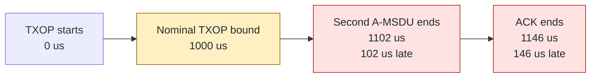
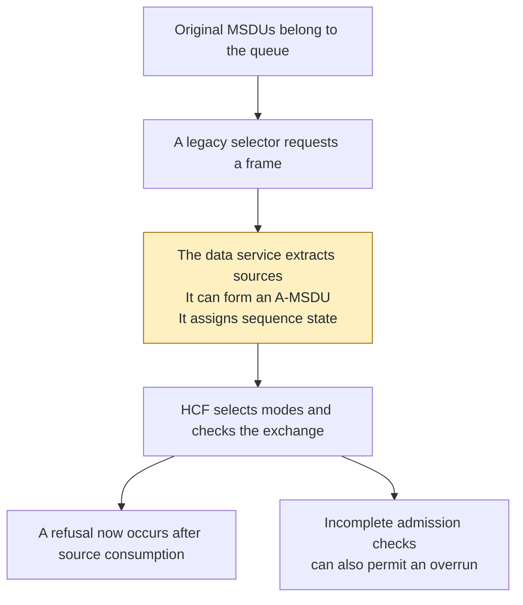
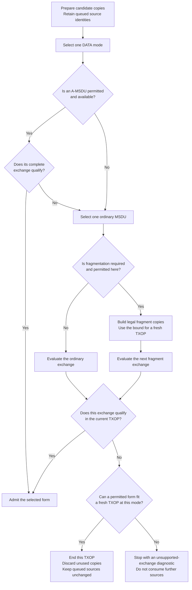
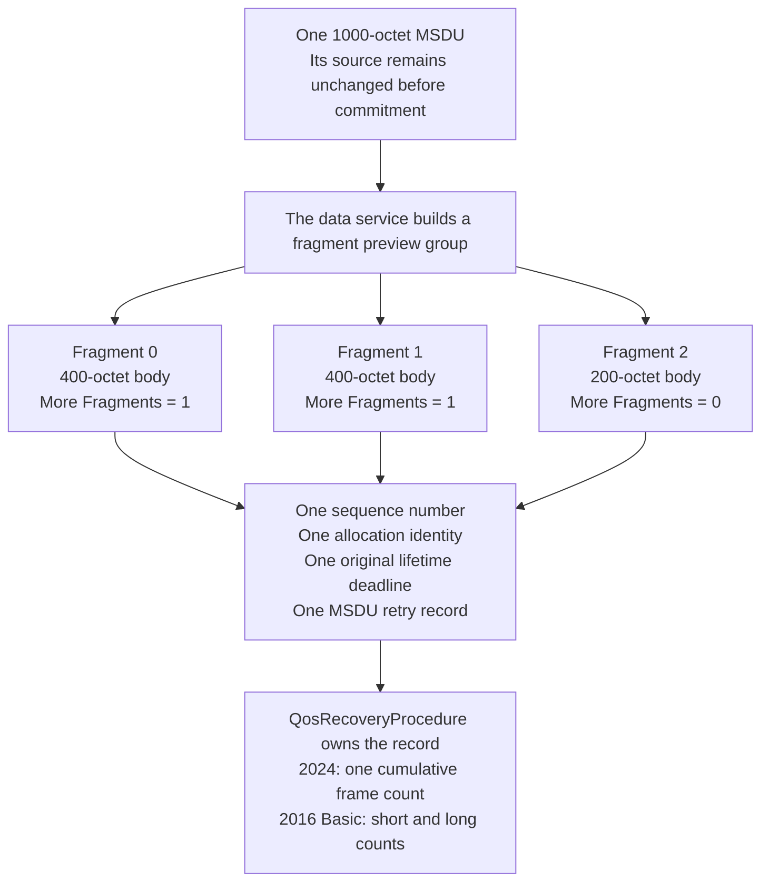
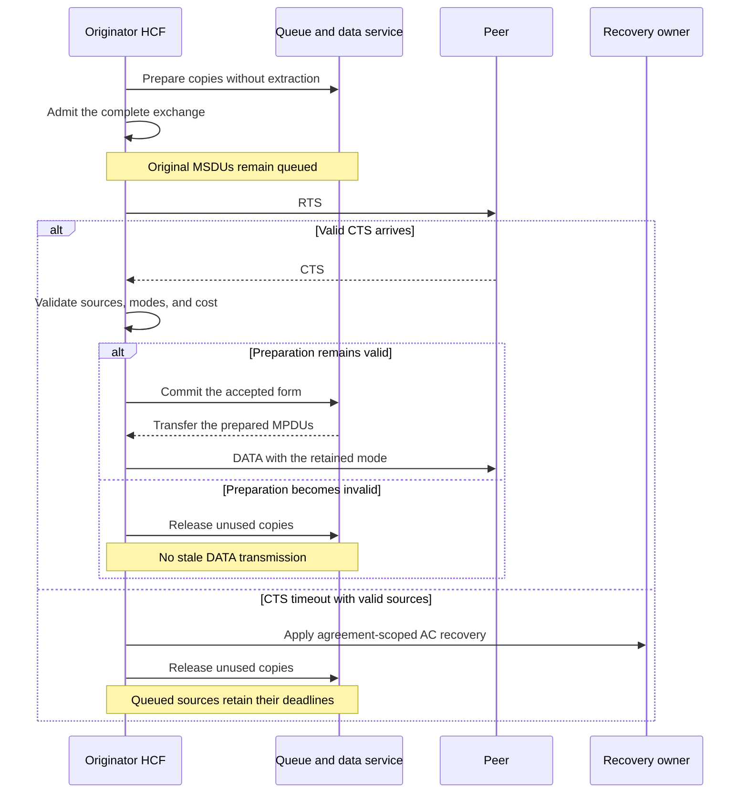
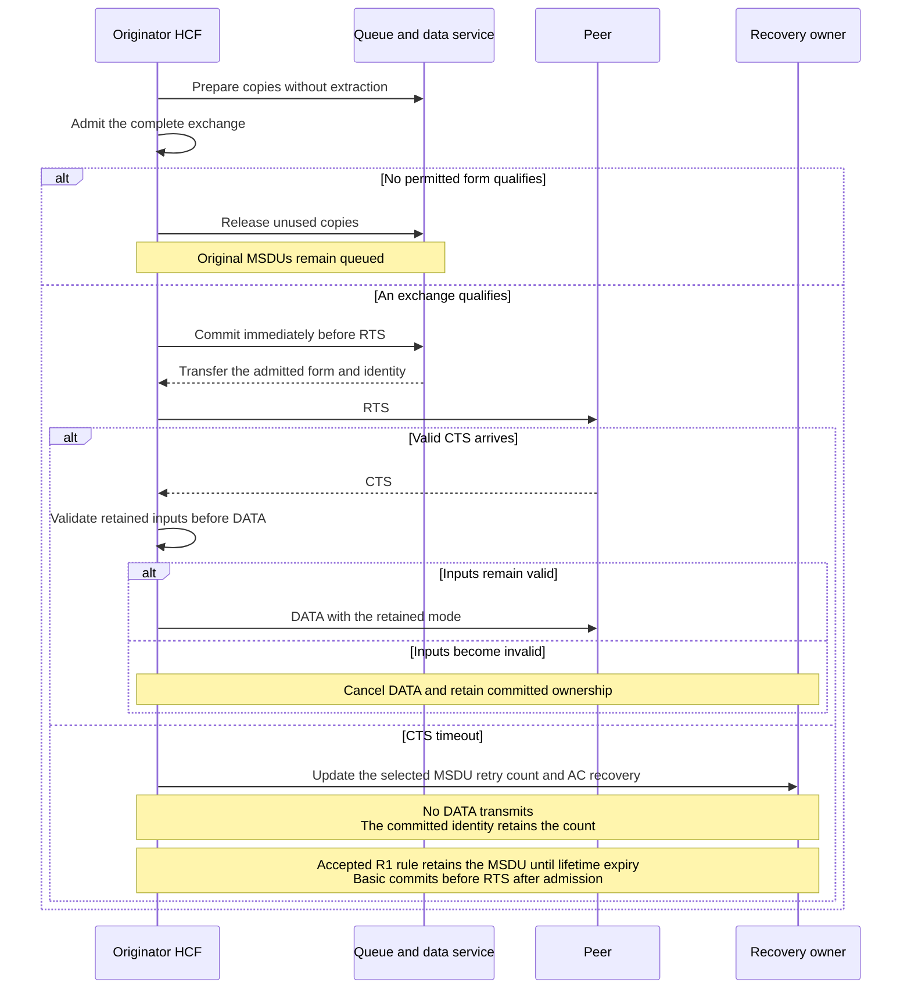
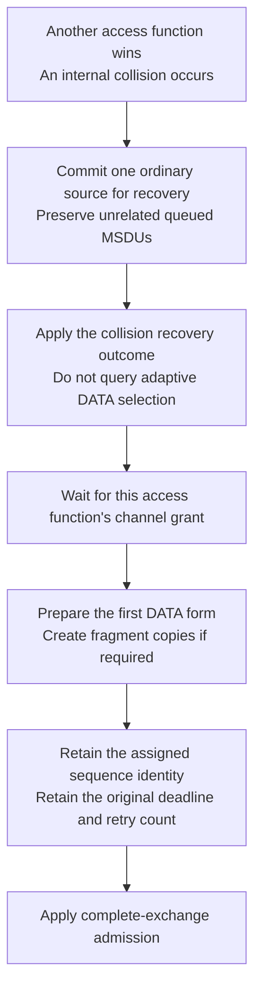
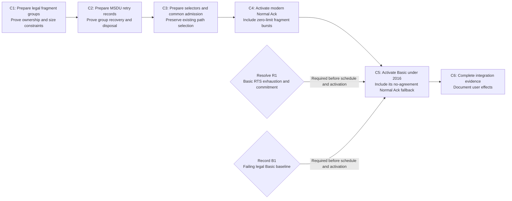

# TXOP admission for Basic and Normal Ack: plan summary

> **Kind:** reference · **Status:** draft · **Seal:** none · **Owns:** — · **Stands on:** [implementation plan](ieee80211-txop-admission-remaining-paths.md)

**HCF will check the complete exchange before it removes queued MSDUs for transmission.** If an aggregate cannot fit, HCF will try a permitted smaller form. If no form fits the current tail, HCF will end the TXOP and leave the source MSDUs queued. Eligible ordinary MSDUs can use permitted fragments that fit a fresh positive TXOP. If no permitted form fits even a fresh TXOP at the selected mode, HCF will stop with a diagnostic. A real internal collision can separately commit one ordinary source for recovery before its channel grant.

This summary describes the design in revision 9 of the [implementation plan](ieee80211-txop-admission-remaining-paths.md), dated 2026-10-19. The user subsequently requested execution. The [execution record](ieee80211-txop-admission-remaining-execution.md) owns current progress and verification. The first diagram shows the historical observations. The other diagrams describe the design and its earlier source context.

The user accepted R1's lifetime interpretation on 2026-10-19. Under an accepted Basic agreement, failed RTS attempts and internal collisions retain the MSDU until lifetime expiry. The required counters still increase. B1 supplies the legal failing baseline. C5 now commits an admitted source before RTS through the existing frame owner. The [decision note](ieee80211-txop-admission-r1-decision.md) records the accepted rule.

## What the reproduction establishes

The retained reproduction establishes TXOP overruns with Block Ack disabled and under the historical HT Basic configuration. It does not establish a failure for legal non-HT Basic operation. The current preparation path identifies a coverage gap for that profile. The [reproduction record](../reproductions/ieee80211-txop-admission-remaining/observations.json) supplies the commands, library hashes, and observed endpoints.

The source sends thirty 700-byte UDP payloads through an AP to another station. All cases use a one-millisecond TXOP, seed zero, HT mixed operation, and zero propagation time. A-MSDU aggregation and RTS protection are enabled. The cases below expose different conditions that the correction must handle.

The Basic runs also violate the 2016 rule that requires Compressed between two HT peers. Their recorded results remain historical evidence, without a requirement to preserve successful HT Basic exchanges. New legal Basic cases must establish the correction. The Block Ack-disabled runs remain direct admission regressions.

[B1](ieee80211-txop-admission-remaining-paths.md#b1-required-baseline-for-legal-basic-operation) has a failing non-HT Basic continuation through production association and accepted agreements. The probe disables both aggregation forms. Before C5, multiple protection at 24 Mbit/s produces eighteen DATA completions beyond the 1024-microsecond bound. Each violation follows earlier DATA in that TXOP. After C5, all four probe configurations report zero invalid boundaries and deliver thirty MSDUs. The execution record retains the exact conditions and evidence.

| Recorded condition | Observation | Why the exchange does not qualify |
| --- | --- | --- |
| Accepted Basic agreement, 24 Mbit/s, multiple protection | The second A-MSDU ends 310 microseconds beyond the TXOP bound. | The TXOP already contains another Data or Management frame. |
| Block Ack disabled, 24 Mbit/s, multiple protection | The second A-MSDU ends 102 microseconds late. Its ACK ends 146 microseconds late. | The complete later exchange must fit. |
| Accepted Basic agreement, 6 Mbit/s, single protection | The first A-MSDU ends 1186 microseconds late. | An initial A-MSDU cannot use the exception for an ordinary MSDU. |
| No agreement, 6 Mbit/s, single protection | The first ordinary DATA ends 166 microseconds late. Its ACK ends 226 microseconds late. | No accepted agreement permits the initial ordinary-MSDU exception. |

The diagram shows the second recorded condition. Times are microseconds after TXOP start. Node positions show event order, without a proportional time scale. The ACK belongs to the same exchange as the late DATA.



The earlier campaign completed eight S5 runs. Four selected controls also ran on this checkout and produced identical observations. The revisions were `1dd4ca2378` for S5 and `d841dc77db` for this checkout. All eight S5 runs delivered thirty payloads, despite the recorded violations. A successful process exit therefore does not establish correct admission.

One 24 Mbit/s case with Block Ack disabled and single protection records no overrun. That result applies only to that configuration. The [full evidence section](ieee80211-txop-admission-remaining-paths.md#executed-reproduction) states the campaign limits.

## Why a final transmission check is insufficient

The current legacy path can remove sources before HCF knows the final exchange cost. The data service can combine MSDUs, delete their original representations, and assign a sequence number. A later refusal cannot restore the original queue form through the current interface. The [source analysis](ieee80211-txop-admission-remaining-paths.md#confirmed-mechanism) identifies the responsible selectors and data service.



With Block Ack disabled, initial frame classification can itself call the destructive accessor. The preparation callback occurs later. Removal of the Compressed-only condition therefore does not solve the queue problem. The correction must also move classification to a preview that does not extract sources.

The current Compressed path already uses reversible preparation. The data service builds candidate copies while the original MSDUs remain queued. The proposed correction extends that mechanism to Basic and Normal Ack paths, with explicit support for fragments and their recovery state.

## How admission will work

HCF will first preserve BAR arbitration. A BAR is a Block Ack request; its exchange remains a separate admission decision. For QoS DATA, the data service will prepare copies of eligible sources. HCF will select one DATA mode and reuse it for every candidate form in that attempt.



An ordinary form carries one unfragmented MSDU in one MPDU. The service will honor the configured fragmentation threshold before commitment. It will also use fragmentation when required to fit a fresh positive TXOP. It will not choose smaller fragments solely to consume a short TXOP tail. This policy can leave unused time at the end of a TXOP.

Admission covers required RTS/CTS, DATA, internal interframe spaces, and the actual immediate response. Normal Ack DATA includes SIFS and ACK airtime. Basic DATA with Block Ack policy does not acquire a fictitious immediate Block Ack response. A later BAR/Block Ack exchange keeps its own cost and arbitration.

A-MSDU use also requires local HT implementation and received peer HT capabilities. An absent Block Ack agreement does not establish that permission. If those capabilities are absent, the service will use an ordinary MSDU or permitted fragments. [Candidate forms and cost](ieee80211-txop-admission-remaining-paths.md#complete-cost-and-permitted-forms).

Admission refusal itself will preserve queue order, source identities, ownership, absolute deadlines, sequence counters, retry counters, and queue service observations. It will not count as an RTS failure or DATA failure. Independent lifetime expiry can still remove an expired source through its normal owner.

Commitment means that the service consumes the accepted source form and transfers the prepared MPDUs to the committed-frame owner. In this model, `InProgressFrames` owns those committed frames. The commitment point depends on RTS recovery, as the diagrams below show.

## How Compressed, Basic, and Normal Ack differ

The plan extends the mechanism that accepted Compressed agreements already use. The Basic extension and the Normal Ack extension outside accepted agreements remain proposed. All three paths will prepare copies, retain one selected DATA mode, and check the complete exchange before source extraction. Refusal will preserve queued MSDUs without a retry increment.

The table compares individual QoS DATA paths. The current A-MPDU path retains its preparation and response contracts. The [full comparison](ieee80211-txop-admission-remaining-paths.md#comparison-with-current-compressed-admission) owns the detailed conditions.

| Condition | Current Compressed, accepted agreement | Proposed Basic, accepted agreement | Proposed Normal Ack, no accepted agreement |
| --- | --- | --- | --- |
| Commitment with RTS | Retain original MSDUs through RTS/CTS. Commit immediately before DATA. | Commit before RTS after admission. R1 selects lifetime retention under the accepted agreement. | After admission succeeds, commit immediately before RTS. |
| Actual RTS failure | Update access-category recovery without a frame counter under a provisional sequence number. | Update the 2016 MSDU short retry count and access-category recovery. | Update the modern MSDU frame retry count and access-category recovery. |
| Initial ordinary MSDU exceeds a fresh positive TXOP | The stated initial-MSDU exception can apply. | The 2016 initial-MSDU exception can apply under the accepted agreement. | That exception does not apply. Prepare legal fragments when necessary. |
| Fragmentation | Preserve the prohibition under HT-immediate Block Ack. | Support permitted Basic fragments under the 2016 contract. | Use permitted fragments that account for TXOP airtime and the configured threshold. |
| Response cost | Individual DATA with Block Ack policy has no immediate ACK. BAR/Block Ack has separate admission. | Use the same exchange separation, with Basic response lengths. | Include SIFS and ACK airtime in the DATA exchange. |

Both selected editions permit the eligible initial ordinary-MSDU exception under an accepted agreement. The exception requires the stated aggregate restrictions and at most one Data or Management frame in the TXOP. An initial A-MSDU cannot use that exception. The [exception rules below](#which-exchanges-may-exceed-a-positive-limit) retain the separate retry and zero-limit conditions.

The selected retry contract controls commitment and RTS recovery. Normal Ack DATA under an accepted Compressed agreement commits before DATA. Basic commits before RTS under its 2016 contract. Disabled Block Ack uses the modern contract even when its unused variant parameter says `basic`. Without RTS, new transmission sources commit before DATA. An earlier collision can already own the source.

The earlier commitment outside an agreement gives RTS recovery a stable frame identity. After actual RTS submission, the admitted form belongs to retry and lifetime procedures. A later cancellation must not restore that form to the queue as new MSDUs.

Hypothetical example: a later exchange needs 300 microseconds, but only 200 microseconds remain. All three paths defer before RTS and preserve queued sources. If an ordinary MSDU also exceeds a fresh positive TXOP, modern no-agreement operation needs permitted fragments. Accepted Basic and Compressed agreements can instead permit the eligible initial ordinary-MSDU exception. The exception requires at most one Data or Management frame in that TXOP.

## Which exchanges may exceed a positive limit

Compressed and modern Normal Ack follow IEEE Std 802.11-2024, Clause 10.23.2.9. Basic follows IEEE Std 802.11-2016, Clause 10.22.2.8. Neither contract treats every initial DATA frame as exempt. The agreement state, aggregate form, actual local transmission history, and earlier TXOP contents control the result. The following table describes the scoped conditions common to both selected editions. The [standards contract](ieee80211-txop-admission-remaining-paths.md#applicable-requirements) provides the exact clauses and source pages.

| Condition | Required treatment |
| --- | --- |
| Initial ordinary MSDU under an accepted Basic or Compressed agreement | The stated exception can apply when the TXOP contains at most one Data or Management frame. |
| Initial ordinary MSDU without an accepted agreement | The exception above does not apply. Prepare legal fragments if the complete exchange exceeds a fresh positive limit. |
| Initial A-MSDU | The ordinary-MSDU exception does not apply. Try the ordinary form when the aggregate cannot fit. |
| Local retransmission of an unchanged-size MPDU | Permit at most one Data or Management frame in the TXOP. The MPDU must not belong to a multi-MPDU A-MPDU. |
| RTS retry or internal collision before any DATA transmission | Neither event proves a DATA retransmission. Do not activate the same-size MPDU exception from either event alone. |
| Nondynamic fragments | Apply the fragment-specific conditions. Preserve the local history needed for an exception that the implementation uses. |
| Zero TXOP limit | Permit the allowed data unit, required protection, and acknowledgments. Multiple PPDUs can carry fragments of one MSDU. |

A zero limit therefore does not mean zero allowed airtime. It also does not always mean one DATA frame. A fragment burst for one MSDU differs from a second unrelated MSDU. The correction must preserve that distinction.

For an ordinary continuation under a positive limit, HCF must also respect the holder's reservation timer, called TXNAV. The two comparisons use different boundaries. Let `E` be the complete exchange cost after the wait, and let `I` be the wait before the exchange.

```text
E < available TXNAV
I + E <= available positive-limit TXOP time
```

HCF samples these budgets after the previous exchange completes, before the next wait. Equality can satisfy positive-limit containment, but equality does not satisfy the strict TXNAV condition. Both protection classes must retain their valid Duration fields. A permitted exception must protect its actual exchange beyond the nominal bound. [Validation and timing](ieee80211-txop-admission-remaining-paths.md#validation-timing-and-state-lifetime).

Basic's 2016 contract removes the 2005 lower-rate test and the initial PHY mode record needed for that test. It permits the initial ordinary-MSDU, previous-fragment retry, and sixteen-fragment exceptions under their stated conditions. Its retry contract still uses short and long counts for each MSDU. The [2016 Basic contract](ieee80211-txop-admission-remaining-paths.md#basic-contract-under-ieee-80211-2016) supplies the exact conditions and PDF pages.

Basic conformance cases use legal peer pairs without A-MSDU aggregation, with legal MSDU lengths and fragmentation thresholds. The 2016 rule permits Basic between non-HT peers or between an HT peer and a non-HT peer. It requires Compressed between two HT peers. The original HT Basic reproduction remains historical evidence only. The 2020 and 2024 editions reserve Basic's former encoding. This revision does not change showcase configurations or their recorded results.

The separate Basic peer-permission work owns enforcement of that peer restriction and its compatibility effects. Its plan remains local context outside this publication. It proposes warnings and Normal Ack fallback for explicit Basic selection between two known HT peers. At a local HT station, unknown peer classification suppresses Basic setup until management publishes sufficient state. A known non-HT local station already excludes a two-HT pair. That change needs its own PR, impact inventory, and migration evidence; it is not part of C5.

Current ad hoc management supplies no production event that guarantees later classification. A local HT station can therefore retain Normal Ack for an unknown ad hoc peer throughout the run. The separate plan documents that limit and adds no capability discovery. Infrastructure publication will trigger permission reassessment and normal DATA progress before the current setup-intent procedure resumes.

The plan now links the 2016 and 2020 PDFs under this checkout's `standards/` directory. Readers need those local inputs, as they need the 2024 PDF. The local link check does not establish public availability.

## Why fragment preparation is part of the correction

A fragment preview requires permission under the applicable agreement and PPDU conditions. IEEE Std 802.11-2024, Clause 10.2.7 prohibits MSDU fragmentation under an HT-immediate Block Ack agreement. The configured threshold and a Normal Ack policy do not remove that prohibition. The 2016 Clause 10.2.7 also prohibits fragmentation under HT-immediate and HT-delayed agreements. Non-HT Basic cases can use permitted fragments. The [fragmentation eligibility rule](ieee80211-txop-admission-remaining-paths.md#fragmentation-eligibility) supplies the scope.

A final guard could refuse an ordinary MSDU on every fresh TXOP while its size remains fixed. The MSDU would then wait until lifetime expiry. That behavior prevents an overrun but does not supply the required transmission form. The data service must therefore prepare legal fragments before source extraction.

The hypothetical example below uses an eligible Normal Ack MSDU outside an agreement. The service splits that 1000-octet MSDU into three fragments. The first two fragment bodies contain 400 octets each; the last contains 200 octets. Each MPDU also contains its own MAC header and FCS. The actual size bound comes from the selected PHY mode and complete exchange cost.



The fragmentation policy will combine the airtime bound with the configured threshold. It will enforce equal nonfinal lengths, even nonfinal lengths, and the sixteen-fragment bound. Ordinary nondynamic fragmentation will not split an A-MSDU. The service will first abandon an oversized aggregate preview when ordinary fragments are needed.

Commitment will extract an unnumbered source once and allocate one sequence identity for its fragment group. A source that already has an identity will retain it. Every fragment will retain the source's absolute deadline. A real retransmission will preserve the previously transmitted body and length. [Fragment ownership and constraints](ieee80211-txop-admission-remaining-paths.md#nondynamic-fragment-preparation).

The retry record belongs to the MSDU, not to one fragment number or one side of the RTS threshold. A collision can occur before an ordinary source becomes smaller fragments. Fragment replacement retains the same allocation and record without another initialization. A successful nonfinal fragment ACK preserves the modern MSDU count and its short retry limit. Basic instead applies its 2016 count-specific increment and reset conditions. [MSDU retry state](ieee80211-txop-admission-remaining-paths.md#msdu-retry-state-and-fragment-disposal).

Basic DATA sent under an accepted agreement follows Clause 10.24.3's lifetime rule rather than ordinary DATA retry limits. The new MSDU record must not impose another DATA retry limit on that path. A failed associated RTS still updates the MSDU short counter under Clause 10.22.2.11.1. A Normal Ack policy does not itself remove the agreement.

The two retry models still differ outside an accepted agreement. The first three rows below describe that condition. The last row compares the two accepted agreement profiles. The [detailed comparison](ieee80211-txop-admission-remaining-paths.md#msdu-retry-state-and-fragment-disposal) maps each difference to a direct test.

| Condition | Basic under 2016 | Modern operation under 2024 |
| --- | --- | --- |
| DATA fails above the RTS threshold. | Increment the long count and apply the long limit. | Increment the single frame count and apply the short limit. |
| A nonfinal fragment receives its ACK. | Reset the applicable count under the stated success conditions. | Retain the cumulative MSDU count. |
| A source becomes fragments across the RTS threshold. | Preserve both counts and the allocation identity. | Preserve the single count and the allocation identity. |
| RTS fails under an accepted Basic agreement. | Update the short count. Retain the MSDU beyond the limit under the accepted R1 rule. | Current accepted Compressed preparation updates AC recovery without a provisional MSDU count. |

When the selected contract requires retry-limit disposal, HCF cancels retained preparation for that allocation. InProgressFrames disposes of every remaining fragment in the group. HCF removes the ACK and lifetime entries through their current owners. The recovery owner retires the MSDU record once. Expiry and agreement disposal use the same group cleanup. A final success retires the record after the group completes.

If no permitted form fits a fresh TXOP at the selected mode, HCF raises `cRuntimeError` before further source consumption. Sequence and recovery state remain intact. The diagnostic identifies the peer, TID, selected mode, limit, and failed constraint. This deliberate model limit stops the simulation; it does not return ordinary deferral or request another contention attempt. When only the current tail is too short, HCF returns `DEFERRED` and ends the TXOP normally. An earlier collision-owned source remains committed in either case until its owner disposes of it.

The fatal diagnostic is a proposed model policy, not an IEEE requirement. It preserves the source without a contention loop at the selected mode. A new drop reason would change the source-retention requirement. Failure at that selected mode does not establish failure at every PHY mode.

## Why the RTS commitment point depends on recovery

Commitment before RTS gives MSDU recovery a stable allocation identity. This boundary is an implementation choice. The selected standard requires correct retry counts and disposal at the applicable limits. It does not prescribe queue extraction or sequence allocation before RTS. The [plan's explanation](ieee80211-txop-admission-remaining-paths.md#commitment-and-rts-recovery) supplies the source references and design alternatives.

RTS/CTS introduces a real event boundary between admission and DATA. Sources can expire, or peer capabilities can change, while HCF waits for CTS. The QoS context will retain the selected modes across that boundary. HCF will validate them without another adaptive DATA mode query.

### With an accepted Compressed agreement

The original sources will remain queued through RTS/CTS. After valid CTS, HCF will validate the retained preparation before the service commits it for DATA. A real RTS failure will update AC recovery through its owner and release the unused preview. It will not create a frame retry counter under a provisional DATA sequence number.



The Compressed path retains this ownership contract. It also applies to Normal Ack DATA under that accepted Compressed agreement. Basic under 2016 uses the different recovery contract below. Independent expiry can dispose of an expired original. Cancellation must not retain stale pointers.

### With modern no-agreement recovery or Basic under 2016

A failed associated RTS must increment the modern no-agreement MSDU or A-MSDU count, even when DATA never transmits. IEEE Std 802.11-2024, Clause 10.23.2.12.1 supplies this requirement. Basic's 2016 Clause 10.22.2.11.1 increments the MSDU short count and the access-category short count, also under an accepted agreement. A preview predicts a sequence number without allocation. Commitment assigns the sequence and allocation identities. Both paths commit immediately before RTS after complete admission.

R1 concerns the effect of that Basic short counter at its limit. The general 2016 retry clause requires discard at exhaustion. The Block Ack clause specifies lifetime instead of retry limits. The user accepted the lifetime interpretation for an accepted Basic agreement. C5 retains the required counters beyond both limits. Lifetime expiry still removes the complete allocation.

The resolution must cover exhaustion before the first DATA transmission and after an earlier DATA transmission under the agreement. It must also state the effect of internal collisions. Both candidate interpretations retain the mandatory counter update and AC recovery. Absence of discard would not make Compressed's AC-only recovery sufficient for Basic.

Hypothetical example: no agreement applies, admission succeeds, and HCF sends RTS, but no CTS arrives. DATA never transmits, yet recovery must retain an increased frame retry count for the next attempt. Commitment before RTS gives that count a permanent frame identity. A counter tied only to a disposable preview could lose its frame association after preview disposal. A later candidate could reuse the provisional sequence and acquire retry state for different sources.



After actual RTS submission, the form belongs to ordinary retry and lifetime procedures. It must not return to the queue as new MSDUs after a later cancellation. Before RTS, an admission refusal must leave the original queued sources unchanged. Without RTS, the service commits a new transmission source immediately before DATA. An earlier collision-owned source retains its commitment. [Commitment and RTS recovery](ieee80211-txop-admission-remaining-paths.md#commitment-and-rts-recovery).

Commitment before DATA could satisfy these MSDU recovery requirements with persistent retry state for uncommitted sources. That state would need cleanup for expiry, cancellation, and source replacement. Commitment before RTS reuses the committed owner, as the [ownership comparison](ieee80211-txop-admission-remaining-paths.md#commitment-and-rts-recovery) explains. C5 selects that boundary. The ACK policy bit alone does not select the commitment boundary.

## How an internal collision differs from admission refusal

An internal collision occurs when another access function in the same station wins channel access. It is a recovery event. The handler can need a numbered frame before that frame obtains its own channel grant. It must not form an unadmitted A-MSDU to obtain that identity.

This is the explicit exception to commitment after transmission admission. If a later admission attempt refuses the exchange, the committed source remains in InProgressFrames with its collision state. It does not return to the pending queue as new MSDUs. Sources that remain queued retain the ordinary refusal guarantees.



The first DATA form can therefore use fragments from an already numbered ordinary source. The service must preserve its identity and retry count through that replacement. A collision still does not prove an earlier DATA transmission. The same-size DATA retry exception must remain unavailable until the required local transmission history exists. [Internal collision design](ieee80211-txop-admission-remaining-paths.md#internal-collision-before-data-transmission).

## Work order and proof of completion

The plan separates preparation from activation in six implementation steps. C1–C3 add fragment, recovery, and selector mechanisms. C4 activates modern Normal Ack with its prerequisites. C5 activates Basic after the accepted R1 decision and the legal B1 baseline. C6 supplies focused evidence and user documentation. Combined verification still requires the separate peer-permission activation.



The [verification matrix](ieee80211-txop-admission-remaining-paths.md#direct-test-matrix) requires these separate forms of evidence:

- Production exchanges must meet the applicable DATA, response, TXOP, and TXNAV conditions.
- Refusal cases must compare source identities, queue state, deadlines, sequence counters, retry counters, and queue service observations.
- Fragment cases must prove legal lengths, one source consumption, one sequence identity, inherited deadlines, and complete group disposal.
- Retry cases must follow one MSDU record through a collision, fragment replacement across the RTS threshold, nonfinal ACK, and later fragment failure.
- Basic admission cases must use their 2016 rules with legal peer pairs. The separate peer-permission PR owns rejection of invalid pairs.
- Peer cases must preserve Basic between an HT peer and a non-HT peer. HT Compressed controls must retain valid exchanges.
- Basic RTS cases must assert R1's outcome before and after an earlier local DATA transmission. An unspecified expected outcome is insufficient.
- Impossible fresh-TXOP cases must prove a terminal diagnostic before further source consumption, without another contention attempt.
- RTS timeout, source expiry, capability changes, and internal collisions must prove their distinct recovery and cancellation behavior.
- Boundary cases must cover zero limits, positive-limit equality, strict TXNAV equality, and applicable initial and retry exceptions.
- Eligibility cases must preserve the HT-immediate fragmentation prohibition, even with a low threshold or Normal Ack DATA under the accepted agreement.
- Compressed, A-MPDU, management, and group controls must detect effects from shared selector changes.

C2 must exercise the production recovery owner and InProgressFrames through transfer, replacement, acknowledgment, and disposal. It must preserve exact Compressed and A-MPDU counter increments, acknowledgment cleanup, AC counters, and contention-window changes. Current RTS checks remain controls, but delivery or Retry bits alone do not establish counter preservation. C3 must call the production selectors and HCF admission operations with real contexts and owners. Test substitutes may supply inputs or observe results; they must not replace the logic under test.

C4 owns `NormalAckZeroLimitFragmentBurst`. Its first MSDU must complete all fragments and required ACKs in one zero-limit TXOP. A second unrelated MSDU must wait for another TXOP. The case covers RTS disabled and forced, under both protection classes. It checks sequence identity, allocation identity, absolute deadlines, and final ACK completion.

The plan names eight non-HT Basic configurations within its proposed test files. These cover the initial exception, continuation refusal, RTS exhaustion, Normal Ack under an agreement, DATA lifetime, fragments, and recovery boundaries. `BasicNonHtRtsExhaustionBeforeData` and `BasicNonHtRtsExhaustionAfterData` require the R1 decision before activation. Existing Basic compatibility coverage remains a control; it does not replace the new admission assertions.

Two additional configurations provide legal controls through production exchanges. `BasicMixedHtPeerAllowed` checks legal Basic with reversed endpoint roles and DATA in both directions. `CompressedHtControl` checks valid Compressed exchanges between two HT peers. The separate peer-permission plan owns `BasicTwoHtRejected`, unknown-peer transitions, warnings, and migration of current negotiation tests.

The earlier twelve diagnostic runs establish the reproduced failures and the comparison between checkouts. They do not verify the proposed correction. This summary adds no simulation result. The implementation tests remain proposed.

Historical commands retain all eight S5 runs and the recorded checkout controls 0, 5, 6, and 7. Corrected-behavior verification instead uses Block Ack-disabled runs 2, 3, 6, and 7, plus the named legal Basic cases. The historical HT Basic runs remain evidence only. Neither command set changes the recorded observations.

Whichever PR lands second must run the other plan's applicable cancellation tests against the combined source. These cover capability changes during CTS wait, retained preparation disposal, committed ownership, and teardown. The joint configuration `BasicRefusalNormalAckTxopAdmission` requires peer permission P2 and Basic-profile activation C5. C4 alone does not activate the enabled Basic profile's 2016 fallback. If P2 lands before C5, joint TXOP admission remains pending C5. The [joint verification section](ieee80211-txop-admission-remaining-paths.md#cross-plan-verification-and-activation-order) assigns the case to the later required activation.

The correction can change contention, delivery time, and fingerprints where earlier exchanges exceeded a bound. It promises no measured throughput or fairness gain. The bounded fragmentation contract requires external migration guidance with C1. Its operation remains pure virtual under the project's contract-purity rule. An unbounded fallback followed by rejection does not supply required smaller fragments. The interface receives no default body or general adapter.

The required scope is individually addressed QoS DATA through HCF, with Basic, disabled Block Ack, or Normal Ack fallback. DCF, HCCA, dynamic fragmentation, new acknowledgment policies, and MAC stop/start support remain outside this proposal. The plan preserves the current Compressed and A-MPDU contracts. The [scope and implementation boundary](ieee80211-txop-admission-remaining-paths.md#8-risks-decisions-and-implementation-boundary) defines the final limits.

These documents and the reproduction remain outside the committed A-MPDU PR #1364 work. Future TXOP implementation needs its own branch or series and a newly pinned target. This revision changes documents only.
