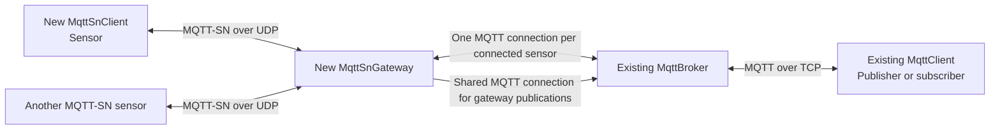
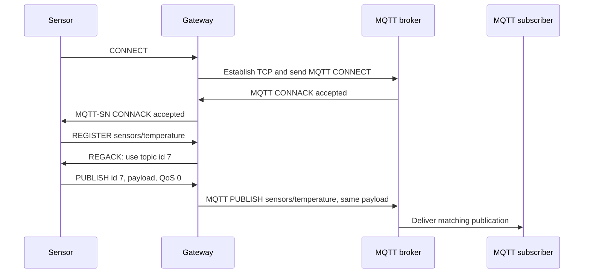
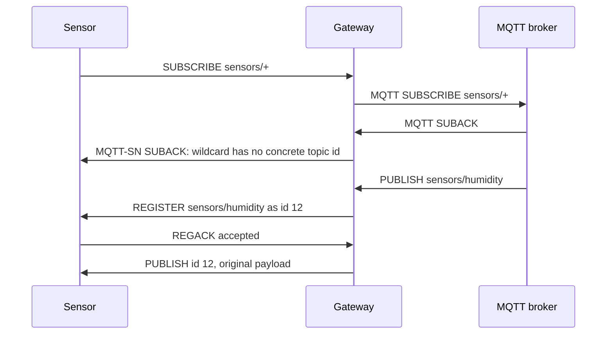
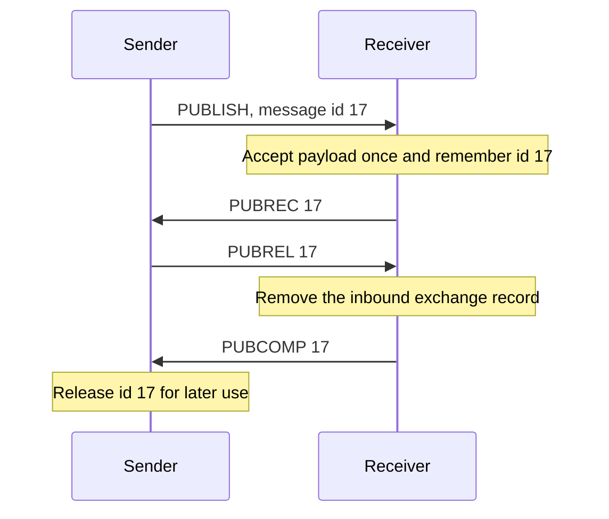
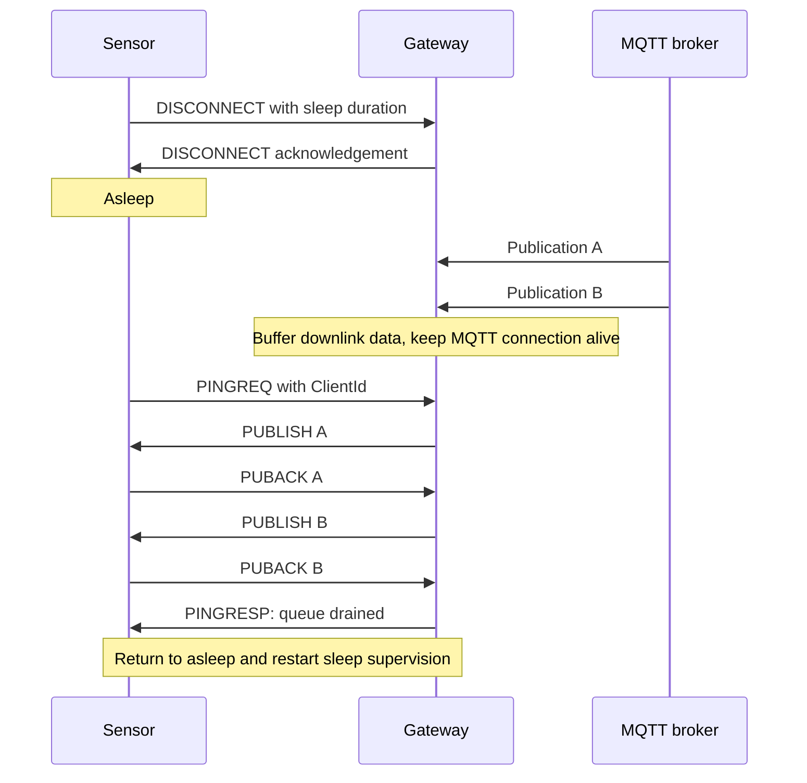
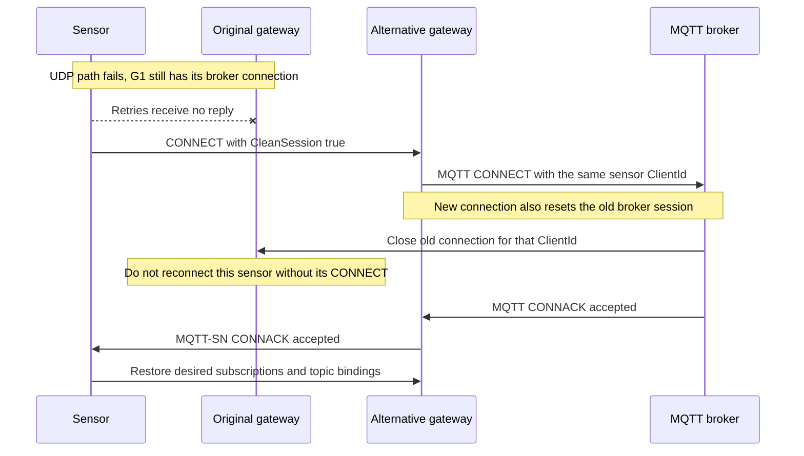

# MQTT-SN implementation summary

> **Kind:** report · **Status:** current · **Seal:** none · **Owns:** — · **Stands on:** [MQTT-SN implementation plan](mqtt-sn.md), [verification ledger](../../doc/project/evidence/model/mqttsn/coverage.md)

MQTT-SN sensor clients now exchange messages over UDP with a gateway connected to the existing MQTT broker over TCP. Simulations can study publish/subscribe messaging over unreliable datagrams, including retries, sleeping sensors and gateway failure.

This summary explains the implementation of revision 5 of the [plan](mqtt-sn.md). Debug and release builds pass, along with all 79 MQTT-SN protocol tests and nine module tests. Ten release-mode protocol checks and three release-mode shutdown checks also pass; the [ledger](../../doc/project/evidence/model/mqttsn/coverage.md) records their exact scope and source timing. The existing 24 MQTT protocol tests passed in the integrated regression run. Eight wired/wireless example configurations run with the expected delivery counts, and the user guide builds. Six publication commits separate the profile, wire contract, session records, client, gateway and examples/documentation; each source increment was built and tested with later endpoint files absent. The ledger distinguishes those results from broader checks that remain blocked or report existing findings. PR creation is canceled at the user's request. Diagram rendering remains unverified.

## What the model connects

A publisher sends a message to a named topic, such as `sensors/temperature`. A subscriber asks for messages matching a topic or a filter, such as `sensors/+`. The broker finds the matching subscribers. The gateway translates between the sensor's compact MQTT-SN messages and the broker's MQTT messages.

The separate connection for each sensor lets the existing broker manage subscriptions and its own persistent sessions. The shared gateway connection carries connectionless sensor traffic and Will messages, explained below. It has its own identifier, so it does not compete with a sensor's connection.

The gateway acknowledges delivery separately on its UDP and TCP sides and manages MQTT-SN Will messages itself. These choices mean the model does not claim the fully transparent, end-to-end gateway behavior described in the specification, even though it uses one broker connection per connected sensor.

## A sensor connects, registers a topic and publishes

MQTT-SN avoids sending a full topic name in every publication. The sensor first registers the name with its gateway and receives a two-byte topic identifier. It can then send the identifier and payload. That identifier belongs to this sensor's relationship with this gateway; another sensor may use the same number for a different topic.

This example uses QoS 0, which sends a publication without a delivery acknowledgement. The MQTT subscriber is assumed to have already subscribed to `sensors/temperature`.

The gateway only accepts the sensor's connection after the broker accepts its upstream connection. A refusal remains a refusal; the gateway translates its reason into an MQTT-SN response rather than copying incompatible numeric return codes between protocols.

Besides registered topic names, the model supports predefined identifiers configured on both sides and short topic names containing exactly two octets. These are different topic representations, even when their numeric bytes happen to match.

## Messages can also travel toward the sensor

A sensor can subscribe to a wildcard filter without knowing every concrete topic that will match it. When the broker later supplies a previously unseen topic, the gateway must tell the sensor which identifier represents that name before sending the publication.

The publication waits for registration to finish. If REGACK is lost, the gateway retries registration instead of sending data with an identifier the sensor might not understand. If a sensor rejects one concrete topic, that does not remove its wildcard subscription to other topics.

The existing MQTT broker remains responsible for retained messages: a publisher can leave a last-known value for later subscribers. The gateway translates the resulting deliveries rather than maintaining another retained-message database.

## How delivery and retries work

QoS means quality of service. It describes the delivery exchange on one protocol hop. The gateway has separate exchange state on its MQTT-SN and MQTT sides; their identifiers and acknowledgements are independent.

| Level | Meaning in this model |
| --- | --- |
| QoS −1 | A very simple sensor publishes without first connecting. It uses a predefined or short topic and receives no acknowledgement. The gateway forwards at MQTT QoS 0. |
| QoS 0 | Send once without a delivery acknowledgement. The message may be lost. |
| QoS 1 | Retain the message until acknowledgement and retry when needed. Duplicate deliveries are possible. |
| QoS 2 | Track a four-message exchange so repeats do not cause a second application handoff within the retained session. |

For MQTT-SN, a request expecting a reply has a timeout and a bounded retry count. A retry preserves the exchange identity. Repeated SUBSCRIBE and PUBLISH messages set their defined duplicate flag; messages without such a flag do not acquire one. On the MQTT side, TCP handles loss while the connection remains open.

The QoS 2 receiver accepts the payload once when the first PUBLISH arrives, then retains enough state to recognize repeated messages until the handshake advances.

If PUBLISH repeats before PUBREL arrives, the receiver returns PUBREC without another handoff. Repeated PUBREL receives PUBCOMP. At the gateway, accepting a payload into its forwarding queue is distinct from delivering it to the final subscriber.

MQTT-SN also permits an error PUBACK in response to a QoS 2 PUBLISH. The sender must handle invalid-topic and congestion responses rather than wait forever for PUBREC. It repairs an invalid normal-topic binding or waits before publishing again, as appropriate. An error from an earlier phase cannot roll back an exchange that has already advanced.

These guarantees depend on retained session state. They do not make an external application's processing transactional or preserve data lost in a gateway or broker crash.

## Sleeping sensors keep their subscriptions

A sensor requests sleep using DISCONNECT with a sleep duration. This differs from ordinary disconnect: the session remains available, and the gateway buffers messages for it while maintaining its broker connection. Active keepalive and publication retry deadlines stop while the sensor is asleep.

When the sensor polls, the gateway resumes any unfinished downlink exchange and drains its queue. PINGRESP tells the sensor that the drain has finished and it can return to sleep. The example assumes the downlink topic is already registered and uses QoS 1.

Sleep must not destroy an unfinished QoS exchange or let its old retry timer declare the sensor lost. A late acknowledgement can update the saved exchange, but further sends wait for polling. New messages arriving during the drain join its queue; continuous traffic can therefore prolong the awake period.

The sensor must reconnect to active operation before sending new application work. Application sleep alone does not turn off a simulated radio or establish an energy-saving result.

## Detecting loss and handling Will messages

Keepalive lets an active sensor and gateway detect missing peers. A sleeping sensor instead has a sleep deadline. When a sensor is declared lost, the gateway queues its current Will: a configured publication such as `sensors/status = offline`.

The gateway owns this Will because MQTT-SN allows a sensor to change or delete it during a session, while the existing upstream MQTT version cannot update a connection's Will in place. The queued Will uses the shared gateway connection, so cleaning up the lost sensor's session cannot accidentally delete it. If that connection is temporarily unavailable, the queue waits for recovery.

Normal sensor disconnect suppresses Will publication. A gateway crash loses its in-memory queue and does not guarantee delivery of pending Wills. Broker connection loss can also end a sensor relationship before sensor-loss supervision fires; the model does not promise a Will for every possible ordering of failures.

## Reconnection and changing gateways

Clean Session controls which state survives the end of a relationship. With it set to false, eligible subscriptions, Will data and unfinished exchanges can be retained. With it set to true, that relationship's session state is discarded when it ends. Sleep is not the end of a relationship, so both settings permit sleeping-client buffering.

If a sensor's upstream broker connection fails, the gateway notifies the sensor with DISCONNECT and waits for a new sensor CONNECT before replacing that connection. This prevents an old gateway from repeatedly taking over a sensor's broker connection after the sensor moves elsewhere.

The sensor can use a configured gateway or discover local IPv4 gateways through advertisements and search messages. It tries another known gateway when retries fail. Switching gateways starts fresh exchange state and reports unfinished old publications as uncertain; it cannot migrate the old gateway's memory or promise exactly-once continuity across that move.

An ordinary stop/start retains the state allowed by the session policy, cancels old deadlines and establishes fresh sockets. A crash loses local runtime state. A restarted client first requests a clean session so reset identifiers cannot collide with incompatible state retained at the gateway.

## Where the implementation lives

The package is [src/inet/applications/mqttsn/](../../src/inet/applications/mqttsn/). Both applications fit existing host application slots. The packet core is unchanged.

| Component | Responsibility |
| --- | --- |
| `MqttSnClient` | Sensor workload, selected gateway, local topic bindings and MQTT-SN requests/retries. |
| `MqttSnGateway` | Sensor relationships, topic translation, buffered downlink traffic, upstream sockets and Will handling. |
| `MqttSnSession` and `MqttSnTransaction` | Retained session data and the current phase, message and deadline of an exchange. These are ordinary records, not extra simulation modules. |
| `MqttSnPacket` and its serializer | Protocol fields and their exact bytes, including short and extended length encodings. |
| Protocol identity, printer and dissector | Make MQTT-SN packets recognizable to dispatch and inspection tools. |
| Existing MQTT and socket helpers | MQTT framing and QoS state, TCP/UDP transport, packet ownership and lifecycle support. |

One complete MQTT-SN message occupies one UDP datagram. The receiver checks it before changing session state. TCP framing is different: an MQTT packet may arrive in pieces, so the gateway reuses the existing MQTT framing helper and keeps each stream buffer confined to its own connection.

## The nine implementation steps

The implementation covers these nine capability areas. Each protocol area has focused tests and a reviewer document explaining the scenarios, exchanges and limits. The six publication commits group them by wire contract, retained records and endpoint ownership; their partial source trees were built and tested in order.

| Commit | What it adds | Main evidence to write |
| --- | --- | --- |
| C1 | Define the MQTT-SN version, supported profile and requirement inventory. | Trace requirements to planned tests and record exclusions and interpretation choices. |
| C2 | Encode, decode and inspect MQTT-SN packets. | Independently derived wire vectors, length boundaries and malformed input. |
| C3 | Connect a sensor through the gateway to the existing MQTT broker. | Acceptance/refusal, setup retries, disconnect, IPv6 unicast and clean TCP framing after reconnect. |
| C4 | Register topics, subscribe/unsubscribe and bridge QoS 0 traffic. | Both directions of routing, wildcard registration, retained values, identifier isolation and subscription retry/grant checks. |
| C5 | Add connectionless QoS −1 and acknowledged QoS 1. | Lost messages/acknowledgements, duplicate handling, congestion waits and invalid-topic repair. |
| C6 | Complete QoS 2 and persistent-session recovery. | Lost handshake phases, identifier reuse, error PUBACK, upstream failure and broker-session restoration. |
| C7 | Add Will negotiation/updates, keepalive and sleeping clients. | Loss versus normal disconnect, sleep buffering/polling and safe suspension of unfinished exchanges. |
| C8 | Add discovery/failover and verify failure/lifecycle boundaries. | Discovery suppression/expiry, live-gateway takeover, malformed traffic, stop/start and crash cleanup. |
| C9 | Provide examples, documentation and feature integration. | Runnable wired/wireless examples, existing MQTT regression checks and builds with optional features disabled. |

The final integrated implementation supports QoS 0/1/2 subscription grants. Wire tests check exact independently transcribed bytes; protocol tests exercise real clients, gateways and UDP/TCP paths. Test-only scripted peers supply losses, duplicates and malformed responses without adding fault parameters to production applications.

## What the checks establish

MQTT-SN sensors exchange the same topic names and binary payloads with ordinary MQTT clients in both directions. The tests observe registration, delivery handshakes, bounded retries, sleeping queues, recovery and lifecycle cleanup under specific faults. The [examples](../../examples/mqttsn/README.md) make these behaviors accessible without reading the C++ implementation.

The first version targets MQTT-SN v1.2 over UDP, with IPv4 unicast/local broadcast discovery and configured IPv6 unicast. It excludes native ZigBee/IEEE 802.15.4 transport, forwarder encapsulation, IPv6 multicast discovery, aggregate gateway connections, durable storage and encryption. State is held in memory, and the initial queues have no configurable congestion capacity limit.

The checks establish the behavior of the scenarios they run. They do not prove every packet ordering, external interoperability or crash-durable delivery. The broader serializer suite could not compile with this feature profile because it includes disabled protocols' generated headers; the MQTT-SN codec and all 34 registered filler variants pass their dedicated module check. Repository-wide mechanical gates report existing findings in unchanged files; scoped MQTT-SN architecture/naming and source/document seal checks pass. Mermaid rendering is unverified.
