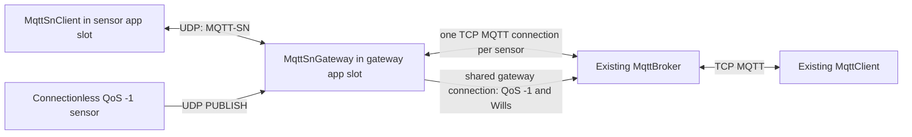

# MQTT-SN implementation

> **Kind:** design · **Status:** draft · **Seal:** none · **Owns:** — · **Stands on:** [project map](../../doc/project/README.md), [protocol anatomy](../../doc/project/design/protocol-anatomy.md), [plan procedure](../../doc/project/guide/write-an-implementation-plan.md)

Implement MQTT-SN sensor clients and a gateway so sensors can publish and subscribe over datagrams while communicating with the existing MQTT broker. For example, a sensor registers `sensors/temperature`, receives a two-byte topic identifier, and publishes a measurement using that identifier. The gateway translates it into an MQTT publication; a normal MQTT subscriber receives the original topic and binary payload. In the reverse direction, the gateway registers an unfamiliar topic with the sensor before delivering its publication. Lost acknowledgements cause the required retries without confusing topic identifiers, message identifiers, or another client's session.

## Basis and status

Publication preparation on 2026-11-16 maps the integrated C1–C9 implementation to six independently buildable commits. The user authorized committing and pushing, then explicitly canceled PR creation. The existing 13 MQTT commits are prerequisites already on this branch. The published MQTT-SN review order is:

| Commit | Purpose and dependencies | Files and verification |
| --- | --- | --- |
| P1: `plan: add: define the MQTT-SN model and review sequence` | Record the v1.2 profile, requirement inventory and this publication map. No dependency beyond the existing MQTT branch. | Plan/summary and three evidence inventories. Document checks only, no protocol behavior introduced. |
| P2: `mqttsn: add: encode and inspect protocol datagrams` | Supply the wire contract required by both endpoints. Depends on P1 and existing MQTT helpers. | Packet, codec, inspection, feature declarations, serializer fillers, wire test and codec module. Build debug/release and run those direct tests. Parent lacks these types, so fixture incompatibility is a missing capability, not an observed runtime failure. |
| P3: `mqttsn: add: retain per-peer exchange and topic state` | Prepare records and identifier allocation for both endpoints. Depends on P2. | Session records, topic-capacity helper and test network/scripted peer. Build both modes and test allocation/wire invariants. This introduces no endpoint behavior and needs no additional protocol reviewer document. |
| P4: `mqttsn: add: implement the sensor client state machine` | Add the complete client over the wire/session contracts, independent of a production gateway. Depends on P3. | Client C++/NED, scripted-gateway cases, three shutdown modules and client reviewer document. Build debug/release and run all client-only tests plus prior wire checks. Parent lacks the client module. |
| P5: `mqttsn: add: bridge sensor sessions to MQTT brokers` | Add the production gateway and cross-protocol integration. Depends on P4. | Gateway C++/NED, gateway/bridge cases, lifecycle/capacity modules and C3–C8 reviewer documents. Build debug/release and run all MQTT-SN cases. Parent has a client and scripted peer but no production gateway. |
| P6: `mqttsn: add: provide examples and user documentation` | Ship accessible scenarios and reconcile execution/publication records. Depends on P5. | Examples feature/configurations, guide, release note and final evidence updates. Both builds and documentation/mechanical gates. Protocol behavior is unchanged, so no new protocol reviewer document is needed. |

This replaces the proposed nine historical behavior increments below as the publication decomposition. The C1–C9 descriptions still define the required capabilities and checks. Wire/session preparation stands alone; each endpoint is one complete state machine with its socket, deadlines and lifecycle cleanup. Splitting an endpoint by temporarily disabling already-tested QoS, Will or sleep paths would manufacture intermediate behavior that was not the implemented development sequence. The client and gateway therefore remain separate endpoint commits, each with an explicit size rationale and role-specific tests. Their source must match the already-tested integrated source exactly.

This is revision 5, reviewed on 2026-11-16 for `/home/miguel/workspace/inet-mqtt-sn` at `73e8f28a285acc2305a8a963c3c6ecb95e59fc12`. The pre-existing local change is `AGENTS.md`; this task leaves it untouched. The user's subsequent instruction, “Execute the plan”, authorizes implementation of this revision and its verification. Publication and baseline changes remain outside that instruction. The project planning procedure and rules are drafts; their approval process is conditional on acceptance. The current [commit-series content rule](../../doc/project/rule/pull-request.md#pr-series-plan) and [protocol-test planning rule](../../doc/project/rule/testing.md#tr-plan-protocol) apply independently.

Use [MQTT-SN Protocol Specification v1.2](https://www.oasis-open.org/committees/download.php/66091/MQTT-SN_spec_v1.2.pdf), linked from the [MQTT specification index](https://mqtt.org/mqtt-specification/), as the MQTT-SN source. The official PDF was retrieved and its text inspected during planning. Pin its checksum and bibliographic details in C1; do not silently substitute a newer draft. Its section 6 inherits MQTT semantics where MQTT-SN does not change them. The gateway's upstream protocol is explicitly [MQTT 3.1.1](https://docs.oasis-open.org/mqtt/mqtt/v3.1.1/os/mqtt-v3.1.1-os.html), matching this checkout. C1 must record differences between the older MQTT reference used by MQTT-SN and this upstream profile rather than assuming identical versions.

The retrieved PDF has SHA-256 `6a74113800a2869cad7e76058a892d55b7b4fb3d21cd2f451ade802e91eedcc3`. C1 records this provenance alongside the specification's revision history and publication details.

Relevant current guidance is [adding a protocol](../../doc/project/guide/add-a-protocol.md), [architecture](../../doc/project/rule/architecture.md), [naming](../../doc/project/rule/naming.md), [minimal design](../../doc/project/rule/quality.md#qr-design-minimal), [documentation](../../doc/project/rule/documentation.md), [deriving protocol tests](../../doc/project/guide/derive-tests-from-a-standard.md), and [running gates](../../doc/project/guide/run-the-gates.md). The [seal registry](../../doc/project/audit/seal-list.md) protects `src/inet/common/packet/`; this design requires no changes there.

## Verified starting point

There is no MQTT-SN implementation, feature declaration, example, or test under the inspected `src/`, `examples/`, `tests/`, and `.oppfeatures` paths. This is a missing capability, not a reproduced MQTT defect.

The existing [MqttClient](../../src/inet/applications/mqtt/MqttClient.ned) and [MqttBroker](../../src/inet/applications/mqtt/MqttBroker.ned) fill `StandardHost.app[]` through `IApp`. They use TCP socket gates. The broker's [connection/session maps and routing method](../../src/inet/applications/mqtt/MqttBroker.h) are protected implementation details; there is no public gateway attachment API. An MQTT-SN gateway should therefore connect through the broker's actual TCP interface rather than call its routing code or duplicate its subscription and retained-message database.

The existing [MqttConnection::extract()](../../src/inet/applications/mqtt/MqttConnection.cc) frames complete MQTT packets from a TCP read buffer. [MqttSession](../../src/inet/applications/mqtt/MqttSession.h) owns MQTT packet identifiers and QoS exchanges. Neither implements MQTT-SN datagram retries, registration, or sleeping state. They are not interchangeable with MQTT-SN sessions. [MqttTopicFilter](../../src/inet/applications/mqtt/MqttTopicFilter.cc) is available for MQTT-compatible topic validation and matching where the selected profile requires it.

The local [MQTT protocol identity](../../src/inet/applications/mqtt/MqttProtocol.cc) registers TCP port 1883 without editing `common/Protocol`. Follow that extension pattern for MQTT-SN. [UdpSocket](../../src/inet/transportlayer/contract/udp/UdpSocket.h) supplies datagram send/receive, binding and broadcast options; its implementation routes through the UDP dispatcher. [UdpBasicApp](../../src/inet/applications/udpapp/UdpBasicApp.cc) demonstrates application initialization, socket callbacks and lifecycle handling. The [MQTT test network](../../tests/networks/mqtt/MqttTestNetwork.ned) and [connect fixture](../../tests/protocol/mqtt/MqttConnect.test) establish an existing production-path protocol-test pattern.

## Scope and observable completion

The initial model is MQTT-SN v1.2 over UDP/IP with one upstream MQTT connection per connected sensor, plus a shared gateway connection for connectionless QoS −1 traffic and gateway-owned Wills. The connection layout follows section 4.1, but the gateway terminates QoS exchanges independently and owns Will handling. It therefore does not claim section 4.1's fully transparent end-to-end exchange semantics. Keeping separate sensor connections delegates subscription routing and persistent broker sessions to the existing broker without implementing aggregate subscription accounting. Both endpoints are configurable applications in existing host app slots. UDP is a transport binding choice; MQTT-SN itself does not require IP. Support IPv4 unicast and local broadcast discovery, and IPv6 unicast with a configured gateway. IPv6 multicast discovery, native IEEE 802.15.4/ZigBee transport, forwarder encapsulation from section 5.5, aggregating gateways, automatic gateway-state migration, durable storage, encryption, and sensor hardware power control are separate follow-ups. Reject or ignore out-of-profile input according to the applicable protocol rule; never advertise those extensions as supported.

Completion requires all of the following:

| Capability | Required observation |
| --- | --- |
| Wire format | Exact short and extended length encodings, binary payloads, legal fields and return codes; malformed/truncated datagrams cause no partial session change. |
| Discovery and connection | ADVERTISE/SEARCHGW/GWINFO, one selected gateway, CONNECT/CONNACK, refusal, retransmission and retry exhaustion are observable through real UDP paths. |
| Topic handling | Normal, predefined and two-octet short topics remain distinct; wildcard subscriptions trigger registration before first delivery; identifiers are scoped to a client and gateway. |
| Publications | MQTT and MQTT-SN endpoints exchange original topics and payloads in both directions at QoS 0/1/2, with correct duplicate handling and acknowledgements. QoS −1 needs no MQTT-SN connection. |
| Sessions and liveness | Clean Session controls subscription/Will retention; reconnect, keepalive loss, Will negotiation/update/deletion, normal disconnect and sleeping/awake transitions follow the selected specification profile. |
| Lifecycle and integration | Stop/start and crash leave no orphan events or sockets; feature isolation works; existing MQTT cases still pass. |

QoS describes each protocol hop and its retained exchange state. It does not promise transactional exactly-once processing after gateway or broker memory loss. Do not claim standards completeness beyond the declared transport and feature profile. Sleep changes application behavior and buffering; it does not by itself turn off a simulated radio or prove energy savings.

## Components and production path



Add `src/inet/applications/mqttsn/`, namespace `inet::mqttsn`, with `MqttSnClient` and `MqttSnGateway` C++/NED pairs, `package.ned`, `MqttSnPacket.msg`, `MqttSnPacketSerializer`, `MqttSnProtocol`, `MqttSnProtocolDissector`, and `MqttSnProtocolPrinter`. Use a protocol-local `mqttSnProtocol` identity and UDP protocol-group registration for port 1884. No new global protocol member, dispatcher branch, metadata tag, or application interface is needed. Register serializer and inspection tools beside the protocol, using the existing packet APIs.

The client owns its selected gateway, discovered candidates, workload cursor, local topic bindings and pending MQTT-SN exchanges. The gateway owns records keyed by ClientId, with the active UDP address/port, topic bindings, subscriptions needed for translation/recovery, Will, sleep state, and MQTT-SN exchange queues. A separate socket-id map identifies the upstream connection. An address alone is not a persistent session identity; accepting a reconnect must not leave the former endpoint able to mutate the new session.

Preserve the sensor ClientId on its upstream connection. The current broker accepts only 1–23 ASCII alphanumeric bytes; examples use that intersection, and valid MQTT-SN identifiers outside it can receive an upstream refusal. Do not describe that broker restriction as an MQTT-SN wire rule. Configure a distinct alphanumeric identifier for the shared gateway connection, and document that unrelated MQTT clients sharing sensor identifiers can trigger broker takeover. Gateway broker credentials are configured separately from MQTT-SN, whose CONNECT has no MQTT username/password fields.

Use plain `MqttSnSession` and `MqttSnTransaction` records for retained protocol state; they need no NED modules or virtual interface. Each transaction owns an immutable retransmission template for its current phase, identifier, expected response/phase, retry count and deadline. Duplicate sends copy that template and set the message-specific retry flags; a phase change replaces the template. The gateway's MQTT side can reuse `MqttConnection::extract()` and `MqttSession` for their existing MQTT contracts. MQTT-SN identifiers, retry state and topic tables remain separate. The modules own sockets and scheduled events; records own their queued packet references. Shared MQTT helper use makes `MqttSn` depend explicitly on `Mqtt`, not the reverse. Avoid a generic publish/subscribe framework or broker refactor for this feature.

TCP stream buffers belong to one connection, separately from retained MQTT session exchanges. Clear a retired connection's partial frame before socket reuse; [TcpSocket::renewSocket()](../../src/inet/transportlayer/contract/tcp/TcpSocket.cc) changes its id/address/state but does not clear its read buffer. Retire dynamically owned sockets after their callback processing returns, following the existing broker's ownership pattern, rather than deleting a socket from inside its callback.

### Wire boundary

Represent actual protocol fields in the message schema, including message type, flags, protocol id, duration, topic representation, message id, return code and variable bytes. Presence is message-type-dependent: an absent DISCONNECT duration differs from a present duration. QoS −1 is the two-bit encoding `11`, not a negative value written as an integer octet. Length includes the complete MQTT-SN message. Section 5.2.1 permits the extended form even for short messages; accept both legal forms, preserving the selected form in decoded packets for byte-exact re-encoding. Locally constructed messages use the short form when they fit and the extended form otherwise. Switching forms adds two length octets, so test the boundary using body lengths, not an assumed one-byte increase in total size.

The UDP binding sends one complete MQTT-SN message per datagram. Validate the complete datagram length and field layout before changing state. The codec distinguishes structurally malformed bytes from a decodable request containing an unsupported protocol/version or feature; the endpoint can refuse the latter. Locally generated messages use zero for unused flag bits; ignore them semantically on receipt where the specification merely calls them unused, retaining their raw value for codec round trips. Drop structurally malformed packets and reserved message types without mutating session state, as an explicit model policy where the specification gives no response. A decodable CONNECT using an unsupported ProtocolId receives CONNACK `0x03`. Other field/phase errors follow the applicable procedure, including invalid-topic PUBACK and unknown-client DISCONNECT, rather than one universal drop rule.

Keep the wire codec capable of the specification's 65535-octet range. Use a common UDP-binding maximum of 65507 bytes for IPv4 and IPv6; this is a conservative profile limit for IPv6. Lower layers may fragment IP packets, but there is no MQTT-SN fragmentation. Do not import TCP incremental framing into this path. Test oversized prefixes without allocating arbitrary declared sizes. Gateway publication of an unrepresentable topic or payload follows section 6.10's abort behavior, with a local diagnostic rather than an invented wire response.

### Topic identifiers, subscriptions and QoS

Allocate normal topic ids from 1 through 65534 per client; section 5.3.11 reserves zero and 65535. Keep predefined bindings in a separate configured namespace and encode short names as exactly two octets. Do not use a numeric topic id as a broker topic or share one sensor's normal-topic table with another. A successful REGISTER/REGACK commits a binding; a wildcard SUBACK uses topic id zero and does not establish a concrete topic binding. Hold a gateway-to-client publication until its required REGISTER is acknowledged. Rejected REGACK suppresses delivery for that concrete topic as section 6.10 describes; retain the wildcard subscription and its other matches. Invalid-topic PUBACK invalidates the corresponding normal binding and triggers registration before a later attempt; an unknown predefined binding cannot be repaired by registration and ends that publication attempt with a diagnostic. If no normal id is free, return congestion without allocating a reserved or another client's id.

Honor section 6.5's single outstanding client REGISTER, section 6.6's single outstanding client QoS 1/2 publication, and section 6.9's subscription-operation serialization. Use the same single outstanding publication policy for gateway downlink to keep its implementation small. Queue later workload actions deterministically. Allocate message identifiers from 1 through 65535 without reusing one still active in that direction; QoS 0/−1 PUBLISH uses id zero. Reply matching checks peer, message type, id and phase, plus TopicId in PUBACK. Coalesce a repeated pending operation. Retain only the latest completed request/reply for each serialized registration/subscription procedure so an immediate retry after a lost reply can be answered without repeating upstream work. Match the request type, identifier and semantic contents, excluding DUP; a nonduplicate SUBSCRIBE is a new subscription action even when it reuses an identifier and filter. This is bounded replay state, not a permanent history of identifiers: a new request replaces it and later id reuse is legal. Completed QoS 2 state must also allow later id reuse; repeated PUBREL receives PUBCOMP without another delivery.

Terminate MQTT-SN and MQTT QoS exchanges independently at the gateway. Once a hop has accepted ownership, retain its outbound work until its own delivery exchange completes or the owning session ends. Acknowledge incoming work according to its hop's QoS phase, not by copying identifiers or acknowledgements across transports. In particular, a repeated MQTT-SN QoS 2 PUBLISH must not enqueue a second MQTT publication. Preserve required ordering. Mirror the sensor's effective CleanSession on its upstream connection: false permits retaining eligible MQTT work across a disconnect; true discards session exchanges and reports unfinished outcomes as uncertain. Do not retry a CleanSession=true MQTT exchange as though it were persistent. The initial simulation profile has no configurable congestion queue cap; lack of free identifiers defers allocation. Memory scaling is a documented limit, not a hidden packet-drop policy.

After an established per-sensor upstream connection fails or closes unexpectedly, send unsolicited MQTT-SN DISCONNECT, cancel that sensor's active/sleep supervision and downlink retries, and leave it disconnected with the cleanup dictated by its effective CleanSession. Open a replacement per-sensor MQTT connection only in response to a new CONNECT from that sensor. An active client receiving unsolicited DISCONNECT reconnects to its selected gateway; if that exchange fails it follows candidate failover. The old gateway must not autonomously reconnect a sensor ClientId after the broker has handed it to another gateway. This also means a sleeping sensor whose DISCONNECT notification is lost discovers the broken relationship at its next poll; automatic restoration while it remains asleep is not promised. The uniquely identified shared gateway connection can reconnect autonomously at `reconnectInterval`.

For a congestion PUBACK, suspend new publication attempts for TWAIT and cancel the affected publication retry deadline if one exists; resuming after the wait starts a new bounded attempt. QoS 0 has no retained acknowledgement transaction, but the same publisher backoff applies to later work. Invalid-normal-topic PUBACK blocks further use of that binding pending registration. A pending QoS 1/2 publication can then resume; QoS 0 repair only affects later publications. Match a QoS 0 error using the peer and TopicId, not a nonexistent nonzero MsgId. These error responses must not leave the affected Tretry expiry running during backoff or registration; independent transactions keep their own deadlines.

Implementation clarification: retain the latest QoS 0 topic representation sent for each feedback TopicId in the owning session. Ignore zero-id feedback without that context, and invalidate a normal binding only when the matching representation is normal. A predefined/short error must never erase a numerically equal normal binding. QoS 0 feedback cannot distinguish an older publication after the same peer/TopicId has been reused with a different representation; this model applies it to the latest context. This is a limit of the zero-id feedback correlation, not a delivery acknowledgement or a new retransmission queue. Clear these records with session exchanges.

Section 6.6 permits a rejecting PUBACK regardless of the PUBLISH QoS. While a QoS 2 sender awaits PUBREC, its allowed responses therefore include matching PUBACK with invalid-topic or congestion return code, as well as PUBREC. An accepted PUBACK cannot complete QoS 2; this model ignores it without resetting the response deadline. Once PUBREC has advanced the transaction to PUBREL, a delayed error PUBACK from the earlier phase cannot roll it back; ignore it without changing the binding or current retry deadline. Keep this response set distinct from MQTT's QoS 2 response rules.

Use MQTT QoS 2 Method B, as the existing MQTT session helper does: the first accepted PUBLISH records its inbound id and hands the publication to the receiving application's queue once, then sends PUBREC. Repeated PUBLISH while awaiting PUBREL sends PUBREC without another handoff. PUBREL removes the inbound record and sends PUBCOMP, including when PUBREL is repeated after the record was removed. The sender retains PUBLISH until PUBREC, then retains PUBREL until PUBCOMP. Apply this separately to MQTT-SN and MQTT state; accepting into a gateway queue is not yet delivery to the remote sensor or MQTT observer.

Map MQTT-SN subscribe/unsubscribe requests to MQTT operations and acknowledge the sensor only after the corresponding upstream result is known. Cap the QoS requested upstream at the implemented MQTT-SN level. Validate the reply against the pending MQTT operation, including type, identifier and result count; a successful SUBACK grant must not exceed that upstream request. Accept and report a valid lower grant, but treat an excessive grant as an invalid MQTT exchange rather than silently clamping it. Close the offending upstream connection and use the connection-failure behavior above; never send an accepted MQTT-SN SUBACK for that result. The existing [MQTT client's receiveControl()](../../src/inet/applications/mqtt/MqttClient.cc) performs these contextual checks; codec validation alone cannot compare a grant with its request. Upstream SUBACK `0x80` becomes MQTT-SN SUBACK `0x03`; it is not a QoS value. For CONNECT, upstream MQTT refusal codes 1/2/4/5 map to MQTT-SN `0x03`, and server-unavailable code 3 or a bounded upstream setup timeout maps to `0x01`. Keep the original upstream reason in the diagnostic; never copy MQTT return-code numbers directly into MQTT-SN. The broker remains the owner of retained messages and wildcard routing. The gateway retains only accepted filters/grants needed to rebuild a missing broker session and concrete exclusions required by rejected registration. A later accepted subscription matching an excluded concrete topic clears that exclusion; clean-session reset also clears it. Translate normal, predefined and short topics to their actual MQTT topic strings. Preserve payload octets, QoS and retain semantics; outbound hop identifiers and DUP history are independent. QoS −1 uses only predefined or short topics and forwards to MQTT at QoS 0 over the dedicated connection.

### Connection, discovery, timers and Will

A client may use a configured gateway or local IPv4 broadcast discovery. Implement section 6.1's randomized SEARCHGW delay, suppression after an equivalent peer search, delayed client GWINFO response and cancellation, candidate expiry, and selection by ascending GwId among nonexpired candidates. Use the simulator RNG, not ambient randomness. Discovery uses an explicitly configured IPv4 interface and subnet broadcast address, with radius 1 and IP TTL 1; reject an unsupported configured radius rather than claim multi-hop discovery. All discovery participants share the configured MQTT-SN UDP port (default 1884). Gateway GWINFO omits GwAdd and uses the datagram source address; relayed client GWINFO includes a binding-specific GwAdd consisting of a length octet `4` followed by four IPv4 address octets. This address encoding is a local UDP profile convention, not an MQTT-SN universal format, and must be documented and golden-vector tested.

Use an advertisement interval of 20min and expire an advertised candidate after three missed intervals. A candidate learned only from GWINFO uses the client parameter `gatewayInfoLifetime = 60min` until an ADVERTISE supplies its duration. Cache at most one candidate per GwId; a conflicting address for a live id is diagnosed and ignored in this configured unique-id profile. On retry exhaustion, try each remaining nonexpired candidate once before searching again; a configured-only client waits Tretry before a new connection attempt. A discovery round observes replies for `searchResponseTimeout = 5s` after its SEARCHGW (or the equivalent peer SEARCHGW it suppressed its own for). A round without a candidate waits one searchResponseTimeout before retrying, doubles that wait up to `searchRetryMax = 60s`, and resets the backoff on a valid candidate; each search still applies its randomized initial delay. On switching gateways, clear old normal topic bindings, reply caches and inbound QoS duplicate state, report unfinished publications as uncertain, and force CleanSession=true until the new gateway accepts a connection. This clears the old broker session instead of reusing another gateway's inaccessible exchange state. Restore desired subscriptions, then use the configured CleanSession value on later connections. Advertise only while the shared gateway connection is MQTT-active; cease advertising when its failure is detected. TCP connection state is the observation boundary and does not prove immediate detection of a network partition.

The configured advertisement interval must be a whole number of seconds from 1 through 65535, because ADVERTISE carries it in a two-octet seconds field. CONNECT keepalive and DISCONNECT sleep durations likewise use integer seconds in their wire range, with zero handled as specified above. Local-only timers such as Tretry, gatewayInfoLifetime and search delays may use fractional seconds; do not round a fractional wire duration into a different protocol value.

Use configurable timer values with units in NED. Defaults following section 7.2 are search/GWINFO delay bounds 5s, TWAIT 6min, Tretry 10s and Nretry 3 retransmissions. Send the original request once, then at most Nretry retries at Tretry intervals; abort when the final retry's response deadline expires. A reply cancels only its matching deadline. For congestion refusals to REGISTER/SUBSCRIBE, this model also waits TWAIT before a new attempt, adopting the specification's recommendation. Loss of a setup Will request/response is recovered by replaying the current handshake phase on repeated CONNECT or phase input. Model gateway-originated REGISTER, QoS publication phases and Will prompts with the same bounds; after exhaustion mark an established sensor lost, stop sending that transaction and apply its session/Will cleanup rule. Incomplete setup is instead discarded without activating a Will that was never accepted. This symmetric retry policy is a model choice where section 6.13 specifies only the client. Awaited Will-update responses have no message id: serialize those updates so the response type identifies the one pending operation. TCP owns retransmission on the MQTT connection; do not add periodic MQTT retries within a healthy TCP connection.

Apply each message's own flag definition to MQTT-SN retries. Sections 5.4.12 and 5.4.15 require DUP on repeated PUBLISH and SUBSCRIBE respectively; section 5.4.17 marks DUP unused in UNSUBSCRIBE, so generated UNSUBSCRIBE retries keep it zero. REGISTER and the PUBREC/PUBREL/PUBCOMP messages have no DUP field. The specific SUBSCRIBE definition takes precedence over section 5.3.4's narrower general description of DUP. Preserve the identifier and semantic request contents across retries; do not copy MQTT fixed-header rules onto MQTT-SN messages.

Client and gateway state distinguish connection setup, active, asleep, awake, disconnected and lost as appropriate; operational up/down state remains owned by `ApplicationBase`. Adopt section 7.2's recommended gateway timer tolerance as a fixed model policy: 50% for durations at most 60s, 10% above 60s. The source leaves exactly 60s unspecified; this profile includes it in the shorter-duration branch. Keepalive zero disables active-state keepalive supervision, following the inherited MQTT meaning. DISCONNECT with a present zero duration still enters sleep and is acknowledged, then its zero-delay expiry event marks the client lost and removes that deadline; no repeating zero-time timer or extra tick delay is needed. Client PINGREQ is due after one nonzero keepalive interval without a sent control message, and the gateway measures time since the last valid message from that sensor. Timers derive from application/socket send/receive boundaries, without invented CPU delays. A single earliest-deadline event per owner drives retained deadlines; no event is required for a synchronous local state update.

The gateway owns the MQTT-SN Will, including four CleanSession/Will combinations in section 6.3 and live updates/deletion in section 6.4. Upstream MQTT CONNECT omits a broker-managed Will: MQTT 3.1.1 cannot change it in place. When a sensor becomes lost, enqueue a copy of the current Will on the existing dedicated gateway connection, which also carries QoS −1 traffic. Its MQTT session supports the Will's configured QoS and is persistent across upstream reconnects. This lets sensor-session cleanup and socket closure proceed without deleting an unsent Will or creating a second socket per lost sensor. Mark the loss transition once so repeated timeout paths cannot enqueue another copy. If upstream is unavailable, that connection's queue retains the publication until recovery. Normal disconnect suppresses publication without silently erasing persistent Will data. Gateway crash loses its queue and provides no Will-delivery guarantee; tests distinguish sensor loss from gateway loss. Broker keepalive is maintained independently while a sensor sleeps.

The client defers a workload sleep action until its own registration/subscription/publication and Will-update requests have completed. It then sends DISCONNECT containing a duration and awaits an acknowledgement without a duration. The gateway enters asleep on receiving the request, cancels active keepalive and any current downlink retry deadline, and retains that downlink exchange's phase and queued data. This applies regardless of CleanSession: entering sleep does not end the session. While asleep it buffers data and does not retransmit publications; sleep supervision replaces active keepalive supervision. A late acknowledgement can advance or complete the retained downlink exchange, but the gateway defers any next-phase send or new publication until polling. Repeated sleep DISCONNECT is acknowledged without clearing that exchange or buffered data. The client cancels active ping deadlines when beginning sleep and retries only the sleep request until acknowledged or exhausted; a late active-state PINGRESP cannot complete that sleep request.

PINGREQ carrying ClientId moves the gateway session to awake and stops its sleep deadline. Resume an interrupted downlink exchange from its retained phase with a fresh retry deadline, then drain the FIFO queue, including arrivals while awake. A retried PUBLISH carries DUP; a pending PUBREL is resumed as PUBREL. Emit PINGRESP synchronously when the queue and current downlink exchange become empty; later simulation events enqueue for the next poll. An empty drain responds immediately. Continuous downlink traffic can prolong awake time; the model does not invent a fixed-size batch that would claim completion while buffered messages remain. A repeated polling PINGREQ continues the current drain without resetting the gateway's downlink retry budget or restarting completed deliveries. A waking client resets its poll response timer on intermediate traffic, retries its PINGREQ on silence, and returns to sleep after the bounded failed polling attempt. Sending new application work requires CONNECT to return to active state; that transition cancels sleep supervision and restarts active keepalive.

### Configuration, observation and lifecycle

Declare `IApp` socket gates for the client and gateway, and route the gateway's UDP and TCP indications by socket ownership through existing socket APIs. Parameters cover bind/gateway/broker addresses and ports, discovery interface/broadcast address, identifiers, Clean Session, keepalive, predefined topics, Will, timer policy and workload. Bound upstream connection setup with `connectTimeout = 5s`, reconnect attempts with `reconnectInterval = 1s`, MQTT liveness with `brokerKeepAlive = 30s` and `brokerPingTimeout = 5s`, and graceful stop with `stopOperationTimeout = 5s`. These are model defaults independent of MQTT-SN wire durations. The client connected-workload origin is its first accepted CONNACK; connectionless-only QoS −1 mode uses application start. Ordinary stop/start preserves that origin and cursor; crash starts a new workload. XML actions are ordered by nondecreasing `at` offsets and cover publish/subscribe/unsubscribe, Will changes and sleep/poll, with binary payloads expressed as hex. Overdue actions become eligible at the current simulation time, without scheduling into the past; execute only actions allowed by the current session phase and serialization limits. A sleep-period publish action first reconnects to active, rather than publishing from awake polling state.

Declare sent/received control-packet, delivered-publication and session-state signals in NED; derive statistics there. Packet delivery means payload handed to the receiving application, not sender enqueue or transport receipt. Print/filter support exposes message type, topic representation, id, QoS and return code. No drawing or analysis code belongs in protocol classes.

Create reusable events once, cancel on stop/crash and release on destruction. Graceful client stop attempts bounded DISCONNECT; keep receiving its completion while stopping, then close UDP. Normal disconnect without a sleep duration closes that sensor's upstream MQTT connection cleanly. Lost/disconnected clean-session relationships discard subscriptions and unfinished exchange state; persistent ones retain eligible exchanges, desired filters and Will. Topic mappings remain gateway-local and can be re-established by registration. Sensor loss copies its Will to the gateway connection's queue before sensor-session cleanup; a graceful gateway shutdown sends unsolicited DISCONNECT to current peers and suppresses new sensor Wills because it is ending those relationships deliberately. Broker/gateway crash has no Will-delivery guarantee.

Gateway stop retains persistent records and their queued data, plus the independent shared gateway connection's queued Wills; clean-session sensor data follows the discard rule above. It cancels all retry/sleep/liveness deadlines and closes sockets. Restart binds fresh sockets and leaves sensors disconnected until CONNECT. Persistent reconnect re-arms eligible exchanges with fresh deadlines; sleep state is not silently resumed across gateway shutdown. Client ordinary restart reconnects using the configured CleanSession and resumes only exchanges retained under its preceding effective false value. Crash destroys sockets and all local runtime state. On client crash/restart force a clean initial session until acceptance before reverting to configured persistence, so reset local ids cannot collide with retained gateway exchanges. Gateway crash loses topic mappings and exchange records; it does not reconstruct them from MQTT Session Present. Socket shutdown callbacks and cancellation use their existing owners; do not add a second operational-state flag or speculative generation counter.

## Commit series and verification tasks

Every artifact named below is proposed unless linked above as existing. No existing MQTT-SN test exposes these gaps. Parent capabilities in C2–C9 are assumptions until their preceding commits are implemented and verified. Keep each commit buildable, with claims limited to its implemented subset. Add cleanup with the resource that introduces it, rather than postponing timer/socket safety to C8.

For every protocol commit C2–C8, explicitly write the listed `.test` files and its own reviewer document in the same commit. The reviewer document must explain the requirement/clauses, parent gap, component correction, topology, configuration, stimulus, observed production path, every assertion, expected before/after result and limits. Include sequence/state diagrams for distinct exchanges, faults and timer boundaries; verify rendering or mark it unverified. Future paths are written as code below because they do not exist yet.

Common fixture: add `tests/networks/mqttsn/MqttSnTestNetwork.ned` with sensor, second sensor, gateway, broker and MQTT observer hosts joined through a 100Mbps Ethernet switch, 1ms links, static addressing, `seed-set = 0`, and no unrelated traffic. C3 onward run the production endpoint for the role under test; use a scripted UDP peer or protocol interception for missing replies, malformed inputs and duplicates. Include a test-local UDP scripted peer where the shared fixture cannot generate these messages. Do not modify shared test infrastructure without first demonstrating the missing capability. Trigger actions from observed acknowledgements, use distinct payloads, bound every positive assertion and close every absence/count window. Default limit is 30s with Tretry 100ms, Nretry 2 and TWAIT 500ms where needed; the keepalive boundary cases instead use real 60s/61s durations and a 120s limit. Tests using short timers check policy behavior rather than the realism of the defaults. All shorthand `.test` basenames below are relative to `tests/protocol/mqttsn/`.

Discovery variants override the advertised interval to 1s, `gatewayInfoLifetime` to 600ms, the search random-delay bound to 50ms, `searchResponseTimeout` to 100ms and `searchRetryMax` to 400ms. Retain three missed advertisements. Assert that the ADVERTISE Duration field is exactly 1 and its configured interval is representable, rather than rounding a subsecond interval into the wire field. These explicit overrides let candidate expiry and capped backoff complete inside 30s; no fixture waits for the production 60min fallback lifetime.

### C1 — Define the MQTT-SN v1.2 model profile and requirement inventory

Dependencies: none. Add `doc/project/evidence/standard/mqtt-sn-v1.2/catalog.md`, `doc/project/evidence/protocol/mqttsn/features.md`, and `doc/project/evidence/model/mqttsn/coverage.md`. Inventory the section 4 gateway architecture, sections 5–7 and the applicable inherited MQTT requirements, assigning every in-profile wire field, exchange, timer and negative requirement to C2–C8 and a proposed case. Record the independent-hop QoS/Will profile, optional/out-of-profile features and UDP-specific choices explicitly; do not mark section 4.1's end-to-end transparency as implemented. For section 6.12's contradictory CleanSession sentence, use section 6.3's explicit flag matrix: false retains subscription/Will state; true clears it at the specified session boundaries. Record the 60s and zero-duration policies as interpretations, not quoted mandatory requirements. Any newly discovered contradiction that changes this design must be resolved in the plan before implementing its dependent step.

This commit adds evidence/design documents only and introduces no protocol behavior, so protocol tests and a behavior reviewer document do not apply. Verify source provenance, clause references, complete assignment, relative links, and model exclusions. Coverage entries start `NOT_RUN`, not supported/pass. Record the downloaded specification's checksum; do not commit an unreviewed third-party PDF or implementation.

### C2 — Add MQTT-SN packet encoding and inspection

Dependencies: C1. Add the packet schema, codec, protocol identity/registrations, dissector/printer, package, and initial `MqttSn`/`MqttSnTests` feature entries in `.oppfeatures`; add serializer fillers under `tests/serializer/lib/fillers/`. This changes the current inability to represent or inspect MQTT-SN bytes. Scope: sections 5.2–5.4, excluding forwarder encapsulation.

Write `tests/module/mqttsn_serializer.test` and `tests/protocol/mqttsn/MqttSnWireFormat.test`. Give the protocol fixture a test-local application that receives real UDP datagrams and invokes the production codec. Derive fixed byte vectors independently from the specification tables for all supported message types, one-byte total length 255, extended totals below 256 and at/above 256, empty optional Will fields, embedded-zero payloads, short-topic bytes, relayed GWINFO addresses, and legal return codes. Inject short/extended truncated prefixes, inconsistent lengths and illegal field combinations. Assert decoded fields and exact re-encoded bytes for legal inputs, including unused bits that do not affect semantics. A structurally valid CONNECT with an unsupported ProtocolId must remain decodable so C3 can refuse it. Reserved/unsupported types and structurally invalid input are classified without application delivery. Before C2 these cases cannot initialize because the packet/codec does not exist; afterward vectors and classifications pass. Extend the serializer suite's existing registration mechanism rather than editing packet core code.

Write `tests/protocol/mqttsn/wire-format.md` for C2. Run the wire protocol case, focused module codec case and serializer filler coverage with matching debug artifacts. Golden vectors establish wire correctness beyond self-consistent round trips; they do not establish session behavior.

### C3 — Connect sensor clients through per-client gateway connections

Dependencies: C2. Add `MqttSnClient`, `MqttSnGateway`, session records, NED parameters, the test network and a UDP scripted peer. Establish a sensor's TCP MQTT connection and return accepted MQTT-SN CONNACK only after broker acceptance. Implement section 6.2 connection setup without Will, CleanSession setup, section 6.12 disconnect and base request timeout/retry handling from 6.13. Until C7, refuse Will-enabled CONNECT with `0x03`; do not accept and omit negotiation. Refuse unsupported ProtocolId and translate broker/setup failures using the mapping above. Retain separate peer and socket identities.

Write `tests/protocol/mqttsn/MqttSnConnect.test` and `MqttSnConnectRetry.test`. With fresh state, send CONNECT and observe upstream MQTT CONNECT/CONNACK before downstream acceptance. Repeat the connection case with static IPv6 addresses and discovery disabled. Cover unsupported ProtocolId, broker refusal codes and unavailable setup, duplicate CONNECT after dropped CONNACK, exactly Nretry retransmissions followed by exhaustion, normal DISCONNECT/ack, and reconnect using the same ClientId from a changed UDP port. Assert one active upstream connection and no session mutation from the obsolete endpoint; repeated CONNECT must not create duplicate sessions. A scripted MQTT peer supplies refusal codes the built-in broker cannot generate. It also sends a partial CONNACK then closes, accepts the next sensor-triggered connection and sends a complete CONNACK: assert the old prefix never contaminates the new frame and terminal socket callbacks complete safely. Before C3 no endpoint can bind or establish these sessions; afterward the real transport path and bounded setup outcomes exist. Write `tests/protocol/mqttsn/connect.md` for C3. These tests do not yet establish Will, publication or persistence recovery.

### C4 — Register topics and bridge QoS 0 publications and subscriptions

Dependencies: C3. Implement sections 6.5, 6.7, 6.9 and 6.10 in client/gateway topic tables, registration/subscription transactions and MQTT translation. Forward QoS 0 binary publications both ways with ordinary and retained broker semantics. Grant at most QoS 0 until C5 raises the cap to 1 and C6 to 2; each commit updates its subscription-grant cases. Intermediate versions reject an unsupported requested publish QoS with a local diagnostic rather than silently downgrade it. Keep gateway-to-sensor data behind required registration acknowledgement.

Write `tests/protocol/mqttsn/MqttSnTopics.test` and `MqttSnRouting.test`. Starting connected, register a normal topic, publish its id, and assert that the production MQTT observer receives the exact topic/payload; repeat bidirectional QoS 0 routing over IPv6. Test predefined and short names separately, ids 0/65535 in contexts where they are reserved, and valid message-id 65535. Subscribe a sensor to `sensors/+`, publish a previously unseen concrete topic upstream, and assert zero-id SUBACK, REGISTER/REGACK, then PUBLISH ordering. Drop REGACK once, repeat REGISTER, and assert a stable binding without early publication. Use two sensors with equal numeric ids mapped to different names and assert isolation. Inject invalid-topic PUBACK and rejected registration/subscription; assert the required repair/refusal and no unrelated wildcard cancellation. Repeated SUBSCRIBE after lost SUBACK must not repeat upstream retained replay. Unsubscribe then publish again and assert no delivery in a closed window. Cover retained replay and retained deletion with an empty payload. Before C4 sessions connect but cannot route application data; afterward these operations cross both production protocols. Write `tests/protocol/mqttsn/topics-and-routing.md` for C4. Fault tests do not yet claim publication QoS recovery.

In `MqttSnTopics.test`, drop SUBACK and assert the repeated SUBSCRIBE keeps its id, filter and requested QoS while changing DUP from zero to one; receiving the reply stops its timer. Drop UNSUBACK separately and assert its retry keeps DUP zero. After completing a subscription, deliberately reuse its id/filter in a new DUP=0 SUBSCRIBE and require a new upstream subscription and retained replay, distinguishing it from the cached retry response. Use the scripted MQTT peer for a valid lower grant, a refusal, and invalid higher-grant/wrong-id/wrong-result-count responses. For invalid replies, assert upstream closure and MQTT-SN DISCONNECT with no accepted SUBACK. The C5/C6 cap updates retain these cases against their new requested QoS levels; the lower-grant case becomes applicable once C5 supports requesting QoS 1.

Add `tests/module/mqttsn_topic_capacity.test` in C4 for the capacity branch. Use a test-only gateway subclass to prefill its per-client topic table, then deliver a REGISTER through the production handler and assert congestion without changing another client's mapping. This avoids tens of thousands of timed network registrations and adds no production configuration switch. The protocol fixture tests ordinary allocation and injected congestion responses; capacity setup itself is module-level evidence, not a network-scale experiment.

### C5 — Add QoS −1 and QoS 1 delivery with datagram retries

Dependencies: C4. Implement sections 6.6, 6.8, 6.13 and 7.1, the dedicated gateway upstream connection, independent hop identifiers, retained QoS 1 exchanges, and congestion backoff. Serialize client QoS 1/2 publication transactions while allowing the specified other operations. The dedicated connection uses CleanSession=false and has no broker subscriptions; reconnect resumes its eligible exchanges. It is introduced for QoS −1 here and reused for gateway-owned Wills in C7.

Write `tests/protocol/mqttsn/MqttSnQosMinusOne.test`, `MqttSnQosOne.test`, and `MqttSnCongestion.test`. Send a predefined/short-topic QoS −1 PUBLISH before any sensor CONNECT: assert MQTT QoS 0 observer delivery and no sensor acknowledgement, registration or session creation. Inject an illegal normal-topic QoS −1 message and assert no routing. For QoS 1 in each direction, drop PUBLISH then PUBACK in separate cases; assert original id, required DUP on retry, eventual completion and release of the next queued publication. Count duplicates using payload identity; QoS 1 may deliver duplicates. Inject congestion and invalid-topic PUBACK even in the lower-QoS paths covered by section 6.6; assert no early send before TWAIT or registration repair as applicable, with no endless repair loop for an unknown predefined binding. Before C5 QoS −1 is unsupported and QoS 1 has no guaranteed completion; afterward the independent retry paths satisfy those assertions. Write `tests/protocol/mqttsn/qos-minus-one-and-one.md` for C5. No crash-durable delivery claim applies.

### C6 — Complete QoS 2 and persistent-session recovery

Dependencies: C5. Implement MQTT-SN QoS 2 state and resume behavior from sections 6.3, 6.6, 6.10 and inherited MQTT QoS semantics. Recover the upstream MQTT side through its existing session contract, after the sensor's CONNECT authorizes replacing its connection; do not equate MQTT Session Present with a reconstructed MQTT-SN topic table. A missing broker session clears upstream inbound QoS 2 duplicate state, restores accepted subscriptions, and retries eligible outbound MQTT exchanges independently of new workload. Re-register concrete downlink topics when the reconnecting sensor needs them. Clean-session reconnect clears the appropriate old subscriptions/exchanges; persistent reconnect retains eligible work. Raise the subscription-grant cap to 2 and verify the cap change.

Write `tests/protocol/mqttsn/MqttSnQosTwo.test` and `MqttSnSessionRecovery.test`. Establish a subscription and one QoS 2 publication per direction. Drop each of PUBREC, PUBREL and PUBCOMP separately, duplicate each received phase, and assert one receiver application delivery in a bounded window plus the expected repeated response. Assert that later reuse of the same id succeeds and a second queued publication waits for the first to finish. Disconnect/reconnect with clean true and false while a phase is pending; assert discard or resume with the original id as applicable. Break the upstream TCP connection under each CleanSession setting: require unsolicited DISCONNECT in both cases, then reconnect the sensor. False resumes eligible exchanges; true reports uncertain unfinished work without retrying old MQTT ids. Assert no replacement per-sensor TCP connection before that new CONNECT. Restart the broker in a distinct persistent-session case: after sensor reconnection verify subscription restoration after Session Present false, cleared inbound MQTT duplicate state, and eligible outbound retransmission before new workload. Before C6 QoS 2/recovery is absent; afterward production state suppresses duplicates within the retained session and handles the specified reset cases. Write `tests/protocol/mqttsn/qos-two-and-sessions.md` for C6. These tests cannot prove exactly-once continuity after gateway memory loss.

In `MqttSnQosTwo.test`, have a scripted gateway reject a client's QoS 2 PUBLISH with invalid-topic PUBACK, then require registration repair before a new publish attempt. Repeat with congestion PUBACK and require TWAIT without a spurious PUBREL or old timeout expiry. Inject an accepted PUBACK while the sender awaits PUBREC and require that it does not complete the transaction. Finally deliver PUBREC, then a delayed error PUBACK: require continuation with the retained PUBREL phase, without registration rollback or a second application handoff. These cases exercise the MQTT-SN-specific response set through the production client's receive handler.

### C7 — Add Will handling, keepalive and sleeping-client delivery

Dependencies: C6. Implement sections 6.2–6.4, 6.11 and 6.14 with gateway-owned Will and buffered downlink traffic. Maintain upstream liveness independently of sensor inactivity. Complete request retry behavior for Will and sleep/poll paths.

Write `tests/protocol/mqttsn/MqttSnWill.test`, `MqttSnKeepAlive.test`, and `MqttSnSleep.test`. Test all four CleanSession/Will combinations, negotiated Will topic/message, independent updates, deletion by empty topic, and each lost setup/update request or response. After silent sensor loss assert one publication of the current Will; after ordinary disconnect assert none. In a separate CleanSession=true case, interrupt only the dedicated gateway connection while the sensor's upstream connection stays established, lose the sensor, then restore that gateway connection: assert the queued Will survives sensor-session cleanup. For keepalive test ping in both directions, missing responses and last-message timer movement, disabled keepalive, and expiry just after 90s/67.1s for durations 60s/61s. Arrange a silent scripted client so automatic ping does not mask the expiry assertion. For sleep, establish a subscription, request sleep, publish two unique downlink payloads upstream and assert no UDP delivery while asleep. Poll using ClientId, require registration/acknowledged delivery before PINGRESP, then poll an empty queue and require PINGRESP in the same handler event. Drop the final PINGRESP and verify bounded poll retry without duplicate QoS 2 delivery. Test sleep with CleanSession true and false, zero-duration expiry, sleep expiry/Will, new data arriving during drain, return to active with CONNECT, and changed sleep duration. Before C7 an idle sensor is not correctly supervised and cannot receive a sleeping drain; afterward the observed state and exchange sequence match the specification/profile. Write `tests/protocol/mqttsn/will-keepalive-and-sleep.md` for C7. No radio sleep or energy claim follows.

In `MqttSnSleep.test`, also drop the sleep acknowledgement and require idempotent DISCONNECT retry while the gateway already considers the sensor asleep. Begin sleep with a downlink QoS 1 acknowledgement or QoS 2 PUBCOMP pending, advance beyond its previous retry deadline, and assert no gateway retransmission or loss transition during sleep. Poll and require resumption of the retained PUBLISH/PUBREL phase, with no second QoS 2 application handoff. Delay a PUBREC until after sleep begins and assert that it advances the saved phase without sending PUBREL until polling. Check that an old active ping timeout cannot fire during sleep, and that CONNECT back to active cancels the former sleep expiry. These are separate deterministic variants of the same fixture, not a full cross-product of QoS, sleep durations and faults.

### C8 — Discover gateways and verify failure and lifecycle boundaries

Dependencies: C7. Implement section 6.1 candidate discovery/expiry and alternate-gateway selection, and finish lifecycle interactions for all resources introduced so far. Add a second gateway to the relevant fixture, each attached to the same broker but with independent MQTT-SN session state and distinct gateway-owned MQTT ClientIds. A moving sensor keeps its ClientId, causing broker takeover, but resets its effective session on the new gateway as described above.

Write `tests/protocol/mqttsn/MqttSnDiscovery.test`, `MqttSnGatewayFailover.test`, and `MqttSnMalformedInput.test`. Start without a configured gateway, observe bounded randomized SEARCHGW and GWINFO/ADVERTISE, then successful connection. Inject an equivalent peer SEARCHGW during the pending delay and GWINFO during a delayed client response; assert cancellation. Test a relayed client GWINFO independently of a direct gateway reply. Stop advertisements and verify expiry at the missed-count boundary, plus expiry of a GWINFO-only candidate. Lose the selected gateway, exhaust retries and assert selection of the other gateway, fresh normal bindings and subscription restoration, with an uncertain outcome reported for unfinished old publications. Craft invalid-length, phase-inappropriate, wrong-peer, unknown-id and stale-ack datagrams against production endpoints; assert the drop/refusal/DISCONNECT response defined above and no mutation of another session or unmatched transaction. Before C8 explicit-gateway communication works but discovery/failover is absent; afterward these bounded paths complete. Write `tests/protocol/mqttsn/discovery-and-failures.md` for C8.

The failover fixture must include a UDP-only partition: the original gateway stays alive and connected to the broker while the sensor reaches the second gateway. Assert CleanSession=true on the new gateway until acceptance, removal of old broker session state, and restoration of desired subscriptions. After broker takeover closes the original connection, observe for at least two `reconnectInterval` periods that the old gateway opens no replacement per-sensor connection without a new sensor CONNECT. Keep the new session usable throughout that window. A gateway-crash case alone cannot expose this takeover loop. In discovery's no-response variant, shorten the search timers and assert the response window, exponential wait and configured backoff cap, so the complete case remains within its finite limit.

Also write `tests/module/mqttsn_lifecycle.test`: stop/start and crash/restart each endpoint with discovery, retry, keepalive, sleep, queued traffic and upstream closure pending in separate cases. Advance beyond old deadlines while down; assert no callback-generated sends, no leaked owned packets/events, successful socket rebinding and the documented retained/reset state after restart. Exercise graceful-stop acknowledgement processing and timeout fallback. These are application lifecycle assertions, complementary to the protocol cases, and belong in C8's reviewer explanation.

### C9 — Ship runnable MQTT-SN examples and user documentation

Dependencies: C8. Add `MqttSnExamples`, finalize feature dependencies, `examples/mqttsn/` with wired bridge, QoS-loss and sleeping-sensor configurations, and `doc/src/users-guide/ch-mqtt-sn.rst` linked from the owning guide index. Include one wireless UDP sensor example using an existing radio/network model; this demonstrates the application over a wireless IP path, not native ZigBee or an energy model. Add a release note in the repository's current release-note location. State supported/excluded features, port/binding choices, timer defaults, workload syntax, gateway failure and persistence limits.

This commit introduces configuration and documentation using already-tested protocol behavior; new protocol logic and a protocol reviewer document do not apply. Run each named example configuration with fixed seeds and a finite limit, verify expected publication counts/payloads, build the user guide, and exercise feature combinations: MQTT enabled/MQTT-SN disabled; MQTT-SN enabled with only required neighbors; and examples/tests disabled. Declare dependencies when first used, starting in C2; C9 verifies them rather than repairing earlier unbuildable commits. `MqttSn` requires the existing `Udp` and `Mqtt` features; tests/examples declare their concrete TCP/IP/link dependencies separately. Verify existing MQTT protocol tests to detect integration regressions. Do not add new baseline expectations merely to make examples green; fingerprint recording, if later desired, needs its own deliberate baseline workflow.

## Execution record and completion gates

Planning itself did not run simulations. Following the user's implementation instruction, the integrated implementation and tests were written and executed; current results and remaining verification limits are in the [coverage ledger](../../doc/project/evidence/model/mqttsn/coverage.md) and [human summary](mqtt-sn-summary.md). The C1–C9 labels remain the proposed commit decomposition: no separate historical stage snapshots or commits have been constructed or validated. Protocol-test discovery automatically recognizes the new suite, per the existing [authoring guide](../../tests/protocol/lib/AUTHORING.md#10-running-tests).

After each implementation commit, build fresh debug artifacts and run the directly related new cases plus earlier MQTT-SN cases affected by its contracts. Proposed suite commands, from this checkout root, are:

```sh
opp_run_protocol_tests -m debug -w mqttsn -f 'MqttSnWireFormat' --dry-run
opp_run_protocol_tests -m debug -w mqttsn -f 'MqttSnWireFormat'
opp_run_protocol_tests -m debug -w mqttsn -f 'MqttSn(Connect|ConnectRetry)'
opp_run_protocol_tests -m debug -w mqttsn -f 'MqttSn(Topics|Routing)'
opp_run_protocol_tests -m debug -w mqttsn -f 'MqttSn(QosMinusOne|QosOne|Congestion)'
opp_run_protocol_tests -m debug -w mqttsn -f 'MqttSn(QosTwo|SessionRecovery)'
opp_run_protocol_tests -m debug -w mqttsn -f 'MqttSn(Will|KeepAlive|Sleep)'
opp_run_protocol_tests -m debug -w mqttsn -f 'MqttSn(Discovery|GatewayFailover|MalformedInput)'
```

Check dry-run selection against actual generated case names before treating these proposed selectors as executable evidence. Confirm the module and serializer runners' current options when their new targets exist. Record mode, build freshness, exact selector, seed/configuration, selected-case count, exit status, result classification and raw logs for each execution. Zero selected cases and setup failures are not passes. The C1 coverage ledger must distinguish wire-only evidence from production-path evidence and unsupported behavior from a failing supported claim.

Before publication, follow the current [gate procedure](../../doc/project/guide/run-the-gates.md): debug and release builds, scoped then final applicable architecture/naming/interface/seal/series checks, feature isolation, the focused cases above, and the affected existing MQTT suite. Do not change fingerprint/statistical/chart expectations without their separate baseline procedure. Validate wire bytes against the independently derived vectors from the specification tables; do not imply the PDF supplies a reference-vector suite. Any later external-implementation comparison must pin its version, setup and limitations and is not a substitute for the specified direct assertions.

For this plan-only task, verify Markdown links to existing local documents, commit/test ownership, specification references, whitespace and scope of the diff. Diagram rendering remains unverified unless a renderer is actually run. The supplied `AGENTS.md` also requests skill-suite validation, unit tests and isolated packaging; this checkout lacks `scripts/validate_skill_suite.py`, `scripts/package_skill_suite.py` and `tests/skill-suite/`. Record those checks as unavailable rather than borrowing tools from a different repository or reporting a pass. No skill package is changed by this plan.

Plan preparation results: local link targets and anchors resolve, C1–C9 and their reviewer-document assignments are present in dependency order, and whitespace checks pass, including the new untracked file. During initial preparation the requested skill validator exited 2 because its script is absent; unittest discovery exited 1 because its start directory is absent. Isolated packaging was not run because its script is absent. Mermaid rendering and every proposed implementation/build/simulation check remain unverified. Revision 5's repeated reviews corrected the advertisement test's unrepresentable wire duration and made the QoS 2 error-PUBACK response set and phase boundaries explicit. The final review found no further actionable inconsistency, vague design claim or unnecessary mechanism. This is a plan-review result, not implementation validation. The only task-created artifact is this plan file; the existing `AGENTS.md` modification remains outside the task.
