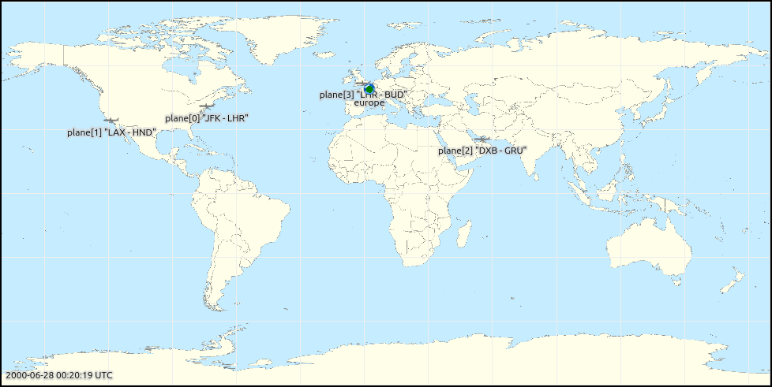
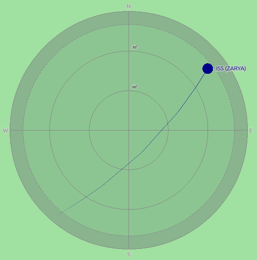

Geographic Mobility: Aircraft and Satellites
============================================

Goals
-----

Aircraft fly over the curved surface of the Earth, and satellites orbit around
it. A recorded flight gives positions as latitude, longitude and altitude, not as
x, y and z coordinates on a flat scene. It is a list of GNSS (Global Navigation
Satellite System) position fixes. A satellite orbit is published as a two-line
element set (TLE). Converting either one into waypoints on a flat scene by hand is
tedious, and straight segments between the waypoints miss the curvature of the
path.

INET has two mobility models that take this geographic data directly:
:ned:`GnssTrackMobility` replays a recorded track, and :ned:`SatelliteMobility`
computes an orbit from a TLE. A set of canvas visualizers draws the nodes on a
world map, together with their coverage footprints and their position in the sky
above a ground station.

In this showcase, we fly four planes between major airports and follow two
satellites, Vanguard 1 and the International Space Station (ISS).

| Verified with INET version: ``TODO``
| Source files location: `inet/showcases/mobility/geographic <https://github.com/inet-framework/inet/tree/master/showcases/mobility/geographic>`__

.. todo::

   The showcase is not in any release yet, and it needs the equirectangular
   Europe map image (commit c532ab3365 on topic/gy/europe-map-equirectangular).
   Fill in the version above, and change the ``inet-4.7`` release in the Try It
   Yourself ``opp_env`` commands, once a release contains them.

About Geographic Positions
--------------------------

A geographic position is a latitude, a longitude and a height above the WGS84
(World Geodetic System 1984) ellipsoid, the reference shape of the Earth that GNSS
receivers use. To compute distances, the position is converted into the
Earth-centered, Earth-fixed (ECEF) frame. This is a Cartesian frame with its
origin at the center of the Earth, and it rotates with the Earth.

The shortest path between two points on the Earth is a great circle. A map that
draws latitude and longitude as straight axes is an equirectangular map. On such a
map, most great circles appear curved; only the meridians and the equator are
straight lines. A flight from New York to London first heads north-east, passes
north of both airports over the Atlantic, and then turns east-south-east toward
London.

A GNSS track is a sequence of position fixes, usually with a time stamp for each
fix. Common formats are CSV (comma-separated values), GPX (GPS Exchange Format,
where GPS is the Global Positioning System) and GeoJSON. GeoJSON has no standard
field for time stamps.

A two-line element set (TLE) describes an orbit by its mean orbital elements at
one moment, the epoch of the TLE. The SGP4 (Simplified General Perturbations 4)
model computes the satellite's position at other times from these elements. It
includes the effects of the Earth's flattening and of atmospheric drag. For orbits
with a period of 225 minutes or more, its deep-space variant SDP4 is used. The
accuracy of SGP4 decreases as the time from the epoch grows, so a TLE is used
close to its epoch: the error is about 1 km at the epoch and grows by a few
kilometers per day. Organizations such as CelesTrak publish fresh TLEs every day.

The footprint of a node is the area of the Earth's surface from which the node is
above a minimum elevation angle (the elevation mask). The footprint grows with
altitude. A ground station sees a satellite only while the station is inside the
satellite's footprint. A sky view plots where the satellite is in the sky of the
station: its azimuth (the compass direction) and its elevation (the angle above
the horizon).

Geographic Mobility in INET
---------------------------

The nodes in this showcase share one coordinate system module, a
:ned:`Wgs84EcefGeographicCoordinateSystem`. It makes the scene coordinates ECEF
coordinates, so a node's scene position is its position relative to the center of
the Earth. Each mobility module finds this module through its
:par:`coordinateSystemModule` parameter. The map visualizer sets up a projection
from these positions onto the map image. A mobility module with
:par:`updateDisplayString` set to ``true`` places the icon of its node through this
projection, so the icon appears at the node's geographic position. The showcase
sets it for every node, because :ned:`SatelliteMobility` sets it to ``false`` by
default.

A stationary node, such as a ground station, uses a :ned:`StationaryMobility`
with the :par:`initialLatitude`, :par:`initialLongitude` and :par:`initialAltitude`
parameters, and with :par:`initFromDisplayString` and
:par:`updateFromDisplayString` set to ``false``. All altitudes
are heights above the WGS84 ellipsoid. GPX elevations are usually heights above
mean sea level, which differ from these by up to about 100 m.

:ned:`GnssTrackMobility` moves the node along the great circle between two fixes,
and changes the altitude linearly. Its main parameters are the following:

- :par:`trackData`: the track as CSV or GPX text, inline or from a file with
  ``readFile("track.csv")``. A CSV row is ``latitude,longitude,altitude,time``, in
  degrees, meters and seconds. Only the differences between the time stamps
  matter: the first fix is played at :par:`trackStartTime` (0 s by default).
- :par:`trackJson`: the track as a GeoJSON object, instead of :par:`trackData`,
  for example ``readJSON("track.geojson")``. Time stamps are read from a ``coordTimes`` array in the properties of the
  feature.
- :par:`speed`: a constant ground speed, used only when the track has no time
  stamps. With time stamps, the time stamps set the speed.
- :par:`loopMode`: the track plays once (``none``), repeats from the start
  (``repeat``), or plays forward and then backward (``pingPong``).

:ned:`SatelliteMobility` computes the orbit with SGP4. Its main parameters are the
following:

- :par:`tleData`: the TLE text, which can hold several satellites.
- :par:`satelliteName`, :par:`satelliteIndex` or :par:`satelliteCatalogNumber`:
  selects one satellite from the TLE text.
- :par:`epoch`: the date and time, in UTC (Coordinated Universal Time), that
  corresponds to the start of the simulation. The map visualizer has an
  :par:`epoch` parameter for its clock too, so the showcase sets both with
  ``**.epoch``.
- :par:`attitudeMode`: where the satellite points its forward axis, for example
  along its velocity.

.. note::

   :ned:`SatelliteMobility` converts the orbit into ECEF coordinates using the
   rotation of the Earth only. It ignores polar motion and the difference between
   UTC and UT1, the time given by the actual rotation of the Earth. The resulting
   position error is less than 1 km, far less than one pixel of the
   world map in this showcase (about 55 km).

Four canvas visualizers show the result:

- :ned:`GeoMapCanvasVisualizer` draws the map image, optionally a clock that shows
  the date and time, and sets up the projection that the other visualizers use.
- :ned:`MobilityCanvasVisualizer` draws the movement trails (and, optionally,
  positions, orientations and velocities) on that map.
- :ned:`GeoHorizonCanvasVisualizer` draws the footprints. Its elevation mask is 0°
  by default.
- :ned:`GeoSkyViewCanvasVisualizer` draws a sky view for each ground station.

In your own network, the :ned:`IntegratedCanvasVisualizer` has optional
``geoMapVisualizer``, ``geoHorizonVisualizer`` and ``geoSkyViewVisualizer``
submodules for these. They are enabled by setting their ``typename``.

These visualizers draw on the 2D canvas, so the showcase runs in a standard OMNeT++
build, without OpenSceneGraph (OSG) or osgEarth.

The Model and Results
---------------------

The showcase uses the :ned:`GeographicMobilityShowcase` network:

..
   FIGURE RECIPE
   type:     canvas
   config:   Aircraft, t=0
   shows:    world map with the four planes and the europe node
   capture:  set_canvas_view <root> zoom=1.352; get_canvas_image <root>
             area=module_rectangle margin=5; crop the 5 px margin (978x491)
   stamp:    recorded 2026-10, INET 4.7 (branch topic/gy/geographic-mobility-showcase)

The nodes contain only a mobility submodule: the showcase shows movement, not
communication. The configurations share the coordinate system and the world map:

.. literalinclude:: ../omnetpp.ini
   :start-at: coordinateSystem.typename
   :end-at: skyView.coordinateSystemModule
   :language: ini

The map starts at 170°W and ends 360° further east, at 190°E, which is 170°W
again. The edge of the map, where a trail wraps around, falls in the Pacific
Ocean, so only a trans-Pacific flight crosses it.

There are two configurations:

- ``Aircraft``: four planes replay GNSS tracks between major airports.
- ``Satellites``: the SGP4 model moves Vanguard 1 and the ISS, and two ground
  stations show them in their sky views.

Aircraft
~~~~~~~~

The four planes fly from New York to London (airport codes JFK and LHR), from Los
Angeles to Tokyo (LAX–HND), from Dubai to São Paulo (DXB–GRU), and from London to
Budapest (LHR–BUD). Each plane has a :ned:`GnssTrackMobility`. Here are the
mobility settings and the track of the New York–London (JFK–LHR) flight:

.. literalinclude:: ../omnetpp.ini
   :start-at: plane[*].mobility.typename
   :end-at: plane[0].mobility.trackData
   :language: ini

Each track has six rows: the departure airport twice (the plane waits 30 minutes
at the gate), the end of the climb at 10,000 m, the start of the descent, and the
arrival airport twice (the plane waits again). The climb and descent points lie on
or near the great circle between the two airports. The time stamps give an average speed
of about 250 m/s on all four routes. With ``pingPong``, each plane then flies the
track backward, so it waits for one hour at each turnaround: 30 minutes at the end
of the track and 30 minutes at the start of the reversed track.

The map clock starts at 2000-06-28 00:20:19 UTC. This is 5 hours 30 minutes after
the epoch of a year-2000 two-line element set (TLE) of Vanguard 1, 2000-06-27 18:50:19 UTC
(day 179.78495062 of 2000). The date affects only the clock.

When a plane climbs, its footprint grows to its cruising size (with the default
0° elevation mask). The trail of the
New York–London (JFK–LHR) flight curves north over the Atlantic: this is the great
circle, drawn on a flat map. The Los Angeles–Tokyo (LAX–HND) flight leaves the map
at its left edge and enters it again at the right edge. The trail skips the
segment that would cross the whole map, because the
:par:`movementTrailSegmentHideThreshold` parameter of the visualizer hides trail
segments longer than 100 pixels.

Here is a video of the world map during the first 11 hours (each trail shows the
recent path of one plane; the blue disks are the footprints):

.. video:: media/aircraft-world.mp4
   :width: 100%

..
   VIDEO RECIPE (frames grabbed one by one, not with record_video)
   config:   Aircraft
   seed:     default (the config uses no random numbers)
   shows:    JFK-LHR curving north and landing, LAX-HND wrapping from the left
             map edge to the right edge, DXB-GRU over Africa, footprints
   anchors:  JFK-LHR lands at 6.6 h; LAX-HND lands at 10.2 h (from the tracks)
   window:   t = 0 to 39600 s, step 120 s (331 frames)
   frames:   one get_canvas_image per step (MCP of the simulation itself,
             --mcp-server-address); before each, run_simulation mode=fast,
             inclusive, time_limit=<t>; skip the run at t=0 (0s = no limit)
   capture:  set_canvas_view <root> zoom=1.352; get_canvas_image <root>
             area=module_rectangle margin=5 (988x501)
   encode:   ffmpeg -framerate 15 -i f_%04d.png -vf crop=978:490:5:5
             -vcodec libx264 -pix_fmt yuv420p -crf 20
   stamp:    recorded 2026-10, INET 4.7 (branch topic/gy/geographic-mobility-showcase)

The ``europe`` node, placed on the world map near Paris, is an :ned:`EuropeMap`: a
compound module defined in the showcase, with its own map visualizer and its own
mobility, footprint, node and label visualizers. Double-clicking it in Qtenv opens
its canvas, the Europe map. Here is the same run on the Europe map during the first 7 hours. The
London–Budapest (LHR–BUD) flight stays inside the map, and the New York–London
(JFK–LHR) flight enters it from the west before it lands:

.. video:: media/aircraft-europe.mp4
   :width: 100%

..
   VIDEO RECIPE (frames grabbed one by one, not with record_video)
   config:   Aircraft
   seed:     default (the config uses no random numbers)
   shows:    LHR-BUD out, one hour turnaround in Budapest, back to London, out again;
             JFK-LHR arriving from the west
   anchors:  LHR-BUD lands in Budapest at 2.17 h, leaves again at 3.17 h;
             JFK-LHR lands at 6.6 h
   window:   t = 0 to 25200 s, step 60 s (421 frames)
   frames:   one get_canvas_image per step (MCP of the simulation itself,
             --mcp-server-address); before each, run_simulation mode=fast,
             inclusive, time_limit=<t>; skip the run at t=0 (0s = no limit)
   capture:  set_canvas_view europe zoom=1.0 (opens the inspector);
             get_canvas_image europe area=module_rectangle margin=5 (668x636)
   encode:   ffmpeg -framerate 15 -i f_%04d.png -vf crop=658:626:5:5
             -vcodec libx264 -pix_fmt yuv420p -crf 20
   stamp:    recorded 2026-10, INET 4.7 (branch topic/gy/geographic-mobility-showcase)

| New York to London: **5,541 km, flight time 6.1 hours**
| Northernmost point of the New York–London trail: **about 54°N**
| Footprint radius at cruising altitude: **about 360 km**

Satellites
~~~~~~~~~~

Each satellite has a :ned:`SatelliteMobility`. The two TLEs are from CelesTrak:

.. literalinclude:: ../satellites.tle

The epoch of a TLE is the fourth field of its first line, as a two-digit year and
a fractional day of the year: ``26298.976`` is day 298 of 2026, 23:25 UTC. Both
epochs are within a day of the start of the simulation. With fresh TLEs, change
the ``epoch`` of the simulation too:

.. literalinclude:: ../omnetpp.ini
   :start-at: **.epoch = "2026
   :end-at: satellite[1].display-name
   :language: ini

The ground stations in Lima and Los Angeles each have a sky view with a 10°
elevation mask. The sky view draws the band below the mask in grey, and a
satellite in that band as a faded dot. The footprints use the same elevation mask,
so a satellite is above the mask in the sky view of a station while the station
is inside the footprint of the satellite:

.. literalinclude:: ../omnetpp.ini
   :start-at: skyView.observerFilter
   :end-at: geoHorizon.elevationMask
   :language: ini

The ground track of a satellite is the path of the point directly below it. The
ground track of the ISS is a wave between about 52°N and 52°S, close to the
inclination of its orbit (51.6°). After each orbit, the wave is further west,
because the Earth has turned under the orbit in the meantime. Vanguard 1 is on an eccentric orbit, so
its altitude changes during each orbit, and its footprint grows and shrinks with
it.

The satellite visualizer keeps up to 1,700 trail sections (:par:`trailLength`),
instead of the default 100, so the trails keep several orbits. Here is a video of
the world map during the first 6 hours (each trail is the ground track of one satellite; the
arrows show the direction of flight):

.. video:: media/satellites-world.mp4
   :width: 100%

..
   VIDEO RECIPE (frames grabbed one by one, not with record_video)
   config:   Satellites
   seed:     default (the config uses no random numbers)
   shows:    ISS waves shifting west orbit by orbit (blue trail); Vanguard 1 on its
             slower, lower-inclination orbit (purple trail); footprints, arrows
   anchors:  ISS ascending-node crossings 92.8-93.0 min apart, 23.4-23.7 deg further
             west each orbit (from recorded positions of a full-length run)
   window:   t = 0 to 21600 s, step 60 s (361 frames)
   frames:   one get_canvas_image per step (MCP of the simulation itself,
             --mcp-server-address); before each, run_simulation mode=fast,
             inclusive, time_limit=<t>; skip the run at t=0 (0s = no limit)
   capture:  set_canvas_view <root> zoom=1.352; get_canvas_image <root>
             area=module_rectangle margin=5 (988x501)
   encode:   ffmpeg -framerate 15 -i f_%04d.png -vf crop=978:490:5:5
             -vcodec libx264 -pix_fmt yuv420p -crf 20
   stamp:    recorded 2026-10, INET 4.7 (branch topic/gy/geographic-mobility-showcase)

In Qtenv, the sky views are below the world map, in the order of the ground
stations: Lima on the left, Los Angeles on the right. A sky view labels a
satellite with its name in the TLE, here ``ISS (ZARYA)``. The center of a sky view is the zenith,
the rim is the horizon, and north is up. When the ISS passes over Los Angeles, it
rises above 10° elevation, crosses the sky of the station, and sets again a few
minutes later. Here is the sky view of Los Angeles near the end of the pass that
starts at about 8 hours 15 minutes. The ISS rose in the south-west, passed 71°
elevation, and is now at about 14° in the north-east:

..
   FIGURE RECIPE
   type:     canvas
   config:   Satellites, t=30060 s
   shows:    Los Angeles sky view, the ISS trail from SW through ~71 deg to the
             current dot at ~14 deg NE
   anchors:  ISS above 10 deg over Los Angeles from 29700 s to 30090 s, peak 71 deg
             at 29890 s (recorded positions of a full-length run)
   capture:  run_simulation mode=fast inclusive time_limit=30060s;
             set_canvas_view <root> zoom=3.5 center_x=871 center_y=1610;
             get_canvas_image <root> area=viewport margin=0 (1030x723);
             crop (236,180)-(766,716) around the right-hand plot
   stamp:    recorded 2026-10, INET 4.7 (branch topic/gy/geographic-mobility-showcase)

| ISS orbital period: **93 minutes**
| Westward shift of the ISS ground track per orbit: **about 23.5°**
| Vanguard 1 altitude: **about 650 km to 3,820 km**, footprint radius **about 1,850 km to 4,670 km**

Sources: :download:`omnetpp.ini <../omnetpp.ini>`, :download:`GeographicMobilityShowcase.ned <../GeographicMobilityShowcase.ned>`, :download:`satellites.tle <../satellites.tle>`

Try It Yourself
---------------

If you already have INET and OMNeT++ installed, start the IDE by typing
``omnetpp``, import the INET project into the IDE, then navigate to the
``inet/showcases/mobility/geographic`` folder in the `Project Explorer`. There, you can view
and edit the showcase files, run simulations, and analyze results.

Otherwise, there is an easy way to install INET and OMNeT++ using `opp_env
<https://omnetpp.org/opp_env>`__, and run the simulation interactively.
Ensure that ``opp_env`` is installed on your system, then execute:

.. code-block:: bash

    $ opp_env run inet-4.7 --init -w inet-workspace --install --build-modes=release --chdir \
       -c 'cd inet-4.7.*/showcases/mobility/geographic && inet'

This command creates an ``inet-workspace`` directory, installs the appropriate
versions of INET and OMNeT++ within it, and launches the ``inet`` command in the
showcase directory for interactive simulation.

Alternatively, for a more hands-on experience, you can first set up the
workspace and then open an interactive shell:

.. code-block:: bash

    $ opp_env install --init -w inet-workspace --build-modes=release inet-4.7
    $ cd inet-workspace
    $ opp_env shell

Inside the shell, start the IDE by typing ``omnetpp``, import the INET project,
then start exploring.

Discussion
----------

Use `this page <https://github.com/inet-framework/inet-showcases/issues/TODO>`__ in
the GitHub issue tracker for commenting on this showcase.

.. TODO: create the tracker issue for this showcase and replace the link above
