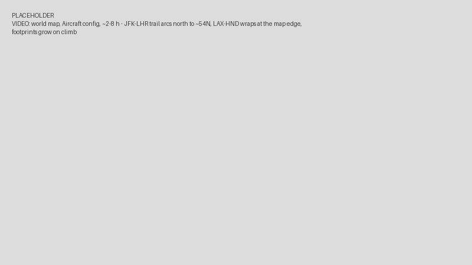

Geographic Mobility: Aircraft and Satellites
============================================

Goals
-----

Aircraft fly over the curved surface of the Earth, and satellites orbit around
it. A recorded flight gives positions as latitude, longitude and altitude, not as
x, y and z coordinates on a flat scene. It is a list of GNSS (Global Navigation
Satellite System) position fixes. A satellite orbit is published as a two-line
element set (TLE). Converting either one into waypoints on a flat scene by hand is
tedious, and straight segments between the waypoints miss the curvature of the
path.

INET has two mobility models that take this geographic data directly:
:ned:`GnssTrackMobility` replays a recorded track, and :ned:`SatelliteMobility`
computes an orbit from a TLE. A set of canvas visualizers draws the nodes on a
world map, together with their coverage footprints and their position in the sky
above a ground station.

In this showcase, we fly four planes between major airports and follow two
satellites, Vanguard 1 and the International Space Station (ISS).

| Verified with INET version: ``4.7``
| Source files location: `inet/showcases/mobility/geographic <https://github.com/inet-framework/inet/tree/master/showcases/mobility/geographic>`__

About Geographic Positions
--------------------------

A geographic position is a latitude, a longitude and a height above the WGS84
(World Geodetic System 1984) ellipsoid, the reference shape of the Earth that GNSS
receivers use. To compute distances, the position is converted into the
Earth-centered, Earth-fixed (ECEF) frame. This is a Cartesian frame with its
origin at the center of the Earth, and it rotates with the Earth.

The shortest path between two points on the Earth is a great circle. A map that
draws latitude and longitude as straight axes is an equirectangular map. On such a
map, most great circles appear curved; only the meridians and the equator are
straight lines. A flight from New York to London first heads north-east, passes
north of both airports over the Atlantic, and then turns south-east toward London.

A GNSS track is a sequence of position fixes, usually with a time stamp for each
fix. Common formats are CSV (comma-separated values), GPX (GPS Exchange Format,
where GPS is the Global Positioning System) and GeoJSON.

A two-line element set (TLE) describes an orbit by its mean orbital elements at
one moment, the epoch of the TLE. The SGP4 (Simplified General Perturbations 4)
model computes the satellite's position at other times from these elements. It
includes the effects of the Earth's flattening and of atmospheric drag. The
accuracy of SGP4 decreases as the time from the epoch grows, so a TLE is used
close to its epoch. Organizations such as CelesTrak publish fresh TLEs every day.

The footprint of a node is the area of the Earth's surface from which the node is
above a minimum elevation angle (the elevation mask). The footprint grows with
altitude. A ground station sees a satellite only while the station is inside the
satellite's footprint. A sky view plots where the satellite is in the sky of the
station: its azimuth (the compass direction) and its elevation (the angle above
the horizon).

Geographic Mobility in INET
---------------------------

All nodes in this showcase share one coordinate system module, a
:ned:`Wgs84EcefGeographicCoordinateSystem`. It makes the scene coordinates ECEF
coordinates, so a node's scene position is its position relative to the center of
the Earth. Each mobility module finds this module through its
:par:`coordinateSystemModule` parameter.

:ned:`GnssTrackMobility` moves the node along the great circle between two fixes,
and changes the altitude linearly. Its main parameters are the following:

- :par:`trackData`: the track as CSV or GPX text. A CSV row is
  ``latitude,longitude,altitude,time``.
- :par:`trackJson`: the track as a GeoJSON object, instead of :par:`trackData`.
- :par:`speed`: a constant ground speed, used only when the track has no time
  stamps. With time stamps, the time stamps set the speed.
- :par:`loopMode`: the track plays once (``none``), repeats from the start
  (``repeat``), or plays forward and then backward (``pingPong``).

:ned:`SatelliteMobility` computes the orbit with SGP4. Its main parameters are the
following:

- :par:`tleData`: the TLE text, which can hold several satellites.
- :par:`satelliteName`, :par:`satelliteIndex` or :par:`satelliteCatalogNumber`:
  selects one satellite from the TLE text.
- :par:`epoch`: the date and time, in UTC (Coordinated Universal Time), that
  corresponds to the start of the simulation.
- :par:`attitudeMode`: where the satellite points its forward axis, for example
  along its velocity.

.. note::

   :ned:`SatelliteMobility` converts the orbit into ECEF coordinates using the
   rotation of the Earth only. It ignores polar motion and the difference between
   UTC and UT1, the time given by the actual rotation of the Earth. The resulting
   position error is at most a few hundred meters, far less than one pixel of the
   world map in this showcase (about 55 km).

Four canvas visualizers show the result:

- :ned:`GeoMapCanvasVisualizer` draws the map image, optionally a clock that shows
  the date and time, and sets up the projection that the other visualizers use. A
  map can contain further, more detailed maps; double-clicking one in Qtenv opens
  it.
- :ned:`MobilityCanvasVisualizer` draws the movement trails (and, optionally,
  positions, orientations and velocities) on that map.
- :ned:`GeoHorizonCanvasVisualizer` draws the footprints.
- :ned:`GeoSkyViewCanvasVisualizer` draws a sky view for each ground station.

These visualizers draw on the 2D canvas, so the showcase runs in a standard OMNeT++
build, without OpenSceneGraph (OSG) or osgEarth.

The Model and Results
---------------------

The showcase uses the :ned:`GeographicMobilityShowcase` network:

The nodes contain only a mobility submodule: the showcase shows movement, not
communication. The configurations share the coordinate system and the world map:

.. literalinclude:: ../omnetpp.ini
   :start-at: coordinateSystem.typename
   :end-at: map.maxLongitude
   :language: ini

The map starts at 170°W. The edge of the map, where a trail wraps around, falls in
the Pacific Ocean, so only a trans-Pacific flight crosses it.

There are two configurations:

- ``Aircraft``: four planes replay GNSS tracks between major airports.
- ``Satellites``: the SGP4 model moves Vanguard 1 and the ISS, and two ground
  stations show them in their sky views.

Aircraft
~~~~~~~~

The four planes fly from New York to London (airport codes JFK and LHR), from Los
Angeles to Tokyo (LAX–HND), from Dubai to São Paulo (DXB–GRU), and from London to
Budapest (LHR–BUD). Each plane has a :ned:`GnssTrackMobility`. Here are the
mobility settings and the track of the New York–London (JFK–LHR) flight:

.. literalinclude:: ../omnetpp.ini
   :start-at: plane[*].mobility.typename
   :end-at: plane[0].mobility.trackData
   :language: ini

Each track has six rows: the departure airport twice (the plane waits 30 minutes
at the gate), the end of the climb at 10,000 m, the start of the descent, and the
arrival airport twice (the plane waits again). The climb and descent points lie on
the great circle between the two airports. The time stamps give an average speed
of about 250 m/s on all four routes. With ``pingPong``, each plane then flies the
track backward.

When a plane climbs, its footprint grows to its cruising size. The trail of the
New York–London (JFK–LHR) flight curves north over the Atlantic: this is the great
circle, drawn on a flat map. The Los Angeles–Tokyo (LAX–HND) flight leaves the map
at its left edge and enters it again at the right edge. The trail skips the
segment that would cross the whole map.

Here is a video of the world map (each trail shows the recent path of one plane;
the blue disks are the footprints):

The ``europe`` node is a second map, an :ned:`EuropeMap`, placed on the world map
near Paris. Here is the same run on the Europe map, where the London–Budapest
(LHR–BUD) flight stays inside the map:

| New York to London: **5,541 km, flight time 6.1 hours**
| Northernmost point of the New York–London trail: **about 54°N**
| Footprint radius at cruising altitude: **about 360 km**

.. note::

   The Budapest icon on the Europe map is a third map: double-clicking it shows
   the streets of the Óbuda district from OpenStreetMap.

Satellites
~~~~~~~~~~

Each satellite has a :ned:`SatelliteMobility`. The two TLEs are in
:download:`satellites.tle <../satellites.tle>`, and their epochs are within a day
of the start of the simulation:

.. literalinclude:: ../omnetpp.ini
   :start-at: **.epoch = "2026
   :end-at: satellite[1].display-name
   :language: ini

The ground stations in Lima and Los Angeles each have a sky view, which ignores
satellites below 10° elevation:

.. literalinclude:: ../omnetpp.ini
   :start-at: skyView.observerFilter
   :end-at: skyView.elevationMask
   :language: ini

The ground track of a satellite is the path of the point directly below it. The
ground track of the ISS is a wave between 51.6°N and 51.6°S, the inclination of
its orbit. After each orbit, the wave is further west, because the Earth has
turned under the orbit in the meantime. Vanguard 1 is on an eccentric orbit, so
its altitude changes during each orbit, and its footprint grows and shrinks with
it.

Here is a video of the world map (each trail is the ground track of one satellite;
the arrows show the direction of flight):

Each sky view shows the satellites that are above 10° elevation at the station.
When the ISS passes over Los Angeles, it rises above 10° elevation, crosses the
sky of the station, and sets again a few minutes later. Here is the sky view of
Los Angeles during such a pass:

| ISS orbital period: **93 minutes**
| Westward shift of the ISS ground track per orbit: **about 23°**
| Vanguard 1 altitude: **about 660 km to 3,830 km**, footprint radius **about 2,800 km to 5,700 km**

Sources: :download:`omnetpp.ini <../omnetpp.ini>`, :download:`GeographicMobilityShowcase.ned <../GeographicMobilityShowcase.ned>`, :download:`satellites.tle <../satellites.tle>`

Try It Yourself
---------------

If you already have INET and OMNeT++ installed, start the IDE by typing
``omnetpp``, import the INET project into the IDE, then navigate to the
``inet/showcases/mobility/geographic`` folder in the `Project Explorer`. There, you can view
and edit the showcase files, run simulations, and analyze results.

Otherwise, there is an easy way to install INET and OMNeT++ using `opp_env
<https://omnetpp.org/opp_env>`__, and run the simulation interactively.
Ensure that ``opp_env`` is installed on your system, then execute:

.. code-block:: bash

    $ opp_env run inet-4.7 --init -w inet-workspace --install --build-modes=release --chdir \
       -c 'cd inet-4.7.*/showcases/mobility/geographic && inet'

This command creates an ``inet-workspace`` directory, installs the appropriate
versions of INET and OMNeT++ within it, and launches the ``inet`` command in the
showcase directory for interactive simulation.

Alternatively, for a more hands-on experience, you can first set up the
workspace and then open an interactive shell:

.. code-block:: bash

    $ opp_env install --init -w inet-workspace --build-modes=release inet-4.7
    $ cd inet-workspace
    $ opp_env shell

Inside the shell, start the IDE by typing ``omnetpp``, import the INET project,
then start exploring.

Discussion
----------

Use `this <https://github.com/inet-framework/inet/discussions>`__ page in the GitHub issue tracker for commenting on this showcase.
