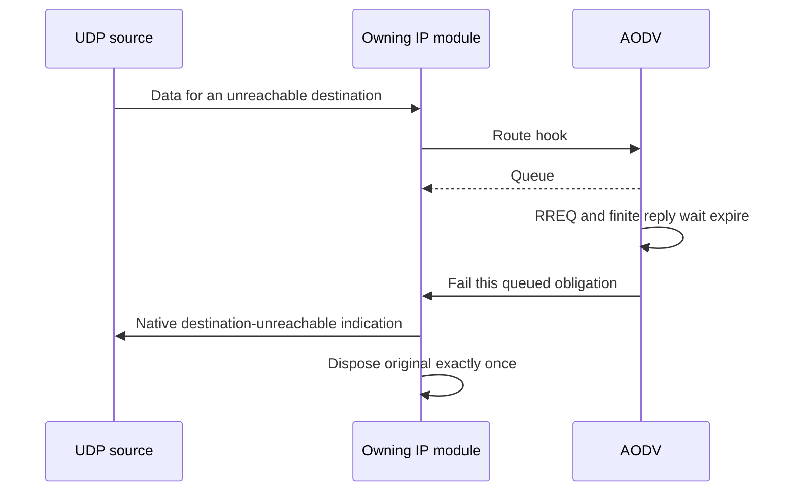

# Discovery failure notifications

When bounded originating discovery cannot find a route, the application should learn that its datagram could not be sent. The AODV caller asks the owning IP module to fail the queued obligation. IP creates the native error indication and disposes of the original packet; AODV does not manufacture a socket callback or take the packet away from IP.

These C3 cases use the real AODV hooks, native IPv4/IPv6, UDP and AckingMac. `AodvFeatureSource` binds port 12345 and sends tracked datagrams to port 9999. On each native UDP error it checks the ICMP type/code, quoted original destination and quoted ports. The scripted peer observes emitted requests and received data; it never calls a private AODV handler. Run 0 uses seed 0, fixed positions and zero AODV jitter.



All file names below have prefix `Rfc3561DiscoveryFailureNotification` and suffix `.test`.

| Case | Initial condition and observation |
| --- | --- |
| Ipv4Udp | Two absent IPv4 targets. Observe two logical RREQs and two Host Unreachable socket indications, each quoting its own target and original ports. No data is received. |
| Ipv6Udp | Repeat with native IPv6 and ND. The two indications are Destination Unreachable / No Route. |
| SharedOwner | Two external IPv4 members share one configured gateway search. One request owner exhausts, but each original datagram receives an error naming its actual member destination. |
| RecoveryThenExhaustion | Crash and restart the native IPv6 node. Submit data during the recovery hold, then let discovery exhaust. Errors occur through the normal path after recovery rather than bypassing its hold. |
| Recovered | The scripted peer answers the one IPv4 demand. The actual datagram reaches the peer, and the application receives no error. |
| StopCrash | Crash the node while two originating searches still wait for replies. Both source obligations are destroyed and no application indication or data emission is observed. |
| RepairFailure | Learn a native IPv6 transit route, observe its native RREP-ACK while the next hop is reachable, then establish the reverse source path in a separate phase. Switch off the old next-hop radio and submit two transit packets. Actual MAC failure starts local repair. Its timeout produces RERR while the local source receives no originating-discovery indication. ICMPv6 errors are not substituted for the transit RERR. |

`Rfc3561DiscoveryExhaustion.test` and `Rfc3561GatewayFailure.test` keep the original ownership cases and now require the two native application indications. The latter shares one owner across two external destinations. Their old expectation of zero errors is intentionally updated with the C3 behavior change.

The C2 parent has the shared failure operation but AODV still uses deletion-only disposal on exhaustion, so the new socket-error assertions are expected to distinguish C3. That comparison is source-based until identical fixtures run on both revisions. The recovery/repair and successful-route cases are controls for the termination classification, not additional claims that every parent necessarily fails.

```sh
flock /tmp/inet-aodv-test-runner.lock opp_run_protocol_tests --load . -p inet -m debug --no-build --no-concurrent -w '^tests/protocol/aodv$' -f 'Rfc3561(DiscoveryFailureNotification[A-Za-z0-9_]+|DiscoveryExhaustion|GatewayFailure)\.test$'
```

Execution status: **PASS**, matching debug build after the protocol ownership audit, General/run 0/seed 0. Library SHA256: `bcb9f5d13fa867ddca91b87c45121fe280c38c2a6042d8fc4b830e7d777e1011`; build log: `/tmp/aodv-owned-protocol-debug-build.log`. All seven new cases plus `DiscoveryExhaustion` and `GatewayFailure` passed in the 35-case affected selection, exit 0, `/tmp/aodv-c345-owned-protocol.log`. Generated output was copied under the runner lock to `/tmp/aodv-c345-owned-protocol-artifacts`. `RepairFailure` explicitly reported local errors 0, RERR 1, peer ICMP 0. The diagram rendered successfully in `/home/miguel/workspace/ai-logs/executions/aodv-diagrams-20261114/results.json`. Identical parent execution remains **NOT_RUN**.

The standalone feature-helper C++ syntax check passed. The tracked-source destruction count does not establish the owning DUT's transit-queue destructor path after a radio transmission copy; existing local-repair ownership fixtures remain necessary for that separate claim. These deterministic cases do not establish application retry policy or a statistical mobility result.
